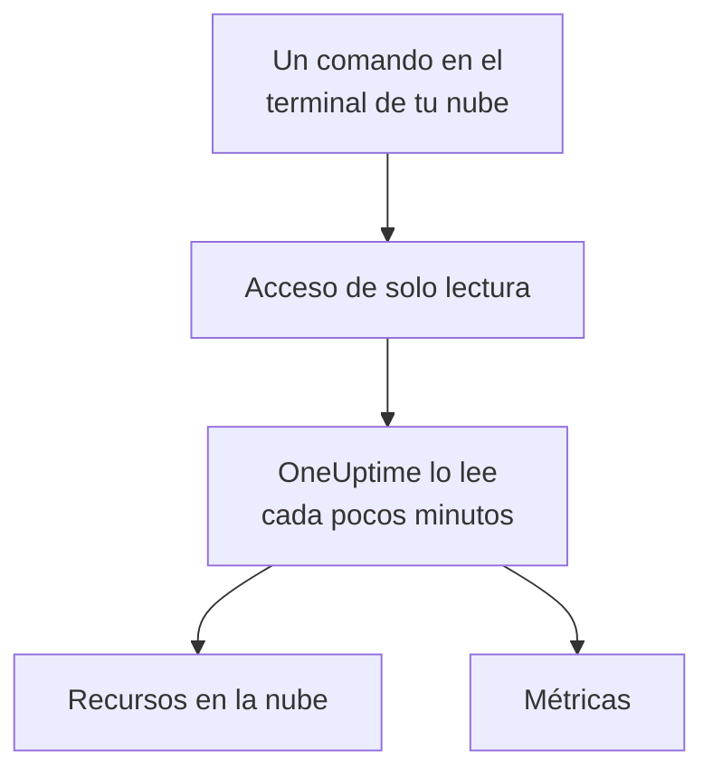

# Conectar una cuenta en la nube

Conecta una cuenta de AWS, una suscripción de Azure o un proyecto de Google Cloud desde el panel, y OneUptime enumera sus recursos y lee sus métricas clave según una programación. Ejecutas un comando en el terminal del navegador de tu nube y pegas lo que imprime: no hay ningún recopilador que ejecutar ni nada que instalar.

:::cards
- [Amazon Web Services](#amazon-web-services): Un rol de IAM con el que OneUptime inicia sesión, o una clave de acceso.
- [Microsoft Azure](#microsoft-azure): Una aplicación con el rol Monitoring Reader.
- [Google Cloud](#google-cloud): Una cuenta de servicio con el rol Monitoring Viewer.
- [Qué lee OneUptime](#qué-lee-oneuptime): Qué recursos y métricas, con qué frecuencia y cuánto cuesta.
:::

## Cómo funciona



- **El acceso solo puede leer.** El comando crea un acceso que lee métricas y nada más: tres acciones de lectura en AWS, el rol **Monitoring Reader** en Azure y el rol **Monitoring Viewer** en Google Cloud. Elimínalo para cortar el acceso de OneUptime.
- **OneUptime lee según una programación.** Cada 5 minutos para Azure y Google Cloud, y cada 10 minutos para AWS, salvo que elijas otro intervalo al conectar.
- **Cada recurso tiene su propia página.** Los recursos aparecen en **Nube → Todos los recursos** con sus métricas clave, propietarios y etiquetas, como los recursos que informa un recopilador.

## Antes de empezar

- **Un propietario o administrador del proyecto.** Solo ellos pueden conectar, probar y editar cuentas en la nube.
- **El terminal de tu nube** (AWS CloudShell, Azure Cloud Shell o Google Cloud Shell), con una sesión iniciada por alguien que pueda crear un rol o usuario de IAM, un registro de aplicación o una cuenta de servicio.

## Amazon Web Services

:::steps
### Abrir el formulario de AWS

Ve a **Nube → Conectar** y elige **Amazon Web Services**.

### Ejecutar el comando en AWS CloudShell

Elige cómo inicia sesión OneUptime. Un **Rol de IAM** es la forma recomendada: no se guarda nada secreto y puedes eliminar el rol en cualquier momento. El formulario muestra el comando escrito para tu proyecto: crea un rol que confía en la cuenta de AWS de OneUptime con el ID externo de tu proyecto, e imprime el ARN del rol. Usa una **Clave de acceso** cuando no sea posible usar un rol. Este comando crea un usuario con los mismos permisos e imprime su clave:

```bash
aws iam create-user --user-name OneUptimeReadOnly > /dev/null 2>&1 || true
aws iam put-user-policy --user-name OneUptimeReadOnly --policy-name OneUptimeReadOnly --policy-document '{"Version":"2012-10-17","Statement":[{"Effect":"Allow","Action":["cloudwatch:GetMetricData","cloudwatch:ListMetrics","tag:GetResources"],"Resource":"*"}]}'
aws iam create-access-key --user-name OneUptimeReadOnly
```

### Pegar lo que imprimió el comando de AWS

Pega todo lo que imprimió el comando en **Lo que imprimió el comando**. OneUptime extrae el ARN del rol, o el ID de clave de acceso y su secreto.

### Probar y conectar AWS

OneUptime prueba la conexión al abrirse este paso: inicia sesión, cuenta los recursos que encuentra y dice cuánto cuesta leerlos. Selecciona **Conectar** para guardar.
:::

El rol y el usuario pueden hacer tres cosas, y nada más:

| Acción | Para qué la usa OneUptime |
| --- | --- |
| `cloudwatch:ListMetrics` | Encontrar los recursos que informan métricas, en cada región |
| `cloudwatch:GetMetricData` | Leer sus métricas clave |
| `tag:GetResources` | Nombrar cada recurso por su etiqueta `Name` |

> [!NOTE]
> En un OneUptime autoalojado, la forma **Rol de IAM** necesita una identidad de AWS propia de OneUptime: define `CLOUD_CONNECT_AWS_ACCESS_KEY_ID` y `CLOUD_CONNECT_AWS_SECRET_ACCESS_KEY` con la clave de un usuario de IAM que pueda llamar a `sts:AssumeRole`. Sin ellas, el formulario ofrece una **Clave de acceso**.

## Microsoft Azure

:::steps
### Abrir el formulario de Azure

Ve a **Nube → Conectar** y elige **Microsoft Azure**.

### Ejecutar el comando en Azure Cloud Shell

El comando crea una aplicación con el rol **Monitoring Reader** en tu suscripción actual, e imprime sus datos:

```bash
az ad sp create-for-rbac --name OneUptimeReadOnly --role "Monitoring Reader" --scopes "/subscriptions/$(az account show --query id --output tsv)"
```

### Pegar lo que imprimió el comando de Azure

Pega todo lo que imprimió el comando en **Lo que imprimió el comando**. OneUptime extrae `tenant`, `appId` y `password`.

### Probar y conectar Azure

OneUptime prueba la conexión al abrirse este paso. Selecciona **Conectar** para guardar.
:::

Para leer más suscripciones con la misma aplicación, dale el rol en cada una de ellas:

```bash
az role assignment create --assignee <APP_ID> --role "Monitoring Reader" --scope /subscriptions/<SUBSCRIPTION_ID>
```

OneUptime lee todas las suscripciones que la aplicación puede leer, salvo que indiques algunas en **Suscripciones**.

## Google Cloud

:::steps
### Abrir el formulario de Google Cloud

Ve a **Nube → Conectar** y elige **Google Cloud**.

### Ejecutar el comando en Google Cloud Shell

Ejecútalo en el proyecto que quieres monitorear. Activa la API de Cloud Monitoring, crea una cuenta de servicio con el rol **Monitoring Viewer** e imprime su clave:

```bash
PROJECT_ID=$(gcloud config get-value project)
gcloud services enable monitoring.googleapis.com
gcloud iam service-accounts create oneuptime-read-only --display-name "OneUptime (read only)"
gcloud projects add-iam-policy-binding "$PROJECT_ID" --member "serviceAccount:oneuptime-read-only@$PROJECT_ID.iam.gserviceaccount.com" --role roles/monitoring.viewer --condition=None > /dev/null
gcloud iam service-accounts keys create oneuptime-key.json --iam-account "oneuptime-read-only@$PROJECT_ID.iam.gserviceaccount.com"
cat oneuptime-key.json && rm oneuptime-key.json
```

### Pegar la clave

Pega todo lo que imprimió el comando. OneUptime lee el propio proyecto de la clave y guarda la clave cifrada.

### Probar y conectar Google Cloud

OneUptime prueba la conexión al abrirse este paso. Selecciona **Conectar** para guardar.
:::

Para leer más proyectos con la misma cuenta de servicio, dale el rol en cada uno de ellos e indícalos en **Proyectos**:

```bash
gcloud projects add-iam-policy-binding <PROJECT_ID> --member "serviceAccount:oneuptime-read-only@<KEY_PROJECT_ID>.iam.gserviceaccount.com" --role roles/monitoring.viewer
```

## Qué lee OneUptime

| | AWS | Azure | Google Cloud |
| --- | --- | --- | --- |
| Recursos | Los que informan métricas a CloudWatch, en cada región que usas | Todos los recursos de las suscripciones | Los que informan métricas a Cloud Monitoring |
| Métricas | Las métricas clave de cada servicio, como la CPU, la red y las comprobaciones de estado de una instancia | Hasta 8 métricas clave por recurso | Las métricas clave de cada tipo de recurso |
| Se lee cada | 10 minutos | 5 minutos | 5 minutos |
| Un recurso eliminado | Se archiva tras 7 días sin métricas | Se archiva en la siguiente lectura | Se archiva tras 7 días sin métricas |

Cada lectura continúa donde se detuvo la anterior, así que cada punto de datos se escribe una sola vez. La primera lectura de una conexión nueva empieza en menos de un minuto y retrocede una hora; tras una pausa, una lectura retrocede como mucho 6 horas.

Las llamadas de OneUptime se facturan a tu cuenta en la nube, a los precios de tu nube. La prueba estima el coste de lo que encuentra, y leer con menos frecuencia cuesta menos: cambia **Frecuencia de lectura de métricas** en **Más campos**.

| Nube | Precio |
| --- | --- |
| AWS | CloudWatch `GetMetricData`: $0.01 por cada 1,000 métricas, y cada métrica clave de un recurso es una métrica por lectura |
| Azure | Las primeras 1,000,000 lecturas de métricas al mes de cada suscripción son gratuitas; después, $0.01 por cada 1,000 |
| Google Cloud | Las primeras 1,000,000 series temporales leídas al mes son gratuitas; después, $0.50 por millón |

## Solución de problemas

:::details La prueba dice que no se aceptó la clave o el secreto
Copia todo lo que imprimió el comando y vuelve a pegarlo. Una clave creada hace un minuto puede tardar un minuto en funcionar.
:::

:::details La prueba inicia sesión, pero no puede leer
Vuelve a ejecutar el comando: otorga el rol que OneUptime necesita. En AWS, ejecuta el comando que el formulario muestra para este proyecto: un rol creado para otro proyecto confía en el ID externo de ese proyecto, no en el de este.
:::

:::details Google Cloud no deja que el comando cree una clave
Una política de la organización, `iam.disableServiceAccountKeyCreation`, puede prohibir las claves de cuentas de servicio. Pide al administrador de tu organización una excepción para el proyecto, o [envía las métricas con tu propio recopilador](/docs/telemetry/cloud-resources).
:::

:::details No aparecen recursos
En AWS y Google Cloud, un recurso aparece cuando informa métricas. Si una conexión no funciona, **Ver error** en **Nube → Conectar** indica por qué falló su última lectura.
:::

## Próximos pasos

:::cards
- [Recursos en la nube](/docs/telemetry/cloud-resources): Ejecuta tu propio OpenTelemetry Collector en su lugar, o transmite las métricas de CloudWatch.
- [Monitor de métricas](/docs/monitor/metrics-monitor): Crea alertas sobre las métricas de un recurso.
:::
