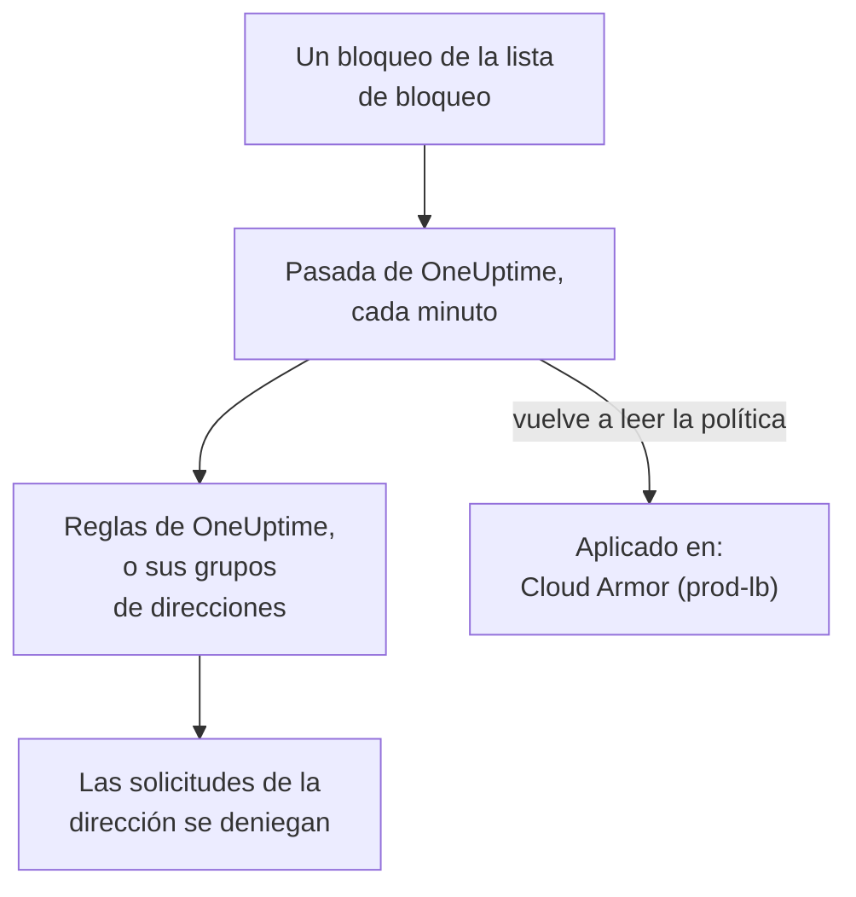

# Bloquear direcciones en Cloud Armor

La lista de bloqueo de tu proyecto puede aplicarse en las políticas de seguridad de Google Cloud Armor de tus balanceadores de carga. Actívala en una conexión de Google Cloud que ya tengas, elige las políticas de seguridad y cada dirección que bloquee la lista de bloqueo quedará bloqueada allí, tanto si la bloqueó una persona como un playbook u OneUptime AI.

:::cards
- [Activación](#activación): Un ajuste en la conexión de Google Cloud, y el rol que necesita.
- [Qué crea OneUptime](#qué-crea-oneuptime): Reglas propias en cada política, o grupos de direcciones con Cloud Armor Enterprise.
- [Qué dirección se compara](#qué-dirección-se-compara): La dirección que se conectó, o la IP de usuario detrás de un proxy.
:::

## Cómo funciona

OneUptime mantiene reglas propias en cada política de seguridad que elijas, y pone en ellas las direcciones que bloquea la lista de bloqueo. Cada minuto cambia lo que ha cambiado, una regla cada vez, y después vuelve a leer la política. En la página **Lista de bloqueo**, la columna **Aplicado en** de un bloqueo solo nombra Cloud Armor (prod-lb) cuando la política contiene el bloqueo; hasta entonces, el bloqueo no se aplica.

## Antes de empezar

- Un proyecto de Google Cloud conectado a OneUptime (consulta [Conectar una cuenta en la nube](/docs/telemetry/cloud-accounts#google-cloud)).
- Un rol que pueda cambiar dónde se aplica la lista de bloqueo: **Propietario del proyecto**, **Administrador del proyecto** o **Administrador de seguridad**.
- Alguien que pueda crear roles y concederlos en el proyecto de Google Cloud, para ejecutar un comando en Cloud Shell.

## Activación

:::steps
### Abrir la conexión
Abre **Nube → Conectar** y edita la conexión de Google Cloud.

### Activar el ajuste
En **Más campos**, cambia **Bloquear direcciones en Cloud Armor** a **Activado** y guarda. El comando de configuración que muestra el formulario concede ahora el rol de abajo allí donde concede los demás. Una conexión que ya tengas no necesita volver a ejecutarlo: el cuadro de diálogo **Añadir WAF** da las líneas que conceden el rol en el proyecto de la política.

### Añadir las políticas de seguridad
Abre **Eventos de seguridad → Playbooks → Lista de bloqueo**. En **WAF en la nube**, haz clic en **Añadir WAF** y elige una política de seguridad. OneUptime pregunta a Google Cloud si la conexión puede escribir en ella, sin escribir nada.

### Conceder el rol, si falta
Cuando falta un permiso, el cuadro de diálogo muestra las líneas que lo conceden en el proyecto de la política. Ejecútalas en Cloud Shell, haz clic en **Comprobar de nuevo** y después añade la política. Su **Estado** indica **Aplicada** en cuanto OneUptime la ha configurado.
:::

Las políticas de seguridad vienen del inventario de la conexión: una que OneUptime aún no ha leído aparece tras la siguiente lectura. Mientras una política aplica la lista de bloqueo, el ajuste de su conexión no se puede desactivar y la conexión no se puede eliminar: quita primero la política, para que OneUptime retire sus reglas.

## Qué crea OneUptime

OneUptime elige cómo contiene una política la lista de bloqueo cuando la añades.

| Qué | Nombre | Dónde |
| --- | --- | --- |
| Reglas que deniegan con 403, cada una con hasta 10 direcciones o rangos | Su descripción empieza por `OneUptime blocklist <project> #1`, `#2`, ... | En cada política elegida, como máximo 20. |
| Dos grupos de direcciones, IPv4 e IPv6 | `oneuptime-<project>-block-ipv4`, `oneuptime-<project>-block-ipv6` | Globales, en el proyecto de la política. Solo con Cloud Armor Enterprise. |
| Una regla que deniega con 403 lo que contenga cualquiera de los dos grupos | Su descripción empieza por `OneUptime blocklist <project>, address groups` | En cada política de backend global elegida, con Cloud Armor Enterprise. |

`<project>` son los ocho primeros caracteres del ID externo de tu proyecto, así que dos proyectos de OneUptime que eligen una misma política nunca escriben las reglas del otro. Cloud Armor solo nombra una regla por su prioridad, así que OneUptime reconoce sus propias reglas por su descripción.

- **Reglas.** Cloud Armor admite 10 direcciones o rangos en una regla, así que una política admite hasta 200 bloqueos en las 20 reglas de OneUptime; un bloqueo que no cabe lo indica en su fila.
- **Grupos de direcciones.** Una política de backend global de un proyecto con Cloud Armor Enterprise contiene en su lugar la lista de bloqueo en dos grupos de direcciones: 10,000 rangos IPv4 y 2,000 rangos IPv6. Todas las políticas de ese tipo del proyecto los comparten, y una regla en cada política deniega lo que contienen. Los grupos ocupan 16,000 unidades de la cuota de grupos de direcciones del proyecto.

OneUptime añade, cambia y elimina cada una de sus reglas por separado, con los métodos de reglas de Cloud Armor: nunca escribe la política entera ni escribe una regla tuya. Una dirección sola se escribe como `/32` o `/128`.

## El lugar de las reglas en la política

OneUptime coloca sus reglas en prioridades libres antes de tu primera regla que deja pasar una solicitud, empezando por la más baja, para que ninguna regla tuya deje pasar una dirección bloqueada: una regla que permite, limita la velocidad, prohíbe por tasa o reparte de forma equitativa. Una regla tuya que deniega puede ir antes. OneUptime nunca renumera, cambia ni elimina una regla tuya: cuando no hay ninguna prioridad libre antes de tu primera regla de ese tipo, la política indica **Sin prioridad libre**, y OneUptime añade su regla en cuanto liberes una.

## Qué dirección se compara

| Política de seguridad | Dirección del cliente | Cuándo elegirla |
| --- | --- | --- |
| Backend | **La dirección que se conectó al balanceador de carga (origin.ip)** | El valor predeterminado. |
| Backend | La IP de usuario de los encabezados de solicitud de la política (origin.user_ip) | Para un balanceador de carga detrás de otro proxy o CDN. |
| Perimetral | La dirección que se conectó al balanceador de carga (origin.ip) | La única opción: una política perimetral no lee ninguna otra dirección. |

`origin.user_ip` es la dirección de los encabezados de solicitud de IP de usuario de la política (`userIpRequestHeaders`), que escribe un proxy o CDN situado delante del balanceador de carga. Si no hay ninguno definido, o no contienen ninguna dirección válida, es `origin.ip`. Elige la IP de usuario solo si un proxy así los escribe, ya que un cliente que llega directamente al balanceador de carga puede escribirlos él mismo. La opción está en **Más campos** del cuadro de diálogo **Añadir WAF**, y puedes cambiarla más tarde con **Dirección del cliente** en la fila de la política.

Una política de seguridad perimetral de red, para los balanceadores de carga de red de transferencia, no se puede elegir, y el cuadro de diálogo **Añadir WAF** indica por qué: sus reglas coinciden con paquetes, no con solicitudes.

Las reglas de OneUptime en Cloud Armor solo deniegan. Un bloqueo que pide aplicar un desafío a una dirección no se aplica en Cloud Armor, y lo indica. El desafío de una política de respuesta automática se aplica allí como un bloqueo durante el mismo tiempo.

## Cuando una regla se cambia a mano

Cuando alguien pone una de las reglas de OneUptime en modo de vista previa, la cambia o la elimina, o elimina uno de sus grupos de direcciones, OneUptime lo deja tal como lo dejó esa persona. La política indica **Modificada a mano**, y los bloqueos que contenía no se aplican, con el motivo, hasta que alguien haga clic en **Restablecer** en la fila de la política. «Restablecer» vuelve a escribir la regla tal como la escribe OneUptime, en su propia prioridad mientras esté libre, y vuelve a crear un grupo de direcciones eliminado.

OneUptime no comprueba que una política esté asociada a un servicio de backend. Una política que no está asociada a ninguno no bloquea nada.

## Mantener una política en Terraform

Una `google_compute_security_policy` con bloques `rule` es dueña de todas las reglas de la política, así que su siguiente plan elimina las reglas de OneUptime. Mantén tus reglas como recursos `google_compute_security_policy_rule`, que no tocan las demás reglas, o añade `ignore_changes = [rule]` al bloque `lifecycle` de la política.

## Permisos

El comando de configuración añade un rol personalizado, `oneuptimeCloudArmorBlocklist`, allí donde concede los demás roles de la conexión, y lo concede a la cuenta de servicio de la conexión. Las líneas que muestra el cuadro de diálogo **Añadir WAF** añaden el mismo rol en el proyecto de la política. Una política en modo de reglas solo necesita sus propios permisos.

| Permiso | Por qué |
| --- | --- |
| `compute.securityPolicies.get`, `compute.securityPolicies.update` | Leer una política global y cambiar en ella las reglas de OneUptime. |
| `compute.regionSecurityPolicies.get`, `compute.regionSecurityPolicies.update` | Leer una política regional y cambiar en ella las reglas de OneUptime. |
| `compute.globalOperations.get`, `compute.regionOperations.get` | Esperar a que termine un cambio. |
| `compute.projects.get` | Leer si el proyecto tiene Cloud Armor Enterprise. |
| `networksecurity.addressGroups.get`, `networksecurity.addressGroups.list`, `networksecurity.addressGroups.create`, `networksecurity.addressGroups.update`, `networksecurity.addressGroups.delete`, `networksecurity.addressGroups.use` | Mantener los grupos de direcciones de OneUptime y hacer referencia a ellos desde su regla. Solo con Cloud Armor Enterprise. |
| `networksecurity.operations.get` | Esperar a que termine el cambio de un grupo de direcciones. |

El rol no puede eliminar una política, y OneUptime nunca escribe nada más. El comando de configuración también activa las API de Compute Engine y Network Security.

## Desactivación

:::steps
### Quitar la política de seguridad
En **Eventos de seguridad → Playbooks → Lista de bloqueo**, haz clic en **Eliminar** en la fila de la política. OneUptime retira sus reglas de la política, y elimina sus grupos de direcciones en cuanto ninguna otra política del proyecto los usa.

### Desactivar el ajuste
Edita la conexión, cambia **Bloquear direcciones en Cloud Armor** a **Desactivado** y guarda. El ajuste se puede desactivar en cuanto ninguna política de la conexión aplica la lista de bloqueo.
:::

Cuando OneUptime ya no pueda escribir en la política, marca **Quitar solo de OneUptime** en el cuadro de diálogo **Quitar WAF**. OneUptime quita la política de la lista de bloqueo y nombra las reglas y los grupos de direcciones que dejó: siguen bloqueando lo que contienen hasta que los elimines en Google Cloud.

## Solución de problemas

:::details No aplicada
El estado de la política dice qué respondió Google Cloud y qué hacer. Un rechazo nombra el permiso que falta: ejecuta las líneas que muestra **Añadir WAF** para la política y después haz clic en **Comprobar de nuevo**. Un rechazo por una cuota la nombra: pide más cuota a Google Cloud o elimina las reglas que ya no uses.
:::

:::details Sin prioridad libre
Todas las prioridades anteriores a tu primera regla que deja pasar una solicitud están ocupadas. Dale a esa regla un número más alto y después haz clic en **Comprobar de nuevo**.
:::

:::details Una política no aparece en la lista
OneUptime muestra las políticas de seguridad de las conexiones con el ajuste activado, una vez que las ha leído. Una política añadida desde entonces aparece tras la siguiente lectura de la conexión.
:::

## Próximos pasos

:::cards
- [Casos de seguridad y playbooks](/docs/telemetry/security-cases): Bloquea una dirección desde un caso y comprueba su paso.
- [Conectar una cuenta en la nube](/docs/telemetry/cloud-accounts): La conexión de la que forma parte este ajuste.
:::
