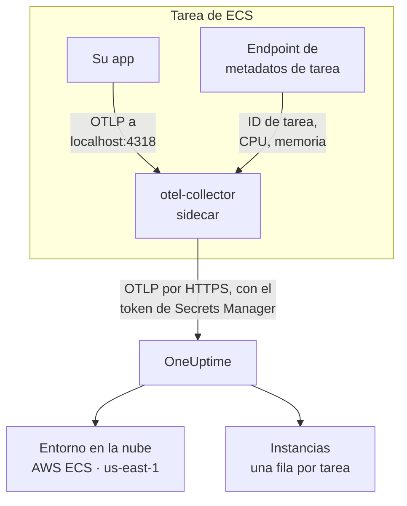

# AWS ECS / Fargate

Envíe las trazas, los registros y las métricas de sus tareas de Amazon ECS a OneUptime, tanto en el tipo de lanzamiento Fargate como en EC2. Cada tarea que informa `cloud.platform=aws_ecs` se une a un **Entorno en la nube** por cuenta de AWS y región, como _AWS ECS · us-east-1 · 123456789012_, tanto si ejecuta un servicio como cincuenta.

:::cards
- [Cómo funciona](#cómo-funciona): Qué hacen el detector de ECS y el colector sidecar.
- [Configurarlo](#configurarlo): Guardar el token, añadir los ajustes a la definición de tarea, desplegar y comprobar.
- [La definición de tarea completa](#la-definición-de-tarea-completa): Una definición de tarea de Fargate completa para registrar.
- [Solución de problemas](#solución-de-problemas): Tareas atascadas en PENDING, exportaciones rechazadas, instancias o mosaicos vacíos.
:::

## Cómo funciona



- **El detector de ECS nombra el entorno.** El detector de recursos de ECS de OpenTelemetry, en el SDK o en un colector, lee el endpoint de metadatos de tarea que ECS da a cada contenedor y pone la cuenta, la región y la tarea en todo lo que envía la tarea. Nada está fijado en el código.
- **La tarea nombra cada instancia.** La pestaña **Instancias** del entorno lista las tareas en ejecución por ID de tarea, con su CPU y su memoria.
- **Un colector sidecar añade CPU y memoria.** Su receptor `awsecscontainermetrics` lee la CPU y la memoria de cada tarea del mismo endpoint, y guarda el token para que la aplicación nunca lo vea.

El detector de ECS define estos atributos de recurso:

| Atributo | Definido por el detector de ECS | Para qué sirve |
| ------------------------------------------------------------------ | ----------------------- | --------------------------------------------------------------------------------------------------------- |
| `cloud.platform` | `aws_ecs` | Archiva la telemetría en **Entornos en la nube**. El valor debe ser exacto |
| `cloud.account.id` | `123456789012` | Parte de la clave de entorno |
| `cloud.region` | `us-east-1` | Parte de la clave de entorno |
| `aws.ecs.task.arn` | el ARN de la tarea | Nombra una tarea en ejecución en **Instancias**, por el ID de tarea de su final |
| `aws.ecs.task.id` | el ID de la tarea | Lo mismo; las versiones más recientes del detector definen ambos |
| `aws.ecs.cluster.arn`, `aws.ecs.task.family`, `aws.ecs.launchtype` | el clúster y la tarea | Se guardan en cada span, registro y métrica para que pueda buscar por ellos; no forman parte del entorno |

La clave de entorno es `aws_ecs|123456789012|us-east-1`. El ID de tarea nombra una instancia aunque el SDK también defina `service.instance.id`: las métricas de contenedor del sidecar solo llevan el ID de tarea, y usarlo como clave mantiene los spans de una tarea y su CPU y su memoria en una sola fila. La regla completa está en [Entornos en la nube](/docs/telemetry/cloud-environments).

## Antes de empezar

- **Una clave de ingesta.** Cree una clave **Servidor** en **Ajustes del proyecto → Telemetría y APM → Claves de ingesta** y copie su token.
- **Un clúster de ECS y una definición de tarea que pueda revisar**, y la AWS CLI configurada para esa cuenta.
- **Su aplicación instrumentada con un SDK de OpenTelemetry** que exporte OTLP, en cualquier lenguaje.

## Elegir cómo sale la telemetría de la tarea

| | Sidecar collector | SDK direct |
| ----------------------- | ---------------------------------------------- | ----------------------------------------------- |
| Contenedor adicional | `otel-collector` en cada tarea | Ninguno |
| CPU y memoria por tarea | Sí, del receptor `awsecscontainermetrics` | No |
| Guarda el token | El colector | La aplicación |
| El secreto contiene | Solo el token | El encabezado completo `x-oneuptime-token=...` |

La mayoría de los equipos usa el colector sidecar: pone los atributos `cloud.*` incluso en la telemetría de bibliotecas que no saben nada de ECS. SDK direct es la opción más sencilla para un único servicio. Cada paso de abajo tiene una pestaña para cada uno; elija una y cada paso la seguirá.

## Configurarlo

:::steps
### Guardar el token en Secrets Manager

> [!IMPORTANT]
> El token es un secreto. Guárdelo en AWS Secrets Manager y haga referencia a él desde la definición de tarea con `secrets` y `valueFrom`. Un token en una entrada `environment` normal es visible para cualquiera que pueda leer la definición de tarea, y aparece en cada salida de `describe-task-definition` y en cada diff de CloudFormation.

:::tabs
@tab Sidecar collector
```bash
aws secretsmanager create-secret \
  --name oneuptime/ingestion-token \
  --region us-east-1 \
  --secret-string "YOUR_TELEMETRY_INGESTION_TOKEN"
```

La configuración del colector añade el nombre del encabezado, así que este secreto contiene solo el token.
@tab SDK direct
```bash
aws secretsmanager create-secret \
  --name oneuptime/ingestion-token \
  --region us-east-1 \
  --secret-string "x-oneuptime-token=YOUR_TELEMETRY_INGESTION_TOKEN"
```

ECS pone el valor de un secreto tal cual en la variable, y `OTEL_EXPORTER_OTLP_HEADERS` necesita el par `name=value` completo, así que este secreto contiene el encabezado completo.
:::

Anote el ARN que imprime el comando. Termina en un sufijo aleatorio, como `oneuptime/ingestion-token-AbCdEf`, y lo pegará en la definición de tarea.

### Permitir que la tarea lea el secreto

El rol de ejecución de tareas (el rol con el que ECS inicia la tarea, no el rol con el que se ejecuta su código) necesita leer el secreto. Adjunte esta política a `ecsTaskExecutionRole`:

```json title="secret-access-policy.json"
{
  "Version": "2012-10-17",
  "Statement": [
    {
      "Effect": "Allow",
      "Action": ["secretsmanager:GetSecretValue"],
      "Resource": "arn:aws:secretsmanager:us-east-1:123456789012:secret:oneuptime/ingestion-token-*"
    }
  ]
}
```

Si una clave de KMS administrada por el cliente cifra el secreto, el rol también necesita `kms:Decrypt` sobre esa clave. Sin cualquiera de los dos, la tarea no arranca: se detiene con `ResourceInitializationError: unable to pull secrets`.

### Añadir los ajustes a la definición de tarea

:::tabs
@tab Sidecar collector
1. **AWS Console → Amazon Elastic Container Service → Task definitions** → seleccione la familia → **Create new revision**.
2. En **Container - 1** (su aplicación), despliegue **Environment variables** y añada las variables de la aplicación de abajo.
3. **+ Add container**: nombre `otel-collector`, imagen `otel/opentelemetry-collector-contrib:latest` (fije una versión cuando funcione), **Essential container: No**. En **Docker configuration → Command** escriba `--config=env:OTEL_COLLECTOR_CONFIG`.
4. En el contenedor del colector, añada la variable de entorno `ONEUPTIME_TOKEN` con **Value type: ValueFrom** y el ARN del secreto, y `OTEL_COLLECTOR_CONFIG` con **Value type: Value** y la configuración del colector de abajo.
5. En **Startup dependency ordering** del contenedor de la aplicación, añada `otel-collector` con la condición **Start**, para que la aplicación nunca arranque antes de que algo escuche en el puerto 4318.
6. En **Task execution role**, compruebe que es el rol al que adjuntó la política.

Variables de la aplicación. En el modo de red `awsvpc` (siempre, en Fargate) los contenedores de una tarea comparten una red, así que `localhost` es el sidecar:

```bash
OTEL_SERVICE_NAME=checkout-api
OTEL_EXPORTER_OTLP_ENDPOINT=http://localhost:4318
OTEL_EXPORTER_OTLP_PROTOCOL=http/protobuf
```

Configuración del colector. El colector la lee entera de la variable `OTEL_COLLECTOR_CONFIG`, así que no hay ningún archivo que incluir en una imagen, y resuelve `${env:ONEUPTIME_TOKEN}` a partir del secreto que ECS pone en su entorno:

```yaml title="OTEL_COLLECTOR_CONFIG"
receivers:
  otlp:
    protocols:
      http:
        endpoint: 0.0.0.0:4318
      grpc:
        endpoint: 0.0.0.0:4317
  # Per-task and per-container CPU / memory from the ECS task metadata
  # endpoint. This is what fills the CPU and memory tiles in OneUptime.
  awsecscontainermetrics:
    collection_interval: 20s
processors:
  # Stamps cloud.provider, cloud.platform=aws_ecs, cloud.account.id,
  # cloud.region and aws.ecs.task.arn on every span, log and metric.
  resourcedetection:
    detectors: [env, ecs]
    timeout: 5s
  batch: {}
exporters:
  otlphttp/oneuptime:
    endpoint: https://oneuptime.com/otlp
    headers:
      x-oneuptime-token: ${env:ONEUPTIME_TOKEN}
service:
  pipelines:
    traces:
      receivers: [otlp]
      processors: [resourcedetection, batch]
      exporters: [otlphttp/oneuptime]
    metrics:
      receivers: [otlp, awsecscontainermetrics]
      processors: [resourcedetection, batch]
      exporters: [otlphttp/oneuptime]
    logs:
      receivers: [otlp]
      processors: [resourcedetection, batch]
      exporters: [otlphttp/oneuptime]
```

Ni el detector `ecs` ni el receptor `awsecscontainermetrics` necesitan un permiso de IAM: ambos leen el endpoint de metadatos que ECS da a cada contenedor en `ECS_CONTAINER_METADATA_URI_V4`.
@tab SDK direct
1. **AWS Console → Amazon Elastic Container Service → Task definitions** → seleccione la familia → **Create new revision**.
2. En **Container - 1** (su aplicación), despliegue **Environment variables** y añada las variables de abajo. Añada `OTEL_EXPORTER_OTLP_HEADERS` con **Value type: ValueFrom** y el ARN del secreto como valor.
3. Añada el ajuste que activa el detector de recursos de ECS de su lenguaje, según la tabla de abajo.
4. En **Task execution role**, compruebe que es el rol al que adjuntó la política.

```bash
OTEL_SERVICE_NAME=checkout-api
OTEL_EXPORTER_OTLP_ENDPOINT=https://oneuptime.com/otlp
OTEL_EXPORTER_OTLP_PROTOCOL=http/protobuf
# Injected from Secrets Manager (secrets / valueFrom), not typed here.
OTEL_EXPORTER_OTLP_HEADERS=x-oneuptime-token=YOUR_TELEMETRY_INGESTION_TOKEN
```

| Lenguaje | Activar el detector de ECS |
| -------- | --------------------------------------------------------------------------------------------------------------- |
| Node.js | `OTEL_NODE_RESOURCE_DETECTORS=env,host,os,aws` (auto-instrumentations-node) |
| Python | `pip install opentelemetry-sdk-extension-aws` y luego `OTEL_EXPERIMENTAL_RESOURCE_DETECTORS=aws_ecs` |
| Java | `-Dotel.resource.providers.aws.enabled=true` (el agente trae el proveedor desactivado) |
| Go | `import "go.opentelemetry.io/contrib/detectors/aws/ecs"` y pase `ecs.NewResourceDetector()` a `resource.New` |
| .NET | El paquete `OpenTelemetry.Resources.AWS`: `.ConfigureResource(r => r.AddAWSECSDetector())` |

En un archivo de definición de tarea, el secreto es `"secrets": [{ "name": "OTEL_EXPORTER_OTLP_HEADERS", "valueFrom": "<secret ARN>" }]`.
:::

Si aloja OneUptime usted mismo, use `https://YOUR-ONEUPTIME-HOST/otlp` como endpoint.

### Desplegar la nueva revisión

Haga clic en **Create** y luego en **Clusters → your cluster → Services → select the service → Update → Task definition revision: latest → Deploy**. O desde la CLI:

```bash
aws ecs update-service \
  --cluster production \
  --service checkout-api \
  --task-definition checkout-api
```

### Comprobar la conexión

Compruebe primero el token: es la comprobación más barata, y nada de lo que sigue funciona sin él.

```bash
curl -i https://oneuptime.com/otlp/v1/validate \
  -H "x-oneuptime-token: YOUR_TELEMETRY_INGESTION_TOKEN"
```

`200` con `"valid": true` significa que el token se acepta. `401` significa que es desconocido, revocado, desactivado o caducado. Ejecute el mismo comando desde dentro de la tarea con ECS Exec, para demostrar que la propia tarea llega a OneUptime:

```bash
aws ecs execute-command --cluster production --task <task id> \
  --container app --interactive --command "sh"
```

El flujo de registros de CloudWatch del colector (`otel/otel-collector/...`) debería decir `Everything is ready`, sin líneas de `401` ni `connection refused`. Al minuto del primer span, registro o métrica, el entorno aparece en **Nube → Todos los entornos** como _AWS ECS · us-east-1 · 123456789012_.
:::

## La definición de tarea completa

La configuración con sidecar como un archivo que registra con `aws ecs register-task-definition --cli-input-json file://task-definition.json`. Sustituya el ID de cuenta, la región, la imagen y el ARN del secreto:

```json title="task-definition.json"
{
  "family": "checkout-api",
  "requiresCompatibilities": ["FARGATE"],
  "networkMode": "awsvpc",
  "cpu": "512",
  "memory": "1024",
  "executionRoleArn": "arn:aws:iam::123456789012:role/ecsTaskExecutionRole",
  "taskRoleArn": "arn:aws:iam::123456789012:role/checkout-api-task-role",
  "containerDefinitions": [
    {
      "name": "app",
      "image": "123456789012.dkr.ecr.us-east-1.amazonaws.com/checkout-api:1.4.2",
      "essential": true,
      "portMappings": [{ "containerPort": 8080, "protocol": "tcp" }],
      "environment": [
        { "name": "OTEL_SERVICE_NAME", "value": "checkout-api" },
        {
          "name": "OTEL_EXPORTER_OTLP_ENDPOINT",
          "value": "http://localhost:4318"
        },
        { "name": "OTEL_EXPORTER_OTLP_PROTOCOL", "value": "http/protobuf" }
      ],
      "dependsOn": [
        { "containerName": "otel-collector", "condition": "START" }
      ],
      "logConfiguration": {
        "logDriver": "awslogs",
        "options": {
          "awslogs-group": "/ecs/checkout-api",
          "awslogs-region": "us-east-1",
          "awslogs-stream-prefix": "app"
        }
      }
    },
    {
      "name": "otel-collector",
      "image": "otel/opentelemetry-collector-contrib:latest",
      "essential": false,
      "command": ["--config=env:OTEL_COLLECTOR_CONFIG"],
      "secrets": [
        {
          "name": "ONEUPTIME_TOKEN",
          "valueFrom": "arn:aws:secretsmanager:us-east-1:123456789012:secret:oneuptime/ingestion-token-AbCdEf"
        }
      ],
      "environment": [
        {
          "name": "OTEL_COLLECTOR_CONFIG",
          "value": "receivers:\n  otlp:\n    protocols:\n      http:\n        endpoint: 0.0.0.0:4318\n      grpc:\n        endpoint: 0.0.0.0:4317\n  awsecscontainermetrics:\n    collection_interval: 20s\nprocessors:\n  resourcedetection:\n    detectors: [env, ecs]\n    timeout: 5s\n  batch: {}\nexporters:\n  otlphttp/oneuptime:\n    endpoint: https://oneuptime.com/otlp\n    headers:\n      x-oneuptime-token: ${env:ONEUPTIME_TOKEN}\nservice:\n  pipelines:\n    traces:\n      receivers: [otlp]\n      processors: [resourcedetection, batch]\n      exporters: [otlphttp/oneuptime]\n    metrics:\n      receivers: [otlp, awsecscontainermetrics]\n      processors: [resourcedetection, batch]\n      exporters: [otlphttp/oneuptime]\n    logs:\n      receivers: [otlp]\n      processors: [resourcedetection, batch]\n      exporters: [otlphttp/oneuptime]\n"
        }
      ],
      "logConfiguration": {
        "logDriver": "awslogs",
        "options": {
          "awslogs-group": "/ecs/checkout-api",
          "awslogs-region": "us-east-1",
          "awslogs-stream-prefix": "otel"
        }
      }
    }
  ]
}
```

El valor de `OTEL_COLLECTOR_CONFIG` es la configuración del colector como una sola cadena JSON. En lugar de escaparla a mano, guarde el YAML en `collector.yaml` y deje que `jq` lo haga:

```bash
jq --rawfile cfg collector.yaml \
  '.containerDefinitions[1].environment[0].value = $cfg' \
  task-definition.json > task-definition.rendered.json
aws ecs register-task-definition --cli-input-json file://task-definition.rendered.json
```

## Red

La tarea tiene que llegar a dos cosas fuera de su VPC: Secrets Manager, para arrancar, y OneUptime, para exportar.

- **Las tareas de Fargate en subredes privadas** necesitan una ruta a Internet: una puerta de enlace NAT en la tabla de rutas de la subred, o una subred pública con `assignPublicIp=ENABLED`. Una tarea sin ninguna de las dos se queda en `PENDING` con el secreto, antes de que el colector envíe nada.
- **La salida del grupo de seguridad** debe permitir TCP 443 hacia el host de OneUptime: `oneuptime.com`, o su propio host en el puerto en el que escucha. El grupo de seguridad predeterminado permite toda la salida; uno restringido a menudo no. La telemetría no necesita ninguna regla de entrada.
- **Los endpoints de interfaz de VPC** para `com.amazonaws.us-east-1.secretsmanager` (y `ecr.api`, `ecr.dkr` y S3 para descargar imágenes) mantienen las llamadas a AWS fuera de la ruta NAT. OneUptime sigue necesitando la ruta a Internet.

```bash
aws ecs update-service \
  --cluster production \
  --service checkout-api \
  --task-definition checkout-api \
  --network-configuration "awsvpcConfiguration={subnets=[subnet-0abc1234],securityGroups=[sg-0def5678],assignPublicIp=ENABLED}"
```

## Qué obtiene

- **Vista general**: solicitudes, tasa de errores y latencia p95 de sus trazas, los mosaicos **CPU** y **Memoria** y **Principales instancias por CPU**. Los mosaicos se llenan con `ecs.task.cpu.utilized` y `ecs.task.memory.utilized` del receptor `awsecscontainermetrics`, o con cualquier métrica `container.cpu.utilization` y `container.memory.usage` que lleve la identidad de la tarea. SDK direct no envía ninguna de las dos.
- **Instancias**: una fila por tarea en ejecución, nombrada por su ID de tarea (el final de `aws.ecs.task.arn`), con su última CPU, su memoria y la hora en que se vio por última vez. Una tarea que deja de informar pasa a **Obsoleto**.
- **Registros**, **Trazas** y **Métricas**: todo lo que llevó `cloud.platform=aws_ecs` para esta cuenta y esta región.
- **Servicios**: las mismas tareas, desglosadas por `service.name`.

## Solución de problemas

Los fallos propios de ECS, en el orden en que ocurren:

:::details Una tarea se queda en PENDING con "unable to pull secrets"
El error completo es `ResourceInitializationError: unable to pull secrets`. O bien el rol de ejecución de tareas no tiene `secretsmanager:GetSecretValue` sobre el secreto (o `kms:Decrypt` sobre su clave), o bien la tarea no tiene ruta a Secrets Manager: ni puerta de enlace NAT ni endpoint de VPC. Consulte [Red](#red).
:::

:::details El colector registra 401
El secreto contiene un valor incorrecto. Para el colector sidecar debe ser solo el token; para SDK direct, el encabezado completo `x-oneuptime-token=...`. Compruebe el propio token con el comando de [Comprobar la conexión](#comprobar-la-conexión).
:::

:::details El entorno aparece, pero Instancias está vacío
La telemetría no lleva ninguna identidad de tarea. Asegúrese de que el detector `ecs` se ejecuta: el recurso debe llevar `aws.ecs.task.arn`, `aws.ecs.task.id` o `service.instance.id`.
:::

:::details Las instancias se llenan, pero los mosaicos CPU y Memoria siguen vacíos
Falta el receptor `awsecscontainermetrics` en el pipeline `metrics`, o ese pipeline se salta el procesador `resourcedetection`, así que las métricas de contenedor llegan sin `cloud.platform`. SDK direct nunca llena estos mosaicos.
:::

Un entorno que nunca aparece, llega a **Hosts** o a **Funciones serverless**, muestra **Desconectado** o se divide en dos se trata en [Solución de problemas en la nube](/docs/telemetry/cloud-troubleshooting).

## Próximos pasos

:::cards
- [Entornos en la nube](/docs/telemetry/cloud-environments): Cómo se identifican los entornos y las instancias.
- [Solución de problemas en la nube](/docs/telemetry/cloud-troubleshooting): Los fallos que comparten todas las plataformas.
- [Recursos en la nube (IaaS y PaaS)](/docs/telemetry/cloud-resources): Sus balanceadores de carga, bases de datos RDS y buckets, desde CloudWatch.
- [OpenTelemetry](/docs/telemetry/open-telemetry): Instrumentar su aplicación, y los endpoints y límites.
:::
