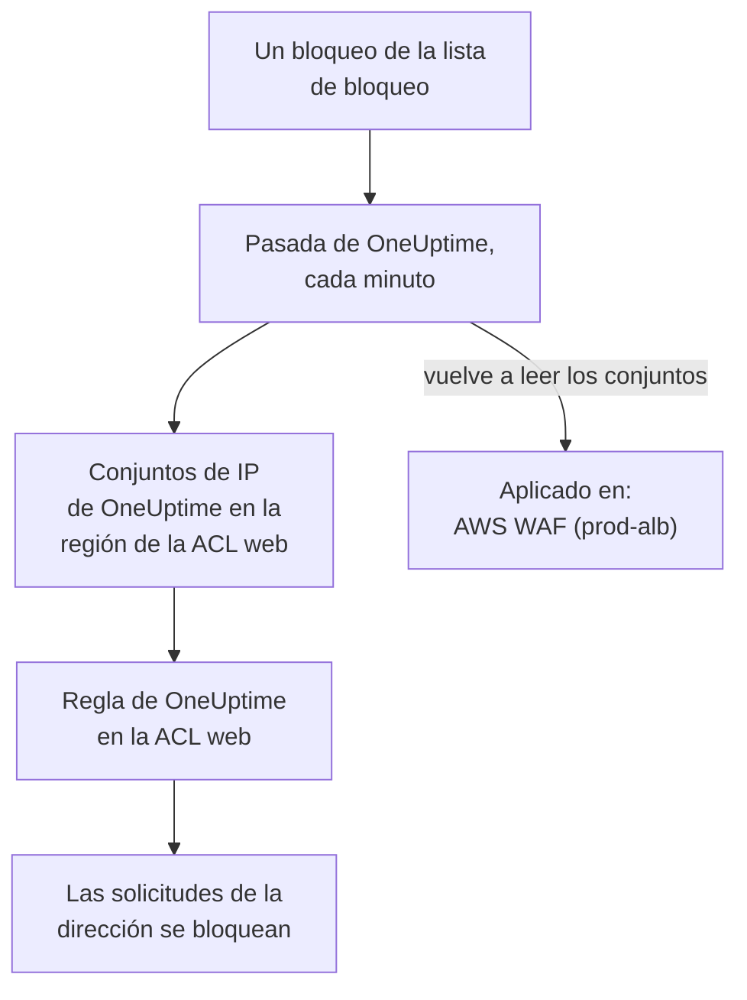

# Bloquear direcciones en AWS WAF

La lista de bloqueo de tu proyecto puede aplicarse en las ACL web de AWS WAF que están delante de tus distribuciones de CloudFront, tus balanceadores de carga y tus API Gateway. Actívala en una conexión de AWS a la nube que ya tengas, elige las ACL web y cada dirección que bloquee la lista de bloqueo quedará bloqueada allí, tanto si la bloqueó una persona como un playbook u OneUptime AI.

:::cards
- [Activación](#activación): Un ajuste en la conexión de AWS, y volver a ejecutar su comando de configuración.
- [Qué crea OneUptime](#qué-crea-oneuptime): Cuatro conjuntos de IP por región y dos reglas por ACL web.
- [Gestionar la ACL web en código](#gestionar-la-acl-web-en-código): Añade tú mismo las reglas en Terraform o CloudFormation.
:::

## Cómo funciona

OneUptime mantiene sus propios conjuntos de IP en cada región en la que hay una ACL web elegida, y en cada ACL web una regla que bloquea las direcciones que contienen. Cada minuto escribe una vez cada conjunto con lo que contiene la lista de bloqueo y después vuelve a leer los conjuntos. En la página **Lista de bloqueo**, la columna **Aplicado en** de un bloqueo solo nombra AWS WAF (prod-alb) cuando AWS WAF contiene el bloqueo y la regla de la ACL web bloquea su conjunto; hasta entonces, el bloqueo no se aplica.

## Antes de empezar

- Una cuenta de AWS conectada a OneUptime (consulta [Conectar una cuenta en la nube](/docs/telemetry/cloud-accounts#amazon-web-services)).
- Un rol que pueda cambiar dónde se aplica la lista de bloqueo: **Propietario del proyecto**, **Administrador del proyecto** o **Administrador de seguridad**.
- Alguien que pueda volver a ejecutar el comando de configuración de la conexión en la cuenta de AWS.

## Activación

:::steps
### Abrir la conexión
Abre **Nube → Conectar** y edita la conexión de AWS.

### Elegir quién añade la regla
En **Más campos**, cambia **Bloquear direcciones en AWS WAF** a **Activado, y OneUptime añade su regla**, o a **Activado, y añado la regla en mi código** si tus ACL web se gestionan en Terraform o CloudFormation.

### Volver a ejecutar el comando de configuración
El comando que muestra ahora el formulario concede los conjuntos de IP, y también la regla cuando la añade OneUptime. Ejecútalo en AWS CloudShell y después guarda la conexión.

### Añadir las ACL web
Abre **Eventos de seguridad → Playbooks → Lista de bloqueo**. En **WAF en la nube**, haz clic en **Añadir WAF**, elige una ACL web y, en **Más campos**, de dónde lee la dirección del cliente, y añádela. OneUptime la configura al momento, y su **Estado** indica **Aplicada** cuando su regla bloquea los conjuntos.
:::

Las ACL web vienen del inventario de la conexión: una que OneUptime aún no ha leído aparece tras la siguiente lectura. Mientras una ACL web aplica la lista de bloqueo, el ajuste de su conexión no se puede desactivar ni cambiar de que OneUptime añada su regla a que la añadas en código, y la conexión no se puede eliminar: quita primero la ACL web, para que OneUptime retire su regla.

## Qué crea OneUptime

| Qué | Nombre | Dónde |
| --- | --- | --- |
| Cuatro conjuntos de IP: bloqueo y desafío, IPv4 e IPv6 | `oneuptime-<project>-block-ipv4`, `oneuptime-<project>-block-ipv6`, `oneuptime-<project>-challenge-ipv4`, `oneuptime-<project>-challenge-ipv6` | En cada región en la que hay una ACL web elegida. Las ACL web de CloudFront son globales, y sus conjuntos están en `us-east-1`. |
| Dos reglas: una bloquea y otra aplica un desafío | `OneUptime-Blocklist-<project>`, `OneUptime-Challenge-<project>` | En cada ACL web elegida, cuando OneUptime añade su regla. |

`<project>` son los ocho primeros caracteres del ID externo de tu proyecto, así que dos proyectos de OneUptime en una misma cuenta nunca escriben en los conjuntos del otro. Las ACL web de una misma región comparten los conjuntos. Una dirección sola se escribe como `/32` o `/128`. AWS WAF admite 10,000 direcciones en un conjunto y 100 conjuntos de IP por región, salvo que AWS te haya ampliado el límite; un bloqueo que no cabe lo indica en su fila.

## El lugar de la regla en la ACL web

OneUptime coloca sus dos reglas en prioridades libres por debajo de la de tu primera regla, para que se ejecuten antes que las reglas que escribiste. Si la ACL web no tiene reglas, toman las prioridades 0 y 1. OneUptime nunca renumera, cambia ni elimina una regla tuya: cuando no hay dos prioridades libres por debajo de la de tu primera regla, la ACL web indica **Sin prioridad libre**, y OneUptime añade sus reglas en cuanto liberes dos.

Cada regla coincide cuando alguno de sus conjuntos, IPv4 o IPv6, contiene la dirección del cliente. AWS WAF actualiza una ACL web entera, así que OneUptime la lee, añade sus reglas y la vuelve a escribir con el token de bloqueo de la ACL web, y la lee de nuevo si otra persona la escribió entretanto.

## Direcciones reenviadas

Una ACL web que está detrás de otro proxy o CDN ve la dirección del proxy, no la del cliente. Elige de dónde lee la dirección del cliente en **Dirección del cliente**:

| Dirección del cliente | Qué lee la regla |
| --- | --- |
| **La dirección de origen de la solicitud** | La dirección de la que vino la solicitud. El valor predeterminado. |
| La última dirección del encabezado `X-Forwarded-For` | La dirección que añadió el último proxy. Una dirección anterior a ella es una que declaró la solicitud. |
| El encabezado `CF-Connecting-IP` | La única dirección que escribe Cloudflare. |
| El encabezado `True-Client-IP` | La única dirección que escribe Akamai o Cloudflare Enterprise. |

Una solicitud sin el encabezado no coincide: AWS WAF la deja pasar en lugar de bloquear la dirección de un proxy.

## Gestionar la ACL web en código

Con **Activado, y añado la regla en mi código**, OneUptime solo crea los conjuntos de IP y nunca escribe en tu ACL web. Haz clic en **Mostrar regla** en la fila de la ACL web: da las dos reglas en Terraform (bloques `rule` de `aws_wafv2_web_acl`) y en CloudFormation, con el ARN de cada conjunto y el encabezado que lee la ACL web. Añádelas a tu código antes de tus otras reglas y aplícalo.

Hasta que las reglas estén ahí, la ACL web indica **Esperando tu regla**, y sus bloqueos no se aplican. OneUptime lee la ACL web en cada pasada, y sus bloqueos se aplican desde la primera pasada que encuentra una regla que bloquea cada conjunto, sea cual sea el nombre que le hayas dado.

## Permisos

El comando de configuración añade al rol una política insertada, `OneUptimeWafBlocklist`. Con una clave de acceso, el límite que IAM pone a las políticas propias de un usuario hace que vaya en un grupo, `OneUptimeWafBlocklist-<project>`, al que se une el usuario.

| Acción | Recurso | Por qué |
| --- | --- | --- |
| `wafv2:ListIPSets` | Cualquiera | Encontrar los conjuntos de IP de OneUptime en una región. |
| `wafv2:GetIPSet`, `wafv2:CreateIPSet`, `wafv2:UpdateIPSet`, `wafv2:DeleteIPSet` | Solo los conjuntos de IP de OneUptime (`oneuptime-<project>-*`) | Mantener los conjuntos y eliminarlos cuando quitas la última ACL web de una región. |
| `wafv2:GetSampledRequests` | ACL web | Leer las solicitudes que rechazó una regla: la prueba con la que se comprueba el paso de bloqueo de un caso. |
| `wafv2:UpdateWebACL` | ACL web, y los conjuntos de IP, conjuntos de expresiones regulares y grupos de reglas a los que hacen referencia | Añadir las reglas de OneUptime. Solo con **Activado, y OneUptime añade su regla**. |

Leer una ACL web, `wafv2:GetWebACL`, ya forma parte de la política de solo lectura de la conexión.

## Desactivación

:::steps
### Quitar la ACL web
En **Eventos de seguridad → Playbooks → Lista de bloqueo**, haz clic en **Eliminar** en la fila de la ACL web. OneUptime retira sus reglas de la ACL web, y vacía y elimina sus conjuntos de IP en cuanto ninguna otra ACL web de la región los usa.

### Desactivar el ajuste
Edita la conexión, cambia **Bloquear direcciones en AWS WAF** a **Desactivado** y guarda. El ajuste se puede desactivar en cuanto ninguna ACL web de la conexión aplica la lista de bloqueo.
:::

Cuando OneUptime ya no pueda escribir en la ACL web, marca **Quitar solo de OneUptime** en el cuadro de diálogo **Quitar WAF**. OneUptime quita la ACL web de la lista de bloqueo y nombra las reglas y los conjuntos de IP que dejó en AWS WAF: siguen bloqueando lo que contienen hasta que los elimines allí. Una regla tuya que aún hace referencia a un conjunto también lo conserva: OneUptime lo vacía y lo nombra.

## Solución de problemas

:::details No aplicada
El estado de la ACL web dice qué respondió AWS y qué hacer. Un rechazo nombra la acción y el ajuste que la concede: activa el ajuste, o elige **Activado, y OneUptime añade su regla**, y después vuelve a ejecutar el comando de configuración de la conexión y haz clic en **Comprobar de nuevo**.
:::

:::details Sin prioridad libre
Tu primera regla está en la prioridad 0 o 1, así que no hay dos prioridades libres por debajo de ella. Aumenta en dos el número de prioridad de tus reglas y después haz clic en **Comprobar de nuevo**.
:::

:::details Una ACL web no aparece en la lista
OneUptime muestra las ACL web de las conexiones con el ajuste activado, una vez que las ha leído. Las ACL web que solo se ven por sus métricas necesitan volver a ejecutar el comando de configuración de la conexión, que permite a OneUptime leerlas.
:::

## Próximos pasos

:::cards
- [Casos de seguridad y playbooks](/docs/telemetry/security-cases): Bloquea una dirección desde un caso y comprueba su paso.
- [Conectar una cuenta en la nube](/docs/telemetry/cloud-accounts): La conexión de la que forma parte este ajuste.
:::
