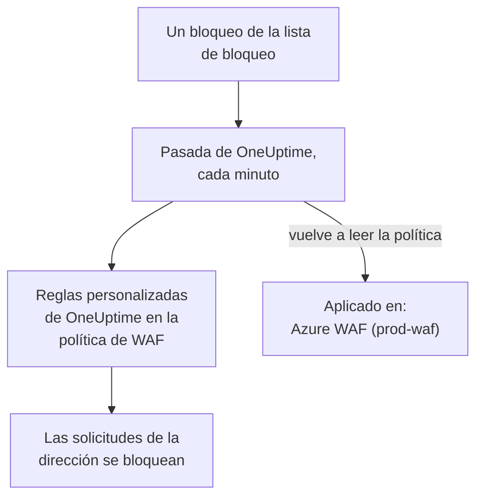

# Bloquear direcciones en Azure WAF

La lista de bloqueo de tu proyecto puede aplicarse en las políticas de Azure WAF de tus Application Gateway y Front Door. Actívala en una conexión de Azure a la nube que ya tengas, elige las políticas de WAF y cada dirección que bloquee la lista de bloqueo quedará bloqueada allí, tanto si la bloqueó una persona como un playbook u OneUptime AI.

:::cards
- [Activación](#activación): Un ajuste en la conexión de Azure, y el rol que necesita.
- [Qué crea OneUptime](#qué-crea-oneuptime): Reglas personalizadas propias en cada política que elijas.
- [Qué dirección se compara](#qué-dirección-se-compara): La dirección que se conectó, o el cliente original detrás de un proxy.
:::

## Cómo funciona

OneUptime mantiene reglas personalizadas propias en cada política de WAF que elijas, y pone en ellas las direcciones que bloquea la lista de bloqueo. Cada minuto escribe una vez la política con lo que contiene la lista de bloqueo y después vuelve a leerla. En la página **Lista de bloqueo**, la columna **Aplicado en** de un bloqueo solo nombra Azure WAF (prod-waf) cuando la política contiene el bloqueo y Azure lo ha aplicado; hasta entonces, el bloqueo no se aplica.

## Antes de empezar

- Una suscripción de Azure conectada a OneUptime (consulta [Conectar una cuenta en la nube](/docs/telemetry/cloud-accounts#microsoft-azure)).
- Un rol que pueda cambiar dónde se aplica la lista de bloqueo: **Propietario del proyecto**, **Administrador del proyecto** o **Administrador de seguridad**.
- Alguien que pueda asignar roles en la suscripción de Azure, para ejecutar un comando en Azure Cloud Shell.

## Activación

:::steps
### Abrir la conexión
Abre **Nube → Conectar** y edita la conexión de Azure.

### Activar el ajuste
En **Más campos**, cambia **Bloquear direcciones en Azure WAF** a **Activado** y guarda. El comando de configuración que muestra el formulario concede ahora el rol de abajo en toda la suscripción. Una conexión que ya tengas no necesita volver a ejecutarlo: el cuadro de diálogo **Añadir WAF** da las líneas que conceden el rol solo en una política.

### Añadir las políticas de WAF
Abre **Eventos de seguridad → Playbooks → Lista de bloqueo**. En **WAF en la nube**, haz clic en **Añadir WAF** y elige una política de WAF. OneUptime pregunta a Azure si la conexión puede escribir en ella, sin escribir nada.

### Conceder el rol, si falta
Cuando falta un permiso, el cuadro de diálogo muestra las líneas que lo conceden solo en esa política. Ejecútalas en Azure Cloud Shell, haz clic en **Comprobar de nuevo** y después añade la política. Su **Estado** indica **Aplicada** en cuanto OneUptime la ha leído.
:::

Las políticas de WAF vienen del inventario de la conexión: una que OneUptime aún no ha leído aparece tras la siguiente lectura. Mientras una política aplica la lista de bloqueo, el ajuste de su conexión no se puede desactivar y la conexión no se puede eliminar: quita primero la política, para que OneUptime retire sus reglas.

## Qué crea OneUptime

| Qué | Nombre | Dónde |
| --- | --- | --- |
| Reglas personalizadas, cada una con una condición de coincidencia de IP y la acción Block | `OneUptime<project>Block1`, `OneUptime<project>Block2`, ... | En cada política de WAF elegida, como máximo 10. |

`<project>` son los ocho primeros caracteres del ID externo de tu proyecto, así que dos proyectos de OneUptime que eligen una misma política nunca escriben las reglas del otro. Una regla admite 540 direcciones o rangos en Application Gateway, 600 con CRS 3.2 o un Default Rule Set, y 600 en Front Door. Con diez reglas, una política admite 5,400 o 6,000 bloqueos; un bloqueo que no cabe lo indica en su fila.

OneUptime no cambia nada en una política salvo sus propias reglas. Azure solo escribe una política de WAF entera, así que OneUptime lee la política con su ETag, cambia sus propias reglas y la vuelve a escribir con el ETag en `If-Match`: todas las demás reglas, ajustes y conjuntos de reglas administrados se escriben tal como se leyeron. Si otra persona escribió la política entretanto, Azure rechaza la escritura, y OneUptime la vuelve a leer y hace su cambio sobre lo que esa persona escribió.

## El lugar de las reglas en la política

OneUptime coloca sus reglas en prioridades libres antes de tu primera regla que permite tráfico, empezando por la más baja, para que ninguna regla tuya deje pasar una dirección bloqueada. Una regla tuya que bloquea o registra puede ir antes. OneUptime nunca renumera, cambia ni elimina una regla tuya: cuando no hay ninguna prioridad libre antes de tu primera regla Allow, la política indica **Sin prioridad libre**, y OneUptime añade su regla en cuanto liberes una.

## Qué dirección se compara

| Política de WAF | Dirección del cliente | Cuándo elegirla |
| --- | --- | --- |
| Front Door | **La dirección que se conectó a Front Door (SocketAddr)** | El valor predeterminado. |
| Front Door | El cliente original, según X-Forwarded-For (RemoteAddr) | Para un Front Door detrás de otro proxy o CDN. |
| Application Gateway | La dirección que se conectó a la puerta de enlace (RemoteAddr) | La única opción: su coincidencia de IP no lee ninguna otra dirección. |

Front Door toma `RemoteAddr` del encabezado `X-Forwarded-For`, que un cliente que se conecta directamente a Front Door escribe él mismo. Elige el cliente original solo si otro proxy o CDN situado delante de Front Door escribe ese encabezado. La opción está en **Más campos** del cuadro de diálogo **Añadir WAF**, y puedes cambiarla más tarde con **Dirección del cliente** en la fila de la política.

La coincidencia de IP de Application Gateway solo lee direcciones IPv4, así que un bloqueo IPv6 no se aplica allí, y su fila indica por qué.

Las reglas de OneUptime en Azure WAF solo bloquean. Un bloqueo que pide aplicar un desafío a una dirección no se aplica en Azure WAF, y lo indica. El desafío de una política de respuesta automática se aplica allí como un bloqueo durante el mismo tiempo.

## Cuánto tarda un cambio

Application Gateway aplica un cambio en cuanto Azure lo escribe. Front Door acepta el cambio y lo distribuye a sus ubicaciones perimetrales en los minutos siguientes: la política indica **Aplicando**, y la columna **Aplicado en** de un bloqueo nuevo espera a la política hasta que Azure la notifique como aprovisionada. A partir de entonces, el bloqueo se aplica.

## Cuando una regla se cambia a mano

Cuando alguien desactiva, cambia o elimina una de las reglas de OneUptime en Azure, OneUptime la deja tal como la dejó esa persona. La política indica **Modificada a mano**, y los bloqueos que contenía esa regla no se aplican, con el motivo, hasta que alguien haga clic en **Restablecer** en la fila de la política. «Restablecer» vuelve a escribir la regla tal como la escribe OneUptime, en su propia prioridad mientras esté libre.

Una política que no bloquea nada también lo indica, y sus bloqueos no se aplican:

- Una política desactivada.
- Una política en modo **Detection**, que solo registra lo que coincide con las reglas de OneUptime.
- Una política que no está asociada a ninguna puerta de enlace de aplicación, agente de escucha, regla de ruta ni dominio de Front Door.

## Mantener una política en Terraform

Terraform también escribe una política de WAF entera, así que su siguiente plan elimina las reglas de OneUptime. Para que OneUptime las conserve, añade `ignore_changes = [custom_rules]` al bloque `lifecycle` de una `azurerm_web_application_firewall_policy`, o `ignore_changes = [custom_rule]` al de una `azurerm_cdn_frontdoor_firewall_policy`, y deja tus propias reglas personalizadas fuera del código de esa política.

## Permisos

El comando de configuración añade un rol personalizado, `OneUptime WAF Blocklist`, y lo asigna a la aplicación de la conexión en la suscripción. Las líneas que muestra el cuadro de diálogo **Añadir WAF** asignan el mismo rol solo en una política.

| Acción | Por qué |
| --- | --- |
| `Microsoft.Network/ApplicationGatewayWebApplicationFirewallPolicies/read`, `Microsoft.Network/ApplicationGatewayWebApplicationFirewallPolicies/write` | Leer una política de WAF de Application Gateway y escribir en ella las reglas de OneUptime. |
| `Microsoft.Network/FrontDoorWebApplicationFirewallPolicies/read`, `Microsoft.Network/FrontDoorWebApplicationFirewallPolicies/write` | Leer una política de WAF de Front Door y escribir en ella las reglas de OneUptime. |

El rol no puede eliminar una política, y OneUptime nunca escribe nada más.

## Desactivación

:::steps
### Quitar la política de WAF
En **Eventos de seguridad → Playbooks → Lista de bloqueo**, haz clic en **Eliminar** en la fila de la política. OneUptime retira sus reglas de la política y no cambia nada más en ella.

### Desactivar el ajuste
Edita la conexión, cambia **Bloquear direcciones en Azure WAF** a **Desactivado** y guarda. El ajuste se puede desactivar en cuanto ninguna política de la conexión aplica la lista de bloqueo.
:::

Cuando OneUptime ya no pueda escribir en la política, marca **Quitar solo de OneUptime** en el cuadro de diálogo **Quitar WAF**. OneUptime quita la política de la lista de bloqueo y nombra las reglas que dejó en ella: siguen bloqueando lo que contienen hasta que las elimines en Azure.

## Solución de problemas

:::details No aplicada
El estado de la política dice qué respondió Azure y qué hacer. Un rechazo nombra el permiso que falta: ejecuta las líneas que muestra **Añadir WAF** para la política y después haz clic en **Comprobar de nuevo**.
:::

:::details Sin prioridad libre
Tu primera regla que permite tráfico está en la prioridad 1, o todas las prioridades anteriores a ella están ocupadas. Aumenta su número de prioridad y después haz clic en **Comprobar de nuevo**.
:::

:::details Una política no aparece en la lista
OneUptime muestra las políticas de WAF de las conexiones con el ajuste activado, una vez que las ha leído. Una política añadida desde entonces aparece tras la siguiente lectura de la conexión.
:::

## Próximos pasos

:::cards
- [Casos de seguridad y playbooks](/docs/telemetry/security-cases): Bloquea una dirección desde un caso y comprueba su paso.
- [Conectar una cuenta en la nube](/docs/telemetry/cloud-accounts): La conexión de la que forma parte este ajuste.
:::
