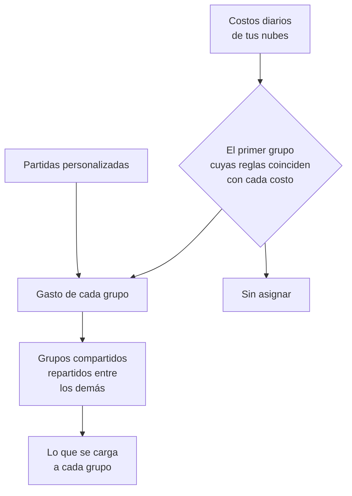

# Asignación de costos de la nube

Los grupos de costos responden la primera pregunta de cada factura mensual de la nube: quién lo gastó. Una **vista de costos** como «Por equipo» o «Por centro de costo» asigna el gasto de tus cuentas conectadas a **grupos de costos** mediante reglas, sin contar nada dos veces. Lo que ninguna regla toma queda a la vista como gasto sin asignar, y los costos compartidos se reparten entre los grupos. Encuéntralos en **Nube → Gasto → Grupos de costos**.

:::cards
- [Crear una vista](#crear-una-vista): Por equipo según los propietarios que ya definiste, por una etiqueta o con tus propios grupos.
- [Escribir las reglas de un grupo](#escribir-las-reglas-de-un-grupo): Cuentas, servicios, etiquetas, equipos propietarios, etiquetas de OneUptime y más.
- [Gasto sin asignar](#gasto-sin-asignar): Lo que ninguna regla toma, y un clic para asignarlo.
- [Costos compartidos](#costos-compartidos): Un plan de soporte o un clúster compartido, repartido entre los grupos.
:::

## Cómo funciona



- **El primer grupo que coincide se lleva el costo.** Los grupos de una vista tienen un orden, y cada costo va al primer grupo cuyas reglas coinciden con él, así que nada se cuenta dos veces. Los grupos y el gasto sin asignar siempre suman el total del periodo.
- **Las reglas leen todo lo que lleva un costo.** La cuenta, la nube, el servicio, la región, el recurso y sus etiquetas, y lo que OneUptime sabe del recurso: sus equipos propietarios, sus etiquetas de OneUptime, su entorno y su aplicación de plataformas de aplicaciones.
- **Todo se calcula al mirar.** No se guarda nada por costo. Una regla que cambias vuelve a asignar cada mes que OneUptime conserva, hasta 400 días atrás, sin nada que esperar. Cada cifra sigue al selector que tiene encima, facturado, amortizado o neto, como en [Costos en la nube](/docs/telemetry/cloud-costs#facturado-amortizado-y-neto), y una partida personalizada es la misma en cada base.
- **Varias vistas pueden asignar el mismo gasto.** «Por equipo» y «Por centro de costo» asignan todo el gasto, cada una a su manera.

## Antes de empezar

- **Costos que se leen.** [Conecta una cuenta en la nube](/docs/telemetry/cloud-accounts) y deja que [lea sus costos](/docs/telemetry/cloud-costs).
- **Etiquetas o propietarios, si los quieres.** Las reglas sobre etiquetas necesitan costos que las lleven; en AWS, activa [Costos por recurso](/docs/telemetry/cloud-costs#costos-por-recurso). Los equipos propietarios vienen de los propietarios de cada recurso, definidos a mano o con [reglas del propietario](/docs/configuration/label-and-owner-rules).

## Crear una vista

Abre **Nube → Gasto → Grupos de costos**. A un proyecto sin vistas se le ofrecen tres formas de empezar:

| Inicio | Lo que crea |
| --- | --- |
| **Por equipo, según los propietarios** | Un grupo por cada equipo propietario de recursos en la nube, vinculado al equipo. |
| **Por una etiqueta** | Un grupo por cada valor de una etiqueta que llevan tus costos, como `team` o `cost-center`. |
| **Tus propios grupos** | Una vista vacía. Tú escribes las reglas de cada grupo. |

OneUptime crea los grupos de una vista por etiqueta o por equipo propietario al guardarla, y luego cada hora a medida que aparecen nuevos valores de etiqueta y propietarios. Puedes cambiar el nombre de esos grupos, vincularlos a un equipo o compartirlos. Sus reglas siguen siendo de OneUptime. Para crear ahora los grupos que faltan, abre la vista y pulsa **Crear grupos ahora**.

## Escribir las reglas de un grupo

Abre una vista y luego **Crear Grupo de costos** en **Grupos**. Un costo es del grupo cuando **alguna** de sus reglas coincide con él, y una regla coincide cuando lo hacen **todas** sus condiciones. Una condición compara algo que lleva un costo con los valores que eliges o escribes:

| Campo | Lo que lee |
| --- | --- |
| **Etiqueta** | El valor de una etiqueta, por su clave. **está definido** y **no está definido** preguntan si el costo la lleva. |
| **Cuenta** | La cuenta conectada a la que se factura el costo. |
| **Equipo propietario** | Los equipos propietarios del recurso en OneUptime. |
| **Servicio** | El servicio, tal como lo nombra la facturación de tu nube. |
| **Etiqueta** | Las etiquetas de OneUptime del recurso o de su cuenta. |
| **Región** | La región. Deja el valor vacío para un servicio global. |
| **Nube** | AWS, Azure o Google Cloud. |
| **Recurso** | El recurso, tal como lo nombra tu nube. |
| **Entorno de plataformas de aplicaciones** y **Aplicación** | Lo que se factura a un entorno o a una aplicación, tal como lo cuenta **Nube → Gasto → Costos**. |
| **Espacio de nombres de Kubernetes** y **clúster de Kubernetes** | Los espacios de nombres de un clúster, cuando un grupo compartido se reparte por ellos. Consulta [Clústeres de Kubernetes](#clústeres-de-kubernetes). |

El texto se compara sin importar mayúsculas y minúsculas: `Payments` y `payments` son un solo equipo. La clave de una etiqueta se compara tal como está escrita, como la guardan tus nubes.

Por ejemplo, un grupo **Pagos** con tres reglas se lleva un costo etiquetado `team: payments`, **o** facturado a la cuenta payments, **o** propiedad del equipo Pagos.

### El orden de los grupos

Arrastra los grupos en **Grupos** para cambiar su orden. Un grupo cuyas reglas ya cubre un grupo anterior nunca puede llevarse un costo, y su fila dice qué grupo se lo lleva todo. Un grupo cuyas reglas también coinciden con costos que se lleva un grupo anterior dice cuánto recibe de ellos.

### Recursos con varios equipos propietarios

Un recurso de dos equipos se reparte a partes iguales entre ellos: la mitad de cada equipo pasa por las reglas por separado. Una regla que no pregunta por propietarios, como una etiqueta o una cuenta, sigue llevándose el costo completo. Una mitad cuyo equipo no tiene grupo queda sin asignar.

## Gasto sin asignar

La página de una vista lista lo que aún no toma ninguna regla: los servicios, cuentas, valores de etiqueta y equipos propietarios que lo forman, primero los más costosos. Pulsa **Añadir al grupo** junto a uno para añadir una regla para él a un grupo, o a un grupo nuevo. Sus costos pasan al grupo al instante, también los de meses pasados.

## Costos compartidos

Un plan de soporte, un clúster compartido o un hub de red es de todos. Conviértelo en un grupo propio; luego, en **Más campos**, activa **Compartido** y elige cómo se reparten sus costos entre los demás grupos de la vista:

| Reparto | Cómo |
| --- | --- |
| **Repartir según la parte del gasto** | Cada grupo se lleva su parte del gasto en la nube de los demás grupos ese mes. Un mes en que no gastaron nada se reparte a partes iguales. |
| **Repartir a partes iguales** | El mismo importe para cada grupo. |
| **Repartir por porcentajes fijos** | Los porcentajes que fijas para cada grupo, que suman 100. |
| **Repartir por espacios de nombres de Kubernetes** | Lo que costó cada espacio de nombres de un clúster ese mes. Ver más abajo. |

Los costos de un grupo compartido se reparten día a día con las partes de cada mes, así que un mes da las mismas cifras leído por día o por mes. El gasto sin asignar nunca recibe una parte.

### Clústeres de Kubernetes

Tu nube factura los nodos de un clúster, mientras que el motor de costos del propio clúster dice lo que usó cada espacio de nombres. Para cobrar a cada equipo sus cargas de trabajo dentro de un clúster compartido:

1. Crea un grupo cuyas reglas coincidan con los nodos del clúster, por ejemplo **Etiqueta** `eks:cluster-name` **es cualquiera de** `prod`.
2. Activa **Compartido**, elige **Repartir por espacios de nombres de Kubernetes** y selecciona el **Clúster de Kubernetes**.
3. Da a los grupos de los equipos reglas que lean los labels de los espacios de nombres, que cuentan como etiquetas. Por ejemplo, **Etiqueta** `team` **es cualquiera de** `payments`, o **Espacio de nombres de Kubernetes** **comienza con** `payments-`.

Cada mes, los costos de los nodos se reparten según lo que costó cada espacio de nombres en el [motor de costos](/docs/telemetry/kubernetes-cost) del clúster, y la parte de cada espacio de nombres va al primer grupo cuyas reglas coinciden con ella. La capacidad ociosa, y un espacio de nombres que ningún grupo toma, se quedan en el grupo del clúster. Los costos tasados del propio clúster nunca se suman a tu factura, así que nada se cuenta dos veces.

## Partidas personalizadas

En **Partidas personalizadas**, dentro de **Nube → Gasto → Grupos de costos**, añade un cargo o un crédito que las facturas de tus nubes no incluyen: una parte de un contrato de soporte, un descuento empresarial, un recargo interno o una tarifa de plataforma.

- **Una vez o cada mes.** Una partida mensual se reparte entre los días de cada mes, así que una parte del mes se lleva su parte.
- **En una cuenta o en un grupo.** Una partida añadida a una cuenta pasa por las reglas de cada vista igual que los costos de la cuenta. Una añadida a un grupo va directamente a él.
- **Siempre aparte.** Cada cifra mantiene las partidas aparte de lo que facturaron las nubes, así que las cifras de las nubes siguen coincidiendo con sus consolas.

## Ver el gasto de cada grupo

- **Nube → Gasto → Costos**: en **Adónde va el dinero**, elige **Grupos de costos** y una vista. El gasto de cada grupo, frente al periodo anterior.
- **La página de una vista**: lo que se cargó a cada grupo, con sus costos compartidos, lo que ninguna regla toma, y **Descargar CSV** para repercutir el mes.
- **La página de un grupo**: su gasto día a día, los servicios, recursos y cuentas que más se le facturan, y sus reglas. Muestra solo el gasto de ese grupo, así que vincula el grupo a su **Equipo** y envía al equipo su página: cualquiera que pueda leer el gasto en la nube puede abrirla.

## API, CLI y MCP

Las vistas, los grupos y las partidas son recursos de la API (`cloud-cost-view`, `cloud-cost-group`, `cloud-cost-line-item`), con comandos de la CLI y herramientas MCP como cualquier recurso. Las reglas de un grupo son JSON:

```json
[
  { "conditions": [{ "field": "tag", "key": "team", "operator": "is", "values": ["payments"] }] },
  { "conditions": [{ "field": "ownerTeam", "operator": "is", "values": ["<team ID>"] }] }
]
```

Para leer lo que asigna una vista, en días UTC completos de `startDate` a `endDate`:

```bash
curl -X POST "https://oneuptime.com/api/cloud-cost-view/<view ID>/allocation" \
  -H "apikey: <API key>" -H "tenantid: <project ID>" -H "Content-Type: application/json" \
  -d '{"startDate": "2026-11-01", "endDate": "2026-11-30", "currency": "USD"}'
```

La respuesta trae el `total` de cada grupo y de qué se compone (`cloud`, `lineItems`, `sharedIn`, `sharedOut`), sus cifras por día o por mes, el periodo anterior, y de qué se compone el gasto sin asignar. `POST /cloud-cost-group/<group ID>/spend` responde para un solo grupo. Envía `basis` como `billed`, `amortized` o `net` para cifras en esa base; sin él, están en la del proyecto, y el `basis` de la respuesta dice cuál.

## Límites

- Una vista tiene como máximo 500 grupos. Una vista por etiqueta crea grupos para los 500 valores más costosos.
- Un grupo tiene como máximo 25 reglas, una regla 20 condiciones y una condición 200 valores.
- Los costos se conservan 400 días, así que una vista lee como máximo 400 días.

## Solución de problemas

:::details Un grupo no recibe nada
Puede que sus reglas aún no coincidan con ningún costo, o que un grupo anterior se lleve todos los costos que cubren. Su fila en **Grupos** nombra entonces ese grupo: arrastra este por encima, o acota las reglas del grupo anterior.
:::

:::details Un costo está en el grupo equivocado
Un costo va al primer grupo cuyas reglas coinciden con él. Arrastra el grupo al que pertenece por encima del grupo que se lo lleva, o acota las reglas de ese grupo.
:::

:::details Una regla sobre una etiqueta no coincide con nada
Un costo conserva las etiquetas que tenía al leerse: las etiquetas de una exportación de facturación de Google Cloud o, si no, las del recurso al que se factura, lo que en AWS requiere [Costos por recurso](/docs/telemetry/cloud-costs#costos-por-recurso). La clave de una etiqueta se compara tal como está escrita.
:::

:::details A una vista por etiqueta o por equipo propietario le falta un grupo
OneUptime crea los grupos que faltan cada hora: uno por cada valor de etiqueta de los costos de los últimos 400 días, o por cada equipo propietario de recursos en la nube, hasta 500 grupos. Pulsa **Crear grupos ahora** en la página de la vista para crearlos al instante.
:::

:::details Las cifras dejan fuera una cuenta
Las cifras de una vista están en la moneda en la que se factura la mayoría de tus cuentas. Una cuenta facturada en otra queda fuera de ellas, igual que una partida en otra moneda.
:::

## Próximos pasos

:::cards
- [Costos y ahorros en la nube](/docs/telemetry/cloud-costs): Lo que cuestan tus cuentas conectadas y cómo gastar menos.
- [Reglas de etiquetas y propietarios](/docs/configuration/label-and-owner-rules): Da a los recursos equipos propietarios y etiquetas que lean las reglas.
- [Observabilidad de costos de Kubernetes](/docs/telemetry/kubernetes-cost): Lo que cuesta cada carga de trabajo de Kubernetes.
:::
