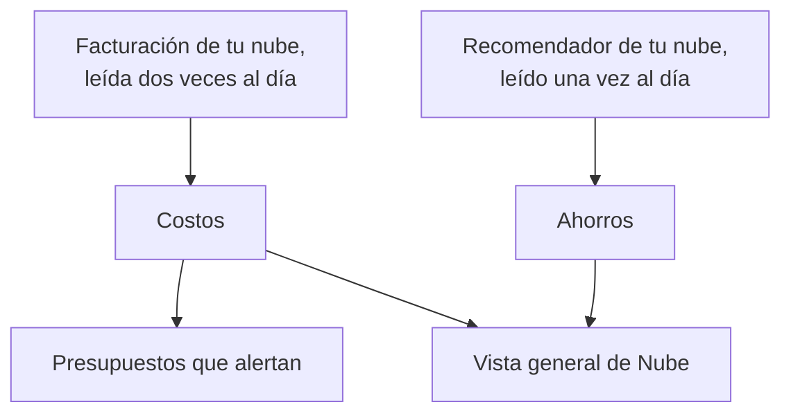

# Costos y ahorros en la nube

Una cuenta en la nube conectada también dice cuánto cuesta y cómo podría costar menos. OneUptime lee los costos de cada día de la propia facturación de tu nube y las recomendaciones del propio recomendador de tu nube, los muestra en **Nube → Gasto → Costos** y **Nube → Gasto → Ahorros**, y alerta antes de que un mes cueste más que su presupuesto en **Nube → Gasto → Presupuestos**.

:::cards
- [Amazon Web Services](#amazon-web-services): Cost Explorer y Cost Optimization Hub, cada uno activado una vez.
- [Microsoft Azure](#microsoft-azure): Cost Management y Azure Advisor, con un rol más.
- [Google Cloud](#google-cloud): Tu exportación de facturación a BigQuery y el Recommender.
- [Presupuestos](#presupuestos): Una alerta cuando el gasto de un mes supera una parte de su presupuesto.
:::

## Cómo funciona



- **Los costos vienen de la propia facturación de tu nube.** AWS Cost Explorer, Azure Cost Management y la exportación de facturación de Google Cloud a BigQuery, antes de créditos y reembolsos, en la moneda en que se factura la cuenta. Cada cifra es la de un día, en días UTC, como los factura tu nube.
- **Una nube informa del último día o dos con retraso.** Cada lectura vuelve a tomar la última semana, y todo el mes pasado en los primeros días de un mes, así que el costo de un día se asienta a medida que tu nube lo termina. La primera lectura de una conexión retrocede hasta el inicio del penúltimo mes.
- **La proyección del mes es el ritmo de la última semana.** Es lo que el mes ha costado hasta ahora, con cada día que queda al promedio de los últimos siete días completos.
- **Los ahorros vienen del propio recomendador de tu nube.** AWS Cost Optimization Hub, Azure Advisor y el Recommender de Google Cloud: un tamaño menor, un recurso inactivo, un compromiso que vale la pena, cada uno con lo que ahorraría al mes. Una recomendación que aplicas o descartas en la consola de tu nube desaparece en la siguiente lectura.

## Antes de empezar

- **Una cuenta conectada.** [Conectar una cuenta en la nube](/docs/telemetry/cloud-accounts) con el comando de configuración actual: permite que la conexión lea costos y recomendaciones. Una conexión creada antes no lee ninguno de los dos hasta que vuelvas a ejecutar su comando.

## Amazon Web Services

La conexión lee los costos con `ce:GetCostAndUsage` y las recomendaciones con `cost-optimization-hub:ListRecommendations`. Cada uno necesita antes que se active algo en la cuenta:

:::steps
### Activar Cost Explorer

Abre Cost Explorer una vez en la consola de AWS Billing and Cost Management: AWS prepara los costos de la cuenta en menos de un día. Conecta la cuenta de administración de la organización para leer los costos de cada cuenta miembro.

### Activar Cost Optimization Hub

Abre Cost Optimization Hub en la misma consola y actívalo, para la organización desde su cuenta de administración o solo para la cuenta. Sus recomendaciones llegan en menos de un día.
:::

Cost Explorer cobra $0.01 por cada solicitud, y una lectura de los costos hace unas pocas. Cost Optimization Hub es gratuito.

## Microsoft Azure

La aplicación lee los costos con el rol **Cost Management Reader**, en el mismo ámbito que **Monitoring Reader**: el comando de configuración concede ambos. Las recomendaciones de Azure Advisor se leen con **Monitoring Reader**, así que no hay nada que activar. Para dar el rol a una aplicación creada antes, ejecuta:

```bash
az role assignment create --assignee <APP_ID> --role "Cost Management Reader" --scope /subscriptions/<SUBSCRIPTION_ID>
```

Cost Management responde por cada suscripción, con el recurso al que corresponde cada costo, y leerlo no cuesta nada. Cuando no puede responder por una suscripción, los **Costos** de la cuenta dicen por qué.

## Google Cloud

Google Cloud no tiene ninguna API para los costos de un proyecto: OneUptime los lee de la exportación de tu cuenta de facturación a BigQuery.

:::steps
### Exportar tu facturación a BigQuery

En la consola de Google Cloud, abre Billing, luego Billing export, y activa la exportación del costo de uso detallado a un conjunto de datos de BigQuery. Google la escribe con unas horas de retraso, desde el día en que la activas.

### Permitir que la cuenta de servicio la lea

Da a la cuenta de servicio de la conexión **BigQuery Data Viewer** en el conjunto de datos de la exportación. El comando de configuración ya le dio **BigQuery Job User**, para ejecutar la consulta en su propio proyecto.

### Indicar la tabla de la exportación

Edita la conexión en **Nube → Conectar** y, en **Más campos**, pon en **Tabla de la exportación de facturación** el nombre completo de la tabla: `<PROJECT_ID>.<DATASET>.gcp_billing_export_resource_v1_<BILLING_ACCOUNT_ID>`.
:::

La exportación detallada indica el recurso al que corresponde cada costo; la estándar solo dice el servicio y la región. BigQuery factura la consulta: el primer 1 TiB al mes es gratuito, luego $6.25 por TiB, y un mes de una exportación ocupa de unos pocos megabytes a unos pocos gigabytes. Las recomendaciones de tipo de máquina y de recursos inactivos del Recommender se leen con **Compute Recommender Viewer**, que concede el comando de configuración, y no cuestan nada.

## Formas de gastar menos

**Nube → Gasto → Ahorros** enumera cada recomendación, el mayor ahorro primero: qué hacer, en qué recurso, qué cambiaría y cuánto ahorra al mes. La franja de arriba las suma, en total y por tipo: un tamaño menor, un recurso inactivo, un compromiso. Una recomendación enlaza a la página de su recurso cuando OneUptime tiene el recurso.

## Presupuestos

:::steps
### Crear un presupuesto

En **Nube → Gasto → Presupuestos**, crea un presupuesto: su **Importe mensual** y la **Cuenta** a la que se aplica, o ninguna para todas las cuentas.

### Elegir cuándo alerta

**Alertar en** recibe las partes del presupuesto en las que alertar, en porcentaje: 80 y 100 para empezar. **Alertar si va camino de superarse** también alerta, una vez al mes, cuando el ritmo de la última semana llevaría el mes por encima del presupuesto. **Gravedad de la alerta** y **Políticas de guardia** dicen lo graves que son las alertas y a quién se avisa.
:::

Un presupuesto se comprueba tras cada lectura de los costos y cada hora. Cuando el gasto del mes supera un umbral, se genera una alerta por él, la más alta si una lectura supera varios a la vez, y un nuevo mes resuelve las alertas del mes pasado. Un presupuesto solo cuenta las cuentas que se facturan en su moneda.

## Qué ves en OneUptime

- **La vista general de Nube.** **Nube → Vista general** muestra el gasto del mes frente al del mes pasado hasta el mismo día, los servicios que más cuestan y las mayores formas de gastar menos, junto a lo que necesita atención.
- **El gasto de cada día.** **Nube → Gasto → Costos** dibuja cada uno de los últimos 30 días y desglosa un periodo por servicio, región, cuenta o recurso. Las cuentas cuyos costos no se leen aparecen debajo, cada una con el motivo.
- **Los costos de una cuenta.** Los **Costos** de una cuenta muestran lo mismo solo para la cuenta, con sus formas de gastar menos.
- **El costo de un recurso.** La página de un recurso muestra lo que costó este mes y en los últimos 30 días cuando su nube lo factura por su nombre, con sus formas de gastar menos.

## Solución de problemas

:::details Una cuenta dice Necesita permiso
La conexión todavía no puede leer los costos de la cuenta. Vuelve a ejecutar su comando de configuración desde **Nube → Conectar**: añade lo que necesita leer los costos. En Google Cloud, da también a la cuenta de servicio **BigQuery Data Viewer** en el conjunto de datos de la exportación.
:::

:::details Una cuenta dice Sin configurar
Su nube todavía no tiene costos que dar. En AWS, activa Cost Explorer; en Google Cloud, indica la tabla de la exportación en **Tabla de la exportación de facturación**. Las primeras cifras llegan con la siguiente lectura, en menos de 12 horas.
:::

:::details Las cifras dejan fuera una cuenta
Las cifras están en la moneda en que se factura la mayoría de tus cuentas. Una cuenta facturada en otra aparece debajo con su moneda, y un presupuesto solo cuenta las cuentas facturadas en la suya.
:::

:::details Este mes es más bajo que en la consola de tu nube
Tu nube informa del último día o dos con retraso, y las cifras son antes de créditos y reembolsos. Las siguientes lecturas se ponen al día.
:::

## Próximos pasos

:::cards
- [Conectar una cuenta en la nube](/docs/telemetry/cloud-accounts): Conecta otra cuenta o vuelve a ejecutar su comando.
- [Recursos en la nube](/docs/telemetry/cloud-resources): Las métricas de cada recurso, desde un recopilador propio.
- [Observabilidad de costos de Kubernetes](/docs/telemetry/kubernetes-cost): Lo que cuesta cada carga de trabajo de Kubernetes.
:::
