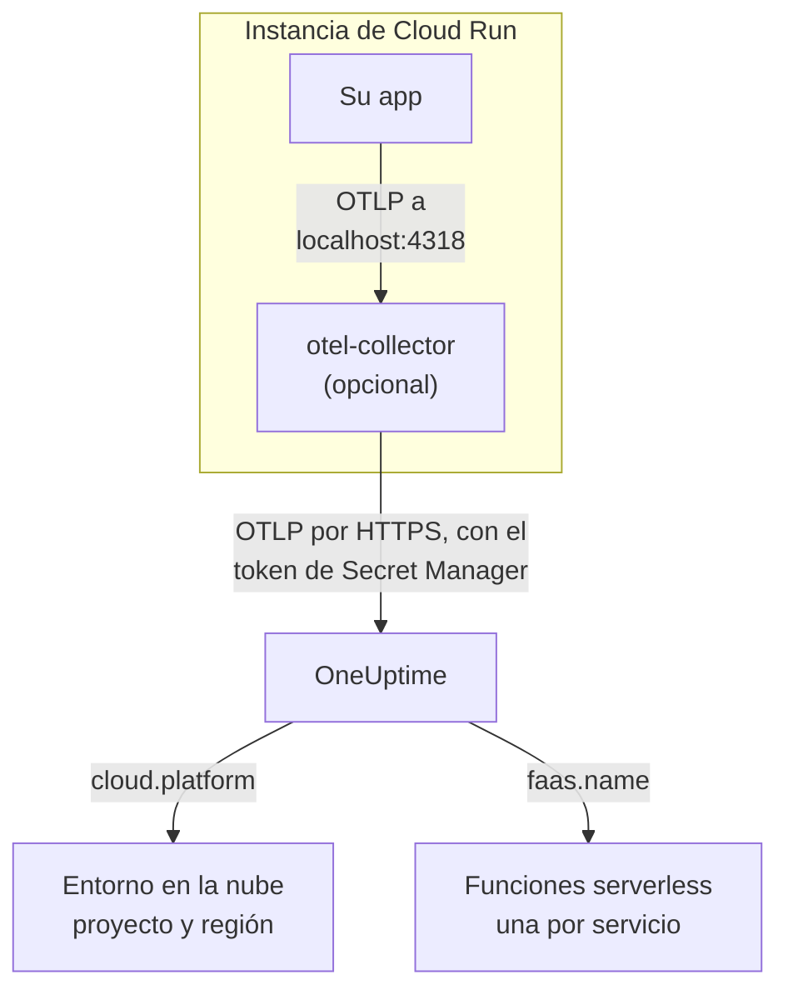

# Google Cloud Run

Envíe las trazas, los registros y las métricas de sus servicios y trabajos de Cloud Run a OneUptime. Todo lo que informa `cloud.platform=gcp_cloud_run` se une a un **Entorno en la nube** por proyecto de Google Cloud y región, como _GCP Cloud Run · us-central1 · my-project_, y cada servicio aparece también en **Funciones serverless**.

:::cards
- [Cómo funciona](#cómo-funciona): Qué define el detector de GCP, y por qué un servicio aparece en dos lugares.
- [Configurarlo](#configurarlo): Guardar el token, configurar el servicio, desplegar y comprobar.
- [El YAML del servicio con un sidecar](#el-yaml-del-servicio-con-un-sidecar): Un servicio de Cloud Run completo con un colector.
- [Solución de problemas](#solución-de-problemas): Errores de secretos, orden de arranque del sidecar y entornos que faltan.
:::

## Cómo funciona



El detector de recursos de GCP de OpenTelemetry lee el servidor de metadatos y las variables de entorno `K_SERVICE` y `K_REVISION`, y define:

| Atributo | Valor en Cloud Run | Para qué sirve |
| ------------------ | ------------------------------ | ----------------------------------------------------------------------------------------- |
| `cloud.platform` | `gcp_cloud_run` | Archiva la telemetría en **Entornos en la nube** |
| `cloud.account.id` | el ID del proyecto | Parte de la clave de entorno |
| `cloud.region` | `us-central1` | Parte de la clave de entorno |
| `faas.name` | el nombre del servicio (`K_SERVICE`) | Lista también el servicio en **Funciones serverless** |
| `faas.version` | la revisión (`K_REVISION`) | Se muestra en la vista general de la función serverless del servicio; el entorno no lo usa |
| `faas.instance` | el ID de la instancia | Nombra una instancia en ejecución: una fila cada una en **Instancias** |

> [!NOTE]
> Cloud Run aparece en dos lugares a propósito. Como el detector define `faas.name`, cada servicio es también una **Función serverless**, con sus propias invocaciones, tasa de errores y duración. El **Entorno en la nube** agrupa cada servicio de ese proyecto y esa región. Nada se guarda dos veces: la misma telemetría se archiva en ambos.

La clave de entorno es `gcp_cloud_run|my-project|us-central1`.

## Antes de empezar

- **Una clave de ingesta.** Cree una clave **Servidor** en **Ajustes del proyecto → Telemetría y APM → Claves de ingesta** y copie su token.
- **`gcloud`**, con sesión iniciada en el proyecto y la API de Secret Manager activada: `gcloud services enable secretmanager.googleapis.com`.
- **Su aplicación instrumentada con un SDK de OpenTelemetry** que exporte OTLP.

## Elegir cómo sale la telemetría del servicio

| | SDK direct | Sidecar collector |
| --------------- | ---------------------------------------------------- | ---------------------------------------------------------------------- |
| Contenedor adicional | Ninguno | `otel-collector` en el servicio |
| Ideal para | Un servicio, y los trabajos de Cloud Run | Varios servicios en un proyecto, o un SDK que no puede ejecutar un detector |
| Guarda el token | La aplicación | El colector |
| El secreto | `oneuptime-otlp-headers`, el encabezado completo | `oneuptime-ingestion-token`, solo el token |

Un trabajo se ejecuta hasta terminar, así que no hay nada para lo que mantener vivo un sidecar: use SDK direct. Cada paso de abajo tiene una pestaña para cada uno; elija una y cada paso la seguirá.

## Configurarlo

:::steps
### Guardar el token en Secret Manager

> [!IMPORTANT]
> El token es un secreto. Póngalo en Secret Manager y haga referencia a él desde el servicio como una variable de entorno respaldada por un secreto. Una variable de entorno normal es visible para cada lector del proyecto, en la consola y en `gcloud run services describe`.

:::tabs
@tab SDK direct
```bash
printf '%s' "x-oneuptime-token=YOUR_TELEMETRY_INGESTION_TOKEN" | gcloud secrets create oneuptime-otlp-headers \
  --data-file=- \
  --replication-policy=automatic

gcloud secrets add-iam-policy-binding oneuptime-otlp-headers \
  --member="serviceAccount:checkout-api@my-project.iam.gserviceaccount.com" \
  --role="roles/secretmanager.secretAccessor"
```

Cloud Run pone el valor de un secreto tal cual en la variable, y `OTEL_EXPORTER_OTLP_HEADERS` necesita el par `name=value` completo, así que este secreto contiene el encabezado completo.
@tab Sidecar collector
```bash
printf '%s' "YOUR_TELEMETRY_INGESTION_TOKEN" | gcloud secrets create oneuptime-ingestion-token \
  --data-file=- \
  --replication-policy=automatic

gcloud secrets add-iam-policy-binding oneuptime-ingestion-token \
  --member="serviceAccount:checkout-api@my-project.iam.gserviceaccount.com" \
  --role="roles/secretmanager.secretAccessor"
```

La configuración del colector añade el nombre del encabezado, así que este secreto contiene solo el token.
:::

Ponga en `--member` la cuenta de servicio de ejecución del servicio, no su propio usuario. Sin `roles/secretmanager.secretAccessor`, la revisión no se despliega y falla con `Permission denied on secret`. Si el servicio todavía se ejecuta como la cuenta de servicio de Compute predeterminada, conceda el rol a esa cuenta, y considere dar al servicio una cuenta propia: la predeterminada la comparte todo el proyecto.

### Configurar el servicio

:::tabs
@tab SDK direct
1. **Google Cloud console → Cloud Run → click the service → Edit & deploy new revision**.
2. En la pestaña **Containers**, abra su contenedor y vaya a **Variables & Secrets**. Añada las variables de abajo.
3. Haga clic en **Reference a secret**, elija `oneuptime-otlp-headers`, la versión `latest`, y expóngalo como la variable de entorno `OTEL_EXPORTER_OTLP_HEADERS`.
4. En la pestaña **Security**, compruebe que la **Service account** es la que recibió `roles/secretmanager.secretAccessor`.

```bash
OTEL_SERVICE_NAME=checkout-api
OTEL_EXPORTER_OTLP_ENDPOINT=https://oneuptime.com/otlp
OTEL_EXPORTER_OTLP_PROTOCOL=http/protobuf
# Secret-backed (Variables & Secrets → Reference a secret), not typed here.
OTEL_EXPORTER_OTLP_HEADERS=x-oneuptime-token=YOUR_TELEMETRY_INGESTION_TOKEN
```

Después active el detector de recursos de GCP de su lenguaje:

| Lenguaje | Activar el detector de GCP |
| -------- | ------------------------------------------------------------------------------------------------------------------- |
| Node.js | `OTEL_NODE_RESOURCE_DETECTORS=env,host,os,gcp` (auto-instrumentations-node) |
| Python | `pip install opentelemetry-resourcedetector-gcp` y luego `OTEL_EXPERIMENTAL_RESOURCE_DETECTORS=gcp_resource_detector` |
| Java | `-Dotel.resource.providers.gcp.enabled=true` |
| Go | `import "go.opentelemetry.io/contrib/detectors/gcp"` y pase `gcp.NewDetector()` a `resource.New` |
| .NET | El paquete `OpenTelemetry.Resources.Gcp`: `.ConfigureResource(r => r.AddGcpDetector())` |

O defínalo todo desde la CLI:

```bash
gcloud run services update checkout-api --region us-central1 \
  --set-env-vars "^@^OTEL_SERVICE_NAME=checkout-api@OTEL_EXPORTER_OTLP_ENDPOINT=https://oneuptime.com/otlp@OTEL_EXPORTER_OTLP_PROTOCOL=http/protobuf@OTEL_NODE_RESOURCE_DETECTORS=env,host,os,gcp" \
  --set-secrets "OTEL_EXPORTER_OTLP_HEADERS=oneuptime-otlp-headers:latest"
```

El prefijo `^@^` hace que `gcloud` divida la lista de esa opción por `@` en lugar de `,`. Sin él, `gcloud` divide `OTEL_NODE_RESOURCE_DETECTORS=env,host,os,gcp` en cada coma y falla con `Bad syntax for dict arg [host]`.
@tab Sidecar collector
1. **Google Cloud console → Cloud Run → click the service → Edit & deploy new revision**.
2. En la pestaña **Containers**, abra su contenedor y vaya a **Variables & Secrets**. Añada las variables de la aplicación de abajo.
3. Haga clic en **+ Add container**. Ponga la URL de imagen del contenedor `otel/opentelemetry-collector-contrib:latest`, y en **Container command and arguments** añada el argumento `--config=env:OTEL_COLLECTOR_CONFIG`.
4. En la pestaña **Variables & Secrets** del nuevo contenedor, **Reference a secret**: `oneuptime-ingestion-token`, como la variable de entorno `ONEUPTIME_TOKEN`. Añada la variable `OTEL_COLLECTOR_CONFIG` con la configuración del colector de [El YAML del servicio con un sidecar](#el-yaml-del-servicio-con-un-sidecar).
5. En la pestaña **Settings** del colector, añada una **Startup probe** (HTTP, ruta `/`, puerto `13133`), y en **Container start-up order** haga que su contenedor dependa de `otel-collector`.
6. En la pestaña **Security**, compruebe que la **Service account** es la que recibió `roles/secretmanager.secretAccessor`.

Los contenedores de una misma instancia de Cloud Run comparten `localhost`, así que la aplicación exporta al sidecar allí:

```bash
OTEL_SERVICE_NAME=checkout-api
OTEL_EXPORTER_OTLP_ENDPOINT=http://localhost:4318
OTEL_EXPORTER_OTLP_PROTOCOL=http/protobuf
```

Desde la CLI, el sidecar es el YAML del servicio de abajo, desplegado con `gcloud run services replace service.yaml --region us-central1`.
:::

Si aloja OneUptime usted mismo, use `https://YOUR-ONEUPTIME-HOST/otlp` como endpoint.

### Desplegar la nueva revisión

En la consola, haga clic en **Deploy**. Cloud Run inicia una nueva revisión con los ajustes y le envía tráfico en cuanto está lista. Los comandos `gcloud` despliegan una nueva revisión por sí solos.

### Comprobar la conexión

```bash
curl -i https://oneuptime.com/otlp/v1/validate \
  -H "x-oneuptime-token: YOUR_TELEMETRY_INGESTION_TOKEN"
```

`200` con `"valid": true` significa que el token se acepta. `401` significa que es desconocido, revocado, desactivado o caducado. Después envíe una solicitud al servicio y busque en los registros del colector en Cloud Logging (filtrando por el contenedor `otel-collector`) `401`, `connection refused` o `context deadline exceeded`. En un minuto, el entorno aparece en **Nube → Todos los entornos** como _GCP Cloud Run · us-central1 · my-project_, y el servicio en **Funciones serverless**.
:::

## El YAML del servicio con un sidecar

El colector lee toda su configuración de `OTEL_COLLECTOR_CONFIG` (`--config=env:OTEL_COLLECTOR_CONFIG`), y el token del secreto a través de `${env:ONEUPTIME_TOKEN}`. La anotación `run.googleapis.com/container-dependencies` hace que Cloud Run inicie primero el colector y espere su sonda de inicio antes de iniciar la aplicación:

```yaml title="service.yaml"
apiVersion: serving.knative.dev/v1
kind: Service
metadata:
  name: checkout-api
spec:
  template:
    metadata:
      annotations:
        # "app" depends on "otel-collector": the collector starts first and
        # must pass its startup probe before the app container is started.
        run.googleapis.com/container-dependencies: '{"app":["otel-collector"]}'
    spec:
      serviceAccountName: checkout-api@my-project.iam.gserviceaccount.com
      containers:
        - name: app
          image: us-central1-docker.pkg.dev/my-project/apps/checkout-api:1.4.2
          ports:
            - containerPort: 8080
          env:
            - name: OTEL_SERVICE_NAME
              value: checkout-api
            - name: OTEL_EXPORTER_OTLP_ENDPOINT
              value: http://localhost:4318
            - name: OTEL_EXPORTER_OTLP_PROTOCOL
              value: http/protobuf
        - name: otel-collector
          image: otel/opentelemetry-collector-contrib:latest
          args:
            - --config=env:OTEL_COLLECTOR_CONFIG
          env:
            - name: ONEUPTIME_TOKEN
              valueFrom:
                secretKeyRef:
                  name: oneuptime-ingestion-token
                  key: latest
            - name: OTEL_COLLECTOR_CONFIG
              value: |
                receivers:
                  otlp:
                    protocols:
                      http:
                        endpoint: 0.0.0.0:4318
                      grpc:
                        endpoint: 0.0.0.0:4317
                processors:
                  # Stamps cloud.provider, cloud.platform=gcp_cloud_run,
                  # cloud.account.id, cloud.region and faas.* on everything.
                  resourcedetection:
                    detectors: [env, gcp]
                    timeout: 5s
                  batch: {}
                exporters:
                  otlphttp/oneuptime:
                    endpoint: https://oneuptime.com/otlp
                    headers:
                      x-oneuptime-token: ${env:ONEUPTIME_TOKEN}
                extensions:
                  health_check:
                    endpoint: 0.0.0.0:13133
                service:
                  extensions: [health_check]
                  pipelines:
                    traces:
                      receivers: [otlp]
                      processors: [resourcedetection, batch]
                      exporters: [otlphttp/oneuptime]
                    metrics:
                      receivers: [otlp]
                      processors: [resourcedetection, batch]
                      exporters: [otlphttp/oneuptime]
                    logs:
                      receivers: [otlp]
                      processors: [resourcedetection, batch]
                      exporters: [otlphttp/oneuptime]
          startupProbe:
            httpGet:
              path: /
              port: 13133
            periodSeconds: 2
            failureThreshold: 15
          resources:
            limits:
              cpu: 500m
              memory: 256Mi
```

Despliéguelo:

```bash
gcloud run services replace service.yaml --region us-central1
```

Solo el contenedor que recibe solicitudes (`app`) declara `ports`; un sidecar no debe hacerlo.

## Red

- **De forma predeterminada**, un servicio de Cloud Run llega a Internet directamente, y exportar a `oneuptime.com` no necesita nada más.
- **Con VPC egress: All traffic** (`--vpc-egress all-traffic`, mediante Direct VPC egress o un conector de Serverless VPC Access), el tráfico de salida sale por su VPC, que entonces necesita Cloud NAT (o una ruta a un proxy) para llegar al host de OneUptime. Con el valor predeterminado `private-ranges-only`, solo las direcciones privadas usan la VPC y OneUptime se alcanza directamente.
- **Las reglas de firewall de salida** de la VPC deben permitir TCP 443 hacia el host de OneUptime.
- **Un OneUptime autoalojado dentro de la VPC** es el caso inverso: dirija el tráfico por la VPC (`private-ranges-only` o `all-traffic`), para que `https://YOUR-ONEUPTIME-HOST/otlp` se resuelva allí.

## Qué obtiene

- **Vista general**: solicitudes, tasa de errores y latencia p95 de sus trazas.
- **Instancias**: una fila por instancia de Cloud Run, nombrada por `faas.instance`. Cloud Run no muestra a un sidecar el uso de recursos de un contenedor, así que los mosaicos **CPU** y **Memoria** quedan vacíos salvo que usted envíe métricas `container.cpu.utilization` y `container.memory.usage` con el mismo `faas.instance`. Lea aquí los mosaicos de solicitudes, y deje la CPU y la memoria de las instancias a Cloud Monitoring.
- **Registros**, **Trazas** y **Métricas**, filtrados al entorno.
- El mismo servicio en **Funciones serverless** (por `faas.name`) y en **Servicios** (por `service.name`).

## Solución de problemas

:::details La revisión falla con "Permission denied on secret"
La cuenta de servicio de ejecución no tiene `roles/secretmanager.secretAccessor` sobre el secreto, o la vinculación está en un secreto distinto del que referencia el servicio. Vuelva a ejecutar el comando `gcloud secrets add-iam-policy-binding` con la cuenta de servicio de ejecución como `--member`.
:::

:::details Cloud Run rechaza container-dependencies
La anotación nombra un contenedor que no existe, o el colector no tiene sonda de inicio, así que Cloud Run no puede saber cuándo está listo.
:::

:::details El servicio está en Funciones serverless, pero no existe ningún entorno
La telemetría no tiene `cloud.platform`: el detector de GCP no está activado en el SDK, o falta `gcp` en la lista `detectors` del colector.
:::

:::details El entorno está, pero Instancias está vacío
La telemetría no tiene ni `faas.instance` ni `service.instance.id`. La causa es la misma: el detector no se ejecuta.
:::

Un entorno que nunca aparece, muestra **Desconectado** o se divide en dos se trata en [Solución de problemas en la nube](/docs/telemetry/cloud-troubleshooting).

## Próximos pasos

:::cards
- [Entornos en la nube](/docs/telemetry/cloud-environments): Cómo se identifican los entornos y las instancias.
- [Funciones serverless](/docs/telemetry/serverless-functions): La vista por servicio de cada servicio de Cloud Run.
- [Solución de problemas en la nube](/docs/telemetry/cloud-troubleshooting): Los fallos que comparten todas las plataformas.
- [Recursos en la nube (IaaS y PaaS)](/docs/telemetry/cloud-resources): Su Cloud SQL, balanceadores de carga y buckets, desde Cloud Monitoring.
:::
