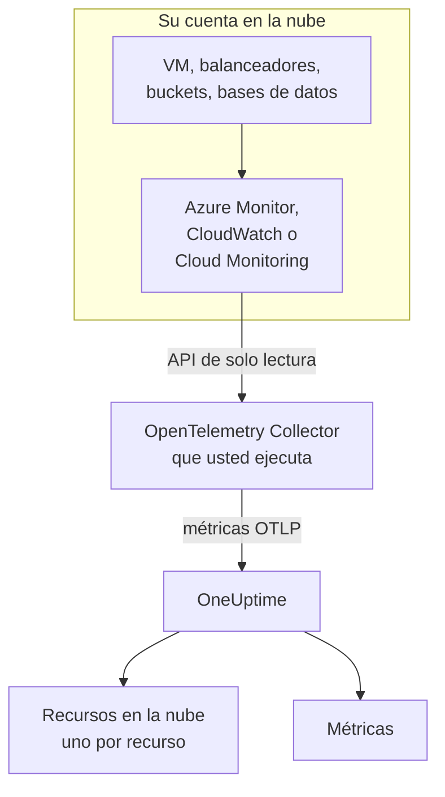
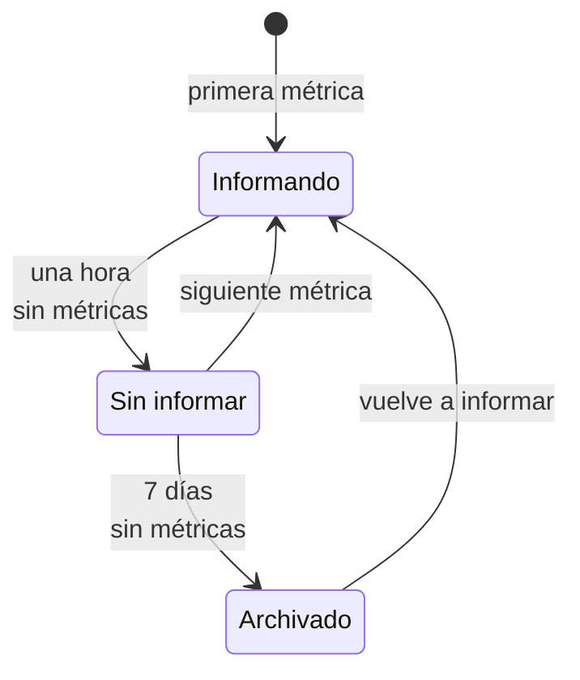

# Recursos en la nube (IaaS y PaaS)

**Recursos en la nube** lista los recursos IaaS y PaaS de sus cuentas de AWS, Azure y Google Cloud: máquinas virtuales, discos, balanceadores de carga, buckets, bases de datos gestionadas, cachés, colas, gateways de API y el resto. Cada uno tiene su propia página, con su tipo, región y cuenta, el ID que le da el proveedor, cada métrica que el proveedor publica sobre él, y propietarios y etiquetas como cualquier otro recurso de OneUptime. Los encontrará en **Nube → Todos los recursos**.

:::cards
- [Conectar Azure](#conectar-azure): Leer cada recurso de una suscripción desde Azure Monitor.
- [Conectar AWS](#conectar-aws): Consultar CloudWatch, o transmitirlo a través de Amazon Data Firehose.
- [Conectar Google Cloud](#conectar-google-cloud): Leer los servicios de un proyecto desde Cloud Monitoring.
- [Cómo se identifica un recurso](#cómo-se-identifica-un-recurso): Cada tipo de recurso que reconoce OneUptime, por proveedor.
:::

## Cómo funciona



- **El proveedor ya mide sus recursos.** Azure Monitor, Amazon CloudWatch y Google Cloud Monitoring publican métricas de cada recurso que ejecutan para usted.
- **Un colector que usted ejecuta las lee.** Un OpenTelemetry Collector con acceso de solo lectura a ese servicio de supervisión exporta las métricas a OneUptime. No se instala nada en los recursos, y OneUptime nunca guarda sus credenciales de la nube: las guarda el colector, en su entorno.
- **Cada recurso aparece con su primera métrica.** OneUptime deduce de cada punto de datos a qué recurso se refiere, y crea el recurso en la nube la primera vez que lo ve.

Recursos en la nube es uno de los varios lugares donde aparece su nube:

| Usted ejecuta | Dónde aparece | Cómo |
| --- | --- | --- |
| Contenedores en ECS, Cloud Run, Container Apps, App Service, … | **Nube → Todos los entornos** | La telemetría propia de sus cargas de trabajo, por su `cloud.platform`. Consulte [Entornos en la nube](/docs/telemetry/cloud-environments) |
| Cualquier recurso IaaS o PaaS que supervise el proveedor | **Nube → Todos los recursos** | La API de supervisión del proveedor, leída por un colector: esta página |
| Máquinas virtuales con un OpenTelemetry Collector instalado | **Hosts** | Las métricas y registros propios del host. Consulte [Colector OpenTelemetry en el host](/docs/telemetry/host-otel-collector) |
| Colas y temas que usan sus aplicaciones | **Colas** | Spans, y las mismas métricas de la nube. Consulte [Colas](/docs/telemetry/queues) |

Un recurso puede aparecer en más de un lugar. Una máquina virtual con el colector instalado es un **Host**, y sus métricas de plataforma (créditos de CPU, disco y red tal como los ve el hipervisor) la convierten también en un **Recurso en la nube**. Una cola de SQS es una **Cola** y un **Recurso en la nube**. Cada vista muestra lo que sabe su fuente.

## Antes de empezar

- **Una clave de ingesta.** Cree una clave **Servidor** en **Ajustes del proyecto → Telemetría y APM → Claves de ingesta**. Los colectores de abajo la leen de la variable de entorno `ONEUPTIME_TOKEN`, nunca de su archivo de configuración.
- **Un lugar donde ejecutar el OpenTelemetry Collector**: la distribución `otelcol-contrib`, imagen `otel/opentelemetry-collector-contrib`, con acceso de salida a su proveedor de nube y a OneUptime. Sirve una VM pequeña, un contenedor o su clúster de Kubernetes, y un colector puede leer varias cuentas y proveedores.
- **Acceso de lectura a la API de supervisión del proveedor.** El primer paso de cada proveedor, más abajo, lo crea.

> [!TIP]
> Los mismos pasos están en el panel, con su token ya incluido: en **Nube → Todos los recursos** hasta que llega el primer recurso, y en la pestaña **Documentación** de cada recurso, que se abre en su propio proveedor.

Si aloja OneUptime usted mismo, sustituya `https://oneuptime.com/otlp` por `https://YOUR-ONEUPTIME-HOST/otlp`.

## Conectar Azure

El receptor `azure_monitor` lista los recursos de una suscripción y lee sus métricas de plataforma cada minuto. Sin lista `services` lee todos los tipos de recurso, así que cada recurso de la suscripción se convierte en un recurso en la nube.

:::steps
### Crear una entidad de servicio con Monitoring Reader

**Monitoring Reader** lee métricas y lista recursos, y no puede cambiar nada:

```bash
az ad sp create-for-rbac \
  --name oneuptime-cloud-collector \
  --role "Monitoring Reader" \
  --scopes /subscriptions/<SUBSCRIPTION_ID>
```

Imprime un `appId` (el ID de cliente), un `password` (el secreto de cliente) y el `tenant`. Dé a la misma entidad de servicio el rol en más suscripciones para leerlas con el mismo colector.

### Configurar el receptor de Azure Monitor

Guarde esto como `config.yaml`:

```yaml
extensions:
  azure_auth:
    service_principal:
      tenant_id: ${env:AZURE_TENANT_ID}
      client_id: ${env:AZURE_CLIENT_ID}
      client_secret: ${env:AZURE_CLIENT_SECRET}

receivers:
  azure_monitor:
    subscription_ids: ["${env:AZURE_SUBSCRIPTION_ID}"]
    auth:
      authenticator: azure_auth
    collection_interval: 60s
    # No `services` list: every resource type in the subscription.
    # Series Azure returns per metric and resource (default 10).
    maximum_number_of_records_per_resource: 50

processors:
  batch: {}

exporters:
  otlphttp/oneuptime:
    endpoint: https://oneuptime.com/otlp
    headers:
      x-oneuptime-token: ${env:ONEUPTIME_TOKEN}

service:
  extensions: [azure_auth]
  pipelines:
    metrics:
      receivers: [azure_monitor]
      processors: [batch]
      exporters: [otlphttp/oneuptime]
```

### Ejecutar el colector de Azure

```bash
docker run -d --name oneuptime-cloud-collector --restart unless-stopped \
  -e ONEUPTIME_TOKEN=YOUR_TELEMETRY_INGESTION_TOKEN \
  -e AZURE_TENANT_ID=<TENANT> \
  -e AZURE_CLIENT_ID=<APP_ID> \
  -e AZURE_CLIENT_SECRET=<PASSWORD> \
  -e AZURE_SUBSCRIPTION_ID=<SUBSCRIPTION_ID> \
  -v "$(pwd)/config.yaml:/etc/otelcol-contrib/config.yaml" \
  otel/opentelemetry-collector-contrib:latest
```

Los recursos aparecen en **Nube → Todos los recursos** en pocos minutos.
:::

Opciones del receptor `azure_monitor`:

| Opción | Qué hace |
| --- | --- |
| `resource_groups`, `services`, `resource_tags` | Leer menos: una lista de grupos de recursos, de tipos de Resource Manager (`Microsoft.Compute/virtualMachines`), o de etiquetas que debe llevar un recurso |
| `metrics` | Limita cada tipo de recurso a las métricas y agregaciones que liste. En cuanto un tipo aparece en la lista, solo se leen sus métricas listadas |
| `discover_subscriptions: true` | Lee cada suscripción que la entidad de servicio puede ver, en lugar de `subscription_ids` |
| `maximum_number_of_records_per_resource` | Cuántas series devuelve Azure por métrica y recurso (10 por defecto). Súbalo cuando una métrica se divide por una dimensión con muchos valores |
| `use_batch_api: true` | Para suscripciones grandes. El receptor hace una llamada a Resource Manager por recurso y por lote de 20 métricas, y Resource Manager permite unas 12.000 lecturas por hora; la API por lotes lee hasta 50 recursos por llamada desde el plano de datos de Azure Monitor, cuyo límite es mucho mayor |
| `cache_resources` | Con qué frecuencia, en segundos, el receptor lista los recursos: una vez al día por defecto. Un recurso creado después de arrancar el colector puede tardar hasta un día en aparecer; reinicie el colector para listarlos de inmediato |

## Conectar AWS

Las métricas de CloudWatch llegan a OneUptime de una de dos maneras:

| | Consulta periódica | Metric Streams |
| --- | --- | --- |
| Cómo | El receptor `aws_cloudwatch` del colector consulta CloudWatch | CloudWatch envía a través de Amazon Data Firehose al receptor `awsfirehose` del colector |
| Requisitos en AWS | Solo credenciales | Un flujo de Firehose y un metric stream en cada región |
| El colector debe ser accesible desde AWS | No | Sí, por HTTPS en el puerto 443 |
| Retraso | De 10 a 20 minutos | Unos minutos |
| Adecuado para | La mayoría de las cuentas | Cuentas grandes |

### Consulta periódica con el receptor aws_cloudwatch

:::steps
#### Permitir que el colector lea CloudWatch

Adjunte esta política al rol con el que se ejecuta el colector (un perfil de instancia de EC2, un rol de tarea de ECS, una cuenta de servicio de EKS), o a un usuario de IAM cuyas claves de acceso le dé:

```json
{
  "Version": "2012-10-17",
  "Statement": [
    {
      "Effect": "Allow",
      "Action": [
        "cloudwatch:ListMetrics",
        "cloudwatch:GetMetricData",
        "sts:GetCallerIdentity"
      ],
      "Resource": "*"
    }
  ]
}
```

`sts:GetCallerIdentity` permite al receptor informar el ID de cuenta, que necesita el ARN de cada recurso.

#### Configurar los receptores de CloudWatch

Un receptor lee un namespace en una región, así que añada uno por cada namespace y región que quiera. Este ejemplo lee los habituales; guárdelo como `config.yaml`:

```yaml
receivers:
  aws_cloudwatch/ec2:
    region: ${env:AWS_REGION}
    metrics:
      collection_interval: 5m
      period: 5m
      delay: 10m
      discovery:
        filters:
          namespace: AWS/EC2
        # Metrics read per scrape, at most. Each costs 4 GetMetricData queries.
        limit: 1000
  aws_cloudwatch/ebs:
    region: ${env:AWS_REGION}
    metrics:
      collection_interval: 5m
      period: 5m
      delay: 10m
      discovery:
        filters:
          namespace: AWS/EBS
        # Metrics read per scrape, at most. Each costs 4 GetMetricData queries.
        limit: 1000
  aws_cloudwatch/applicationelb:
    region: ${env:AWS_REGION}
    metrics:
      collection_interval: 5m
      period: 5m
      delay: 10m
      discovery:
        filters:
          namespace: AWS/ApplicationELB
        # Metrics read per scrape, at most. Each costs 4 GetMetricData queries.
        limit: 1000
  aws_cloudwatch/rds:
    region: ${env:AWS_REGION}
    metrics:
      collection_interval: 5m
      period: 5m
      delay: 10m
      discovery:
        filters:
          namespace: AWS/RDS
        # Metrics read per scrape, at most. Each costs 4 GetMetricData queries.
        limit: 1000
  aws_cloudwatch/lambda:
    region: ${env:AWS_REGION}
    metrics:
      collection_interval: 5m
      period: 5m
      delay: 10m
      discovery:
        filters:
          namespace: AWS/Lambda
        # Metrics read per scrape, at most. Each costs 4 GetMetricData queries.
        limit: 1000
  aws_cloudwatch/dynamodb:
    region: ${env:AWS_REGION}
    metrics:
      collection_interval: 5m
      period: 5m
      delay: 10m
      discovery:
        filters:
          namespace: AWS/DynamoDB
        # Metrics read per scrape, at most. Each costs 4 GetMetricData queries.
        limit: 1000

processors:
  batch: {}

exporters:
  otlphttp/oneuptime:
    endpoint: https://oneuptime.com/otlp
    headers:
      x-oneuptime-token: ${env:ONEUPTIME_TOKEN}

service:
  pipelines:
    metrics:
      receivers: [aws_cloudwatch/ec2, aws_cloudwatch/ebs, aws_cloudwatch/applicationelb, aws_cloudwatch/rds, aws_cloudwatch/lambda, aws_cloudwatch/dynamodb]
      processors: [batch]
      exporters: [otlphttp/oneuptime]
```

#### Ejecutar el colector de CloudWatch

```bash
docker run -d --name oneuptime-cloud-collector --restart unless-stopped \
  -e ONEUPTIME_TOKEN=YOUR_TELEMETRY_INGESTION_TOKEN \
  -e AWS_REGION=us-east-1 \
  -e AWS_ACCESS_KEY_ID=<ACCESS_KEY_ID> \
  -e AWS_SECRET_ACCESS_KEY=<SECRET_ACCESS_KEY> \
  -v "$(pwd)/config.yaml:/etc/otelcol-contrib/config.yaml" \
  otel/opentelemetry-collector-contrib:latest
```

En una instancia de EC2, una tarea de ECS o un pod de EKS que tenga el rol, omita las dos variables de clave.
:::

- **Deje `stats` sin definir.** Cada métrica se lee entonces como un resumen por periodo: cuatro estadísticas, cuatro consultas `GetMetricData`, y AWS cobra `GetMetricData` por métrica solicitada. `discovery.limit` limita las métricas que un receptor lee por recolección (defínalo: el valor predeterminado del propio receptor es 100), y un `collection_interval` más largo las lee con menos frecuencia.
- **Los datos llegan tarde.** `delay` espera a que CloudWatch publique un periodo, así que los puntos de datos llegan de 10 a 20 minutos después del momento que miden, y los recursos aparecen en unos veinte minutos.

### Streaming con CloudWatch Metric Streams

:::steps
#### Configurar el receptor de Firehose

El colector necesita un certificado para su dirección: Firehose solo entrega a `https://` en el puerto 443. Guarde esto como `config.yaml`:

```yaml
extensions:
  awscloudwatchmetricstreams_encoding:
    format: opentelemetry1.0

receivers:
  awsfirehose:
    # Firehose delivers to HTTPS on port 443 only: expose this port as
    # 443, for example behind a load balancer.
    endpoint: 0.0.0.0:4433
    encoding: awscloudwatchmetricstreams_encoding
    access_key: ${env:FIREHOSE_ACCESS_KEY}
    tls:
      cert_file: /etc/otelcol-contrib/tls/server.crt
      key_file: /etc/otelcol-contrib/tls/server.key

processors:
  batch: {}

exporters:
  otlphttp/oneuptime:
    endpoint: https://oneuptime.com/otlp
    headers:
      x-oneuptime-token: ${env:ONEUPTIME_TOKEN}

service:
  extensions: [awscloudwatchmetricstreams_encoding]
  pipelines:
    metrics:
      receivers: [awsfirehose]
      processors: [batch]
      exporters: [otlphttp/oneuptime]
```

#### Ejecutar el colector de Firehose

```bash
docker run -d --name oneuptime-cloud-collector --restart unless-stopped \
  -e ONEUPTIME_TOKEN=YOUR_TELEMETRY_INGESTION_TOKEN \
  -e FIREHOSE_ACCESS_KEY=<A_LONG_RANDOM_SECRET> \
  -p 4433:4433 \
  -v "$(pwd)/tls:/etc/otelcol-contrib/tls:ro" \
  -v "$(pwd)/config.yaml:/etc/otelcol-contrib/config.yaml" \
  otel/opentelemetry-collector-contrib:latest
```

El certificado y su clave van en `tls/`, como `server.crt` y `server.key`. Publique el puerto 4433 detrás de algo que responda en el 443, como un balanceador de carga.

#### Crear el flujo de Firehose y el metric stream

1. **Amazon Data Firehose → Create Firehose stream**: origen **Direct PUT**, destino **HTTP Endpoint**. La URL del endpoint es la dirección `https://` del colector; la clave de acceso es `FIREHOSE_ACCESS_KEY`. Elija o cree un bucket de S3 para las entregas fallidas.
2. **CloudWatch → Metrics → Streams → Create metric stream**: los namespaces que se incluyen (o todos), el flujo de Firehose y el formato de salida **OpenTelemetry 1.0**.
3. Repita en cada región: un metric stream lleva las métricas de su propia región.
:::

AWS cobra un metric stream por cada actualización de métrica que entrega, más los cargos de datos de Firehose, así que incluya solo los namespaces que quiera. Un flujo en formato **JSON** (`format: json` en la extensión de codificación) nombra los mismos recursos, pero además escribe cada namespace en `service.name`, así que cada namespace aparece también en **Servicios**: prefiera **OpenTelemetry 1.0**.

## Conectar Google Cloud

El receptor `googlecloudmonitoring` lee los tipos de métrica que nombra su `metrics_list`, para un proyecto.

:::steps
### Crear una cuenta de servicio con Monitoring Viewer

**Monitoring Viewer** lee métricas, y no puede cambiar nada:

```bash
gcloud iam service-accounts create oneuptime-cloud-collector \
  --project <PROJECT_ID>

gcloud projects add-iam-policy-binding <PROJECT_ID> \
  --member "serviceAccount:oneuptime-cloud-collector@<PROJECT_ID>.iam.gserviceaccount.com" \
  --role roles/monitoring.viewer

gcloud iam service-accounts keys create key.json \
  --iam-account oneuptime-cloud-collector@<PROJECT_ID>.iam.gserviceaccount.com
```

En el propio Google Cloud, ejecute el colector como esta cuenta de servicio en lugar de crear una clave.

### Configurar el receptor de Cloud Monitoring

Cada filtro lee todos los tipos de métrica de un servicio. Guarde esto como `config.yaml`:

```yaml
receivers:
  googlecloudmonitoring:
    project_id: ${env:GCP_PROJECT_ID}
    collection_interval: 2m
    # Only the metric types these filters list are read.
    metrics_list:
      - metric_descriptor_filter: 'metric.type = starts_with("compute.googleapis.com/")'
      - metric_descriptor_filter: 'metric.type = starts_with("cloudsql.googleapis.com/")'
      - metric_descriptor_filter: 'metric.type = starts_with("loadbalancing.googleapis.com/")'
      - metric_descriptor_filter: 'metric.type = starts_with("storage.googleapis.com/")'
      - metric_descriptor_filter: 'metric.type = starts_with("redis.googleapis.com/")'
      - metric_descriptor_filter: 'metric.type = starts_with("run.googleapis.com/")'

processors:
  batch: {}

exporters:
  otlphttp/oneuptime:
    endpoint: https://oneuptime.com/otlp
    headers:
      x-oneuptime-token: ${env:ONEUPTIME_TOKEN}

service:
  pipelines:
    metrics:
      receivers: [googlecloudmonitoring]
      processors: [batch]
      exporters: [otlphttp/oneuptime]
```

### Ejecutar el colector de Google Cloud

```bash
docker run -d --name oneuptime-cloud-collector --restart unless-stopped \
  -e ONEUPTIME_TOKEN=YOUR_TELEMETRY_INGESTION_TOKEN \
  -e GCP_PROJECT_ID=<PROJECT_ID> \
  -e GOOGLE_APPLICATION_CREDENTIALS=/etc/otelcol-contrib/key.json \
  -v "$(pwd)/key.json:/etc/otelcol-contrib/key.json:ro" \
  -v "$(pwd)/config.yaml:/etc/otelcol-contrib/config.yaml" \
  otel/opentelemetry-collector-contrib:latest
```
:::

- **La lista se lee al arrancar el colector:** reinícielo después de un cambio. `metric_name: compute.googleapis.com/instance/cpu/utilization` lee un solo tipo en lugar de todos los tipos de un servicio.
- **Un receptor lee un proyecto:** añada uno por proyecto.
- **Leer tiene un coste y una cuota.** Cada tipo de métrica es una lectura de la API de Cloud Monitoring por intervalo de recolección. Leer las métricas propias de Google Cloud es gratis dentro de la asignación mensual de la API; un `collection_interval` más largo mantiene un proyecto grande dentro de ella, y dentro de la cuota por minuto.

## Mantener el pipeline sin detección de recursos

> [!WARNING]
> No añada el procesador `resourcedetection` al pipeline que lee la supervisión de la nube. Pone el `host.name` y el `os.type` de la propia máquina del colector en cada punto de datos, y OneUptime archiva entonces las métricas de su nube también bajo esa máquina en **Hosts**. Un colector que además supervisa su propio host debería hacerlo en un pipeline aparte.

## Cómo se identifica un recurso

Cada punto de datos de estos receptores nombra un recurso, y OneUptime asocia el recurso en la nube con la identidad de ese recurso, nunca con su nombre, que usted puede cambiar. La identidad se compara sin distinguir mayúsculas de minúsculas, así que un recurso informado con dos grafías es un solo recurso.

### Azure

Cada punto de datos lleva el ID de recurso de Azure de su recurso (`azuremonitor.resource_id`), así que cada recurso que lee el receptor se convierte en un recurso en la nube: los tipos de abajo con un nombre legible, cualquier otro con su tipo de Resource Manager. El ID de recurso, la región, la suscripción y el grupo de recursos se muestran en el recurso.

:::details Los tipos de recurso de Azure con un nombre legible
| Tipo de recurso | Se muestra como | Modelo |
| --- | --- | --- |
| `Microsoft.Compute/virtualMachines` | Virtual Machine | IaaS |
| `Microsoft.Compute/virtualMachineScaleSets` | Virtual Machine Scale Set | IaaS |
| `Microsoft.Compute/disks` | Managed Disk | IaaS |
| `Microsoft.Network/loadBalancers` | Load Balancer | IaaS |
| `Microsoft.Network/applicationGateways` | Application Gateway | IaaS |
| `Microsoft.Network/publicIPAddresses` | Public IP Address | IaaS |
| `Microsoft.Network/natGateways` | NAT Gateway | IaaS |
| `Microsoft.Network/virtualNetworkGateways` | Virtual Network Gateway | IaaS |
| `Microsoft.Network/expressRouteCircuits` | ExpressRoute Circuit | IaaS |
| `Microsoft.Network/azureFirewalls` | Azure Firewall | IaaS |
| `Microsoft.Network/frontdoors` | Front Door (classic) | IaaS |
| `Microsoft.Cdn/profiles` | Front Door and CDN Profile | IaaS |
| `Microsoft.Network/trafficmanagerprofiles` | Traffic Manager Profile | IaaS |
| `Microsoft.Network/networkInterfaces` | Network Interface | IaaS |
| `Microsoft.Network/virtualNetworks` | Virtual Network | IaaS |
| `Microsoft.Network/privateEndpoints` | Private Endpoint | IaaS |
| `Microsoft.Network/dnszones` | DNS Zone | IaaS |
| `Microsoft.Network/bastionHosts` | Bastion | IaaS |
| `Microsoft.Storage/storageAccounts` | Storage Account | IaaS |
| `Microsoft.RecoveryServices/vaults` | Recovery Services Vault | PaaS |
| `Microsoft.Web/sites` | App Service or Function App | PaaS |
| `Microsoft.Web/serverfarms` | App Service Plan | PaaS |
| `Microsoft.Web/staticSites` | Static Web App | PaaS |
| `Microsoft.App/containerApps` | Container App | PaaS |
| `Microsoft.App/managedEnvironments` | Container Apps Environment | PaaS |
| `Microsoft.ContainerInstance/containerGroups` | Container Instance | PaaS |
| `Microsoft.ContainerService/managedClusters` | AKS Cluster | PaaS |
| `Microsoft.ContainerRegistry/registries` | Container Registry | PaaS |
| `Microsoft.SignalRService/SignalR` | SignalR Service | PaaS |
| `Microsoft.Sql/servers/databases` | SQL Database | PaaS |
| `Microsoft.Sql/servers/elasticpools` | SQL Elastic Pool | PaaS |
| `Microsoft.Sql/managedInstances` | SQL Managed Instance | PaaS |
| `Microsoft.DBforPostgreSQL/flexibleServers` | PostgreSQL Flexible Server | PaaS |
| `Microsoft.DBforMySQL/flexibleServers` | MySQL Flexible Server | PaaS |
| `Microsoft.DocumentDB/databaseAccounts` | Cosmos DB Account | PaaS |
| `Microsoft.Cache/redis` | Azure Cache for Redis | PaaS |
| `Microsoft.Cache/redisEnterprise` | Azure Managed Redis | PaaS |
| `Microsoft.ServiceBus/namespaces` | Service Bus Namespace | PaaS |
| `Microsoft.EventHub/namespaces` | Event Hubs Namespace | PaaS |
| `Microsoft.EventGrid/topics` | Event Grid Topic | PaaS |
| `Microsoft.EventGrid/systemTopics` | Event Grid System Topic | PaaS |
| `Microsoft.EventGrid/namespaces` | Event Grid Namespace | PaaS |
| `Microsoft.ApiManagement/service` | API Management | PaaS |
| `Microsoft.Logic/workflows` | Logic App | PaaS |
| `Microsoft.DataFactory/factories` | Data Factory | PaaS |
| `Microsoft.Synapse/workspaces` | Synapse Workspace | PaaS |
| `Microsoft.Kusto/clusters` | Data Explorer Cluster | PaaS |
| `Microsoft.StreamAnalytics/streamingjobs` | Stream Analytics Job | PaaS |
| `Microsoft.CognitiveServices/accounts` | Azure AI Services or OpenAI | PaaS |
| `Microsoft.Search/searchServices` | AI Search Service | PaaS |
| `Microsoft.MachineLearningServices/workspaces` | Machine Learning Workspace | PaaS |
| `Microsoft.KeyVault/vaults` | Key Vault | PaaS |
| `Microsoft.Insights/components` | Application Insights | PaaS |
| `Microsoft.OperationalInsights/workspaces` | Log Analytics Workspace | PaaS |
| `Microsoft.Automation/automationAccounts` | Automation Account | PaaS |
| `Microsoft.Devices/IotHubs` | IoT Hub | PaaS |
:::

### AWS

Una métrica de CloudWatch nombra su recurso en una dimensión que depende del namespace. Un punto de datos que lleva las dimensiones de **Identificado por** pertenece a ese recurso, junto con su cuenta y su región; las dimensiones adicionales acotan la serie, no el recurso (las series por grupo de destino de un Application Load Balancer pertenecen al balanceador). Un punto de datos agregado sobre otra cosa (`InstanceType`, `DatabaseClass`, un total de toda la cuenta) no nombra ningún recurso y no se descubre. Tampoco un namespace que no está en la lista: sus métricas llegan igualmente a **Métricas**.

Cada recurso se muestra con su ARN cuando sus métricas lo nombran completo; cuando no (el ARN de un grupo de Auto Scaling lleva un UUID que ninguna métrica informa), con su namespace y sus dimensiones.

:::details Los namespaces de CloudWatch y las dimensiones que identifican un recurso
| Namespace | Identificado por | Se muestra como | Tipo de recurso | Modelo |
| --- | --- | --- | --- | --- |
| `AWS/EC2` | `InstanceId` | EC2 Instance | `AWS::EC2::Instance` | IaaS |
| `AWS/EC2` | `AutoScalingGroupName` (without `InstanceId`) | Auto Scaling Group | `AWS::AutoScaling::AutoScalingGroup` | IaaS |
| `AWS/AutoScaling` | `AutoScalingGroupName` | Auto Scaling Group | `AWS::AutoScaling::AutoScalingGroup` | IaaS |
| `AWS/EBS` | `VolumeId` | EBS Volume | `AWS::EC2::Volume` | IaaS |
| `AWS/ELB` | `LoadBalancerName` | Classic Load Balancer | `AWS::ElasticLoadBalancing::LoadBalancer` | IaaS |
| `AWS/ApplicationELB` | `LoadBalancer` | Elastic Load Balancer (ALB, NLB, GWLB) | `AWS::ElasticLoadBalancingV2::LoadBalancer` | IaaS |
| `AWS/NetworkELB` | `LoadBalancer` | Elastic Load Balancer (ALB, NLB, GWLB) | `AWS::ElasticLoadBalancingV2::LoadBalancer` | IaaS |
| `AWS/GatewayELB` | `LoadBalancer` | Elastic Load Balancer (ALB, NLB, GWLB) | `AWS::ElasticLoadBalancingV2::LoadBalancer` | IaaS |
| `AWS/NATGateway` | `NatGatewayId` | NAT Gateway | `AWS::EC2::NatGateway` | IaaS |
| `AWS/TransitGateway` | `TransitGateway` | Transit Gateway | `AWS::EC2::TransitGateway` | IaaS |
| `AWS/VPN` | `VpnId` | Site-to-Site VPN Connection | `AWS::EC2::VPNConnection` | IaaS |
| `AWS/DX` | `ConnectionId` | Direct Connect Connection | `AWS::DirectConnect::Connection` | IaaS |
| `AWS/CloudFront` | `DistributionId` | CloudFront Distribution | `AWS::CloudFront::Distribution` | IaaS |
| `AWS/GlobalAccelerator` | `Accelerator` (without `Listener`, `EndpointGroup`) | Global Accelerator | `AWS::GlobalAccelerator::Accelerator` | IaaS |
| `AWS/Route53` | `HealthCheckId` | Route 53 Health Check | `AWS::Route53::HealthCheck` | IaaS |
| `AWS/NetworkFirewall` | `FirewallName` | Network Firewall | `AWS::NetworkFirewall::Firewall` | IaaS |
| `AWS/WAFV2` | `WebACL` (without `Rule`, `RuleGroup`) | WAF Web ACL | `AWS::WAFv2::WebACL` | PaaS |
| `AWS/S3` | `BucketName` | S3 Bucket | `AWS::S3::Bucket` | IaaS |
| `AWS/EFS` | `FileSystemId` | EFS File System | `AWS::EFS::FileSystem` | IaaS |
| `AWS/FSx` | `FileSystemId` | FSx File System | `AWS::FSx::FileSystem` | IaaS |
| `AWS/ECS` | `ClusterName` + `ServiceName` | ECS Service | `AWS::ECS::Service` | PaaS |
| `AWS/ECS` | `ClusterName` (without `ServiceName`) | ECS Cluster | `AWS::ECS::Cluster` | PaaS |
| `AWS/AppRunner` | `ServiceName` | App Runner Service | `AWS::AppRunner::Service` | PaaS |
| `AWS/ElasticBeanstalk` | `EnvironmentName` | Elastic Beanstalk Environment | `AWS::ElasticBeanstalk::Environment` | PaaS |
| `AWS/Lambda` | `FunctionName` | Lambda Function | `AWS::Lambda::Function` | PaaS |
| `AWS/States` | `StateMachineArn` | Step Functions State Machine | `AWS::StepFunctions::StateMachine` | PaaS |
| `AWS/RDS` | `DBInstanceIdentifier` | RDS DB Instance | `AWS::RDS::DBInstance` | PaaS |
| `AWS/RDS` | `DBClusterIdentifier` (without `DBInstanceIdentifier`) | Aurora / RDS DB Cluster | `AWS::RDS::DBCluster` | PaaS |
| `AWS/DocDB` | `DBInstanceIdentifier` | DocumentDB Instance | `AWS::DocDB::DBInstance` | PaaS |
| `AWS/DocDB` | `DBClusterIdentifier` (without `DBInstanceIdentifier`) | DocumentDB Cluster | `AWS::DocDB::DBCluster` | PaaS |
| `AWS/Neptune` | `DBInstanceIdentifier` | Neptune Instance | `AWS::Neptune::DBInstance` | PaaS |
| `AWS/Neptune` | `DBClusterIdentifier` (without `DBInstanceIdentifier`) | Neptune Cluster | `AWS::Neptune::DBCluster` | PaaS |
| `AWS/DynamoDB` | `TableName` | DynamoDB Table | `AWS::DynamoDB::Table` | PaaS |
| `AWS/ElastiCache` | `CacheClusterId` | ElastiCache Cluster | `AWS::ElastiCache::CacheCluster` | PaaS |
| `AWS/ElastiCache` | `ReplicationGroupId` (without `CacheClusterId`) | ElastiCache Replication Group | `AWS::ElastiCache::ReplicationGroup` | PaaS |
| `AWS/ElastiCache` | `clusterId` (without `CacheClusterId`) | ElastiCache Serverless Cache | `AWS::ElastiCache::ServerlessCache` | PaaS |
| `AWS/MemoryDB` | `ClusterName` | MemoryDB Cluster | `AWS::MemoryDB::Cluster` | PaaS |
| `AWS/Redshift` | `ClusterIdentifier` | Redshift Cluster | `AWS::Redshift::Cluster` | PaaS |
| `AWS/ES` | `DomainName` | OpenSearch Domain | `AWS::OpenSearchService::Domain` | PaaS |
| `AWS/SQS` | `QueueName` | SQS Queue | `AWS::SQS::Queue` | PaaS |
| `AWS/SNS` | `TopicName` | SNS Topic | `AWS::SNS::Topic` | PaaS |
| `AWS/Kinesis` | `StreamName` | Kinesis Data Stream | `AWS::Kinesis::Stream` | PaaS |
| `AWS/Firehose` | `DeliveryStreamName` | Data Firehose Stream | `AWS::KinesisFirehose::DeliveryStream` | PaaS |
| `AWS/AmazonMQ` | `Broker` | Amazon MQ Broker | `AWS::AmazonMQ::Broker` | PaaS |
| `AWS/Kafka` | `Cluster Name` | MSK Cluster | `AWS::MSK::Cluster` | PaaS |
| `AWS/Events` | `RuleName` | EventBridge Rule | `AWS::Events::Rule` | PaaS |
| `AWS/ApiGateway` | `ApiName` | API Gateway REST API | `AWS::ApiGateway::RestApi` | PaaS |
| `AWS/ApiGateway` | `ApiId` (without `ApiName`) | API Gateway HTTP or WebSocket API | `AWS::ApiGatewayV2::Api` | PaaS |
| `AWS/AppSync` | `GraphQLAPIId` | AppSync GraphQL API | `AWS::AppSync::GraphQLApi` | PaaS |
| `AWS/CertificateManager` | `CertificateArn` | ACM Certificate | `AWS::CertificateManager::Certificate` | PaaS |
| `AWS/KMS` | `KeyId` | KMS Key | `AWS::KMS::Key` | PaaS |
| `AWS/Cognito` | `UserPool` | Cognito User Pool | `AWS::Cognito::UserPool` | PaaS |
| `AWS/SageMaker` | `EndpointName` | SageMaker Endpoint | `AWS::SageMaker::Endpoint` | PaaS |
| `AWS/Logs` | `LogGroupName` | CloudWatch Log Group | `AWS::Logs::LogGroup` | PaaS |
:::

### Google Cloud

Cloud Monitoring nombra el recurso supervisado de cada métrica con un tipo y etiquetas. Un punto de datos de un tipo de abajo pertenece a ese recurso, identificado por las etiquetas listadas; las demás etiquetas del recurso, y sus etiquetas de metadatos, nunca lo dividen. Los tipos de Kubernetes (`k8s_container`, `k8s_pod`, …) se dejan al producto [Kubernetes](/docs/telemetry/kubernetes-agent).

:::details Los tipos de recurso de Cloud Monitoring y las etiquetas que los identifican
| Tipo de recurso supervisado | Identificado por | Se muestra como | Modelo |
| --- | --- | --- | --- |
| `gce_instance` | `project_id`, `zone`, `instance_id` | Compute Engine VM Instance | IaaS |
| `instance_group` | `project_id`, `location`, `instance_group_id` | Instance Group | IaaS |
| `gcs_bucket` | `project_id`, `bucket_name` | Cloud Storage Bucket | IaaS |
| `filestore_instance` | `project_id`, `location`, `instance_name` | Filestore Instance | IaaS |
| `https_lb_rule` | `project_id`, `url_map_name` | External Application Load Balancer | IaaS |
| `internal_http_lb_rule` | `project_id`, `region`, `url_map_name` | Internal Application Load Balancer | IaaS |
| `vpn_gateway` | `project_id`, `region`, `gateway_id` | Cloud VPN Gateway | IaaS |
| `nat_gateway` | `project_id`, `region`, `router_id`, `gateway_name` | Cloud NAT Gateway | IaaS |
| `gce_router` | `project_id`, `region`, `router_id` | Cloud Router | IaaS |
| `cloudsql_database` | `project_id`, `database_id` | Cloud SQL Instance | PaaS |
| `alloydb.googleapis.com/Instance` | `resource_container`, `location`, `cluster_id`, `instance_id` | AlloyDB Instance | PaaS |
| `redis_instance` | `project_id`, `region`, `instance_id` | Memorystore for Redis Instance | PaaS |
| `spanner_instance` | `project_id`, `instance_id` | Spanner Instance | PaaS |
| `bigtable_table` | `project_id`, `instance` | Bigtable Instance | PaaS |
| `bigquery_dataset` | `project_id`, `dataset_id` | BigQuery Dataset | PaaS |
| `cloud_function` | `project_id`, `region`, `function_name` | Cloud Run Function | PaaS |
| `cloud_run_revision` | `project_id`, `location`, `service_name` | Cloud Run Service | PaaS |
| `cloud_run_job` | `project_id`, `location`, `job_name` | Cloud Run Job | PaaS |
| `gae_app` | `project_id`, `module_id` | App Engine Service | PaaS |
| `pubsub_topic` | `project_id`, `topic_id` | Pub/Sub Topic | PaaS |
| `pubsub_subscription` | `project_id`, `subscription_id` | Pub/Sub Subscription | PaaS |
| `cloud_tasks_queue` | `project_id`, `location`, `queue_id` | Cloud Tasks Queue | PaaS |
| `cloud_composer_environment` | `project_id`, `location`, `environment_name` | Cloud Composer Environment | PaaS |
| `dataproc_cluster` | `project_id`, `region`, `cluster_name` | Dataproc Cluster | PaaS |
| `aiplatform.googleapis.com/Endpoint` | `resource_container`, `location`, `endpoint_id` | Vertex AI Endpoint | PaaS |
:::

### Nombres

Un recurso se nombra según lo llama su proveedor (`vm-prod-01`, `checkout`, `orders`). Los nombres son únicos dentro de un proyecto, y los del proveedor no: dos suscripciones tienen cada una un `web-01`, y un plan de App Service y su app se llaman ambos `checkout`. Así que un recurso cuyo nombre ya está ocupado se nombra con su tipo, después su grupo de recursos o región, y después su cuenta: `web-01 (Virtual Machine, rg-prod)`. Cambie el nombre de cualquier recurso en su pestaña **Ajustes**: las métricas se asocian por su identidad, no por su nombre.

## Estado, archivado y límites



- **Informando** significa que el proveedor envió una métrica sobre el recurso en la última hora; tras una hora sin ninguna muestra **Sin informar**. Algunos recursos son silenciosos por naturaleza, como un Key Vault al que nadie llamó o un bucket cuyas métricas de almacenamiento CloudWatch publica una vez al día, y vuelven con su siguiente punto de datos.
- Un recurso que no envía **ninguna métrica durante 7 días** se archiva automáticamente: una instancia que un grupo de Auto Scaling sustituyó, un volumen eliminado, un bucket que ya no existe. Conserva sus etiquetas, propietarios e historial en **Nube → Avanzado → Archivado**, y se restaura solo en cuanto vuelve a informar. Un recurso que archiva usted sigue archivado; uno que restaura mientras está en silencio permanece en la lista hasta que informa.
- Eliminar un recurso que el proveedor sigue informando no sirve: se vuelve a descubrir a partir de sus siguientes métricas. Archívelo en su lugar.
- El descubrimiento deja de crear recursos cuando un proyecto tiene **5.000** activos (no archivados), y registra una advertencia; los recursos archivados no cuentan.

Las instalaciones autoalojadas pueden cambiar estos valores con variables de entorno en la app:

| Variable | Valor predeterminado | Significado |
| --- | --- | --- |
| `CLOUD_RESOURCE_AUTO_ARCHIVE_DAYS` | `7` | Días sin métricas antes de que un recurso se archive (al menos 1) |
| `CLOUD_RESOURCE_AUTO_CREATE_BUDGET` | `5000` | Recursos activos que un proyecto puede tener antes de que el descubrimiento deje de crear más (`0` desactiva el descubrimiento) |

## Alertar sobre un recurso

:::steps
1. Abra el recurso y su pestaña **Métricas**, que lista cada métrica que su proveedor informa sobre él.
2. Abra una métrica para representarla en el explorador de métricas, ya filtrada al recurso.
3. Haga clic en **Crear monitor a partir de esta vista**: el monitor vigila esa métrica para ese recurso.
:::

> [!IMPORTANT]
> La supervisión de la nube publica cada valor unos minutos después del momento que mide: de 10 a 20 minutos para CloudWatch consultado como arriba, unos minutos para Azure Monitor y Cloud Monitoring. Se guarda en el momento que mide. Dé a un monitor sobre estas métricas una ventana más larga que eso (30 minutos para CloudWatch, 15 para los demás), o no verá datos y nunca se disparará.

## Inventario y reglas

- **Inventario:** los recursos en la nube aparecen en el [Inventario](/docs/inventory/overview) como elementos de tipo **Recurso en la nube**, con el ID del proveedor como `cloud.resource.id` y el tipo como `cloud.resource.type`. Las herramientas de recursos del agente de IA también los listan.
- **Reglas:** **Nube → Ajustes → Reglas de etiquetas** y **Reglas del propietario** se aplican a ellos igual que a los entornos en la nube.

## Solución de problemas

### No aparece ningún recurso

1. Compruebe el token: `curl -i https://oneuptime.com/otlp/v1/validate -H "x-oneuptime-token: YOUR_TELEMETRY_INGESTION_TOKEN"` debe responder `200` con `"valid": true`.
2. Lea el registro del colector (`docker logs oneuptime-cloud-collector`). Un error de autorización nombra el permiso que falta: `AuthorizationFailed` (Azure: **Monitoring Reader** en la suscripción), `AccessDenied` en `cloudwatch:GetMetricData` (AWS: la política de arriba), `PermissionDenied` (Google Cloud: **Monitoring Viewer**).
3. Busque en **Métricas** las métricas del proveedor (`azure_…`, `amazonaws.com/aws/…`, `compute.googleapis.com/…`). Si están pero no hay ningún recurso, los puntos de datos no nombran ningún recurso que OneUptime reconozca: un namespace de AWS o un tipo de Google Cloud que no está en las listas de arriba, o un punto de datos agregado sobre algo que no es un recurso.
4. Espere a los datos tardíos: CloudWatch consultado como arriba va de 10 a 20 minutos por detrás.

### Falta un recurso

- **Azure:** el receptor lista los recursos una vez al día; reinicie el colector para listar los nuevos ahora. Un tipo de recurso sin métricas de plataforma en Azure Monitor no tiene nada que informar.
- **AWS:** cada receptor lee un namespace en una región, y `discovery.limit` limita cuántas métricas lee: súbalo cuando una cuenta tenga más.
- **Google Cloud:** `metrics_list` debe nombrar el servicio del recurso.
- **Cualquier proveedor:** un proyecto que llegó al límite no crea recursos nuevos hasta que se archiven algunos. Consulte [Estado, archivado y límites](#estado-archivado-y-límites).

### El mismo recurso aparece dos veces

Un recurso de AWS leído una vez con su ID de cuenta y otra sin él son dos recursos: el receptor de consulta solo informa la cuenta cuando puede llamar a `sts:GetCallerIdentity`. Dé ese permiso a cada colector, y archive la copia sin cuenta.

### Las métricas de mi nube aparecen bajo un host

El pipeline tiene un procesador `resourcedetection`. Consulte [Mantener el pipeline sin detección de recursos](#mantener-el-pipeline-sin-detección-de-recursos).

## Limitaciones

- **Solo métricas.** Las API de supervisión de los proveedores no publican registros ni trazas sobre un recurso. Envíelos desde sus cargas de trabajo con OpenTelemetry.
- **El descubrimiento sigue a las métricas.** Un recurso sobre el que el proveedor no publica métricas, o que el colector no lee, no se descubre.
- **Sin ajuste de retención propio.** Las métricas de un recurso se conservan tanto como el resto de las métricas que envía su colector.
- **Consultar cuesta dinero** y cuenta contra los límites de las API de la nube: consulte las notas de cada proveedor de arriba.

## Próximos pasos

:::cards
- [Entornos en la nube](/docs/telemetry/cloud-environments): Sus contenedores en ECS, Cloud Run y Container Apps, desde su propia telemetría.
- [Colas](/docs/telemetry/queues): SQS, Service Bus y Pub/Sub, con las mismas métricas de la nube.
- [Reglas de etiquetas y propietarios](/docs/configuration/label-and-owner-rules): Etiquetar recursos y asignarles propietarios a medida que se descubren.
- [Inventario](/docs/inventory/overview): Cada host, dispositivo y recurso en la nube en una sola lista.
:::
