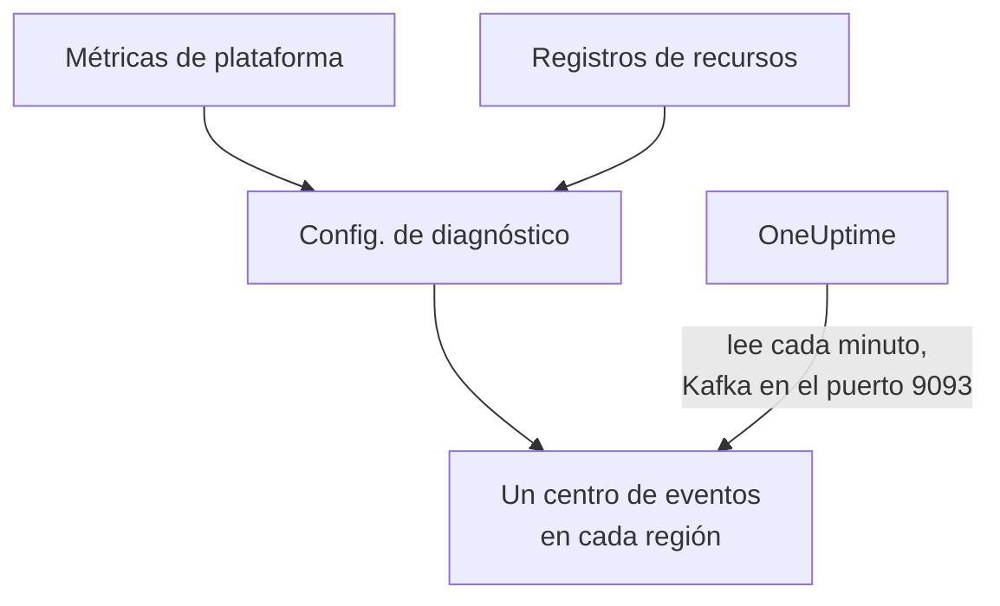

# Transmitir métricas y registros de Azure Monitor

Una suscripción de Azure conectada puede transmitir sus métricas de Azure Monitor y sus registros de recursos a OneUptime. Las configuraciones de diagnóstico los envían a centros de eventos de tu suscripción, y OneUptime lee los centros de eventos cada minuto: la mayoría de las métricas clave llegan pocos minutos después de que Azure Monitor las tiene, en lugar de esperar a la siguiente lectura de la conexión, y los registros de recursos llegan como registros de OneUptime, cada uno archivado bajo el recurso al que se refiere. Un solo comando en Azure Cloud Shell lo configura todo, y no hay nada que ejecutar.

:::cards
- [Cómo funciona](#cómo-funciona): Las configuraciones de diagnóstico envían a un centro de eventos en cada región, y OneUptime los lee.
- [Configurar la transmisión](#configurar-la-transmisión): Elige qué transmitir, activa la lectura y ejecuta un comando.
- [Qué llega](#qué-llega): Las métricas en los recursos que miden, y los registros en los recursos de los que proceden.
- [Qué crea el comando](#qué-crea-el-comando): Cada recurso y cada permiso que el comando crea en tu suscripción.
- [Detener la transmisión](#detener-la-transmisión): Detén la lectura y después elimina lo que creó el comando.
:::

## Cómo funciona



- **Un centro de eventos en cada región.** Una configuración de diagnóstico solo envía a un centro de eventos de la región de su recurso, así que el comando crea un espacio de nombres de Event Hubs en cada región donde están tus recursos, todos en un mismo grupo de recursos, y dirige la configuración de diagnóstico de cada recurso al de su región.
- **OneUptime los lee.** Azure Monitor solo envía a un centro de eventos, una cuenta de almacenamiento o un área de trabajo de Log Analytics, nunca a una dirección tuya: un centro de eventos que lee OneUptime es la forma que no necesita que ejecutes nada. OneUptime inicia sesión como la aplicación de la conexión, que puede leer esos centros de eventos y nada más.
- **Las lecturas dejan las métricas transmitidas al flujo.** Mientras el flujo entrega las métricas clave de un tipo de recurso en una región, las lecturas de la conexión dejan de escribir las que lleva, así que ningún punto de datos se cuenta dos veces, y siguen escribiendo [las que no puede llevar](#qué-llega). Las lecturas siguen encontrando recursos, su estado y sus cambios, y retoman las métricas tras 15 minutos sin un evento.
- **No se pierde nada mientras OneUptime no puede leer.** Los eventos esperan en los centros de eventos a que OneUptime los lea, durante el tiempo que los centros de eventos los conserven, y OneUptime recuerda hasta dónde leyó cada partición, para seguir donde se detuvo.

## Antes de empezar

- **Una suscripción de Azure conectada.** Conéctala primero en **Nube → Conectar**: consulta [Conectar una cuenta en la nube](/docs/telemetry/cloud-accounts).
- **Un propietario o administrador del proyecto.** Solo ellos pueden activar la lectura y detener la transmisión.
- **Azure Cloud Shell**, con la sesión iniciada como **Owner** de las suscripciones, o como **Contributor** que también sea **User Access Administrator**: el comando crea un grupo de recursos y una asignación de roles, y cambia configuraciones de diagnóstico.
- **Una salida hacia Azure, en un OneUptime autoalojado.** OneUptime lee cada espacio de nombres en `<namespace>.servicebus.windows.net` por el puerto 9093, y los espacios de nombres aceptan conexiones desde internet.

## Configurar la transmisión

:::steps
### Abrir el cuadro de transmisión

Ve a **Nube → Conectar** y, en la fila de la suscripción de Azure, elige **Transmitir métricas y registros**.

### Elegir qué transmitir

**Métricas** transmite las métricas clave de cada recurso, minuto a minuto, las métricas que OneUptime grafica y con las que juzga cada recurso, excepto [las que una configuración de diagnóstico no puede enviar](#qué-llega), que la conexión sigue leyendo. **Métricas y registros** añade los registros propios de cada recurso, cada categoría que Azure guarda para él, y **Registros** transmite solo los registros de recursos.

### Activar la lectura

Elige **Activar la lectura**. OneUptime busca los centros de eventos cada minuto, y los espera hasta que el comando los haya creado.

### Ejecutar el comando en Azure Cloud Shell

Copia el comando, ejecútalo en Azure Cloud Shell y espera a que termine. Indica cada región en la que creó un centro de eventos, cuántos recursos envían a ellos y qué recursos dejó fuera, con el motivo de Azure.

### Esperar los primeros eventos

El cuadro pregunta cada pocos segundos qué llegó. Azure empieza a enviar a los pocos minutos de terminar el comando; el cuadro dice entonces qué llegó y desde dónde, y la fila de la conexión dice **Transmitiendo**.
:::

**Más campos** contiene el resto:

| Campo | Qué hace |
| --- | --- |
| **Suscripciones** | Las suscripciones desde las que transmitir: al principio, las que lee la conexión. La primera contiene los centros de eventos, y OneUptime los lee allí. Como máximo 50 |
| **Configurarlo de otra forma** | Los nombres que usa el comando, para configurarlo con Terraform o el portal |

Cuando la conexión aún no ha leído ninguna suscripción, o más de 50, el cuadro pide en su lugar las **Suscripciones** antes de sus pasos.

Cuando la primera suscripción no es aquella en la que OneUptime lee los centros de eventos, el cuadro lo dice: elige **Leerlos allí** antes de ejecutar el comando.

## Qué llega

| Qué | Dónde llega |
| --- | --- |
| Métricas clave | En los recursos en la nube que miden, en las mismas series que escriben las lecturas de la conexión |
| Registros de recursos | En el explorador de registros, bajo el servicio de telemetría de la conexión, con la suscripción, la región y la categoría como atributos |
| Registros de un recurso que OneUptime conoce | También en ese recurso: su página en la nube gana una pestaña **Registros** |

El flujo lleva las métricas clave que la conexión lee minuto a minuto. Las lecturas siguen escribiendo el resto según su programación: una métrica que leen con un intervalo más grueso, como el almacenamiento usado de un registro de contenedores, y cada métrica clave que una configuración de diagnóstico no puede enviar, que la lista de métricas admitidas de Azure Monitor marca como no exportable en la columna DS Export:

- Máquinas virtuales y conjuntos de escalado: `Network In Total`, `Network Out Total`.
- Discos: `Composite Disk Read Bytes/sec`, `Composite Disk Write Bytes/sec`, `Composite Disk Read Operations/sec`, `Composite Disk Write Operations/sec`.
- Cuentas de Azure Cosmos DB: `TotalRequests`, `TotalRequestUnits`, `NormalizedRUConsumption`, `ServerSideLatency`.
- Cuentas de almacenamiento: `UsedCapacity`.
- Clústeres de AKS: `kube_pod_status_ready`.
- Puertas de enlace de aplicaciones: `ApplicationGatewayTotalTime`, `Throughput`.
- Firewalls: `Throughput`.
- Puertas de enlace NAT: `ByteCount`, `SNATConnectionCount`, `DatapathAvailability`.

Un espacio de nombres de Service Bus o Event Hubs no transmite métricas. Las lecturas leen sus métricas clave para cada cola, topic y centro de eventos, y los totales propios del espacio de nombres las suman, mientras que una configuración de diagnóstico envía solo los totales del espacio de nombres, y no envía en absoluto 4 de las 6 métricas clave de un espacio de nombres de Service Bus, ni 2 de las 4 de uno de Event Hubs. Así que las lecturas las escriben todas, haya transmisión o no, y ningún mensaje se cuenta dos veces.

Un registro se archiva bajo su recurso por el ID de ARM del recurso, que lleva como `cloud.resource_id`, y conserva su categoría, operación, resultado y propiedades como atributos, por ejemplo `azure.category`.

Las máquinas virtuales, los conjuntos de escalado, los discos, las interfaces de red, las redes virtuales, los puntos de conexión privados, las puertas de enlace NAT, las zonas DNS y los planes de App Service no envían registros de recursos propios, así que sus páginas no tienen pestaña **Registros**. Los registros de una cuenta de almacenamiento son los de sus servicios, y los de una aplicación de contenedor, los de su entorno.

## Qué crea el comando

El grupo de recursos se llama `oneuptime-stream-` seguido de los 8 primeros caracteres del ID de la conexión. No da a OneUptime ningún acceso a tus recursos: la aplicación de la conexión puede leer los centros de eventos, y nada más.

| Recurso | Qué puede hacer |
| --- | --- |
| Un grupo de recursos, `oneuptime-stream-<suffix>`, en la primera suscripción | Contiene los centros de eventos, etiquetado con el ID de la conexión como `oneuptime-connection` |
| Un espacio de nombres de Event Hubs en cada región, `oneuptime-<suffix>-<region>`, en el nivel Standard con 1 unidad de rendimiento | Recibe lo que envían las configuraciones de diagnóstico de su región |
| Un centro de eventos en cada uno, `oneuptime`, con 2 particiones | Guarda los eventos hasta que OneUptime los lee |
| El rol **Azure Event Hubs Data Receiver** para la aplicación de la conexión, solo sobre el grupo de recursos | Permite a la aplicación leer los centros de eventos, y nada más |
| Una configuración de diagnóstico en cada recurso, `OneUptime-<suffix>` | Envía las métricas, los registros o ambos del recurso al centro de eventos de su región |

Un recurso de una región global, como Front Door, envía al centro de eventos de la primera región. Un recurso del que Azure solo guarda métricas o solo registros se configura con lo que tiene, y uno que ya tiene 5 configuraciones de diagnóstico, el máximo que permite Azure, se deja fuera. Azure cobra la unidad de rendimiento de cada espacio de nombres por horas, y los eventos que envían las configuraciones de diagnóstico.

## Detener la transmisión

:::steps
### Detener la lectura

En la fila de la suscripción en **Nube → Conectar**, elige **Detener la transmisión**. OneUptime deja de leer los centros de eventos al instante, y la conexión vuelve a leer todas sus métricas según su programación. Lo leído se conserva.

### Eliminar lo que creó el comando

Los centros de eventos y las configuraciones de diagnóstico se quedan en Azure, y Azure los cobra, hasta que se eliminan. El cuadro muestra el comando: elimina la configuración de diagnóstico de cada recurso y después el grupo de recursos, en la suscripción que lo contenga.

```bash
oneuptime_stream_stop() {
  local SUB ID N=0
  for SUB in '11111111-aaaa-4aaa-8aaa-111111111111' '22222222-bbbb-4bbb-8bbb-222222222222'; do
    while IFS= read -r ID; do
      if [ -z "$ID" ]; then continue; fi
      az monitor diagnostic-settings delete --name OneUptime-6f1c3a2e --resource "$ID" --output none 2> /dev/null &
      N=$((N + 1))
      if [ $((N % 4)) -eq 0 ]; then wait; fi
    done < <(az resource list --subscription "$SUB" --query "[].id" --output tsv)
  done
  wait
  for SUB in '11111111-aaaa-4aaa-8aaa-111111111111' '22222222-bbbb-4bbb-8bbb-222222222222'; do
    if [ "$(az group exists --subscription "$SUB" --name oneuptime-stream-6f1c3a2e 2> /dev/null)" = true ]; then
      az group delete --subscription "$SUB" --name oneuptime-stream-6f1c3a2e --yes --no-wait && echo "Deleting oneuptime-stream-6f1c3a2e in $SUB."
    fi
  done
}
oneuptime_stream_stop
```
:::

Para cambiar qué se transmite, abre de nuevo **Transmitir métricas y registros**, elige qué transmitir y ejecuta el comando nuevo: actualiza lo que creó la primera ejecución, y no crea nada dos veces.

## Configurarlo de otra forma

Con Terraform o el portal, crea lo que crea el comando, con estos nombres:

| Configuración | Valor |
| --- | --- |
| Grupo de recursos | `oneuptime-stream-<suffix>`, en la suscripción en la que OneUptime lee los centros de eventos |
| Espacio de nombres de Event Hubs | `oneuptime-<suffix>-<region>`, uno en cada región de un recurso que transmitir |
| Centro de eventos | `oneuptime`, en cada espacio de nombres |
| Configuración de diagnóstico | `OneUptime-<suffix>` en cada recurso, al centro de eventos de su región, con la regla `RootManageSharedAccessKey` del espacio de nombres |
| Rol | **Azure Event Hubs Data Receiver** para la aplicación de la conexión, sobre el grupo de recursos |

Después activa la lectura, con esa suscripción la primera en **Suscripciones**.

## Solución de problemas

:::details El cuadro sigue esperando los primeros eventos
Comprueba que el comando terminó y que dijo que el centro de eventos de una región está listo: `az eventhubs namespace list --resource-group oneuptime-stream-6f1c3a2e` lista los espacios de nombres. Una configuración de diagnóstico solo envía lo que tiene Azure Monitor, así que un recurso que no hace nada envía poco. Un rol nuevo puede tardar unos minutos en surtir efecto: hasta entonces, las lecturas no ven los eventos.
:::

:::details La conexión dice Flujo con fallos
El cuadro y la información sobre la fila dicen por qué. Cuando la aplicación no puede leer los centros de eventos, vuelve a ejecutar el comando: le da de nuevo su rol a la aplicación. Cuando OneUptime no pudo llegar a ellos, comprueba que los espacios de nombres aceptan conexiones desde internet, y que un OneUptime autoalojado puede llegar al puerto 9093.
:::

:::details El comando dejó recursos fuera
Los lista, cada uno con el motivo de Azure. Un recurso de un tipo sin configuraciones de diagnóstico no envía nada, y en uno que ya tiene 5 configuraciones de diagnóstico hay que eliminar antes una. Después vuelve a ejecutar el comando.
:::

## Próximos pasos

:::cards
- [Conectar una cuenta en la nube](/docs/telemetry/cloud-accounts): Qué lee una conexión, y con qué frecuencia.
- [Transmitir registros de Google Cloud](/docs/telemetry/cloud-streaming-google-cloud): Los registros de un proyecto de Google Cloud, enviados a través de Pub/Sub.
- [Transmitir métricas y registros de CloudWatch](/docs/telemetry/cloud-streaming): Los de una cuenta de AWS, entregados por Amazon Data Firehose.
- [Explorador de registros](/docs/telemetry/logs-explorer): Busca y filtra lo que entregaron los flujos.
:::
