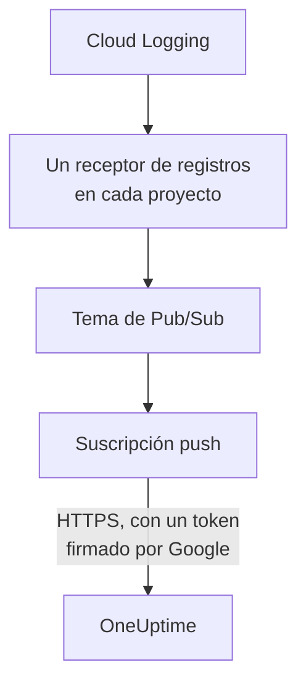

# Transmitir registros de Google Cloud

Un proyecto de Google Cloud conectado puede transmitir sus registros a OneUptime en cuanto se escriben. Cloud Logging los dirige mediante un receptor de registros a un tema de Pub/Sub, y la suscripción push del tema entrega cada entrada a OneUptime en menos de un minuto, como un registro de OneUptime archivado bajo el recurso al que se refiere. Un solo comando en Google Cloud Shell lo configura todo, y no hay nada que ejecutar. Cloud Monitoring no tiene ninguna exportación que envíe métricas, así que la conexión sigue leyendo las métricas según su programación.

:::cards
- [Cómo funciona](#cómo-funciona): Un receptor de registros en cada proyecto, un tema y su suscripción push.
- [Configurar la transmisión](#configurar-la-transmisión): Elige qué registros, crea una clave de flujo y ejecuta un comando.
- [Qué llega](#qué-llega): Los registros en los recursos de los que proceden.
- [Qué crea el comando](#qué-crea-el-comando): Cada recurso y cada permiso que el comando crea en tus proyectos.
- [Detener la transmisión](#detener-la-transmisión): Desactiva las claves y después elimina lo que creó el comando.
:::

## Cómo funciona



- **Un receptor de registros en cada proyecto.** El receptor de cada proyecto dirige las entradas que coinciden con su filtro a un único tema de Pub/Sub, en el proyecto de la cuenta de servicio de la conexión.
- **Dos comprobaciones en cada envío.** Pub/Sub firma un token de OpenID Connect para una cuenta de servicio creada solo para los envíos, y la audiencia del token es la clave de flujo de la conexión. OneUptime acepta un envío solo cuando Google firmó su token para esa cuenta de servicio y la clave es una de las de la conexión. La clave designa la conexión, y por tanto el proyecto: nada en un envío decide dónde se escribe. OneUptime solo guarda el SHA-256 de la clave.
- **No se pierde nada mientras OneUptime no puede aceptarlo.** Pub/Sub vuelve a enviar una entrada rechazada, esperando de 10 segundos a 10 minutos entre intentos, y la guarda durante un día.

## Antes de empezar

- **Un proyecto de Google Cloud conectado.** Conéctalo primero en **Nube → Conectar**: consulta [Conectar una cuenta en la nube](/docs/telemetry/cloud-accounts).
- **Un propietario o administrador del proyecto.** Solo ellos pueden crear una clave de flujo y detener la transmisión.
- **Google Cloud Shell**, con la sesión iniciada como **Owner** de los proyectos, o como alguien que pueda crear en ellos cuentas de servicio, temas de Pub/Sub y receptores de registros.
- **Una dirección HTTPS, en un OneUptime autoalojado.** Pub/Sub solo envía a direcciones `https://`, con un certificado en el que Google confíe, y la dirección debe ser accesible desde Google Cloud.

## Configurar la transmisión

:::steps
### Abrir el cuadro de transmisión

Ve a **Nube → Conectar** y, en la fila del proyecto de Google Cloud, elige **Transmitir registros**.

### Elegir qué registros

**Advertencias y errores** transmite cada entrada de gravedad `WARNING` o superior: lo que salió mal, no cada solicitud. **Todos los registros** transmite cada entrada salvo los registros de auditoría Data Access, que anotan cada lectura y pueden superar todo lo demás que escribe un proyecto. **Un filtro propio** transmite las entradas que coinciden con una consulta de Cloud Logging, escrita en el campo **Filtro**.

### Crear una clave de flujo

Elige **Crear una clave de flujo**. La clave se muestra esta única vez, en el comando: OneUptime solo guarda su SHA-256.

### Ejecutar el comando en Google Cloud Shell

Copia el comando, ejecútalo en Google Cloud Shell y espera a que termine. Indica cada proyecto en el que configuró un receptor, y se detiene en el primer paso que Google rechaza, con el motivo de Google.

### Esperar el primer envío

El cuadro pregunta cada pocos segundos qué llegó. Pub/Sub envía una entrada en menos de un minuto desde que un proyecto escribe una que acepta el filtro; el cuadro dice entonces qué llegó y desde dónde, y la fila de la conexión dice **Transmitiendo**.
:::

**Más campos** contiene el resto:

| Campo | Qué hace |
| --- | --- |
| **Proyectos** | Los proyectos cuyos registros transmitir: al principio, los que lee la conexión. El tema se crea en el proyecto de la cuenta de servicio de la conexión. Como máximo 100 |
| **Configurarlo de otra forma** | El endpoint de envío, la cuenta de servicio push y la clave, para configurarlo con Terraform o la consola |

## Qué llega

| Qué | Dónde llega |
| --- | --- |
| Registros | En el explorador de registros, bajo el servicio de telemetría de la conexión, con el proyecto, la región y el nombre del registro como atributos |
| Registros de un recurso que OneUptime conoce | También en ese recurso: su página en la nube gana una pestaña **Registros** |

Cada registro conserva la hora de su entrada al nanosegundo, su gravedad, su traza y su span, y su solicitud HTTP con los nombres de las convenciones semánticas de OpenTelemetry. Se archiva bajo un recurso cuando su recurso supervisado es de un tipo cuyas métricas lee OneUptime, como una VM (`gce_instance`), un servicio de Cloud Run (`cloud_run_revision`) o una instancia de Cloud SQL (`cloudsql_database`), y lleva el ID del recurso como `cloud.resource_id`. Los registros de solicitudes de un balanceador de carga externo, escritos bajo `http_load_balancer`, se archivan bajo su mapa de URL, la `https_lb_rule` en la que caen sus métricas.

Los registros de un grupo de instancias son los de sus VM, así que su página no tiene pestaña **Registros**. Una entrada de otro tipo se transmite igualmente, bajo su proyecto.

## Qué crea el comando

Sus recursos llevan el nombre de los 8 primeros caracteres del ID de la conexión. No da a OneUptime ningún acceso a tus proyectos: las entradas solo salen.

| Recurso | Qué puede hacer |
| --- | --- |
| Una cuenta de servicio, `oneuptime-push-<suffix>`, en el proyecto de la cuenta de servicio de la conexión | No tiene ningún rol: Pub/Sub firma para ella los tokens de sus envíos |
| El rol **Service Account OpenID Connect Identity Token Creator** para el agente de servicio de Pub/Sub, solo sobre esa cuenta de servicio | Permite a Pub/Sub crear esos tokens, y nada más |
| Un tema de Pub/Sub, `oneuptime-stream-<suffix>` | Contiene las entradas que dirigen los receptores |
| Su suscripción push, `oneuptime-stream-<suffix>-push` | Envía cada entrada a OneUptime, con un plazo de confirmación de 60 segundos, y guarda durante un día lo que no pudo enviar |
| Un receptor de registros en cada proyecto, `oneuptime-stream-<suffix>` | Dirige al tema las entradas que coinciden con su filtro |
| El rol **Pub/Sub Publisher** para el escritor de cada receptor, solo sobre el tema | Permite al receptor publicar en el tema, y nada más |

El comando activa las API de Pub/Sub y de Cloud Logging en el proyecto del tema si están desactivadas. Google cobra Pub/Sub por los registros que entrega: transmite solo los registros que necesites.

## Detener la transmisión

:::steps
### Desactivar las claves

En la fila del proyecto en **Nube → Conectar**, elige **Detener la transmisión**. Todas las claves de flujo de la conexión dejan de funcionar al instante, y OneUptime rechaza lo que envía Pub/Sub. Lo entregado se conserva.

### Eliminar lo que creó el comando

Los receptores, el tema y su suscripción push se quedan en Google Cloud, y Pub/Sub sigue enviando, hasta que se eliminan. El cuadro muestra el comando, para los proyectos que lee la conexión:

```bash
for SOURCE in 'acme-prod' 'acme-data'; do
  gcloud logging sinks delete oneuptime-stream-6f1c3a2e --project "$SOURCE" --quiet
done
gcloud pubsub subscriptions delete oneuptime-stream-6f1c3a2e-push --project 'acme-prod' --quiet
gcloud pubsub topics delete oneuptime-stream-6f1c3a2e --project 'acme-prod' --quiet
gcloud iam service-accounts delete 'oneuptime-push-6f1c3a2e@acme-prod.iam.gserviceaccount.com' --project 'acme-prod' --quiet
```
:::

Para cambiar qué registros se transmiten, abre de nuevo **Transmitir registros**, elige **Crear una clave nueva** y ejecuta el comando nuevo. La clave que reemplaza sigue funcionando 24 horas, así que no se rechaza ningún envío mientras se actualiza la suscripción. Como máximo funcionan a la vez 3 claves reemplazadas.

## Configurarlo de otra forma

Da a un tema de Pub/Sub una suscripción push con estos valores, y permite que el agente de servicio de Pub/Sub cree tokens para la cuenta de servicio push:

| Configuración | Valor |
| --- | --- |
| Endpoint de envío | `https://oneuptime.com/telemetry/gcp-pubsub/v1/logs` |
| Autenticación | Un token de OpenID Connect para `oneuptime-push-<suffix>@<project>.iam.gserviceaccount.com` |
| Audiencia | La clave de flujo |
| Carga útil | Encapsulada, como la envía Pub/Sub salvo que se indique lo contrario |
| Plazo de confirmación | 60 segundos |
| Retención de mensajes | 1 día |

Después dirige los registros de cada proyecto al tema con un receptor de registros, y da al escritor de cada receptor **Pub/Sub Publisher** sobre el tema. En un OneUptime autoalojado, sustituye `https://oneuptime.com` por la dirección HTTPS de tu OneUptime.

OneUptime responde a cada envío como espera Pub/Sub:

| Respuesta | Cuándo | Qué hace Pub/Sub |
| --- | --- | --- |
| `204` | La entrada se aceptó, o ya se había aceptado, o el mensaje no es una entrada de registro | Sigue adelante |
| `400` | No es un envío de Pub/Sub que OneUptime sepa leer | Lo vuelve a enviar, esperando más cada vez, durante un día |
| `401` | El token no lo firmó Google para la cuenta de servicio push, o su audiencia no es una clave de la conexión | Lo vuelve a enviar, esperando más cada vez, durante un día |
| `402` | El proyecto no se puede facturar por telemetría | Lo vuelve a enviar, esperando más cada vez, durante un día |
| `403` | La conexión está desactivada, o el proyecto no puede aceptar telemetría | Lo vuelve a enviar, esperando más cada vez, durante un día |
| `413` | La solicitud supera 1 MiB, o su entrada 512 KiB | Lo vuelve a enviar, esperando más cada vez, durante un día |
| `429` | La suscripción de la conexión envió más de 12.000 entradas en un minuto | Lo vuelve a enviar, esperando más cada vez, durante un día |
| `503` | OneUptime no pudo comprobar el token ni poner la entrada en cola en ese momento | Lo vuelve a enviar, esperando más cada vez, durante un día |

## Solución de problemas

:::details El cuadro sigue esperando el primer envío
Comprueba que el comando terminó sin detenerse, y que un proyecto escribió una entrada que acepta el filtro: con **Advertencias y errores**, un proyecto tranquilo no envía nada. `gcloud pubsub subscriptions describe oneuptime-stream-6f1c3a2e-push --project acme-prod` muestra el endpoint de la suscripción. En un OneUptime autoalojado, comprueba que Google Cloud llega a su dirección por HTTPS.
:::

:::details La conexión dice Flujo rechazado
El cuadro y la información sobre la fila dicen por qué. Una clave incorrecta significa que la suscripción envía con una clave que ya no funciona: crea una clave nueva y vuelve a ejecutar el comando. Un envío que no está firmado para la cuenta de servicio push significa que la suscripción firma como otra cuenta, o que Pub/Sub no puede firmar para ella: vuelve a ejecutar el comando.
:::

:::details Los registros de un recurso no aparecen en su página
La página muestra los registros que Cloud Logging archiva bajo el recurso supervisado del recurso, con las etiquetas que tienen sus métricas. Los registros que una carga de trabajo escribe bajo otro recurso, como los de un contenedor, se transmiten solo bajo su proyecto.
:::

## Próximos pasos

:::cards
- [Conectar una cuenta en la nube](/docs/telemetry/cloud-accounts): Qué lee una conexión, y con qué frecuencia.
- [Transmitir métricas y registros de Azure Monitor](/docs/telemetry/cloud-streaming-azure): Los de una suscripción de Azure, leídos de centros de eventos.
- [Transmitir métricas y registros de CloudWatch](/docs/telemetry/cloud-streaming): Los de una cuenta de AWS, entregados por Amazon Data Firehose.
- [Explorador de registros](/docs/telemetry/logs-explorer): Busca y filtra lo que entregaron los flujos.
:::
