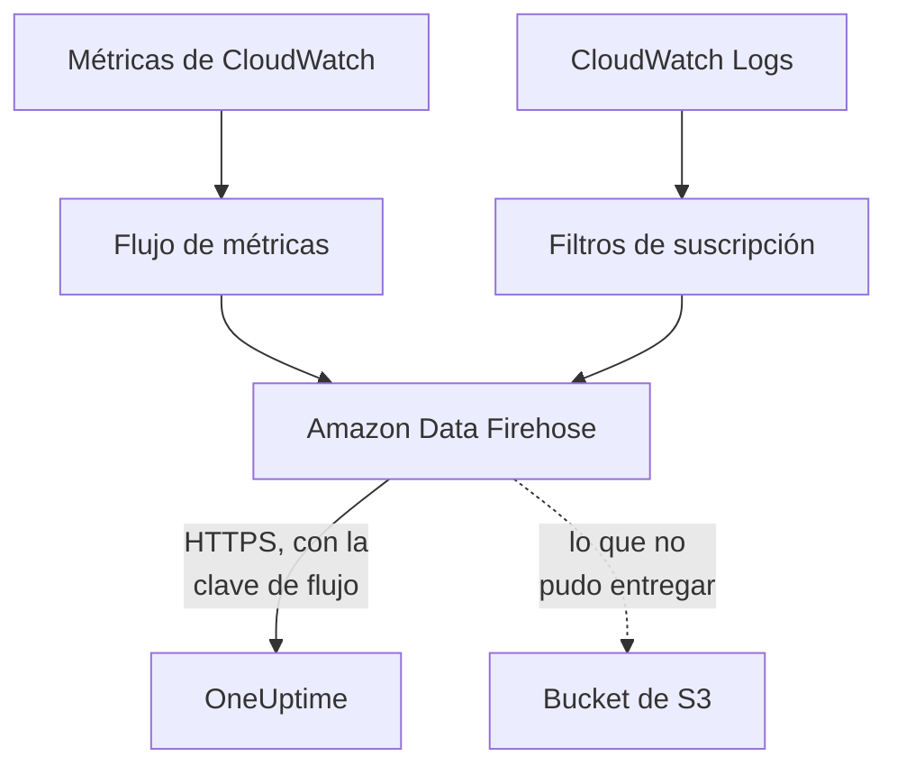

# Transmitir métricas y registros de CloudWatch

Una cuenta de AWS conectada puede transmitir sus métricas y registros de CloudWatch a OneUptime a través de Amazon Data Firehose. Las métricas llegan entonces unos minutos después de que CloudWatch las tenga, en lugar de en la siguiente lectura de la conexión, y CloudWatch Logs llega como registros de OneUptime, cada uno archivado bajo el recurso del que trata. Un solo comando en AWS CloudShell lo configura todo, y no hay nada que ejecutar.

:::cards
- [Cómo funciona](#cómo-funciona): Un flujo de métricas y suscripciones de registros en cada región, entregados por Firehose.
- [Configurar la transmisión](#configurar-la-transmisión): Elige qué transmitir, crea una clave de flujo y ejecuta un comando.
- [Qué llega](#qué-llega): Las métricas en los recursos que miden, y los registros en los recursos de los que vienen.
- [Qué crea la pila](#qué-crea-la-pila): Cada recurso y cada permiso que el comando crea en tu cuenta.
- [Detener la transmisión](#detener-la-transmisión): Desactiva las claves y luego elimina las pilas.
:::

## Cómo funciona



- **Una pila en cada región.** El comando despliega una pila de CloudFormation en cada región desde la que transmites. Su flujo de métricas y sus filtros de suscripción de registros pasan todo a dos flujos de Firehose, y Firehose lo entrega a OneUptime por HTTPS.
- **La clave de flujo dice de quién es.** Firehose envía la clave de flujo de la conexión con cada entrega. La clave nombra la conexión, y por tanto el proyecto: nada en una entrega decide dónde se escribe. OneUptime solo guarda el SHA-256 de la clave.
- **Las lecturas dejan las métricas transmitidas al flujo.** Mientras un flujo entrega un espacio de nombres de una región, las lecturas de la conexión dejan de escribir las métricas de ese espacio de nombres, así que ningún punto de datos se cuenta dos veces. Las lecturas siguen encontrando recursos, su estado y sus cambios, y retoman un espacio de nombres tras 15 minutos sin entregas.
- **No se pierde nada mientras OneUptime no puede aceptarlo.** Firehose vuelve a enviar un lote rechazado durante una hora como máximo y luego lo guarda 30 días en el bucket de S3 de la pila.

## Antes de empezar

- **Una cuenta de AWS conectada.** Conéctala primero en **Nube → Conectar**: consulta [Conectar una cuenta en la nube](/docs/telemetry/cloud-accounts).
- **Un propietario o administrador del proyecto.** Solo ellos pueden crear una clave de flujo y detener la transmisión.
- **AWS CloudShell en esa cuenta**, con la sesión iniciada por alguien que pueda crear pilas de CloudFormation y roles de IAM.
- **Una dirección HTTPS, en un OneUptime autoalojado.** Firehose solo entrega a direcciones `https://` en el puerto 443, con un certificado en el que AWS confíe, y la dirección debe ser accesible desde AWS.

## Configurar la transmisión

:::steps
### Abrir el cuadro de transmisión

Ve a **Nube → Conectar** y, en la fila de la cuenta de AWS, elige **Transmitir métricas y registros**.

### Elegir qué transmitir

**Métricas** transmite cada métrica clave de cada recurso, una vez por minuto: las métricas con las que OneUptime grafica y evalúa cada recurso. **Métricas y registros** añade CloudWatch Logs, y **Registros** transmite solo CloudWatch Logs.

Para los registros, indica los **Grupos de registros** uno por línea, por nombre en la **Región** de al lado o por ARN en su propia región, o elige **Todos los grupos de registros de la cuenta, también los nuevos**. Un comando suscribe como máximo 50 grupos de registros por nombre, en como máximo 10 regiones.

### Crear una clave de flujo

Elige **Crear una clave de flujo**. La clave solo se muestra esta vez, en el comando: OneUptime solo guarda su SHA-256.

### Ejecutar el comando en AWS CloudShell

Copia el comando, ejecútalo en AWS CloudShell y espera a que termine. Escribe la plantilla en `oneuptime-stream.json` y la despliega en cada región, con la clave como un parámetro que no se vuelve a mostrar.

### Esperar la primera entrega

El cuadro pregunta cada pocos segundos qué ha llegado. Firehose entrega a los pocos minutos de terminar el comando; el cuadro dice entonces qué llegó y de dónde, y la fila de la conexión dice **Transmitiendo**.
:::

**Más campos** contiene el resto:

| Campo | Qué hace |
| --- | --- |
| **Todas las métricas, no solo las clave** | Transmite todas las métricas que CloudWatch tiene para la cuenta, incluidas las tuyas. AWS factura cada actualización de métrica que envía un flujo, así que puede costar muchas veces más |
| **Regiones** | Desde dónde transmitir: al principio, las regiones en las que la conexión encontró recursos. Si se deja vacío, el comando transmite desde la región de AWS CloudShell. Como máximo 30 |
| **Configurarlo de otra forma** | Los endpoints de métricas y de registros y la clave, para configurar los flujos con Terraform o la consola |

**Descargar la plantilla** guarda la plantilla que despliega el comando, para desplegarla a tu manera.

## Qué llega

| Qué | Dónde llega |
| --- | --- |
| Métricas | En los recursos en la nube que miden, con los nombres y atributos que les dan las lecturas de la conexión |
| Registros | En el explorador de registros, bajo el servicio de telemetría de la conexión, con la cuenta, la región y el grupo de registros como atributos |
| Registros de un grupo de registros que AWS nombra por un recurso | También en ese recurso: su página en la Nube gana una pestaña **Registros** |

Un grupo de registros se archiva bajo un recurso cuando AWS le dio el nombre de uno:

| Grupo de registros | Tipo de recurso |
| --- | --- |
| `/aws/lambda/<function>` | `AWS::Lambda::Function` |
| `/aws/rds/instance/<instance>/<log>` | `AWS::RDS::DBInstance` |
| `/aws/rds/cluster/<cluster>/<log>` | `AWS::RDS::DBCluster` |
| `/aws/docdb/<cluster>/<log>` | `AWS::DocDB::DBCluster` |
| `/aws/neptune/<cluster>/<log>` | `AWS::Neptune::DBCluster` |
| `/aws/redshift/cluster/<cluster>/<log>` | `AWS::Redshift::Cluster` |
| `/aws/OpenSearchService/domains/<domain>/<log>` | `AWS::OpenSearchService::Domain` |
| `/aws/aes/domains/<domain>/<log>` | `AWS::OpenSearchService::Domain` |
| `/aws/apprunner/<service>/<service-id>/<log>` | `AWS::AppRunner::Service` |
| `/aws/elasticbeanstalk/<environment>/<log>` | `AWS::ElasticBeanstalk::Environment` |
| `/aws/ecs/containerinsights/<cluster>/performance` | `AWS::ECS::Cluster` |

Cada registro lleva el ID del recurso como `cloud.resource_id`, y los registros de una función Lambda llevan además `faas.name`, así que también aparecen en la función en Serverless. Un grupo de registros con otro nombre se transmite igualmente, bajo su cuenta y su región. La gravedad de un registro es la que indica su mensaje, tal como la escribe Lambda.

## Qué crea la pila

La pila se llama `OneUptimeStream-` seguido de los 8 primeros caracteres del ID de la conexión. No da a OneUptime ningún acceso a tu cuenta: los datos solo salen.

| Recurso | Qué puede hacer |
| --- | --- |
| Un flujo de métricas de CloudWatch, en el formato OpenTelemetry 1.0 | Escribir registros solo en el flujo de Firehose de métricas |
| Filtros de suscripción de registros, o una política de suscripción de toda la cuenta para cada grupo de registros | Escribir registros solo en el flujo de Firehose de registros |
| Dos flujos de Firehose, `OneUptime-<suffix>-metrics` y `OneUptime-<suffix>-logs` | Entregar a OneUptime con GZIP, un búfer de 1 MiB o 60 segundos y una hora de reintentos, y escribir en el bucket lo que no pudieron entregar |
| Un bucket de S3 para lo que no se pudo entregar | Acceso público bloqueado, cifrado, vaciado tras 30 días y conservado al eliminar la pila |
| Un grupo de registros, `/aws/kinesisfirehose/OneUptime-<suffix>` | Guarda los errores de entrega del propio Firehose y nunca se transmite |
| Tres roles de IAM | Cada uno confía en un servicio de AWS de esta cuenta y solo permite lo que dicen las filas anteriores |

AWS factura el flujo de métricas por cada actualización de métrica que envía, y Firehose por lo que entrega. Transmite solo las métricas y los grupos de registros que necesites.

## Detener la transmisión

:::steps
### Desactivar las claves

En la fila de la cuenta en **Nube → Conectar**, elige **Detener la transmisión**. Todas las claves de flujo de la conexión dejan de funcionar al instante, OneUptime rechaza lo que entregan los flujos y la conexión vuelve a leer todas sus métricas según su programación. Lo que entregaron los flujos se conserva.

### Eliminar las pilas

Los flujos siguen en AWS, y AWS los factura, hasta que se eliminan sus pilas. El cuadro muestra el comando, para las regiones en las que la conexión encontró recursos:

```bash
for REGION in us-east-1 eu-west-1; do
  aws cloudformation delete-stack --region "$REGION" --stack-name OneUptimeStream-6f1c3a2e
done
```
:::

Para cambiar lo que transmite una pila, vuelve a abrir **Transmitir métricas y registros**, elige **Crear una clave nueva** y ejecuta el nuevo comando. La clave que reemplaza sigue funcionando 24 horas, así que no se rechaza ninguna entrega mientras se actualizan las pilas. Como máximo 3 claves reemplazadas funcionan a la vez.

## Configurarlo de otra forma

Da a cada flujo de Firehose un destino de endpoint HTTP con estos valores, y al flujo de métricas el formato de salida OpenTelemetry 1.0:

| Ajuste | Valor |
| --- | --- |
| Endpoint de métricas | `https://oneuptime.com/telemetry/aws-firehose/v1/metrics` |
| Endpoint de registros | `https://oneuptime.com/telemetry/aws-firehose/v1/logs` |
| Clave de acceso | La clave de flujo, enviada como `X-Amz-Firehose-Access-Key` |
| Codificación del contenido | `GZIP` |
| Búfer | 1 MiB o 60 segundos |
| Duración de los reintentos | 3600 segundos, con un bucket de S3 para lo que no se pudo entregar |

En un OneUptime autoalojado, sustituye `https://oneuptime.com` por la dirección HTTPS de tu OneUptime. El endpoint de métricas también acepta un flujo de métricas en el formato JSON.

OneUptime responde a cada entrega como Firehose espera:

| Respuesta | Cuándo | Qué hace Firehose |
| --- | --- | --- |
| `200` | La entrega se aceptó, o ya se había aceptado | Continúa |
| `400` | No es una entrega de Firehose que OneUptime pueda leer, como una de más de 10.000 registros | La vuelve a enviar durante una hora como máximo |
| `401` | La clave no es una de las de la conexión | La vuelve a enviar durante una hora como máximo |
| `402` | No se puede facturar la telemetría al proyecto | La vuelve a enviar durante una hora como máximo |
| `403` | La conexión está desactivada, o el proyecto no puede aceptar telemetría | La vuelve a enviar durante una hora como máximo |
| `413` | La solicitud supera los 4 MiB, o se descomprime en más de 32 MiB | La guarda en el bucket |
| `429` | Los flujos de la conexión enviaron más de 600 entregas en un minuto | La vuelve a enviar más tarde |

## Solución de problemas

:::details El cuadro sigue esperando la primera entrega
Comprueba que el comando terminó en cada región sin errores: `aws cloudformation describe-stacks --stack-name OneUptimeStream-6f1c3a2e` indica el estado de la pila. Un flujo de métricas solo entrega las métricas que CloudWatch tiene, así que una región sin recursos no envía nada. En un OneUptime autoalojado, comprueba que AWS llega a su dirección por HTTPS en el puerto 443.
:::

:::details La conexión dice Flujo rechazado
El cuadro y la información emergente de la fila dicen por qué. Una clave incorrecta significa que las pilas funcionan con una clave que ya no sirve: crea una clave nueva y vuelve a ejecutar el comando. Firehose sigue enviando lo que guarda, y se acepta en cuanto la clave es la correcta.
:::

:::details Los registros de una función Lambda no aparecen en su página
La página muestra los registros del grupo de registros con el nombre de la función, `/aws/lambda/<function>`. Una función que escribe en un grupo de registros con otro nombre transmite sus registros solo bajo su cuenta y su región.
:::

## Próximos pasos

:::cards
- [Conectar una cuenta en la nube](/docs/telemetry/cloud-accounts): Qué lee una conexión, y con qué frecuencia.
- [Recursos en la nube (IaaS y PaaS)](/docs/telemetry/cloud-resources): Cada tipo de recurso que OneUptime reconoce.
- [Explorador de registros](/docs/telemetry/logs-explorer): Busca y filtra lo que entregaron los flujos.
:::
