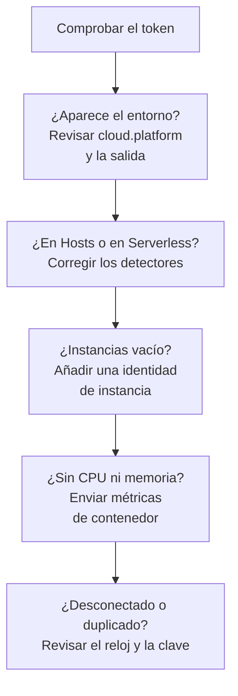

# Solución de problemas en la nube

Averigüe por qué un entorno en la nube falta, está archivado en el lugar equivocado, está vacío o duplicado. Las secciones siguen el orden en que fallan estas cosas, y cada una descarta una capa, así que avance de arriba abajo. Los fallos propios de una plataforma están al final de su página: [AWS ECS / Fargate](/docs/telemetry/cloud-aws-ecs), [Google Cloud Run](/docs/telemetry/cloud-gcp-cloud-run), [Azure Container Apps](/docs/telemetry/cloud-azure-container-apps) y [Otras plataformas en la nube](/docs/telemetry/cloud-other-platforms).



## Compruebe primero el token

Es la comprobación más barata, y nada de lo que sigue funciona sin ella:

```bash
curl -i https://oneuptime.com/otlp/v1/validate \
  -H "x-oneuptime-token: YOUR_TELEMETRY_INGESTION_TOKEN"
```

| Respuesta | Qué significa |
| ------------------------- | -------------------------------------------------------------------------------------------------------------------------- |
| `200`, `"valid": true` | El token se acepta. Su `keyType` debería ser `Server`: una clave `Browser` se rechaza desde un colector o un servicio de backend. |
| `401`, `"valid": false` | El token falta, es desconocido, revocado, desactivado o caducado, y el `message` de la respuesta dice cuál. Cree una clave nueva en **Ajustes del proyecto → Telemetría y APM → Claves de ingesta** y vuelva a desplegarla. |

Si aloja OneUptime usted mismo, use `https://YOUR-ONEUPTIME-HOST/otlp/v1/validate`. Ejecute la comprobación desde dentro de la tarea, la instancia o la réplica cuando pueda (ECS Exec, `az containerapp exec`): demuestra que la propia carga de trabajo llega a OneUptime, no solo su portátil.

## El entorno no aparece

Nada en **Nube → Todos los entornos** un minuto después de la primera solicitud. Revise estas tres cosas, en este orden.

**`cloud.platform` falta, o no es un valor gestionado.** OneUptime archiva la telemetría en Entornos en la nube solo cuando el recurso lleva uno de estos valores: `aws_ecs`, `aws_elastic_beanstalk`, `aws_app_runner`, `gcp_cloud_run`, `gcp_app_engine`, `azure_container_apps`, `azure_container_instances` o `azure_app_service`. Las causas habituales:

- El detector de recursos está desactivado en el SDK (`OTEL_NODE_RESOURCE_DETECTORS`, `OTEL_EXPERIMENTAL_RESOURCE_DETECTORS`, `-Dotel.resource.providers.<cloud>.enabled=true`).
- El pipeline del colector se salta el procesador `resourcedetection`.
- En una plataforma sin detector, `OTEL_RESOURCE_ATTRIBUTES` tiene una errata.

Los detectores de Azure de Node.js y .NET escriben `azure.container_apps`, `azure.app_service` y `azure.functions`; OneUptime los reescribe a los valores con guion bajo, así que cuentan. Para ver qué lleva su telemetría, abra el servicio en **Servicios**, abra una de sus trazas desde la pestaña **Trazas** y lea los atributos de recurso. Si `cloud.platform` no está, ese es todo el problema.

**El token es incorrecto.** La comprobación del token respondió `401`. El colector lo registra como `Permanent error: ... 401`. Un SDK lo registra una vez y deja de reintentar, que es el comportamiento correcto de OTLP y fácil de pasar por alto.

**La salida está bloqueada.** El colector registra `connection refused`, `context deadline exceeded`, `i/o timeout` o un fallo de DNS:

- **ECS y Fargate:** una subred privada necesita una puerta de enlace NAT o `assignPublicIp=ENABLED`, y el grupo de seguridad debe permitir la salida por TCP 443.
- **Cloud Run:** **VPC egress: All traffic** necesita Cloud NAT.
- **Container Apps:** una ruta definida por el usuario hacia un firewall debe permitir el host de OneUptime.
- **En todas partes:** un OneUptime autoalojado detrás de un nombre DNS privado debe resolverse desde la red de la carga de trabajo.

## Aparece en Hosts en su lugar

El recurso lleva la plataforma de una máquina virtual (`aws_ec2`, `gcp_compute_engine` o `azure_vm`), así que OneUptime lo archiva en **Hosts**: correcto para una máquina virtual, incorrecto para cómputo gestionado. El detector de una máquina virtual le ganó al gestionado: `detectors: [ec2, elastic_beanstalk]` en un colector, donde gana el primer detector que define `cloud.platform`, o un SDK cuyo orden favorece al detector de EC2. Ponga `elastic_beanstalk` primero, o defina usted `cloud.platform` en `OTEL_RESOURCE_ATTRIBUTES` y deje solo el detector `env`.

## Aparece solo en Funciones serverless

El recurso lleva `faas.name` pero ninguna `cloud.platform` gestionada. Cloud Run y App Engine definen ambos cuando se ejecuta el detector de GCP. Si define `faas.name` a mano, o un colector descarta los atributos de recurso que definió el detector del SDK, solo se cumple el lado serverless. Active el detector, o defina usted `cloud.platform=gcp_cloud_run` (o `gcp_app_engine`), `cloud.account.id` y `cloud.region`.

> [!NOTE]
> En Cloud Run y App Engine un servicio debe aparecer en ambos lugares: el entorno agrupa el proyecto y la región, y **Funciones serverless** muestra el servicio individual.

## Instancias está vacío

El entorno está, pero su pestaña **Instancias** no lista nada: la telemetría no lleva ninguna identidad de instancia. OneUptime nombra una instancia a partir del primero de estos atributos de recurso que encuentra:

1. `aws.ecs.task.id`
2. `aws.ecs.task.arn` (acortado al ID de la tarea)
3. `faas.instance`
4. `azure.container_app.instance.id`
5. `service.instance.id`
6. `container.id`
7. `host.id`
8. `host.name`

La identidad propia de la plataforma va antes que `service.instance.id`, para que un ID que el SDK inventa para cada proceso (el SDK de Node.js lo hace por defecto) no pueda separar una tarea de la CPU y la memoria de su sidecar. Qué define la identidad en cada plataforma:

| Plataforma | Qué define la identidad |
| ----------------------------------------- | ------------------------------------------------------------------------------------------------------------------------------------------------ |
| ECS | El detector `ecs` define el ARN de la tarea |
| Cloud Run, App Engine | El detector `gcp` define `faas.instance` |
| Container Apps | El detector `azurecontainerapps` del Collector define el ID de la réplica; o defina `service.instance.id` a partir de `CONTAINER_APP_REPLICA_NAME`, o ejecute el detector de host |
| App Runner, Container Instances | El `host.name` del detector de host |
| App Service, Elastic Beanstalk | El detector de la plataforma define `service.instance.id`; en Beanstalk, elimínelo para que `host.id` nombre cada instancia |

Una instancia aparece al minuto de la primera señal que lleva el atributo.

## La CPU y la memoria están vacías

Las instancias aparecen, pero los mosaicos **CPU** y **Memoria** de la vista general, y las columnas de CPU y memoria de **Instancias**, están vacíos. Proceden de métricas, no de trazas: puntos de datos `container.cpu.utilization` y `container.memory.usage` (o `container.memory.usage.total`) cuyo recurso lleva la misma identidad de instancia que las trazas, y `cloud.platform`.

- **En ECS,** el receptor `awsecscontainermetrics` de un colector sidecar los aporta como `ecs.task.cpu.utilized` y `ecs.task.memory.utilized`. Manténgalo en el pipeline `metrics`, y mantenga también `resourcedetection` en ese pipeline, o las métricas llegarán sin `cloud.platform` y se archivarán en otro lugar.
- **En Cloud Run, Container Apps y las demás plataformas,** la plataforma no muestra el uso de los contenedores a un sidecar. Los mosaicos quedan vacíos salvo que usted envíe esas métricas: lea en su lugar los mosaicos de solicitudes.
- **Con SDK direct,** nada envía métricas de contenedor, así que los mosaicos vacíos son lo esperado.

## El entorno muestra Desconectado

Un entorno muestra **Desconectado** cuando no ha llegado telemetría para él en 15 minutos, y el siguiente span, registro o métrica lo recupera. El tiempo en que el propio OneUptime estuvo caído o poniéndose al día no cuenta. Mientras fluye la telemetría, la hora de la última recepción puede ir hasta cinco minutos por detrás, por eso el umbral es de 15.

- **Un entorno con actividad muestra Desconectado:** el exportador se detuvo. Busque en los registros del colector los errores `401` y de salida de arriba.
- **Un entorno de staging que escala a cero por la noche** muestra Desconectado hasta la primera solicitud de la mañana, lo cual es correcto.

Las instancias siguen dos relojes:

- **Obsoleto:** la pestaña **Instancias** marca una tarea, instancia o réplica como **Obsoleto** cuando no ha informado en los últimos 15 minutos, y la vista general solo cuenta las demás como activas.
- **Eliminado:** una limpieza elimina las filas de instancia no vistas durante `CLOUD_INSTANCE_STALE_MINUTES` (15 por defecto, al menos 10), medido desde la última telemetría del propio entorno, así que una caída del colector congela ese reloj en lugar de borrar la última lista de tareas conocida. Las funciones serverless usan `SERVERLESS_INSTANCE_STALE_MINUTES`. Subir el umbral conserva las filas más tiempo; no cambia cuándo pasan a **Obsoleto**.

## Dos entornos donde debería haber uno

La clave de entorno es `cloud.platform|cloud.account.id|cloud.region`, comparada carácter por carácter. Si unas cargas de trabajo definen `cloud.account.id` y otras no, una escribe `eastus` y otra `East US`, o un colector ejecuta el detector `ecs` y otro no, obtendrá `aws_ecs|123456789012|us-east-1` y `aws_ecs||us-east-1` uno al lado del otro.

Abra la **Vista general** de cada entorno: su **Clave de entorno** muestra qué parte difiere. Corrija la carga de trabajo a la que le falta el valor. El entorno con la parte vacía deja de recibir telemetría, y puede archivarlo.

## Un entorno creado a mano nunca se asocia

La ingesta asocia un entorno solo por su clave, y la clave debe ser exactamente `platform|account|region`, como `aws_ecs|123456789012|us-east-1`: el mismo valor de plataforma, ID de cuenta y región que lleva la telemetría. El formulario de creación (**Crear Recurso en la nube** en **Nube → Todos los entornos**) construye la clave a partir de sus campos **Plataforma en la nube**, **ID de cuenta en la nube** y **Región en la nube**, así que esos tres deben coincidir con la telemetría carácter por carácter. Si no coinciden, la ingesta crea un segundo entorno con la clave que calculó, y el suyo se queda vacío. Archive el entorno creado a mano y deje que la ingesta cree el correcto, o vuelva a crearlo con los valores corregidos.

## Sigue sin resolverse

Reúna esto antes de pedir ayuda:

- Los atributos de recurso de un span o registro real de la carga de trabajo. El exportador `debug` del colector los imprime, o abra una traza del servicio en **Servicios**.
- La respuesta de la comprobación `/otlp/v1/validate`, ejecutada desde dentro de la carga de trabajo.
- Las últimas 50 líneas del registro del colector, o el registro de diagnóstico del SDK con `OTEL_LOG_LEVEL=debug`.
- La **Clave de entorno** de cualquier entorno que sí apareciera.

Después contacte con support@oneuptime.com, o abra una incidencia en [GitHub](https://github.com/OneUptime/oneuptime).

## Próximos pasos

:::cards
- [Entornos en la nube](/docs/telemetry/cloud-environments): Cómo se identifican los entornos y las instancias.
- [AWS ECS / Fargate](/docs/telemetry/cloud-aws-ecs): La configuración de ECS, con una definición de tarea completa.
- [OpenTelemetry](/docs/telemetry/open-telemetry): Endpoints, límites y qué significa cada respuesta.
:::
