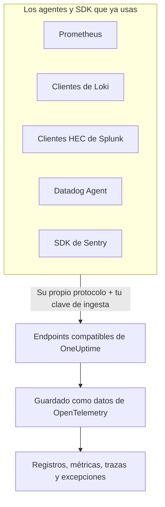

# Prometheus, Loki, Splunk, Datadog & Sentry

¿Ya usas Prometheus, un cliente de Loki, un reenviador de Splunk, el Datadog Agent o un SDK de Sentry? No hace falta cambiarlo. OneUptime acepta lo que envía cada una de estas herramientas, en las rutas que la herramienta ya usa, y lo guarda como datos de OpenTelemetry. Probar OneUptime es cuestión de cambiar una URL y una clave, no de volver a instrumentar, y tus filtros de descarte, reglas de depuración, canalizaciones de registros, retención y presupuestos de ingesta se aplican a estos datos como a cualquier otro.

:::cards
- [Prometheus remote write](#prometheus-remote-write): Métricas de Prometheus, Grafana Alloy o cualquier emisor de remote write.
- [Loki](#loki): Registros de Promtail, Grafana Alloy, Fluent Bit o Vector.
- [Splunk HTTP Event Collector](#splunk-http-event-collector): Registros y eventos de métricas de cualquier cliente HEC.
- [Datadog Agent](#datadog-agent): Métricas y registros del Datadog Agent.
- [SDK de Sentry](#sdk-de-sentry): Errores, transacciones y registros de cualquier SDK de Sentry.
:::

## Cómo funciona



Cada endpoint responde en el idioma de su herramienta (un `204` para Prometheus y Loki, el `{"text": "Success", "code": 0}` de HEC, el `202` de Datadog, el ID de evento de Sentry), así que la herramienta informa de los éxitos y los fallos como siempre. Después, los datos se procesan exactamente igual que los de un SDK de OpenTelemetry.

## Antes de empezar

- **Un proyecto de OneUptime**: en OneUptime Cloud, la telemetría se factura por GB ingerido, y un proyecto del plan Free necesita un método de pago antes de poder enviar telemetría.
- **Clave de ingesta de telemetría**: crea una clave de **Servidor** en **Productos → Ajustes del proyecto → Telemetría y APM → Claves de ingesta** y copia su **Clave secreta**. Cada herramienta la envía donde envía su propia credencial. El DSN de Sentry de una aplicación de navegador lleva en cambio una clave de **Navegador**, limitada a los orígenes de tu sitio.
- **Tu host**: los ejemplos usan `oneuptime.com`. Si alojas OneUptime tú mismo, usa tu propio host.

> [!TIP]
> La pestaña Guía de configuración de Registros, Métricas, Trazas y Excepciones incluye estas herramientas entre sus formas de enviar, con tu host y la clave que elijas ya rellenados.

## Endpoints

| Herramienta | Apúntala a | Dónde va la clave |
| --- | --- | --- |
| Prometheus remote write | `https://oneuptime.com/telemetry/prometheus/api/v1/write` | Un token bearer, o autenticación básica con la clave como contraseña. |
| Loki | `https://oneuptime.com/telemetry/loki/api/v1/push` | Autenticación básica con la clave como contraseña, o un token bearer. |
| Splunk HTTP Event Collector | `https://oneuptime.com/telemetry/services/collector` | El token de HEC: `Authorization: Splunk <key>`. |
| Datadog Agent | `https://oneuptime.com/telemetry/datadog` | La clave de API: `DD-API-KEY`. |
| SDK de Sentry | El DSN `https://<key>@oneuptime.com/telemetry/sentry/1` | La clave pública del DSN. |

Todos los endpoints aceptan también la clave en una cabecera `x-oneuptime-token`, y una cabecera `x-oneuptime-service-name` indica el servicio al que pertenece todo lo que envía la herramienta. Una clave puede escribirse como sus 32 dígitos hexadecimales sin guiones; en el DSN de Sentry y como clave de API de Datadog tiene que escribirse así.

## Prometheus remote write

Añade OneUptime como destino de remote write. Prometheus sigue haciendo scrape como hasta ahora y envía una copia de cada muestra:

```yaml title="prometheus.yml"
remote_write:
  - url: https://oneuptime.com/telemetry/prometheus/api/v1/write
    authorization:
      credentials: YOUR_TELEMETRY_KEY
```

Con Grafana Alloy, añade un componente `prometheus.remote_write` y reenvíale tus scrapes:

```text title="config.alloy"
prometheus.remote_write "oneuptime" {
  endpoint {
    url          = "https://oneuptime.com/telemetry/prometheus/api/v1/write"
    bearer_token = "YOUR_TELEMETRY_KEY"
  }
}
```

Se aceptan tanto remote write 1.0 como 2.0, comprimidos con snappy, como los envía cualquier emisor.

### En qué se convierte una serie

- **Su nombre y sus etiquetas se mantienen.** `http_requests_total{job="checkout", code="500"}` es la métrica `http_requests_total` con los atributos `job` y `code`, así que una consulta traída de Grafana la encuentra.
- **El job es el servicio.** Cada `job` se convierte en un servicio, y cada `instance`, en su instancia de servicio, tal como los asignan las reglas de Prometheus de OpenTelemetry.
- **Los tipos se conservan.** Los contadores, y los buckets y el recuento de un histograma, son sumas acumulativas, así que sus tasas se grafican correctamente. El tipo sale de los metadatos que incluye el emisor; sin ellos, un nombre terminado en `_total` es un contador, y un `_bucket` con una etiqueta `le`, un bucket de histograma.
- **Los histogramas nativos** se convierten en histogramas exponenciales, y los histogramas nativos con buckets personalizados, en histogramas.
- **No se conservan:** los marcadores de obsolescencia y otras muestras NaN o infinitas, las series `_created` de los contadores y los exemplars.

## Loki

OneUptime acepta la API push de Loki en la misma ruta que usa Loki, en JSON o como el protobuf comprimido con snappy que envían Promtail y Grafana Alloy. Añádelo como cliente:

```yaml title="promtail.yaml"
clients:
  - url: https://oneuptime.com/telemetry/loki/api/v1/push
    bearer_token: YOUR_TELEMETRY_KEY
```

La salida `loki` de Fluent Bit recibe el host y la ruta por separado:

```text title="fluent-bit.conf"
[OUTPUT]
    Name         loki
    Match        *
    Host         oneuptime.com
    Port         443
    Tls          On
    Uri          /telemetry/loki/api/v1/push
    Http_User    oneuptime
    Http_Passwd  YOUR_TELEMETRY_KEY
    Labels       job=fluent-bit
```

### En qué se convierte un flujo

- **Cada entrada es un registro**, con su propia marca de tiempo con precisión de nanosegundos y su línea como cuerpo.
- **Las etiquetas y los metadatos estructurados son atributos**, con los nombres que tienen en Loki.
- **El servicio** sale del primero de `service_name`, `service`, `app`, `application`, `name`, `app_kubernetes_io_name`, `container`, `container_name`, `component`, `workload` y `job` que tenga un flujo, tal como lo determina Loki. Una etiqueta `host` o `hostname` indica el host.
- **El nivel** sale de una etiqueta o un metadato `level`, `detected_level` o `severity`, o, si no, de un `level=` de logfmt o del campo `level` de una línea JSON.
- **Contexto de traza:** un `trace_id` y un `span_id` en los metadatos estructurados vinculan el registro con su traza.

## Splunk HTTP Event Collector

Usa OneUptime como HTTP Event Collector, con tu clave de ingesta como token de HEC. El controlador de registro de Docker para Splunk añade la ruta por sí mismo, así que solo necesita el host:

```bash
docker run \
  --log-driver=splunk \
  --log-opt splunk-url=https://oneuptime.com \
  --log-opt splunk-token=YOUR_TELEMETRY_KEY \
  --log-opt splunk-format=json \
  your-image
```

Cualquier otro cliente HEC hace POST a `/services/collector/event` o `/services/collector/raw`. Para enviar un evento:

```bash
curl https://oneuptime.com/telemetry/services/collector/event \
  -H "Authorization: Splunk YOUR_TELEMETRY_KEY" \
  -d '{"event": "Payment failed for order 42", "sourcetype": "app", "fields": {"service": "checkout"}}'
```

Un `200` con `{"text": "Success", "code": 0}` significa que el evento se aceptó. El endpoint responde también con los códigos propios de HEC: `No data` (5), `Invalid data format` (6) con el número del evento que no era válido, y `Event field is required` (12). Además, responde a `GET /services/collector/health` sin token.

### En qué se convierte un evento

- **Un registro**, con su `time` como marca de tiempo. Un evento de tipo cadena es el cuerpo; en un evento de tipo objeto, `message`, `msg`, `log`, `line` o `text` es el cuerpo, y sus demás campos son atributos.
- **Sus metadatos se mantienen:** `host` es el host, y `source`, `sourcetype` e `index` se conservan como `com.splunk.source`, `com.splunk.sourcetype` y `com.splunk.index`. Los `host`, `source`, `sourcetype` e `index` de la cadena de consulta completan lo que un evento omite.
- **Sus campos son atributos.** Un campo `service.name` da nombre al servicio, igual que el campo `service` de un registro.
- **Los eventos de métricas** (`"event": "metric"`, con `metric_name` y `_value`, o con campos `metric_name:<name>`) se guardan como métricas, nunca como registros.
- **No se ofrece:** la confirmación del indexador. Un cliente que la pida no recibe ningún `ackId`.

## Datadog Agent

Apunta las métricas y los registros del Agent a OneUptime, con tu clave de ingesta como clave de API:

```yaml title="datadog.yaml"
api_key: YOUR_TELEMETRY_KEY_WITHOUT_HYPHENS
dd_url: https://oneuptime.com/telemetry/datadog
logs_enabled: true
logs_config:
  use_http: true
  logs_dd_url: oneuptime.com:443
apm_config:
  enabled: false
process_config:
  process_collection:
    enabled: false
```

El Agent añade sus propias rutas a `dd_url` y envía los registros a `/api/v2/logs` en el host y el puerto que indica `logs_dd_url`. En la raíz, OneUptime solo responde a esas rutas para una solicitud que lleve una cabecera `DD-API-KEY`. Reinicia el Agent después del cambio; `datadog-agent status` muestra su clave de API como válida cuando OneUptime la acepta.

### En qué se convierten los datos del Agent

- **Las métricas** conservan sus nombres. Los gauges siguen siendo gauges, los contadores se convierten en sumas y las tasas, en gauges de su valor por segundo.
- **Las distribuciones** se convierten en summaries con su recuento, su suma, su mínimo y su máximo.
- **Los checks de servicio** se convierten en una métrica con el nombre del check, cuyo valor es el estado del check: 0 OK, 1 advertencia, 2 crítico, 3 desconocido.
- **Los registros** conservan su mensaje, estado, host y servicio, y el resto de sus campos, como atributos.
- **Las etiquetas son atributos**, y las etiquetas `service`, `env` y `version` indican el servicio, su entorno y su versión.
- **Aún no se leen:** las trazas de APM, los procesos, los contenedores, los datos de red y los perfiles. Déjalos desactivados en `datadog.yaml`, como arriba.

Los clientes de la API HTTP de Datadog (una biblioteca de registros que hace POST a `/api/v2/logs`, un script que envía series) pueden enviar al mismo endpoint con la cabecera `DD-API-KEY`.

## SDK de Sentry

Sustituye el DSN donde configuras Sentry. El resto de tu código de Sentry se queda como está:

```javascript
Sentry.init({
  dsn: "https://YOUR_TELEMETRY_KEY_WITHOUT_HYPHENS@oneuptime.com/telemetry/sentry/1",
  release: "checkout@1.4.2",
  environment: "production",
});
```

```python
sentry_sdk.init(
    dsn="https://YOUR_TELEMETRY_KEY_WITHOUT_HYPHENS@oneuptime.com/telemetry/sentry/1",
    release="checkout@1.4.2",
    environment="production",
)
```

Los SDK de Sentry exigen el `1` del final del DSN, pero no se lee. El DSN de una aplicación de navegador es público, así que usa ahí una clave de ingesta de **Navegador**, limitada a los orígenes de tu sitio.

### En qué se convierte un sobre

- **Los errores** aparecen en Excepciones, con sus stack traces y las excepciones que los causaron, agrupados como cualquier otra excepción. Cada uno es un span de su traza, bajo el span que estaba activo.
- **Las transacciones** y sus spans aparecen en Trazas.
- **Los registros de Sentry** y los mensajes capturados con `capture_message` aparecen en Registros.
- **El servicio** es una etiqueta `service` o, si no la hay, el nombre de la release antes de la `@`: `checkout@1.4.2` es `checkout`. La release es la versión del servicio, y el entorno se conserva.
- **No se conservan:** sesiones, replays, adjuntos, perfiles y check-ins. El SDK los sigue enviando; OneUptime los acepta y los descarta.

## Límites y presupuestos de ingesta

- **Tamaño de la solicitud**: el ingress de OneUptime acepta solicitudes de hasta 4 MB bajo `/telemetry`, y cada cuerpo puede descomprimirse hasta un máximo de 64 MB.
- **Presupuestos de ingesta**: Prometheus remote write y Loki se comprueban contra el presupuesto de métricas o de registros antes de leer su cuerpo, y se rechazan con `403` cuando está agotado. Un lote de HEC, una carga de Datadog o un sobre de Sentry pueden llevar varias señales, así que cada señal se descuenta de su propio presupuesto al guardarse, y se descarta cuando ese presupuesto está agotado.

## Solución de problemas

### Todas las solicitudes se rechazan con 401

La clave no llegó adonde el endpoint la busca, o no es una clave de este proyecto. Compara la configuración de credenciales de la herramienta con la tabla de [Endpoints](#endpoints), y comprueba que la clave no esté desactivada ni caducada.

### Un SDK de Sentry dice que el DSN no es válido

Los SDK de Sentry rechazan un DSN cuya clave tenga guiones. Escribe la clave como sus 32 dígitos hexadecimales, sin los guiones.

### Llegan las métricas de Datadog, pero no los registros

Comprueba que `logs_config.use_http` sea `true` y que `logs_config.logs_dd_url` sea un host y un puerto, no una URL. El Agent envía los registros por TCP cuando `use_http` no está definido.

### Prometheus devuelve 415

El emisor pidió un protocolo de remote write que OneUptime no lee. Envía remote write 1.0 o 2.0.
