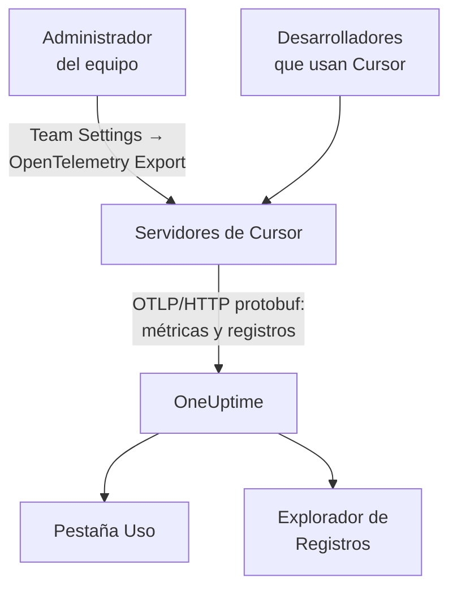

# Cursor

Cursor exporta la telemetría de su equipo desde los propios servidores de Cursor. Un administrador del equipo añade OneUptime como destino una sola vez, en el panel de Cursor, y llegan los tokens, el coste estimado y las llamadas a herramientas de todo el equipo: no hay nada que instalar ni que configurar en los equipos de los desarrolladores.

:::cards
- [Configúralo](#configúralo): Crea una clave en OneUptime y un destino en Cursor.
- [Lo que obtienes](#lo-que-obtienes-y-lo-que-no): Métricas y registros; sin trazas.
- [Quién gastó qué](#atribución-a-empleados): Las personas llegan como ids de usuario de Cursor.
- [Solución de problemas](#solución-de-problemas): Qué comprobar cuando no llega nada.
:::

## Cómo funciona



## Antes de empezar

- **El plan Enterprise de Cursor.** La pantalla OpenTelemetry Export no está en los demás planes.
- **Un endpoint al que Cursor pueda llegar desde internet.** Es Cursor quien se conecta a ti, desde un conjunto fijo de direcciones. OneUptime Cloud no necesita nada más; un OneUptime autoalojado detrás de un firewall debe permitir las direcciones de salida que Cursor enumera en su página [OpenTelemetry Export](https://cursor.com/docs/enterprise/opentelemetry-export).

## Configúralo

:::steps
### Crea una clave de ingesta

En OneUptime, abre **Ajustes del proyecto → Telemetría y APM → Claves de ingesta**, haz clic en **Crear clave de ingesta** y copia la clave. Tu URL base de OTLP es `https://oneuptime.com/otlp`, o `https://YOUR-ONEUPTIME-HOST/otlp` si alojas OneUptime tú mismo.

### Crea el destino en Cursor

En el panel web de Cursor, como administrador del equipo, abre **Team Settings → OpenTelemetry Export** y crea un destino:

| Campo | Valor |
| --- | --- |
| Endpoint (base URL) | `https://oneuptime.com/otlp` |
| Header name | `x-oneuptime-token` |
| Header value | `YOUR_INGESTION_TOKEN` |

Escribe la URL base sin `/v1`: Cursor añade `/v1/metrics` y `/v1/logs` por sí mismo, y `https://oneuptime.com/otlp/v1` enviaría a `/otlp/v1/v1/metrics`, donde no llega nada.

### Prueba y activa

Haz clic en **Test connection** para comprobar la URL y la cabecera, y después en **Enable**. La exportación empieza en un minuto aproximadamente; los cambios posteriores en la cabecera tardan unos 30 segundos.

### Comprueba que llegan datos

Usa Cursor un minuto o dos, después abre **Registros** en OneUptime y filtra por el nombre de servicio `cursor`: los registros `cursor.api.request` con recuentos de tokens indican que la clave y la URL son correctas.
:::

Cursor habla OTLP sobre HTTP solo con protobuf binario (ni gRPC ni JSON), que OneUptime acepta tal cual. Guarda la cabecera cifrada y envía a un único destino por equipo: para enviar a OneUptime y a otro sitio, pon un collector delante.

## Lo que obtienes, y lo que no

| Señal | Desde Cursor |
| --- | --- |
| Métricas: tokens, coste estimado, llamadas a herramientas | Sí, como deltas |
| Eventos de log: solicitudes, errores, correcciones, skills, hooks, plugins, agentes en la nube | Sí |
| Texto de prompts y respuestas | Solo si activas la familia `conversation_content` |
| Trazas | No |
| Nada de antes de activar el destino | No |

Así que en OneUptime, Cursor aparece en la pestaña **Uso** de **Productos → IA / LLM**, a partir de `cursor.token.usage` y `cursor.cost.usage`, pero nunca en **Llamadas** ni en **Conversaciones**, que se construyen a partir de trazas. El detalle por solicitud es el evento `cursor.api.request` en el explorador de **Registros**.

### Familias

Cada señal, y cada familia de telemetría, tiene su propio interruptor en los ajustes de Cursor:

| Familia | Cubre |
| --- | --- |
| `model_usage` | `cursor.token.usage`, `cursor.cost.usage`, y los eventos `cursor.api.request`, `cursor.api.error` y `cursor.api.correction` |
| `tool_calls` | `cursor.tool.calls` |
| `skills_hooks_plugins` | Eventos de skills, hooks y plugins |
| `cloud_agents` | Eventos `cursor.cloud_agent.*` |
| `grok_bot_agent_actions` | Eventos `cursor.grok_bot.*`; necesita Action Recording |
| `conversation_content` | El texto de los mensajes y la entrada y salida de las herramientas MCP; desactivada por defecto |

Todas las familias salvo `conversation_content` empiezan activadas. Las familias que Cursor añada más adelante también empiezan activadas, salvo que desactives `auto_enable_new_families`.

## Métricas y eventos

Las tres métricas son sumas delta:

| Métrica | Unidad | Atributos |
| --- | --- | --- |
| `cursor.token.usage` | `{token}` | `cursor.token.type`: `input`, `output`, `cache_read`, `cache_creation`; `cursor.model.name`; `cursor.api.status`: `success`, `errored`, `aborted`; `cursor.api.billable` |
| `cursor.cost.usage` | `USD` | `cursor.model.name` |
| `cursor.tool.calls` | `{call}` | `cursor.tool.kind`: `builtin`, `mcp`; `cursor.tool.name`; `cursor.tool.status`: `success`, `failure`, `aborted`; `cursor.mcp.server.name` |

Los puntos de datos no llevan ningún id de conversación ni de solicitud, así que el coste por sesión no está en las métricas. `cursor.model.name` es el modelo solicitado, con las elecciones enrutadas agrupadas: un desglose por modelo tiene una fila llamada `Auto` que no se puede repartir entre los modelos a los que Cursor la enrutó.

El evento de log que más usarás es `cursor.api.request`: uno por solicitud, con sus recuentos de tokens de entrada, de salida y de caché, el modelo y si se facturó. `cursor.api.error` registra una solicitud fallida (sin el mensaje de error), y `cursor.api.correction` llega más tarde para decir que una solicitud al final no se facturó. La [referencia del formato](https://cursor.com/docs/enterprise/opentelemetry-export/wire) de Cursor enumera cada evento y atributo.

Cada registro lleva estos atributos de recurso:

| Atributo | Qué es |
| --- | --- |
| `service.name` | Siempre `cursor`: filtra por él los exploradores de **Registros** y **Métricas** |
| `cursor.team.id` | Tu equipo, un entero; siempre presente |
| `cursor.user.id` | La persona, un entero propio del equipo; opcional |
| `cursor.surface` | De dónde vino la actividad, como `desktop`, `cli`, `cloud_agent` o `bugbot` |
| `cursor.entrypoint` | Cómo empezó, como `desktop`, `cli`, `web`, `api` o `github_pr` |

## Atribución a empleados

**Cursor nombra a una persona por `cursor.user.id`, un entero que solo Cursor puede convertir en un nombre, y a menudo lo omite en los agentes en la nube.** OneUptime lo lee como el empleado, y `cursor.team.id` como el equipo, así que la pestaña **Uso** clasifica personas y equipos sin configuración, pero las personas aparecen como enteros.

- Ambos llegan como atributos de recurso (`resource.cursor.user.id`, `resource.cursor.team.id`), que OneUptime lee.
- Cursor también puede enviar `cursor.user.email`, pero OneUptime todavía no lo lee, así que la columna del correo del empleado se queda vacía para Cursor.
- `gen_ai.user`, `llm.user` y los ids de usuario final de LiteLLM nunca se leen como el empleado: nombran a tus clientes, no a tu personal. Consulta [Atribución a empleados y equipos](/docs/telemetry/ai-coding-assistants#atribución-a-empleados-y-equipos).

### Dónde aparece Cursor en la pestaña Uso

Cursor envía métricas y ningún span de GenAI, y las métricas solo suplen a los spans: **si el mismo proyecto recibe spans de GenAI con coste, el gasto de Cursor no aparece.** Envía Cursor a un proyecto propio. Consulta [Primero los spans, las métricas los suplen](/docs/telemetry/ai-llm-observability#primero-los-spans-las-métricas-los-suplen).

| Desglose | Para Cursor |
| --- | --- |
| **Empleado** | Sí, por `cursor.user.id` |
| **Equipo** | Sí, por `cursor.team.id` |
| **Modelo** | Sí, por `cursor.model.name` |
| **Proveedor** | No: Cursor nunca dice qué proveedor atendió una llamada |
| **Aplicación / Servicio** | No: las métricas de Cursor no pertenecen a ningún servicio de OneUptime |

Una fila de Cursor solo lleva el coste: sus celdas de llamadas y tokens muestran `—`, porque `cursor.cost.usage` no tiene detalle por llamada. `cursor.token.usage` sigue alimentando los totales de tokens encima de la tabla (sus tipos `input` y `output`; los tokens de caché quedan fuera), y puedes representarlo en un panel por `cursor.token.type`.

:::details Convertir un id de usuario de Cursor en una persona
Los nombres y los importes facturados están en la Admin API de Cursor, a la que OneUptime no llama: consúltala tú mismo si la necesitas. Es solo para Enterprise, está en `https://api.cursor.com`, y recibe una clave de API de administrador como nombre de usuario con una contraseña vacía:

```bash
curl -u YOUR_API_KEY: https://api.cursor.com/teams/members
```

`GET /teams/members` enumera el correo y el nombre de cada miembro. `POST /teams/filtered-usage-events` devuelve el uso facturado por evento; suma sus `chargedCents` para obtener el gasto. Su `conversationId` coincide con `cursor.conversation.id` en los eventos de log de Cursor, lo que une una persona y un importe facturado a una sesión que ya ves, cuando ambos lados lo llevan. Cursor no documenta que el entero `cursor.user.id` y los ids de usuario de la Admin API sean los mismos, así que compruébalo con tu propio equipo antes de cobrar a nadie en base a ello.
:::

## Cómo entrega Cursor

Estas reglas cambian lo que ves en los gráficos, así que conócelas antes de informar de un hueco:

- **Las métricas se envían como máximo una vez.** Una exportación fallida no se reintenta, así que un hueco breve tras un fallo es normal: no avises a nadie por los huecos en las métricas de Cursor.
- **Los registros se envían al menos una vez**, se deduplican por `cursor.event.id` y se reintentan automáticamente durante unos 7 días.
- **No hay orden.** Un `cursor.api.correction` llega después de la solicitud que corrige: ordena por la marca de tiempo del registro, nunca por la llegada.
- **No se recupera nada hacia atrás.** No llega nada de antes de activar el destino, y un destino que se deja roto pierde lo que Cursor no pudo enviar.
- **Desactivar o eliminar un destino descarta los datos en tránsito.** Para cambiar la clave de ingesta, edita la cabecera del destino en lugar de eliminarlo y volver a crearlo.

## El coste es una estimación, no una factura

Cursor documenta `cursor.cost.usage` como una estimación aproximada. No separa el uso incluido del uso facturado bajo demanda; con tus propias claves de modelo, solo refleja la tarifa de tokens de Cursor, no la factura de tu proveedor; y un `cursor.api.correction` posterior puede retirar uso que ya había contado. Léelo como una tendencia. Para una cifra que coincida con la factura, suma los `chargedCents` de la Admin API de Cursor.

## Solución de problemas

:::details No llega nada
Vuelve a ejecutar **Test connection** en Cursor. Comprueba que la URL base no termina en `/v1`, que el nombre de la cabecera es `x-oneuptime-token` y su valor exactamente la clave, y que la familia `model_usage` está activada. La exportación empieza aproximadamente un minuto después de activar el destino.
:::

:::details No llega nada a un OneUptime autoalojado
Cursor se conecta desde sus propios servidores: tu endpoint OTLP debe ser accesible desde internet, con un nombre DNS público, y permitir las direcciones de salida de Cursor a través de tu firewall.
:::

:::details Llegan los registros, pero la pestaña Uso no muestra gasto de Cursor
El proyecto también recibe spans de GenAI con coste, así que las métricas de Cursor no se leen. Envía Cursor a un proyecto propio, con su propia clave de ingesta.
:::

:::details Las personas aparecen como números
Es `cursor.user.id`: el único id de persona que OneUptime lee hoy de Cursor. Asócialo a nombres con la Admin API de Cursor.
:::

## Próximos pasos

:::cards
- [Asistentes de programación con IA](/docs/telemetry/ai-coding-assistants): Cómo se atribuye el gasto en todos los asistentes de programación.
- [Gateways de IA](/docs/telemetry/ai-gateways): Trazas y prompts completos para las llamadas a modelos que hacen tus propias aplicaciones.
- [Monitor de métricas](/docs/monitor/metrics-monitor): Alerta sobre `cursor.cost.usage`, `cursor.token.usage` o `cursor.tool.calls`.
:::
