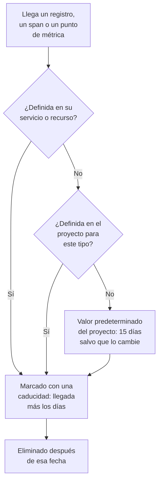

# Retención de datos

OneUptime conserva sus registros, trazas, métricas y perfiles durante un número de días y luego los elimina: 15 días, salvo que lo cambie. Esta página muestra cómo se calcula ese número, cómo cambiarlo para todo el proyecto y cómo conservar parte de la telemetría más o menos tiempo que el resto.

:::cards
- [Cuánto tiempo se conserva la telemetría](#cuánto-tiempo-se-conserva-la-telemetría): El orden en que OneUptime lee los ajustes.
- [Cambiar la retención del proyecto](#cambiar-la-retención-del-proyecto): Un solo número para toda su telemetría.
- [Conservar parte de la telemetría más o menos tiempo](#conservar-parte-de-la-telemetría-más-o-menos-tiempo): Por tipo, gravedad, estado o servicio.
- [Lo que cuesta la retención](#lo-que-cuesta-la-retención): La facturación en OneUptime Cloud, el disco si usa autoalojamiento.
:::

## Cuánto tiempo se conserva la telemetría

Cada registro, span, punto de métrica y muestra de perfil recibe su retención al llegar. OneUptime calcula cuántos días conservarlo, marca la fecha en que caduca y lo elimina después de esa fecha. Gana el ajuste más específico:

En detalle, OneUptime lee estos ajustes en este orden, y decide el primero que esté definido:

| Orden | Ajuste | Dónde se define |
| --- | --- | --- |
| 1 | Días para una gravedad de registro o un estado de span, para un servicio o recurso | **Retención por tipo de telemetría**, en su página **Ajustes** |
| 2 | Días para un tipo de telemetría, para un servicio o recurso | La misma tarjeta |
| 3 | Días para todo lo que viene de un servicio o recurso | **Retención de datos de telemetría**, en la misma página |
| 4 | Días para una gravedad de registro o un estado de span, para el proyecto | **Retención por tipo de telemetría**, en **Retención de datos** |
| 5 | Días para un tipo de telemetría, para el proyecto | La misma tarjeta |
| 6 | Días para todo lo demás | **Retención predeterminada (días)**, en **Retención de datos** |

- **Los ajustes 1 a 5 son anulaciones de retención.** Forman parte de la [Edición Enterprise](/docs/self-hosted/enterprise), y del plan Scale en OneUptime Cloud. Sin ellas, cada entrada se conserva según el valor predeterminado del proyecto.
- **Un cambio se aplica a la telemetría nueva.** Una entrada conserva la fecha que se le marcó: una retención más corta no la elimina antes, y una más larga no la conserva más tiempo. Las entradas nuevas siguen un cambio en unos cinco minutos.
- **Las excepciones siguen a aquello en lo que se encontraron.** Una excepción se conserva tanto tiempo como el span o el registro del que salió. Las Session Replays tienen su propia retención: consulte [Otros datos con su propia retención](#otros-datos-con-su-propia-retención).

## Antes de empezar

- **Un rol que modifique el proyecto.** Project Owner o Project Admin cambian la retención del proyecto. La retención de un servicio o recurso requiere el rol que cambia sus demás ajustes.
- **Para las anulaciones, la Edición Enterprise o el plan Scale.** Una instalación autoalojada necesita una licencia Enterprise, y un proyecto de OneUptime Cloud el plan Scale o superior. La retención predeterminada del proyecto existe en todas las ediciones y planes.

## Cambiar la retención del proyecto

:::steps
### Abrir la retención de datos

Vaya a **Ajustes del proyecto → Telemetría y APM → Retención de datos**. **Telemetría y APM** empieza contraído en el menú lateral: haga clic en él para abrirlo. La tarjeta **Retención de datos de telemetría** muestra la **Retención predeterminada (días)**.

### Fijar el número de días

Haga clic en **Editar ajustes de retención**, escriba el número de días, al menos 1, y haga clic en **Guardar cambios**.
:::

El número nuevo se aplica a cada entrada que llega a partir de entonces y no tiene una anulación propia.

## Conservar parte de la telemetría más o menos tiempo

Las anulaciones conservan más tiempo lo que necesita y menos el resto: los registros de error durante un trimestre, por ejemplo, y los de depuración durante unos días.

### Para todo el proyecto

Debajo del valor predeterminado, la tarjeta **Retención por tipo de telemetría** fija días para cada tipo de telemetría. Haga clic en **Edit Overrides**, rellene los campos que necesite y deje vacíos los demás:

| Tipo | Campos |
| --- | --- |
| Registros | **Logs default (days)**, y un campo para cada gravedad de registro |
| Trazas | **Traces default (days)**, y un campo para cada estado de span: Error, Correcto y Sin establecer |
| Métricas | **Metrics default (days)** |
| Perfiles | **Profiles default (days)** |

Un campo vacío recurre al siguiente ajuste del orden de arriba, así que una gravedad sin días propios conserva sus registros según el valor predeterminado de los registros.

### Para un servicio o recurso

Abra la página **Ajustes** del servicio o del recurso. Su tarjeta **Retención de datos de telemetría** contiene **Conservar datos de telemetría durante (días)**, un solo número para todo lo que envía, y su tarjeta **Retención por tipo de telemetría** tiene los mismos campos que la del proyecto. Deje un campo vacío para usar los ajustes del proyecto.

Los servicios, los hosts, los clústeres de Kubernetes, los hosts de Docker y Podman, los clústeres de Docker Swarm, Proxmox y Ceph, las cabinas de almacenamiento, los vCenter, las bases de datos, las funciones serverless, los recursos en la nube, las aplicaciones RUM y las flotas IoT tienen todos estas tarjetas. Consulte el [Catálogo de servicios](/docs/telemetry/services#cambiar-un-servicio) para la página **Ajustes** de un servicio.

### Cuando el plan o la licencia ya no incluye anulaciones

- **En una instalación autoalojada**, las anulaciones dejan de aplicarse cuando termina la prueba Enterprise o el periodo de gracia sin una licencia. La telemetría nueva se conserva según el valor predeterminado del proyecto, las tarjetas pasan a ser de solo lectura y no se elimina nada de lo que definió: active una licencia y vuelven a aplicarse. Consulte [Edición Enterprise](/docs/self-hosted/enterprise#cuando-una-licencia-caduca-o-falta).
- **En OneUptime Cloud**, una anulación que dejó definida una prueba sigue aplicándose por debajo del plan Scale. Su página la muestra bajo la tarjeta de mejora de plan, con un botón **Quitar anulación** que funciona en todos los planes. Volver a definir una anulación requiere el plan Scale.

## Otros datos con su propia retención

| Datos | Se conservan durante | Dónde cambiarlo |
| --- | --- | --- |
| Session Replays | 7 días, salvo que lo cambie | La política de grabación de la aplicación RUM: consulte [Gestionar aplicaciones](/docs/rum/applications#retención-de-la-reproducción-de-sesiones). |
| Registros de monitores, una fila por comprobación | 1 día, salvo que lo cambie | En una instalación autoalojada, **Retención de registros del monitor (días)** en el Admin Dashboard |
| Métricas de monitores, y las métricas que registran los SLO | 30 días, salvo que lo cambie | En una instalación autoalojada, **Retención de métricas del monitor (días)** en el Admin Dashboard |

## Lo que cuesta la retención

- **En OneUptime Cloud**, la telemetría se factura por GB ingerido, y el precio por GB incluye 15 días de retención. Una retención más larga cuesta proporcionalmente más: 30 días cuestan el doble por GB que 15. Una retención más corta cuesta proporcionalmente menos, pero una retención de menos de 7 días se factura como 7 días. **Ajustes del proyecto → Facturación y facturas → Historial de uso** muestra, día a día, cuánto envió cada servicio y cuánto tiempo se conserva.
- **Si usa autoalojamiento**, la telemetría vive en ClickHouse, y la retención multiplica su disco. Consulte [Dimensionamiento](/docs/installation/sizing#la-retención-y-cómo-afecta-al-almacenamiento).

La telemetría que no necesita no cuesta nada si nunca se guarda: los [Filtros de descarte y reglas de depuración](/docs/telemetry/drop-filters-and-scrub-rules) la descartan al llegar.

## Solución de problemas

:::details Reduje la retención, pero los datos antiguos siguen ahí
Una entrada conserva la fecha de caducidad que se le marcó al llegar. Las entradas guardadas antes del cambio se eliminan en sus propias fechas, y solo las entradas nuevas siguen la nueva retención.
:::

:::details Las tarjetas de anulación muestran una invitación a mejorar el plan
Las anulaciones de retención requieren la Edición Enterprise en una instalación autoalojada, y el plan Scale en OneUptime Cloud. Hasta entonces, todo se conserva según el valor predeterminado del proyecto.
:::

:::details El espacio en disco vuelve un día después de que caduquen los datos
Las entradas caducadas dejan de aparecer en las búsquedas, los gráficos y las listas en cuanto caducan. En el disco, los registros y las métricas se eliminan en la primera medianoche siguiente, así que su espacio vuelve hasta un día después.
:::

## Próximos pasos

:::cards
- [Claves de ingesta](/docs/telemetry/ingestion-keys): Envíe telemetría a su proyecto.
- [Filtros de descarte y reglas de depuración](/docs/telemetry/drop-filters-and-scrub-rules): Conserve solo la telemetría que necesita.
- [Catálogo de servicios](/docs/telemetry/services): Fije la retención propia de un servicio.
- [Edición Enterprise](/docs/self-hosted/enterprise): Lo que aportan las anulaciones de retención.
:::
