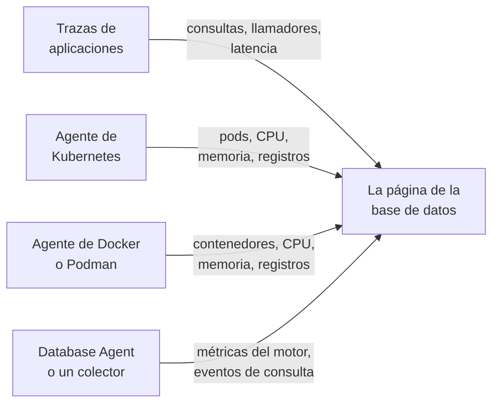

# Bases de datos

**Bases de datos** da a cada servidor de bases de datos que tu proyecto ejecuta o al que se conecta su propia página: quién lo llama y con qué rapidez, dónde se ejecuta, las métricas de salud propias del motor, sus registros y trazas, los incidentes, alertas y mantenimientos programados vinculados a él, y los monitores de alertas recomendados para su motor. Las bases de datos tienen etiquetas, propietarios, reglas de etiquetas y de propietarios, retención por base de datos y archivado, como cualquier otro recurso. Ábrelas en **Productos → Recursos → Bases de datos**.

:::cards
- [El Database Agent](#el-database-agent): Métricas del motor para PostgreSQL, MySQL, SQL Server, Oracle, Redis, MongoDB, Elasticsearch y Memcached.
- [Cómo se detectan las bases de datos](#cómo-se-detectan-las-bases-de-datos): A partir de trazas, Kubernetes, Docker, Podman y colectores.
- [Alertas sobre una base de datos](#alertas-sobre-una-base-de-datos): Monitores recomendados y monitores que construyes tú.
- [Solución de problemas](#solución-de-problemas): Un script de diagnóstico y los problemas habituales.
:::

## Cómo funciona

La mayoría de las bases de datos aparecen solas. OneUptime compone cada una a partir de hasta cuatro fuentes, y cada fuente aporta algo distinto:

| Fuente | Qué necesita de ti | Qué añade a la página de la base de datos |
| --- | --- | --- |
| **Trazas de aplicaciones** | Aplicaciones instrumentadas (OpenTelemetry) | Consultas de las aplicaciones: tasa de llamadas, errores, latencia y los servicios que la llaman |
| **Kubernetes** | El [agente de Kubernetes de OneUptime](/docs/telemetry/kubernetes-agent) | Dónde se ejecuta: pods, CPU y memoria, y los registros de los pods |
| **Docker / Podman** | El [agente de Docker](/docs/telemetry/docker-host) o el [agente de Podman](/docs/telemetry/podman-host) | Dónde se ejecuta: los contenedores, su CPU y memoria, y sus registros |
| **Database Agent** (un OpenTelemetry Collector) | El [Database Agent](#el-database-agent) o tu propio colector | **Métricas del motor**: conexiones, rendimiento, tasa de aciertos de caché, bloqueos, retraso de replicación, memoria, en la medida en que el motor los tenga (consulta [Qué se recopila](#qué-se-recopila)), además de muestras de consultas opcionales, consultas principales y el archivo de registro del motor |



Las métricas del motor solo vienen de un colector que habla con la propia base de datos (o, en una base de datos administrada en la nube, con la API de monitorización de su proveedor). Las trazas y los inventarios de contenedores le dicen a OneUptime que una base de datos existe y cómo se usa, pero no cómo está por dentro: el estado **Métricas del motor** de cada base de datos indica si esa parte está conectada.

También puedes añadir una base de datos a mano: **Bases de datos → Crear Base de datos** con su motor, dirección y puerto. Para una comprobación de salud desde una sonda que no necesita ningún agente, consulta el [Monitor de salud de la base de datos](/docs/monitor/database-health-monitor).

## Bases de datos compatibles

OneUptime conoce por su nombre los motores de la tabla siguiente: normaliza lo que las instrumentaciones ponen en `db.system.name` (o el antiguo `db.system`) al valor de la segunda columna, muestra el nombre del motor, aplica su puerto predeterminado cuando un span o una dirección no lo tienen, reconoce sus imágenes de contenedor y sus charts de Helm, y sabe de dónde vienen sus métricas del motor. Un motor que no aparece en la lista funciona igualmente en todas partes donde una base de datos se identifica por su dirección: solo aparece con el nombre en bruto que informan tus spans y nunca se crea a partir de trazas por sí solo.

Una **familia** es el motor a través del cual se llega a un fork o a un motor compatible a nivel de protocolo: las bibliotecas cliente no distinguen MariaDB de MySQL ni Valkey de Redis, así que un span dice `mysql` o `redis` mientras que una imagen de contenedor, un chart de Helm o el Database Agent nombran el fork. Ambos acaban en la misma base de datos, y la base de datos muestra el motor más específico en cuanto su imagen de contenedor, o una fuente al menos tan fuerte como la que dio su motor actual, lo nombra (consulta [Qué motor muestra una base de datos](#qué-motor-muestra-una-base-de-datos)).

**Creada a partir de trazas** indica si los spans de cliente bastan para crear una base de datos de ese motor (consulta [A partir de trazas de aplicaciones](#a-partir-de-trazas-de-aplicaciones)): un servicio administrado al que se llega a través del host de API compartido de su proveedor, y un motor que se ejecuta dentro del proceso de tu aplicación, nunca lo hacen. **Métricas del motor** indica de dónde vienen las métricas de salud propias del motor: una configuración del Database Agent, un receptor de collector-contrib que añades a tu propio colector, el endpoint de Prometheus propio del motor (`:port/path`, recopilado con el receptor `prometheus` del colector), la API de monitorización del proveedor de la nube o nada integrado. La pestaña **Documentación** de cada base de datos lo convierte en una configuración del colector lista para usar con esa base de datos.

| Motor | `db.system.name` | Puerto predeterminado | Familia | Creada a partir de trazas | Métricas del motor |
| --- | --- | --- | --- | --- | --- |
| Actian Ingres | `actian.ingres` | — | — | Sí | Nada integrado |
| Actian Zen (Pervasive PSQL) | `pervasive` | 1583 | — | Sí | Nada integrado |
| Aerospike | `aerospike` | 3000 | — | Sí | receptor `aerospike` |
| Amazon DocumentDB | `aws.documentdb` | 27017 | MongoDB | Sí | receptor `awsfirehose` (monitorización en la nube) |
| Amazon DynamoDB | `aws.dynamodb` | 443 | — | No (API en la nube) | receptor `awsfirehose` (monitorización en la nube) |
| Amazon Neptune | `aws.neptune` | 8182 | — | Sí | receptor `awsfirehose` (monitorización en la nube) |
| Amazon Redshift | `aws.redshift` | 5439 | PostgreSQL | Sí | receptor `awsfirehose` (monitorización en la nube) |
| Apache Derby | `derby` | 1527 | — | No (en el proceso) | Ninguna (en el proceso) |
| Apache Doris | `doris` | 9030 | MySQL | Sí | Prometheus, `:8030/metrics` |
| Apache Druid | `druid` | 8888 | — | Sí | Nada integrado |
| Apache Geode | `geode` | 10334 | — | Sí | Nada integrado |
| Apache HBase | `hbase` | — | — | Sí | Nada integrado |
| Apache Hive | `hive` | 10000 | — | Sí | Nada integrado |
| Apache Ignite | `ignite` | 10800 | — | Sí | Nada integrado |
| Apache Impala | `impala` | 21050 | — | Sí | Nada integrado |
| Apache Pinot | `pinot` | 8099 | — | Sí | Nada integrado |
| Apache Solr | `solr` | 8983 | — | Sí | Nada integrado |
| ArangoDB | `arangodb` | 8529 | — | Sí | Prometheus, `:8529/_admin/metrics/v2` |
| Azure Cosmos DB | `azure.cosmosdb` | 443 | — | No (API en la nube) | receptor `azure_monitor` (monitorización en la nube) |
| Cassandra | `cassandra` | 9042 | — | Sí | Nada integrado |
| Chroma | `chroma` | 8000 | — | Sí | Nada integrado |
| Claris FileMaker | `filemaker` | 2399 | — | Sí | Nada integrado |
| ClickHouse | `clickhouse` | 9000 | — | Sí | Prometheus, `:9363/metrics` |
| Cloud Bigtable | `gcp.bigtable` | 443 | — | No (API en la nube) | receptor `googlecloudmonitoring` (monitorización en la nube) |
| Cloud Firestore | `gcp.firestore` | 443 | — | No (API en la nube) | receptor `googlecloudmonitoring` (monitorización en la nube) |
| Cloud Spanner | `gcp.spanner` | 443 | — | No (API en la nube) | receptor `google_cloud_spanner` |
| CockroachDB | `cockroachdb` | 26257 | PostgreSQL | Sí | Prometheus, `:8080/_status/vars` |
| Couchbase | `couchbase` | 11210 | — | Sí | Prometheus, `:8091/metrics` |
| CouchDB | `couchdb` | 5984 | — | Sí | receptor `couchdb` |
| Databricks | `databricks` | 443 | — | Sí | Nada integrado |
| Dragonfly | `dragonfly` | 6379 | Redis | Sí | Database Agent (receptor `redis`) |
| DuckDB | `duckdb` | — | — | No (en el proceso) | Ninguna (en el proceso) |
| Elasticsearch | `elasticsearch` | 9200 | — | Sí | Database Agent (receptor `elasticsearch`) |
| etcd | `etcd` | 2379 | — | Sí | Prometheus, `:2379/metrics` |
| FerretDB | `ferretdb` | 27017 | MongoDB | Sí | Prometheus, `:8088/debug/metrics` |
| Firebird | `firebirdsql` | 3050 | — | Sí | Nada integrado |
| FoundationDB | `foundationdb` | 4500 | — | Sí | Nada integrado |
| Google BigQuery | `bigquery` | 443 | — | No (API en la nube) | receptor `googlecloudmonitoring` (monitorización en la nube) |
| Greenplum | `greenplum` | 5432 | PostgreSQL | Sí | Nada integrado |
| H2 | `h2database` | 9092 | — | No (en el proceso) | Ninguna (en el proceso) |
| Hazelcast | `hazelcast` | 5701 | — | Sí | Nada integrado |
| HyperSQL | `hsqldb` | 9001 | — | No (en el proceso) | Ninguna (en el proceso) |
| IBM Db2 | `ibm.db2` | 50000 | — | Sí | Nada integrado |
| IBM Informix | `ibm.informix` | 9088 | — | Sí | Nada integrado |
| IBM Netezza | `ibm.netezza` | 5480 | — | Sí | Nada integrado |
| InfluxDB | `influxdb` | 8086 | — | Sí | Prometheus, `:8086/metrics` |
| InstantDB | `instantdb` | — | — | No (en el proceso) | Ninguna (en el proceso) |
| InterBase | `interbase` | 3050 | Firebird | Sí | Nada integrado |
| InterSystems IRIS / Caché | `intersystems.cache` | 1972 | — | Sí | Prometheus, `:52773/api/monitor/metrics` |
| KeyDB | `keydb` | 6379 | Redis | Sí | Database Agent (receptor `redis`) |
| MariaDB | `mariadb` | 3306 | MySQL | Sí | Database Agent (receptor `mysql`) |
| Meilisearch | `meilisearch` | 7700 | — | Sí | Prometheus, `:7700/metrics` |
| Memcached | `memcached` | 11211 | — | Sí | Database Agent (receptor `memcached`) |
| Milvus | `milvus` | 19530 | — | Sí | Prometheus, `:9091/metrics` |
| MongoDB | `mongodb` | 27017 | — | Sí | Database Agent (receptor `mongodb`) |
| MySQL | `mysql` | 3306 | — | Sí | Database Agent (receptor `mysql`) |
| Neo4j | `neo4j` | 7687 | — | Sí | Prometheus, `:2004/metrics` |
| OceanBase | `oceanbase` | 2881 | MySQL | Sí | Nada integrado |
| OpenSearch | `opensearch` | 9200 | Elasticsearch | Sí | Database Agent (receptor `elasticsearch`) |
| Oracle | `oracle.db` | 1521 | — | Sí | Database Agent (receptor `oracledb`) |
| Pinecone | `pinecone` | 443 | — | No (API en la nube) | Nada integrado |
| PostgreSQL | `postgresql` | 5432 | — | Sí | Database Agent (receptor `postgresql`) |
| Presto | `presto` | 8080 | — | Sí | Nada integrado |
| Progress OpenEdge | `progress` | — | — | Sí | Nada integrado |
| Qdrant | `qdrant` | 6333 | — | Sí | Prometheus, `:6333/metrics` |
| QuestDB | `questdb` | 8812 | PostgreSQL | Sí | Prometheus, `:9003/metrics` |
| RavenDB | `ravendb` | 8080 | — | Sí | Nada integrado |
| Redis | `redis` | 6379 | — | Sí | Database Agent (receptor `redis`) |
| Riak KV | `riak` | 8087 | — | Sí | receptor `riak` |
| SAP ASE (Sybase) | `sybase` | 5000 | — | Sí | Nada integrado |
| SAP HANA | `sap.hana` | 30015 | — | Sí | receptor `saphana` |
| SAP MaxDB | `sap.maxdb` | 7210 | — | Sí | Nada integrado |
| ScyllaDB | `scylladb` | 9042 | Cassandra | Sí | Prometheus, `:9180/metrics` |
| SingleStore | `singlestore` | 3306 | MySQL | Sí | Prometheus, `:9104/metrics` |
| Snowflake | `snowflake` | 443 | — | Sí | receptor `snowflake` |
| Software AG Adabas | `softwareag.adabas` | — | — | Sí | Nada integrado |
| SQL Server | `microsoft.sql_server` | 1433 | — | Sí | Database Agent (receptor `sqlserver`) |
| SQLite | `sqlite` | — | — | No (en el proceso) | Ninguna (en el proceso) |
| StarRocks | `starrocks` | 9030 | MySQL | Sí | Prometheus, `:8030/metrics` |
| SurrealDB | `surrealdb` | 8000 | — | Sí | Nada integrado |
| Teradata | `teradata` | 1025 | — | Sí | Nada integrado |
| TiDB | `tidb` | 4000 | MySQL | Sí | Prometheus, `:10080/metrics` |
| Trino | `trino` | 8080 | — | Sí | Prometheus, `:8080/metrics` |
| Typesense | `typesense` | 8108 | — | Sí | Nada integrado |
| Valkey | `valkey` | 6379 | Redis | Sí | Database Agent (receptor `redis`) |
| Vertica | `vertica` | 5433 | — | Sí | Nada integrado |
| Vitess | `vitess` | 3306 | MySQL | Sí | Prometheus, `:15000/metrics` |
| Weaviate | `weaviate` | 8080 | — | Sí | Prometheus, `:2112/metrics` |
| YugabyteDB | `yugabytedb` | 5433 | PostgreSQL | Sí | Prometheus, `:9000/prometheus-metrics` |

También se aceptan las demás grafías habituales: `postgres` y `pg`, `mssql` y `sqlserver`, `oracle`, `mongo`, `scylla`, `dragonflydb`, `memsql`, y cualquier valor heredado de `db.system` que haya usado OpenTelemetry (`db2`, `hanadb`, `cosmosdb`, `dynamodb`, `spanner`, `redshift`, `informix`, `maxdb`, `cache`, `h2`, `firebird`, `edb`, `cloudscape`, …). Un servicio administrado que habla el protocolo de un motor (Amazon RDS y Aurora, Azure Database, Cloud SQL, AlloyDB, Neon, Supabase, PlanetScale, ElastiCache, Memorystore, MongoDB Atlas) es ese motor.

## Cómo se detectan las bases de datos

Cada base de datos recuerda la fuente que la creó (la columna **Descubierto a partir de**), y el primer elemento de su **Feed** indica qué la encontró: la carga de trabajo de Kubernetes y su clúster, el contenedor de Docker o Podman (o el servicio de Compose o Swarm) y su host, el endpoint al que llamaron las aplicaciones, o el Database Agent (con su versión) o el colector que la informó. Las fuentes posteriores amplían la misma base de datos en lugar de crear otra, siempre que describan el mismo endpoint (consulta [Endpoints](#endpoints-y-la-regla-del-propietario-único)).

### A partir de trazas de aplicaciones

Cada 10 minutos, OneUptime resume los spans CLIENT que tus aplicaciones enviaron en los últimos 15 minutos y que llevan `db.system.name` (o el antiguo `db.system`). El servidor sale de `server.address` (o del antiguo `net.peer.name`, luego `network.peer.address` / `net.sock.peer.addr`) y el puerto de `server.port` (o `net.peer.port`, `network.peer.port`, `net.sock.peer.port`); cuando el span no tiene puerto, se supone el puerto predeterminado del motor. Los nombres de motor se normalizan (consulta [Bases de datos compatibles](#bases-de-datos-compatibles)), así que `postgres`, `pg` y `postgresql` son un solo motor, igual que `mssql` y `microsoft.sql_server`; `mariadb` y `mysql` son dos motores de una misma familia.

Una base de datos solo se **crea** a partir de trazas cuando se cumplen todas estas condiciones; todo lo demás sigue contando para una base de datos que ya existe, pero nunca crea una:

- la dirección nombra un único servidor en todo el proyecto: un nombre DNS, no una IP literal ni un nombre que solo se resuelve en una máquina o dentro de una red, salvo que el clúster de Kubernetes del llamador lo califique (consulta [Endpoints](#endpoints-y-la-regla-del-propietario-único));
- el puerto es uno en el que escucha un servidor. Los sistemas operativos asignan el extremo cliente de una conexión a partir del puerto 32768 (el rango efímero predeterminado de Linux empieza ahí; Windows y macOS usan 49152–65535), así que un puerto a partir de 32768 nunca crea una base de datos, salvo que sea el puerto predeterminado del propio motor (el 50000 de IBM Db2). La instrumentación eBPF, incluida la del agente de Kubernetes, puede unirse a una conexión de larga duración a mitad de camino e intercambiar sus dos extremos. Entonces el span nombra el propio puerto del cliente como servidor, y sin esta regla cada conexión se convertiría en una base de datos propia;
- el motor es uno que OneUptime conoce, con una dirección propia: la columna **Creada a partir de trazas** de [Bases de datos compatibles](#bases-de-datos-compatibles). Las API en la nube cuyo host comparten todos los clientes (DynamoDB, BigQuery, Spanner, Firestore, Bigtable, Cosmos DB, Pinecone), los motores que se ejecutan dentro de tu aplicación (SQLite, DuckDB, H2, HyperSQL, Derby) y los motores que OneUptime no conoce nunca se crean a partir de trazas: añádelos a mano;
- el endpoint recibió al menos 10 consultas en la ventana de 15 minutos que examina una ejecución, para que un script puntual no cree una base de datos. Los spans de gestión de conexiones de una biblioteca cliente (`pg.connect` y `pg-pool.connect` de node-postgres, `redis-connect`, `connect`, …) no son consultas: no cuentan ni aquí ni en las **Consultas** de una base de datos;
- el proyecto está por debajo de su [presupuesto de creación automática](#el-presupuesto-de-creación-automática).

Cada span CLIENT de base de datos también se marca con su endpoint al ingerirse, así que, en cuanto una base de datos posee un endpoint, la sección **Consultas de las aplicaciones** y la pestaña **Trazas** muestran cada llamada a ella, incluidas las llamadas hechas antes de que se creara la base de datos. Las métricas `db.client.*` (por ejemplo `db.client.operation.duration`) que llevan un `server.address` se marcan de la misma manera.

**Clústeres y listas de hosts.** Una cadena de conexión que enumera varios hosts (`m1:27017,m2:27017,m3:27017`) es una sola base de datos, sea cual sea el orden en que un cliente los enumere. Los miembros de MongoDB Atlas (`cluster0-shard-00-01.ab1cd.mongodb.net`) se convierten en una sola base de datos con el nombre de su clúster (`cluster0.ab1cd.mongodb.net`), y cada miembro visto se convierte en uno de sus endpoints. Los drivers que informan por separado de cada miembro de un anillo de Cassandra, un Redis Cluster, un clúster de Elasticsearch o nodos de ElastiCache siguen produciendo una base de datos por miembro: nada en esos nombres de host dice a qué clúster pertenecen. Conserva una y [combina](#endpoints-y-la-regla-del-propietario-único) las demás con ella.

### A partir de Kubernetes

Cada 5 minutos, OneUptime examina los pods de cada clúster de Kubernetes conectado y reconoce las cargas de trabajo de bases de datos:

1. **Primero, las etiquetas de operadores y charts**: CloudNativePG, Zalando (Spilo), Crunchy PGO, los charts de Bitnami, ECK, Altinity ClickHouse, cass-operator, Percona, el operador de Oracle MySQL y el operador de Vitess (sus pods `vtgate` son la base de datos; `vttablet`, `vtctld`, `vtorc` y `vtbackup` son partes de ella, no miembros). Un clúster de operador se convierte en una base de datos. El propio Service vtgate del clúster de Vitess tiene un nombre con hash, así que añádelo en la pestaña **Endpoints** de la base de datos si las aplicaciones se conectan a través de él.
2. **Si no, las imágenes de contenedor**, por nombre exacto de imagen: las imágenes oficiales, las de Bitnami (incluidos los repositorios trasladados `bitnamilegacy` y `bitnamisecure`) y las de Red Hat / OpenShift de cada motor de [Bases de datos compatibles](#bases-de-datos-compatibles) que publica una (`postgres`, `bitnami/postgresql`, `rhel9/postgresql-16`, `mysql`, `mariadb`, `mssql/server`, `gvenzl/oracle-free`, `redis`, `valkey/valkey`, `mongo`, `cockroachdb/cockroach`, `pingcap/tidb`, `clickhouse/clickhouse-server`, `qdrant/qdrant`, …). Un fork se reconoce como él mismo: una imagen `mariadb` es MariaDB y una imagen `valkey/valkey` es Valkey. Los exportadores, los operadores, las interfaces de administración, los poolers de conexiones (pgbouncer, pgpool, ProxySQL, HAProxy, Cloud SQL Proxy) y las herramientas de copia de seguridad no son bases de datos. Un pod que además ejecuta un contenedor de aplicación tampoco se trata como base de datos (una app con un sidecar de base de datos sigue siendo la app), aunque un StatefulSet cuyo contenedor de base de datos declara el puerto predeterminado del motor puede llevar un contenedor adicional que OneUptime no reconoce (un enviador de registros, por ejemplo).

Una imagen de base de datos no convierte un pod en un servidor de bases de datos, pero solo una prueba positiva lo convierte en otra cosa. Un contenedor cuyo programa es una herramienta cliente o de volcado (`psql`, `redis-cli`, `mongosh`, `pg_dump`, `mysql`), un mantenedor de vida (`sleep infinity`, `tail -f /dev/null`) o un shell interactivo (o cuyo script `sh -c` no ejecuta más que esas herramientas, comandos integrados del shell y utilidades simples como `echo` o `cp`) es una ejecución cliente o de depuración, no una base de datos; lo mismo ocurre con un Sentinel de Redis o Valkey (`redis-sentinel`, `redis-server --sentinel`). Eso también vale detrás de un lanzador: `env` (con sus ajustes `NAME=value`), `nohup`, `setsid`, `tini`, `dumb-init` y el `docker-entrypoint.sh` de una imagen se atraviesan hasta el programa que inician, igual que `exec`, `env` y `nohup` dentro de un script, así que `env PGPASSWORD=… psql` y `tini -- redis-cli` son ejecuciones cliente mientras que `tini -- docker-entrypoint.sh postgres` es el servidor, igual que `docker-entrypoint.sh -c max_connections=200`, el propio servidor de la imagen iniciado con una opción. Un script que después inicia cualquier otra cosa (`sleep 5 && exec redis-server`, `bash -ecx 'exec cockroach start …'`), un archivo de script (`sh /start.sh`), un wrapper que toma argumentos propios antes del programa (`gosu postgres …`, `timeout 30 …`) o un script demasiado largo para leerlo cuenta como un posible servidor. Los pods terminados, los jobs por lotes y los pods puntuales de `kubectl run` que no declaran ningún puerto tampoco son bases de datos.

Una base de datos aparece cuando uno de sus pods lleva unos 10 minutos en Ready (cuando solo un sidecar impide que el pod pase a Ready, cuenta en su lugar un contenedor de base de datos listo). Un pod en un bucle de fallos vuelve a pasar a Ready en cada reinicio, así que nunca se convierte en una base de datos, igual que un job de CI o un pod que falló al cabo de un minuto. Una vez creada, una base de datos se actualiza en cada ejecución.

Los pods se agrupan por su StatefulSet, Deployment o clúster de operador, así que un StatefulSet de tres miembros es una base de datos con tres miembros. **Instancias** en su página cuenta los pods cuyo contenedor de base de datos se está ejecutando: no uno que espera en `CrashLoopBackOff` o `ImagePullBackOff`, ni uno que ha terminado, aunque Kubernetes aún pueda informar de ese pod como Running; una carga de trabajo escalada a cero muestra 0 y conserva su página hasta que el [archivado automático](#ciclo-de-vida-archivado-y-retención) la retira. El camino de vuelta también funciona: la página del StatefulSet o Deployment de la carga de trabajo, y la página de cada uno de sus pods, nombran la base de datos que ejecuta con un enlace **Open database**, incluso un StatefulSet o Deployment con un nombre distinto del de su base de datos (`shop-redis-master` de Bitnami para `shop-redis`, `cluster1-pxc` de Percona para `cluster1`), mientras que una carga de trabajo de pooler o de copia de seguridad que un operador etiqueta como parte de un clúster indica que forma parte del clúster de esa base de datos.

El agente de Kubernetes no informa de los objetos Service, así que los nombres de Service de una base de datos salen de las convenciones que siguen los charts y los operadores: el nombre del StatefulSet o Deployment propietario, el Service headless del StatefulSet (y cada miembro detrás de él, `<pod>.<headless-service>`), y los Services de proxy y pooler de los operadores: HAProxy y ProxySQL de Percona XtraDB Cluster, el router y HAProxy de Percona Server for MySQL, mongos de Percona Server for MongoDB, pgBouncer de Crunchy y los poolers de Zalando y CloudNativePG. Cada uno se convierte en un endpoint calificado por el clúster (`postgres.prod.svc.cluster.local:5432@my-cluster`), así que el mismo nombre en dos clústeres sigue siendo dos bases de datos. Mientras el proyecto tiene exactamente un clúster, también se añade el nombre sin calificar `postgres.prod.svc.cluster.local:5432`, que se libera de nuevo unas 2 horas después de que aparezca un segundo clúster. Añade un Service con cualquier otro nombre en la pestaña **Endpoints** de la base de datos.

Las aplicaciones cuya telemetría pasa por el agente de Kubernetes llevan su namespace y su clúster, así que sus llamadas se leen como las lee el resolvedor de su pod: `postgres` (desde el mismo namespace), `postgres.prod` (el Service `postgres` del namespace `prod`), `postgres.prod.svc` y el nombre completo se asocian a la base de datos, igual que `mongo-0.mongo-headless`, un miembro de StatefulSet del propio namespace del llamador.

OneUptime lee los metadatos de los pods, las etiquetas, las imágenes, los puertos declarados y lo que ejecuta la línea de comandos de un contenedor (el nombre del programa, las opciones de un shell y qué comandos conocidos de cliente, de mantenimiento de vida y de shell ejecuta su script; cualquier otro comando solo se anota como no reconocido), nunca variables de entorno, valores de argumentos, texto de scripts ni secretos.

### A partir de Docker y Podman

Cada 5 minutos, los contenedores de cada host de Docker o Podman conectado se clasifican por imagen de la misma manera y después se agrupan y filtran por sus nombres y sus etiquetas de Compose, Swarm y Testcontainers, nunca por el comando que ejecutan (consulta más abajo). Los contenedores de un mismo servicio de Compose (según las etiquetas de proyecto y servicio de Compose) o de un mismo servicio de Swarm son una base de datos con varios miembros, y su carga de trabajo es ese servicio (`Compose service/<project>-<service>`, `Swarm service/<service>`). Cualquier otro contenedor es su propia base de datos con su nombre exacto (`Container/<name>`), así que `redis-6379` y `redis-6380` siguen siendo dos. Los Testcontainers, las ejecuciones puntuales de `docker compose run`, los contenedores que el kubelet ejecuta en un nodo de Docker (el descubrimiento de Kubernetes los encuentra como pods) y los contenedores que se ejecutan menos de 10 minutos nunca se convierten en bases de datos. La antigüedad de un contenedor es su tiempo en ejecución, así que uno que ya lleva ese tiempo se convierte en base de datos en la primera ejecución tras instalar el agente. **Instancias** cuenta los contenedores en ejecución, y la página de cada contenedor enlaza de vuelta a su base de datos (**Open database**). Un host registrado dos veces con el mismo nombre se lee una sola vez, a través del registro visto más recientemente.

El agente envía esas etiquetas con las métricas de cada contenedor en cuanto su `otel-collector-config.yaml` las copia (`container_labels_to_metric_labels`). Un agente de Docker o Podman más antiguo no lo hace: actualízalo; si no, cada contenedor es una base de datos propia, incluidas las ejecuciones de Testcontainers y las puntuales.

A diferencia de Kubernetes, la línea de comandos de un contenedor nunca se lee (los agentes no la envían, porque puede contener secretos), así que un contenedor cliente o de depuración de larga duración de una imagen de base de datos (`sleep infinity`, un bucle de `psql` o `redis-cli`) se convierte en base de datos tras 10 minutos en ejecución. Archívalo para descartarlo: una base de datos que una persona archivó sigue archivada. Si no haces nada, se [archiva automáticamente](#ciclo-de-vida-archivado-y-retención) 7 días después de que el contenedor se detenga.

Los nombres de contenedor solo se resuelven dentro de una red de Docker, así que estas bases de datos **no** reciben endpoints automáticamente; su página muestra las métricas y los registros propios de los contenedores. Para unir las consultas que envían tus aplicaciones, añade la dirección que usan en la pestaña [Endpoints](#endpoints-y-la-regla-del-propietario-único).

Para las métricas del motor, instala el [Database Agent](#el-database-agent) desde la propia pestaña **Documentación** de la base de datos: su comando de instalación y su `.env` llevan `DATABASE_SERVER_ID`, ya rellenado, para que los datos del agente se unan a esta base de datos. Un agente instalado sin él se asocia en su lugar por su `DATABASE_SERVER_ADDRESS`, que una base de datos de contenedores no posee: un nombre DNS registra el servidor como una segunda base de datos (una página con los contenedores y otra con las métricas del motor; consulta [Dos bases de datos para un servidor](#dos-bases-de-datos-para-un-servidor)), y una IP privada o un nombre de contenedor no se une a nada.

### A partir del Database Agent o de tu propio colector

Cuando llegan métricas o registros del motor desde un receptor de bases de datos de un colector, OneUptime los asocia a una base de datos en el momento de la ingesta: directamente por id cuando los datos llevan `oneuptime.database.server.id` (el `DATABASE_SERVER_ID` del agente) y, si no, por el endpoint que nombran los datos (`server.address` / `server.port`):

- los datos vinculados por id se unen a esa base de datos y se muestran en sus páginas (y solo allí), sea cual sea la dirección que informen: una IP privada, un nombre local del clúster, una dirección que posee otra base de datos o ninguna. Una dirección informada que nombra un único servidor en todo el proyecto y que aún no pertenece a ninguna base de datos se añade a la base de datos como endpoint, para que las trazas de aplicaciones hacia esa dirección también lleguen allí;
- si no, un endpoint que ya posee una base de datos une los datos a esa base de datos, sea cual sea la fuente que la creó;
- si no, se **crea** una base de datos, pero solo a partir de un nombre que designa un único servidor en todo el proyecto (un nombre DNS, una IP pública o un nombre local del clúster, `.internal` o `.local` que los datos califican con su clúster de Kubernetes, `k8s.cluster.name`, que el Database Agent nunca pone) y solo para un motor que pueda crearse por sí solo (la columna **Creada a partir de trazas** de [Bases de datos compatibles](#bases-de-datos-compatibles): nunca una API en la nube compartida, un motor dentro del proceso ni uno desconocido). Las IP privadas y link-local, los nombres de una sola etiqueta (`db`) y los nombres sin calificar locales del clúster (`postgres.prod.svc.cluster.local`), `.internal` o `.local` pueden designar un servidor distinto en cada red; la IP de un pod cambia con cada reinicio; y un nombre de una sola etiqueta que completó el propio namespace del colector puede ser un Service o el propio pod del colector. Los datos que nombran uno de esos solo se unen a una base de datos que ya lo tiene como endpoint: la carga de trabajo detectada en Kubernetes, para sus nombres de Service. Crea esa base de datos a mano (**Bases de datos → Crear Base de datos**, misma dirección y mismo puerto) o vincula el agente a ella con `DATABASE_SERVER_ID`. En un proyecto con un clúster de Kubernetes, un nombre de Service local del clúster se rechaza sin su clúster: crea la base de datos como `postgres.prod.svc.cluster.local:5432@my-cluster` y después añade el nombre sin calificar `postgres.prod.svc.cluster.local:5432` (lo que informa el agente) en su pestaña **Endpoints**;
- un lote de receptor que no nombra ningún servidor se ignora (consulta [Usar tu propio OpenTelemetry Collector](#usar-tu-propio-opentelemetry-collector)).

Las bases de datos que crea un colector cuentan para el [presupuesto de creación automática](#el-presupuesto-de-creación-automática) como cualquier otra base de datos descubierta; una base de datos que creaste a mano y vinculaste con `DATABASE_SERVER_ID` nunca necesita una creación. Consulta [El Database Agent](#el-database-agent).

### Qué motor muestra una base de datos

Cuando las fuentes no coinciden sobre el motor de una base de datos, gana la prueba más fuerte: un motor que definió una persona, después un colector o el Database Agent (el motor que informa sobre sí mismo), después una imagen de contenedor o un chart de Helm, y después los spans de cliente; un driver de PostgreSQL informa `postgresql` incluso cuando habla con CockroachDB. Una fuente solo mueve una base de datos a otra familia de motores cuando su prueba es más fuerte que lo que nombró el motor actual, y un motor que definió una persona nunca lo cambia el descubrimiento. Dentro de una familia, un fork precisa el motor cuando la fuente que lo nombra es al menos tan fuerte como la que nombró el motor actual, o es una imagen de contenedor: un span dice `redis`, la imagen dice `valkey` y la base de datos muestra Valkey, incluso cuando el receptor `redis` de un colector dijo `redis`, ya que no puede distinguir los dos. Las trazas de aplicaciones por sí solas nunca precisan un motor que determinó una imagen o un colector: un cliente nombra el protocolo que habla, y MariaDB Connector/J informa `mariadb` ante un servidor MySQL. Un colector nombra el fork cuando lo pone en `db.system.name` (el Database Agent lo hace, a partir de `DATABASE_SYSTEM`) o cuando el `db.system.version` del lote lo nombra: una cadena de versión que lleva el nombre del fork (`8.0.11-TiDB-v7.5.1`) o una versión principal que solo ha publicado el fork; MySQL no tiene 10.x ni 11.x, así que `mysql` con `11.4.13`, el número a secas que el receptor `mysql` informa para MariaDB 11.4, es MariaDB (consulta [Usar tu propio OpenTelemetry Collector](#usar-tu-propio-opentelemetry-collector)). Un fork solo se deshace con una imagen de contenedor que nombre el motor de su familia, y solo cuando nada más que trazas de aplicaciones nombró el fork; un colector o una traza que nombre la familia nunca deshace uno. Una carga de trabajo de Kubernetes cuya imagen pasa a un fork de la misma familia (`redis` a `valkey`) sigue siendo la misma base de datos.

### El presupuesto de creación automática

Las trazas, Kubernetes, Docker, Podman y los colectores solo crean bases de datos por sí solos mientras el proyecto tenga menos de 500 bases de datos descubiertas activas y no archivadas (`DATABASE_SERVER_AUTO_CREATE_BUDGET`, consulta [Ajustes para instalaciones autoalojadas](#ajustes-para-instalaciones-autoalojadas)). Las bases de datos que creas a mano nunca cuentan y nunca se bloquean; las archivadas no cuentan, así que el [archivado automático](#ciclo-de-vida-archivado-y-retención) libera presupuesto; y las bases de datos que ya existen se siguen asociando y actualizando. Una vez alcanzado el presupuesto, los datos de colector para un endpoint nuevo no crean nada (solo se unen a bases de datos existentes), y OneUptime registra una advertencia como mucho una vez cada 10 minutos por proyecto.

## El Database Agent

El Database Agent de OneUptime es un OpenTelemetry Collector preconfigurado para **PostgreSQL**, **MySQL / MariaDB**, **SQL Server**, **Oracle**, **Redis / Valkey / KeyDB / Dragonfly**, **MongoDB**, **Elasticsearch / OpenSearch** y **Memcached**. Es solo configuración: un contenedor `otel/opentelemetry-collector-contrib` estándar que ejecuta el receptor nativo del colector para tu motor, con una configuración que marca cada lote con la identidad de la base de datos y lo envía a OneUptime por OTLP. No se instala nada en el servidor de bases de datos. El mismo `docker-compose.yml` también ejecuta el [agente de IA de bases de datos](#agente-de-ia) junto al colector, para OneUptime AI. Para los demás motores de [Bases de datos compatibles](#bases-de-datos-compatibles), consulta [Usar tu propio OpenTelemetry Collector](#usar-tu-propio-opentelemetry-collector); la pestaña **Documentación** de cada base de datos tiene la configuración.

**Un agente supervisa un servidor de bases de datos.** La identidad se pone en todo lo que envía el agente, así que ejecuta un agente (un directorio de instalación) por servidor, y uno por réplica si quieres las réplicas en sus propias páginas.

El agente está en el [directorio DatabaseAgent](https://github.com/OneUptime/oneuptime/tree/master/agents/DatabaseAgent): `docker-compose.yml`, una configuración del colector por receptor (`configs/postgresql.yaml`, `configs/mysql.yaml`, `configs/sqlserver.yaml`, `configs/oracledb.yaml`, `configs/redis.yaml`, `configs/mongodb.yaml`, `configs/elasticsearch.yaml`, `configs/memcached.yaml`), `install.sh`, `troubleshoot.sh` y una unidad de systemd. Un fork o un sustituto compatible ejecuta la configuración de su familia e informa de su propio nombre: `DATABASE_SYSTEM=mariadb` ejecuta `configs/mysql.yaml` y la base de datos aparece como MariaDB.

### Antes de empezar

- Docker Engine 20.10 o posterior con el plugin Docker Compose v2, en una máquina que llegue al puerto de la base de datos (o un clúster de Kubernetes: consulta [Kubernetes](#kubernetes)).
- Un login en la base de datos que pueda crear el usuario de monitorización y concederle los permisos de estadísticas que se indican abajo.
- Una clave de ingesta. Crea una en **Ajustes del proyecto → Telemetría y APM → Claves de ingesta** y copia su valor.

:::steps
### Crea un usuario de monitorización

Dale al agente su propio login con acceso de lectura a las estadísticas del motor: nunca un administrador y nunca el login de una aplicación. Si ya creaste un usuario de monitorización para el [Monitor de salud de la base de datos](/docs/monitor/database-health-monitor#crear-un-usuario-de-monitoreo), sus permisos de PostgreSQL, MySQL y SQL Server también cubren al agente.

:::tabs
@tab PostgreSQL
```sql
CREATE USER oneuptime_monitor WITH PASSWORD 'a-strong-password';
GRANT pg_monitor TO oneuptime_monitor;
```

`pg_monitor` es un rol integrado (PostgreSQL 10 y posteriores) que concede acceso de lectura a las vistas de estadísticas y monitorización y ningún acceso a tus tablas. No es opcional: sin él, `pg_stat_activity` no falla, sino que devuelve solo la propia sesión del agente, así que el número de conexiones indica `1` en un servidor que en realidad está lleno. El receptor se conecta a cada base de datos para leer las estadísticas por base de datos, así que el usuario también necesita `CONNECT` en cada una (`PUBLIC` lo tiene de forma predeterminada). El receptor de PostgreSQL no arranca sin contraseña.

Las consultas principales (`DATABASE_QUERY_EVENTS=true`) también leen `pg_stat_statements`: cárgalo con `shared_preload_libraries = 'pg_stat_statements'` (un reinicio) y créalo en cada base de datos supervisada:

```sql
CREATE EXTENSION IF NOT EXISTS pg_stat_statements;
```

Los planes de ejecución de las consultas principales necesitan `SELECT` sobre las tablas que tocan las consultas, que `pg_monitor` no concede; concédelo por esquema (`GRANT SELECT ON ALL TABLES IN SCHEMA app TO oneuptime_monitor`) si quieres planes. Sin él, las consultas principales llegan igualmente, con planes vacíos, y el colector registra `failed to explain` para cada una; el script de diagnóstico lo informa como una advertencia, no como un permiso que falta.

En un servicio administrado donde `pg_monitor` no está disponible, `pg_read_all_stats` cubre las mismas vistas. El agente ya omite las bases de datos internas de Amazon RDS, Azure, Cloud SQL y AlloyDB que ningún login de cliente puede abrir.
@tab MySQL / MariaDB
```sql
CREATE USER 'oneuptime_monitor'@'%' IDENTIFIED BY 'a-strong-password';
GRANT PROCESS, REPLICATION CLIENT ON *.* TO 'oneuptime_monitor'@'%';
GRANT SELECT ON performance_schema.* TO 'oneuptime_monitor'@'%';
```

`PROCESS` y `REPLICATION CLIENT` cubren los contadores de estado globales, el estado de InnoDB y el estado de las réplicas; `performance_schema` (activado de forma predeterminada desde MySQL 5.6) se lee para las muestras de consultas y las consultas principales. MariaDB 10.5.9 y posteriores separan el estado de las réplicas en su propio privilegio, así que ejecuta también `GRANT SLAVE MONITOR ON *.* TO 'oneuptime_monitor'@'%';` allí. Define `DATABASE_SYSTEM=mariadb` para un servidor MariaDB: la misma configuración lo supervisa y la base de datos aparece como MariaDB. Esa es la forma fiable. Un agente instalado como `mysql` contra MariaDB 10 o posterior también acaba allí, por su número de versión (`11.4.13`; MySQL nunca publicó una 10.x ni una 11.x), pero un MariaDB 5.5 sigue siendo MySQL.
@tab SQL Server
```sql
CREATE LOGIN oneuptime_monitor WITH PASSWORD = 'a-strong-password';
GRANT VIEW SERVER STATE TO oneuptime_monitor;
GRANT VIEW ANY DEFINITION TO oneuptime_monitor;
```

`VIEW SERVER STATE` (en SQL Server 2022 y posteriores basta con `VIEW SERVER PERFORMANCE STATE`) lee las vistas de administración dinámica de las que sale cada métrica y no concede acceso a tus datos. El receptor pone el login en una cadena de conexión sin entrecomillarlo, así que el nombre de usuario y la contraseña no deben contener un punto y coma (`;`) ni una comilla doble (`"`), ni empezar o terminar con un espacio; `install.sh` los rechaza. El driver negocia el cifrado con el propio servidor, así que las variables de TLS no se aplican.

Para una instancia con nombre (`sql1.corp\INST01`), apunta `DATABASE_ENDPOINT` al puerto TCP propio de la instancia, nunca al 1433 de la instancia predeterminada, que llega en su lugar a la instancia predeterminada. El Administrador de configuración de SQL Server lo muestra (el protocolo TCP/IP de la instancia, IPAll), o ejecuta `SELECT local_tcp_port FROM sys.dm_exec_connections WHERE session_id = @@SPID;` en la instancia. `install.sh` rechaza `host\instance` y pide `host:port`.
@tab Oracle
```sql
-- In the pluggable database the agent connects to, e.g. ALTER SESSION SET CONTAINER = FREEPDB1;
CREATE USER oneuptime_monitor IDENTIFIED BY "a-strong-password";
GRANT CREATE SESSION TO oneuptime_monitor;
GRANT SELECT_CATALOG_ROLE TO oneuptime_monitor;
```

`SELECT_CATALOG_ROLE` lee las vistas `V$` y `DBA_` de las que salen las métricas, las muestras de consultas y las consultas principales, y no concede acceso a tus tablas. `DATABASE_ORACLE_SERVICE` nombra el servicio al que se conecta el agente (`FREEPDB1`, `ORCLPDB1`, …).
@tab Redis / Valkey / KeyDB / Dragonfly
```text
ACL SETUSER oneuptime_monitor on >a-strong-password -@all +info +ping
```

El receptor solo ejecuta `INFO`. Haz persistente el usuario con `ACL SAVE` (o una línea `user` en `redis.conf` / tu archivo ACL). En un servidor protegido solo con `requirepass`, deja `DATABASE_USERNAME` vacío y define `DATABASE_PASSWORD`; en un servidor sin autenticación, deja ambos vacíos. Define `DATABASE_SYSTEM` como `valkey`, `keydb` o `dragonfly` para esos servidores. El receptor lee la versión del `redis_version` de `INFO`, que Valkey mantiene en `7.2.4` (la versión de Redis de la que se bifurcó) y que Dragonfly fija en la versión de Redis que emula. OneUptime la ignora para ellos, así que una base de datos Valkey o Dragonfly muestra la versión de su imagen de contenedor cuando la ejecuta Kubernetes, Docker o Podman, y ninguna con el agente solo.
@tab MongoDB
```js
db.getSiblingDB("admin").createUser({
  user: "oneuptime_monitor",
  pwd: "a-strong-password",
  roles: [{ role: "clusterMonitor", db: "admin" }],
});
```

`clusterMonitor` cubre todas las métricas. Los planes de ejecución de las consultas principales necesitan además `{ role: "read", db: "<database>" }` para cada base de datos supervisada; sin ello, las consultas principales llegan igualmente, con planes vacíos. El agente se conecta exactamente a un miembro (`direct_connection`), así que ejecuta un agente por miembro del replica set.
@tab Elasticsearch / OpenSearch
```text
POST /_security/role/oneuptime_monitor
{ "cluster": ["monitor"], "indices": [{ "names": ["*"], "privileges": ["monitor"] }] }

POST /_security/user/oneuptime_monitor
{ "password": "a-strong-password", "roles": ["oneuptime_monitor"] }
```

Los privilegios `monitor` leen estadísticas de nodos, del clúster y de índices, y ningún documento. En OpenSearch con el plugin de seguridad, concede en su lugar el permiso de clúster `cluster_monitor` y el permiso de índice `indices_monitor` sobre `*`; en un clúster sin seguridad, deja `DATABASE_USERNAME` y `DATABASE_PASSWORD` vacíos. Un agente supervisa todo el clúster a través de un endpoint, una URL (`http://search.internal:9200`, o `https://` para TLS). Define `DATABASE_SYSTEM=opensearch` para un clúster de OpenSearch.
@tab Memcached
Memcached no tiene usuarios: el receptor ejecuta `stats` por el protocolo de texto, así que deja `DATABASE_USERNAME` y `DATABASE_PASSWORD` vacíos. Un servidor iniciado con autenticación SASL (`-S`) no se puede supervisar de esta manera.
:::

### Instala e inicia el agente

:::tabs
@tab install.sh
Descarga el script de instalación y ejecútalo en la máquina que alojará el agente:

```bash
curl -sSL https://raw.githubusercontent.com/OneUptime/oneuptime/master/agents/DatabaseAgent/install.sh -o install.sh
bash install.sh
```

El script pide tu URL de OneUptime y tu clave de ingesta, el motor, el endpoint al que conectarse y las credenciales de monitorización (la contraseña se lee sin eco) y, para un motor que admite el [agente de IA](#agente-de-ia), si puede aplicar correcciones y, en ese caso, un login propio para él. Descarga `docker-compose.yml` y el `configs/<receiver>.yaml` correspondiente (guardado como `otel-collector-config.yaml`) en `/opt/oneuptime-database-agent`, escribe un archivo `.env` con permisos `0600` e inicia el agente. Cuando el endpoint solo tiene sentido en esta máquina (`localhost`, `host.docker.internal`), también pide el nombre de host que usan tus aplicaciones, porque ese nombre es la identidad de la base de datos; cuando ese nombre solo se resuelve dentro de una red (una IP privada o link-local, un nombre de una sola etiqueta, un nombre local del clúster, `.internal` o `.local`), pide el id de la base de datos en OneUptime (`DATABASE_SERVER_ID`), porque un nombre así nunca crea una por sí solo.

Cada pregunta se puede responder con una variable exportada del mismo nombre, y `INSTALL_DIR` elige el directorio; por ejemplo, `INSTALL_DIR=/opt/oneuptime-database-agent-orders bash install.sh` para una segunda base de datos. Volver a ejecutar el script reutiliza todos los valores de tu `.env` existente (consulta [Actualizar y desinstalar](#actualizar-y-desinstalar)).

Cualquier carácter vale en la contraseña, salvo los pocos que la cadena de conexión de SQL Server no puede llevar (consulta la pestaña SQL Server de [Crea un usuario de monitorización](#crea-un-usuario-de-monitorización)). El colector expande una vez más los `$` de los valores que lee (`$$` pasa a ser `$` y `${NAME}` pasa a ser otra variable), así que el script escribe cada `$` de `DATABASE_USERNAME` y `DATABASE_PASSWORD` duplicado, además de entrecomillar los valores para Docker Compose.
@tab Docker Compose
Descarga `docker-compose.yml` y la configuración de tu motor desde el [directorio DatabaseAgent](https://github.com/OneUptime/oneuptime/tree/master/agents/DatabaseAgent) en una misma carpeta, guardando la configuración como `otel-collector-config.yaml`:

```bash
curl -fsSL https://raw.githubusercontent.com/OneUptime/oneuptime/master/agents/DatabaseAgent/docker-compose.yml -o docker-compose.yml
curl -fsSL https://raw.githubusercontent.com/OneUptime/oneuptime/master/agents/DatabaseAgent/configs/postgresql.yaml -o otel-collector-config.yaml
```

Crea un archivo `.env` junto a ellos (`chmod 600 .env`; contiene una contraseña):

```bash
# DATABASE_USERNAME and DATABASE_PASSWORD are escaped for the collector: every $ is written as $$.
ONEUPTIME_URL=YOUR_ONEUPTIME_URL
ONEUPTIME_TELEMETRY_INGESTION_KEY=YOUR_TELEMETRY_INGESTION_KEY
DATABASE_SYSTEM=postgresql
DATABASE_ENDPOINT=db.example.com:5432
DATABASE_ENDPOINT_HOST=db.example.com
DATABASE_ENDPOINT_PORT=5432
DATABASE_ORACLE_SERVICE=
DATABASE_SERVER_ADDRESS=db.example.com
DATABASE_SERVER_PORT=5432
DATABASE_USERNAME=oneuptime_monitor
DATABASE_PASSWORD='a-strong-password'
DATABASE_TLS_INSECURE=true
DATABASE_TLS_INSECURE_SKIP_VERIFY=false
DATABASE_COLLECTION_INTERVAL=30s
DATABASE_QUERY_EVENTS=false
DATABASE_SERVER_ID=
```

Pon la contraseña entre comillas simples y escribe cada `$` que contenga como `$$`. La primera línea lo indica, con las palabras del `.env` que escribe `install.sh`, y `install.sh`, ejecutado de nuevo sobre esta carpeta (`INSTALL_DIR`), lee el archivo de la misma manera. Inícialo:

```bash
docker compose up -d
```
:::

### Encuentra la base de datos en OneUptime

Tras la primera recopilación, la base de datos aparece en **Bases de datos** o, si OneUptime ya la había detectado a partir de trazas o contenedores en la misma dirección, su estado **Métricas del motor** pasa a Conectado. Para una IP privada o un nombre que solo se resuelve dentro de tu red (`db.prod.internal`, un nombre local del clúster), crea primero la base de datos o define `DATABASE_SERVER_ID` (consulta [A partir del Database Agent o de tu propio colector](#a-partir-del-database-agent-o-de-tu-propio-colector)).
:::

### Variables de entorno

| Variable | Obligatoria | Descripción |
| --- | --- | --- |
| `ONEUPTIME_URL` | Sí | La URL de tu instancia de OneUptime (por ejemplo `https://oneuptime.com` o tu host autoalojado) |
| `ONEUPTIME_TELEMETRY_INGESTION_KEY` | Sí | La clave de ingesta de **Ajustes del proyecto → Telemetría y APM → Claves de ingesta** |
| `DATABASE_SYSTEM` | Sí | El motor, que se pone como `db.system.name`: `postgresql`, `mysql`, `mariadb`, `redis`, `valkey`, `keydb`, `dragonfly`, `mongodb`, `microsoft.sql_server`, `oracle.db`, `elasticsearch`, `opensearch` o `memcached`. `install.sh` acepta las grafías habituales y descarga la configuración correspondiente |
| `DATABASE_ENDPOINT` | Sí | `host:port` al que se conecta el agente. Usa `host.docker.internal:<port>` cuando el agente se ejecuta en la máquina de la base de datos (consulta [Solución de problemas](#solución-de-problemas) si se rechaza). Para Elasticsearch / OpenSearch, una URL: `http://host:9200`, o `https://` para TLS |
| `DATABASE_ENDPOINT_HOST` | SQL Server | El host de `DATABASE_ENDPOINT` por separado; el receptor de SQL Server toma el host y el puerto por separado. `install.sh` lo escribe |
| `DATABASE_ENDPOINT_PORT` | SQL Server | El puerto de `DATABASE_ENDPOINT` por separado. `install.sh` lo escribe |
| `DATABASE_ORACLE_SERVICE` | Oracle | El servicio de Oracle al que conectarse, por ejemplo `FREEPDB1` o `ORCLPDB1` |
| `DATABASE_SERVER_ADDRESS` | Sí | La identidad de la base de datos, que se pone como `server.address`: el nombre de host que usan tus **aplicaciones** para llegar a ella. Nunca `localhost`; OneUptime ignora las direcciones que solo tienen sentido en una máquina. Un nombre que solo se resuelve dentro de una red (una IP privada, un nombre de una sola etiqueta, un nombre local del clúster, `.internal` o `.local`) solo se une a una base de datos que ya lo tiene como endpoint. Mantenlo estable; cambiarlo registra una segunda base de datos |
| `DATABASE_SERVER_PORT` | Sí | El puerto que usan tus aplicaciones, que se pone como `server.port` |
| `DATABASE_USERNAME` | PostgreSQL, MySQL, SQL Server, Oracle | El usuario de monitorización. Opcional para servidores Redis, MongoDB y Elasticsearch sin autenticación; no se usa con Memcached |
| `DATABASE_PASSWORD` | PostgreSQL, SQL Server, Oracle | Su contraseña. En `.env`, ponla entre comillas simples y escribe cada `$` como `$$` (`install.sh` hace ambas cosas por ti) |
| `DATABASE_TLS_INSECURE` | No | `true` (predeterminado) se conecta sin TLS; `false` activa TLS |
| `DATABASE_TLS_INSECURE_SKIP_VERIFY` | No | `true` acepta un certificado en el que la imagen del colector no confía (autofirmado, CA privada). El valor predeterminado es `false` |
| `DATABASE_COLLECTION_INTERVAL` | No | Con qué frecuencia se leen las estadísticas del motor. El valor predeterminado es `30s` |
| `DATABASE_QUERY_EVENTS` | No | `true` envía las muestras de consultas y las consultas principales como registros (PostgreSQL, MySQL, MongoDB, SQL Server y Oracle). Contienen el texto de las consultas. El valor predeterminado es `false` |
| `DATABASE_SERVER_ID` | No | El id de una base de datos que OneUptime ya muestra (su pestaña **Documentación** lo tiene, ya rellenado). Entonces los datos se unen directamente a esa base de datos y se muestran en sus páginas, sea cual sea la dirección que informen (o ninguna); es la vía para Kubernetes y las IP privadas. Debe ser una base de datos del proyecto al que pertenece la clave de ingesta |

### Qué se recopila

| Motor | Receptor | También activadas por el agente (desactivadas en upstream) | Eventos de consulta |
| --- | --- | --- | --- |
| PostgreSQL | `postgresql`: conexiones frente a `max_connections`, commits y rollbacks, lecturas de bloques, tamaños de bases de datos y tablas, operaciones de filas, retraso de replicación en bytes, antigüedad del WAL, checkpoints, vacuums | `postgresql.blks_hit` / `postgresql.blks_read` (tasa de aciertos de caché), `postgresql.deadlocks`, `postgresql.temp_files`, `postgresql.tup_*` (rendimiento de filas), `postgresql.database.locks`, `postgresql.wal.delay` (retraso de replicación en tiempo) | muestras de consultas (`pg_stat_activity`), consultas principales (`pg_stat_statements`) |
| MySQL / MariaDB | `mysql`: hilos y conexiones, uso y lecturas del buffer pool, bloqueos de filas y tablas, handlers, operaciones de filas (solo MySQL), tiempo activo | `mysql.query.count`, `mysql.query.slow.count`, `mysql.commands`, `mysql.connection.count`, `mysql.connection.errors`, `mysql.max_used_connections`, `mysql.replica.time_behind_source`, `mysql.client.network.io` | muestras de consultas, consultas principales (`performance_schema`) |
| SQL Server | `sqlserver`: conexiones de usuario, solicitudes por lotes, compilaciones, tasa de aciertos de la caché de búfer, esperanza de vida de las páginas, esperas de bloqueo | `sqlserver.deadlock.rate`, `sqlserver.processes.blocked`, `sqlserver.memory.grants.pending.count`, `sqlserver.cpu.utilization`, `sqlserver.database.io`, `sqlserver.database.latency`, `sqlserver.availability_group.database_replica.secondary_lag` | muestras de consultas, consultas principales (vistas de administración dinámica) |
| Oracle | `oracledb`: sesiones, ejecuciones, commits y rollbacks, análisis, lecturas lógicas y físicas, tiempo de CPU, PGA, tamaños de tablespaces (una conexión a una base de datos conectable no informa del número de procesos ni de los límites de sesiones o procesos) | `oracledb.db.time`, `oracledb.tablespace.utilization`, `oracledb.sga.usage`, `oracledb.sga.limit` | muestras de consultas, consultas principales (`V$SESSION`, `V$SQL`) |
| Redis / Valkey / KeyDB / Dragonfly | `redis`: clientes, comandos por segundo, aciertos y fallos del keyspace, memoria, desalojos, expiraciones, offset de replicación, tiempo activo | `redis.maxmemory`, `redis.role`, `redis.replication.replica_offset`, `redis.cmd.latency` | — |
| MongoDB | `mongodb`: conexiones, operaciones y su duración, operaciones de caché, memoria, tamaños de datos, almacenamiento e índices, cursores, sesiones | `mongodb.uptime`, `mongodb.operation.latency.time`, `mongodb.page_faults`, `mongodb.lock.deadlock.count`, `mongodb.active.reads`, `mongodb.active.writes` | muestras de consultas (`$currentOp`), consultas principales (profiler o `getLog`) |
| Elasticsearch / OpenSearch | `elasticsearch`: salud del clúster, shards y tareas pendientes, documentos por nodo, operaciones y su duración, pools de hilos, cachés, disco, heap de la JVM y GC, tamaños y operaciones por índice | `jvm.memory.heap.utilization`, `elasticsearch.process.cpu.usage`, `elasticsearch.node.operations.current` | — |
| Memcached | `memcached`: conexiones, comandos, aciertos y fallos, desalojos, elementos, bytes, red, hilos, CPU (todas activadas de forma predeterminada) | — | — |

La feature gate `postgresqlreceiver.preciselagmetrics` del receptor de PostgreSQL, activada de forma predeterminada, registra el retraso de replicación en tiempo como `postgresql.wal.delay` en lugar de `postgresql.wal.lag`, y esa métrica está desactivada en upstream; por eso el agente la activa. Cada configuración enumera otras métricas opcionales en un comentario; activa cualquiera de ellas de la misma manera. La sección **Métricas del motor** de la vista general de una base de datos representa un conjunto seleccionado para cada motor de esta tabla (para Elasticsearch / OpenSearch, la salud del clúster, los nodos, los shards sin asignar, las tareas pendientes, el heap de la JVM, el disco libre, las búsquedas y la indexación; para Memcached, las conexiones, la memoria, los elementos, los aciertos y fallos de get, los comandos y los desalojos), y la pestaña **Métricas** lo tiene todo. Allí, una métrica que representa la vista general muestra el valor de la vista general (sus series combinadas de la misma manera, un contador como tasa por segundo) con una leyenda que indica cómo (_total of series_, _per second, all series_); cualquier otra fila muestra la media de sus series, y lo mismo hace cada fila mientras filtras la lista por un atributo. MariaDB informa `mysql.buffer_pool.limit` como el número de páginas del buffer pool en lugar de los bytes que declara el receptor, así que en una base de datos MariaDB esa fila y su gráfico se leen en páginas. MariaDB no tiene contadores de estado `Innodb_rows_*`, así que el receptor no envía `mysql.row_operations` para ella y la vista general de MariaDB no tiene gráfico **Row operations**; **Handler operations** muestra sus lecturas y escrituras de filas.

La **Versión** de la base de datos viene del receptor cuando informa de una: `db.system.version` (MySQL / MariaDB, MongoDB), `redis.version` (Redis, KeyDB), `oracle.db.version` (Oracle) y `elasticsearch.node.version` (Elasticsearch / OpenSearch). Los receptores de PostgreSQL, SQL Server y Memcached no informan de ninguna, así que con el agente solo esas bases de datos no muestran versión; una que además se ejecuta en Kubernetes, Docker o Podman muestra la de su imagen de contenedor.

Las muestras de consultas y las consultas principales llegan a la pestaña **Registros** de la base de datos, con el texto de la consulta como mensaje. Los receptores las envían con el cuerpo vacío y la consulta en `db.query.text`; el procesador `transform/query_event_body` de la configuración la copia en el cuerpo, conserva el atributo y da a un evento sin texto de consulta su nombre de evento (`db.server.query_sample`, `db.server.top_query`).

Cada lote lleva `db.system.name` (a partir de `DATABASE_SYSTEM`), `server.address`, `server.port`, `oneuptime.database.agent` y `oneuptime.agent.version`, además de `oneuptime.database.server.id` cuando `DATABASE_SERVER_ID` está definido. La configuración elimina `service.name` para que los datos nunca puedan registrar un Service fantasma, las configuraciones de SQL Server y Oracle desactivan el `host.name` de sus receptores (el nombre de la máquina de la base de datos) y ninguna configuración tiene un procesador `resourcedetection`, así que ninguna máquina ocupa nunca el lugar de la identidad de la base de datos.

### Opcional: enviar el archivo de registro de la base de datos

Las configuraciones de PostgreSQL, MySQL, Redis y MongoDB tienen un receptor `filelog` comentado. Descoméntalo, añádelo al pipeline `logs` y monta el directorio de registros del motor en `/var/log/database` en `docker-compose.yml` (por ejemplo `- /var/log/postgresql:/var/log/database:ro`). El colector se ejecuta como usuario no root, así que los archivos deben poder leerse con él. El procesador `resource` pone la misma identidad, así que las líneas llegan a la pestaña **Registros** de la base de datos.

### Ejecutarlo como servicio de systemd

```bash
sudo cp /opt/oneuptime-database-agent/systemd/oneuptime-database-agent.service /etc/systemd/system/
sudo systemctl daemon-reload
sudo systemctl enable --now oneuptime-database-agent
```

La unidad supone `/opt/oneuptime-database-agent` (el valor predeterminado del script de instalación). Para una segunda base de datos, cópiala con un nombre nuevo y cambia `WorkingDirectory`.

### Actualizar y desinstalar

Vuelve a ejecutar `install.sh`: reutiliza todos los valores de tu `.env` existente, sustituye `docker-compose.yml`, `otel-collector-config.yaml` y la unidad de systemd por las versiones actuales y vuelve a crear el contenedor del agente para que la nueva configuración surta efecto. Un archivo que habías editado (`network_mode: host`, un receptor `filelog` y su montaje, métricas adicionales) se conserva junto al nuevo como `<file>.bak.<timestamp>`, y el script lo enumera al final para que puedas volver a aplicar el cambio. Aplica cualquier cambio en `.env` o en `otel-collector-config.yaml` con `docker compose up -d --force-recreate`: el colector solo lee su configuración al arrancar, y un simple `docker compose up -d` deja como está el contenedor en ejecución cuando solo ha cambiado el archivo de configuración. El script registra lo que instaló en `.agent-files.sha256`, así que un archivo que nadie editó se sustituye sin copia, por mucho que haya cambiado la nueva versión; en un directorio sin ese registro (uno que preparaste a mano), se conserva cada archivo que difiere de la nueva versión, ya que puede contener cambios. Para quitar el agente, `cd /opt/oneuptime-database-agent && docker compose down`, y luego elimina el usuario de monitorización (y el login propio del agente de IA, si creaste uno).

El agente informa de la versión del colector que fijan sus archivos como su **Versión del agente**. Cuando es anterior a la versión que fija esta versión de OneUptime, aparece una señal de advertencia junto a ella en la **Vista general** de la base de datos. Selecciónala para ver cómo actualizar: con el script de instalación, con Docker Compose o, para una base de datos en Kubernetes, con el Deployment de la guía de configuración.

## Agente de IA

El `docker-compose.yml` del Database Agent también ejecuta el **Agente de IA de bases de datos**, el servicio `oneuptime-database-ai-agent` (imagen `oneuptime/resource-ai-agent:release`). Mientras OneUptime AI investiga un incidente o una alerta de esta base de datos, le pide al agente diagnósticos (`db sessions --limit 20`, `db long-queries --min-seconds 30`, `db locks`, `db replication`, `db settings work_mem`) y, solo si lo permites, aplica una corrección: cancelar una consulta en ejecución o terminar una sesión. `db` no es SQL: cada comando es una operación de un catálogo fijo que el agente ejecuta a través del driver propio del motor, en una sesión de solo lectura con un límite de tiempo en cada sentencia. OneUptime AI nunca escribe SQL, un comando de Redis ni código de la shell de MongoDB, y el texto de las consultas vuelve con cada literal sustituido por `?`.

- **Las investigaciones de IA están activadas de forma predeterminada.** En cuanto el agente se conecta, OneUptime AI lo usa para investigar los incidentes y alertas de esta base de datos, y la **Vista general** de la base de datos muestra el estado del agente. Para detenerlo, define `ONEUPTIME_AI_INVESTIGATION=false` donde se ejecuta el agente (**Cambiar** en **Lo que puede hacer la IA** de la página del agente de IA muestra cómo), o no instales el agente.
- Admite PostgreSQL, MySQL (y MariaDB y Percona Server), Redis (y Valkey, KeyDB y Dragonfly) y MongoDB. Para SQL Server, Oracle, Elasticsearch / OpenSearch y Memcached no ejecuta nada y lo indica en la página **IA → Agente de IA** de la base de datos.
- Se registra como la base de datos que informa el colector (`DATABASE_SERVER_ID`, o `DATABASE_SYSTEM`, `DATABASE_SERVER_ADDRESS` y `DATABASE_SERVER_PORT`) y se conecta a `DATABASE_ENDPOINT` con el login de monitorización del colector del mismo `.env`. **El login es el límite infranqueable**: el login de monitorización puede leer y nada más.
- Es de **solo lectura** salvo que definas `ONEUPTIME_AI_ALLOW_WRITES=true`. Las correcciones necesitan un login propio del agente de IA que pueda enviar señales a otras sesiones (`pg_signal_backend` en PostgreSQL, el privilegio `CONNECTION_ADMIN` en MySQL 8, `+client|kill` para un usuario ACL de Redis, la acción `killop` en MongoDB), definido como `ONEUPTIME_AI_DATABASE_USERNAME` / `ONEUPTIME_AI_DATABASE_PASSWORD` en el mismo `.env`, para que el del colector siga siendo de solo lectura (el README del agente tiene los permisos, y [Credenciales y mínimo privilegio](/docs/ai/infrastructure-ai-agents#credentials-and-least-privilege) los de los demás recursos). Nunca termina su propia sesión. `ONEUPTIME_AI_FIXES` en el mismo `.env` indica cómo se ejecutan las correcciones (`ask-for-approval`, en el que una persona aprueba cada una, `automatic` o `bypass-approval`), y la página del agente de IA lo muestra en solo lectura ([Qué puede hacer la IA, definido por el agente](/docs/ai/infrastructure-ai-agents#what-ai-may-do-set-by-the-agent)).
- Se ejecuta como UID 1000 sin capacidades. Elimina el servicio `oneuptime-database-ai-agent` de `docker-compose.yml` si no usas OneUptime AI.

Sus propias variables, en el mismo `.env` (el archivo compose solo se las pasa al agente de IA; ejecuta `docker compose up -d` después de cambiar una):

| Variable | Predeterminado | Descripción |
| --- | --- | --- |
| `ONEUPTIME_AI_INVESTIGATION` | `true` | `false` impide que OneUptime AI ejecute incluso los diagnósticos de solo lectura mientras investiga |
| `ONEUPTIME_AI_FIXES` | `ask-for-approval` con `ONEUPTIME_AI_ALLOW_WRITES=true`; si no, `off` | Cómo se ejecutan las correcciones: `off`, `ask-for-approval`, `automatic` o `bypass-approval`. Cualquier modo distinto de `off` necesita además `ONEUPTIME_AI_ALLOW_WRITES=true`. La página del agente de IA de la base de datos muestra ambos en solo lectura |
| `ONEUPTIME_AI_ALLOW_WRITES` | `false` | `true` le permite aplicar correcciones; cualquier otro valor lo mantiene en solo lectura |
| `ONEUPTIME_AI_WRITE_TARGETS` | cualquier sesión | Globs `session:<id>` separados por comas que una corrección puede tocar |
| `ONEUPTIME_AI_PROTECTED_TARGETS` | — | Globs `session:<id>` separados por comas que una corrección nunca toca |
| `ONEUPTIME_AI_DATABASE_USERNAME` | el login de monitorización | Un login propio del agente de IA, que se usa en lugar de `DATABASE_USERNAME` / `DATABASE_PASSWORD` cuando cualquiera de estas dos variables está definida. Se escribe tal cual: a diferencia del login del colector, sus `$` no se duplican |
| `ONEUPTIME_AI_DATABASE_PASSWORD` | — | La contraseña de ese login; ponla entre comillas simples |
| `ONEUPTIME_AI_DATABASE_NAME` | `postgres` / `admin` | PostgreSQL: la base de datos a la que se conecta el agente. MongoDB: la base de datos de autenticación del login |
| `ONEUPTIME_AI_DATABASE_CA_FILE` | — | Un paquete de CA en PEM, montado en el contenedor (consulta los `volumes` comentados de `oneuptime-database-ai-agent`), con el que verificar el certificado del servidor cuando `DATABASE_TLS_INSECURE=false` |
| `ONEUPTIME_AI_AGENT_RESOURCE_NAME` | la identidad del colector | Registra el agente de IA como una base de datos distinta de la del colector: su id en OneUptime o `<engine>\|<address>:<port>`. Déjalo vacío |
| `LOG_LEVEL` | `info` | El nivel de registro del agente de IA: `debug`, `info`, `warn` o `error` |

Qué puede ejecutar, cómo funcionan las correcciones y cómo solucionar problemas: [Infrastructure AI Agents](/docs/ai/infrastructure-ai-agents#database-servers).

## Kubernetes

Las bases de datos que se ejecutan en un clúster con el agente de Kubernetes de OneUptime se [detectan automáticamente](#a-partir-de-kubernetes) con sus pods, su uso de recursos y sus registros. Las métricas del motor necesitan el Database Agent a su lado: ejecútalo como un pequeño Deployment en el namespace de la base de datos, vinculado a la base de datos detectada por su id.

La pestaña **Documentación** de la aplicación de una base de datos detectada genera este manifiesto ya rellenado para esa base de datos: namespace, motor, dirección e id. A mano:

:::steps
### Pon la configuración y los secretos en el namespace

Pon la configuración de tu motor en un ConfigMap y los secretos en un Secret (escribe cada `$` de la contraseña como `$$`; el colector lo expande):

```bash
curl -fsSL https://raw.githubusercontent.com/OneUptime/oneuptime/master/agents/DatabaseAgent/configs/postgresql.yaml -o config.yaml
kubectl -n prod create configmap oneuptime-database-agent --from-file=config.yaml=config.yaml
kubectl -n prod create secret generic oneuptime-database-agent \
  --from-literal=ONEUPTIME_TELEMETRY_INGESTION_KEY='YOUR_TELEMETRY_INGESTION_KEY' \
  --from-literal=DATABASE_PASSWORD='a-strong-password'
```

### Aplica el Deployment

```yaml
apiVersion: apps/v1
kind: Deployment
metadata:
  name: oneuptime-database-agent
  namespace: prod
spec:
  replicas: 1
  selector:
    matchLabels:
      app.kubernetes.io/name: oneuptime-database-agent
  template:
    metadata:
      labels:
        app.kubernetes.io/name: oneuptime-database-agent
    spec:
      containers:
        - name: otel-collector
          image: otel/opentelemetry-collector-contrib:0.161.0
          env:
            - name: ONEUPTIME_URL
              value: "YOUR_ONEUPTIME_URL"
            - name: ONEUPTIME_TELEMETRY_INGESTION_KEY
              valueFrom:
                secretKeyRef:
                  name: oneuptime-database-agent
                  key: ONEUPTIME_TELEMETRY_INGESTION_KEY
            - name: DATABASE_SYSTEM
              value: "postgresql"
            - name: DATABASE_ENDPOINT
              value: "postgres.prod.svc.cluster.local:5432"
            - name: DATABASE_ENDPOINT_HOST
              value: "postgres.prod.svc.cluster.local"
            - name: DATABASE_ENDPOINT_PORT
              value: "5432"
            - name: DATABASE_ORACLE_SERVICE
              value: ""
            - name: DATABASE_SERVER_ADDRESS
              value: "postgres.prod.svc.cluster.local"
            - name: DATABASE_SERVER_PORT
              value: "5432"
            - name: DATABASE_USERNAME
              value: "oneuptime_monitor"
            - name: DATABASE_PASSWORD
              valueFrom:
                secretKeyRef:
                  name: oneuptime-database-agent
                  key: DATABASE_PASSWORD
            - name: DATABASE_TLS_INSECURE
              value: "true"
            - name: DATABASE_TLS_INSECURE_SKIP_VERIFY
              value: "false"
            - name: DATABASE_COLLECTION_INTERVAL
              value: "30s"
            - name: DATABASE_QUERY_EVENTS
              value: "false"
            - name: DATABASE_SERVER_ID
              value: "YOUR_DATABASE_ID"
          volumeMounts:
            - name: config
              mountPath: /etc/otelcol-contrib
              readOnly: true
          resources:
            requests:
              cpu: 50m
              memory: 64Mi
            limits:
              memory: 320Mi
      volumes:
        - name: config
          configMap:
            name: oneuptime-database-agent
```
:::

Dos valores vinculan las métricas a la base de datos que OneUptime ya detectó:

- `DATABASE_SERVER_ID`: el id de la base de datos, de su pestaña **Documentación**. Un nombre local del clúster solo es único dentro de un clúster, así que nunca crea una base de datos por sí solo; el id une los datos directamente a la base de datos detectada, y se muestran en las páginas de esa base de datos incluso cuando el proyecto tiene varios clústeres. Sin él, los datos solo se unen a una base de datos que ya tiene el simple `<service>.<namespace>.svc.cluster.local:<port>` como endpoint, que OneUptime añade automáticamente solo mientras el proyecto tiene exactamente un clúster.
- `DATABASE_SERVER_ADDRESS`: el nombre completo del Service, `<service>.<namespace>.svc.cluster.local`, con `DATABASE_ENDPOINT` apuntando al mismo Service. Para métricas por miembro, ejecuta un agente por miembro con ambos definidos como el nombre headless de ese pod (`<pod>.<headless-service>.<namespace>.svc.cluster.local`) y el mismo `DATABASE_SERVER_ID`: así las series de los miembros se mantienen separadas por `server.address`.

El agente nunca pone `k8s.cluster.name`. OneUptime lee ese atributo como el latido del propio agente de Kubernetes, así que el Database Agent haría que el clúster pareciera conectado o registraría un clúster nuevo por una errata.

La imagen del colector monta el ConfigMap en la ruta que ya lee su comando predeterminado, así que no hacen falta `args`. No se detecta a sí misma como base de datos: los colectores se reconocen como infraestructura.

## Usar tu propio OpenTelemetry Collector

Si ya ejecutas colectores, añade el receptor a uno de ellos en lugar de ejecutar el agente. OneUptime reconoce los datos de los receptores de collector-contrib `postgresql`, `mysql`, `sqlserver`, `oracledb`, `redis`, `mongodb`, `mongodbatlas`, `elasticsearch`, `memcached`, `couchdb`, `riak`, `saphana`, `snowflake`, `aerospike` y `googlecloudspanner` (los colectores actuales configuran los de Atlas y Spanner como `mongodb_atlas` y `google_cloud_spanner`), y de cualquier recurso que lleve a la vez `db.system.name` (o el antiguo `db.system`) y `server.address` (por ejemplo, un scrape de Prometheus del endpoint de métricas propio del motor que marques tú mismo). La pestaña **Documentación** de cada base de datos genera la configuración completa del colector para su motor: receptor o scrape de Prometheus, marca de identidad, exportador y pipeline. Tres reglas:

1. **Cada lote debe nombrar el servidor.** OneUptime lee `server.address` / `server.port`, luego un `host:port` en `service.instance.id`, luego `mysql.instance.endpoint`, luego `mongodb_atlas.host.name` / `mongodb_atlas.process.port` y luego `saphana.host` (con el puerto predeterminado de SAP HANA, 30015); los valores que no identifican nada (`unknown`, un id de contenedor, el propio nombre del pod) cuentan como ausentes. Los receptores que no informan de ninguno de ellos (Redis, salvo que estén activados `resource_attributes.server.address` y `server.port`, Memcached, Elasticsearch, CouchDB, Snowflake, Riak, Aerospike y Cloud Spanner) se ignoran hasta que pongas `server.address` y `server.port` con un procesador `resource`, como hacen las configuraciones del agente (o pongas `oneuptime.database.server.id`). Los lotes del receptor `saphana` se asocian por el nombre de host propio de HANA; pon igualmente `server.address` y `server.port` (o el id) cuando ese nombre de host sea un nombre de una sola etiqueta (que solo se une a una base de datos que ya lo tiene y nunca crea una) o no sea la dirección que usan tus aplicaciones. Una instancia de receptor por pipeline; si no, la marca las fusiona. Un receptor apuntado a un fork informa de su familia: con su configuración predeterminada, el receptor `mysql` dice `mysql` para MariaDB y TiDB, y el receptor `redis` dice `redis` para Valkey. El receptor `mysql` nombra a MariaDB por sí mismo en cuanto se activa su `resource_attributes.db.system.name` (desactivado de forma predeterminada): entonces informa `mariadb`. Un `db.system.version` que contiene la cadena de versión propia del servidor también precisa el motor cuando nombra MariaDB, TiDB, Vitess u OceanBase (`8.0.11-TiDB-v7.5.1` es TiDB). El receptor `mysql` solo informa allí el número (`11.4.13`, nunca `11.4.13-MariaDB`); eso sigue nombrando MariaDB 10 y posteriores, porque MySQL nunca publicó una 10.x ni una 11.x, pero no un MariaDB 5.5, ni TiDB, Vitess u OceanBase, cuyos números son los de MySQL. Poner el nombre del fork en `db.system.name` es la forma fiable de verlo como él mismo; el Database Agent lo hace, a partir de `DATABASE_SYSTEM`.
2. **Deja `service.name` fuera del recurso.** Los datos con un `service.name` se dirigen primero a ese Service. El receptor de Prometheus siempre lo define (con el nombre del job), así que elimínalo, junto con `service.instance.id`, el destino del scrape, en el procesador `resource`.
3. **Nombra el servidor que usan tus aplicaciones.** Un endpoint de loopback (`localhost:5432`) no nombra ningún servidor. OneUptime recurre al `host.name` de la máquina del colector solo para un colector que se ejecuta directamente en una VM o un host físico (el detector `system` de `resourcedetection` informa `os.type`, y nada lo marca como contenedor, pod o tarea serverless); en cualquier otro caso, el lote se ignora. Poner `server.address` con el nombre que usan las aplicaciones es más fiable en cualquier caso, y es lo que une las métricas del motor con las trazas de aplicaciones. Da a los receptores de bases de datos su propio pipeline, como hacen las configuraciones del agente: los datos del receptor pertenecen a su base de datos en cualquier caso (consulta [Las métricas acaban en un host](#las-métricas-acaban-en-un-host-o-aparece-un-service-nuevo)), pero un procesador `resource` que pone la identidad de una base de datos la pone en cada recurso de su pipeline, incluidas las métricas de host.

Para asociar un receptor a una base de datos que OneUptime ya muestra, sea cual sea su dirección, pon también `oneuptime.database.server.id` con el id de esa base de datos (su pestaña **Documentación** lo tiene). Los valores que el colector lee del entorno se expanden una vez más, así que escribe cada `$` de una contraseña como `$$`.

Si activas los eventos de consulta de un receptor (`db.server.query_sample`, `db.server.top_query`), copia el texto de la consulta en el cuerpo del registro como hacen las configuraciones del agente: los receptores dejan el cuerpo vacío y la pestaña **Registros** mostraría `{}` como mensaje de cada evento:

```yaml
processors:
  transform/query_event_body:
    error_mode: ignore
    log_statements:
      - set(log.body, log.attributes["db.query.text"]) where (log.body == nil or log.body == "") and log.attributes["db.query.text"] != nil and log.attributes["db.query.text"] != ""
      - set(log.body, log.event_name) where (log.body == nil or log.body == "") and log.event_name != ""
```

Añádelo al pipeline `logs`, antes de `batch`.

## Endpoints y la regla del propietario único

Un endpoint es un `host:port` en el que responde una base de datos. La pestaña **Endpoints** de una base de datos los enumera: el principal (el endpoint a partir del cual se creó la base de datos, que no se puede quitar) y los alias. Todo lo que nombra un endpoint (un span, una métrica `db.client.*`, un lote de receptor, un monitor de salud de la base de datos o de consulta SQL) se atribuye a la base de datos que lo posee, así que los endpoints son lo que une trazas, Kubernetes, métricas del motor y alertas en una sola página.

- **Un propietario.** Un endpoint pertenece como mucho a una base de datos en un proyecto. Añadir un alias que ya posee otra base de datos se rechaza, nombrando esa base de datos cuando puedes verla.
- **Añadir o quitar un alias es una edición.** Necesita permiso para editar esa base de datos (un permiso de edición limitado por etiqueta o por propietario solo cubre las bases de datos a las que llega), y el endpoint principal nunca se puede quitar. Cada alias añadido o quitado de esta manera aparece en el **Feed** de la base de datos, con el endpoint y quién lo cambió; los cambios de endpoints propios del descubrimiento, no.
- **Combinar dos bases de datos que son un mismo servidor.** Anota los endpoints de la que no conservas, elimínala y añade de inmediato esos endpoints como alias en la otra. Eliminar libera todos los endpoints de la base de datos eliminada, incluido el principal; archivar no: una base de datos archivada conserva sus endpoints. Una vez añadidos los alias, todo lo que los nombre llega a la base de datos que conservaste, así que la eliminada no vuelve.
- **Formas canónicas.** Los endpoints se guardan en minúsculas con un puerto (el predeterminado del motor cuando no se da ninguno), y el IPv6 entre corchetes. Los nombres de Kubernetes se amplían a `<service>.<namespace>.svc.cluster.local`, y los nombres que solo se resuelven dentro de una red reciben el clúster como sufijo (`postgres.prod.svc.cluster.local:5432@my-cluster`) siempre que se conoce el clúster. Una cadena de conexión que enumera varios hosts es un solo endpoint, sea cual sea el orden en que los enumere.
- **Instancias con nombre de SQL Server.** Dos instancias con nombre en un mismo host son dos bases de datos. Una dirección que nombra una instancia y ningún puerto (`sql1.corp\INST01`, o el `db.mssql.instance_name` de un span, o la parte de instancia de un `db.namespace` de la forma `instance|database`) se convierte en el endpoint `sql1.corp\inst01`, sin puerto. Un puerto conocido ya identifica la instancia, así que `sql1.corp:14330` no necesita nombre de instancia, y `MSSQLSERVER`, la instancia predeterminada, no es una instancia en absoluto. Si algunas aplicaciones nombran una instancia y otras su puerto, combina las dos bases de datos como se indica arriba.
- **Los nombres solo locales nunca identifican una base de datos.** `localhost`, `127.0.0.1`, `::1`, `host.docker.internal`, `host.containers.internal`, cualquier otro nombre `*.docker.internal` y los nombres `host.<tool>.internal` de minikube, k3d, Lima, OrbStack y Rancher Desktop apuntan a un sitio distinto para cada llamador, normalmente a un proxy sidecar como Cloud SQL Auth Proxy o pgbouncer en localhost. Las llamadas a ellos no se atribuyen a ninguna base de datos y no se pueden añadir como alias.
- **Los nombres que solo se resuelven dentro de una red** (un nombre de una sola etiqueta como `postgres`, un nombre local del clúster, un nombre `.internal`, `.local`, `.home.arpa` o `.localdomain`, una IP privada como `10/8`, `172.16/12`, `192.168/16`, `100.64/10` o `fc00::/7`) se califican con el clúster del llamador cuando el llamador se ejecuta en Kubernetes. Sin un clúster (una llamada desde una VM, un portátil, una función serverless o el Database Agent) se registran en los spans y en los datos de los receptores, pero nunca crean una base de datos: solo se unen a una base de datos que ya tiene exactamente ese endpoint, una que creaste con esa dirección o una a la que lo añadiste como alias porque el nombre es realmente único en tu proyecto. Las direcciones link-local (`169.254/16`, `fe80::/10`) nunca crean una base de datos, ni siquiera desde un pod: cada enlace de red tiene las suyas.
- **Las llamadas desde Kubernetes llevan su clúster.** Una aplicación cuya telemetría pasa por el agente de Kubernetes informa de su namespace y su clúster, así que sus llamadas se leen como las lee el resolvedor de su pod (`postgres` como el Service de su propio namespace, `postgres.prod` como el Service `postgres` del namespace `prod`), y los nombres que solo se resuelven dentro del clúster se registran con el clúster adjunto. Un nombre de dos partes llamado desde una VM es un nombre DNS normal.
- **Nombrar el clúster tú mismo.** Cuando escribes un endpoint (la dirección de una base de datos que creas o un alias en su pestaña Endpoints), escribe el clúster después de una `@` para un nombre que solo se resuelve dentro de un clúster o una red: `postgres.prod.svc.cluster.local:5432@my-cluster` o `postgres.prod:5432@my-cluster`, con el nombre de clúster con el que se instaló tu agente de Kubernetes; si no, las llamadas desde ese clúster no coincidirán. En una base de datos detectada en Kubernetes, un nombre escrito sin clúster toma el de la base de datos. El calificador se rechaza en un nombre que se resuelve igual en todas partes (`db.example.com@prod`), un nombre de una sola etiqueta necesita primero su namespace (`postgres.prod@prod`, no `postgres@prod`), y `user@host` (`admin@10.0.0.5:5432`) se rechaza: el usuario de la base de datos no pertenece a un endpoint.
- **Independientes del motor.** Los endpoints no llevan ningún motor, así que los motores compatibles a nivel de protocolo se unen: un clúster de CockroachDB o YugabyteDB al que las aplicaciones llegan con un driver de PostgreSQL, un servidor MariaDB al que llegan con un driver de MySQL o un clúster de OpenSearch que los clientes informan como Elasticsearch acaba igualmente en su base de datos, que muestra el motor específico en cuanto una imagen, un chart o el agente lo nombra.
- **Los endpoints descubiertos se trasladan.** La columna **Añadido por** indica si un endpoint lo añadió una persona o el descubrimiento. El descubrimiento mantiene los suyos: un nombre de Service de Kubernetes se libera unas 2 horas después de que la carga de trabajo deje de producirlo (un Service renombrado, o la forma sin calificar en cuanto el proyecto tiene un segundo clúster), y cuando se sustituye una carga de trabajo (un Deployment convertido en StatefulSet, una imagen reconocida como otro motor), los endpoints de la base de datos antigua pasan a la nueva en cuanto la carga de trabajo antigua lleva una hora sin verse. También se van de un duplicado intacto que crearon las trazas de aplicaciones antes de que se detectara la carga de trabajo, uno que nadie renombró, describió, etiquetó, asignó a un propietario, vinculó a un incidente, alerta o mantenimiento programado, al que nadie añadió un endpoint, cambió la retención ni restauró desde el archivo en los últimos 30 días. Los endpoints que añadió una persona nunca se mueven ni se liberan. **Última coincidencia** se actualiza como mucho una vez por hora; para un nombre de Service de Kubernetes, es cuándo lo produjo por última vez la carga de trabajo.

El nombre predeterminado de una base de datos es el motor y su endpoint (`PostgreSQL db.example.com:5432`) o, para una base de datos detectada a partir de sus contenedores, el motor y su carga de trabajo: `<namespace>/<workload>` en Kubernetes (`PostgreSQL data/postgres`), y en Docker o Podman el nombre del contenedor, su servicio de Compose (`<project>-<service>`) o su servicio de Swarm. Se puede renombrar libremente; el nombre no es la identidad. Ese valor predeterminado facilita las reglas de etiquetas y de propietarios por nombre: un patrón de nombre `^PostgreSQL` coincide con todas las bases de datos PostgreSQL, y `^MariaDB` con todas las MariaDB.

## Alertas sobre una base de datos

Las pestañas **Alertas** e **Incidentes** de una base de datos muestran lo que abrieron los monitores que la nombran. Mientras la base de datos está en una ventana de mantenimiento programado en curso, esos monitores no abren incidentes ni alertas nuevos, salvo que también nombren un recurso que está fuera de la ventana. Su estado se sigue actualizando, y lo que abrieron antes de la ventana se sigue resolviendo. Las bases de datos también se pueden vincular a mano a incidentes, alertas y mantenimientos programados, como cualquier otro recurso: crear uno desde la propia pestaña **Incidentes**, **Alertas** o **Mantenimiento programado** de la base de datos empieza con la base de datos ya seleccionada.

### Monitores recomendados

La pestaña **Recomendaciones** de la base de datos ofrece monitores de métricas listos para usar para su motor (conexiones cerca de su límite, retraso de replicación, presión de memoria y caché, sesiones bloqueadas, tablespaces llenos, salud del clúster, reinicios y una comprobación **Engine Metrics Stopped** que se dispara cuando dejan de llegar las métricas del motor) para estos motores: PostgreSQL, MySQL, MariaDB, SQL Server, Oracle, Redis, Valkey, KeyDB, Dragonfly, Memcached, MongoDB, CouchDB, Elasticsearch y OpenSearch. Leen las métricas que informa el receptor del motor en el colector, así que se ofrecen en cuanto una de esas métricas ha llegado marcada con el `oneuptime.database.server.id` de la base de datos en los últimos 30 días (sus registros, otro receptor, como el receptor `mongodbatlas` de un clúster de MongoDB Atlas, o un exportador no cuentan, y hasta entonces la pestaña explica por qué está vacía), y cada uno filtra por el `oneuptime.database.server.id` de la base de datos. El distintivo junto a la pestaña cuenta los que aún no se han creado.

La documentación de un receptor enumera lo que puede informar, no lo que llega desde cada configuración, así que los monitores de SQL Server y Oracle solo leen métricas que se ha visto llegar desde las propias configuraciones del Database Agent. Por eso SQL Server no tiene monitor de registro de transacciones ni de tiempo de espera de bloqueos (solo los contadores de rendimiento de Windows los informan, y el agente se conecta directamente) y Oracle ninguno sobre su límite de sesiones o procesos (una conexión a una base de datos conectable no los informa).

### Monitores que construyes tú

Un monitor que construyes vincula sus alertas e incidentes a una base de datos cuando nombra la base de datos:

- **Por id.** Un monitor de **Métricas** sobre una métrica del motor, o un monitor de **Registros** sobre sus eventos de consulta y su archivo de registro, que filtra por `oneuptime.database.server.id`, el id de la pestaña **Documentación** de la base de datos. Para vigilar muchas bases de datos con un solo monitor, agrupa en su lugar la consulta por `oneuptime.database.server.id`: entonces cada serie se vincula a su propia base de datos y solo la silencia el mantenimiento programado de esa base de datos.
- **Por endpoint.** Los monitores de **Salud de la base de datos** y **Consulta SQL** se vinculan a la base de datos cuyos endpoints incluyen el host y el puerto a los que se conectan (para una instancia con nombre de SQL Server, `host\instance`, su host y su instancia: el driver ignora el puerto en una instancia con nombre y pregunta a SQL Browser por el de la instancia), y lo mismo hacen los monitores de métricas y de **Trazas** que filtran por `server.address`, con `server.port` o, si no, el puerto predeterminado del motor que nombra un filtro de `db.system.name` o una métrica de receptor (`postgresql.backends`). Un monitor de trazas sobre las llamadas fallidas a `orders-db.example.com` es de esa base de datos. La dirección se lee igual que la de un span, así que un filtro de `k8s.namespace.name` o `k8s.cluster.name` junto a un nombre local del clúster lo completa y lo califica; una sonda no lleva clúster, así que coincide con un nombre que solo se resuelve dentro de un clúster solo mientras la base de datos también lo tenga sin calificar (un proyecto con un clúster de Kubernetes).

La forma más rápida de construir uno es desde el propio gráfico: un gráfico abierto desde la pestaña **Métricas** de la base de datos tiene **Crear monitor**, que abre un nuevo monitor de métricas sobre esa métrica (con la agregación, los filtros de atributos y el intervalo de tiempo del gráfico) filtrado por el `oneuptime.database.server.id` de la base de datos, así que pertenece a la base de datos desde el principio. Un gauge seleccionado que el gráfico suma entre series (conexiones por base de datos, un agente por miembro del replica set) se convierte en un monitor que alerta sobre cada serie (un monitor no puede sumar series), y uno cuyo gráfico muestra el máximo o el mínimo de sus series se lee con Max o Min; una línea bajo el botón lo indica. El botón está desactivado, y explica por qué, para un contador acumulativo (el gráfico muestra su tasa y un monitor no tiene tasa) y para una métrica que no lleva el id de la base de datos: las métricas `db.client.*` de las aplicaciones que la llaman, o la CPU y la memoria de los pods y contenedores con los que se ejecuta. Construye esos desde el explorador de métricas.

Agrupar por `server.address` no vincula nada: agrupa por `oneuptime.database.server.id`. Los gráficos superponen los incidentes y alertas de una base de datos cuando se filtran por `oneuptime.database.server.id`, nunca por `oneuptime.database.server.name`, que es un nombre para mostrar formado a partir de los datos y no el nombre propio de la base de datos.

### Sobre qué alertar

Gauges con umbral (conexiones frente a su límite, memoria, retraso de replicación, tasa de aciertos de caché, sesiones bloqueadas) o una proporción entre dos gauges del mismo scrape. Un contador acumulativo (consultas lentas, interbloqueos, conexiones rechazadas, desalojos) solo crece y los monitores no tienen función de tasa, así que un umbral sobre su valor en bruto se dispara una vez y nunca se recupera; la pestaña **Métricas** lo representa igualmente como tasa. Para alertar sobre uno, conviértelo en deltas en el colector con un procesador `cumulativetodelta`: cada punto pasa a ser el aumento desde el anterior, y una suma sobre la ventana del monitor le aplica el umbral. En el `otel-collector-config.yaml` del agente, añade el procesador y ponlo en el pipeline `metrics` antes de `batch`:

```yaml
processors:
  cumulativetodelta/alerting:
    include:
      metrics:
        - postgresql.deadlocks
        - postgresql.rollbacks
      match_type: strict

service:
  pipelines:
    metrics:
      processors: [memory_limiter, resource, transform/optional_identity, cumulativetodelta/alerting, batch]
```

Enumera solo los contadores sobre los que alertas: a partir de entonces, los gráficos de la base de datos muestran esas métricas por intervalo. Una actualización sustituye la configuración y conserva tu copia editada junto a ella (consulta [Actualizar y desinstalar](#actualizar-y-desinstalar)), así que vuelve a aplicar el cambio después.

Las métricas `sqlserver.*.rate` de SQL Server (solicitudes por lotes, compilaciones, esperas de bloqueo, interbloqueos) son contadores disfrazados: a través de la conexión directa del agente llevan el total del contador desde que arrancó el servidor en lugar de una tasa por segundo (solo los contadores de rendimiento de Windows informan la tasa), y `cumulativetodelta` las deja como están porque el receptor las informa como gauges. Alerta en su lugar sobre los valores puntuales de SQL Server: sesiones bloqueadas, concesiones de memoria pendientes, esperanza de vida de las páginas, tasa de aciertos de la caché de búfer.

Para una sonda que comprueba una base de datos sin ningún agente, consulta el [Monitor de salud de la base de datos](/docs/monitor/database-health-monitor).

## Ciclo de vida, archivado y retención

- **Visto por última vez** lo actualiza cada fuente, y la píldora de la cabecera de una base de datos lo lee: _Visto recientemente_ mientras alguna fuente vio la base de datos en los últimos 30 minutos, _Not seen recently_ después, y _Nunca visto_ antes de que ninguna fuente la haya visto. No dice nada de las métricas del motor, que tienen su propio estado.
- **Métricas del motor** indica _Conectado_ mientras siguen llegando datos del colector, _Desconectado_ en cuanto un colector que informaba se detiene durante 15 minutos, y _No conectado_ cuando ningún Database Agent ni colector ha informado nunca. Los 15 minutos son un mínimo: OneUptime registra el latido de un colector solo cada 5 minutos aproximadamente mientras fluyen los datos, así que espera 7 minutos más, contados desde el último latido registrado, y comprueba cada 5 minutos; un colector que se detiene indica _Desconectado_ entre 15 y unos 27 minutos después de su último punto de datos. El filtro **Métricas del motor** de la lista ofrece los tres.
- **Archivar para descartar.** Eliminar una base de datos descubierta solo la quita hasta que una fuente vuelve a verla: el siguiente span o pod la recupera como una base de datos nueva. Para descartar una definitivamente, **archívala**: una base de datos archivada conserva sus endpoints, así que todo lo que coincide con ellos sigue vinculado a la base de datos archivada en lugar de crear una nueva.
- **Bases de datos creadas para el puerto de un cliente.** Una base de datos que crearon las trazas de aplicaciones para un puerto a partir de 32768 (distinto del predeterminado de su motor) se elimina, no se archiva, si nadie invirtió en ella, la renombró, la describió, la archivó o la restauró. El descubrimiento ya no las crea (consulta [Una base de datos por conexión](#una-base-de-datos-por-conexión-cada-una-en-un-puerto-alto-distinto)), y una eliminada no vuelve.
- **Archivado automático.** Una base de datos descubierta que ninguna fuente ha visto durante 7 días se archiva automáticamente, salvo que alguien haya invertido en ella: etiquetas o propietarios que añadió una persona, un incidente, una alerta o un mantenimiento programado, un endpoint que añadió una persona o un ajuste de retención. Las etiquetas y los propietarios que las reglas de etiquetas o de propietarios, o los atributos `oneuptime.label.*`, adjuntaron por sí solos no cuentan (si no, una regla general conservaría todas las bases de datos para siempre) hasta que una persona los guarda en la base de datos. Las bases de datos de un clúster de Kubernetes o de un host de Docker o Podman que se ha quedado en silencio no se archivan mientras está apagado: una base de datos solo cuenta como no vista cuando dejó de verse bastante antes que su clúster o su host.
- **Restauración.** Una base de datos archivada automáticamente se restaura automáticamente en cuanto una fuente vuelve a verla, excepto la base de datos de una carga de trabajo de Kubernetes, Docker o Podman, que solo recupera su carga de trabajo o un colector: las trazas de aplicaciones que aún nombran su Service no la restauran ni cuentan como verla (su **Visto por última vez** no se mueve). Las bases de datos que creaste, y las que archivó una persona, nunca las archiva ni las restaura el descubrimiento. Una base de datos que restaura una persona sigue restaurada durante 30 días (o la ventana de archivo, si es más larga) aunque nada la vea; a partir de su siguiente avistamiento, vuelve a aplicarse la regla de los 7 días.
- **Retención.** El ajuste de retención de la pestaña **Ajustes** de una base de datos se aplica a la telemetría que un colector o el agente recopila de la propia base de datos: métricas del motor, eventos de consulta y su archivo de registro, incluidos los datos de un receptor de bases de datos que comparte colector con métricas de host o de Kubernetes. Sin ajuste, se aplica el valor predeterminado del proyecto. Las trazas de aplicaciones siguen la retención del servicio que las envió, y los registros y métricas de contenedores la de su clúster o su host.

## Ajustes para instalaciones autoalojadas

Las instalaciones autoalojadas pueden ajustar el descubrimiento con estas variables de entorno en la aplicación de OneUptime:

| Variable | Predeterminado | Qué controla |
| --- | --- | --- |
| `DATABASE_SERVER_MIN_CALLS` | `10` | Las consultas que necesita un endpoint dentro de la ventana de 15 minutos que examina cada ejecución de 10 minutos antes de que las trazas creen una base de datos para él (los spans de conexión como `pg.connect` no cuentan) |
| `DATABASE_SERVER_AUTO_CREATE_BUDGET` | `500` | Las bases de datos descubiertas activas y no archivadas que puede tener un proyecto antes de que las trazas, Kubernetes, Docker, Podman y los colectores dejen de crear otras nuevas. Solo están exentas las bases de datos creadas a mano; `0` desactiva la creación automática |
| `DATABASE_SERVER_AUTO_ARCHIVE_DAYS` | `7` | Días sin verse antes de que una base de datos descubierta intacta se archive (mínimo 1) |
| `DATABASE_SERVER_COLLECTOR_STALE_MINUTES` | `15` | Minutos de silencio del colector antes de que Métricas del motor indique Desconectado (mínimo 10): al menos este tiempo después de los últimos datos, y hasta unos 12 minutos más (consulta [Ciclo de vida](#ciclo-de-vida-archivado-y-retención)) |

## Solución de problemas

### Ejecuta primero el script de diagnóstico

```bash
curl -sSL https://raw.githubusercontent.com/OneUptime/oneuptime/master/agents/DatabaseAgent/troubleshoot.sh -o troubleshoot.sh
bash troubleshoot.sh    # add -d <dir> if you installed outside /opt/oneuptime-database-agent
```

Comprueba el contenedor, la identidad en `.env`, la accesibilidad TCP de la base de datos desde la propia red del agente, los errores de login, permisos y TLS en el registro del colector (y nombra cualquier otro error de receptor que encuentre allí) y la clave de ingesta. La comprobación de la clave importa: los endpoints OTLP de OneUptime rechazan una clave incorrecta con `401` (`422` para una clave desactivada o una clave de navegador), y el colector descarta cada lote que no puede entregar y registra por lote una línea `Exporting failed` fácil de pasar por alto entre la salida del receptor. El script llama a `GET <url>/otlp/v1/validate`, que responde `200` o `401` directamente. Ejecuta sus sondas desde una imagen de curl fijada y le pasa la clave por stdin, nunca en una línea de comandos.

### El agente se ejecuta, pero no aparece ninguna base de datos

- `DATABASE_SERVER_ADDRESS` es `localhost`, `127.0.0.1` o `host.docker.internal`: las direcciones solo locales se ignoran. Usa el nombre que usan tus aplicaciones.
- Es una IP privada, un nombre de una sola etiqueta o un nombre local del clúster (`*.svc.cluster.local`): esos nombres nunca crean una base de datos por sí solos. Crea la base de datos a mano con esa dirección y ese puerto, o define `DATABASE_SERVER_ID`. En un proyecto con un clúster de Kubernetes, crea un nombre de Service local del clúster con su clúster (`postgres.prod.svc.cluster.local:5432@my-cluster`), ya que el nombre sin calificar se rechaza allí, y después añade el nombre sin calificar que informa el agente en la pestaña **Endpoints** de la base de datos.
- `DATABASE_SERVER_ID` no es el id de una base de datos del proyecto al que pertenece la clave de ingesta.
- La clave de ingesta es incorrecta: ejecuta el script de diagnóstico.
- Tu propio colector envía lotes de receptor sin `server.address`: **los lotes de receptor que no nombran su servidor se ignoran**. Activa `resource_attributes.server.address` / `server.port` (Redis) o pon ambos con un procesador `resource` (Memcached, Elasticsearch, CouchDB, Snowflake, Riak, Aerospike, Cloud Spanner). Un recurso que marques tú mismo necesita `db.system.name` (o el antiguo `db.system`) junto a `server.address`.
- Los lotes de tu propio colector solo nombran un servidor por un nombre de una sola etiqueta (por ejemplo, el nombre de host propio de SAP HANA), que nunca crea una base de datos. Pon `server.address` / `server.port` con el nombre que usan las aplicaciones, o `oneuptime.database.server.id`.

### El colector no puede conectarse a la base de datos

Dentro del contenedor del agente, `localhost` es el propio contenedor. Usa `host.docker.internal:<port>` (el archivo compose lo asigna a la máquina también en Linux) con la base de datos escuchando además en la dirección del puente de Docker, o descomenta `network_mode: host` en `docker-compose.yml` y usa `localhost:<port>`. Para servidores remotos, comprueba el DNS, los cortafuegos y la lista de permitidos del propio servidor (`pg_hba.conf`, `bind-address`, `bind`, `net.bindIp`).

### Errores de login, permisos o TLS en el registro del colector

- `password authentication failed`, `Access denied for user`, `Login failed for user`, `ORA-01017`, `WRONGPASS`, `Authentication failed`: comprueba las credenciales. El colector expande una vez más los `$` que contienen, así que cada `$` debe escribirse como `$$` en `.env` o en un Secret de Kubernetes (`install.sh` lo hace). Pon entre comillas en `.env` una contraseña que contenga `#`, espacios o comillas. En SQL Server, un login que contiene `;` o `"`, o con espacios alrededor, siempre falla: su cadena de conexión no puede llevarlos (consulta la pestaña SQL Server de [Crea un usuario de monitorización](#crea-un-usuario-de-monitorización)).
- Conexiones siempre a `1`, `permission denied`, `Access denied; you need … privilege(s)` (error 1227 de MySQL / MariaDB: `PROCESS`, o `SLAVE MONITOR` en MariaDB 10.5.9 y posteriores), `NOPERM`, `not authorized`, `VIEW SERVER STATE`, `ORA-00942`: al usuario de monitorización le falta su permiso; consulta [Crea un usuario de monitorización](#crea-un-usuario-de-monitorización).
- `ORA-12514` o `ORA-12505`: el listener de Oracle responde (así que la comprobación de conexión se supera), pero no conoce el servicio que nombra `DATABASE_ORACLE_SERVICE`; `lsnrctl services` en el host de la base de datos enumera los que conoce.
- `ORA-28000` o `ORA-28001`: el usuario de monitorización de Oracle está bloqueado o su contraseña caducó.
- `failed to explain` en las consultas principales de PostgreSQL no es un permiso que falta: los planes de ejecución necesitan `SELECT` sobre tus tablas, que `pg_monitor` no concede deliberadamente. Las métricas y las consultas principales no se ven afectadas; solo los planes quedan vacíos.
- `SSL is not enabled on the server`: define `DATABASE_TLS_INSECURE=true`. Un servidor que exige TLS: `DATABASE_TLS_INSECURE=false`, más `DATABASE_TLS_INSECURE_SKIP_VERIFY=true` para un certificado en el que la imagen no confía. Para Elasticsearch / OpenSearch lo decide el `http://` o `https://` de `DATABASE_ENDPOINT`.
- Errores de `pg_stat_statements`: crea la extensión, o define `DATABASE_QUERY_EVENTS=false`.
- Para cualquier otro error de receptor, el script de diagnóstico muestra el más frecuente, tal como lo redactó el driver de la base de datos (con la contraseña ocultada).

### Las métricas acaban en un host, o aparece un Service nuevo

OneUptime atribuye un lote a una base de datos solo cuando el lote nombra el servidor de la base de datos o lleva su `oneuptime.database.server.id`. Un lote que no lo hace se atribuye por sus otros atributos: al host del colector cuando `resourcedetection` añadió `host.name`, o a un Service cuando lleva `service.name`, que gana incluso sobre la identidad de una base de datos. Pon `server.address` / `server.port` (consulta [Usar tu propio OpenTelemetry Collector](#usar-tu-propio-opentelemetry-collector)) y elimina `service.name` en el procesador `resource`.

Los datos de un receptor de bases de datos pertenecen a la base de datos incluso cuando el receptor comparte colector (y pipeline) con métricas de host o de Kubernetes: cada receptor emite su propio recurso, así que un receptor de PostgreSQL añadido a un pipeline de métricas de host o del agente de Kubernetes se atribuye a su base de datos, no al host ni al clúster, y ni registra un host de inventario ni mantiene uno vivo con un latido. Solo un recurso único que además lleve él mismo métricas `system.*` o `process.*` sigue siendo un host. Los colectores configurados así antes de que existiera la base de datos envían ahora esos datos a la base de datos (creada automáticamente cuando su dirección lo permite), así que:

- se les aplica la retención de la base de datos (defínela en la pestaña **Ajustes** de la base de datos) y, hasta que definas una, la predeterminada del proyecto, no la del host ni la del clúster;
- sus filas llevan `oneuptime.database.server.id` en lugar de `oneuptime.host.id`: un monitor o un panel que agrupaba esas métricas por `oneuptime.host.id` debería filtrar o agrupar por `oneuptime.database.server.id`.

### Dos bases de datos para un servidor

Las fuentes lo nombraron de forma distinta: una IP en un sitio y un nombre DNS en otro, dos nombres DNS, una instancia de SQL Server nombrada por su instancia en un sitio y por su puerto en otro, o un miembro de clúster que un driver informó por separado (Cassandra, Redis Cluster, Elasticsearch, ElastiCache). Elimina la que no conservas y añade sus endpoints como alias en la otra (consulta [Endpoints](#endpoints-y-la-regla-del-propietario-único)). Apuntar el agente a la base de datos con `DATABASE_SERVER_ID` evita el problema para las métricas del motor, sobre todo para una base de datos detectada a partir de sus contenedores de Docker o Podman, que no tiene ningún endpoint con el que pueda coincidir la dirección del agente: instala el agente desde la pestaña **Documentación** de esa base de datos, donde el id ya está rellenado.

### Una base de datos por conexión, cada una en un puerto alto distinto

Muchas bases de datos con un mismo host y puertos distintos a partir de 32768, como `Redis my-worker.default.svc.cluster.local:46600`, `…:46482` y `…:60538`, todas encontradas por **Trazas de aplicaciones**, no son bases de datos. Son el propio extremo cliente de cada conexión. Una instrumentación eBPF que se unió a las conexiones a mitad de camino intercambió sus dos extremos, así que cada span nombró la carga de trabajo llamadora y su puerto efímero como servidor. El descubrimiento ya no crea una base de datos para un puerto así (consulta [A partir de trazas de aplicaciones](#a-partir-de-trazas-de-aplicaciones)). Las creadas antes se eliminan en 5 minutos, salvo que alguien haya renombrado, descrito, etiquetado, asignado a un propietario, archivado o restaurado alguna, la haya vinculado a un incidente, alerta o mantenimiento programado, le haya añadido un endpoint o haya cambiado su retención. Elimina esas tú mismo.

### No se creó una base de datos que usan mis aplicaciones

Probablemente quedó fuera de la [política de creación](#a-partir-de-trazas-de-aplicaciones): una dirección IP, un nombre solo local o de una sola etiqueta, un nombre que solo se resuelve dentro de una red (un nombre `.internal` o `.local`, un nombre local del clúster) llamado desde fuera de Kubernetes, un puerto a partir de 32768 que no es el predeterminado del motor (un puerto de Docker publicado al azar, por ejemplo), menos de 10 consultas en los últimos 15 minutos (los spans de conexión como `pg.connect` y `pg-pool.connect` no cuentan), un motor que nunca se crea a partir de trazas (una API en la nube compartida, un motor dentro del proceso o uno que OneUptime no conoce) o el [presupuesto de creación automática](#el-presupuesto-de-creación-automática) del proyecto. Créala a mano con la dirección que usan tus aplicaciones: su sección **Consultas de las aplicaciones** se llena a partir de los spans ya almacenados.

### No se detectó una base de datos de Kubernetes

El clúster debe estar conectado (con el agente de Kubernetes en ejecución), y uno de los pods de la base de datos debe llevar unos 10 minutos en Ready; un pod en `CrashLoopBackOff` vuelve a pasar a Ready en cada reinicio. Un pod que además ejecuta un contenedor de aplicación, una ejecución cliente o de depuración de una imagen de base de datos (directamente, a través de `sh -c` o detrás de `env`, `nohup`, `tini`, `dumb-init` o `docker-entrypoint.sh`), un pod de `kubectl run` que no declara ningún puerto, una imagen que OneUptime no reconoce o un pooler de conexiones no es una base de datos. Créala a mano y añade sus nombres de Service como endpoints con el clúster adjunto (`postgres.prod.svc.cluster.local:5432@my-cluster`), para que coincidan las llamadas de las aplicaciones del clúster.

### Consultas de las aplicaciones está vacía

A los spans les falta `db.system.name` / `db.system` o `server.address`, o usan una dirección que no es uno de los endpoints de la base de datos: compara la pestaña **Endpoints** con el `server.address` de un span en el explorador de **Trazas** y añade el alias que falta.

### Métricas del motor indica Desconectado o No conectado

_No conectado_: ningún Database Agent ni colector ha informado nunca de esta base de datos; instala el agente desde su pestaña **Documentación**. _Desconectado_: uno lo hizo y no ha enviado nada durante al menos 15 minutos (consulta [Ciclo de vida](#ciclo-de-vida-archivado-y-retención)); ejecuta el [script de diagnóstico](#ejecuta-primero-el-script-de-diagnóstico) donde se ejecuta. Los monitores recomendados aparecen en la pestaña **Recomendaciones** en cuanto llegan las métricas propias del receptor del motor.

### Las alertas de un monitor no aparecen en la base de datos

El monitor no nombra la base de datos. Filtra o agrupa un monitor de métricas o de registros por `oneuptime.database.server.id`, o comprueba que el host y el puerto que nombra un monitor de salud de la base de datos, de consulta SQL, de métricas o de trazas es uno de los endpoints de la base de datos, exactamente como lo enumera la pestaña **Endpoints** (consulta [Monitores que construyes tú](#monitores-que-construyes-tú)).

## Próximos pasos

:::cards
- [Monitor de métricas](/docs/monitor/metrics-monitor): Alerta sobre las métricas del motor de una base de datos, filtradas por su `oneuptime.database.server.id`.
- [Monitor de salud de la base de datos](/docs/monitor/database-health-monitor): Comprueba PostgreSQL, MySQL o SQL Server desde una sonda, sin agente.
- [OpenTelemetry](/docs/telemetry/open-telemetry): Instrumenta tus aplicaciones para que sus llamadas a la base de datos llenen **Consultas de las aplicaciones**.
- [Infrastructure AI Agents](/docs/ai/infrastructure-ai-agents): Qué puede ejecutar el agente de IA de bases de datos y cómo funcionan las correcciones.
:::
