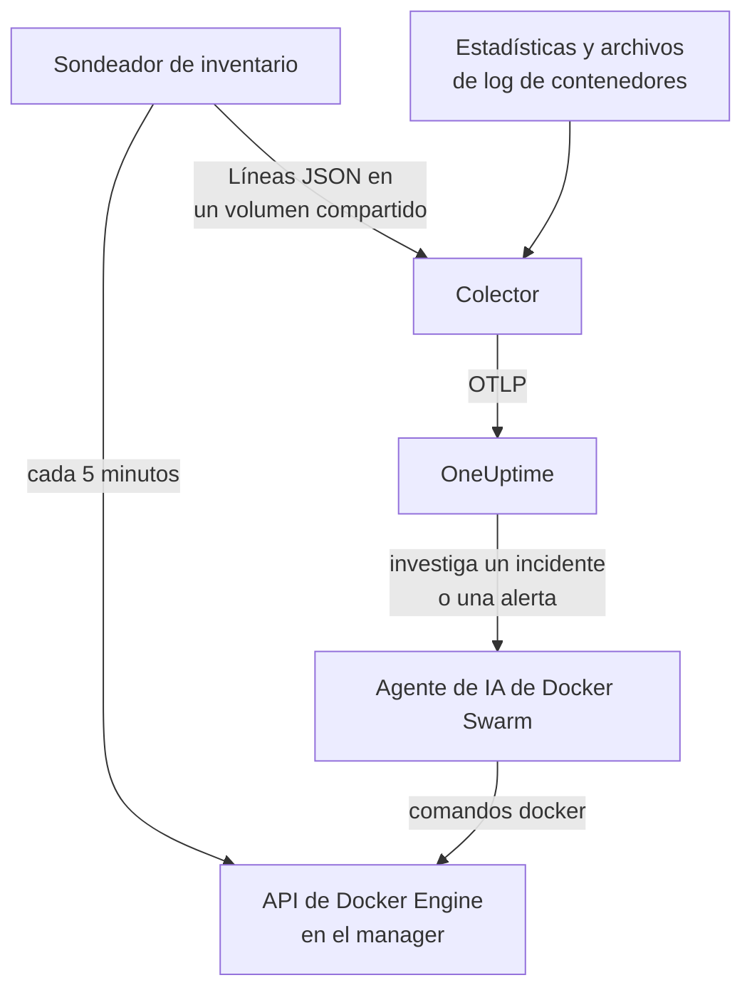

# Agente de Docker Swarm

El agente de Docker Swarm de OneUptime supervisa un clúster de Docker Swarm: sus nodos, servicios, tareas, stacks, redes overlay, secretos, configs y volúmenes, además de las métricas y los logs de cada contenedor. Lo ejecutas con Docker Compose en un nodo manager del swarm, y el clúster aparece en OneUptime con todo ello. Los [monitores de Docker Swarm](/docs/monitor/docker-swarm-monitor) alertan sobre lo que llega.

:::cards
- [Instalar el agente](#instala-el-agente): El script de instalación o Docker Compose, en un nodo manager.
- [Qué recopila el agente](#qué-recopila-el-agente): El inventario, los recuentos del clúster y las métricas y logs de los contenedores.
- [Agente de IA](#agente-de-ia): Deja que OneUptime AI lea el swarm mientras investiga.
- [Solución de problemas](#solución-de-problemas): Un script de diagnóstico y los problemas habituales.
:::

## Cómo funciona

El agente son tres contenedores, todos definidos en un único `docker-compose.yml`:

1. **Colector**: un OpenTelemetry Collector que lee `docker_stats` para las métricas de cada contenedor, sigue los archivos de log de los contenedores y sigue el archivo de instantánea del inventario. Marca todo con el nombre de tu clúster (`docker.swarm.cluster.name`) y lo envía a OneUptime por OTLP.
2. **Sondeador de inventario**: un pequeño sidecar con `curl` y `jq` que cada 5 minutos recorre la API del manager del swarm (`/nodes`, `/services`, `/tasks`, `/networks`, `/secrets`, `/configs`, `/volumes`) y deduce los stacks de la etiqueta de servicio `com.docker.stack.namespace`. Escribe una línea JSON por objeto para que el colector la reenvíe.
3. **Agente de IA**: `oneuptime-docker-swarm-ai-agent`, que ejecuta los comandos `docker` que pide OneUptime AI mientras investiga un incidente o una alerta en este clúster. Es de solo lectura salvo que permitas correcciones (consulta [Agente de IA](#agente-de-ia)).



El clúster se registra con sus primeros datos, con el nombre de clúster que configures.

## Antes de empezar

- Un nodo **manager** del swarm en el que ejecutar el agente: el sondeador de inventario y el agente de IA llaman a endpoints de la API que solo responden los managers.
- Docker Engine 20.10 o posterior con el plugin Docker Compose v2.
- Una clave de ingesta. Crea una en **Ajustes del proyecto → Telemetría y APM → Claves de ingesta** y copia su valor.
- HTTPS saliente desde el nodo hacia tu URL de OneUptime.

### Dónde ejecutar el agente

Ejecútalo en un nodo manager. El colector informa de los contenedores del nodo en el que se ejecuta, así que, para las métricas de los contenedores de todos los nodos, ejecuta el colector en cada nodo, todos con el mismo `DOCKER_SWARM_CLUSTER_NAME`; el sondeador de inventario y el agente de IA solo necesitan ejecutarse en un manager. `install.sh` deja fuera el agente de IA en un nodo que no es manager (y quita uno que hubiera instalado allí antes). Un agente de IA iniciado de todos modos en un worker nunca se registra para el clúster: espera hasta que su nodo sea manager, así que no puede desplazar al agente de IA del manager. ¿Despliegas el agente como stack de swarm en lugar de con Compose? Mantén el sondeador de inventario y el agente de IA en managers con la restricción `node.role == manager`.

## Instala el agente

:::steps
### Instala e inicia el agente

:::tabs
@tab install.sh
Descarga el script de instalación y ejecútalo en un nodo manager:

```bash
curl -sSL https://raw.githubusercontent.com/OneUptime/oneuptime/master/agents/DockerSwarmAgent/install.sh -o install.sh
sh install.sh
```

El script pide tu URL de OneUptime, la clave de ingesta y un nombre para el clúster. Se instala en `/opt/oneuptime-docker-swarm-agent`, escribe un archivo `.env` que solo su propietario puede leer e inicia los tres contenedores. Añade `--no-ai-agent` para dejar fuera el agente de IA.
@tab Docker Compose
Descarga `docker-compose.yml`, `otel-collector-config.yaml` e `inventory-snapshot.sh` del [directorio DockerSwarmAgent](https://github.com/OneUptime/oneuptime/tree/master/agents/DockerSwarmAgent) en una carpeta nueva de un nodo manager:

```bash
curl -fsSL https://raw.githubusercontent.com/OneUptime/oneuptime/master/agents/DockerSwarmAgent/docker-compose.yml -o docker-compose.yml
curl -fsSL https://raw.githubusercontent.com/OneUptime/oneuptime/master/agents/DockerSwarmAgent/otel-collector-config.yaml -o otel-collector-config.yaml
curl -fsSL https://raw.githubusercontent.com/OneUptime/oneuptime/master/agents/DockerSwarmAgent/inventory-snapshot.sh -o inventory-snapshot.sh
chmod +x inventory-snapshot.sh
```

Crea un archivo `.env` junto a ellos. Contiene la clave de ingesta, así que mantenlo privado con `chmod 600 .env`:

```bash title=".env"
ONEUPTIME_URL=https://oneuptime.com
ONEUPTIME_SERVICE_TOKEN=your-telemetry-ingestion-key
DOCKER_SWARM_CLUSTER_NAME=my-swarm
```

Inicia el agente:

```bash
docker compose up -d
```
:::

### Comprueba que el agente se está ejecutando

```bash
docker compose ps
docker compose logs --tail 50 oneuptime-docker-swarm-agent oneuptime-docker-swarm-inventory
```

`docker compose ps` muestra tres contenedores: el colector (`oneuptime-docker-swarm-agent`), el sondeador de inventario (`oneuptime-docker-swarm-inventory`) y el agente de IA (`oneuptime-docker-swarm-ai-agent`).

### Busca el clúster en OneUptime

Abre **Productos → Infraestructura → Docker Swarm → Todos los clústeres**. El clúster aparece en pocos minutos, y sus páginas **Nodos**, **Servicios**, **Tareas**, **Stacks**, **Redes**, **Secretos**, **Configuraciones** y **Volúmenes** se llenan tras la primera instantánea del inventario, en menos de 5 minutos.
:::

## Variables de entorno

El script de instalación escribe las tres primeras en `/opt/oneuptime-docker-swarm-agent/.env`; una instalación con Docker Compose las lee del `.env` que está junto a `docker-compose.yml`. Añade o cambia ahí cualquiera de ellas y luego ejecuta `docker compose up -d` en esa carpeta.

| Variable | Obligatoria | Descripción |
| --- | --- | --- |
| `ONEUPTIME_URL` | Sí | Tu URL de OneUptime, como `https://oneuptime.com` o tu instancia autoalojada. Usa `http://` y su puerto si la instancia solo admite HTTP. |
| `ONEUPTIME_SERVICE_TOKEN` | Sí | La clave de ingesta de **Ajustes del proyecto → Telemetría y APM → Claves de ingesta**. |
| `DOCKER_SWARM_CLUSTER_NAME` | Sí | El nombre del clúster en OneUptime, y la clave con la que se unen los datos de cada nodo: marcado en todo como el atributo de recurso `docker.swarm.cluster.name`. Mantenlo estable: cambiarlo más tarde registra un segundo clúster. Su valor predeterminado es `docker-swarm`. |
| `DOCKER_INVENTORY_INTERVAL_SECONDS` | No | Cada cuánto toma el sondeador de inventario una instantánea, en segundos. Su valor predeterminado es `300`. |
| `DOCKER_API_VERSION` | No | La versión de la API de Docker Engine que hablan el colector y el sondeador de inventario. Su valor predeterminado es `1.44`; vacío, se negocia con el daemon (consulta [Solución de problemas](#solución-de-problemas)). El agente de IA la negocia salvo que fijes una. |

Los ajustes propios del agente de IA están en [Agente de IA](#agente-de-ia).

## Qué recopila el agente

| Señal | Origen | Dónde se muestra |
| --- | --- | --- |
| Los nodos, servicios, tareas, stacks, redes, secretos, configs y volúmenes | El sondeador de inventario, desde la API del manager del swarm | Las listas y páginas de detalle del clúster |
| Recuentos del clúster (nodos listos, tareas en ejecución, servicios, stacks, …) | La misma instantánea | Las tarjetas de la vista general y los contadores del menú lateral |
| CPU, memoria, número de procesos y tiempo en marcha de los contenedores | El receptor `docker_stats` | La página **Métricas** |
| Logs stdout y stderr de los contenedores | El receptor `filelog` | La página **Registros** |

### En qué se diferencia del agente de Docker

El [agente de Docker](/docs/telemetry/docker-host) modela un único host y marca `host.name` y `container.runtime=docker`. El agente de Docker Swarm marca solo `docker.swarm.cluster.name`, a propósito: así OneUptime archiva los datos bajo el clúster de swarm, en lugar de registrar cada nodo como un host propio.

## Etiquetar el clúster con etiquetas del proyecto

Un atributo de recurso que empieza por `oneuptime.label.` se convierte en una etiqueta del proyecto en el clúster: `oneuptime.label.<dimension>=<value>` es la etiqueta `<dimension>:<value>`. Añade los atributos al procesador `resource` en `otel-collector-config.yaml`, junto a `docker.swarm.cluster.name`:

```yaml
processors:
  resource:
    attributes:
      # ...existing attributes...
      - key: oneuptime.label.team
        value: platform
        action: upsert
      - key: oneuptime.label.env
        value: production
        action: upsert
```

El colector lee su configuración solo al iniciarse: ejecuta `docker compose restart oneuptime-docker-swarm-agent`. El clúster muestra entonces las etiquetas `team:platform` y `env:production`. Las etiquetas se comparan sin distinguir mayúsculas de minúsculas, así que una etiqueta `Production` existente se reutiliza en lugar de duplicarse, y el agente nunca quita una etiqueta que alguien añadió en OneUptime.

## Ejecutar como servicio de systemd

Para iniciar el agente con el nodo y reiniciarlo cuando falle, instala su unidad de systemd. Supone que el agente está en `/opt/oneuptime-docker-swarm-agent`, donde lo pone el script de instalación:

```bash
sudo curl -fsSL https://raw.githubusercontent.com/OneUptime/oneuptime/master/agents/DockerSwarmAgent/systemd/oneuptime-docker-swarm-agent.service -o /etc/systemd/system/oneuptime-docker-swarm-agent.service
sudo systemctl daemon-reload
sudo systemctl enable --now oneuptime-docker-swarm-agent
```

## Actualizar el agente

El agente informa de la versión del colector que ejecuta. Cuando es más antigua que la versión que fija esta versión de OneUptime, aparece un signo de advertencia junto a la versión del agente en la página **Vista general** del clúster. Selecciónalo para ver estos comandos.

Vuelve a ejecutar el script de instalación en el nodo manager y responde a sus preguntas con la misma URL, clave y nombre de clúster. Descarga los archivos más recientes, descarga las imágenes y reinicia el agente:

```bash
curl -sSL https://raw.githubusercontent.com/OneUptime/oneuptime/master/agents/DockerSwarmAgent/install.sh -o install.sh
sh install.sh
```

El script vuelve a escribir `.env` a partir de tus respuestas. Solo conserva las listas de destinos del agente de IA y lo que puede hacer la IA (`ONEUPTIME_AI_INVESTIGATION`, `ONEUPTIME_AI_FIXES`): vuelve a añadir cualquier variable que hayas fijado tú, como `DOCKER_API_VERSION`. ¿Activaste las correcciones de IA? Ejecútalo como `ONEUPTIME_AI_ALLOW_WRITES=true sh install.sh` para mantenerlas activadas. ¿Dejaste fuera el agente de IA? Pasa de nuevo `--no-ai-agent`.

Con Docker Compose, vuelve a descargar los tres archivos en la carpeta del agente (y vuelve a hacer cualquier cambio que hicieras en `docker-compose.yml`), y descarga las imágenes y reinicia:

```bash
docker compose pull
docker compose up -d
```

La versión del colector está fijada en los archivos, así que descargar las imágenes no basta para que el agente avance.

## Desinstalar el agente

```bash
cd /opt/oneuptime-docker-swarm-agent
docker compose down
```

## Agente de IA

El `docker-compose.yml` del swarm (e `install.sh`) también ejecuta el **Agente de IA de Docker Swarm**: un tercer contenedor, `oneuptime-docker-swarm-ai-agent` (imagen `oneuptime/resource-ai-agent:release`), que ejecuta los comandos `docker` de solo lectura que pide OneUptime AI mientras investiga un incidente o una alerta en este clúster — `docker node ls`, `docker service ps web --no-trunc`, `docker service logs --tail 200 web` — y, solo si lo permites, aplica correcciones como un reinicio gradual de un servicio concreto. Lee las mismas `ONEUPTIME_URL`, `ONEUPTIME_SERVICE_TOKEN` y `DOCKER_SWARM_CLUSTER_NAME` que el colector, así que sirve exactamente a este clúster, y aparece en la página **IA → Agente de IA** del clúster en OneUptime.

- **Las investigaciones con IA están activadas por defecto.** En cuanto el agente se conecta, OneUptime AI investiga con él los incidentes y alertas de este clúster, y la **Vista general** del clúster muestra el estado del agente. Para detenerlo, establece `ONEUPTIME_AI_INVESTIGATION=false` donde se ejecuta el agente (**Cambiar** en **Lo que puede hacer la IA**, en la página del agente de IA, muestra cómo), u omite el agente.
- Como el sondeador de inventario, **debe ejecutarse en un nodo manager**: los comandos de nodos, servicios y tareas solo existen en los managers. En un worker no ejecuta nada y no se registra para el clúster hasta que el nodo sea manager (su `/status` dice por qué). Ejecuta uno por clúster.
- Es de **solo lectura** salvo que establezcas `ONEUPTIME_AI_ALLOW_WRITES=true` en `.env` y ejecutes `docker compose up -d` (o ejecutes `install.sh` con ella; el instalador escribe `ONEUPTIME_AI_ALLOW_WRITES`, `ONEUPTIME_AI_INVESTIGATION`, `ONEUPTIME_AI_FIXES`, `ONEUPTIME_AI_WRITE_TARGETS` y `ONEUPTIME_AI_PROTECTED_TARGETS` de su entorno en `.env`, y una nueva ejecución conserva lo que `.env` ya tiene para las cuatro últimas salvo que pases esa variable, aunque sea vacía); `ONEUPTIME_AI_WRITE_TARGETS` (patrones glob de nombres de servicios y nodos, por ejemplo `web_*,api_*`) limita lo que una corrección puede tocar. `ONEUPTIME_AI_FIXES`, en el mismo `.env`, indica cómo se ejecutan las correcciones — `ask-for-approval` (una persona aprueba cada una), `automatic` o `bypass-approval` — y la página del agente de IA lo muestra en solo lectura ([Lo que puede hacer la IA, fijado por el agente](/docs/ai/infrastructure-ai-agents#what-ai-may-do-set-by-the-agent)). Drenar un nodo siempre necesita la aprobación de una persona, sea cual sea el modo.
- Se ejecuta como root con el socket de Docker montado, porque el socket pertenece a root — y en un manager, quien puede usar el socket controla todo el swarm, con `:ro` o sin él. La política de comandos del agente es el límite: nunca crea ni elimina servicios o stacks, nunca toca secretos ni configs, y nunca se cambia a sí mismo, al colector, al sondeador de inventario ni nada de `ONEUPTIME_AI_PROTECTED_TARGETS` (patrones glob de nombres de servicios y nodos).
- `install.sh --no-ai-agent` lo deja fuera; también puedes eliminar el servicio `oneuptime-docker-swarm-ai-agent` de `docker-compose.yml`.

Qué puede ejecutar, cómo funcionan las correcciones y cómo solucionar sus problemas: [Infrastructure AI Agents](/docs/ai/infrastructure-ai-agents#docker-swarm-clusters).

## Solución de problemas

:::details Ejecuta primero el script de diagnóstico
El agente incluye un script, [`troubleshoot.sh`](https://github.com/OneUptime/oneuptime/blob/master/agents/DockerSwarmAgent/troubleshoot.sh), que comprueba toda la cadena: los contenedores, que el sondeador de inventario está en un manager (`docker node ls`), el archivo de instantánea, el nombre del clúster marcado en todo, la forma del token, las propias métricas del colector y si OneUptime acepta la clave de ingesta. Esa última comprobación es la que más importa. OneUptime rechaza una clave incorrecta con `401` (`422` para una clave desactivada o una clave de navegador), y el colector lo registra como una línea `Exporting failed` por lote, fácil de pasar por alto. El script pide `GET <url>/otlp/v1/validate` para obtener un `200` (válida) o un `401` (no válida) directos. Ejecútalo en el nodo manager:

```bash
curl -sSL https://raw.githubusercontent.com/OneUptime/oneuptime/master/agents/DockerSwarmAgent/troubleshoot.sh -o troubleshoot.sh
bash troubleshoot.sh    # add -d <dir> if you installed outside /opt/oneuptime-docker-swarm-agent
```
:::

:::details El clúster nunca aparece
Ejecuta primero el script de diagnóstico. Si no, lee los logs del colector (`docker compose logs oneuptime-docker-swarm-agent`), comprueba que `ONEUPTIME_SERVICE_TOKEN` y `ONEUPTIME_URL` en `.env` son correctos y que el nodo llega a tu URL de OneUptime.
:::

:::details No aparece ningún inventario
Comprueba que el sondeador de inventario se ejecuta en un manager: `docker node ls` debe funcionar ahí. Después busca líneas `failed to emit ...` en sus logs: `docker compose logs oneuptime-docker-swarm-inventory`.
:::

:::details El clúster pasa a desconectado
Un clúster pasa a desconectado cuando OneUptime no ha recibido nada de él durante 15 minutos; OneUptime lo comprueba cada 5 minutos, y el tiempo en que él mismo no recibía datos no cuenta. Asegúrate de que el contenedor del colector sigue en marcha: `docker compose ps` lo muestra.
:::

:::details El colector termina con "client version is too new"
Los logs del colector muestran:

```text
Error: cannot start pipelines: failed to start "docker_stats" receiver:
Error response from daemon: client version 1.44 is too new.
Maximum supported API version is 1.41
```

La versión de API más alta del daemon es inferior a la predeterminada `1.44` (Docker Engine 20.10 se queda en `1.41`), así que el receptor `docker_stats` no puede iniciarse y el contenedor se reinicia en bucle. Averigua la versión más alta del daemon:

```bash
docker version --format '{{ .Server.APIVersion }}'
```

Establece `DOCKER_API_VERSION` en ese valor en `.env` y ejecuta `docker compose up -d` en cada nodo en el que se ejecute el agente. Los daemons más nuevos siguen sirviendo versiones antiguas de la API, así que el ajuste sigue funcionando después de actualizar Docker. O establece `DOCKER_API_VERSION=` (vacío) para que el colector negocie la versión con el daemon en lugar de fijar una.
:::

:::details El clúster aparece con un nombre equivocado
El nombre del clúster viene de `DOCKER_SWARM_CLUSTER_NAME`. Cámbialo en `.env` y ejecuta `docker compose up -d`: un nombre nuevo registra un clúster nuevo en lugar de renombrar el anterior.
:::

## Próximos pasos

:::cards
- [Monitor de Docker Swarm](/docs/monitor/docker-swarm-monitor): Alerta sobre nodos, servicios, tareas y contenedores.
- [Infrastructure AI Agents](/docs/ai/infrastructure-ai-agents): Qué puede ejecutar el agente de IA de Docker Swarm y cómo funcionan las correcciones.
- [Agente de Docker](/docs/telemetry/docker-host): Supervisa en su lugar un único host de Docker.
:::
