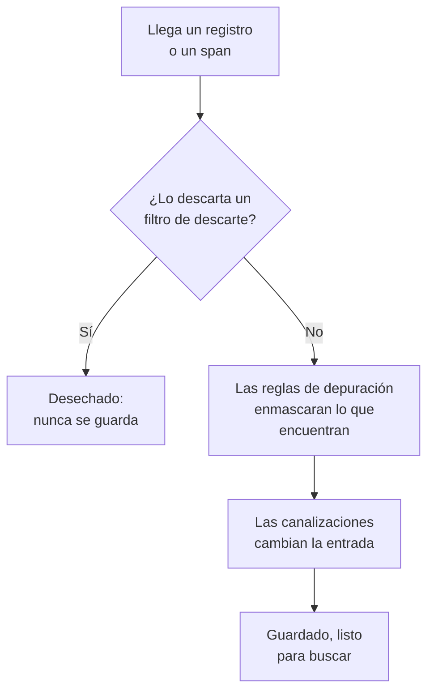

# Filtros de descarte y reglas de depuración

Los filtros de descarte y las reglas de depuración actúan sobre sus registros y spans a medida que llegan, antes de que se guarde nada. Un filtro de descarte desecha las entradas que nunca necesita, o conserva solo una muestra de ellas. Una regla de depuración enmascara los datos personales y los secretos, como direcciones de correo electrónico, números de tarjeta y contraseñas, para que nunca lleguen a su almacenamiento.

:::cards
- [Dónde se ejecutan](#dónde-se-ejecutan): Antes de las canalizaciones, antes del almacenamiento.
- [Descartar o muestrear entradas](#descartar-o-muestrear-entradas): Seleccionar entradas y luego descartarlas o conservar una parte.
- [Depurar datos sensibles](#depurar-datos-sensibles): Ocultar, enmascarar o resumir con hash lo que encuentra un patrón.
- [Comprobar qué descartó un filtro](#comprobar-qué-descartó-un-filtro): Contadores en cada filtro.
:::

## Dónde se ejecutan

Los registros tienen los suyos en **Registros → Ajustes**, y los spans en **Trazas → Ajustes**. Cuando llega una entrada, OneUptime los ejecuta en este orden:



- **Solo actúan sobre entradas nuevas.** Una regla que cree o cambie se aplica a las entradas que llegan alrededor de un minuto después. Las entradas ya guardadas no cambian.
- **Una entrada descartada desaparece.** Ninguna búsqueda, gráfico, monitor ni regla de grabación la ve nunca, y no se crea ninguna excepción a partir de ella. En OneUptime Cloud, tampoco se factura.
- **Cada lista se ejecuta en orden.** Arrastre las filas de una lista para cambiar el orden. Solo se ejecutan los filtros y las reglas habilitados.

Los filtros de descarte y las reglas de depuración de registros se aplican por igual a los registros de OpenTelemetry, Syslog, Fluent Bit y Fluentd. [Canalizaciones de registros](/docs/telemetry/log-pipelines) explica el paso que viene después.

## Antes de empezar

- **Registros o spans que llegan.** Consulte [OpenTelemetry](/docs/telemetry/open-telemetry).
- **Un rol que cambie los ajustes de telemetría.** Project Owner o Project Admin, o un rol personalizado con el permiso de lo que cambie, como Create Log Drop Filter o Create Trace Scrub Rule. Los roles de Telemetry pueden ver los filtros y las reglas, pero no cambiarlos.

## Descartar o muestrear entradas

:::steps
### Abrir los filtros de descarte

Vaya a **Registros → Ajustes → Filtros de descarte**, o a **Trazas → Ajustes → Filtros de descarte** para los spans.

### Seleccionar las entradas

Haga clic en **Crear Filtro de descarte de registros**, o en **Crear Filtro de descarte de trazas** para los spans. En **Coincidencia**, dé al filtro un **Nombre** y construya su **Consulta de filtro**: un campo, un operador y un valor para cada condición, y si deben coincidir **Todas las condiciones** o **Cualquier condición**. Haga clic en **Siguiente**.

### Elegir la acción

En **Acción**, deje **Descartar** para desechar cada entrada que coincida, o elija **Muestra** e indique el **Porcentaje de muestreo** que conservar, de 1 a 99. Luego cree el filtro.
:::

El filtro empieza a descartar en menos de un minuto. Para guardarlo sin descartar nada todavía, desactive **Habilitado** en **Avanzado** antes de crearlo.

> [!WARNING]
> Una entrada descartada no se puede recuperar. Mantenga acotada la consulta de un filtro, y vigile su contador **Descartado** después de crearlo.

Un filtro puede comprobar estos campos, y cualquier atributo con **Atributo personalizado...**:

| Entradas | Campos |
| --- | --- |
| Registros | **Gravedad**, **Cuerpo del registro**, **ID del servicio** |
| Spans | **Nombre del span**, **Tipo de span**, **Estado**, **Mensaje de estado**, **ID del servicio**, **Tiene excepción**, **Es span raíz** |

| Operador | Coincide con |
| --- | --- |
| **es igual a** | El valor exacto, con sus mayúsculas y minúsculas: `Debug` coincide, `DEBUG` no. |
| **no es igual a** | Cualquier cosa salvo el valor exacto. |
| **contiene** | El valor en cualquier parte del campo, sin distinguir mayúsculas y minúsculas. Un `%` en el valor es un comodín. |
| **es uno de** | Uno de una lista de valores exactos, separados por comas. |

**Previsualizar consulta** muestra la consulta que forman las condiciones. Esta descarta las líneas de depuración de una comprobación de estado:

```text
severityText = 'Debug' AND body LIKE 'healthcheck'
```

El muestreo decide entrada por entrada: con un **Porcentaje de muestreo** de 10, se conserva aproximadamente una de cada diez entradas que coinciden. Los filtros se ejecutan en el orden de la lista, y decide el primero que descarta una entrada; una entrada que conserva una muestra pasa al filtro siguiente.

## Depurar datos sensibles

:::steps
### Abrir las reglas de depuración

Vaya a **Registros → Ajustes → Reglas de depuración**, o a **Trazas → Ajustes → Reglas de depuración** para los spans.

### Elegir qué buscar

Haga clic en **Crear Regla de depuración de registros**, o en **Crear Regla de depuración de trazas** para los spans, y elija un **Tipo de patrón**. La regla toma su nombre, como **Depurar direcciones de correo electrónico**, hasta que escriba uno propio. Para **Expresión regular personalizada**, indique también el **Patrón de regex personalizado**.

### Elegir cómo depurar

En **Avanzado**, elija la **Acción de depuración** y los **Campos a depurar**, o déjelos como están: una regla nueva sustituye cada coincidencia por `[REDACTED]`, esté donde esté en la entrada. Luego cree la regla.
:::

| Tipo de patrón | Qué encuentra |
| --- | --- |
| **Dirección de correo electrónico** | Direcciones de correo electrónico, como `jane@example.com` |
| **Número de tarjeta de crédito** | Dieciséis dígitos en grupos de cuatro, como `4111 1111 1111 1111` |
| **SSN (número de la Seguridad Social)** | Números de la Seguridad Social de EE. UU., como `123-45-6789` |
| **Número de teléfono** | Números de teléfono norteamericanos, como `555-123-4567` |
| **Dirección IP** | Direcciones IPv4, como `192.168.1.1` |
| **Claves de atributos sensibles** | El valor completo de cualquier atributo cuya clave parezca secreta, como `password`, `token`, `api_key`, `authorization` o `cookie` |
| **Expresión regular personalizada** | Su propia expresión regular, escrita sin barras ni modificadores, y que distingue mayúsculas y minúsculas |

| Acción de depuración | En qué se convierte una coincidencia |
| --- | --- |
| **Redactar** | `[REDACTED]`, la opción predeterminada |
| **Máscara** | Oculta en su mayor parte: una dirección de correo conserva su primera letra y el final de su dominio, un número de tarjeta, de teléfono o de la Seguridad Social sus cuatro últimos dígitos, y una coincidencia personalizada o un valor secreto su primer y su último carácter. Una dirección IP se oculta por completo. |
| **Hash** | Un hash corto del valor, siempre el mismo para el mismo valor, para que las repeticiones se puedan seguir contando |

Por ejemplo, una regla de **Dirección de correo electrónico** guarda este cuerpo de registro:

```text
Payment failed for jane@example.com
```

de una de estas formas, según su **Acción de depuración**:

```text
Redact: Payment failed for [REDACTED]
Mask:   Payment failed for j***@***.com
Hash:   Payment failed for [HASHED:8c87b489]
```

**Campos a depurar** es **Ambos (cuerpo y atributos)** para una regla de registros, salvo que elija **Solo el cuerpo** o **Solo atributos**, y **Todo (nombre, atributos y eventos)** para una regla de spans, salvo que elija **Solo nombre del span**, **Solo atributos** o **Solo atributos del evento**. Una regla de **Claves de atributos sensibles** siempre depura valores de atributos, ya que lee las claves de los atributos.

- **Las excepciones salen de la entrada depurada.** Una excepción encontrada en un registro se crea después de la depuración, y las reglas que depuran los eventos de los spans también depuran las excepciones registradas en ellos.
- **Las Session Replays también se depuran.** Las reglas de depuración de registros también se ejecutan sobre las grabaciones de Session Replay, además del enmascaramiento que hace la grabadora en el navegador.
- **Las reglas se ejecutan en el orden de la lista.** Cada regla ve lo que dejaron las reglas anteriores.
- **Un patrón personalizado tarda en proporción a la entrada.** Conserva la sintaxis y las respuestas de JavaScript, búsquedas anticipadas y retrospectivas incluidas, se escriba como se escriba. Una referencia inversa, como `\1`, no puede ejecutarse así: una regla que la tenga se rechaza al guardarla, igual que un patrón demasiado grande para ejecutarse. Si encontrar cada coincidencia obligara a leer un valor largo una y otra vez, la regla depura el valor entero. Los filtros de descarte, las reglas de depuración y las canalizaciones de un proyecto también comparten un cupo de trabajo para cada lote que envía, en proporción al tamaño del lote y suficiente para que decenas de patrones personalizados lean cada valor. Cuando sus patrones necesitan más, una regla de depuración personalizada depura el valor entero, y un filtro que no puede responderse no se aplica a la entrada.

## Comprobar qué descartó un filtro

La lista **Filtros de descarte** muestra de cada filtro su contador **Descartado** y cuándo fue su **Último descarte**. **Aún no se ha descartado nada** significa que nunca ha coincidido. La página de un filtro muestra lo mismo en **Actividad**, actualizado menos de un minuto después de un descarte. Su tarjeta **Condiciones de filtro** muestra lo que selecciona, y puede cambiar las condiciones allí.

## Solución de problemas

:::details Un filtro de descarte no descarta nada
**es igual a**, **no es igual a** y **es uno de** comparan el texto exacto, mayúsculas y minúsculas incluidas. Las gravedades se escriben `Information` y `Warning`, no `INFO` ni `WARN`. Compruebe que el filtro está habilitado, y espere un minuto después de un cambio.
:::

:::details Faltan registros que esperaba
Mire el contador **Descartado** y la hora del **Último descarte** de cada filtro de descarte. Desactive **Habilitado** en el que sospeche, y los registros siguientes vuelven a llegar.
:::

:::details Una regla de depuración personalizada dice No depura nada
Su patrón está vacío, no es una expresión regular válida o no puede ejecutarse, por ejemplo porque tiene una referencia inversa como `\1`, así que no depura nada. Edite la regla y dele un patrón que coincida con al menos un carácter.
:::

:::details Las entradas antiguas siguen mostrando los datos que depura una regla nueva
Las reglas de depuración actúan cuando llegan las entradas. Las entradas guardadas antes de la regla conservan lo que tenían hasta que termina su retención. Consulte [Retención de datos](/docs/telemetry/data-retention).
:::

## Próximos pasos

:::cards
- [Canalizaciones de registros](/docs/telemetry/log-pipelines): Analice y enriquezca los registros que conserva.
- [Explorador de registros](/docs/telemetry/logs-explorer): Busque lo que se guardó.
- [Explorador de trazas](/docs/telemetry/traces-explorer): Siga los spans que conserva.
- [Retención de datos](/docs/telemetry/data-retention): Decida cuánto tiempo se conservan.
:::
