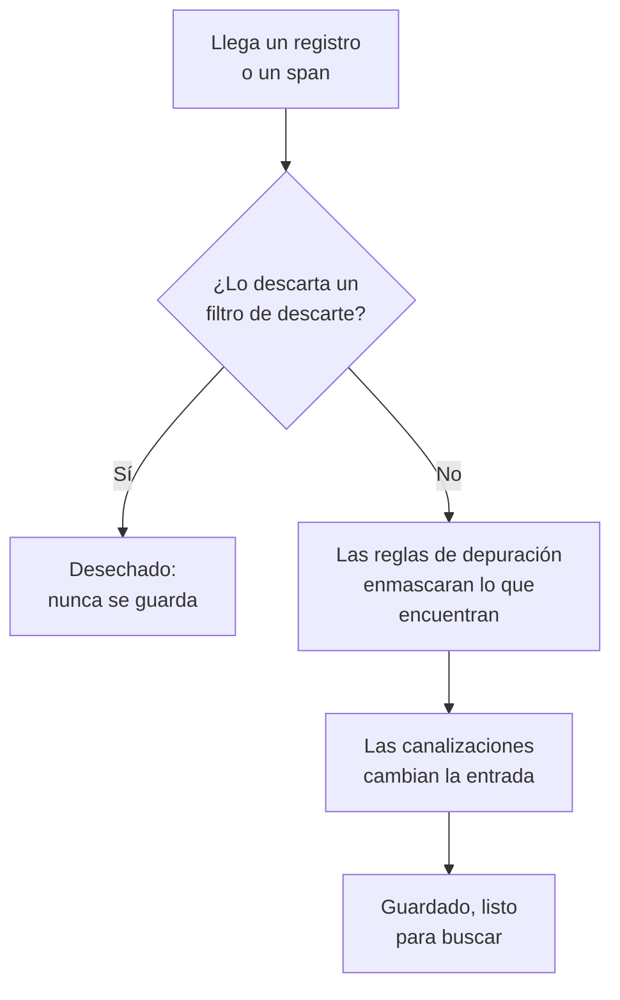

# Filtros de descarte y reglas de depuración

Los filtros de descarte y las reglas de depuración actúan sobre sus registros y spans a medida que llegan, antes de que se guarde nada. Un filtro de descarte desecha las entradas que nunca necesita, o conserva solo una muestra de ellas. Una regla de depuración enmascara los datos personales y los secretos, como direcciones de correo electrónico, números de tarjeta y contraseñas, para que nunca lleguen a su almacenamiento.

:::cards
- [Dónde se ejecutan](#dónde-se-ejecutan): Antes de las canalizaciones, antes del almacenamiento.
- [Descartar o muestrear entradas](#descartar-o-muestrear-entradas): Seleccionar entradas y luego descartarlas o conservar una parte.
- [Lo que un filtro se llevaría](#lo-que-un-filtro-se-llevaría): Qué lee las entradas, antes de que lo guarde.
- [Depurar datos sensibles](#depurar-datos-sensibles): Ocultar, enmascarar o resumir con hash lo que encuentra un patrón.
- [Comprobar qué descartó un filtro](#comprobar-qué-descartó-un-filtro): Contadores en cada filtro.
:::

## Dónde se ejecutan

Los registros tienen los suyos en **Registros → Ajustes**, y los spans en **Trazas → Ajustes**. Cuando llega una entrada, OneUptime los ejecuta en este orden:



- **Solo actúan sobre entradas nuevas.** Una regla que cree o cambie se aplica a las entradas que llegan alrededor de un minuto después. Las entradas ya guardadas no cambian.
- **Una entrada descartada desaparece.** Ninguna búsqueda, gráfico, monitor ni regla de grabación la ve nunca, y no se crea ninguna excepción a partir de ella. En OneUptime Cloud, tampoco se factura.
- **Cada lista se ejecuta en orden.** Arrastre las filas de una lista para cambiar el orden. Solo se ejecutan los filtros y las reglas habilitados.

Los filtros de descarte y las reglas de depuración de registros se aplican por igual a los registros de OpenTelemetry, Syslog, Fluent Bit y Fluentd. [Canalizaciones de registros](/docs/telemetry/log-pipelines) explica el paso que viene después.

## Antes de empezar

- **Registros o spans que llegan.** Consulte [OpenTelemetry](/docs/telemetry/open-telemetry).
- **Un rol que cambie los ajustes de telemetría.** Propietario del proyecto o Administrador del proyecto, o un rol personalizado con el permiso de lo que cambie, como Create Log Drop Filter o Create Trace Scrub Rule. Los roles de Telemetry pueden ver los filtros y las reglas, pero no cambiarlos.

## Descartar o muestrear entradas

:::steps
### Abrir los filtros de descarte

Vaya a **Registros → Ajustes → Filtros de descarte**, o a **Trazas → Ajustes → Filtros de descarte** para los spans.

### Seleccionar las entradas

Haga clic en **Crear Filtro de descarte de registros**, o en **Crear Filtro de descarte de trazas** para los spans. En **Coincidencia**, dé al filtro un **Nombre** y construya su **Consulta de filtro**: un campo, un operador y un valor para cada condición, y si deben coincidir **Todas las condiciones** o **Cualquier condición**. Haga clic en **Siguiente**.

### Elegir la acción

En **Acción**, deje **Descartar** para desechar cada entrada que coincida, o elija **Muestra** e indique el **Porcentaje de muestreo** que conservar, de 1 a 99. Luego cree el filtro.
:::

El filtro empieza a descartar en menos de un minuto. Para guardarlo sin descartar nada todavía, desactive **Habilitado** en **Avanzado** antes de crearlo.

> [!WARNING]
> Una entrada descartada no se puede recuperar. Mantenga acotada la consulta de un filtro, y vigile su contador **Descartado** después de crearlo.

Un filtro puede comprobar estos campos, y cualquier atributo con **Atributo personalizado...**:

| Entradas | Campos |
| --- | --- |
| Registros | **Gravedad**, **Cuerpo del registro**, **ID del servicio** |
| Spans | **Nombre del span**, **Tipo de span**, **Estado**, **Mensaje de estado**, **ID del servicio**, **Tiene excepción**, **Es span raíz** |

| Operador | Coincide con |
| --- | --- |
| **es igual a** | El valor exacto, con sus mayúsculas y minúsculas: `Debug` coincide, `DEBUG` no. |
| **no es igual a** | Cualquier cosa salvo el valor exacto. |
| **contiene** | El valor en cualquier parte del campo, sin distinguir mayúsculas y minúsculas. Un `%` en el valor es un comodín. |
| **es uno de** | Uno de una lista de valores exactos, separados por comas. |

**Previsualizar consulta** muestra la consulta que forman las condiciones. Esta descarta las líneas de depuración de una comprobación de estado:

```text
severityText = 'Debug' AND body LIKE 'healthcheck'
```

El muestreo decide entrada por entrada: con un **Porcentaje de muestreo** de 10, se conserva aproximadamente una de cada diez entradas que coinciden. Los filtros se ejecutan en el orden de la lista, y decide el primero que descarta una entrada; una entrada que conserva una muestra pasa al filtro siguiente.

## Lo que un filtro se llevaría

Una entrada descartada desaparece para todo lo que la lee, así que, mientras escribe un filtro de descarte, su formulario dice lo que se llevaría, un momento después de que deje de escribir: bajo la **Consulta de filtro** en **Coincidencia**, y bajo la acción en **Acción**. Una línea dice el efecto más importante, y **Mostrar detalles** dice el resto:

- **Con cuánto coincide.** De las entradas guardadas en el último día, cuántas coinciden: lo que el filtro mantiene fuera de su almacenamiento y de su factura. Se cuenta a partir de lo que se guardó, después de que las reglas de depuración y las canalizaciones lo cambiaran, y solo en los servicios cuyas entradas puede leer. Un recuento que tarda más de 10 segundos se detiene, y el formulario lo dice.
- **Lo que perderían los Eventos de seguridad.** Donde [Eventos de seguridad](/docs/telemetry/security-events) lee sus registros con la tarjeta **Tus registros**, o sus spans, el formulario dice cuántas de las entradas que coinciden leyó: los inicios de sesión, los ataques y las entradas de firewall que convierte en eventos. Un filtro de **Muestra** también nombra las reglas que se activan al llegar a un recuento, y qué les pasa si conserva solo su parte: al 10 %, una regla que se activa con 10 inicios de sesión fallidos en cinco minutos necesita unos 100, así que se activa mucho menos a menudo, o nunca.
- **Qué más lee las mismas entradas.** Los monitores, SLO, paneles con sus widgets, reglas de grabación y vistas guardadas cuyas consultas pueden incluir una entrada que el filtro se lleva. Una consulta las lee cuando lee el mismo tipo de entrada, de un servicio del que el filtro puede tomar entradas, y nada de lo que fija a un valor exacto excluye el filtro: un filtro de registros de **Depuración** deja en paz un monitor de errores, y un filtro de un servicio deja en paz el SLO de otro servicio. Todo lo que el formulario no puede excluir, como una búsqueda en el cuerpo del registro, cuenta como lectura. Cada uno es un enlace, y los que no puede abrir se cuentan, pero nunca se nombran.

Cuando algo lee lo que un filtro se lleva, crear el filtro, activarlo o cambiar la consulta o la acción de uno que está activo le pide que confirme. Puede guardar el filtro de todos modos: la pregunta está ahí para que decida con conocimiento. Un filtro que nada lee se guarda sin preguntar.

A través de la API nada pregunta, porque un script o Terraform no tiene a nadie que responda. Un filtro que la API crea o cambia se guarda, y cuando se lleva lo que otros leen, la respuesta lleva un encabezado `X-OneUptime-Write-Warning` que lo dice en cifras y que el proveedor de Terraform muestra como advertencia. Para preguntar antes, envíe `filterQuery`, `action` y `samplePercentage` del filtro a `POST /api/telemetry/logs/drop-filter-impact`, o a `/api/telemetry/traces/drop-filter-impact` para los spans: responde con todo lo que muestra el formulario.

Los filtros de OpenStack que OneUptime añade a un proyecto conservan cada línea que lee Eventos de seguridad, mientras sigan tal como OneUptime los creó. Si cambia uno, descarta lo que coincide, como un filtro propio.

## Depurar datos sensibles

:::steps
### Abrir las reglas de depuración

Vaya a **Registros → Ajustes → Reglas de depuración**, o a **Trazas → Ajustes → Reglas de depuración** para los spans.

### Elegir qué buscar

Haga clic en **Crear Regla de depuración de registros**, o en **Crear Regla de depuración de trazas** para los spans, y elija un **Tipo de patrón**. La regla toma su nombre, como **Depurar direcciones de correo electrónico**, hasta que escriba uno propio. Para **Expresión regular personalizada**, indique también el **Patrón de regex personalizado**, y para **Atributos indicados**, los **Atributos a ocultar**, uno por línea.

### Elegir cómo depurar

En **Más campos**, elija la **Acción de depuración** y los **Campos a depurar**, o déjelos como están: una regla nueva sustituye cada coincidencia por `[REDACTED]`, esté donde esté en la entrada. Luego cree la regla.
:::

| Tipo de patrón | Qué encuentra |
| --- | --- |
| **Dirección de correo electrónico** | Direcciones de correo electrónico, como `jane@example.com` |
| **Número de tarjeta de crédito** | Dieciséis dígitos en grupos de cuatro, como `4111 1111 1111 1111` |
| **SSN (número de la Seguridad Social)** | Números de la Seguridad Social de EE. UU., como `123-45-6789` |
| **Número de teléfono** | Números de teléfono norteamericanos, como `555-123-4567` |
| **Dirección IP** | Direcciones IPv4 e IPv6 públicas, como `203.0.113.7` o `2001:db8::1`, pero no las privadas, de bucle invertido ni de enlace local |
| **Claves de atributos sensibles** | El valor completo de cualquier atributo cuya clave parezca secreta, como `password`, `token`, `api_key`, `authorization` o `cookie` |
| **Atributos indicados** | El valor completo de los atributos que indique, contenga lo que contenga, como el nombre de una persona bajo `customer_name`. Una clave nombra también los atributos anidados bajo ella: `user` oculta `user.email` |
| **Expresión regular personalizada** | Su propia expresión regular, escrita sin barras ni modificadores, y que distingue mayúsculas y minúsculas |

| Acción de depuración | En qué se convierte una coincidencia |
| --- | --- |
| **Redactar** | `[REDACTED]`, la opción predeterminada |
| **Máscara** | Oculta en su mayor parte: una dirección de correo conserva su primera letra y el final de su dominio, un número de tarjeta, de teléfono o de la Seguridad Social sus cuatro últimos dígitos, y una coincidencia personalizada o un valor secreto su primer y su último carácter. Una dirección IP se oculta por completo. |
| **Hash** | Un token exclusivo de su proyecto, siempre el mismo para el mismo valor, para que las repeticiones se puedan seguir contando, sin que nadie pueda deducir el valor |

Por ejemplo, una regla de **Dirección de correo electrónico** guarda este cuerpo de registro:

```text
Payment failed for jane@example.com
```

de una de estas formas, según su **Acción de depuración**:

```text
Redact: Payment failed for [REDACTED]
Mask:   Payment failed for j***@***.com
Hash:   Payment failed for [HASHED:5e29db14e508e09a]
```

**Campos a depurar** es **Ambos (cuerpo y atributos)** para una regla de registros, salvo que elija **Solo el cuerpo** o **Solo atributos**, y **Todo (nombre, atributos y eventos)** para una regla de spans, salvo que elija **Solo nombre del span**, **Solo atributos** o **Solo atributos del evento**. Los atributos de los enlaces de un span se depuran junto con los atributos propios del span, y **Todo (nombre, atributos y eventos)** también depura el mensaje de estado de un span y los nombres de sus eventos. Una regla de **Claves de atributos sensibles** lee claves, así que siempre depura los valores que hay bajo ellas: en los atributos y en el cuerpo JSON de un registro.

- **Una regla puede ser para un solo servicio.** En **Más campos**, elige el servicio en **Solo para un servicio**: la regla depura los registros de ese servicio, y los de los demás servicios se quedan como están. Si lo dejas vacío, depura los registros de todos los servicios. La columna **Alcance** de la lista dice cuál.
- **Una regla puede nombrar los atributos que lee.** Una regla de **Atributos indicados** oculta los atributos que nombra, y una regla que Seguridad de datos crea para un hallazgo solo lee el atributo en el que se encontraron los datos. La lista los nombra bajo el **Tipo de patrón** de la regla: los atributos que una regla oculta enteros, o los únicos que lee su patrón.
- **La lista dice qué cambió cada regla.** **Valores cambiados** cuenta los valores que ocultó cada regla en los últimos 7 días, y **Por servicio** abre de qué servicios y versiones vinieron. Una versión que deja de enviar lo que oculta una regla ya no cambia nada, y así es como se ve aquí una fuga corregida en el código.
- **Una regla que Seguridad de datos demostró lo dice.** Una regla creada para un hallazgo se ejecutó en las entradas en las que se vieron los datos antes de guardarse, y muestra **Demostrado** mientras siga siendo la regla que se demostró (consulte [Datos sensibles en la telemetría](/docs/data-security/telemetry#demostrada-en-las-entradas-del-hallazgo)).
- **El formulario dice qué cambiaría una regla para los demás.** Antes de crear una regla, y cuando activas una, OneUptime enumera lo que lee los valores que ocultaría: monitores, paneles, vistas guardadas, reglas de grabación y SLO, cada uno como un enlace, y lo que perderían los [Eventos de seguridad](/docs/telemetry/security-events). Un monitor que filtra por un valor oculto deja de coincidir con él. La regla se guarda de todos modos.
- **Una regla de dirección IP oculta las direcciones que son datos personales.** Son las direcciones IPv4 e IPv6 públicas, se escriban como se escriban: abreviadas, como `2001:db8::1`, entre corchetes con un puerto, como `[2001:db8::1]:443`, que conserva sus corchetes y su puerto, con una zona, como `2001:db8::2%eth0`, que conserva su zona, o una dirección IPv4 escrita como IPv6, como `::ffff:203.0.113.7`, oculta entera. Conserva las direcciones privadas, de bucle invertido y de enlace local, como `10.0.0.12`, `127.0.0.1` y `fe80::1`, y la dirección de metadatos de la nube `169.254.169.254` en la URL de una solicitud, donde [Eventos de seguridad](/docs/telemetry/security-events) busca la falsificación de solicitudes del lado del servidor. Para ocultar también las direcciones internas, añada para ellas una regla de **Expresión regular personalizada**, como `\b(?:\d{1,3}\.){3}\d{1,3}\b` para toda dirección IPv4. Salvo que la regla les aplique hash, Eventos de seguridad no nombra entonces ninguna dirección para los ataques que encuentra en los registros o las trazas que la regla depura: consulte [Oculta por una regla de depuración](/docs/telemetry/security-events#oculta-por-una-regla-de-depuración).
- **Un token de hash es propio de su proyecto.** Se crea con una clave de su proyecto, derivada del `ENCRYPTION_SECRET` de la instalación, así que el mismo valor tiene otro token en otro proyecto, y nadie que lea un token puede deducir el valor ni calcular el hash de una suposición para compararlo. Una dirección IP tiene un solo token, se escriba como se escriba: `::ffff:203.0.113.7` y `203.0.113.7` comparten uno. Los registros guardados antes de que los tokens tuvieran clave contienen tokens de 8 caracteres, como `[HASHED:8c87b489]`, distintos de los actuales, de 16 caracteres: hasta que esos registros lleguen al final de su retención, busque ambos. Cambiar `ENCRYPTION_SECRET` cambia todos los tokens, y en una instalación autoalojada los tokens son solo tan secretos como él.
- **Una regla de dirección IP que borra o enmascara dice lo que le cuesta a Eventos de seguridad.** Donde [Eventos de seguridad](/docs/telemetry/security-events) lee sus registros o trazas, una regla así dice en su fila que también oculta las direcciones a Eventos de seguridad, así que no puede decirle qué dirección bloquear, con **Aplicar hash en su lugar**, que cambia la regla a **Hash**: las personas ven un token en lugar de la dirección, y Eventos de seguridad sigue viendo la dirección. El formulario de la regla dice lo mismo bajo las acciones de la regla, y **Depurar** aplica hash allí a una dirección IP desde el principio.
- **Eventos de seguridad aún puede nombrar una dirección IP con hash.** Cuando [Eventos de seguridad](/docs/telemetry/security-events) lee sus registros o trazas, una regla de dirección IP que aplica hash también guarda cada dirección que oculta junto a su token, en un almacén que solo leen los análisis de Eventos de seguridad: ninguna página, búsqueda, exportación, API ni herramienta de IA puede leerlo. Así, un ataque desde una dirección que sus registros solo muestran como token sigue nombrando la dirección, y su caso dice qué dirección bloquear. Cada dirección se guarda hasta 30 días después de la última vez que se vio. Una regla que borra o enmascara la dirección no guarda nada, así que Eventos de seguridad dice entonces que una regla de depuración ocultó la dirección, como hace con un token de más de 30 días o creado antes de que los tokens tuvieran una clave.
- **También se leen las listas y los valores anidados.** Una regla lee cada texto dentro de una lista, una lista de listas o una lista de clave-valor, como los valores de una cabecera HTTP, y conserva la forma del valor: los números y los valores verdadero o falso quedan como están. Una regla de **Claves de atributos sensibles** también lee las claves dentro de un valor, así que también se oculta el `password` dentro de una lista de clave-valor. El cuerpo de un registro enviado como mapa o como lista se guarda como su texto JSON, y una regla de **Claves de atributos sensibles** lee las claves que contiene, como en un cuerpo escrito en JSON. Una regla de patrón mantiene ese cuerpo como JSON, y también un atributo escrito en JSON, como los mensajes de una llamada de IA: lee el texto tal como lo escribió su aplicación, con una secuencia de escape como `\n` leída como el salto de línea que representa, y reemplaza lo que encuentra solo dentro de sus textos y números.
- **También se lee el JSON dentro de un texto.** Un texto que es JSON por sí mismo, como un atributo `http.request.body` que contiene `{"password":"hunter2"}`, o la línea `log` de un registro de Fluentd dentro del cuerpo de un registro, se lee como JSON, hasta 4 niveles de JSON uno dentro de otro, y más allá como texto. Una regla de **Claves de atributos sensibles** oculta los valores bajo las claves que parecen secretas dentro de él, y nada más: sus números, espacios y demás textos quedan como los escribió su aplicación. Un texto que solo parece JSON, como `{token}`, queda como está.
- **Un valor demasiado grande para leerlo elemento por elemento se lee como texto.** Un valor anidado a más de 32 niveles de profundidad, o uno que llevaría a una entrada a superar los 10.000 valores dentro de sus listas y mapas, se lee y se guarda como su texto JSON. Una regla de patrón depura lo que encuentra en ese texto, y una regla de **Claves de atributos sensibles** oculta el valor entero cuando aparece en él una palabra como `password` o `token`. En el cuerpo de un registro, y en el JSON dentro de un texto, solo la parte que pasa de estos límites se lee como texto: el resto se sigue leyendo clave por clave.
- **Las excepciones salen de la entrada depurada.** Una excepción encontrada en un registro se crea después de la depuración, y las reglas que depuran los eventos de los spans también depuran las excepciones registradas en ellos. Cada excepción se sigue agrupando por lo que decía antes de la depuración, así que añadir una regla nunca convierte una excepción que ya tiene en una nueva ni vuelve a disparar **Nueva excepción** por ella. Cuando una regla oculta parte de aquello por lo que se agrupa una excepción nueva, su huella se calcula con una clave de su proyecto, como un token de hash, para que nadie pueda deducir lo que se ocultó.
- **Las copias en bruto de una línea de syslog ocultan lo que las reglas ocultaron en sus partes.** Syslog guarda los datos estructurados de una línea RFC 5424 tal como llegaron en `syslog.structured.raw`, y el syslog enviado por HTTP guarda la línea completa en `syslog.raw`. Cada copia se vuelve a armar con lo que las reglas dejaron de los campos de la cabecera, de cada parámetro de los datos estructurados y del mensaje, y luego las reglas la leen como leen cualquier atributo. Así, una contraseña que una regla de **Claves de atributos sensibles** oculta en `syslog.structured.auth_1.password`, o una dirección que una regla **Solo el cuerpo** oculta en el mensaje, también queda oculta en las copias, escrita como RFC 5424 escribe un valor: `password="[REDACTED\]"`. Una línea en la que las reglas no cambian nada conserva sus copias tal como llegó.
- **Se conserva el id de sesión de una entrada.** Una regla de **Claves de atributos sensibles** oculta una sesión de acceso, como un `session_id`, un `sessionid` o una cookie, pero conserva `session.id` cuando contiene la sesión a la que pertenece el registro o el span: el id aleatorio con el que [Session Replay](/docs/telemetry/session-replay) archiva la entrada, que la entrada conserva como su sesión de todos modos. El id de conversación de una llamada de IA se conserva de la misma forma. No envíe el secreto de una sesión de acceso como `session.id`.
- **Las Session Replays también se depuran.** Las reglas de depuración de registros para todos los servicios también se ejecutan sobre las grabaciones de Session Replay, además del enmascaramiento que hace la grabadora en el navegador.
- **Las reglas se ejecutan en el orden de la lista.** Cada regla ve lo que dejaron las reglas anteriores.
- **Un patrón personalizado tarda en proporción a la entrada.** Conserva la sintaxis y las respuestas de JavaScript, búsquedas anticipadas y retrospectivas incluidas, se escriba como se escriba. Una referencia inversa, como `\1`, no puede ejecutarse así: una regla que la tenga se rechaza al guardarla, igual que un patrón demasiado grande para ejecutarse. Si encontrar cada coincidencia obligara a leer un valor largo una y otra vez, la regla depura el valor entero. Los filtros de descarte, las reglas de depuración y las canalizaciones de un proyecto también comparten un cupo de trabajo para cada lote que envía, en proporción al tamaño del lote y suficiente para que decenas de patrones personalizados lean cada valor. Cuando sus patrones necesitan más, una regla de depuración personalizada depura el valor entero, y un filtro que no puede responderse no se aplica a la entrada.

## Comprobar qué descartó un filtro

La lista **Filtros de descarte** muestra de cada filtro su contador **Descartado** y cuándo fue su **Último descarte**. **Aún no se ha descartado nada** significa que nunca ha coincidido. La página de un filtro muestra lo mismo en **Actividad**, actualizado menos de un minuto después de un descarte. Su tarjeta **Condiciones de filtro** muestra lo que selecciona, y puede cambiar las condiciones allí.

## Solución de problemas

:::details Un filtro de descarte no descarta nada
**es igual a**, **no es igual a** y **es uno de** comparan el texto exacto, mayúsculas y minúsculas incluidas. Las gravedades se escriben `Information` y `Warning`, no `INFO` ni `WARN`. Compruebe que el filtro está habilitado, y espere un minuto después de un cambio.
:::

:::details Faltan registros que esperaba
Mire el contador **Descartado** y la hora del **Último descarte** de cada filtro de descarte. Desactive **Habilitado** en el que sospeche, y los registros siguientes vuelven a llegar.
:::

:::details Una regla de depuración personalizada dice No depura nada
Su patrón está vacío, no es una expresión regular válida o no puede ejecutarse, por ejemplo porque tiene una referencia inversa como `\1`, así que no depura nada. Edite la regla y dele un patrón que coincida con al menos un carácter.
:::

:::details Las entradas antiguas siguen mostrando los datos que depura una regla nueva
Las reglas de depuración actúan cuando llegan las entradas. Las entradas guardadas antes de la regla conservan lo que tenían hasta que termina su retención. Consulte [Retención de datos](/docs/telemetry/data-retention).
:::

## Próximos pasos

:::cards
- [Canalizaciones de registros](/docs/telemetry/log-pipelines): Analice y enriquezca los registros que conserva.
- [Explorador de registros](/docs/telemetry/logs-explorer): Busque lo que se guardó.
- [Explorador de trazas](/docs/telemetry/traces-explorer): Siga los spans que conserva.
- [Retención de datos](/docs/telemetry/data-retention): Decida cuánto tiempo se conservan.
:::
