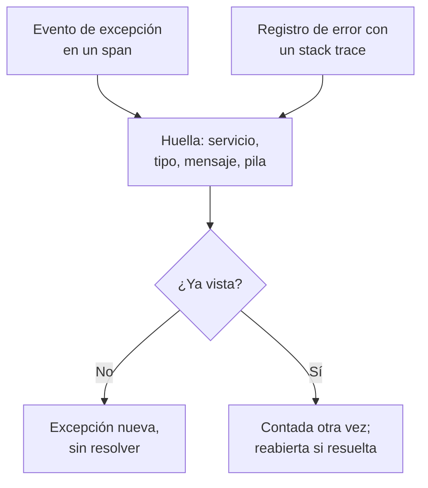

# Seguimiento de excepciones

El seguimiento de excepciones recoge los errores que lanza su código y agrupa cada ocurrencia del mismo error en una sola excepción, con su stack trace, su tendencia y las solicitudes en las que ocurrió. Revíselas como una lista de tareas: corrija, resuelva o archive el ruido, y deje que la IA abra un pull request para las que sabe corregir.

:::cards
- [De dónde vienen las excepciones](#de-dónde-vienen-las-excepciones): Spans y registros que sus servicios ya envían.
- [Revisar la lista](#revisar-la-lista): Lo no resuelto primero, el ruido oculto.
- [La página de una excepción](#la-página-de-una-excepción): Stack trace, ocurrencias y contexto.
- [Corregirla con IA](#corregirla-con-ia): Un pull request con la corrección, o una prueba de regresión.
:::

## De dónde vienen las excepciones

No envía las excepciones por separado. OneUptime las encuentra en la telemetría que sus servicios ya envían:

- un evento de excepción en un span, que es lo que escribe `recordException()` de OpenTelemetry;
- un registro con los atributos `exception.type`, `exception.message` o `exception.stacktrace`;
- un registro de gravedad Error o Fatal cuyo mensaje contiene un stack trace, cuando el registro no se escribió dentro de un span (el span ya la informa).

Cada ocurrencia se agrupa con las anteriores del mismo error en una sola excepción:

- **Una excepción por servicio y error.** La huella se calcula a partir del servicio, el tipo de excepción, el mensaje y el stack trace. Antes se quitan los valores que cambian de una llamada a otra: UUID y otros identificadores, marcas de tiempo, direcciones IP y de correo, y números de siete o más dígitos. Así, `Order id=1042 not found` y `Order id=2077 not found` son una sola excepción.
- **Una ocurrencia nueva reabre una excepción resuelta.** Si vuelve a ocurrir después de resolverla, la corrección no funcionó.
- **Una excepción archivada sigue archivada.** Sus nuevas ocurrencias se siguen contando, pero dejan de notificar.

> [!TIP]
> Para mantener un error esperado fuera del seguimiento de excepciones, como una entrada no válida que su servicio rechazó, ponga el atributo `error.class` a `user-error` o `expected-denial` en el evento de excepción del span. OneUptime no registra entonces ninguna excepción para él.

## Antes de empezar

- **Spans o registros que llegan.** Instrumente sus servicios con [OpenTelemetry](/docs/telemetry/open-telemetry). La pestaña **Guía de configuración** muestra el código para su lenguaje.
- **Un rol que pueda leer telemetría.** Project Owner, Project Admin, Project Member, Viewer, Telemetry Admin, Telemetry Member o Telemetry Viewer, o un rol personalizado con el permiso Read Telemetry Service Exception. Resolver y archivar requiere Project Owner o Project Admin, o el permiso Edit Telemetry Service Exception.

## Revisar la lista

:::steps
### Abrir Excepciones

Vaya a **Productos → Observabilidad → Excepciones**. La insignia de la pestaña **Excepciones** cuenta los problemas sin resolver, y la lista se abre con las excepciones **Sin resolver**.

### Elegir un estado

Cambie entre **Sin resolver**, **Resuelto**, **Archivado** y **Todos**. El gráfico de encima de la lista muestra cuántas ocurrencias fueron **No controlado** y cuántas **Gestionado** a lo largo del tiempo.

### Elegir qué cuenta como problema

**Problemas**, el predeterminado, oculta los errores de usuario y las denegaciones esperadas, para que la lista muestre lo que necesita una corrección. **User errors** muestra solo esos, y **Todos** muestra cada excepción.

### Buscar y filtrar

Escriba una consulta como `type:TypeError env:production`, consulte [Sintaxis de búsqueda](/docs/telemetry/search-syntax#excepciones), o haga clic en un valor de la barra lateral **Filtros**: un servicio, un host u otro recurso, un **Tipo de excepción**, un **Entorno** o una **Clase de error**.

### Abrir una excepción

Haga clic en una fila para abrir la página de la excepción.
:::

## La página de una excepción

El menú lateral de la página agrupa lo que hace con una excepción:

| Página | Qué muestra |
| --- | --- |
| **Vista general** | El mensaje, el servicio, cuántas veces ocurrió y cuándo se vio por primera y por última vez, su tendencia en el tiempo y su última ocurrencia: la versión, el entorno, el span, la traza y la sesión de usuario. |
| **Stack trace** | Los frames de la pila. Para código de navegador, los archivos y líneas originales, una vez que suba los [Source maps](/docs/telemetry/source-maps) de la versión. |
| **Ocurrencias** | Cada ocurrencia, con su hora, su mensaje y la traza en la que ocurrió. |
| **Contexto** | Los atributos de la última ocurrencia, su grabación de sesión cuando la hay, y los pasos que llevaron a ella. |
| **Registros** | Los registros escritos alrededor de la última ocurrencia. |
| **Asistencia de IA** | Tareas de IA que corrigen la excepción o la prueban. |
| **Ajustes** | Resolver o archivar la excepción. Está en **Gestionar**, que empieza contraído. |

## Resolver, reabrir y archivar

Los botones de la parte superior de la página de la excepción, y su página **Ajustes**, cambian su estado:

| Acción | Cuándo usarla | Qué pasa después |
| --- | --- | --- |
| **Resolver** | Desplegó la corrección. | Sale de la lista **Sin resolver**. Una ocurrencia nueva la reabre. |
| **Reabrir** | La corrección no funcionó. | Vuelve a estar sin resolver. |
| **Archivar** | Es ruido que no piensa corregir. | Sale de la lista. Las ocurrencias nuevas se cuentan pero dejan de notificar. |
| **Desarchivar** | Quiere volver a saber de ella. | Vuelve a la lista que le corresponde. |

**Ajustes** muestra quién resolvió o archivó la excepción por última vez, y cuándo. Sus botones dicen **Marcar como resuelto** o **Marcar como no resuelto**, y **Archivar** o **Desarchivar**.

## Clases de error

Cada excepción tiene una clase de error, que dice de quién es el problema. OneUptime AI la fija cuando revisa un insight sobre la excepción, como una excepción nueva o que se dispara: consulte [AI SRE](/docs/ai/ai-sre#hallazgos-detección-proactiva). Una excepción que no ha revisado se queda en `unknown`.

| Clase | Qué significa | En **Problemas** |
| --- | --- | --- |
| `code-fault` | Un defecto en el código. La única clase que la IA corrige por su cuenta. | Sí |
| `infrastructure` | Un tiempo de espera agotado, una conexión cortada o recursos agotados. | Sí |
| `unknown` | Aún sin clasificar. | Sí |
| `user-error` | El resultado de una entrada no válida de un usuario. | No |
| `expected-denial` | Una comprobación que hace su trabajo, como un inicio de sesión rechazado. | No |

Con **Archivar las excepciones esperadas** activado, en los ajustes de los insights de IA, las excepciones que la revisión identifica como denegaciones esperadas se archivan por usted.

## Corregirla con IA

La página **Asistencia de IA** ofrece tres tareas. Cada una se ejecuta como una tarea de IA que abre un pull request en su repositorio de código:

| Tarea | Qué hace el pull request |
| --- | --- |
| **Corregir esta excepción con IA** | Corrige la causa raíz. Iníciela con **Corregir con IA**. |
| **Generar prueba de regresión** | Añade una prueba que falla hasta que se corrija el error. |
| **Mejorar el manejo de errores** | Para errores esperados: valida antes la entrada, mantiene los datos de usuario fuera de los mensajes y marca el error como gestionado. |

La IA necesita antes tres cosas: un proveedor de LLM, un repositorio conectado (en GitHub, GitLab, Forgejo o Gitea, o en cualquier servidor Git) y un agente de IA en línea que ejecute la tarea. La página comprueba cada una y enlaza a lo que falte. Las tareas se pausan mientras la excepción está resuelta o archivada. Consulte [Código](/docs/ai/ai-agent).

## Análisis de excepciones

La pestaña **Análisis** cuenta sus excepciones **Sin resolver**, **Resuelto** y **Archivado** y su tasa de resolución, y enumera las excepciones más frecuentes, los servicios a los que afectan y las vistas más recientemente.

## Solución de problemas

:::details Una excepción que acabo de lanzar no está en la lista
Compruebe primero la vista: **Problemas** oculta los errores de usuario y las denegaciones esperadas, así que elija **Todos**. Después amplíe el intervalo de tiempo y compruebe que la excepción se registró en un span, o en un registro con un stack trace.
:::

:::details Un error aparece como varias excepciones
La huella incluye el mensaje y el stack trace. Cuando difieren, por ejemplo cuando un mensaje incluye un número corto o un nombre que cambia en cada llamada, cada variante es su propia excepción.
:::

:::details Una excepción resuelta vuelve una y otra vez
Una ocurrencia nueva reabre una excepción resuelta a propósito: el error sigue ocurriendo. Compruebe que la corrección llegó a la versión que la informa, o archive la excepción si ya no quiere saber de ella.
:::

## Próximos pasos

:::cards
- [Monitor de excepciones](/docs/monitor/exceptions-monitor): Recibir alertas cuando las excepciones se disparen.
- [Source maps](/docs/telemetry/source-maps): Stack traces legibles para código de navegador.
- [Código](/docs/ai/ai-agent): Cómo la IA corrige código y abre pull requests.
- [Explorador de trazas](/docs/telemetry/traces-explorer): Ver la solicitud en la que ocurrió una excepción.
:::
