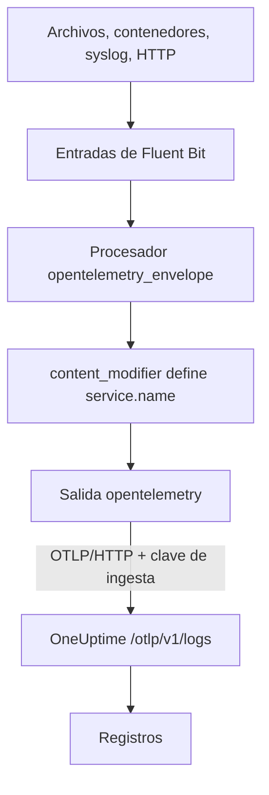

# Fluent Bit

[Fluent Bit](https://docs.fluentbit.io/manual) es un agente ligero que recopila registros de archivos, systemd, contenedores, syslog, HTTP y muchas otras fuentes. Su [salida OpenTelemetry](https://docs.fluentbit.io/manual/pipeline/outputs/opentelemetry) envía lo que recopila al endpoint OpenTelemetry (OTLP) de OneUptime, donde los registros se pueden buscar en **Productos → Registros**.

:::cards
- [Configurar Fluent Bit](#configurar-fluent-bit): Añade la salida OpenTelemetry y ponle nombre a tu servicio.
- [Ejemplo completo](#ejemplo-completo): Un archivo de configuración entero para empezar.
- [OneUptime autoalojado](#oneuptime-autoalojado): Apunta Fluent Bit a tu propia instancia.
:::

## Cómo funciona



Fluent Bit envuelve cada registro en un sobre de OpenTelemetry para que pueda llevar atributos de recurso como `service.name`. Después, la salida OpenTelemetry envía los registros a OneUptime con tu clave de ingesta en la cabecera `x-oneuptime-token`. OneUptime los guarda bajo el servicio que nombra `service.name` y crea ese servicio la primera vez que envía.

## Antes de empezar

- **Instalar Fluent Bit**: consulta la [guía de instalación](https://docs.fluentbit.io/manual/installation/getting-started-with-fluent-bit). La configuración de esta página usa el formato YAML de Fluent Bit y el procesador `opentelemetry_envelope`, así que usa una versión actual.
- **Un proyecto de OneUptime.** En OneUptime Cloud, la telemetría se factura por GB ingerido —consulta los [precios](https://oneuptime.com/pricing)— y un proyecto del plan Free necesita un método de pago antes de poder enviar telemetría.
- **Una clave de ingesta de telemetría.** Si no tienes una:

:::steps
### Abrir las claves de ingesta

Ve a **Productos → Ajustes del proyecto**, abre **Telemetría y APM** en el menú lateral y selecciona **Claves de ingesta**.


### Crear una clave

Haz clic en **Crear clave de ingesta**. El diálogo ya tiene rellenado el nombre de la clave y elegido **Servidor** —el tipo de clave con el que envía una aplicación o un collector—, así que haz clic en **Crear clave de ingesta** para crearla, o cámbiale antes el nombre.

### Copiar el secreto

La nueva clave se abre en su propia página. Copia su **Clave secreta**: es el `YOUR_TELEMETRY_INGESTION_TOKEN` de la configuración de abajo.


:::

## Configurar Fluent Bit

Fluent Bit lee su configuración YAML de un archivo como `/etc/fluent-bit/fluent-bit.yaml`.

:::steps
### Añadir la salida OpenTelemetry

Añade una salida `opentelemetry` que envíe a OneUptime. Mantén la salida `stdout` mientras pruebas si quieres ver los registros en local:

```yaml title="fluent-bit.yaml"
service:
  # Keep the chunks still to send on disk: a restart of Fluent Bit loses none
  storage.path: /var/lib/fluent-bit/buffer
  storage.sync: normal
  # Try a chunk again about every 30 seconds
  scheduler.base: 30
  scheduler.cap: 30

pipeline:
  outputs:
    - name: stdout
      match: "*"
    - name: opentelemetry
      match: "*"
      host: "oneuptime.com"
      port: 443
      metrics_uri: "/otlp/v1/metrics"
      logs_uri: "/otlp/v1/logs"
      traces_uri: "/otlp/v1/traces"
      tls: On
      header:
        - x-oneuptime-token YOUR_TELEMETRY_INGESTION_TOKEN
      # Send a chunk again when OneUptime is busy or restarting, for about 72 hours
      retry_limit: 8640
      # At most 512 MB on disk: when it is full, the oldest chunks are dropped
      storage.total_limit_size: 512M
```

`retry_limit: 8640` vuelve a enviar un chunk cuando OneUptime está ocupado (`429`) o reiniciándose (`502`, `503`, `504`), aproximadamente cada 30 segundos (`scheduler.base` y `scheduler.cap`), durante unas 72 horas; lo predeterminado en Fluent Bit es intentarlo una vez más y descartarlo. `storage.path` guarda en disco los chunks que faltan por enviar, así que un reinicio de Fluent Bit no pierde ninguno, para cada entrada con `storage.type: filesystem`, como en el paso siguiente. Fluent Bit debe poder escribir en esa carpeta: el servicio del paquete se ejecuta como root, y a mano ejecútalo con `sudo`. `storage.total_limit_size: 512M` guarda como máximo 512 MB para la salida; cuando está lleno, se descartan los chunks más antiguos.

### Envolver los registros en un sobre de OpenTelemetry y nombrar el servicio

Añade el procesador `opentelemetry_envelope` a cada entrada, seguido de un `content_modifier` que defina `service.name`. Sustituye `YOUR_SERVICE_NAME` por el nombre con el que deben aparecer los registros en OneUptime:

```yaml title="fluent-bit.yaml"
pipeline:
  inputs:
    - name: tail # or any other input
      path: /var/log/my-app/*.log
      # Keep its place in each file, so a restart reads on from there
      db: /var/lib/fluent-bit/tail.db
      # Keep its chunks on disk until OneUptime takes them
      storage.type: filesystem

      processors:
        logs:
          - name: opentelemetry_envelope

          - name: content_modifier
            context: otel_resource_attributes
            action: upsert
            key: service.name
            value: YOUR_SERVICE_NAME
```

`db` guarda la posición del tail en cada archivo, así que un reinicio sigue leyendo desde ahí; sin él, Fluent Bit vuelve a empezar al final de cada archivo, y las líneas escritas mientras estaba parado nunca se envían. `storage.type: filesystem` guarda los chunks de la entrada en `storage.path`.

### Reiniciar Fluent Bit

El servicio del paquete `fluent-bit` lee `/etc/fluent-bit/fluent-bit.conf`, el ejemplo del propio paquete, no este archivo. Apúntalo a `/etc/fluent-bit/fluent-bit.yaml` con un drop-in y luego arráncalo ahora y en cada arranque:

```bash
sudo mkdir -p /etc/systemd/system/fluent-bit.service.d
printf '[Service]\nExecStart=\nExecStart=/opt/fluent-bit/bin/fluent-bit -c /etc/fluent-bit/fluent-bit.yaml\n' | sudo tee /etc/systemd/system/fluent-bit.service.d/fluent-bit-yaml.conf
sudo systemctl daemon-reload
sudo systemctl enable fluent-bit
sudo systemctl restart fluent-bit
```

El `ExecStart=` vacío borra la línea de arranque del propio paquete. Para probar antes el archivo en primer plano, ejecuta `sudo /opt/fluent-bit/bin/fluent-bit -c /etc/fluent-bit/fluent-bit.yaml`: el paquete pone el programa en `/opt/fluent-bit/bin`, que no está en el `PATH`. En pocos segundos los registros aparecen en **Productos → Registros**, y el servicio aparece en **Productos → Servicios**.
:::

## Ejemplo completo

Esta configuración recibe registros por HTTP en el puerto `8888`, solo desde este host, y los reenvía a OneUptime:

```yaml title="fluent-bit.yaml"
service:
  flush: 1
  log_level: info
  # Keep the chunks still to send on disk: a restart of Fluent Bit loses none
  storage.path: /var/lib/fluent-bit/buffer
  storage.sync: normal
  # Try a chunk again about every 30 seconds
  scheduler.base: 30
  scheduler.cap: 30

pipeline:
  inputs:
    - name: http
      # This host alone may send here
      listen: 127.0.0.1
      port: 8888
      storage.type: filesystem

      processors:
        logs:
          - name: opentelemetry_envelope

          - name: content_modifier
            context: otel_resource_attributes
            action: upsert
            key: service.name
            value: YOUR_SERVICE_NAME

  outputs:
    - name: stdout
      match: "*"
    - name: opentelemetry
      match: "*"
      host: "oneuptime.com"
      port: 443
      metrics_uri: "/otlp/v1/metrics"
      logs_uri: "/otlp/v1/logs"
      traces_uri: "/otlp/v1/traces"
      tls: On
      header:
        - x-oneuptime-token YOUR_TELEMETRY_INGESTION_TOKEN
      # Send a chunk again when OneUptime is busy or restarting, for about 72 hours
      retry_limit: 8640
      # At most 512 MB on disk: when it is full, the oldest chunks are dropped
      storage.total_limit_size: 512M
```

`listen: 127.0.0.1` acepta registros solo desde este host: la entrada `http` no pide ninguna clave, así que con `listen: 0.0.0.0` cualquiera que llegue al puerto puede enviar logs a OneUptime con tu clave de ingesta. Sustituye la entrada `http` por las entradas que necesites —por ejemplo `tail` para archivos de registro o `systemd` para el journal— y mantén los dos procesadores y `storage.type: filesystem` en cada una de ellas.

## Enviar con la salida HTTP

La [salida HTTP](https://docs.fluentbit.io/manual/pipeline/outputs/http) de Fluent Bit también puede enviar al endpoint de Fluentd de OneUptime, que lee cada registro como describe la [página de Fluentd](/docs/telemetry/fluentd). Pon en `format` el valor `json_lines`, como abajo, o `json`: OneUptime lee los dos, comprimidos con `compress: gzip` o no. El formato predeterminado de Fluent Bit, `msgpack`, se rechaza.

```yaml title="fluent-bit.yaml"
pipeline:
  outputs:
    - name: http
      match: "*"
      host: "oneuptime.com"
      port: 443
      uri: "/fluentd/logs"
      format: json_lines
      # Send each record's time where OneUptime reads it
      json_date_key: timestamp
      tls: On
      header:
        - x-oneuptime-token YOUR_TELEMETRY_INGESTION_TOKEN
        - x-oneuptime-service-name YOUR_SERVICE_NAME
      # Send a chunk again when OneUptime is busy or restarting, for about 72 hours
      retry_limit: 8640
      # At most 512 MB on disk: when it is full, the oldest chunks are dropped
      storage.total_limit_size: 512M
```

## OneUptime autoalojado

Pon en `host` el host de tu instancia de OneUptime. Si se sirve por HTTP simple en lugar de HTTPS, pon también en `port` el puerto en el que escucha (normalmente `80`) y quita `tls`:

```yaml title="fluent-bit.yaml"
pipeline:
  outputs:
    - name: stdout
      match: "*"
    - name: opentelemetry
      match: "*"
      host: "your-oneuptime-instance.com"
      port: 80
      metrics_uri: "/otlp/v1/metrics"
      logs_uri: "/otlp/v1/logs"
      traces_uri: "/otlp/v1/traces"
      header:
        - x-oneuptime-token YOUR_TELEMETRY_INGESTION_TOKEN
      # Send a chunk again when OneUptime is busy or restarting, for about 72 hours
      retry_limit: 8640
      # At most 512 MB on disk: when it is full, the oldest chunks are dropped
      storage.total_limit_size: 512M
```

## Solución de problemas

:::details Fluent Bit registra `401` desde la salida OpenTelemetry
Falta la clave de ingesta, es desconocida o ha caducado. Revisa la línea `header`: es `x-oneuptime-token`, un espacio y después la **Clave secreta** de la clave.
:::

:::details Fluent Bit registra `402` o `422`
`402`: en OneUptime Cloud, el proyecto está en el plan Free y no tiene método de pago. Añade uno en **Ajustes del proyecto → Facturación y facturas → Facturación**. `422`: la clave está deshabilitada, o es una clave de navegador. Vuelve a activar **Habilitado** en los ajustes de la clave, o crea una clave de **Servidor**.
:::

:::details Los registros llegan a un servicio inesperado
El servicio sale de `service.name`. Comprueba que cada entrada tenga el procesador `opentelemetry_envelope` seguido del `content_modifier` que lo define.
:::

:::details No llega nada y Fluent Bit registra errores de conexión
Comprueba que `tls: On` y `port: 443` estén definidos para un endpoint HTTPS, y que el host donde se ejecuta Fluent Bit pueda llegar a tu host de OneUptime en ese puerto.
:::

:::details Fluent Bit registra `cannot be retried`
Fluent Bit descartó un chunk que no pudo enviar. Con `retry_limit: 8640`, como en la configuración de arriba, vuelve a enviar un chunk al que OneUptime responde `429`, `502`, `503` o `504` aproximadamente cada 30 segundos, durante unas 72 horas; con lo predeterminado en Fluent Bit, lo intenta una vez más. Un `400`, `401`, `402`, `413`, `422` o `500` se descarta enseguida, porque la respuesta es la misma cada vez: revisa la clave, el plan y el tamaño de la solicitud.
:::

Si tienes alguna pregunta o necesitas ayuda con la configuración, escríbenos a support@oneuptime.com.

## Próximos pasos

:::cards
- [Canalizaciones de registros](/docs/telemetry/log-pipelines): Analiza y enriquece los registros que envía Fluent Bit.
- [Sintaxis de búsqueda](/docs/telemetry/search-syntax): Encuentra los registros en el explorador de registros.
- [OpenTelemetry](/docs/telemetry/open-telemetry): Endpoints, claves y límites para toda la telemetría.
- [Fluentd](/docs/telemetry/fluentd): Usa Fluentd en su lugar.
:::
