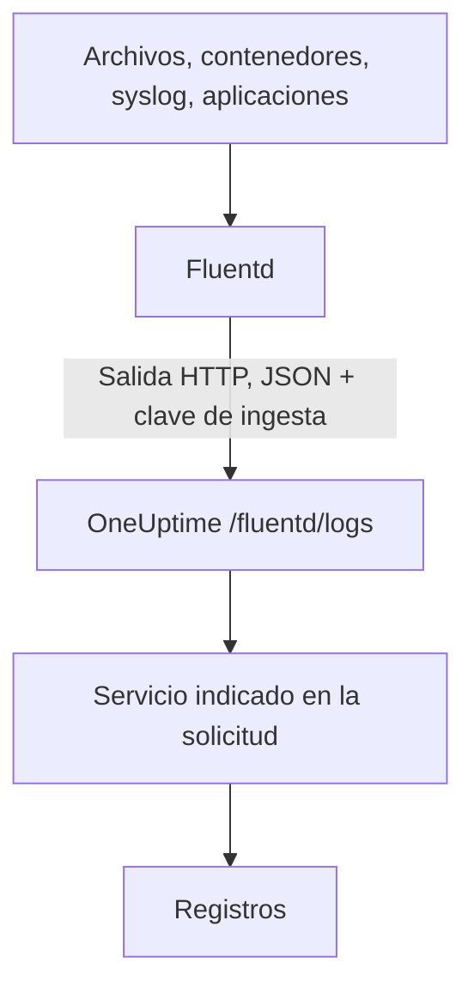

# Fluentd

[Fluentd](https://www.fluentd.org/) recopila registros de archivos, contenedores, syslog, aplicaciones y [muchas otras fuentes](https://www.fluentd.org/datasources). Su [salida HTTP](https://docs.fluentd.org/output/http) integrada los envía al endpoint de Fluentd de OneUptime, donde se pueden buscar en **Productos → Registros**.

:::cards
- [Configurar Fluentd](#configurar-fluentd): Añade una salida HTTP que apunte a OneUptime.
- [Cómo se leen los registros](#cómo-se-leen-los-registros): Qué campos se convierten en el mensaje, la severidad y los atributos.
- [OneUptime autoalojado](#oneuptime-autoalojado): Apunta Fluentd a tu propia instancia.
:::

## Cómo funciona



Fluentd envía los registros por lotes en JSON, con tu clave de ingesta en la cabecera `x-oneuptime-token` y el nombre del servicio en `x-oneuptime-service-name`. OneUptime convierte cada registro en un registro de ese servicio y crea el servicio la primera vez que envía.

## Antes de empezar

- **Instalar Fluentd**: consulta la [guía de instalación](https://docs.fluentd.org/installation).
- **Un proyecto de OneUptime.** En OneUptime Cloud, la telemetría se factura por GB ingerido —consulta los [precios](https://oneuptime.com/pricing)— y un proyecto del plan Free necesita un método de pago antes de poder enviar telemetría.
- **Una clave de ingesta de telemetría.** Si no tienes una:

:::steps
### Abrir las claves de ingesta

Ve a **Productos → Ajustes del proyecto**, abre **Telemetría y APM** en el menú lateral y selecciona **Claves de ingesta**.


### Crear una clave

Haz clic en **Crear clave de ingesta**. El diálogo ya tiene rellenado el nombre de la clave y elegido **Servidor** —el tipo de clave con el que envía una aplicación o un collector—, así que haz clic en **Crear clave de ingesta** para crearla, o cámbiale antes el nombre.

### Copiar el secreto

La nueva clave se abre en su propia página. Copia su **Clave secreta**: es el `YOUR_SERVICE_TOKEN` de la configuración de abajo.


:::

## Configurar Fluentd

El archivo de configuración de Fluentd suele ser `/etc/fluent/fluentd.conf`, o `/etc/td-agent/td-agent.conf` en el antiguo paquete td-agent.

:::steps
### Añadir una salida HTTP

Añade una sección `<match>` que envíe los registros a OneUptime. Sustituye `YOUR_SERVICE_TOKEN` por tu clave de ingesta y `YOUR_SERVICE_NAME` por el nombre con el que deben aparecer los registros (el que quieras):

```text title="fluentd.conf"
# Send the time Fluentd gave each event: the HTTP output sends only the record
<filter **>
  @type record_transformer
  enable_ruby true
  <record>
    fluentd_time ${time.utc.strftime("%Y-%m-%dT%H:%M:%S.%NZ")}
  </record>
</filter>

# Match all patterns
<match **>
  @type http

  endpoint https://oneuptime.com/fluentd/logs
  open_timeout 2

  headers {"x-oneuptime-token":"YOUR_SERVICE_TOKEN", "x-oneuptime-service-name":"YOUR_SERVICE_NAME"}

  content_type application/json
  json_array true

  # Send a batch again when OneUptime is busy (429) or restarting (502, 503, 504)
  retryable_response_codes 429,502,503,504

  <format>
    @type json
  </format>
  <buffer>
    # Keep the batches on disk until OneUptime takes them: a restart of Fluentd loses none
    @type file
    path /var/log/fluent/buffer/oneuptime
    total_limit_size 512m
    flush_interval 10s
    chunk_limit_size 900k
    # Try again at least every 30 seconds, for up to 72 hours
    retry_max_interval 30s
    retry_timeout 72h
  </buffer>
</match>

# Keep Fluentd's own logs out of OneUptime
<label @FLUENT_LOG>
  <match **>
    @type null
  </match>
</label>
```

`json_array true` envía cada fragmento del búfer como un único array JSON, y `flush_interval 10s` envía el búfer cada 10 segundos. `chunk_limit_size 900k` mantiene cada solicitud por debajo de 1 MB, lo máximo que OneUptime acepta en este endpoint.

El valor predeterminado de Fluentd también funciona: sin `content_type` ni `json_array true`, envía JSON delimitado por saltos de línea, un registro por línea, y OneUptime lee cada línea como el registro que es, con `compress gzip` o sin él.

`@type file` guarda los lotes que faltan por enviar en la carpeta que indica `path`, así que un reinicio de Fluentd no pierde ninguno; un búfer en memoria, el predeterminado de Fluentd, pierde lo que contiene. El usuario de Fluentd debe poder escribir en esa carpeta: `/var/log/fluent` es la de fluent-package, `/var/log/td-agent` la de td-agent y `/fluentd/log` la de la imagen `fluent/fluentd`. `total_limit_size 512m` guarda allí 512 MB como máximo; cuando está lleno, Fluentd no acepta más registros hasta que se envía un lote.

`retryable_response_codes 429,502,503,504` vuelve a enviar un lote cuando OneUptime está ocupado (`429`) o reiniciándose (`502`, `503`, `504`); sin él, Fluentd descarta un lote ante cualquier respuesta que no sea `503`. `retry_max_interval 30s` espera como mucho 30 segundos entre intentos, y `retry_timeout 72h` descarta un lote que aún no ha podido enviar tras 72 horas. El filtro `record_transformer` añade la hora que Fluentd dio a cada registro, como `fluentd_time`: la salida HTTP envía solo el registro, y OneUptime lee de él la hora de un log.

### Reiniciar Fluentd

Reinicia el servicio de Fluentd para que cargue la nueva salida.

### Comprobar que llegan los registros

Pocos segundos después del siguiente vaciado, los registros aparecen en **Productos → Registros**. El servicio aparece en **Productos → Servicios**; si todavía no existía, OneUptime lo crea.
:::

## Ejemplo completo

Esta configuración recibe registros por el protocolo forward de Fluentd en el puerto `24224`, solo desde este host, y los envía todos a OneUptime:

```text title="fluentd.conf"
####
## Source descriptions:
##

## built-in TCP input
## @see https://docs.fluentd.org/input/forward
<source>
  @type forward
  port 24224
  # This host alone: see "Take records from other hosts" to open it
  bind 127.0.0.1
</source>

# Send the time Fluentd gave each event: the HTTP output sends only the record
<filter **>
  @type record_transformer
  enable_ruby true
  <record>
    fluentd_time ${time.utc.strftime("%Y-%m-%dT%H:%M:%S.%NZ")}
  </record>
</filter>

<match **>
  @type http

  endpoint https://oneuptime.com/fluentd/logs
  open_timeout 2

  headers {"x-oneuptime-token":"YOUR_SERVICE_TOKEN", "x-oneuptime-service-name":"YOUR_SERVICE_NAME"}

  content_type application/json
  json_array true

  # Send a batch again when OneUptime is busy (429) or restarting (502, 503, 504)
  retryable_response_codes 429,502,503,504

  <format>
    @type json
  </format>
  <buffer>
    # Keep the batches on disk until OneUptime takes them: a restart of Fluentd loses none
    @type file
    path /var/log/fluent/buffer/oneuptime
    total_limit_size 512m
    flush_interval 10s
    chunk_limit_size 900k
    # Try again at least every 30 seconds, for up to 72 hours
    retry_max_interval 30s
    retry_timeout 72h
  </buffer>
</match>

# Keep Fluentd's own logs out of OneUptime
<label @FLUENT_LOG>
  <match **>
    @type null
  </match>
</label>
```

`bind 127.0.0.1` acepta registros solo desde este host, como los del controlador de logs `fluentd` de Docker, que envía a `localhost:24224`. Para enviar distintas fuentes como distintos servicios, usa una sección `<match>` por etiqueta, cada una con su propio `x-oneuptime-service-name` y su propio `path` de búfer: Fluentd no arranca con dos búferes en una misma ruta.

## Recibir registros de otros hosts

Con `bind 0.0.0.0` y sin sección `<security>`, cualquiera que llegue al puerto `24224` puede enviar logs a OneUptime con tu clave de ingesta. Para recibir registros de Fluentd o Fluent Bit en otros hosts, escucha en todas las direcciones, pide a cada emisor una clave compartida y usa TLS. Sustituye la sección `<source>` del ejemplo completo por:

```text title="fluentd.conf on this host"
<source>
  @type forward
  port 24224
  bind 0.0.0.0
  <transport tls>
    cert_path /etc/fluent/certs/fluentd.crt
    private_key_path /etc/fluent/certs/fluentd.key
  </transport>
  <security>
    self_hostname fluentd.example.com
    shared_key YOUR_SHARED_KEY
  </security>
</source>
```

`cert_path` y `private_key_path` son un certificado para el nombre de este host, aquí `fluentd.example.com`, y su clave, que el usuario de Fluentd debe poder leer. Fluentd avisa cuando la clave no tiene frase de contraseña; `private_key_passphrase` la establece. Sustituye `YOUR_SHARED_KEY` por un secreto largo y aleatorio, como uno de `openssl rand -base64 32`, y da el mismo a cada emisor:

```text title="fluentd.conf on each sender"
<match **>
  @type forward
  transport tls
  # The certificate of the authority that signed this host's; not needed for a public one
  tls_cert_path /etc/fluent/certs/ca.crt
  <security>
    self_hostname app-1.example.com
    shared_key YOUR_SHARED_KEY
  </security>
  <server>
    host fluentd.example.com
    port 24224
  </server>
  <buffer>
    @type file
    path /var/log/fluent/buffer/forward
  </buffer>
</match>

# Keep Fluentd's own logs out of OneUptime
<label @FLUENT_LOG>
  <match **>
    @type null
  </match>
</label>
```

La salida `forward` de Fluent Bit admite los mismos ajustes: `Shared_Key`, `Self_Hostname`, `tls On` y `tls.ca_file`.

Un emisor sin la clave, o sin TLS, es rechazado. La clave nunca cruza la red: cada lado demuestra que la tiene. Sin TLS, cualquiera en la red entre los hosts puede leer los registros. Abre el puerto `24224` en el cortafuegos del host solo a los hosts que envían. Si Fluentd se ejecuta con el archivo Docker Compose de la guía de logs, publica allí también el puerto en todas las direcciones, `"24224:24224"`, y monta la carpeta del certificado en el contenedor.

## Cómo se leen los registros

OneUptime lee estos campos de cada registro:

| Campo del registro | Se lee del primer campo presente entre | Notas |
| --- | --- | --- |
| Cuerpo | `message`, `log`, `msg`, `body`, `text` | La línea de registro. Un registro sin ninguno de ellos se guarda completo, como JSON. |
| Severidad | `level`, `severity`, `loglevel`, `log_level`, `priority`, `severityText`, `severity_text` | Nombres como `trace`, `debug`, `info`, `notice`, `warn`, `error`, `critical` y `fatal`, en mayúsculas o minúsculas. Cualquier otro valor se guarda como `Unspecified`. |
| ID de traza | `trace_id`, `traceId`, `traceid` | Enlaza el registro con su traza. |
| ID de span | `span_id`, `spanId`, `spanid` | Enlaza el registro con su span. |
| Servicio | la cabecera `x-oneuptime-service-name` | `Fluentd` cuando la cabecera no está definida. |
| Hora | `time`, `timestamp`, `@timestamp`, `ts`, `fluentd_time` | Una hora ISO 8601, como `2026-11-14T08:00:00.123Z`, o segundos, milisegundos, microsegundos o nanosegundos desde la época Unix; una hora sin zona horaria es UTC. No se lee una hora anterior a 2000 ni una que vaya más de un día por delante. El campo del que se lee la hora no se guarda como atributo. Un registro sin hora se guarda a la hora a la que OneUptime lo recibe. |

Cualquier otro campo se convierte en un atributo llamado `fluentd.` seguido del nombre del campo, por el que puedes buscar y filtrar: un campo `container_name` es `@fluentd.container_name` en el explorador de registros. Un objeto anidado se aplana con puntos, como `fluentd.kubernetes.pod_name`, y una lista se guarda como JSON.

Los registros de Fluentd pasan por tus [canalizaciones de registros](/docs/telemetry/log-pipelines), filtros de descarte y reglas de enmascaramiento como cualquier otro registro.

## OneUptime autoalojado

Sustituye `https://oneuptime.com` en `endpoint` por la URL de tu instancia de OneUptime: `http(s)://YOUR_ONEUPTIME_HOST/fluentd/logs`.

## Solución de problemas

:::details Fluentd registra `401` desde la salida HTTP
Falta la clave de ingesta, es desconocida o ha caducado. Revisa el valor de `x-oneuptime-token` en `headers`.
:::

:::details Fluentd registra `402` o `422`
`402`: en OneUptime Cloud, el proyecto está en el plan Free y no tiene método de pago. Añade uno en **Ajustes del proyecto → Facturación y facturas → Facturación**. `422`: la clave está deshabilitada, o es una clave de navegador. Vuelve a activar **Habilitado** en los ajustes de la clave, o crea una clave de **Servidor**.
:::

:::details Fluentd registra `413`
La solicitud supera 1 MB, lo máximo que OneUptime acepta en este endpoint. Pon `chunk_limit_size 900k` en la sección `<buffer>`, como en la configuración de arriba.
:::

:::details Fluentd registra `429`, `502`, `503` o `504`
OneUptime está ocupado o reiniciándose. Con `retryable_response_codes 429,502,503,504` en la sección `<match>`, como en la configuración de arriba, Fluentd conserva el lote y lo vuelve a enviar; sin él, Fluentd descarta el lote. Con `@type file` en la sección `<buffer>`, Fluentd también conserva el lote cuando se reinicia.
:::

:::details Los logs muestran la hora a la que OneUptime los recibió, no la suya
OneUptime lee la hora de un log de su registro, y la salida HTTP de Fluentd envía solo el registro. Una sección `<parse>` saca el campo `time` del registro, como la hora del evento: añádele `time_key fluentd_time`, para que no lea la hora de ningún registro y deje `time` tal como está. Añade también el filtro `record_transformer` de la configuración de arriba: añade la hora que Fluentd dio a cada registro, como `fluentd_time`.
:::

:::details Una línea JSON cuyo `time` es `null`, `true`, una lista o un objeto nunca llega
El parser `json` de Fluentd lee el campo `time` de una línea como la hora del evento, y descarta sin aviso una línea cuyo `time` no es ni texto ni un número. Añade `time_key fluentd_time` a su sección `<parse>`, como arriba: Fluentd deja entonces `time` en el registro tal como está. Con el filtro `record_transformer` de arriba, OneUptime guarda el log a la hora en que Fluentd lo leyó, `fluentd_time`; sin él, a la hora en que OneUptime lo recibe.
:::

:::details Los registros llegan al servicio `Fluentd`
Falta la cabecera `x-oneuptime-service-name`. Añádela a `headers` en cada sección `<match>`.
:::

:::details El cuerpo del registro muestra todo el registro como JSON
OneUptime toma el cuerpo del primer campo presente entre `message`, `log`, `msg`, `body` o `text`, y guarda el registro completo cuando no tiene ninguno. Cambia el nombre del campo que contiene tu línea de registro a uno de esos, por ejemplo con el filtro `record_transformer` de Fluentd.
:::

Si tienes alguna pregunta o necesitas ayuda con la configuración, escríbenos a support@oneuptime.com.

## Próximos pasos

:::cards
- [Canalizaciones de registros](/docs/telemetry/log-pipelines): Analiza y enriquece los registros que envía Fluentd.
- [Sintaxis de búsqueda](/docs/telemetry/search-syntax): Encuentra los registros en el explorador de registros.
- [Fluent Bit](/docs/telemetry/fluentbit): Un agente más ligero que envía por OpenTelemetry.
- [Monitor de registros](/docs/monitor/logs-monitor): Alerta cuando aparezcan registros que coincidan.
:::
