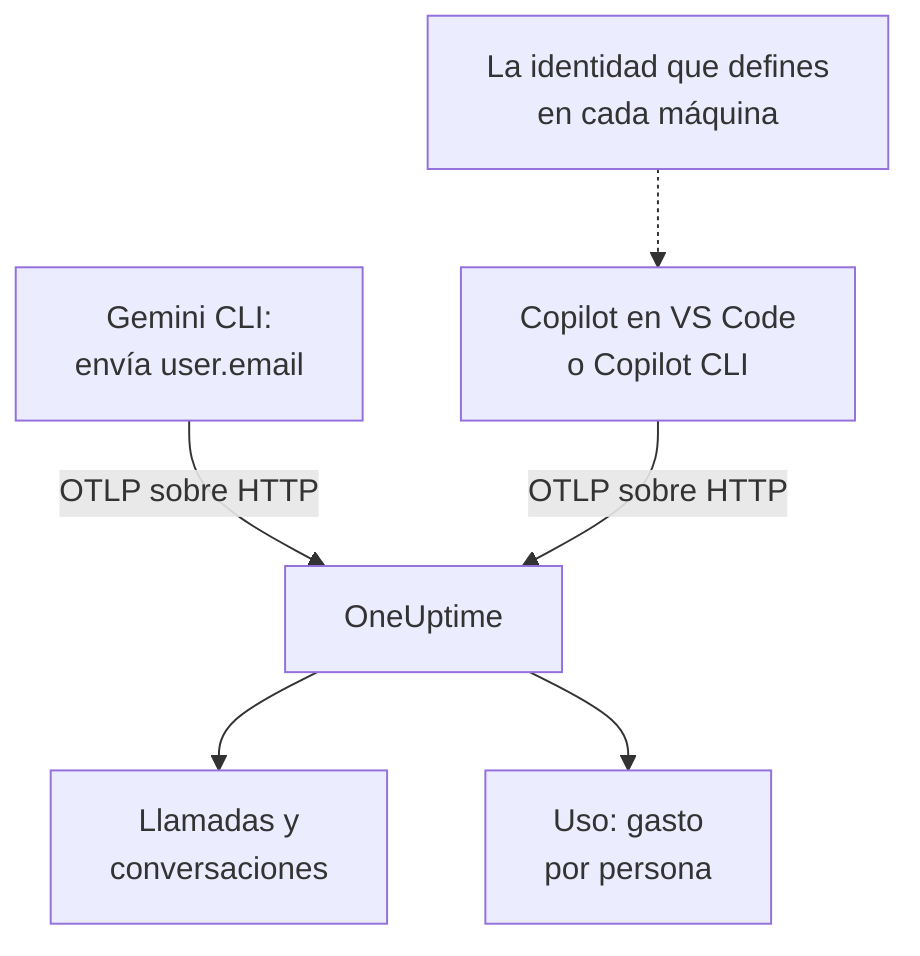

# Gemini CLI y GitHub Copilot

Gemini CLI y GitHub Copilot exportan OpenTelemetry por sí mismos: apúntalos a OneUptime y sus llamadas al modelo, tokens, costes y llamadas a herramientas llegan a [IA / LLM](/docs/telemetry/ai-llm-observability), junto a las llamadas de IA de tus propias apps. Se diferencian en lo que más importa para repercutir costes: Gemini CLI nombra a la persona en cada registro y Copilot no nombra a nadie, así que nombras tú a cada desarrollador.

:::cards
- [Gemini CLI](#configura-gemini-cli): Activa la telemetría, con trazas, y envíala directamente a OneUptime.
- [GitHub Copilot](#configura-github-copilot): Exporta desde VS Code o Copilot CLI.
- [Nombra a cada desarrollador](#nombra-a-cada-desarrollador): La identidad que Copilot omite.
- [Solución de problemas](#solución-de-problemas): Qué revisar cuando no llega nada.
:::

## Cómo funciona



| | Gemini CLI | GitHub Copilot |
| --- | --- | --- |
| Envía | Trazas, métricas y registros | Trazas, métricas y eventos, solo desde sus superficies de agente |
| Nombra a la persona | `user.email`, con la sesión iniciada | A nadie: tú defines `enduser.id` y `user.email` |
| Texto de los prompts | Enviado salvo que desactives `logPrompts` | No enviado salvo que actives `captureContent` |
| De fábrica envía a | `http://localhost:4317`, sobre gRPC | `http://localhost:4318`, sobre HTTP |

## Antes de empezar

- Una clave de ingesta: abre **Ajustes del proyecto → Telemetría y APM → Claves de ingesta** y haz clic en **Crear clave de ingesta**.
- Tu URL base de OTLP: `https://oneuptime.com/otlp`, o `https://YOUR-ONEUPTIME-HOST/otlp` si alojas OneUptime tú mismo.
- La clave viaja en la cabecera `x-oneuptime-token` de cada petición de exportación.

## Configura Gemini CLI

Gemini CLI envía trazas, métricas y eventos de registro, y pone `user.email` en cada registro cuando alguien ha iniciado sesión. OneUptime lee `user.email` como el empleado, así que el gasto de cada persona aparece sin tablas de correspondencia y sin configurar cada máquina.

:::steps
### Activa la telemetría

Añade un bloque `telemetry` al archivo de ajustes de usuario de cada máquina, o a `.gemini/settings.json` en un repositorio:

```json title="~/.gemini/settings.json"
{
  "telemetry": {
    "enabled": true,
    "target": "local",
    "otlpEndpoint": "https://oneuptime.com/otlp",
    "otlpProtocol": "http",
    "otlpHeaders": {
      "x-oneuptime-token": "YOUR_INGESTION_TOKEN"
    },
    "traces": true,
    "logPrompts": false
  }
}
```

### Inicia una sesión nueva

Gemini CLI lee sus ajustes al arrancar, así que vuelve a iniciarlo y ejecuta un prompt.

### Comprueba que llegan datos

Abre **Productos → IA / LLM → Llamadas**: las llamadas aparecen bajo el servicio `gemini-cli`, con el modelo y los tokens.
:::

Tres ajustes de ese bloque importan más que el resto:

- `otlpProtocol: "http"`. Gemini CLI usa gRPC si no se le indica otra cosa. Sobre HTTP añade por su cuenta `/v1/traces`, `/v1/metrics` y `/v1/logs` a la URL base. OneUptime también acepta gRPC en el puerto 443 (consulta [OTLP sobre gRPC](/docs/telemetry/open-telemetry#otlp-sobre-grpc)), pero HTTP es más sencillo.
- `traces: true`. Está desactivado por defecto, y sin él los spans de Gemini CLI no llevan ni modelo ni recuentos de tokens, así que no se puede poner precio a nada. Gemini CLI tampoco envía una métrica de coste: activa las trazas para ver lo que cuestan sus llamadas.
- `logPrompts: false`. Lee la advertencia de abajo.

> [!WARNING]
> `logPrompts` es `true` por defecto, así que activar la telemetría envía el texto que escriben tus ingenieros: a menudo código fuente, datos de clientes y credenciales pegadas. Ponlo en `false` en el mismo cambio que activa la telemetría. Si quieres prompts para depurar, decídelo a propósito, y enmascara lo necesario con reglas de depuración en **Trazas → Ajustes**.

### Ajustes para una flota

Cada ajuste tiene una variable de entorno, y las variables prevalecen sobre el `.gemini/settings.json` de un repositorio, lo que las convierte en el lugar para una política de flota distribuida por MDM:

```bash
export GEMINI_TELEMETRY_ENABLED=true
export GEMINI_TELEMETRY_TARGET=local
export GEMINI_TELEMETRY_OTLP_ENDPOINT="https://oneuptime.com/otlp"
export GEMINI_TELEMETRY_OTLP_PROTOCOL=http
export GEMINI_TELEMETRY_OTLP_HEADERS="x-oneuptime-token=YOUR_INGESTION_TOKEN"
export GEMINI_TELEMETRY_TRACES_ENABLED=true
export GEMINI_TELEMETRY_LOG_PROMPTS=false
```

| Ajuste | Variable | Predeterminado | Qué hace |
| --- | --- | --- | --- |
| `enabled` | `GEMINI_TELEMETRY_ENABLED` | `false` | Activa la telemetría |
| `target` | `GEMINI_TELEMETRY_TARGET` | `local` | `local` envía al endpoint que definas; `gcp` envía a Google Cloud |
| `otlpEndpoint` | `GEMINI_TELEMETRY_OTLP_ENDPOINT` | `http://localhost:4317` | Adónde va la telemetría |
| `otlpProtocol` | `GEMINI_TELEMETRY_OTLP_PROTOCOL` | `grpc` | `grpc` o `http` |
| `otlpHeaders` | `GEMINI_TELEMETRY_OTLP_HEADERS` | Ninguno | Cabeceras en cada exportación: un objeto en el archivo, pares `key=value` o JSON en la variable |
| `traces` | `GEMINI_TELEMETRY_TRACES_ENABLED` | `false` | Pone el modelo, los tokens y los contenidos en los spans |
| `logPrompts` | `GEMINI_TELEMETRY_LOG_PROMPTS` | `true` | Pone el texto de los prompts en los eventos de registro |
| `outfile` | `GEMINI_TELEMETRY_OUTFILE` | Ninguno | Escribe la telemetría en un archivo en su lugar, para ver lo que se enviaría |

Los flags de la línea de comandos prevalecen sobre las variables `GEMINI_TELEMETRY_*`, que prevalecen sobre las variables estándar `OTEL_EXPORTER_OTLP_*`, que prevalecen sobre `settings.json`. Gemini CLI también lee `OTEL_EXPORTER_OTLP_HEADERS`, así que una cabecera que ya hayas definido para otras herramientas le llega.

:::details Enviar a través de un OpenTelemetry Collector
Un collector en cada máquina, o uno por equipo, puede agrupar, reintentar y enrutar la telemetría antes de que llegue a OneUptime. Deja Gemini CLI con sus valores predeterminados, que envían gRPC a `http://localhost:4317`, y deja que el collector añada la clave:

```yaml title="otel-collector-config.yaml"
receivers:
  otlp:
    protocols:
      grpc:
        endpoint: 0.0.0.0:4317
      http:
        endpoint: 0.0.0.0:4318

exporters:
  otlphttp:
    endpoint: "https://oneuptime.com/otlp"
    headers:
      "x-oneuptime-token": "YOUR_INGESTION_TOKEN"

service:
  pipelines:
    traces:
      receivers: [otlp]
      exporters: [otlphttp]
    metrics:
      receivers: [otlp]
      exporters: [otlphttp]
    logs:
      receivers: [otlp]
      exporters: [otlphttp]
```

Consulta [OpenTelemetry](/docs/telemetry/open-telemetry) para ejecutar un collector.
:::

### Lo que envía Gemini CLI

| Métrica | Lo que lleva |
| --- | --- |
| `gen_ai.client.token.usage` | Tokens de entrada y de salida: la serie que cuenta OneUptime |
| `gemini_cli.token.usage` | Los mismos tokens con el nombre propio de Gemini CLI, más sus tokens `thought`, `cache` y `tool`; no se cuenta, para que los tokens nunca se cuenten dos veces |
| `gen_ai.client.operation.duration` | Cuánto tardó cada llamada al modelo |
| `gemini_cli.api.request.count` | Llamadas al modelo |
| `gemini_cli.tool.call.count` | Llamadas a herramientas |
| `gemini_cli.session.count` | Sesiones iniciadas |
| `gemini_cli.lines.changed` | Líneas que cambió el agente |

Entre sus eventos de registro están `gemini_cli.user_prompt`, `gemini_cli.api_request`, `gemini_cli.api_response`, `gemini_cli.api_error`, `gemini_cli.tool_call` y `gemini_cli.file_operation`. Cada registro lleva `session.id`, `installation.id`, `active_approval_mode` y, cuando alguien ha iniciado sesión, `user.email`. OneUptime lee `session.id` como ID de conversación, así que una sesión entera de Gemini CLI aparece como una sola conversación en **Conversaciones**, por muchas trazas que haya necesitado.

Las métricas son métricas de OpenTelemetry corrientes: representa cualquiera de ellas en un dashboard, o alerta sobre una con un [monitor de métricas](/docs/monitor/metrics-monitor).

## Configura GitHub Copilot

GitHub documenta OpenTelemetry solo para las superficies de agente de Copilot:

| Superficie | Envía OpenTelemetry |
| --- | --- |
| Copilot Chat y el modo agente en VS Code | Sí |
| Copilot CLI | Sí |
| Copilot SDK | Sí |
| Flujos de agente en los IDE de JetBrains | Sí, definido en los ajustes del plugin de Copilot |
| Completados en línea, Copilot en github.com, revisión de código de Copilot | No documentado |

Así que un equipo que usa sobre todo completados en línea parece inactivo en OneUptime, se configure como se configure la exportación.

:::tabs
@tab VS Code
```json title="settings.json"
{
  "github.copilot.chat.otel.enabled": true,
  "github.copilot.chat.otel.exporterType": "otlp-http",
  "github.copilot.chat.otel.otlpEndpoint": "https://oneuptime.com/otlp",
  "github.copilot.chat.otel.captureContent": false
}
```
@tab Copilot CLI
```bash
export COPILOT_OTEL_ENABLED=true
export OTEL_EXPORTER_OTLP_ENDPOINT="https://oneuptime.com/otlp"
export OTEL_EXPORTER_OTLP_HEADERS="x-oneuptime-token=YOUR_INGESTION_TOKEN"
```
@tab Ajustes administrados
```json
{
  "telemetry": {
    "enabled": true,
    "endpoint": "https://oneuptime.com/otlp",
    "protocol": "http/protobuf",
    "serviceName": "github-copilot",
    "captureContent": false,
    "lockCaptureContent": true,
    "headers": {
      "x-oneuptime-token": "YOUR_INGESTION_TOKEN"
    }
  }
}
```
:::

- Los ajustes de VS Code no tienen clave para cabeceras: define `OTEL_EXPORTER_OTLP_HEADERS` en el entorno desde el que arranca VS Code, como para Copilot CLI. Las variables de entorno prevalecen sobre los ajustes de VS Code.
- Los ajustes administrados, que una empresa distribuye a VS Code y Copilot CLI, llevan la clave en `headers` y prevalecen sobre lo que configure cada desarrollador. `lockCaptureContent` mantiene desactivada la captura de prompts para todos. `protocol` es ahí el formato de transmisión, `http/protobuf` o `http/json`.
- `captureContent` está desactivado por defecto, así que los prompts y las respuestas no se envían salvo que lo actives.

## Nombra a cada desarrollador

Copilot no envía ninguna identidad que OneUptime pueda usar. Su ajuste `captureIdentity` añade `user.name`, y Copilot CLI puede añadir `enduser.pseudo.id`, pero OneUptime no lee ninguno de los dos como el empleado. Sin identidad, todo el gasto de Copilot cae en una sola fila **Sin atribuir** en la pestaña **Uso**.

Define la identidad en cada máquina, en el entorno desde el que arrancan VS Code y Copilot CLI: un perfil de shell, o un script que ejecute tu MDM.

```bash
export OTEL_RESOURCE_ATTRIBUTES="enduser.id=alice@example.com,user.email=alice@example.com,team.id=platform,cost_center=eng-tools"
```

| Atributo | OneUptime lo lee como |
| --- | --- |
| `enduser.id` | El ID del empleado |
| `user.email` | El email del empleado: el nombre que muestra la pestaña **Uso** |
| `team.id`, `team`, `cost_center`, `department` | El equipo o el centro de coste |

Son atributos de recurso, así que llegan como `resource.enduser.id`, `resource.user.email` y demás: OneUptime lee cada clave de identidad y de equipo con o sin el prefijo `resource.`. Gemini CLI ya envía `user.email`; dale `OTEL_RESOURCE_ATTRIBUTES` solo para el equipo.

- Define la identidad antes de la primera llamada: las llamadas que llegaron sin ella no se pueden atribuir después.
- Deja `resourceAttributes` fuera de los ajustes administrados de Copilot: prevalecen sobre `OTEL_RESOURCE_ATTRIBUTES` y sustituirían la identidad que defines en cada máquina.
- No uses `gen_ai.user` ni `llm.user`. En una app que atiende a clientes nombran al cliente, así que OneUptime nunca los lee como el empleado.

## Cómo son los datos de Copilot

Copilot sigue las convenciones GenAI de OpenTelemetry, así que sus llamadas aparecen en **Llamadas**, **Conversaciones** y **Uso** como las de tus propias apps.

| Span | Uno por |
| --- | --- |
| `invoke_agent` | Turno del agente |
| `chat` | Llamada al modelo |
| `execute_tool` | Llamada a herramienta |
| `execute_hook` | Ejecución de hook |

Sus spans llevan el modelo, `gen_ai.usage.input_tokens`, `gen_ai.usage.output_tokens` y `gen_ai.conversation.id`, así que un turno entero del agente aparece como una sola conversación. Las dos superficies envían además las métricas `gen_ai.client.token.usage` y `gen_ai.client.operation.duration`, y eventos por la señal de registros de OTLP: mantén una pipeline `logs` en cualquier collector que pongas en medio.

OneUptime pone precio a cada llamada a partir de su modelo y sus tokens, con las tarifas de **Precios**. Es lo que costarían los tokens a precio de lista, no lo que GitHub te factura: Copilot se paga por licencia y por petición premium.

Las licencias, su actividad y la facturación de las peticiones premium no están en OpenTelemetry en absoluto: están en la API REST de GitHub, que OneUptime no lee. Toma de GitHub las cifras de licencias y de facturación.

## Solución de problemas

:::details No llega nada de Gemini CLI
La causa habitual es `otlpProtocol` en su valor predeterminado `grpc` mientras el endpoint es la URL de HTTP. Pon `otlpProtocol` en `http` y comprueba que `otlpEndpoint` es la URL base, terminada en `/otlp`, y que la cabecera `x-oneuptime-token` está definida. Define `outfile` un momento para ver lo que enviaría Gemini CLI.
:::

:::details Las llamadas de Gemini CLI llegan sin modelo, tokens ni coste
`traces` está desactivado. Actívalo: sin él, los spans de Gemini CLI no llevan ni modelo ni recuentos de tokens, y no envía ninguna métrica de coste.
:::

:::details El gasto de Copilot aparece como sin atribuir
La identidad no llegó al exportador. Comprueba que `OTEL_RESOURCE_ATTRIBUTES` está definido en el entorno desde el que arrancó VS Code o Copilot CLI, y que los ajustes administrados de Copilot no definen `resourceAttributes`, que lo sustituiría.
:::

:::details Copilot no envía nada en absoluto
Comprueba que las personas que esperas usan una superficie de agente, no completados en línea, y que `OTEL_EXPORTER_OTLP_HEADERS` lleva la clave: los propios ajustes de VS Code no pueden.
:::

:::details La clave se rechaza
OneUptime responde `401` a una clave ausente, desconocida o caducada, y `422` a una clave desactivada o a una clave de navegador. Usa una clave de servidor, enviada en `x-oneuptime-token`.
:::

## Próximos pasos

:::cards
- [Asistentes de código con IA](/docs/telemetry/ai-coding-assistants): Quién usa qué herramienta, y cuánto gasta cada persona y cada equipo.
- [Observabilidad de IA / LLM](/docs/telemetry/ai-llm-observability): Los atributos que lee OneUptime, cómo se calcula el coste y los presupuestos diarios.
- [Gateways de IA](/docs/telemetry/ai-gateways): Herramientas sin exportación propia, a través de un gateway.
:::
