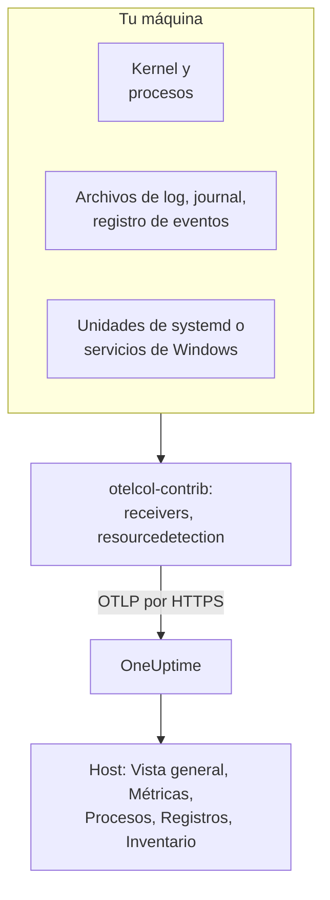

# Colector OpenTelemetry en el host

Ejecuta el OpenTelemetry Collector en una máquina Linux, macOS o Windows para enviar sus métricas, procesos, logs y estados de servicio a OneUptime. La máquina aparece en **Productos → Infraestructura → Hosts** con sus propias páginas, sin ningún agente de OneUptime que instalar: el colector es la versión upstream `otelcol-contrib`. Los [monitores de hosts](/docs/monitor/host-monitor) alertan según lo que envía.

:::cards
- [Instala el colector](#instala-el-colector): Tres pasos en Linux, macOS o Windows.
- [Elige qué recopilar](#elige-qué-recopilar): Métricas, logs de archivos, el journal, registros de eventos y estados de servicio.
- [Atributos de inventario](#atributos-de-inventario-ip-mac-número-de-serie-fabricante-modelo-firmware): IP, MAC, número de serie, fabricante, modelo y firmware para tu CMDB.
- [Envía menos](#reducir-el-volumen-de-datos-recopilados): Menos líneas de log, intervalos más largos, menos series.
:::

## Cómo funciona

El colector lee la máquina a través de sus receivers, marca cada registro con la identidad de la máquina y lo envía a OneUptime por OTLP con tu clave de ingesta. OneUptime registra el host a partir de sus primeras métricas y va llenando sus páginas a medida que llegan los datos.



| Lo que ves en el host | De dónde sale |
| --- | --- |
| **Vista general** y **Métricas** | El receiver `hostmetrics`: CPU, memoria, discos, sistemas de archivos, red, carga, paginación. |
| **Procesos** | El scraper `process` de `hostmetrics`: un conjunto de series por proceso. |
| **Registros** | Los receivers `filelog`, `journald` y `windowseventlog`. |
| **Unidades de systemd** (Linux) | El receiver `systemd`. |
| **Servicios** (Windows) | El receiver `windows_service`. |
| El elemento de inventario | El procesador `resourcedetection`, más los [atributos que marcas](#atributos-de-inventario-ip-mac-número-de-serie-fabricante-modelo-firmware). |
| **Versión del agente** | `oneuptime.agent.version` en el procesador `resource`. |

Un host se registra cuando un lote que lleva `host.name` también lleva métricas de `hostmetrics` o `process`, o un atributo `os.type`. El procesador `resourcedetection` los establece todos, por eso cada configuración lo pone primero. `host.id` o `host.arch` por sí solos no registran un host, y la telemetría que lleva una identidad de Kubernetes (`k8s.cluster.name`, `k8s.node.name`, `k8s.pod.name`) se archiva en su clúster: supervisa los nodos de Kubernetes con el [agente de Kubernetes](/docs/telemetry/kubernetes-agent).

## Antes de empezar

- Una clave de ingesta. Crea una en **Ajustes del proyecto → Telemetría y APM → Claves de ingesta** y copia su valor. El colector la envía como el encabezado `x-oneuptime-token`.
- Derechos de administrador en la máquina: `sudo` en Linux y macOS, un PowerShell con privilegios elevados en Windows.
- HTTPS saliente desde la máquina hacia tu URL de OneUptime.
- La distribución contrib del colector, `otelcol-contrib`. La compilación core `otelcol` no tiene los receivers ni los procesadores que usan estas configuraciones. El receiver `systemd` (Linux) funciona desde la v0.143.0 y el receiver `windows_service` (Windows) desde la v0.155.0; los comandos de abajo instalan la v0.161.0, la versión que fija OneUptime.

## Instala el colector

:::steps
### Guarda la configuración

Guarda esto como `config.yaml` en la carpeta desde la que ejecutarás los comandos de instalación y reemplaza `YOUR_TELEMETRY_INGESTION_TOKEN` por tu clave de ingesta (y el endpoint por tu propia URL si usas autoalojamiento).

:::tabs
@tab Linux
```yaml title="config.yaml"
receivers:
  hostmetrics:
    collection_interval: 30s
    scrapers:
      cpu:
        metrics:
          system.cpu.utilization:
            enabled: true
          system.cpu.logical.count:
            enabled: true
      memory:
        metrics:
          system.memory.utilization:
            enabled: true
      disk:
      filesystem:
        metrics:
          system.filesystem.utilization:
            enabled: true
      load:
      network:
      paging:
      processes:
      process:
        mute_process_name_error: true
        mute_process_exe_error: true
        mute_process_io_error: true
        metrics:
          process.cpu.utilization:
            enabled: true
          process.memory.utilization:
            enabled: true

  # The systemd journal: every unit's logs, info and above.
  journald:
    directory: /var/log/journal
    priority: info

  # Powers the Systemd Units tab (otelcol-contrib v0.143.0+).
  systemd:
    collection_interval: 30s
    units: ["*.service"]
    metrics:
      systemd.service.cpu.time:
        enabled: false

processors:
  # Stamps host.name, host.id and os.type: this is how OneUptime attaches
  # telemetry to the host. Without it the host's pages stay empty.
  resourcedetection:
    detectors: [system, env]
    system:
      hostname_sources: [os]
      resource_attributes:
        host.name:
          enabled: true
        host.id:
          enabled: true
        host.arch:
          enabled: true
        host.ip:
          enabled: true
        host.mac:
          enabled: true
        os.type:
          enabled: true
        os.description:
          enabled: true
        os.version:
          enabled: true
  # The collector release this config is for: the host's Agent Version.
  resource:
    attributes:
      - key: oneuptime.agent.version
        value: "0.161.0"
        action: upsert
  batch:

exporters:
  otlphttp/oneuptime:
    endpoint: https://oneuptime.com/otlp
    headers:
      x-oneuptime-token: YOUR_TELEMETRY_INGESTION_TOKEN

service:
  pipelines:
    metrics:
      receivers: [hostmetrics, systemd]
      processors: [resourcedetection, resource, batch]
      exporters: [otlphttp/oneuptime]
    logs:
      receivers: [journald]
      processors: [resourcedetection, resource, batch]
      exporters: [otlphttp/oneuptime]
```
@tab macOS
```yaml title="config.yaml"
receivers:
  hostmetrics:
    collection_interval: 30s
    scrapers:
      cpu:
        metrics:
          system.cpu.utilization:
            enabled: true
          system.cpu.logical.count:
            enabled: true
      memory:
        metrics:
          system.memory.utilization:
            enabled: true
      disk:
      filesystem:
        metrics:
          system.filesystem.utilization:
            enabled: true
      load:
      network:
      paging:
      processes:
      process:
        mute_process_name_error: true
        mute_process_exe_error: true
        mute_process_io_error: true
        metrics:
          process.cpu.utilization:
            enabled: true
          process.memory.utilization:
            enabled: true

  filelog/system:
    include:
      - /var/log/install.log
      - /var/log/wifi.log
    start_at: end

processors:
  # Stamps host.name, host.id and os.type: this is how OneUptime attaches
  # telemetry to the host. Without it the host's pages stay empty.
  resourcedetection:
    detectors: [system, env]
    system:
      hostname_sources: [os]
      resource_attributes:
        host.name:
          enabled: true
        host.id:
          enabled: true
        host.arch:
          enabled: true
        host.ip:
          enabled: true
        host.mac:
          enabled: true
        os.type:
          enabled: true
        os.description:
          enabled: true
        os.version:
          enabled: true
  # The collector release this config is for: the host's Agent Version.
  resource:
    attributes:
      - key: oneuptime.agent.version
        value: "0.161.0"
        action: upsert
  batch:

exporters:
  otlphttp/oneuptime:
    endpoint: https://oneuptime.com/otlp
    headers:
      x-oneuptime-token: YOUR_TELEMETRY_INGESTION_TOKEN

service:
  pipelines:
    metrics:
      receivers: [hostmetrics]
      processors: [resourcedetection, resource, batch]
      exporters: [otlphttp/oneuptime]
    logs:
      receivers: [filelog/system]
      processors: [resourcedetection, resource, batch]
      exporters: [otlphttp/oneuptime]
```
@tab Windows
```yaml title="config.yaml"
receivers:
  hostmetrics:
    collection_interval: 30s
    scrapers:
      cpu:
        metrics:
          system.cpu.utilization:
            enabled: true
          system.cpu.logical.count:
            enabled: true
      memory:
        metrics:
          system.memory.utilization:
            enabled: true
      disk:
      filesystem:
        metrics:
          system.filesystem.utilization:
            enabled: true
      load:
      network:
      paging:
      processes:
      process:
        mute_process_name_error: true
        mute_process_exe_error: true
        mute_process_io_error: true
        metrics:
          process.cpu.utilization:
            enabled: true
          process.memory.utilization:
            enabled: true

  windowseventlog/system:
    channel: System
    start_at: end

  windowseventlog/application:
    channel: Application
    start_at: end

  windowseventlog/security:
    channel: Security
    start_at: end

  # Powers the Services tab (otelcol-contrib v0.155.0+).
  windows_service:
    collection_interval: 30s

processors:
  # Stamps host.name, host.id and os.type: this is how OneUptime attaches
  # telemetry to the host. Without it the host's pages stay empty.
  resourcedetection:
    detectors: [system, env]
    system:
      hostname_sources: [os]
      resource_attributes:
        host.name:
          enabled: true
        host.id:
          enabled: true
        host.arch:
          enabled: true
        host.ip:
          enabled: true
        host.mac:
          enabled: true
        os.type:
          enabled: true
        os.description:
          enabled: true
        os.version:
          enabled: true
  # The collector release this config is for: the host's Agent Version.
  resource:
    attributes:
      - key: oneuptime.agent.version
        value: "0.161.0"
        action: upsert
  batch:

exporters:
  otlphttp/oneuptime:
    endpoint: https://oneuptime.com/otlp
    headers:
      x-oneuptime-token: YOUR_TELEMETRY_INGESTION_TOKEN

service:
  pipelines:
    metrics:
      receivers: [hostmetrics, windows_service]
      processors: [resourcedetection, resource, batch]
      exporters: [otlphttp/oneuptime]
    logs:
      receivers:
        - windowseventlog/system
        - windowseventlog/application
        - windowseventlog/security
      processors: [resourcedetection, resource, batch]
      exporters: [otlphttp/oneuptime]
```
:::

Cada configuración es la que el dashboard escribe en **Productos → Infraestructura → Hosts → Documentación**, con un pipeline de logs añadido: sus procesadores son `resourcedetection`, `resource` y `batch`, y su exporter es `otlphttp/oneuptime`. No establece ningún `service.name`, así que la telemetría del host pertenece al propio host y se archiva como `host/<hostname>`. Añade un `service.name` al procesador `resource` solo si quieres que se archive en un servicio de telemetría con ese nombre.

### Instala e inicia el colector

:::tabs
@tab Linux
En Debian o Ubuntu:

```bash
VERSION=0.161.0                      # the release OneUptime pins
ARCH=$(dpkg --print-architecture)   # amd64 or arm64

curl -fL -o /tmp/otelcol-contrib.deb \
  "https://github.com/open-telemetry/opentelemetry-collector-releases/releases/download/v${VERSION}/otelcol-contrib_${VERSION}_linux_${ARCH}.deb"
sudo dpkg -i /tmp/otelcol-contrib.deb
```

En RHEL, CentOS, Fedora o Amazon Linux:

```bash
VERSION=0.161.0
ARCH=$(uname -m | sed 's/x86_64/amd64/;s/aarch64/arm64/')

curl -fL -o /tmp/otelcol-contrib.rpm \
  "https://github.com/open-telemetry/opentelemetry-collector-releases/releases/download/v${VERSION}/otelcol-contrib_${VERSION}_linux_${ARCH}.rpm"
sudo rpm -Uvh /tmp/otelcol-contrib.rpm
```

El paquete instala `/usr/bin/otelcol-contrib` y una unidad de systemd, y la inicia con una configuración predeterminada. Coloca la tuya, permite que el usuario del colector lea el journal y reinícialo:

```bash
sudo install -m 0644 config.yaml /etc/otelcol-contrib/config.yaml
sudo usermod -aG systemd-journal otelcol-contrib
sudo systemctl enable otelcol-contrib
sudo systemctl restart otelcol-contrib
sudo systemctl status otelcol-contrib
```

La unidad empaquetada ejecuta el colector como el usuario sin privilegios `otelcol-contrib`. El grupo `systemd-journal` le permite leer el journal; para seguir archivos en `/var/log` (legibles por el grupo `adm` en Debian y Ubuntu), añade también ese grupo. Para que el scraper `process` vea los procesos de otros usuarios, dale la capacidad `CAP_SYS_PTRACE`.
@tab macOS
```bash
VERSION=0.161.0
ARCH=$(uname -m | sed 's/x86_64/amd64/')   # arm64 on Apple silicon, amd64 on Intel

curl -fL -o /tmp/otelcol-contrib.tar.gz \
  "https://github.com/open-telemetry/opentelemetry-collector-releases/releases/download/v${VERSION}/otelcol-contrib_${VERSION}_darwin_${ARCH}.tar.gz"

sudo mkdir -p /usr/local/otelcol-contrib /usr/local/bin /etc/otelcol-contrib
sudo tar -xzf /tmp/otelcol-contrib.tar.gz -C /usr/local/otelcol-contrib
sudo ln -sf /usr/local/otelcol-contrib/otelcol-contrib /usr/local/bin/otelcol-contrib
sudo install -m 0644 config.yaml /etc/otelcol-contrib/config.yaml
```

Crea `/Library/LaunchDaemons/com.oneuptime.otelcol-contrib.plist` para que launchd inicie el colector con el Mac y lo reinicie si se detiene:

```xml title="/Library/LaunchDaemons/com.oneuptime.otelcol-contrib.plist"
<?xml version="1.0" encoding="UTF-8"?>
<!DOCTYPE plist PUBLIC "-//Apple//DTD PLIST 1.0//EN" "http://www.apple.com/DTDs/PropertyList-1.0.dtd">
<plist version="1.0">
<dict>
  <key>Label</key><string>com.oneuptime.otelcol-contrib</string>
  <key>ProgramArguments</key>
  <array>
    <string>/usr/local/bin/otelcol-contrib</string>
    <string>--config=/etc/otelcol-contrib/config.yaml</string>
  </array>
  <key>RunAtLoad</key><true/>
  <key>KeepAlive</key><true/>
  <key>StandardOutPath</key><string>/var/log/otelcol-contrib.out.log</string>
  <key>StandardErrorPath</key><string>/var/log/otelcol-contrib.err.log</string>
</dict>
</plist>
```

Cárgalo:

```bash
sudo launchctl load -w /Library/LaunchDaemons/com.oneuptime.otelcol-contrib.plist
sudo launchctl list | grep otelcol-contrib
```

Usa este tarball, no Homebrew: la fórmula de Homebrew es la compilación core, que se niega a arrancar con esta configuración.
@tab Windows
Desde un PowerShell con privilegios elevados, en la carpeta que contiene `config.yaml`, ejecuta este bloque completo: cada línea depende de las variables anteriores.

```powershell
$VERSION = "0.161.0"                          # the release OneUptime pins; v0.155.0+ has the Services tab
$ARCH    = "amd64"                            # use "arm64" on ARM hosts
$dest    = "C:\Program Files\otelcol-contrib"
$tar     = "$env:TEMP\otelcol-contrib.tar.gz"

# Note the "-contrib" in the asset name; otelcol_... is the wrong archive.
$url = "https://github.com/open-telemetry/opentelemetry-collector-releases/releases/download/v$VERSION/otelcol-contrib_${VERSION}_windows_${ARCH}.tar.gz"

New-Item -ItemType Directory -Force -Path $dest | Out-Null
Invoke-WebRequest -Uri $url -OutFile $tar
tar -xf $tar -C $dest                          # tar.exe ships with Windows 10 1803+ / Server 2019+
Get-ChildItem $dest                            # expect otelcol-contrib.exe, not otelcol.exe
Copy-Item config.yaml "$dest\config.yaml" -Force

# --% hands the rest of the line to sc.exe unchanged, so its quoting
# survives PowerShell — keep the command on one line.
sc.exe --% create "otelcol-contrib" binPath= "\"C:\Program Files\otelcol-contrib\otelcol-contrib.exe\" --config=\"C:\Program Files\otelcol-contrib\config.yaml\"" start= auto DisplayName= "OpenTelemetry Collector (OneUptime)"
sc.exe description "otelcol-contrib" "Collects host telemetry and forwards it to OneUptime over OTLP."
sc.exe start "otelcol-contrib"
sc.exe query "otelcol-contrib"
```

El servicio se ejecuta como `LocalSystem`, que puede leer el registro de eventos `Security` y todos los servicios de Windows. En Windows, el scraper `load` solo emula una carga media a partir del contador *Processor Queue Length*, empezando en 0.

El nombre del recurso debe empezar por `otelcol-contrib_`. El archivo core `otelcol_<version>_windows_amd64.tar.gz` descomprime `otelcol.exe`, que no tiene los receivers `windowseventlog` ni `windows_service`; renombrarlo a `otelcol-contrib.exe` no los añade. ¿Prefieres un instalador? La misma [página de versiones](https://github.com/open-telemetry/opentelemetry-collector-releases/releases) tiene un `otelcol-contrib_<version>_windows_x64.msi` firmado, que registra el servicio por ti: apúntalo a este `config.yaml` y mantén el servicio en `LocalSystem`.
:::

### Comprueba que aparece el host

Abre **Productos → Infraestructura → Hosts → Todos los hosts**. El host aparece con su nombre de host en cuanto llegan las primeras métricas, normalmente en 30 segundos, y sus páginas **Vista general**, **Métricas**, **Procesos** y **Registros** se llenan. Si no aparece, lee los logs del propio colector:

:::tabs
@tab Linux
```bash
sudo journalctl -u otelcol-contrib -f
```
@tab macOS
```bash
tail -f /var/log/otelcol-contrib.err.log
```
@tab Windows
```powershell
Get-WinEvent -LogName Application -MaxEvents 20 | Where-Object ProviderName -eq "otelcol-contrib"
```
:::
:::

Para generar una línea de log de prueba, ejecuta `logger "hello from oneuptime"` (Linux, macOS) o `eventcreate /T INFORMATION /ID 999 /L APPLICATION /SO OneUptimeTest /D "hello from oneuptime"` (Windows, con privilegios elevados) y luego mira la página **Registros** del host.

## Elige qué recopilar

Todas las configuraciones siguen la misma forma: receivers para lo que hay que leer, los procesadores `resourcedetection`, `resource` y `batch`, y el exporter `otlphttp/oneuptime`. Añade los receivers de abajo a `receivers:` y a su pipeline, y luego reinicia el colector (`sudo systemctl restart otelcol-contrib`, `launchctl unload` y `load` en un Mac, `Restart-Service otelcol-contrib` en Windows). Combina cada fragmento con las secciones que ya tiene tu configuración: una segunda clave `processors:` o `service:` reemplaza a la primera.

### Métricas del host

`hostmetrics` funciona en todos los sistemas operativos. Lee CPU, memoria, discos, sistemas de archivos, red, carga, paginación y procesos del kernel, cada `collection_interval`. Las métricas `*.utilization` y `system.cpu.logical.count` están desactivadas por defecto en el receiver, y los gráficos del host y las plantillas de alerta de Host las leen, así que mantenlas activadas como hacen las configuraciones de arriba. El scraper `process` alimenta la página **Procesos**; también es la mayor fuente de series (consulta [Envía menos](#reducir-el-volumen-de-datos-recopilados)).

En Linux, el colector lee `/proc` y `/sys`. Un colector en un contenedor debe montar los del host y establecer `HOST_PROC` y `HOST_SYS` (consulta [En un contenedor Docker](#en-un-contenedor-docker)); una instalación nativa no necesita nada.

### Logs de archivos

Sigue cualquier archivo de log del disco con un receiver `filelog` y añádelo al pipeline `logs`:

```yaml
receivers:
  filelog/app:
    include:
      - /var/log/myapp/*.log
    start_at: end
    multiline:
      # A new entry starts with a timestamp; continuation lines (the
      # "at ...", "File ...", "Caused by: ..." frames) are folded into it.
      line_start_pattern: '^\d{4}-\d{2}-\d{2}[ T]\d{2}:\d{2}:\d{2}'
```

`start_at: end` lee solo las líneas nuevas; usa `beginning` para leer los archivos desde el principio en la primera ejecución. El colector recuerda su posición en cada archivo, así que continúa correctamente después de un reinicio.

OneUptime busca stack traces en las líneas de log de error y fatales y las agrupa en **Excepciones**, bajo el host. Para ello, un stack trace de varias líneas (Java, Python, .NET, Ruby) debe llegar como un solo registro, que es lo que hace `multiline`; sin él, cada frame es un log independiente. Si tu aplicación puede escribir ella misma los atributos de OpenTelemetry `exception.type`, `exception.message` y `exception.stacktrace`, es aún más fiable.

En un host con systemd, `/var/log/syslog` y `/var/log/messages` repiten lo que ya contiene el journal, así que lee uno u otro.

### Journal de systemd

En un host con systemd, el receiver `journald` lee los logs de todas las unidades en un solo lugar, con sus campos estructurados. La configuración de Linux de arriba los lee todos desde `info`; limítalo a algunas unidades:

```yaml
receivers:
  journald:
    directory: /var/log/journal
    units:
      # Drop this list to ingest everything; restrict it to limit volume.
      - ssh.service
      - cron.service
      - nginx.service
    priority: info
```

El receiver ejecuta `journalctl`, que tiene cualquier host con systemd, y el usuario del colector debe estar en el grupo `systemd-journal`.

### Servicios de Linux (unidades de systemd, métricas)

La página **Unidades de systemd** del host enumera cada unidad y su estado, a partir del [`systemdreceiver`](https://github.com/open-telemetry/opentelemetry-collector-contrib/tree/main/receiver/systemdreceiver) (tipo de configuración `systemd`), el equivalente en Linux de la página **Servicios** de Windows. La configuración de Linux de arriba lo activa:

```yaml
receivers:
  systemd:
    collection_interval: 30s
    # The service manager to read: "system" (default) or "user".
    scope: system
    # Which units to scrape, as systemctl unit patterns. The default is
    # every service; widen it to include timers, sockets or mounts, or
    # narrow it to cut volume on hosts with hundreds of units:
    units: ["*.service"]
    # units: [nginx.service, postgresql.service, "*.timer"]
    metrics:
      # Per-service CPU time is on by default and doubles this receiver's
      # datapoint count. The Systemd Units tab does not use it, so turn it
      # off unless you chart it. On v0.142.0 the key is
      # systemd.unit.cpu.time — naming a metric the running build does not
      # have stops the collector at startup.
      systemd.service.cpu.time:
        enabled: false

service:
  pipelines:
    metrics:
      receivers: [hostmetrics, systemd]
      processors: [resourcedetection, resource, batch]
```

El receiver se publicó por primera vez en `otelcol-contrib` v0.142.0, y la v0.143.0 es la primera versión que vale la pena ejecutar. En cualquier versión anterior, añadir `systemd` falla al arrancar con `'receivers' unknown type: "systemd"`; solo la v0.142.0 llama a su métrica de CPU `systemd.unit.cpu.time` y busca estadísticas de cgroup en todas las unidades, lo que registra un error de scrape por cada unidad que no es `.service`.

Emite `systemd.unit.state` como un conjunto de estados: en cada scrape, cada unidad recibe un punto de datos por cada estado posible (`active`, `reloading`, `inactive`, `failed`, `activating`, `deactivating`, `maintenance`, `refreshing`), `1` para el estado en que se encuentra y `0` para el resto. El nombre de la unidad es el atributo de recurso `systemd.unit.name` y el estado, el atributo de punto de datos `systemd.unit.active_state`. Como el nombre de la unidad es un atributo de recurso, `resourcedetection` debe permanecer en el pipeline de métricas: marca `host.name` en el recurso de cada unidad y, sin él, las muestras nunca se asocian a un host.

Lee el estado de las unidades a través del D-Bus del sistema, con las llamadas de solo lectura que hace `systemctl list-units`, que systemd permite sin privilegios. Así que el servicio empaquetado, que se ejecuta como el usuario `otelcol-contrib` y no como root, no necesita derechos adicionales. Sí necesita el bus: un colector en un contenedor no tiene `/run/dbus/system_bus_socket` a menos que montes el del host, así que usa una instalación nativa. El receiver está en fase alfa y solo funciona en Linux.

> [!WARNING]
> El conjunto de estados cuesta ocho puntos de datos por unidad y scrape, y `systemd.service.cpu.time`, activada por defecto, añade dos más (`user` y `system`): 10 puntos de datos por unidad y scrape. Un host que sigue 300 unidades cada 30 segundos envía unos 6.000 puntos de datos por minuto solo desde este receiver, o unos 4.800 con la métrica de CPU desactivada. Limita `units:` a los servicios sobre los que alertas, o aumenta `collection_interval`, antes de activarlo en toda una flota.

### Apple Unified Log

macOS escribe sus logs del sistema en el Apple Unified Log, que se lee con `log show` y `log stream`, en lugar de en `/var/log/system.log`. Para recopilarlo, envíalo a un archivo con un pequeño script, `/usr/local/otelcol-contrib/log-stream.sh`:

```bash title="/usr/local/otelcol-contrib/log-stream.sh"
#!/bin/bash
exec /usr/bin/log stream --style ndjson --level info \
  --predicate 'subsystem != "com.apple.cfnetwork"' \
  >> /var/log/apple-unified.log
```

Hazlo ejecutable y ejecútalo con launchd (o `nohup` para una prueba rápida), y luego apunta un receiver `filelog` al archivo:

```yaml
receivers:
  filelog/apple-unified:
    include:
      - /var/log/apple-unified.log
    start_at: end
    operators:
      - type: json_parser
        timestamp:
          parse_from: attributes.timestamp
          layout: "%Y-%m-%d %H:%M:%S.%f%j"
```

Muchas flotas de Mac funcionan bien con métricas del host y unos pocos logs de archivos, sin el log unificado.

### Registros de eventos de Windows

La configuración de Windows de arriba se suscribe a los canales `System`, `Application` y `Security`. Para limitar el canal `Security`, de gran volumen, a algunos ID de evento:

```yaml
windowseventlog/security:
  channel: Security
  start_at: end
  query: "*[System[(EventID=4625 or EventID=4740)]]"
```

Para leer otro canal (cualquiera bajo *Event Viewer → Applications and Services Logs*), usa su nombre exacto:

```yaml
windowseventlog/iis:
  channel: Microsoft-IIS-Logging/Logs
  start_at: end
```

### Servicios de Windows (métricas)

La página **Servicios** del host enumera cada servicio de Windows con su estado y tipo de inicio, a partir del [`windowsservicereceiver`](https://github.com/open-telemetry/opentelemetry-collector-contrib/tree/main/receiver/windowsservicereceiver) (tipo de configuración `windows_service`). Se incluye en `otelcol-contrib` desde la v0.155.0: en versiones anteriores, añadir `windows_service` falla al arrancar con `'receivers' unknown type: "windows_service"`. La configuración de Windows de arriba lo activa:

```yaml
receivers:
  windows_service:
    collection_interval: 30s
    # Collect every service by default. To cut volume — and avoid the
    # "access denied" noise from services the collector can't open —
    # list just the ones you care about:
    # include_services: [Spooler, W3SVC, MSSQLSERVER]
    # Or collect everything except a few:
    # exclude_services: [TrustedInstaller]

service:
  pipelines:
    metrics:
      receivers: [hostmetrics, windows_service]
```

Emite un gauge `windows.service.status` por servicio, el estado del servicio Win32 (`4` es en ejecución, `1` es detenido), con los atributos `name` y `startup_mode`. El colector lee todos los servicios como `LocalSystem` y omite los que no puede abrir. El receiver está en fase alfa y solo funciona en Windows; si un error de scrape o un `access denied` en un servicio afecta a los demás, restríngelo con `include_services`.

`include_services` solo puede reducir el conjunto. Si enumeras servicios y sigues viéndolos todos, la configuración editada no ha llegado al colector en ejecución: reinicia el servicio, comprueba que `include_services` es una lista con elementos y la misma sangría que `collection_interval`, y dale a la página **Servicios** unos minutos, hasta que los servicios notificados antes del cambio salgan de su ventana móvil. Los nombres son los nombres de clave exactos del servicio, que distinguen mayúsculas y minúsculas (`Spooler`, `W3SVC`), y que `Get-Service | Select-Object Name` enumera.

### Etiquetas

Cualquier atributo de recurso que empiece por `oneuptime.label.` se convierte en una etiqueta del proyecto en el host: `oneuptime.label.<dimension>=<value>` es la etiqueta `<dimension>:<value>`. Añade un procesador para ellas y nómbralo en los pipelines:

```yaml
processors:
  resource/oneuptime-labels:
    attributes:
      - key: oneuptime.label.team
        value: payments
        action: upsert
      - key: oneuptime.label.env
        value: production
        action: upsert

service:
  pipelines:
    metrics:
      processors: [resourcedetection, resource, resource/oneuptime-labels, batch]
```

Las etiquetas se comparan sin distinguir mayúsculas y minúsculas, así que se reutiliza una etiqueta `Production` existente en lugar de duplicarla, y el colector nunca elimina las etiquetas añadidas en OneUptime.

### Atributos de inventario (IP, MAC, número de serie, fabricante, modelo, firmware)

Cada host recibe también un elemento de inventario: el registro que lee una exportación a una CMDB. Sus detalles se rellenan directamente a partir de los atributos de recurso de la telemetría que envías, así que lo que llega es lo que puede extraer una sincronización con una CMDB.

| Lo que quieres | Atributo | De dónde sale |
| --- | --- | --- |
| Direcciones IP | `host.ip` | `resourcedetection`, unidas por comas cuando la máquina tiene varias |
| Direcciones MAC | `host.mac` | `resourcedetection`, una por interfaz activa, unidas por comas |
| Arquitectura | `host.arch` | `resourcedetection` |
| ID de la máquina | `host.id` | `resourcedetection`: el GUID de la máquina en Windows, `/etc/machine-id` en Linux |
| SO | `os.type`, `os.description`, `os.version` | `resourcedetection` |
| Número de serie | `host.serial_number` | Lo marcas tú, desde WMI o DMI |
| Fabricante | `device.manufacturer` | Lo marcas tú, desde WMI o DMI |
| Modelo | `device.model.name` | Lo marcas tú, desde WMI o DMI |
| Versión del firmware (BIOS o UEFI) | `device.firmware.version` | Lo marcas tú, desde WMI o DMI |

Las configuraciones de arriba activan todos los atributos detectados: en el detector system solo `host.name` y `os.type` están activados por defecto, por eso enumeran los demás en `resource_attributes`. Si creas tu propia configuración, conserva ese bloque `resourcedetection`: sin él no hay `host.name`, y por tanto ni host ni elemento de inventario.

#### El número de serie, el fabricante, el modelo y la versión del firmware no tienen detector

Están en el firmware de la máquina, que el colector no lee. En Linux no es un ajuste que puedas cambiar: el colector empaquetado se ejecuta como el usuario sin privilegios `otelcol-contrib`, y `/sys/class/dmi/id/product_serial` solo lo puede leer root. Así que léelos una vez, cuando se aprovisiona la máquina, y márcalos en el recurso con un procesador propio:

```yaml
processors:
  resource/oneuptime-hardware:
    attributes:
      - key: host.serial_number
        value: "7XYZ123"
        action: upsert
      - key: device.manufacturer
        value: "Dell Inc."
        action: upsert
      - key: device.model.name
        value: "OptiPlex 7090"
        action: upsert
      - key: device.firmware.version
        value: "1.21.0"
        action: upsert

service:
  pipelines:
    metrics:
      processors: [resourcedetection, resource, resource/oneuptime-hardware, batch]
```

Añade `resource/oneuptime-hardware` a la lista de procesadores que ya tienes, en lugar de pegar esta línea encima: si quitas `resource`, el host pierde su **Versión del agente**. En cualquier caso, mantén `resourcedetection` en primer lugar: es lo que asocia el lote al host.

`host.manufacturer`, `host.model.name`, `host.firmware.version` y `host.bios.version` se aceptan como grafías alternativas y se guardan con las claves `device.*` de arriba, así que una configuración escrita de cualquiera de las dos formas acaba en el mismo sitio; cuando están ambas, gana el valor `device.*`. El número de serie va en sentido contrario: `device.serial_number` se acepta y se guarda como `host.serial_number`.

> [!NOTE]
> En un recurso sin identidad de host, `device.manufacturer` significa "aplicación móvil": es uno de los atributos que marcan un lote como Real User Monitoring móvil. El recurso de un host siempre lleva `host.name` o `host.id`, así que una configuración del colector como la de arriba nunca se confunde con un teléfono, pero no reutilices el mismo bloque en la configuración del SDK de una aplicación móvil.

#### Leer los valores

En Windows, desde un PowerShell con privilegios elevados. Imprime el bloque YAML de la máquina en la que lo ejecutas:

```powershell
$bios = Get-CimInstance -ClassName Win32_BIOS
$cs   = Get-CimInstance -ClassName Win32_ComputerSystem

# Quote for YAML: trim, escape any embedded quote, wrap in single quotes.
# The cast to string first is what keeps this working on machines whose
# firmware leaves a field empty — .Trim() on $null throws.
function Format-YamlValue($value) {
  "'" + ("$value".Trim() -replace "'", "''") + "'"
}

@"
  resource/oneuptime-hardware:
    attributes:
      - key: host.serial_number
        value: $(Format-YamlValue $bios.SerialNumber)
        action: upsert
      - key: device.manufacturer
        value: $(Format-YamlValue $cs.Manufacturer)
        action: upsert
      - key: device.model.name
        value: $(Format-YamlValue $cs.Model)
        action: upsert
      - key: device.firmware.version
        value: $(Format-YamlValue $bios.SMBIOSBIOSVersion)
        action: upsert
"@
```

Imprime una entrada de procesador, ya con sangría: añádela dentro del bloque `processors:` que tienes, no como una segunda clave `processors:`. Usa `Get-CimInstance`, no el obsoleto `Get-WmiObject`, que PowerShell 7 y posteriores ya no tienen. Un campo que el firmware deja vacío se imprime como `''`: elimina ese atributo en lugar de enviar uno en blanco. Las máquinas virtuales a menudo no tienen ningún número de serie.

En Linux, como root:

```bash
cat /sys/class/dmi/id/product_serial   # host.serial_number
cat /sys/class/dmi/id/sys_vendor       # device.manufacturer
cat /sys/class/dmi/id/product_name     # device.model.name
cat /sys/class/dmi/id/bios_version     # device.firmware.version
```

`bios_version` es el único de los cuatro que puede leer cualquier usuario. En máquinas sin `/sys/class/dmi`, `dmidecode -s system-serial-number`, `-s system-manufacturer`, `-s system-product-name` y `-s bios-version` devuelven los mismos valores. Las máquinas virtuales informan aquí de su hipervisor (`QEMU`, `VMware, Inc.`, `Amazon EC2`), que suele ser lo que quieres en una CMDB.

En un Mac:

```bash
ioreg -l | awk -F'"' '/IOPlatformSerialNumber/{print $4}'   # host.serial_number
sysctl -n hw.model                                          # device.model.name
system_profiler SPHardwareDataType | awk -F': ' '/System Firmware Version/{print $2}'   # device.firmware.version
```

El fabricante es `Apple Inc.` `hw.model` devuelve el identificador del modelo, como `Mac14,7` o `MacBookPro18,3`, no el nombre comercial, que el Mac no informa: asigna el identificador en tu CMDB si necesitas uno. Ponlo de todos modos en `device.model.name`: `device.model.identifier` marca un lote como aplicación móvil, lleve lo que lleve, así que un Mac marcado con él se archiva como un teléfono y se separa de su host.

#### Usar variables de entorno en su lugar

El detector `env` está activado, así que `OTEL_RESOURCE_ATTRIBUTES` funciona en lugar del procesador:

```text
OTEL_RESOURCE_ATTRIBUTES=host.serial_number=7XYZ123,device.manufacturer=Dell%20Inc.,device.model.name=OptiPlex%207090
```

Codifica cada valor en formato porcentual. La variable se lee como una lista de `key=value` de W3C Baggage, donde `,` y `=` separan las entradas y los espacios no son portables entre versiones del colector; las comillas no ayudan, y `device.manufacturer="Dell Inc."` puede llegar con las comillas en el valor. En Windows, `[System.Uri]::EscapeDataString($value)` codifica un valor.

Establécela en el propio servicio del colector, nunca en toda la máquina:

- **Linux:** `sudo systemctl edit otelcol-contrib` y luego una sección `[Service]` con `Environment="OTEL_RESOURCE_ATTRIBUTES=…"`.
- **Windows:** el valor `Environment` (de tipo `REG_MULTI_SZ`) bajo `HKLM\SYSTEM\CurrentControlSet\Services\otelcol-contrib`. `sc.exe create` no puede establecer variables de entorno de servicio, y `setx` establece una variable que el servicio en ejecución nunca vuelve a leer.

> [!WARNING]
> No la establezcas en toda la máquina (`setx /M`, `/etc/environment`). Todos los procesos con un SDK de OpenTelemetry en la máquina heredan `OTEL_RESOURCE_ATTRIBUTES`, así que tus aplicaciones informarían del `device.manufacturer` de la máquina como propio, y un recurso de aplicación con `device.manufacturer` y sin `host.name` ni `host.id` se interpreta como una aplicación móvil, lo que lo separa de su servicio.

Es más fácil acertar con el procesador: por su diseño se limita al colector, y los valores nunca cambian para una máquina. Prefiérelo, salvo que ya generes archivos de entorno con plantillas.

#### Una dirección MAC no es un valor marcado

`host.mac` viene del detector `system`, igual que `host.ip`: una dirección por cada interfaz de red activa, sin incluir loopback, en la forma IEEE que especifica OpenTelemetry (`AC-DE-48-23-45-67`). Una máquina que ejecuta Docker o Hyper-V informa también de sus conmutadores virtuales, por eso el valor es una lista. Se omite una interfaz que informa del marcador de posición todo a ceros (`00-00-00-00-00-00`).

Nada en la máquina informa de una versión de firmware disponible como actualización, así que OneUptime registra la versión instalada.

#### Comprobar que funcionó

Abre el elemento del host en **Productos → Inventario** y mira su tarjeta **Detalles del activo**. Los valores aparecen a los pocos minutos del siguiente lote; un detalle que el colector no ha informado aparece como desconocido, con un enlace a esta sección. Como se marcan en lugar de detectarse, no se actualizan solos: vuelve a marcarlos tras un cambio de placa base, una actualización del firmware o una reinstalación.

## Otras formas de ejecutar el colector

### En un contenedor Docker

Ejecuta el colector en un contenedor que vea los procesos y sistemas de archivos del host, desde la carpeta que contiene `config.yaml`:

```bash
docker run -d \
  --name otel-collector \
  --restart unless-stopped \
  --network host \
  --pid host \
  -v $(pwd)/config.yaml:/etc/otelcol-contrib/config.yaml:ro \
  --volume /:/hostfs:ro,rslave \
  -e HOST_PROC=/hostfs/proc \
  -e HOST_SYS=/hostfs/sys \
  -e HOST_ETC=/hostfs/etc \
  -e HOST_VAR=/hostfs/var \
  -e HOST_RUN=/hostfs/run \
  -e HOST_DEV=/hostfs/dev \
  otel/opentelemetry-collector-contrib:0.161.0 \
  --config /etc/otelcol-contrib/config.yaml
```

`--network host`, `--pid host`, el montaje `/hostfs` y las variables `HOST_*` permiten que `hostmetrics` y `process` lean el kernel del host en lugar del del contenedor. Usa solo el pipeline de métricas de la configuración: la imagen no tiene `journalctl`, y el receiver `systemd` necesita el D-Bus del host.

### Desde el tarball de la versión

Donde los paquetes no son una opción, descomprime el binario estático y dale su propia unidad de systemd:

```bash
VERSION=0.161.0
ARCH=$(uname -m | sed 's/x86_64/amd64/;s/aarch64/arm64/')

curl -fL -o /tmp/otelcol.tar.gz \
  "https://github.com/open-telemetry/opentelemetry-collector-releases/releases/download/v${VERSION}/otelcol-contrib_${VERSION}_linux_${ARCH}.tar.gz"
sudo mkdir -p /opt/otelcol-contrib
sudo tar -xzf /tmp/otelcol.tar.gz -C /opt/otelcol-contrib
sudo install -m 0644 config.yaml /opt/otelcol-contrib/config.yaml
```

```ini title="/etc/systemd/system/otelcol-contrib.service"
[Unit]
Description=OpenTelemetry Collector
After=network.target

[Service]
ExecStart=/opt/otelcol-contrib/otelcol-contrib --config /opt/otelcol-contrib/config.yaml
Restart=on-failure
RestartSec=5s
User=root

[Install]
WantedBy=multi-user.target
```

```bash
sudo systemctl daemon-reload
sudo systemctl enable --now otelcol-contrib
```

`User=root` permite que esta unidad lea todos los archivos de log y todos los procesos; la instalación empaquetada de arriba es la alternativa sin privilegios.

### En nodos de Kubernetes

Los nodos de Kubernetes no son hosts en OneUptime: su telemetría lleva una identidad de Kubernetes y se archiva en el clúster. Instala el [agente de Kubernetes](/docs/telemetry/kubernetes-agent): cada nodo aparece en la página **Nodos** de su clúster, junto a sus pods.

## Actualizar el colector

Cada configuración de esta página marca la versión del colector para la que está hecha como `oneuptime.agent.version`, en su procesador `resource`. OneUptime la muestra como la **Versión del agente** en la **Vista general** del host, con una señal de advertencia al lado cuando OneUptime fija una versión más nueva. Selecciona la señal para ver cómo actualizar según cómo instalaste.

Para actualizar a mano, instala la nueva versión de la misma forma en que instalaste esta, con la nueva `VERSION` (en Debian y Ubuntu, `sudo dpkg -i --force-confold` conserva tu configuración sin preguntar), establece `oneuptime.agent.version` en `config.yaml` a la misma versión y reinicia el colector. Un colector cuya configuración no marca ninguna versión no muestra ninguna, ni tampoco nunca una señal.

## Reducir el volumen de datos recopilados

La configuración es tuya, así que nada sale de la máquina a menos que lo lea un receiver que añadiste. Si un host envía más de lo que quieres (lo que se nota como más ingesta y, en OneUptime Cloud, más costo), recórtalo aquí. Las dos palancas más grandes son qué logs lees y con qué frecuencia recopilas métricas; un procesador `filter` hace el resto. Cambia una palanca cada vez y reinicia el colector después de cada edición.

### De dónde sale el volumen

| Señal | Factor principal | Redúcelo con |
| --- | --- | --- |
| Logs | Cada línea de cada archivo, unidad del journal o canal de eventos | Menos receivers, un `units:` o `query:` más acotado, un `filter` por severidad |
| Métricas del host | Con qué frecuencia recopilas, multiplicado por el número de series | Un `collection_interval` más largo, menos scrapers |
| Cardinalidad de métricas | Métricas por proceso: un conjunto de series por proceso | Omitir o acotar el scraper `process` |
| Unidades de systemd | 10 puntos de datos por unidad y scrape (conjunto de estados y CPU) | Un `units:` más acotado, la métrica de CPU desactivada, un `collection_interval` más largo |

### Lee solo los logs que necesitas

Los logs son casi siempre la mayor parte, y el colector solo lee lo que enumeras, así que enumera menos:

- Apunta `filelog` a archivos concretos, no a globs amplios: `/var/log/myapp/error.log` en lugar de `/var/log/**`.
- Limita `journald` a las unidades que te interesan y sube `priority` para descartar `info` y `debug` antes de que salgan de la máquina:

```yaml
receivers:
  journald:
    directory: /var/log/journal
    units:
      - ssh.service
      - nginx.service
    priority: warning # info and debug are dropped before export
```

- Limita el canal de eventos `Security`, de gran volumen, a los ID de evento que auditas con una `query:` (como en [Registros de eventos de Windows](#registros-de-eventos-de-windows)), o descarta el canal.

### Recopila métricas con menos frecuencia

El volumen de `hostmetrics` crece con `collection_interval`: si una resolución de 30 segundos es más de lo que necesitas, 60 segundos reduce los puntos de datos a la mitad.

```yaml
receivers:
  hostmetrics:
    collection_interval: 60s
```

### Acota el scraper por proceso

El scraper `process` emite un conjunto de series por cada proceso en ejecución, así que en una máquina con mucha actividad es la mayor fuente de series. Omítelo si no necesitas la página **Procesos**, o limítalo a los procesos que importan (mantén `processes`, un puñado de recuentos de procesos, en cualquier caso):

```yaml
receivers:
  hostmetrics:
    collection_interval: 60s
    scrapers:
      cpu:
      memory:
      disk:
      filesystem:
      network:
      load:
      paging:
      processes: # aggregate counts only — cheap
      process:
        mute_process_name_error: true
        mute_process_exe_error: true
        mute_process_io_error: true
        include:
          names: [nginx, postgres, node]
          match_type: strict
```

Esto reduce el receiver a sus métricas predeterminadas: vuelve a poner los bloques `metrics:` de las configuraciones de arriba bajo `cpu`, `memory`, `filesystem` y `process` si usas los gráficos del host y las plantillas de alerta de Host.

### Acota las unidades de systemd

El receiver `systemd` envía un punto de datos por estado y unidad en cada scrape, ocho por unidad, más dos por `systemd.service.cpu.time`, activada por defecto, así que su volumen depende de cuántas unidades coincidan con `units:`. El valor predeterminado `["*.service"]` incluye las decenas de unidades de un solo uso que nunca cambian de estado. Enumera las unidades sobre las que alertas y desactiva la métrica de CPU salvo que la grafiques:

```yaml
receivers:
  systemd:
    collection_interval: 60s
    units: [nginx.service, postgresql.service, ssh.service]
    metrics:
      # On otelcol-contrib v0.142.0 this key is systemd.unit.cpu.time.
      systemd.service.cpu.time:
        enabled: false
```

Juntos, estos cambios llevan un host de 300 unidades de unos 6.000 puntos de datos por minuto a muy por debajo de 100. Las unidades que se quitan de la lista desaparecen de la página **Unidades de systemd** unos minutos después, cuando sus últimas muestras salen de su ventana móvil.

### Descarta registros con un procesador filter

Cuando quieres un receiver pero no toda su salida, añade un procesador [`filter`](https://github.com/open-telemetry/opentelemetry-collector-contrib/tree/main/processor/filterprocessor). Evalúa una condición [OTTL](https://github.com/open-telemetry/opentelemetry-collector-contrib/blob/main/pkg/ottl/README.md) y descarta cada registro que coincide, antes de enviar nada.

Descarta los logs por debajo de una severidad:

```yaml
processors:
  filter/drop-low-severity:
    error_mode: ignore
    logs:
      log_record:
        # Drop anything less severe than WARN (info, debug, trace).
        # The UNSPECIFIED guard is required — see the warning below.
        - "severity_number != SEVERITY_NUMBER_UNSPECIFIED and severity_number < SEVERITY_NUMBER_WARN"
```

> [!WARNING]
> Conserva la protección `UNSPECIFIED`. `SEVERITY_NUMBER_UNSPECIFIED` es `0` y `SEVERITY_NUMBER_WARN` es `13`, así que un simple `severity_number < SEVERITY_NUMBER_WARN` es verdadero para cada registro cuya severidad nunca se analizó. Un receiver `filelog` sencillo no analiza ninguna severidad de la línea, así que sin la protección la condición borra en silencio cada línea que lee, sin ningún error. Con la protección, los registros sin analizar se conservan y llegan con la severidad `Unspecified`, lo que te indica que lo que necesitas es un analizador de severidad.

Para filtrar bien los logs de archivos por severidad, analiza primero una con un operador [`severity_parser`](https://github.com/open-telemetry/opentelemetry-collector-contrib/blob/main/pkg/stanza/docs/operators/severity_parser.md) en el receiver:

```yaml
receivers:
  filelog/app:
    include:
      - /var/log/myapp/*.log
    start_at: end
    operators:
      # Pull a level out of lines like "2026-01-01 ERROR something broke".
      - type: regex_parser
        regex: '(?i)(?P<level>TRACE|DEBUG|INFO|WARN(?:ING)?|ERROR|FATAL)'
        parse_from: body
        # Lines with no recognisable level fall through unparsed rather
        # than being discarded, and are then kept by the guard above.
        on_error: send
      - type: severity_parser
        parse_from: attributes.level
        preset: default
        mapping:
          warn: warning
          error: err
          fatal: panic
```

En un host con systemd, el journal no necesita nada de esto: el `priority:` de `journald` filtra por nivel en el propio `journalctl`.

Descarta las métricas que no grafiques, por nombre exacto o por patrón:

```yaml
processors:
  filter/drop-metrics:
    error_mode: ignore
    metrics:
      metric:
        # Exact metric name.
        - 'name == "system.paging.faults"'
        # Or a whole family. IsMatch is RE2 and UNANCHORED, so anchor it
        # yourself with ^ when you mean "starts with".
        - 'IsMatch(name, "^system\\.paging\\.")'
```

Para enviar solo un conjunto fijo de métricas, invierte la condición: `filter` descarta lo que coincide, así que `not (...)` descarta todo lo que no nombraste. Mantén la condición en una sola línea:

```yaml
processors:
  filter/allowlist:
    error_mode: ignore
    metrics:
      metric:
        - 'not (name == "system.cpu.utilization" or name == "system.memory.utilization" or name == "system.filesystem.utilization")'
```

Una lista de permitidos es un martillo grande: lo que olvides nombrar desaparece, junto con los monitores construidos sobre ello. Prefiere descartar las pocas métricas que no quieres, u omitir el scraper que las genera: una métrica que nunca se recopila no cuesta nada filtrarla.

Luego añade el procesador a su pipeline, antes de `batch`:

```yaml
service:
  pipelines:
    metrics:
      receivers: [hostmetrics]
      processors: [filter/drop-metrics, resourcedetection, resource, batch]
      exporters: [otlphttp/oneuptime]
    logs:
      receivers: [journald]
      processors: [filter/drop-low-severity, resourcedetection, resource, batch]
      exporters: [otlphttp/oneuptime]
```

Un pipeline que nombra un procesador o exporter que la configuración no define detiene el colector al arrancar. Conserva `resourcedetection`, que asocia la telemetría al host, y `resource`, que informa de la versión del colector. `filter` es un procesador contrib, así que la compilación core rechaza esta configuración.

### Un punto de partida ligero

Un host solo con métricas, con un intervalo amplio y sin series por proceso, es la huella útil más pequeña:

```yaml title="config.yaml"
receivers:
  hostmetrics:
    collection_interval: 60s
    scrapers:
      cpu:
        metrics:
          system.cpu.utilization:
            enabled: true
          system.cpu.logical.count:
            enabled: true
      memory:
        metrics:
          system.memory.utilization:
            enabled: true
      disk:
      filesystem:
        metrics:
          system.filesystem.utilization:
            enabled: true
      load:
      network:
      paging:
      processes:

processors:
  # Stamps host.name, host.id and os.type: this is how OneUptime attaches
  # telemetry to the host. Without it the host's pages stay empty.
  resourcedetection:
    detectors: [system, env]
    system:
      hostname_sources: [os]
      resource_attributes:
        host.name:
          enabled: true
        host.id:
          enabled: true
        host.arch:
          enabled: true
        host.ip:
          enabled: true
        host.mac:
          enabled: true
        os.type:
          enabled: true
        os.description:
          enabled: true
        os.version:
          enabled: true
  # The collector release this config is for: the host's Agent Version.
  resource:
    attributes:
      - key: oneuptime.agent.version
        value: "0.161.0"
        action: upsert
  batch:

exporters:
  otlphttp/oneuptime:
    endpoint: https://oneuptime.com/otlp
    headers:
      x-oneuptime-token: YOUR_TELEMETRY_INGESTION_TOKEN

service:
  pipelines:
    metrics:
      receivers: [hostmetrics]
      processors: [resourcedetection, resource, batch]
      exporters: [otlphttp/oneuptime]
```

Vuelve a añadir un pipeline `logs`, con un receiver `filelog` o `journald` acotado, cuando lo necesites.

> [!CAUTION]
> Vigila lo que recortas. Un monitor de logs necesita que lleguen sus logs, así que filtrar una severidad o un canal silencia los monitores que lo vigilan, y las plantillas de alerta de Host necesitan las métricas `*.utilization`. Recorta los datos sobre los que no actúas, no los que vigila un monitor, y comprueba la reducción en **Ajustes del proyecto → Historial de uso** uno o dos días después (el uso se cuenta por día) antes de tirar de la siguiente palanca.

## OneUptime autoalojado y proxies

En un OneUptime autoalojado, apunta el exporter a tu propia instancia; usa `http://` y su puerto si solo admite HTTP:

```yaml
exporters:
  otlphttp/oneuptime:
    endpoint: https://your-oneuptime-host.example.com/otlp
    headers:
      x-oneuptime-token: YOUR_TELEMETRY_INGESTION_TOKEN
```

Detrás de un proxy, el colector usa las variables estándar `HTTPS_PROXY`, `HTTP_PROXY` y `NO_PROXY`. Establécelas en su servicio:

- **Linux:** un drop-in, `/etc/systemd/system/otelcol-contrib.service.d/proxy.conf`, con una sección `[Service]` y `Environment="HTTPS_PROXY=http://proxy.example.com:3128"`; luego `sudo systemctl daemon-reload` y reinicia el colector.
- **macOS:** un diccionario `EnvironmentVariables` en el plist.
- **Windows:** el valor `Environment` bajo `HKLM\SYSTEM\CurrentControlSet\Services\otelcol-contrib`.

## Agente de IA

El colector envía lo que informa un host; el **Agente de IA de host** permite que OneUptime AI pregunte al propio host mientras investiga un incidente o una alerta allí. Ejecuta comandos de solo lectura — `systemctl status nginx --no-pager -n 50`, `journalctl -u nginx -n 200 --no-pager`, `df -h`, `free -m`, `ps aux --sort=-%cpu`, `ss -tulpn` — y, solo si lo permites, aplica correcciones como reiniciar una unidad de systemd concreta. Es un contenedor Linux (imagen `oneuptime/resource-ai-agent:release`) con su propio instalador, que necesita Docker (el motor del sistema, no Docker rootless) y el plugin Docker Compose:

```bash
curl -fsSL https://raw.githubusercontent.com/OneUptime/oneuptime/master/agents/HostAIAgent/install.sh -o install.sh
sudo bash install.sh
```

- **Las investigaciones con IA están activadas por defecto.** En cuanto el agente se conecta, OneUptime AI investiga con él los incidentes y alertas de este host, y la **Vista general** del host muestra el estado del agente. Para detenerlo, establece `ONEUPTIME_AI_INVESTIGATION=false` donde se ejecuta el agente (**Cambiar** en **Lo que puede hacer la IA**, en la página del agente de IA, muestra cómo), o quita el agente.
- Se registra con `HOST_NAME`; déjalo vacío para usar el nombre de host propio del host, que es lo que este colector informa como `host.name` salvo que establezcas otro nombre. Ambos deben coincidir para que el agente atienda al host que creó este colector. Aparece en la página **Agente de IA** del host en OneUptime.
- Ejecuta los programas del propio host entrando en los namespaces del host con `nsenter`, así que se ejecuta con privilegios, como root, con `pid: host`: es root en el host. El límite es la política de comandos del agente: comandos de solo lectura salvo que establezcas `ONEUPTIME_AI_ALLOW_WRITES=true`, nunca un shell, `sudo` ni un programa fuera de su lista, y nunca él mismo, la unidad de este colector ni nada de `ONEUPTIME_AI_PROTECTED_TARGETS`.
- Con `ONEUPTIME_AI_ALLOW_WRITES=true`, `ONEUPTIME_AI_WRITE_TARGETS` (nombres completos de unidades como `nginx.service,app-*`) limita qué unidades puede tocar una corrección. `ONEUPTIME_AI_FIXES` indica cómo se ejecutan las correcciones — `ask-for-approval` (una persona aprueba cada una), `automatic` o `bypass-approval` — y la página del agente de IA lo muestra en solo lectura; el instalador escribe ambos desde su entorno en el `.env` del agente ([Lo que puede hacer la IA, según el agente](/docs/ai/infrastructure-ai-agents#what-ai-may-do-set-by-the-agent)).

Qué puede ejecutar, cómo funcionan las correcciones y cómo solucionar sus problemas: [Infrastructure AI Agents](/docs/ai/infrastructure-ai-agents#hosts).

## Solución de problemas

:::details No aparece ningún host en OneUptime
1. Lee los logs del colector en busca de errores de exportación (consulta [Comprueba que aparece el host](#comprueba-que-aparece-el-host)). Añade `service.telemetry.logs.level: debug` a la configuración para obtener más detalle.
2. Un HTTP `401` significa que la clave de ingesta falta, es incorrecta o ha caducado; `422` significa que se ha desactivado o es una clave de navegador, que no puede enviar telemetría de host. Crea una clave en **Ajustes del proyecto → Telemetría y APM → Claves de ingesta** y actualiza `x-oneuptime-token`.
3. Comprueba que la máquina puede llegar a OneUptime: `curl -v https://oneuptime.com/otlp` (o tu URL autoalojada) desde la misma máquina.
4. Mantén `resourcedetection` en el pipeline de métricas: establece `host.name`, que es como OneUptime reconoce el host.
:::

:::details El colector no puede leer el journal o un archivo de log
El colector empaquetado se ejecuta como el usuario sin privilegios `otelcol-contrib`. Añádelo al grupo que puede leer los logs y luego reinícialo: `sudo usermod -aG systemd-journal otelcol-contrib` para el journal, y el grupo `adm` para la mayor parte de `/var/log` en Debian y Ubuntu. Para `journald`, `journalctl` debe estar en el `PATH` del colector y `/var/log/journal` debe existir (`sudo systemd-tmpfiles --create --prefix /var/log/journal` lo crea).
:::

:::details El servicio de Windows falla con Error 2: The system cannot find the file specified
El Service Control Manager no encuentra el programa con el que se registró el servicio. Ejecuta `sc.exe qc "otelcol-contrib"` y compara `BINARY_PATH_NAME` con lo que hay en `C:\Program Files\otelcol-contrib`. Casi siempre se descargó el archivo core `otelcol_<version>_windows_amd64.tar.gz`: descomprime `otelcol.exe`, mientras que el servicio nombra `otelcol-contrib.exe`, que solo tiene el archivo `otelcol-contrib_<version>_...`. Vuelve a descargar el recurso contrib; no renombres `otelcol.exe`, lo que produce en su lugar el `1064` de abajo. La otra causa es un `binPath=` sin comillas: una ruta que pasa por `C:\Program Files` se parte en el espacio salvo que esté entre comillas exactamente como muestra el paso de instalación.
:::

:::details El servicio de Windows falla con Error 1064
El administrador de servicios inició el programa, pero el colector terminó durante el arranque. Un `otelcol.exe` renombrado hace esto: la compilación core no tiene receiver `windowseventlog` ni `windows_service`, así que rechaza la configuración. También lo hace una ruta de `--config` sin comillas, que se parte en el espacio de `Program Files`. Comprueba lo que tienes:

- `otelcol-contrib.exe --version` debería imprimir `otelcol-contrib version ...`; `otelcol version ...` es la compilación core, renombrada.
- `otelcol-contrib.exe components` debería enumerar `windowseventlog` y `windows_service` entre los receivers (no `hostmetrics`, que también tiene la compilación core).
- Ejecútalo en primer plano para ver el error real: `& "C:\Program Files\otelcol-contrib\otelcol-contrib.exe" --config="C:\Program Files\otelcol-contrib\config.yaml"`.
- *Event Viewer → Windows Logs → Application*, origen `otelcol-contrib`, registra el error de arranque que se tragó el administrador de servicios.
:::

:::details El registro de eventos Security devuelve acceso denegado
Al servicio le faltan derechos. Ejecútalo como `LocalSystem` (el valor predeterminado de `sc.exe create`), o concede a su cuenta el derecho de usuario *Manage auditing and security log*.
:::

:::details El receiver de systemd informa un error de D-Bus, o la página Unidades de systemd está vacía
- El colector no llega al bus del sistema: comprueba que `/run/dbus/system_bus_socket` existe y que el usuario del colector puede abrirlo; `systemctl list-units` ejecutado como ese usuario es la comprobación más rápida. No hace falta root. Un colector en un contenedor no ve ningún bus a menos que montes el socket del host.
- La página está vacía mientras el receiver funciona: mantén `resourcedetection` en el mismo pipeline de métricas. El receiver solo asocia `systemd.unit.name` al recurso de cada unidad, así que sin `resourcedetection` no hay `host.name` y las muestras nunca se asocian a un host.
- Un error de scrape por unidad, o un colector que se niega a arrancar por una métrica desconocida, es una diferencia de versiones: la v0.142.0 lee estadísticas de cgroup en todas las unidades y llama a su métrica de CPU `systemd.unit.cpu.time`; la v0.143.0 y posteriores solo leen servicios y la llaman `systemd.service.cpu.time`. Ejecuta la v0.143.0 o posterior y usa la clave que tiene tu compilación en cualquier ajuste de `metrics:`.
:::

:::details Los gráficos de CPU y memoria o las plantillas de alerta de Host no muestran datos
Leen `system.cpu.utilization`, `system.memory.utilization` y `system.filesystem.utilization`, que `hostmetrics` deja desactivadas salvo que las actives. Copia los bloques `metrics:` bajo `cpu`, `memory` y `filesystem` de las configuraciones de arriba en la tuya y reinicia el colector.
:::

:::details Demasiados datos o una factura alta
Consulta [Reducir el volumen de datos recopilados](#reducir-el-volumen-de-datos-recopilados): acota los receivers (canales de Windows, unidades de systemd, archivos de log), recopila con menos frecuencia, acota el scraper por proceso o descarta registros con un procesador `filter` antes de enviarlos.
:::

## Próximos pasos

:::cards
- [Monitor de hosts](/docs/monitor/host-monitor): Alerta sobre CPU, memoria, disco y procesos.
- [Monitor de registros](/docs/monitor/logs-monitor): Alerta sobre patrones de logs, como inicios de sesión fallidos en una ventana de 5 minutos.
- [Exportar a una CMDB](/docs/inventory/cmdb-sync): Envía los atributos de inventario a tu CMDB.
- [Monitor de servidor / VM](/docs/monitor/server-monitor): Vigila también la disponibilidad de un servidor desde fuera.
:::
