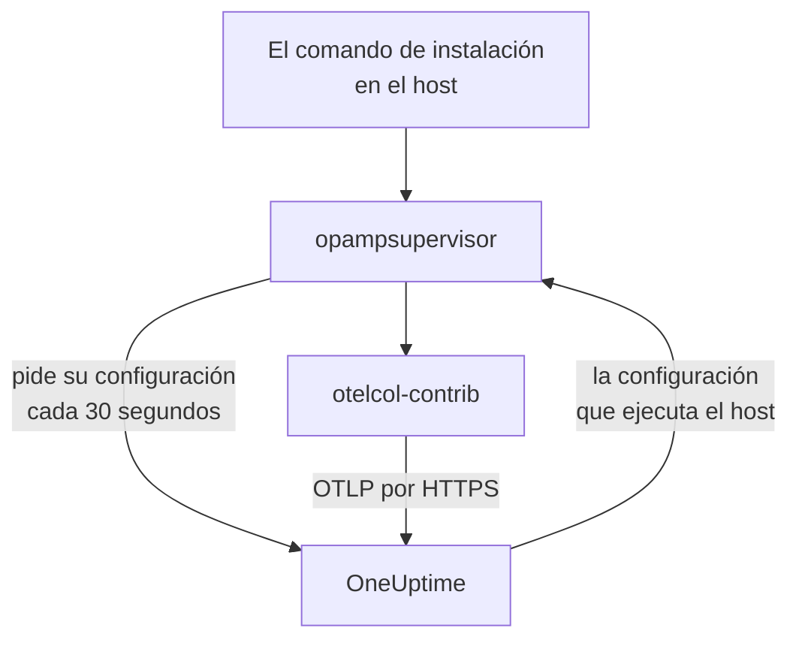

# Hosts

Añade una máquina Linux, Windows o macOS a OneUptime con un solo comando. El comando instala el OpenTelemetry Collector en el host, y OneUptime envía al recolector su configuración y la mantiene al día: no hay ningún `config.yaml` que escribir, copiar a cada host o mantener sincronizado. Para cambiar lo que recopilan tus hosts, edita una configuración del recolector una vez, y cada host al que se aplica recibe el cambio en menos de un minuto.

:::cards
- [Añadir un host](#añadir-un-host): Un comando en Linux, Windows o macOS.
- [Cambiar lo que recopilan los hosts](#cambiar-lo-que-recopilan-los-hosts): Configuraciones del recolector por sistema y etiqueta, con cada versión guardada.
- [Revisar el recolector de un host](#revisar-el-recolector-de-un-host): La configuración que ejecuta, su versión y por qué una configuración no arrancó.
- [Qué puede hacer una configuración](#qué-puede-hacer-una-configuración): Leer el host y enviar solo a esta instancia de OneUptime.
:::

## Cómo funciona

El comando instala dos programas de las versiones publicadas del OpenTelemetry Collector, cada uno comprobado con el SHA-256 que publica su versión: `otelcol-contrib`, el recolector que lee el host, y `opampsupervisor`, que ejecuta el recolector y lo mantiene en la configuración que OneUptime envía por OpAMP, el OpenTelemetry Agent Management Protocol. Ambos se ejecutan como el servicio `oneuptime-collector`.



El supervisor pide a OneUptime la configuración del host cada 30 segundos aproximadamente, con tu clave de ingesta, e informa de qué configuración ejecuta el host y de si arrancó. El host se registra en **Hosts** cuando el supervisor se conecta por primera vez, con el nombre de su máquina, y sus páginas se llenan a medida que llegan sus métricas y logs.

Cada host ejecuta una configuración, elegida en este orden:

| El host ejecuta | Cuándo |
| --- | --- |
| La configuración elegida para él en su página **Recolector** | Alguien eligió una. |
| La primera de las **Configuraciones del recolector** que se le aplica | Una configuración se aplica cuando es para el sistema del host y, si nombra etiquetas, el host tiene alguna de ellas. |
| La predeterminada de OneUptime para su sistema | No se aplica ninguna configuración. |

La predeterminada de OneUptime lee CPU, memoria, discos, sistemas de archivos, red y procesos en cualquier sistema; el journal y las unidades de systemd en Linux, donde el host los tiene; los registros de eventos System, Application y Security y los servicios de Windows en Windows; y los logs de instalación y de Wi-Fi de `/var/log` en macOS. Deja fuera los sistemas de archivos que están llenos por diseño, como los paquetes snap y el `/dev` de macOS, para que nunca mantengan disparada la plantilla High Filesystem Usage. Sigue las versiones de OneUptime, así que un host con la predeterminada recibe las mejoras que OneUptime le haga.

## Antes de empezar

- Una clave de ingesta. **Añadir host** crea una por ti, o elige una que hayas creado en **Ajustes del proyecto → Telemetría y APM → Claves de ingesta**.
- Permisos de administrador en el host: `sudo` en Linux y macOS, PowerShell ejecutado como administrador en Windows.
- Linux con systemd, Windows 10 o Windows Server 2019 y posteriores, o macOS con Apple Silicon o Intel.
- HTTPS saliente desde el host hasta tu URL de OneUptime, directo o a través de un proxy.

## Añadir un host

:::steps
### Abre Añadir host

Abre **Productos → Infraestructura → Hosts** y selecciona **Añadir host**. Elige qué ejecuta el host: Linux, Windows o macOS. Los nodos de un clúster de Kubernetes los supervisa el [Kubernetes Agent](/docs/telemetry/kubernetes-agent) en su lugar.

### Elige una clave de ingesta

Elige una clave o crea una desde el diálogo. El comando de abajo la incluye.

### Ejecuta el comando en el host

Copia el comando del diálogo y ejecútalo en el host. Tarda alrededor de un minuto. Estos son los mismos comandos, con tu URL de OneUptime y tu clave en lugar de los ejemplos:

:::tabs
@tab Linux
```bash
curl -fsSL https://oneuptime.com/docs/static/scripts/host-collector/install.sh | sudo sh -s -- --url https://oneuptime.com --key YOUR_INGESTION_KEY
```
@tab macOS
```bash
curl -fsSL https://oneuptime.com/docs/static/scripts/host-collector/install.sh | sudo sh -s -- --url https://oneuptime.com --key YOUR_INGESTION_KEY
```
@tab Windows
```powershell
[Net.ServicePointManager]::SecurityProtocol = [Net.ServicePointManager]::SecurityProtocol -bor [Net.SecurityProtocolType]::Tls12; & ([scriptblock]::Create((Invoke-RestMethod -Uri 'https://oneuptime.com/docs/static/scripts/host-collector/install.ps1'))) -Url 'https://oneuptime.com' -Key 'YOUR_INGESTION_KEY'
```
:::

Cada instancia de OneUptime sirve sus propios instaladores, así que una instancia autoalojada entrega el instalador de su propia versión: sustituye `https://oneuptime.com` por tu URL en los dos sitios.

### Espera al host

El último paso del diálogo indica cuándo se conecta el host, con un enlace a él. En la lista aparece como **Iniciando** hasta que llegan sus primeras métricas, normalmente en menos de un minuto, y después como conectado, con su recolector **En ejecución**. La página **Topología** del host dibuja en un solo mapa lo que se ejecuta en él, lo que lo llama y lo que llama: consulte [Topología](/docs/telemetry/topology#abrir-el-mapa-propio-de-un-recurso).
:::

## Etiquetar hosts

Añade etiquetas al comando, y el host las tiene desde el momento en que se conecta:

:::tabs
@tab Linux
```bash
curl -fsSL https://oneuptime.com/docs/static/scripts/host-collector/install.sh | sudo sh -s -- --url https://oneuptime.com --key YOUR_INGESTION_KEY --label env=production --label team=payments
```
@tab macOS
```bash
curl -fsSL https://oneuptime.com/docs/static/scripts/host-collector/install.sh | sudo sh -s -- --url https://oneuptime.com --key YOUR_INGESTION_KEY --label env=production --label team=payments
```
@tab Windows
```powershell
[Net.ServicePointManager]::SecurityProtocol = [Net.ServicePointManager]::SecurityProtocol -bor [Net.SecurityProtocolType]::Tls12; & ([scriptblock]::Create((Invoke-RestMethod -Uri 'https://oneuptime.com/docs/static/scripts/host-collector/install.ps1'))) -Url 'https://oneuptime.com' -Key 'YOUR_INGESTION_KEY' -Label 'env=production','team=payments'
```
:::

`env=production` se convierte en la etiqueta `env:production`. Las etiquetas se añaden y nunca se quitan: vuelve a ejecutar el comando con otra etiqueta y el host tendrá las dos. También puedes etiquetar hosts en la lista **Hosts** o con **Reglas de etiquetas**. Una configuración del recolector que nombra etiquetas solo es para hosts que tienen alguna de ellas, así que el mismo comando con etiquetas distintas da a cada grupo de hosts su propia configuración.

## Cambiar lo que recopilan los hosts

:::steps
### Crea una configuración del recolector

Abre **Productos → Infraestructura → Hosts → Configuraciones del recolector** y selecciona **Crear Configuración del recolector**. Dale un nombre, el sistema de los hosts a los que va dirigida y, para llegar solo a algunos, sus etiquetas. Su configuración empieza como la predeterminada de OneUptime para ese sistema.

### Edita su config.yaml

En la página de la configuración, selecciona **Editar configuración**, cambia el YAML y guarda. OneUptime lo comprueba primero y rechaza, explicando el motivo, una configuración que no puede enviar: consulta [Qué puede hacer una configuración](#qué-puede-hacer-una-configuración).

### Comprueba que llega a los hosts

Cada cambio guardado es una versión nueva, y los hosts a los que se aplica la reciben en menos de un minuto. La lista **Hosts** de la configuración muestra cada host, el estado de su recolector y la versión que ejecuta.
:::

Un host ejecuta la primera configuración de la lista que se le aplica: arrastra las filas en **Configuraciones del recolector** para cambiar el orden. Pon primero las configuraciones más específicas, como una para los servidores web con `env:production`, y las generales, como una para todos los hosts Linux, después. La tarjeta **Configuraciones predeterminadas de OneUptime** bajo la lista muestra lo que ejecuta un host cuando no se le aplica ninguna configuración.

### Versiones y restauración

La lista **Versiones** de una configuración guarda cada cambio, el más reciente primero, con quién lo guardó y cuándo. Selecciona **Ver** para leer una versión y **Restaurar** para enviarla de nuevo a los hosts: se guarda como una versión nueva que indica cuál restauró, así que la lista siempre dice qué recibió cada host.

### Elige una configuración para un solo host

En la página **Recolector** de un host, selecciona **Cambiar configuración** y elige una configuración solo para ese host. Se ofrecen las configuraciones para el sistema del host y las de cualquier sistema. Elige Automático para devolver el host a la lista. Un host cuya configuración elegida se elimina vuelve solo a la lista.

### Cuando una configuración no arranca

El supervisor comprueba una configuración nueva con el recolector antes de cambiar a ella, y vuelve a la última configuración que funcionaba cuando una no arranca. El host sigue enviando todo el tiempo. Su página **Recolector** muestra **Falló la configuración** con el motivo del recolector, como un archivo de log que el recolector no tiene permiso para leer, y OneUptime no vuelve a enviar esa configuración al host hasta que cambie. Cuando hayas corregido la causa en el host, selecciona **Volver a intentar** para enviarla una vez más.

## Qué puede hacer una configuración

Una configuración que envía OneUptime se ejecuta en cada host al que se aplica, así que OneUptime la comprueba cada vez que se guarda y rechaza la que incumple una regla:

| Regla | Por qué |
| --- | --- |
| Solo los receivers, processors, exporters, extensions y connectors de la lista de OneUptime | Lee el host y los servicios que hay en él. Un componente que ejecuta programas o lee credenciales de la nube o del clúster no está en la lista. |
| Los datos solo salen del host por el exporter `otlp_http`, hacia `${env:ONEUPTIME_URL}/otlp` con el encabezado `x-oneuptime-token: ${env:ONEUPTIME_INGESTION_KEY}` | Cada host envía a esta instancia de OneUptime, con la clave con la que se instaló. Ninguna configuración contiene una clave. |
| `${env:NAME}` es el único `${...}` que puede usar | Un `${file:...}` o `${https:...}` se leería en cada host y podría reenviarse. |
| Ningún ajuste que ejecute un programa o envíe un archivo que lee, como `journalctl_path` de journald | Una configuración no puede ir más allá de leer el host. |

Aun así, una configuración puede ser una que un host no puede ejecutar, como un receiver para otro sistema o un archivo de log que allí no existe. El recolector de cada host lo comprueba antes de cambiar, como describe [Cuando una configuración no arranca](#cuando-una-configuración-no-arranca).

## Revisar el recolector de un host

Abre el host y su página **Recolector**. Muestra cómo está el recolector, la configuración que ejecuta y **Por qué esta configuración**, la versión que ejecuta, su **Último informe** y su **Versión del recolector**. En **En el host** están los comandos para revisarlo desde una shell en el host: si su servicio se está ejecutando, su log y un reinicio.

:::tabs
@tab Linux
```bash
sudo systemctl status oneuptime-collector
sudo journalctl -u oneuptime-collector -n 50
sudo systemctl restart oneuptime-collector
```
@tab macOS
```bash
sudo launchctl print system/com.oneuptime.collector
sudo tail -n 50 /usr/local/oneuptime-collector/log/collector.log
sudo launchctl kickstart -k system/com.oneuptime.collector
```
@tab Windows
```powershell
Get-Service oneuptime-collector
Get-WinEvent -FilterHashtable @{ LogName = 'Application'; ProviderName = 'oneuptime-collector' } -MaxEvents 50 | Format-List TimeCreated, Message
Restart-Service oneuptime-collector
```
:::

En Linux el recolector se ejecuta como el usuario sin privilegios `oneuptime-collector`, en los grupos `systemd-journal` y `adm` para poder leer el journal y los logs de `/var/log`. En macOS se ejecuta como root, como los daemons de launchd, y en Windows como LocalSystem, para poder leer todos los registros de eventos y servicios de Windows.

## Hosts configurados a mano

Un host cuyo recolector instalaste tú mismo, con la guía [OpenTelemetry Collector para hosts](/docs/telemetry/host-otel-collector), sigue informando como antes, y OneUptime no le envía ninguna configuración. Para traspasarlo, abre la página **Recolector** del host: su comando añade `--replace-existing`, que detiene y desactiva el recolector instalado a mano (el servicio `otelcol-contrib`), para que el host no informe dos veces. El host conserva su nombre, su historial y sus etiquetas.

## Opciones de instalación

Vuelve a ejecutar el comando para cambiar cualquiera de estas opciones, o para pasar a una versión más reciente: reemplaza lo que instaló y mantiene el host tal como está en OneUptime.

| Linux y macOS | Windows | Qué hace |
| --- | --- | --- |
| `--url URL` | `-Url URL` | Dónde está OneUptime. |
| `--key KEY` | `-Key KEY` | Una clave de ingesta de telemetría de tu proyecto. |
| `--label KEY=VALUE` | `-Label KEY=VALUE` | Etiqueta el host. Repítela para más etiquetas; en Windows, enuméralas separadas por comas. |
| `--env NAME=VALUE` | `-EnvVar NAME=VALUE` | Da al recolector una variable de entorno, para configuraciones que leen `${env:NAME}`. |
| `--version VERSION` | `-Version VERSION` | La versión del recolector que se instala, 0.161.0 por defecto. |
| `--download-url URL` | `-DownloadUrl URL` | Descarga las versiones desde un espejo con la misma estructura de carpetas que la de GitHub. |
| `--proxy URL` | `-Proxy URL` | Envía las descargas y todo el tráfico del recolector a través de un proxy HTTP. |
| `--replace-existing` | `-ReplaceExisting` | Detiene y desactiva un recolector instalado a mano. |
| `--uninstall` | `-Uninstall` | Quita el recolector y todo lo que instaló el comando. |

## Desinstalar

:::tabs
@tab Linux
```bash
curl -fsSL https://oneuptime.com/docs/static/scripts/host-collector/install.sh | sudo sh -s -- --uninstall
```
@tab macOS
```bash
curl -fsSL https://oneuptime.com/docs/static/scripts/host-collector/install.sh | sudo sh -s -- --uninstall
```
@tab Windows
```powershell
& ([scriptblock]::Create((Invoke-RestMethod -Uri 'https://oneuptime.com/docs/static/scripts/host-collector/install.ps1'))) -Uninstall
```
:::

El host se queda en OneUptime con su historial: archívalo o elimínalo en la lista **Hosts**.

## Solución de problemas

:::details El comando dice que OneUptime rechazó la clave
HTTP `401`: la clave es incorrecta, ha caducado o se eliminó. HTTP `422`: está desactivada, es una clave de navegador o está fijada a un solo servicio. Elige una clave de servidor activa en **Añadir host** y vuelve a ejecutar el comando: reemplaza la clave en el host.
:::

:::details El host no aparece
Comprueba que el host puede llegar a tu URL de OneUptime por HTTPS y lee después el log del recolector con el comando de su sistema en [Revisar el recolector de un host](#revisar-el-recolector-de-un-host).
:::

:::details El host dice que su configuración falló
Su página **Recolector** muestra por qué no arrancó la configuración. El host sigue ejecutando la última configuración que funcionaba, y vuelve a recibir la que falló cuando la configuración cambia o cuando seleccionas **Volver a intentar**.
:::

:::details El host muestra «Sin informar»
OneUptime no tiene noticias del supervisor del host desde hace más de 15 minutos. Comprueba que el servicio `oneuptime-collector` se está ejecutando y que el host todavía puede llegar a OneUptime.
:::

## Próximos pasos

:::cards
- [OpenTelemetry Collector para hosts](/docs/telemetry/host-otel-collector): Instala el recolector y escribe su configuración tú mismo en su lugar.
- [Monitor de host](/docs/monitor/host-monitor): Recibe alertas sobre lo que informan tus hosts.
- [Claves de ingesta](/docs/telemetry/ingestion-keys): Crea, limita y rota las claves con las que envían los hosts.
- [Kubernetes Agent](/docs/telemetry/kubernetes-agent): Supervisa los nodos y las cargas de trabajo de un clúster.
:::
