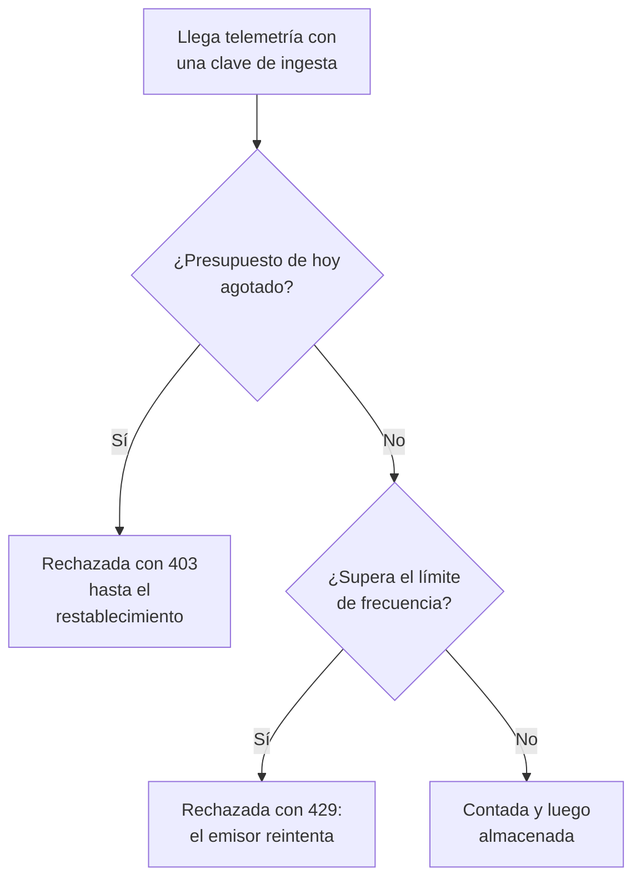

# Presupuestos de ingesta

Un presupuesto de ingesta limita cuánta telemetría envía un proyecto en un día, para que un servicio ruidoso o un bucle de registros descontrolado no pueda llenar su almacenamiento. El administrador de la instancia fija un presupuesto diario para cada señal, para todos los proyectos o para uno solo, y cualquiera que pueda editar una clave de ingesta puede dar a la clave un presupuesto propio más pequeño. Cada presupuesto puede tener además un límite de frecuencia por segundo.

:::cards
- [Cómo funcionan los presupuestos](#cómo-funcionan-los-presupuestos): Tres niveles, contados a medida que llega la telemetría.
- [Fijar los presupuestos predeterminados de todos los proyectos](#fijar-los-presupuestos-predeterminados-de-todos-los-proyectos): En los ajustes del Admin Dashboard.
- [Dar a una clave de ingesta su propio presupuesto](#dar-a-una-clave-de-ingesta-su-propio-presupuesto): Una parte del presupuesto del proyecto.
- [Alertar sobre un presupuesto](#alertar-sobre-un-presupuesto): Antes de que se agote, y cuando se agota.
:::

## Cómo funcionan los presupuestos

La telemetría se descuenta a medida que llega: del presupuesto de su proyecto para su señal, y del de su clave de ingesta cuando la clave tiene uno. Cuando un presupuesto diario se agota, esa señal se rechaza hasta que el presupuesto se restablece.



- **Tres niveles.** El predeterminado de la instancia se aplica a todos los proyectos. El administrador de la instancia puede dar a un proyecto un presupuesto propio en su lugar, o ningún límite. El presupuesto de una clave solo subdivide el de su proyecto: puede ser menor, nunca mayor.
- **Cinco señales.** Los registros, las trazas, las métricas, los perfiles y los eventos de seguridad tienen cada uno su propio presupuesto. Las reproducciones de sesiones tienen sus propios límites: consulte [Reproducción de sesiones](/docs/telemetry/session-replay).
- **Los bytes se cuentan descomprimidos.** Una solicitud cuenta el tamaño de su cuerpo una vez descomprimido, así que comprimirla no cambia lo que cuenta. Un GB son 1024³ bytes, y un MB, 1024² bytes.
- **Se cuenta lo que llega, no lo que se almacena.** La telemetría que un [filtro de descarte](/docs/telemetry/drop-filters-and-scrub-rules) elimina después sigue contando, así que un presupuesto puede indicar más que la página [Uso de telemetría](/docs/telemetry/usage), que cuenta lo que se almacenó.
- **La última solicitud se almacena entera.** Una solicitud que llega mientras un presupuesto aún tiene margen se almacena completa, así que un presupuesto agotado puede indicar algo más del 100 %.
- **Nada se limita hasta que se fija un presupuesto.** Toda instalación empieza sin presupuestos, y un proyecto sin presupuesto no se cuenta en absoluto.
- **Los cambios llegan a todos los servidores en un minuto.**
- **La telemetría se acepta cuando no se puede contar.** Los presupuestos se cuentan en Valkey. Mientras no se puede acceder a Valkey, OneUptime almacena la telemetría sin contarla en lugar de rechazarla, y las páginas de presupuestos lo indican.

## Antes de empezar

- **Para los presupuestos de la instancia y de un proyecto, el Admin Dashboard.** En una instalación autoalojada, solo el administrador de la instancia los fija. Los propietarios y administradores de un proyecto ven sus presupuestos, pero no pueden cambiarlos.
- **Para el presupuesto propio de una clave, un rol que edite claves de ingesta.** Project Owner o Project Admin, o un rol personalizado con el permiso Edit Ingestion Key.
- **Para ver los presupuestos, un rol que vea el uso del proyecto.** Los roles que ven la página [Uso de telemetría](/docs/telemetry/usage) ven en ella los presupuestos del proyecto.

## Fijar los presupuestos predeterminados de todos los proyectos

:::steps
### Abrir los presupuestos de ingesta

En el Admin Dashboard, vaya a **Ajustes → Telemetría → Presupuestos de ingesta**. **Telemetría** empieza contraído en el menú lateral: haga clic en él para abrirlo.

### Fijar los presupuestos diarios

En la tarjeta **Presupuestos diarios predeterminados**, haga clic en **Editar presupuestos diarios predeterminados**, escriba un número de GB para cada señal que quiera limitar, por ejemplo **Registros (GB por día)**, y haga clic en **Guardar cambios**. Deje una señal vacía para no tener límite.

### Fijar los límites de frecuencia, si los necesita

En la tarjeta **Límites de frecuencia predeterminados**, haga clic en **Editar límites de frecuencia predeterminados** y escriba un número de MB por segundo para una señal, por ejemplo **Registros (MB por segundo)**. Un límite de frecuencia evita que una ráfaga agote en minutos el presupuesto de un día.
:::

La tarjeta **Advertencia y restablecimiento** contiene el umbral de advertencia y la hora a la que se restablece el día de presupuesto: consulte [La advertencia y el restablecimiento](#la-advertencia-y-el-restablecimiento).

## Fijar los presupuestos de un proyecto

:::steps
### Abrir el proyecto

En el Admin Dashboard, vaya a **Proyectos**, haga clic en el proyecto y luego en **Presupuestos de ingesta** en su menú lateral. La página se abre con lo que el proyecto ha usado hoy de sus presupuestos.

### Fijar sus presupuestos diarios

En la tarjeta **Presupuestos diarios de este proyecto**, haga clic en **Editar presupuestos diarios**. Escriba un número de GB en lugar del predeterminado de la instancia para una señal, o 0 para no tener ningún límite. Deje una señal vacía para mantener el predeterminado de la instancia.

### Fijar sus límites de frecuencia

En la tarjeta **Límites de frecuencia de este proyecto**, haga clic en **Editar límites de frecuencia** y fíjelos de la misma manera: un número de MB por segundo, 0 para no tener límite o vacío para el predeterminado de la instancia.
:::

Los miembros del proyecto ven estos presupuestos en su página [Uso de telemetría](/docs/telemetry/usage), en modo de solo lectura.

## Dar a una clave de ingesta su propio presupuesto

El presupuesto de una clave es una parte del de su proyecto: un emisor que inunda su propia clave se detiene en el presupuesto de la clave, mientras las demás claves del proyecto siguen enviando.

:::steps
### Abrir la clave

Vaya a **Ajustes del proyecto → Telemetría y APM → Claves de ingesta** y haga clic en la clave. **Telemetría y APM** empieza contraído en el menú lateral: haga clic en él para abrirlo.

### Fijar sus presupuestos

En la tarjeta **Presupuestos de ingesta**, haga clic en **Editar presupuestos de ingesta**. Escriba un número de GB por día para cada señal que quiera limitar en el paso **Presupuestos diarios**, y un número de MB por segundo en el paso **Límites de frecuencia**. Deje una señal vacía para que la clave no tenga presupuesto propio.

### Guardar los presupuestos

Haga clic en **Guardar cambios**. El presupuesto de una clave no puede superar el de su proyecto: OneUptime lo rechaza e indica el máximo posible.
:::

- **Cuentan los dos presupuestos.** La telemetría enviada con la clave se descuenta del presupuesto de la clave y del presupuesto del proyecto, y el que se agote primero la rechaza.
- **Un presupuesto de proyecto rebajado también limita a la clave.** Cuando el presupuesto del proyecto se rebaja por debajo del de una clave, la clave queda limitada al del proyecto.

## Qué ven los emisores

| Cuándo | Por HTTP | Por OTLP/gRPC | Qué hace el emisor |
| --- | --- | --- | --- |
| Un presupuesto diario se agota | `403` | `RESOURCE_EXHAUSTED` | Descarta el lote: reintentar no sirve de nada antes del restablecimiento |
| Se supera un límite de frecuencia | `429` con `Retry-After` | `RESOURCE_EXHAUSTED` con un retraso para reintentar | Reintenta el lote tras el retraso |

Cada rechazo dice por qué. Por OTLP/HTTP, su cuerpo es un `google.rpc.Status`, en protobuf o JSON según cómo se envió la solicitud, así que el registro del emisor muestra un motivo como:

```text
This project's daily logs ingestion budget of 10 GB is used up, so OneUptime is not storing logs from this project until the budget resets at 2026-11-10 00:00 UTC.
```

- **Los demás emisores HTTP reciben JSON.** Fluent Bit, Fluentd, Syslog y los demás endpoints HTTP reciben `error`, `message` y `resetsAt`, y `retryAfterSeconds` cuando se trata de un límite de frecuencia.
- **A MQTT y a los flujos de la nube no se les puede avisar.** La telemetría que llega por MQTT o desde el flujo de un proveedor de nube se descarta cuando su presupuesto se agota. No se le aplica ningún límite de frecuencia: no se podría volver a enviar.
- **Los rechazos se cuentan.** Lo que un presupuesto agotado rechaza o descarta se cuenta como descartado, y cada solicitud que rechaza un límite de frecuencia, como limitada: consulte [Ver el uso y los descartes de hoy](#ver-el-uso-y-los-descartes-de-hoy).

## La advertencia y el restablecimiento

- **La advertencia.** Cuando un presupuesto diario supera el umbral de advertencia, el 80 % salvo que el administrador de la instancia lo cambie, los propietarios del proyecto reciben un correo, y los exploradores muestran un banner encima de los datos de esa señal. Reciben un correo más cuando el presupuesto se agota. Cada presupuesto envía cada correo como máximo una vez al día.
- **El restablecimiento.** Cada día de presupuesto vuelve a empezar a las 00:00 UTC, salvo que el administrador de la instancia lo cambie. La tarjeta **Advertencia y restablecimiento** fija **Umbral de advertencia (%)**, de 1 a 99, **Hora de restablecimiento**, como HH:MM, y **Zona horaria de restablecimiento**: haga clic en **Editar advertencia y restablecimiento**.
- **Horario de verano.** El restablecimiento sigue el reloj de la zona horaria, así que el día de presupuesto en que cambia la hora dura una hora menos o una más. Una hora de restablecimiento que el cambio de hora se salta ocurre ese mismo tiempo después del salto.
- **Un restablecimiento cambiado empieza un día nuevo.** Cambiar la hora de restablecimiento o la zona horaria empieza al instante un nuevo día de presupuesto, sin nada contado todavía.

## Ver el uso y los descartes de hoy

Vaya a **Ajustes del proyecto → Telemetría y APM → Uso**. Mientras haya un presupuesto o un límite de frecuencia fijado para el proyecto, la página se abre con la tarjeta **Presupuestos de ingesta**, y las claves con presupuesto propio están en la tarjeta **Presupuestos de las claves de ingesta**:

| Columna | Qué muestra |
| --- | --- |
| **Señal** | La señal a la que corresponde la fila. |
| **Usado hoy** | Lo que se ha contado desde que empezó el día de presupuesto, y su parte del presupuesto. |
| **Presupuesto diario** | El presupuesto vigente, y dónde se fijó: **Predeterminado de la instancia**, **Fijado para este proyecto** o **Propio de esta clave**. |
| **Límite de frecuencia** | El límite de frecuencia vigente. |
| **Descartado** | Lo que se rechazó o descartó porque el presupuesto estaba agotado. |
| **Limitado** | Cuántas solicitudes rechazó el límite de frecuencia. |
| **Estado** | **Dentro del presupuesto**, **Umbral de advertencia superado** o **Agotado**, **Sin presupuesto diario** para una señal que solo tiene límite de frecuencia, y **Desconocido** mientras no se pueden leer los recuentos. |

- **En la página de una clave**, la tarjeta **Uso del presupuesto de hoy** muestra lo que la clave ha usado de sus propios presupuestos.
- **En los exploradores**, un banner encima de los datos de registros, trazas, métricas, perfiles y eventos de seguridad indica cuándo el presupuesto de esa señal ha superado su umbral de advertencia o se ha agotado, con **Ver presupuestos** para abrir la página Uso.
- **En el Admin Dashboard**, la página **Presupuestos de ingesta** de un proyecto muestra las mismas cifras.

## Alertar sobre un presupuesto

Cada 5 minutos, OneUptime escribe las cifras del día de cada presupuesto como métricas del proyecto, y un [monitor de métricas](/docs/monitor/metrics-monitor) alerta sobre ellas como sobre cualquier otra métrica:

| Métrica | Unidad | Qué contiene |
| --- | --- | --- |
| `oneuptime.telemetry.budget.used.bytes` | `By` | Los bytes descontados del presupuesto diario desde que empezó el día de presupuesto. |
| `oneuptime.telemetry.budget.used.percent` | `%` | Lo mismo, como porcentaje del presupuesto diario. A partir de 100, la señal se rechaza hasta el restablecimiento. |
| `oneuptime.telemetry.budget.dropped.bytes` | `By` | Los bytes rechazados o descartados desde que empezó el día de presupuesto porque el presupuesto estaba agotado. |
| `oneuptime.telemetry.budget.throttled.requests` | `{request}` | Las solicitudes que el límite de frecuencia rechazó desde que empezó el día de presupuesto. |

Cada punto lleva estos atributos:

| Atributo | Valor |
| --- | --- |
| `projectId` | El ID del proyecto. |
| `signal` | `logs`, `traces`, `metrics`, `profiles` o `security-events`. |
| `scope` | `project`, o `ingestion-key` para el presupuesto propio de una clave. |
| `ingestionKeyId` | El ID de la clave, para el presupuesto propio de una clave. |
| `ingestionKeyName` | El nombre de la clave cuando se escribió el punto, para el presupuesto propio de una clave. |

Para recibir un aviso al 90 % del presupuesto de registros del proyecto, cree un monitor de métricas sobre `oneuptime.telemetry.budget.used.percent`, filtrado por `signal` `logs` y `scope` `project`, que alerte cuando el máximo supere 90:

- **Agregue con el máximo.** Cada cifra solo crece durante un día de presupuesto.
- **Use una ventana de 15 minutos o más.** Se escribe un punto cada 5 minutos, y una ventana sin ningún punto resuelve la alerta.
- **Espere huecos, no ceros.** No se escribe nada para una cifra que vale 0, ni mientras no se pueden leer los recuentos.
- **No cuestan nada.** Estas métricas no se descuentan de ningún presupuesto ni cuentan como uso de telemetría, y se conservan tanto como las métricas de monitores: 30 días, salvo que el administrador de la instancia lo cambie. Los nombres de métrica que empiezan por `oneuptime.telemetry.budget.` están reservados para ellas: las métricas que sus aplicaciones envían con un nombre así se descartan.

## Solución de problemas

:::details Un collector registra 403 en sus exportaciones
El presupuesto diario del proyecto o de la clave para esa señal está agotado, y el collector descarta lo que no puede enviar hasta que el presupuesto se restablezca. Consulte **Usado hoy** en la página Uso. Pida al administrador de la instancia que aumente el presupuesto del proyecto, o envíe menos: un filtro de descarte no ayuda aquí, porque elimina la telemetría después de que se haya contado.
:::

:::details Un collector registra 429 y reintenta
Envía más rápido de lo que permite un límite de frecuencia. Reintenta tras el retraso de `Retry-After`, así que no se pierde nada salvo que su cola se llene. Aumente el límite de frecuencia, o reparta los envíos de forma más uniforme.
:::

:::details «Usado hoy» es mayor que lo que muestra la página Uso de telemetría
Un presupuesto cuenta la telemetría a medida que llega, descomprimida, incluido lo que los filtros de descarte eliminan después. La página Uso cuenta lo que se almacenó, al día siguiente.
:::

:::details Los presupuestos dicen que no se pudieron leer los recuentos de hoy
OneUptime no puede acceder a Valkey, donde se cuentan los presupuestos. Hasta que pueda, la telemetría se almacena sin contarse, y no se aplica ningún presupuesto.
:::

## Próximos pasos

:::cards
- [Uso de telemetría](/docs/telemetry/usage): Vea lo que envía cada proyecto y cada servicio.
- [Filtros de descarte y reglas de depuración](/docs/telemetry/drop-filters-and-scrub-rules): Deje de almacenar la telemetría que no necesita.
- [Claves de ingesta](/docs/telemetry/ingestion-keys): Una clave para cada emisor, para que cada uno pueda tener un presupuesto.
- [Monitor de métricas](/docs/monitor/metrics-monitor): Alerte sobre las métricas de los presupuestos.
:::
