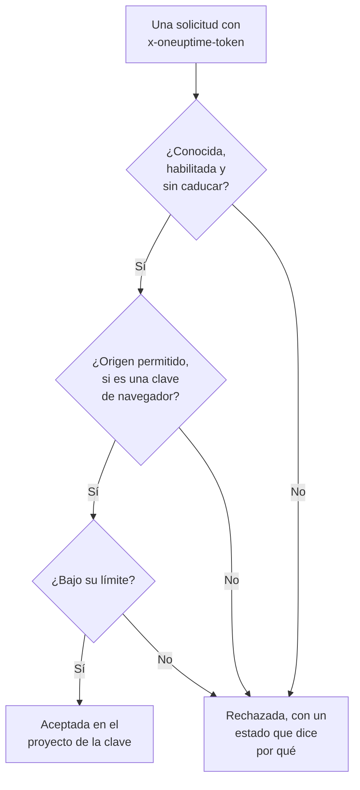

# Claves de ingesta

Una clave de ingesta conecta su telemetría con su proyecto. Las aplicaciones, los OpenTelemetry Collectors y los agentes la envían con cada solicitud, y OneUptime archiva sus registros, trazas y métricas en el proyecto al que pertenece la clave. Esta página muestra cómo crear una clave, qué tipo elegir y cómo mantener las claves seguras.

:::cards
- [Crear una clave de ingesta](#crear-una-clave-de-ingesta): Un nombre, un tipo y un secreto que copiar.
- [Servidor o navegador](#servidor-o-navegador): Qué tipo de clave necesita un emisor.
- [Proteger una clave de navegador](#proteger-una-clave-de-navegador): Orígenes, un nombre de servicio y un límite.
- [Rotar, desactivar o eliminar una clave](#rotar-desactivar-o-eliminar-una-clave): Qué hacer cuando una clave se filtra.
:::

## Cómo se comprueba una clave

Cada solicitud lleva el secreto de la clave, normalmente en un encabezado `x-oneuptime-token`. OneUptime busca la clave, comprueba que todavía puede enviar y solo entonces acepta los datos en el proyecto de la clave.



- **La clave decide el proyecto.** Nunca envía un ID de proyecto: los datos enviados con una clave llegan al proyecto al que pertenece la clave.
- **Los cambios llegan a todos los servidores en un minuto.** Desactivar una clave, restablecer su secreto o cambiar sus orígenes, su caducidad o su límite surte efecto en un minuto aproximadamente.
- **Una clave de servidor es una contraseña.** Quien la tenga puede enviar telemetría a su proyecto. Guárdela en los secretos de sus servidores, nunca en el control de versiones ni en una página web.

## Servidor o navegador

Elija el tipo según dónde vaya a vivir la clave. El tipo no se puede cambiar una vez creada la clave.

| | **Servidor** | **Navegador** |
| --- | --- | --- |
| Para | Aplicaciones, collectors y agentes en máquinas que usted gestiona | Páginas web, y React Native Session Replay |
| Envía | Todo tipo de telemetría, a todos los endpoints | Trazas, registros, métricas y Session Replays |
| Es un secreto | Sí: guárdela en sus servidores | No: cualquiera que vea la página puede leerla |
| Orígenes | No se comprueban | Solo se aceptan los orígenes de la lista |
| Solicitudes por minuto | Sin límite, salvo que usted fije uno | 6.000, salvo que fije otro límite |

En cualquier otro lugar, OneUptime rechaza una clave de navegador, por ejemplo por gRPC y MQTT, para perfiles, Syslog, Fluent Bit y Fluentd, y para subir source maps. Para pasar un emisor al otro tipo, cree una clave de ese tipo, cambie el emisor a ella y luego elimine la clave antigua.

## Antes de empezar

- **Un rol que gestione claves de ingesta.** Project Owner o Project Admin, o un rol personalizado con el permiso Create Telemetry Ingestion Key. Los roles de Telemetry no incluyen las claves de ingesta.
- **En OneUptime Cloud, un método de pago.** La telemetría se factura según el uso, así que un proyecto en el plan Free necesita un método de pago antes de poder crear una clave. El cuadro de creación termina entonces con un paso **Facturación** que muestra los precios.

## Crear una clave de ingesta

:::steps
### Abrir las claves de ingesta

Vaya a **Ajustes del proyecto → Telemetría y APM → Claves de ingesta**. **Telemetría y APM** empieza contraído en el menú lateral: haga clic en él para abrirlo. La lista muestra de cada clave su **Nombre**, **Tipo**, **Último uso** y **Descripción**.

### Nombrar la clave y elegir su tipo

Haga clic en **Crear clave de ingesta**. El cuadro empieza con el nombre **Clave de servidor** y el tipo **Servidor**. Elija el **Tipo de clave** y cambie el nombre de la clave según lo que la vaya a usar, por ejemplo `checkout-collector`. Hay una **Descripción** en **Avanzado**.

### Añadir los orígenes de una clave de navegador

Una clave de **Navegador** pide sus **Orígenes permitidos** en el paso siguiente, **Ajustes del navegador**, con su **Nombre de servicio fijado** en **Avanzado**. Consulte [Proteger una clave de navegador](#proteger-una-clave-de-navegador).

### Crear la clave y copiar su secreto

Haga clic en **Crear clave de ingesta**. Se abre la página de la clave: copie su **Clave secreta** y entréguela a sus emisores.
:::

La **Guía de configuración** de cada producto empieza con **Elige una clave de ingesta**, que lista las claves que esa guía puede usar y crea una allí mismo. Los fragmentos de la guía llevan después esa clave.

## Enviar telemetría con la clave

Los emisores ponen el secreto en un encabezado `x-oneuptime-token`:

```text
x-oneuptime-token: YOUR_ONEUPTIME_INGESTION_KEY
```

- Los SDK de OpenTelemetry lo leen de `OTEL_EXPORTER_OTLP_HEADERS`. Consulte el [inicio rápido de OpenTelemetry](/docs/telemetry/open-telemetry#inicio-rápido).
- Por OTLP/gRPC, va en los metadatos `x-oneuptime-token`.
- Un dispositivo MQTT lo envía como su contraseña. Consulte [Dispositivos IoT](/docs/telemetry/iot-devices).
- OneUptime también lee la clave de un encabezado `x-oneuptime-ingestion-key` o `x-oneuptime-service-token`, que envían algunas configuraciones antiguas.

## Proteger una clave de navegador

Una clave de navegador está en su página, donde cualquiera puede copiarla. Estos ajustes limitan lo que puede hacer una copia. Cámbielos en la página de la clave con **Editar Clave de ingesta de telemetría**.

| Ajuste | Qué hace |
| --- | --- |
| **Orígenes permitidos** | Los únicos orígenes desde los que se acepta la clave. Una solicitud desde cualquier otro origen, o sin encabezado `Origin`, se rechaza. Una clave de navegador debe conservar al menos uno. |
| **Nombre de servicio fijado** | Archiva todo lo que la clave envía por OTLP/HTTP bajo este único servicio, sea cual sea el `service.name` que haya puesto el emisor. Una copia de la clave solo puede escribir entonces en ese servicio. |
| **Límite de solicitudes por minuto** | El máximo de solicitudes por las que se acepta la clave cada minuto, compartido por todos los visitantes. Una clave de navegador recibe 6.000 si deja el campo vacío. |
| **Caduca el** | La fecha a partir de la cual se rechaza la clave, para que una copia publicada deje de funcionar. |

Un origen es un esquema, un host y un puerto opcional: `https://app.example.com` no cubre `https://app.example.com:8443`. Un `*.` inicial cubre todos los subdominios, pero no el dominio en sí. React Native Session Replay envía una identidad `app://` exacta, que no admite comodines:

```json
[
  "https://app.example.com",
  "https://*.example.com",
  "app://com.example.mobile"
]
```

El [Catálogo de servicios](/docs/telemetry/services#cómo-entra-un-servicio-en-el-catálogo) muestra cómo un nombre fijado decide el servicio. El Runner y el agente de IA del agente de Kubernetes, y los agentes de IA de infraestructura, no se registran con una clave fijada: deles una clave de servidor sin nombre fijado.

## Rotar, desactivar o eliminar una clave

La página de una clave muestra su **Estado**, su **Clave secreta** tras **Haz clic para mostrar**, y su **Usado por última vez el**: la última vez que OneUptime aceptó datos enviados con ella.

| Para | Haga esto | Lo que ven los emisores |
| --- | --- | --- |
| Detener una clave al momento, y poder deshacerlo | Haga clic en **Editar Clave de ingesta de telemetría**, abra **Acceso y límites** y desactive **Habilitado**. El estado indica **Deshabilitado: se rechaza la telemetría**. | `422` hasta que vuelva a activarla |
| Sustituir un secreto filtrado | Haga clic en **Restablecer clave secreta** y confirme. La clave conserva sus ajustes y recibe un secreto nuevo. | `401` hasta que envíen el secreto nuevo |
| Detener una clave para siempre | Haga clic en **Eliminar Clave de ingesta de telemetría** al final de su página. | `401` |

Para cambiar un secreto sin perder datos, cree una segunda clave, pase sus emisores a ella y elimine la clave antigua cuando su **Usado por última vez el** deje de moverse. **Usado por última vez el** se actualiza cada pocos minutos, no en cada solicitud.

## Solución de problemas

Una solicitud rechazada recibe un estado y una frase que dice por qué.

| Respuesta | Qué significa |
| --- | --- |
| `401` con `Missing ingestion token` | La solicitud no lleva clave. Envíela en `x-oneuptime-token`. |
| `401` con `Invalid ingestion token` | Ninguna clave tiene este secreto: se escribió mal, se restableció o se eliminó. |
| `401` con `This telemetry ingestion key expired.` | Su **Caduca el** ya pasó. Fije una fecha posterior o use otra clave. |
| `402` con `Add a payment method` | En OneUptime Cloud, el proyecto está en el plan Free y aún no tiene método de pago. |
| `422` con `This telemetry ingestion key has been disabled.` | Alguien desactivó **Habilitado**. |
| `422` con `A browser ingestion key cannot be used for` | Una clave de navegador llegó a un endpoint que solo acepta claves de servidor. |
| `422` con `did not send an Origin header` | Una clave de navegador se envió desde fuera de un navegador. Use allí una clave de servidor. |
| `422` con `is not allowed for this browser ingestion key` | El origen de la página no está en **Orígenes permitidos**. |
| `422` con `is pinned to a single service` | Se usó una clave con **Nombre de servicio fijado** para registrar un agente. Use una clave de servidor sin nombre fijado. |
| `429` con `Too many telemetry requests for this ingestion key` | La clave alcanzó su **Límite de solicitudes por minuto**. Los exportadores reintentan tras el tiempo de `Retry-After`. |

Para las demás respuestas que puede recibir un exportador OTLP, consulte [Respuestas](/docs/telemetry/open-telemetry#respuestas).

:::details Siguen llegando datos un minuto después de desactivar la clave
Cada servidor de OneUptime guarda lo que sabe de una clave durante un minuto como máximo, así que un cambio llega a todos en un minuto aproximadamente. Las solicitudes posteriores se rechazan.
:::

:::details Una clave de navegador funciona en mi portátil pero no en producción
Un origen incluye su esquema y su puerto. `http://localhost:3000` y `https://app.example.com` son orígenes distintos: incluya cada uno desde el que se sirve la página.
:::

:::details Usado por última vez el sigue diciendo Nunca
Nada ha enviado datos con esta clave desde que OneUptime empezó a registrar su uso. Compruebe que sus emisores tienen el secreto de esta clave y que sus solicitudes llegan a OneUptime.
:::

## Próximos pasos

:::cards
- [OpenTelemetry](/docs/telemetry/open-telemetry): Envíe trazas, métricas y registros con su clave.
- [Catálogo de servicios](/docs/telemetry/services): Vea los servicios bajo los que se archiva su telemetría.
- [Retención de datos](/docs/telemetry/data-retention): Decida cuánto tiempo se conservan los datos.
- [Filtros de descarte y reglas de depuración](/docs/telemetry/drop-filters-and-scrub-rules): Descarte o enmascare datos antes de que se guarden.
:::
