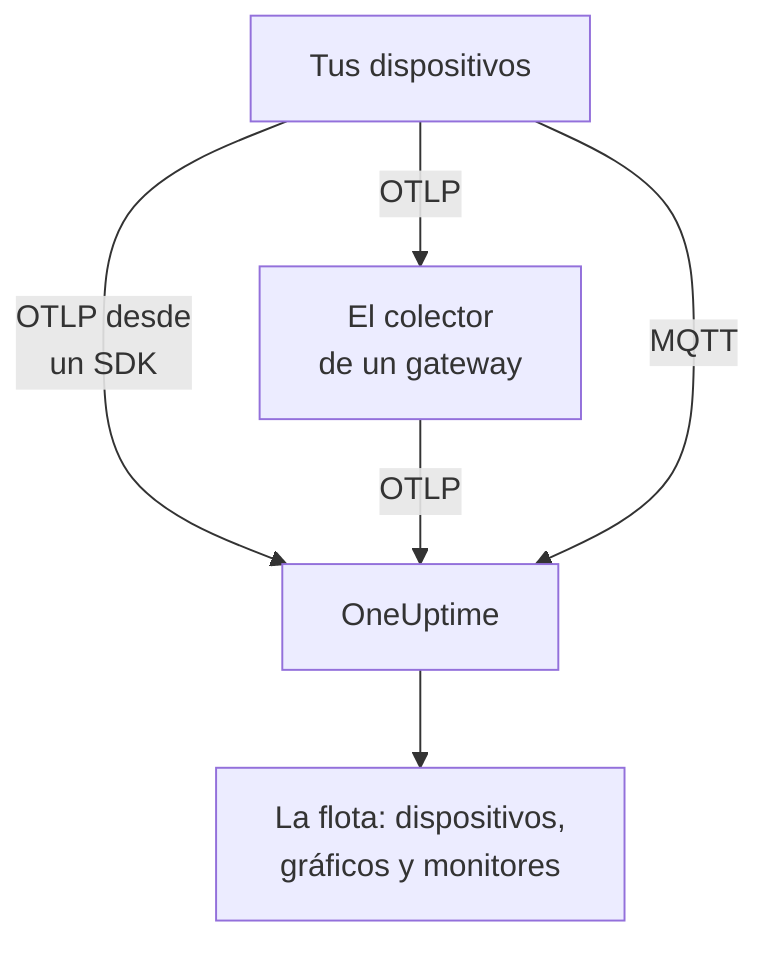

# Dispositivos IoT

OneUptime supervisa flotas de dispositivos IoT — sensores, gateways, controladores y equipos edge — a partir de un pequeño conjunto de métricas `iot_*` que envían. Agrupa los dispositivos en flotas, mantiene un inventario de los dispositivos de cada flota y representa en gráficos su batería, señal, temperatura, CPU, memoria y disponibilidad. No hay ningún agente de OneUptime que instalar en un dispositivo: los dispositivos envían OpenTelemetry estándar o publican en el endpoint MQTT de OneUptime. Los [monitores de dispositivos IoT](/docs/monitor/iot-device-monitor) alertan según lo que envían.

:::cards
- [Elige cómo enviar](#elige-cómo-enviar): Un SDK de OpenTelemetry, un colector en un gateway o MQTT.
- [Envío de métricas mediante MQTT](#envío-de-métricas-mediante-mqtt): Topics, credenciales por dispositivo y Last Will.
- [Convenciones de métricas](#convenciones-de-métricas): Los nombres `iot_*` que OneUptime grafica y sobre los que alerta.
- [Solución de problemas](#solución-de-problemas): Flotas que faltan, dispositivos que faltan, cambios a offline.
:::

## Cómo funciona

Cada lectura pertenece a una flota y a un dispositivo. OneUptime crea la flota a partir de su primera lectura, añade cada dispositivo nuevo al inventario de la flota y actualiza los últimos valores del dispositivo con cada lectura posterior. Las lecturas enviadas por OpenTelemetry y por MQTT alimentan las mismas flotas, el mismo inventario, los mismos gráficos y los mismos monitores.



## Cómo modela OneUptime el IoT

- **Flota**: un grupo de dispositivos, como `building-a-sensors` o `field-gateways`. Sale del atributo de recurso `iot.fleet.name` y aparece en OneUptime como el servicio de telemetría `iot/<fleet>`. Establece también `service.name=iot/<fleet>` para que los logs y las métricas queden en el mismo servicio.
- **Dispositivo**: un dispositivo de una flota, identificado por el atributo `device.id` de cada punto de datos. El inventario de la flota se indexa por `device.id`.

| Atributo | Se establece en | Obligatorio | Descripción |
| --- | --- | --- | --- |
| `iot.fleet.name` | Recurso | Sí | La flota a la que pertenece el dispositivo. Se convierte en el servicio de OneUptime `iot/<fleet>`. |
| `device.id` | Cada punto de datos | Sí | Un ID estable para el dispositivo, único en su flota. |
| `iot.device.kind` | Cada punto de datos | No | La clase de dispositivo, como `Device`, `Sensor` o `Gateway`. Su valor predeterminado es `Device`. |
| `iot.device.type` | Cada punto de datos | No | Un tipo o modelo más concreto para filtrar monitores, como `temp-sensor`. |
| `iot.device.firmware` | Cada punto de datos | No | La versión de firmware que informa el dispositivo. |

Por MQTT, el topic establece la flota y el dispositivo por ti.

## Elige cómo enviar

| Vía | Úsala cuando | Necesita |
| --- | --- | --- |
| [SDK de OpenTelemetry](#envío-de-métricas-mediante-el-sdk-de-opentelemetry) | El dispositivo ejecuta un SDK de OpenTelemetry y llega por sí mismo a OneUptime. | Una clave de ingesta en el dispositivo. |
| [OpenTelemetry Collector](#envío-de-métricas-mediante-un-opentelemetry-collector) | Muchos dispositivos informan a través de un gateway. | Un gateway que ejecute el colector. |
| [MQTT](#envío-de-métricas-mediante-mqtt) | El dispositivo ya habla MQTT, o debe aparecer offline en cuanto se cae. | Cualquier cliente MQTT que se conecte por WebSocket. |

## Antes de empezar

- Una clave de ingesta. Crea una en **Ajustes del proyecto → Telemetría y APM → Claves de ingesta** y copia su valor. Los dispositivos la envían como el encabezado `x-oneuptime-token` o como la contraseña de MQTT.
- Acceso de red desde el dispositivo o el gateway hacia tu URL de OneUptime.
- Un nombre de flota para cada grupo de dispositivos y un ID estable para cada dispositivo.

## Envío de métricas mediante el SDK de OpenTelemetry

:::steps
### Apunta el SDK a OneUptime

Establece las variables de entorno estándar de OpenTelemetry en el dispositivo. Reemplaza la clave, el nombre de la flota y el ID del dispositivo por los tuyos:

```bash
export OTEL_EXPORTER_OTLP_ENDPOINT=https://oneuptime.com/otlp
export OTEL_EXPORTER_OTLP_PROTOCOL=http/protobuf
export OTEL_EXPORTER_OTLP_HEADERS=x-oneuptime-token=YOUR_TELEMETRY_INGESTION_TOKEN
export OTEL_RESOURCE_ATTRIBUTES=iot.fleet.name=building-a-sensors,device.id=sensor-001,service.name=iot/building-a-sensors
```

Mantén estable `iot.fleet.name`: cambiarlo registra una flota nueva.

### Registra las lecturas como métricas IoT

Emite cada lectura como una métrica con uno de los [nombres convencionales](#convenciones-de-métricas) y da a cada punto de datos un atributo `device.id`:

| Métrica | Valor | Atributo del punto de datos |
| --- | --- | --- |
| `iot_device_up` | `1` | `device.id=sensor-001` |
| `iot_battery_percent` | `87` | `device.id=sensor-001` |
| `iot_temperature_celsius` | `21.5` | `device.id=sensor-001` |

El inventario se indexa por el `device.id` del punto de datos, no por el del recurso, así que establécelo en cada medición además de en `OTEL_RESOURCE_ATTRIBUTES`.
:::

Luego [comprueba que aparece la flota](#comprueba-que-aparece-la-flota).

## Envío de métricas mediante un OpenTelemetry Collector

Cuando muchos dispositivos informan a través de un gateway, ejecuta un OpenTelemetry Collector en el gateway. Recibe OTLP de tus dispositivos, marca la flota en cada lectura y las reenvía a OneUptime.

:::steps
### Guarda la configuración del gateway

Guarda esto como `config.yaml` en el gateway:

```yaml title="config.yaml"
receivers:
  otlp:
    protocols:
      grpc:
        endpoint: 0.0.0.0:4317
      http:
        endpoint: 0.0.0.0:4318

processors:
  batch:
    send_batch_size: 512
    timeout: 5s
  resource:
    attributes:
      - key: iot.fleet.name
        value: field-gateways
        action: upsert
      - key: service.name
        value: iot/field-gateways
        action: upsert

exporters:
  otlphttp:
    endpoint: "https://oneuptime.com/otlp"
    headers:
      "x-oneuptime-token": "YOUR_TELEMETRY_INGESTION_TOKEN"

service:
  pipelines:
    metrics:
      receivers: [otlp]
      processors: [resource, batch]
      exporters: [otlphttp]
```

- `otlp` recibe de tus dispositivos por gRPC (`4317`) y HTTP (`4318`). Recibe lecturas de cualquier otra forma que admita el colector (un puente MQTT, logs de archivos) y envíalas por el mismo pipeline.
- `resource` marca cada lectura con la flota. Establece `iot.fleet.name`, y el `service.name=iot/<fleet>` correspondiente, en cada gateway, para que los dispositivos de cada gateway lleguen a su flota.
- Mantén `device.id`, y cualquiera de `iot.device.kind`, `iot.device.type` e `iot.device.firmware`, en cada punto de datos, para que OneUptime pueda distinguir los dispositivos de la flota.
- `otlphttp` envía a OneUptime por HTTPS con la clave de ingesta. Se aceptan tanto la codificación protobuf predeterminada como `encoding: json`.

### Ejecuta el colector en el gateway

:::tabs
@tab Docker
Ejecútalo desde la carpeta que contiene `config.yaml`:

```bash
docker run -d \
  --name otel-collector \
  --restart unless-stopped \
  -p 4317:4317 \
  -p 4318:4318 \
  -v $(pwd)/config.yaml:/etc/otelcol-contrib/config.yaml:ro \
  otel/opentelemetry-collector-contrib:0.161.0 \
  --config /etc/otelcol-contrib/config.yaml
```
@tab otelcol-contrib
Si el gateway ya tiene `otelcol-contrib`, apúntalo al archivo:

```bash
otelcol-contrib --config config.yaml
```
:::

Luego los dispositivos envían OTLP al gateway, por ejemplo con `OTEL_EXPORTER_OTLP_ENDPOINT=http://<gateway-host>:4318` en el SDK de cada dispositivo.
:::

Luego [comprueba que aparece la flota](#comprueba-que-aparece-la-flota).

## Envío de métricas mediante MQTT

OneUptime tiene su propio endpoint MQTT, así que los dispositivos que hablan MQTT le publican las lecturas directamente, sin SDK, colector ni puente. Lo que llega por MQTT pasa por el mismo pipeline que OTLP: se crean las flotas, se actualiza el inventario y todos los monitores y plantillas de alerta de IoT funcionan igual.

### Endpoints

| Transporte | Dirección | Notas |
| --- | --- | --- |
| MQTT sobre WebSocket | `wss://<your-host>/mqtt` | Funciona en todas las instalaciones, a través del puerto HTTPS normal. |
| MQTT sobre TCP | `<app-host>:1883` | Solo autoalojado, e interno a la red del clúster o de Compose hasta que lo expongas. El puerto es `MQTT_INGEST_PORT`. |

### Autenticación

- **Con la clave de ingesta**: envíala como la contraseña de MQTT. El nombre de usuario se ignora; si tu cliente solo tiene un campo de usuario, pon ahí la clave. Esto encaja con un gateway que publica para muchos dispositivos.
- **Con una credencial por dispositivo**: recomendado para los dispositivos que se conectan directamente. Abre la página **Registro de dispositivos** de la flota y registra el dispositivo, con el **ID del dispositivo** que usa como `device.id`. El **Usuario de MQTT** del dispositivo es su nombre de usuario y su **Contraseña de MQTT (secreta)**, su contraseña.

La credencial de un dispositivo solo puede publicar en sus propios topics `oneuptime/<fleet>/<device>/`. Puedes revocar un dispositivo sin tocar el resto de la flota: desactiva su interruptor **Habilitado**, o elimínalo, y un dispositivo conectado queda desconectado en aproximadamente un minuto. Un dispositivo registrado que deja de informar se queda en el inventario como offline, y la plantilla de alerta Device Offline se dispara para él, aunque muera sin un Last Will.

OneUptime rechaza las credenciales incorrectas en CONNECT con el código de retorno 4 (nombre de usuario o contraseña incorrectos), así que un dispositivo mal configurado falla de forma visible. Las claves de navegador se rechazan por MQTT.

### Topics y payloads

Publica bajo el prefijo fijo `oneuptime/`. Los segmentos de flota y de dispositivo no pueden contener `/`, `+` ni `#`, no pueden empezar por `$` y tienen como máximo 100 caracteres.

| Topic | Payload |
| --- | --- |
| `oneuptime/<fleet>/<device>/telemetry` | Un objeto JSON de lecturas: `{"metrics":{"iot_temperature_celsius":21.5}}`, o un objeto plano cuyos campos numéricos son las métricas. |
| `oneuptime/<fleet>/<device>/metrics/<metricName>` | Un valor: un número simple (`23.4`) o `{"value":23.4}`. |
| `oneuptime/<fleet>/<device>/status` | `online` u `offline` (también `1` o `0`, `true` o `false`, `up` o `down`). Establece `iot_device_up`. |

Un payload de telemetría también puede llevar `"attributes"`, un mapa de cadenas que se marca en cada punto de datos (úsalo para `iot.device.kind`, `iot.device.type`, `iot.device.firmware` o tus propias etiquetas), y `"timestamp"`, en ISO 8601 o en segundos o milisegundos de unix. Ambos son opcionales: sin un `timestamp`, se usa la hora en que OneUptime recibe la lectura.

### Detección de offline con Last Will

Registra un Last Will de MQTT en `oneuptime/<fleet>/<device>/status` con el payload `offline`. Si el dispositivo muere o se cae de la red, OneUptime publica `iot_device_up = 0` para él en el momento en que termina su sesión, lo que dispara la plantilla de alerta Device Offline incluida y marca el dispositivo como caído en el inventario, sin sondeos. Publica `online` en el mismo topic después de conectarte, para que el dispositivo vuelva a aparecer como activo.

### Ejemplos

:::tabs
@tab mosquitto_pub
Por TCP sin cifrar, en una instancia autoalojada:

```bash
mosquitto_pub -h YOUR-ONEUPTIME-APP-HOST -p 1883 \
  -u oneuptime -P "YOUR_TELEMETRY_INGESTION_TOKEN" \
  -t "oneuptime/building-a-sensors/sensor-001/telemetry" \
  -m '{"metrics":{"iot_device_up":1,"iot_battery_percent":87,"iot_temperature_celsius":21.5},"attributes":{"iot.device.type":"temp-sensor","iot.device.firmware":"1.4.2"}}'
```
@tab Node.js
Con el paquete `mqtt`, por WebSocket, contra oneuptime.com o cualquier instancia autoalojada:

```javascript
const mqtt = require("mqtt");

const client = mqtt.connect("wss://oneuptime.com/mqtt", {
  username: "oneuptime", // ignored — the token below is what authenticates
  password: "YOUR_TELEMETRY_INGESTION_TOKEN",
  will: {
    topic: "oneuptime/building-a-sensors/sensor-001/status",
    payload: "offline",
  },
});

client.on("connect", () => {
  client.publish("oneuptime/building-a-sensors/sensor-001/status", "online");
  setInterval(() => {
    client.publish(
      "oneuptime/building-a-sensors/sensor-001/telemetry",
      JSON.stringify({
        metrics: {
          iot_device_up: 1,
          iot_battery_percent: readBattery(),
          iot_temperature_celsius: readTemperature(),
        },
      }),
    );
  }, 60 * 1000);
});
```
@tab Python
Con `paho-mqtt`, por WebSocket:

```python
import json
import paho.mqtt.client as mqtt

client = mqtt.Client(transport="websockets")
client.username_pw_set("oneuptime", "YOUR_TELEMETRY_INGESTION_TOKEN")
client.tls_set()
client.will_set("oneuptime/building-a-sensors/sensor-001/status", "offline")
client.ws_set_options(path="/mqtt")
client.connect("oneuptime.com", 443)

client.publish("oneuptime/building-a-sensors/sensor-001/status", "online")
client.publish(
    "oneuptime/building-a-sensors/sensor-001/telemetry",
    json.dumps({"metrics": {"iot_device_up": 1, "iot_temperature_celsius": 21.5}}),
)
```
:::

### Límites y entrega

- El endpoint solo acepta lecturas: las suscripciones se rechazan (un fallo SUBACK) y los mensajes retenidos no se guardan.
- La ingesta es al menos una vez. Usa QoS 1 para que OneUptime confirme cada publicación; un reenvío con QoS 1 o 2 tras perderse una confirmación puede producir puntos de datos duplicados.
- Una publicación de más de 128 KB, o con más de 100 métricas, se descarta, y un paquete que declara más que eso cierra la conexión.
- Una publicación fuera de estos topics, o con un payload mal formado, se acepta y se descarta, porque MQTT 3.1.1 no tiene errores por mensaje. OneUptime registra una advertencia con el motivo (`MQTT: dropped publish to …`).
- En el endpoint WebSocket, mantén el keepalive de MQTT por debajo de 5 minutos. El ingress cierra un WebSocket que está inactivo durante 300 segundos, lo que dispara el Last Will y una falsa alerta Device Offline. Los valores predeterminados de las bibliotecas cliente (60 segundos para `mqtt` y `paho-mqtt`) están bien, y el endpoint TCP no tiene ese límite.

## Convenciones de métricas

OneUptime reconoce estos nombres de métricas `iot_*`. Envía solo los que tengan sentido para tu dispositivo: los que faltan no se grafican. Cada punto de datos lleva el `device.id` del dispositivo (por MQTT, el topic nombra el dispositivo).

| Nombre de la métrica | Significado |
| --- | --- |
| `iot_device_up` | Disponibilidad: `1` es activo y accesible, `0` es caído. La lee el monitor de dispositivos IoT. |
| `iot_device_info` | Solo identidad. Lleva `device.id`, la clase, el tipo y el firmware, para que un dispositivo aparezca en el inventario antes de informar lecturas. |
| `iot_battery_percent` | Carga de la batería, de `0` a `100` (%). |
| `iot_signal_strength_dbm` | Intensidad de la señal inalámbrica en dBm, como el RSSI de Wi-Fi, LoRa o red móvil. |
| `iot_temperature_celsius` | Temperatura del dispositivo o del sensor en °C. |
| `iot_cpu_usage_ratio` | Uso de CPU como proporción de `0` a `1`. OneUptime lo guarda y lo muestra como porcentaje. |
| `iot_memory_usage_bytes` | Memoria en uso, en bytes. |
| `iot_memory_size_bytes` | Memoria total del dispositivo, en bytes. |
| `iot_uptime_seconds` | Segundos desde el último arranque del dispositivo. |

## Comprueba que aparece la flota

1. Comprueba que el dispositivo, el colector del gateway o el cliente MQTT envía sin errores: busca fallos de exportación y respuestas HTTP `401` o `422` en sus logs, o una conexión rechazada con el código de retorno 4.
2. Abre **Productos → Infraestructura → IoT → Todas las flotas**. La flota aparece como `iot/<fleet>` en más o menos un minuto tras sus primeras lecturas.
3. Abre la página **Dispositivos** de la flota. Cada dispositivo que enviaste debería aparecer con su último valor de batería, señal, temperatura, CPU, memoria y estado activo o caído.
4. Abre la página **Métricas** de la flota para graficar cualquiera de las series `iot_*`.

## OneUptime autoalojado

Apunta el endpoint a tu propia instancia:

```bash
export OTEL_EXPORTER_OTLP_ENDPOINT=https://your-oneuptime-host.example.com/otlp
```

O, en un colector:

```yaml
exporters:
  otlphttp:
    endpoint: https://your-oneuptime-host.example.com/otlp
    headers:
      "x-oneuptime-token": "YOUR_TELEMETRY_INGESTION_TOKEN"
```

Para MQTT, conéctate a `wss://your-oneuptime-host.example.com/mqtt`, o expón el puerto TCP de MQTT sin cifrar del servicio app (`MQTT_INGEST_PORT`, `1883` por defecto) para los dispositivos que no pueden usar WebSocket. Establece `MQTT_INGEST_ENABLED=false` en el servicio app para desactivar los dos listeners de MQTT. Si la instancia solo admite HTTP, usa `http://` (y `ws://` para MQTT) y su puerto.

## Solución de problemas

:::details La flota no aparece
1. Comprueba que `iot.fleet.name` es un atributo de recurso (no una etiqueta del punto de datos) y que `service.name` es `iot/<fleet>`.
2. Comprueba que el endpoint es `https://oneuptime.com/otlp` (o tu `…/otlp` autoalojado) y que el encabezado `x-oneuptime-token` lleva una clave de ingesta válida.
3. Por MQTT, comprueba que el topic sigue exactamente `oneuptime/<fleet>/<device>/…`: el segmento de flota del topic es lo que crea la flota.
:::

:::details Faltan dispositivos en el inventario
1. Da a cada punto de datos una etiqueta `device.id`: los dispositivos se indexan por ella. Por MQTT, es el segmento de dispositivo del topic.
2. Para un dispositivo que aún no ha informado lecturas, envía `iot_device_info` (o, por MQTT, un mensaje `status`) para que aparezca en el inventario.
3. Mantén estables los valores de `device.id`: un ID que cambia crea dispositivos duplicados.
:::

:::details HTTP 401 o 422 del exportador
`401` significa que la clave de ingesta falta, es incorrecta o ha caducado; `422` significa que se ha desactivado o es una clave de navegador, que no puede enviar telemetría de dispositivos. Crea una nueva en **Ajustes del proyecto → Telemetría y APM → Claves de ingesta** y actualiza el encabezado `x-oneuptime-token`.
:::

:::details La conexión MQTT se rechaza con "bad username or password"
OneUptime rechaza las credenciales incorrectas en CONNECT con el código de retorno 4. Comprueba que la contraseña es una clave de ingesta válida que no se ha desactivado ni ha caducado o, para un dispositivo registrado, el secreto de la credencial con su **Usuario de MQTT** como nombre de usuario. Las claves de navegador se rechazan por MQTT.
:::

:::details Los dispositivos pasan a offline mientras funcionan
En el endpoint WebSocket, el ingress cierra una conexión que está inactiva durante 300 segundos, lo que dispara el Last Will y una falsa alerta Device Offline. Mantén el keepalive de MQTT por debajo de 5 minutos: los valores predeterminados de las bibliotecas cliente, de 60 segundos, están bien.
:::

:::details Las lecturas no aparecen en los gráficos de la flota
1. Usa los nombres `iot_*` exactos de [Convenciones de métricas](#convenciones-de-métricas): los demás nombres se guardan como métricas genéricas y no llenan los gráficos de IoT.
2. Envía `iot_cpu_usage_ratio` como proporción de `0` a `1`; OneUptime lo muestra como porcentaje.
3. Espera hasta un minuto a que aparezcan los primeros puntos de datos después de que un dispositivo empiece a informar.
:::

## Próximos pasos

:::cards
- [Monitor de dispositivos IoT](/docs/monitor/iot-device-monitor): Alerta cuando un dispositivo queda offline, se queda sin batería o se sobrecalienta.
- [OpenTelemetry](/docs/telemetry/open-telemetry): Cómo recibe OneUptime OTLP de cualquier SDK o colector.
- [Colector OpenTelemetry en el host](/docs/telemetry/host-otel-collector): Supervisa el propio gateway Linux, macOS o Windows.
:::
