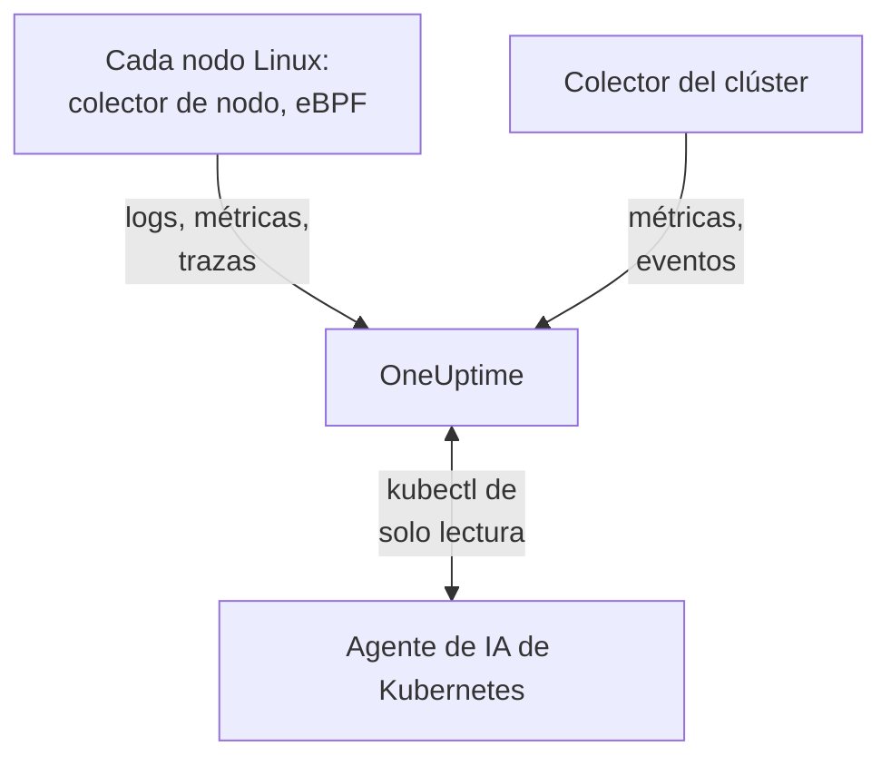

# Agente de Kubernetes

El agente de Kubernetes de OneUptime es un chart de Helm que recopila las métricas, los eventos y los logs de pods de tu clúster y, con eBPF, las trazas, las métricas de solicitudes, el grafo de servicios y los flujos de red de cada pod, sin cambios de código ni SDK. También ejecuta el [agente de IA de Kubernetes](#agente-de-ia-de-kubernetes), que permite a OneUptime AI ejecutar `kubectl` de solo lectura mientras investiga un incidente o una alerta. Un solo `helm install` lo deja listo; los [monitores de Kubernetes](/docs/monitor/kubernetes-monitor) alertan según lo que envía.

:::cards
- [Instala el agente](#instala-el-agente): Cuatro pasos con Helm.
- [Opciones de configuración](#opciones-de-configuración): Filtros, muestreo, plano de control, malla de servicios, costos y etiquetas.
- [Agente de IA de Kubernetes](#agente-de-ia-de-kubernetes): `kubectl` de solo lectura para OneUptime AI, y correcciones cuando las permitas.
- [Envía menos](#reducir-el-volumen-de-datos-recopilados): Las palancas, por orden de impacto.
:::

## Cómo funciona

El chart ejecuta unas pocas cargas de trabajo en su propio namespace. Cada una envía lo que recopila a tu URL de OneUptime por OTLP, con la clave de ingesta que le das, y el clúster se registra con el nombre que le das en `clusterName`.



| Carga de trabajo | Tipo | Qué hace | Se ejecuta |
| --- | --- | --- | --- |
| Colector del clúster | Deployment | Métricas del clúster, eventos de Kubernetes y las especificaciones de pods, nodos y cargas de trabajo, desde la API de Kubernetes. | Siempre |
| Colector de nodo | DaemonSet | Logs de pods de `/var/log/pods`, métricas de kubelet y cAdvisor, y las métricas del SO del nodo. | En todas partes excepto en EKS Fargate |
| Instrumentación eBPF (OBI) | DaemonSet | Trazas y métricas de solicitudes HTTP, gRPC, SQL y Redis de cada pod, y el mapa de servicios. | Por defecto, excepto en GKE Autopilot y EKS Fargate |
| Agente de IA de Kubernetes | Deployment | `kubectl` de solo lectura para OneUptime AI mientras investiga un incidente o una alerta. | Por defecto |
| Lector de logs | Deployment | Logs de pods a través de la API de Kubernetes, donde el colector de nodo no puede leerlos. | Con los presets `gke-autopilot` y `eks-fargate` |
| Motor de costos y sondeador | Deployments | Gasto por namespace, carga de trabajo y pod. | Con `cost.enabled=true` |

Todas las imágenes del agente son solo para Linux, así que todas las cargas de trabajo están fijadas a nodos Linux.

## Antes de empezar

- Un clúster de Kubernetes con v1.23 o posterior, y `kubectl` configurado para llegar a él.
- Helm 3. Las actualizaciones usan `--reset-then-reuse-values`, que necesita Helm 3.14 o posterior.
- Una clave de ingesta. Crea una en **Ajustes del proyecto → Telemetría y APM → Claves de ingesta**. El agente la envía como el encabezado `x-oneuptime-token`, así que una clave de API del proyecto no sirve aquí.
- Un nombre para el clúster, único en tu proyecto y estable, como `prod-us-east-1`: el clúster aparece en OneUptime con ese nombre.
- HTTPS saliente desde el clúster hacia tu URL de OneUptime.

## Instala el agente

:::steps
### Añade el repositorio de Helm

```bash
helm repo add oneuptime https://helm-chart.oneuptime.com
helm repo update
```

### Instala el chart

Reemplaza `YOUR_ONEUPTIME_URL`, `YOUR_ONEUPTIME_API_KEY` (la clave de ingesta) y el nombre del clúster por tus valores, y elige la pestaña de tu plataforma (consulta [Elige un preset](#elige-un-preset)).

:::tabs
@tab Standard
Clústeres autogestionados, EKS on EC2, GKE Standard, AKS, minikube, kind y k3s:

```bash
helm install kubernetes-agent oneuptime/kubernetes-agent \
  --namespace oneuptime-agent \
  --create-namespace \
  --set oneuptime.url="YOUR_ONEUPTIME_URL" \
  --set oneuptime.apiKey="YOUR_ONEUPTIME_API_KEY" \
  --set clusterName="my-cluster" \
  --set aiAgent.enabled=true
```
@tab GKE Autopilot
```bash
helm install kubernetes-agent oneuptime/kubernetes-agent \
  --namespace oneuptime-agent \
  --create-namespace \
  --set oneuptime.url="YOUR_ONEUPTIME_URL" \
  --set oneuptime.apiKey="YOUR_ONEUPTIME_API_KEY" \
  --set clusterName="my-cluster" \
  --set aiAgent.enabled=true \
  --set preset=gke-autopilot
```
@tab EKS Fargate
```bash
helm install kubernetes-agent oneuptime/kubernetes-agent \
  --namespace oneuptime-agent \
  --create-namespace \
  --set oneuptime.url="YOUR_ONEUPTIME_URL" \
  --set oneuptime.apiKey="YOUR_ONEUPTIME_API_KEY" \
  --set clusterName="my-cluster" \
  --set aiAgent.enabled=true \
  --set preset=eks-fargate
```
:::

**Las investigaciones con IA están activadas por defecto.** `aiAgent.enabled=true` ejecuta el [agente de IA de Kubernetes](#agente-de-ia-de-kubernetes) junto al colector: cuando se produce un incidente o una alerta en este clúster, OneUptime AI lo investiga con `kubectl` de solo lectura (`get`, `describe`, `logs`, `events`, `top`) y no cambia nada. Las correcciones siguen desactivadas hasta que las permitas. Para instalar sin él, usa `--set aiAgent.enabled=false` en su lugar.

### Comprueba que los pods se están ejecutando

```bash
kubectl get pods -n oneuptime-agent
```

Cada pod debería llegar a `Running` en uno o dos minutos:

:::tabs
@tab Standard
El colector del clúster, el agente de IA y, en cada nodo, un colector de nodo y un pod de eBPF:

```text
NAME                                          READY   STATUS    RESTARTS   AGE
kubernetes-agent-xxxxxxxxxx-xxxxx             1/1     Running   0          1m
kubernetes-agent-ai-agent-xxxxxxxxxx-xxxxx    1/1     Running   0          1m
kubernetes-agent-ebpf-xxxxx                   1/1     Running   0          1m
kubernetes-agent-logs-xxxxx                   1/1     Running   0          1m
```
@tab GKE Autopilot
El colector de nodo sigue ejecutándose y lee las métricas de kubelet y cAdvisor sin `hostPath`, y un Deployment lector de logs lee los logs de pods a través de la API de Kubernetes:

```text
NAME                                          READY   STATUS    RESTARTS   AGE
kubernetes-agent-xxxxxxxxxx-xxxxx             1/1     Running   0          1m
kubernetes-agent-ai-agent-xxxxxxxxxx-xxxxx    1/1     Running   0          1m
kubernetes-agent-logs-yyyyyyyyyy-yyyyy        1/1     Running   0          1m
kubernetes-agent-logs-xxxxx                   1/1     Running   0          1m
```
@tab EKS Fargate
Tres Deployments y ningún DaemonSet: Fargate da a cada pod su propia micro-VM y nunca programa DaemonSets, así que allí no hay métricas de nodo:

```text
NAME                                          READY   STATUS    RESTARTS   AGE
kubernetes-agent-xxxxxxxxxx-xxxxx             1/1     Running   0          1m
kubernetes-agent-ai-agent-xxxxxxxxxx-xxxxx    1/1     Running   0          1m
kubernetes-agent-logs-yyyyyyyyyy-yyyyy        1/1     Running   0          1m
```
:::

### Busca el clúster en OneUptime

Abre **Productos → Infraestructura → Kubernetes → Todos los clústeres**. El clúster aparece con su `clusterName` en unos minutos, y sus nodos, pods y cargas de trabajo se van llenando. El agente de IA de Kubernetes aparece como conectado en la página **Agente** del clúster, en **IA**.
:::

## Elige un preset

`preset` elige los valores predeterminados que funcionan en tu plataforma: si los logs de pods se leen desde el nodo a través de `hostPath` o a través de la API de Kubernetes, y qué cargas de trabajo pueden ejecutarse con privilegios.

| `preset` | Úsalo para | Logs de pods | Métricas de nodo |
| --- | --- | --- | --- |
| `standard` (predeterminado) | Clústeres autogestionados, **EKS on EC2**, **GKE Standard**, **AKS**, minikube, kind, k3s | El colector de nodo lee `/var/log/pods` a través de `hostPath` (la menor sobrecarga) | Kubelet, cAdvisor y las métricas del SO del nodo |
| `gke-autopilot` | **GKE Autopilot** | El lector de logs los lee a través de la API de Kubernetes (sin `hostPath`, sin acceso al host) | Kubelet y cAdvisor, sin `hostPath` |
| `eks-fargate` | **EKS Fargate** | El lector de logs los lee a través de la API de Kubernetes (sin `hostPath`, sin acceso al host) | Ninguna: Fargate no ejecuta DaemonSets |

Si no estás seguro, empieza con `standard`. Si la instalación falla con un error de Pod Security que menciona `hostPath`, vuelve a instalar con `preset=gke-autopilot` (o `eks-fargate` en Fargate). GKE Autopilot y EKS Fargate también rechazan los pods privilegiados, que necesitan eBPF y el perfilador, así que esos dos presets omiten ambos.

## Qué se recopila

| Categoría | Datos |
| --- | --- |
| Métricas de nodo | Uso de CPU, memoria, sistema de archivos y red |
| Métricas de pod | CPU, memoria, red y reinicios |
| Métricas de contenedor | CPU y memoria por contenedor |
| Métricas del clúster | Condiciones de los nodos, recursos asignables, recuentos de pods |
| Eventos de Kubernetes | Advertencias, errores y eventos de planificación |
| Logs de pods | stdout y stderr de cada contenedor (a través de `hostPath` en clústeres estándar, a través de la API de Kubernetes en Autopilot y Fargate) |
| Trazas de aplicación (eBPF, activadas por defecto) | Spans HTTP, gRPC, SQL y Redis de cada pod, sin SDK ni cambios de código |
| Métricas RED de HTTP (eBPF) | `http.server.request.duration` y los tamaños del cuerpo de solicitud y respuesta, por servicio |
| Grafo de servicios (eBPF) | Aristas de tasa de solicitudes, latencia y errores entre llamador y llamado, que dibujan el mapa de servicios |
| Métricas de flujos de red (eBPF) | Contadores de bytes y paquetes TCP y UDP de pod a pod, con metadatos de Kubernetes |
| Estadísticas de TCP (eBPF) | Contadores de tiempo de ida y vuelta, conexiones fallidas y retransmisiones por nodo |
| Costos de cargas de trabajo (opcional, `cost.enabled=true`) | Gasto por namespace, carga de trabajo y pod, con capacidad ociosa y eficiencia, y el costo por hora de nodos y volúmenes: consulta [Observabilidad de costos de Kubernetes](/docs/telemetry/kubernetes-cost) |

## Opciones de configuración

Cada opción de abajo es un valor de Helm. Establécelo al instalar, o en un agente instalado con `helm upgrade ... --reset-then-reuse-values --set <value>`.

### Filtrado por namespace

`namespaceFilters.rules` aplica patrones de namespace a cuatro ámbitos, cada uno por separado:

| Ámbito | Dónde filtra | Qué afecta |
| --- | --- | --- |
| `podLogs` | En el receiver filelog de hostPath o en el lector de logs de la API | Solo stdout y stderr de los pods; los eventos de Kubernetes y los logs de auditoría no se ven afectados |
| `ebpfDiscovery` | En el descubrimiento de procesos de OBI | Tanto las trazas como las métricas de eBPF de las cargas de trabajo que coinciden |
| `metrics` | En el colector, después de añadir los metadatos de Kubernetes | Series de métricas con namespace; las series de nodo y de clúster sin namespace se conservan |
| `traces` | En el colector, después de añadir los metadatos de Kubernetes | Tanto los spans de eBPF como los spans que las aplicaciones envían por OTLP |

Un patrón coincide con el nombre completo del namespace y puede usar `*` (`team-*`). Si un ámbito tiene alguna regla `include`, solo se conservan para ese ámbito los namespaces que coinciden, y las reglas `exclude` siempre ganan. La regla predeterminada excluye `kube-system` solo de `podLogs` y `ebpfDiscovery`.

Para limitar los logs de pods y el descubrimiento de eBPF a algunos namespaces:

```bash
helm install kubernetes-agent oneuptime/kubernetes-agent \
  --namespace oneuptime-agent \
  --create-namespace \
  --set oneuptime.url="YOUR_ONEUPTIME_URL" \
  --set oneuptime.apiKey="YOUR_ONEUPTIME_API_KEY" \
  --set clusterName="my-cluster" \
  --set-json 'namespaceFilters.rules=[{"action":"include","namespaces":["default","production","staging"],"scopes":["podLogs","ebpfDiscovery"]}]'
```

Para detener los logs de un namespace ruidoso y conservar sus trazas de eBPF, su mapa de servicios y sus métricas, limita la exclusión a `podLogs`:

```bash
  --set-json 'namespaceFilters.rules=[{"action":"exclude","namespaces":["kube-system"],"scopes":["podLogs","ebpfDiscovery"]},{"action":"exclude","namespaces":["noisy-*"],"scopes":["podLogs"]}]'
```

Las reglas de `podLogs` y `ebpfDiscovery` filtran en el origen: los archivos de log excluidos nunca se abren y las cargas de trabajo excluidas nunca se instrumentan. Las reglas de `metrics` y `traces` actúan después, en el colector, una vez que el namespace se ha asociado a los datos.

#### Filtrar métricas y trazas por namespace

Añade esos ámbitos a una regla para filtrar también las métricas o los spans con namespace:

```bash
  --set-json 'namespaceFilters.rules=[{"action":"exclude","namespaces":["kube-system","noisy-*"],"scopes":["podLogs","ebpfDiscovery","metrics","traces"]}]'
```

> [!NOTE]
> Las métricas a nivel de nodo y de clúster se conservan siempre. Un namespace pertenece a un pod, no a un nodo, así que series como la CPU del nodo, la memoria del nodo y el uso del sistema de archivos no tienen con qué coincidir y nunca se descartan: una regla limitada a `metrics` recorta las series por pod sin ocultar un nodo que falla.

Los eventos de Kubernetes no se pueden filtrar por namespace en el agente: llegan del receiver `k8sobjects` sin un atributo `k8s.namespace.name` (el namespace está dentro del cuerpo del evento), así que no hay nada con lo que pueda coincidir un filtro. Descártalos en OneUptime, con **Registros → Ajustes → Filtros de descarte**.

### Filtrado por severidad de logs

`filters.logs.minSeverity` descarta los registros de logs de pods por debajo de una severidad, en el agente, antes de enviar nada:

```bash
  --set filters.logs.minSeverity=WARN
```

Acepta `TRACE`, `DEBUG`, `INFO`, `WARN`, `ERROR` y `FATAL`. `WARN` conserva WARN, ERROR y FATAL y descarta INFO, DEBUG y TRACE; el valor predeterminado (`""`) lo conserva todo. Se aplica en ambos modos de logs (a través del colector en el modo `daemonset`, dentro del lector de logs en el modo `api`), así que un preset nunca lo desactiva a tus espaldas.

Los runtimes de contenedores no registran ninguna severidad, así que el agente la lee del propio texto del log (`[ERROR]`, `WARN:`, `"level":"info"`, …). Qué pasa con una línea sin un nivel reconocible depende del modo de logs, porque los dos modos saben cosas distintas:

| Modo | Una línea sin nivel | Por qué |
| --- | --- | --- |
| `daemonset` | `stderr` cuenta como ERROR (se conserva), `stdout` como INFO (lo descarta un umbral WARN) | El runtime de contenedores registra de qué flujo vino cada línea. |
| `api` | Se conserva siempre | La API `pods/log` de Kubernetes une stdout y stderr en un solo flujo sin marca por línea, así que, en lugar de adivinar, el agente conserva la línea. |

Así que el modo `api` descarta estrictamente menos que el modo `daemonset`, a propósito: un traceback de Python o un `npm ERR!` no lleva ninguna palabra clave de severidad, y borrarlo en silencio es justo el fallo del que debería protegerte un umbral. En el modo híbrido (`logs.windowsPods.enabled`) se aplican ambas filas, según el SO del nodo: los pods de Linux siguen `daemonset`, los de Windows `api`.

Los eventos de varias líneas se vuelven a unir antes de filtrar en ambos modos, así que un stack trace de Java se juzga por su primera línea y se conserva o se descarta entero.

> [!IMPORTANT]
> Esto nunca filtra los eventos de Kubernetes ni las especificaciones de recursos. Llegan de la API de Kubernetes sin severidad propia, así que un umbral borraría todo el feed, incluidas las advertencias `FailedScheduling`, `BackOff` y `OOMKilling` que más quieres. Son pocas y valiosas, así que el agente siempre las envía; para reducirlas, usa **Registros → Ajustes → Filtros de descarte** en OneUptime.

### Incluir o excluir métricas por nombre

`filters.metrics` decide qué métricas salen del clúster, en todos los receivers.

Descarta unas pocas métricas ruidosas (una lista de denegación, normalmente lo que quieres):

```bash
  --set-json 'filters.metrics.exclude=["k8s.volume.available","k8s.volume.capacity"]'
```

Envía solo un conjunto fijo (una lista de permitidos: todo lo demás se descarta):

```bash
  --set-json 'filters.metrics.include=["k8s.pod.cpu.utilization","k8s.pod.memory.usage"]'
```

Busca coincidencias por patrón en lugar de por nombre exacto:

```bash
  --set filters.metrics.matchType=regexp \
  --set-json 'filters.metrics.exclude=["^container_network_"]'
```

| Clave | Significado |
| --- | --- |
| `filters.metrics.exclude` | Nombres de métricas que descartar. Se aplica después de `include`, así que una exclusión siempre gana. |
| `filters.metrics.include` | Si no está vacía, solo se envían estas métricas. |
| `filters.metrics.matchType` | `strict` (el nombre exacto, el valor predeterminado) o `regexp` (RE2, sin anclar). |

- `regexp` no está anclada: `system.cpu` también coincide con `system.cpu.time`. Ánclala (`^system\.cpu$`) cuando te refieras exactamente a una métrica.
- RE2 no tiene lookahead, así que `^(?!container_)` no compila. Expresa "todo excepto" con `include`, no con un patrón negativo.
- `include` abarca todos los receivers a la vez. Una lista de permitidos que olvida una métrica elimina en silencio los monitores construidos sobre ella, así que prefiere `exclude` salvo que quieras un conjunto cerrado.
- Usa `--set-json` (o un archivo de valores) para las listas: un `--set` simple reemplaza una lista en lugar de añadir a ella.

> [!WARNING]
> Prueba un patrón antes de desplegarlo. El colector compila los patrones al arrancar, así que uno no válido no se comporta mal en silencio: el colector se niega a arrancar y entra en un bucle de reinicios, y se lleva consigo los logs de ese colector junto con sus métricas. Helm no puede compilar RE2, así que `helm upgrade` acepta un patrón incorrecto sin protestar.

### Muestreo de trazas

Los filtros de arriba eliminan una categoría de telemetría: un namespace, una severidad, un nombre de métrica. El muestreo conserva todas las categorías y, en su lugar, reduce la población. Establece `sampling.traces.percentage` en la proporción de trazas que conservar:

```bash
helm upgrade kubernetes-agent oneuptime/kubernetes-agent \
  --namespace oneuptime-agent --reset-then-reuse-values \
  --set sampling.traces.percentage=10
```

Eso conserva una traza de cada diez y descarta las otras nueve en el agente, antes de que salgan de tu clúster.

- **Obtienes trazas completas, no fragmentos.** La decisión es un hash del ID de traza, no un lanzamiento de moneda por span, así que todos los spans de una traza se conservan o se descartan juntos, y las trazas que sobreviven se leen de principio a fin.
- **Tus monitores basados en métricas no cambian.** OBI calcula las métricas RED de eBPF (tasa de solicitudes, tasa de errores, duración) a partir de cada solicitud, y viajan por el pipeline de métricas, en el que no está el muestreador. Al 10%, obtienes una décima parte de las trazas y una tasa, unos errores y una latencia exactos.
- **Tus monitores basados en spans sí.** Todo lo que OneUptime cuenta a partir de los propios spans baja con la tasa: consulta la advertencia de abajo.

| Clave | Significado |
| --- | --- |
| `sampling.traces.percentage` | El porcentaje de trazas que conservar, de 0 a 100. Predeterminado `100` (conservarlo todo). |
| `sampling.traces.hashSeed` | La semilla del hash del ID de traza. Predeterminado `22`. |

- `0` no conserva ninguna traza. Es una tasa, no un interruptor de apagado: borra todas las trazas mientras el DaemonSet de eBPF sigue ejecutándose y costándote. Para no tener trazas, usa `ebpf.enabled=false`; para no tener trazas pero sí las métricas RED y el mapa de servicios, mantén eBPF activado y establece `0` a propósito.
- Solo se aplica cuando `ebpf.enabled` está activado: si no, no hay pipeline de trazas y el valor no hace nada.
- Solo muestrea trazas. No hay `sampling.logs` ni `sampling.metrics`, a propósito: consulta la nota de abajo.
- Las fracciones necesitan `--set-json` y tienen un mínimo. `--set sampling.traces.percentage=0.5` falla porque Helm lee `0.5` como una cadena: usa `--set-json 'sampling.traces.percentage=0.5'` o un archivo de valores. Por debajo de unos `0.0061`, la tasa se redondea a cero y se comporta exactamente como `0`, sin ningún error; `0.01` (una de cada diez mil) es el valor más pequeño que hace lo que dice.
- Varios clústeres funcionan por defecto. Dos agentes conservan la misma traza solo si coinciden tanto en `hashSeed` como en `percentage`, y ambos tienen por defecto los mismos valores en todas partes, así que una traza que cruza dos clústeres sobrevive entera. Cambia `hashSeed` solo para hacer independientes dos niveles de muestreo: con la misma semilla, una tasa más baja conserva un subconjunto de las trazas de la tasa más alta.
- Los logs de pods nunca se muestrean, así que con `ebpf.logToTraceCorrelation: true` cada registro de log sigue llevando un ID de traza mientras solo existe la parte conservada de esas trazas. Aproximadamente el (100 − `percentage`)% de los registros de log enlaza entonces a una traza que no existe; seguir una traza hasta sus logs no se ve afectado.

> [!WARNING]
> Reajusta tus monitores basados en spans cuando establezcas esto. El muestreo reduce los spans que llegan a OneUptime, así que todo lo que los cuenta cuenta menos: un monitor de **Trazas** sobre `Span Count` y un monitor de **Excepciones** sobre `Exception Count` ven aproximadamente el `percentage`% del volumen de ayer. Un umbral ajustado con tráfico sin muestrear deja de superarse en silencio: el monitor no da error, simplemente se queda callado. Divide esos umbrales por el mismo factor; la tasa es para todo el clúster, así que ningún servicio puede quedar exento. La agrupación de errores empeora más que linealmente: una excepción frecuente sigue apareciendo, pero es más probable que una excepción rara y aislada desaparezca a que aparezca una décima parte de las veces.

> [!NOTE]
> Por qué no hay muestreo de logs ni de métricas: el muestreador del colector no puede muestrear métricas en absoluto. Puede muestrear logs, pero obtiene su aleatoriedad del ID de traza, que los logs de pods no tienen, así que todos los registros de log darían el mismo hash, y una tasa de logs lo conservaría todo o lo borraría todo según la semilla. En lugar de ofrecer un ajuste que borra tus logs en silencio, el chart no ofrece ninguno. Reduce los logs con [Filtrado por severidad de logs](#filtrado-por-severidad-de-logs) y [Filtrado por namespace](#filtrado-por-namespace), que son precisos en lo que eliminan.

### Desactivar la recopilación de logs

Si no necesitas los logs de pods:

```bash
helm install kubernetes-agent oneuptime/kubernetes-agent \
  --namespace oneuptime-agent \
  --create-namespace \
  --set oneuptime.url="YOUR_ONEUPTIME_URL" \
  --set oneuptime.apiKey="YOUR_ONEUPTIME_API_KEY" \
  --set clusterName="my-cluster" \
  --set logs.enabled=false
```

Tus métricas no se ven afectadas: el colector de nodo sigue ejecutándose para las métricas de kubelet, cAdvisor y del host, y solo deja de leer los logs de pods. Se detienen las alertas basadas en logs, y nada más.

### Forzar un modo concreto de recopilación de logs

`logs.mode` anula la elección del preset y siempre se impone:

- `logs.mode=daemonset`: el DaemonSet de hostPath (la menor sobrecarga; necesita `hostPath`).
- `logs.mode=api`: el Deployment lector de logs de la API de Kubernetes (funciona en cualquier clúster).
- `logs.mode=disabled`: sin logs de pods.

El modo solo decide de dónde vienen los logs de pods: las métricas de nodo se recopilan en cualquier caso, así que `api` y `disabled` conservan tus métricas de kubelet, cAdvisor y del host. La excepción es la plataforma: EKS Fargate no puede programar DaemonSets en absoluto, así que no tiene colector de nodo ni métricas de nodo, pod o contenedor. GKE Autopilot ejecuta el colector de nodo pero bloquea `hostPath`, así que recopila las métricas de kubelet y cAdvisor sin las de `hostmetrics` (E/S de disco, inodos, errores de NIC), que leen `/proc` y `/sys` del host.

En clústeres con grupos de nodos Windows, el modo `daemonset` solo cubre los nodos Linux, porque todas las imágenes del agente son solo para Linux. Añade `--set logs.windowsPods.enabled=true` para ejecutar el lector de logs de la API a su lado solo para los pods de los nodos Windows: los pods de Linux siguen leyendo los archivos localmente en el nodo, y los dos nunca envían la misma línea dos veces. Esto necesita una imagen `kubernetes-log-tailer` al menos tan reciente como el chart: una imagen más antigua ignora la restricción y envía dos veces los logs de Linux.

### Activar la supervisión del plano de control

La página **Plano de control** del clúster muestra gráficos de etcd, el API server, el scheduler y el controller manager. El agente recopila los cuatro cuando `controlPlane.enabled` es `true`:

```bash
helm upgrade kubernetes-agent oneuptime/kubernetes-agent \
  --namespace oneuptime-agent \
  --reset-then-reuse-values \
  --set controlPlane.enabled=true
```

Cada componente se recopila en las direcciones de su propia lista: `controlPlane.etcd.endpoints`, `controlPlane.apiServer.endpoints`, `controlPlane.scheduler.endpoints` y `controlPlane.controllerManager.endpoints`. La recopilación se ejecuta en el pod del agente, que no tiene red del host, así que los valores predeterminados (`https://localhost:<port>/metrics`) apuntan a ese mismo pod: establece cada lista en una dirección a la que el pod pueda llegar. Dentro de cualquier clúster, el API server responde en `https://kubernetes.default.svc:443/metrics`:

```bash
helm upgrade kubernetes-agent oneuptime/kubernetes-agent \
  --namespace oneuptime-agent \
  --reset-then-reuse-values \
  --set controlPlane.enabled=true \
  --set "controlPlane.apiServer.endpoints={https://kubernetes.default.svc:443/metrics}"
```

`controlPlane.enabled` activa las cuatro recopilaciones a la vez. Donde no se puede llegar a un componente en sus endpoints (etcd, el scheduler y el controller manager en un clúster gestionado, o en sus valores predeterminados `localhost`), su recopilación falla en cada intervalo: el colector registra un error de scrape e informa del destino como caído, y no cambia nada más.

El agente solo recopila por HTTPS, con el token de la cuenta de servicio y sin certificado de cliente. Por eso:

- **etcd** necesita una dirección de métricas HTTPS que no pida un certificado de cliente. Los puertos de métricas habituales de etcd quedan fuera de alcance: HTTP simple en `2381` (el `--listen-metrics-urls` de kubeadm) se recopila como HTTPS y falla, y `2379` exige certificados de cliente.
- **El scheduler** (`10259`) y **el controller manager** (`10257`) sirven HTTPS y aceptan el token, pero kubeadm los vincula a `127.0.0.1` en los nodos del plano de control: necesitan un `--bind-address` al que pueda llegar el pod del agente.

Los servicios de Kubernetes gestionados (EKS, GKE, AKS) no exponen etcd, el scheduler ni el controller manager, así que esas pestañas se quedan vacías allí. Hasta que llegan las métricas de una pestaña, la página **Plano de control** muestra en lugar de sus gráficos qué establecer, con el comando para copiar.

### Activar las métricas de CoreDNS

La pestaña **CoreDNS** de la página **Plano de control** muestra gráficos de consultas DNS, latencia, la caché y el reenvío. Su recopilación está desactivada por defecto:

```bash
helm upgrade kubernetes-agent oneuptime/kubernetes-agent \
  --namespace oneuptime-agent \
  --reset-then-reuse-values \
  --set coreDns.enabled=true
```

El agente recopila el puerto `9153` de los pods con la etiqueta `k8s-app=kube-dns` en `kube-system`, que es como se ejecuta CoreDNS en clústeres de kubeadm, EKS y AKS. Si el tuyo se ejecuta en otro sitio, establece también `coreDns.namespace`, `coreDns.service` (la etiqueta `k8s-app`) y `coreDns.port`. GKE ejecuta kube-dns (dnsmasq) o Cloud DNS en lugar de CoreDNS, así que la pestaña se queda vacía allí.

### Activar las métricas de la malla de servicios

La página **Malla de servicios** del clúster muestra gráficos de Istio y Linkerd. El agente recopila una malla, la que nombra `serviceMesh.provider` (`istio` o `linkerd`):

```bash
helm upgrade kubernetes-agent oneuptime/kubernetes-agent \
  --namespace oneuptime-agent \
  --reset-then-reuse-values \
  --set serviceMesh.enabled=true \
  --set serviceMesh.provider=istio
```

Para Istio lee las estadísticas de Envoy de cada sidecar `istio-proxy` (puerto `15090`); para Linkerd, el puerto de administración de cada `linkerd-proxy`. No se recopila el plano de control de ninguna de las dos mallas: istiod (la tarjeta **Pilot**) y los componentes identity, destination y proxy-injector de Linkerd (la tarjeta **Plano de control**) sirven sus métricas en sus propios puertos de administración, así que esas tarjetas lo indican en lugar de mostrar gráficos.

### Métricas que el agente no recopila

Algunos gráficos muestran métricas para las que el agente no tiene recopilación: **kube-proxy** en la página **Plano de control**; **Cilium** (con Hubble) en la página **Malla de servicios**; y, en las pestañas Istio y Linkerd, los propios planos de control de las mallas (**istiod** y los componentes identity, destination y proxy-injector de Linkerd). Se llenan cuando esas métricas llegan a OneUptime por otra vía, por ejemplo desde tu propio [OpenTelemetry Collector](/docs/telemetry/open-telemetry) que las recopile, con el atributo de recurso `k8s.cluster.name` establecido en el nombre del clúster (el `clusterName` del agente). Los clústeres que funcionan sin kube-proxy no tienen ninguna métrica de kube-proxy.

### Activar la observabilidad de costos

Consulta en la página **Costos** del clúster cuánto cuesta cada namespace, cada carga de trabajo y cada pod, con la capacidad ociosa y qué parte de cada solicitud se usa:

```bash
helm upgrade kubernetes-agent oneuptime/kubernetes-agent \
  --namespace oneuptime-agent \
  --reset-then-reuse-values \
  --set cost.enabled=true
```

Eso por sí solo es una instalación completa: el chart incluye el motor de código abierto [OpenCost](https://opencost.io) (con el pequeño Prometheus que necesita) y pone precio a tus nodos y volúmenes a partir de los precios de lista públicos de tu proveedor de nube, sin credenciales. Añade dos pods pequeños, y los primeros costos aparecen tras la primera hora cerrada. ¿Ya ejecutas Kubecost u OpenCost? Añade `--set cost.engine.url=<its service URL>` en su lugar, y no se incluye nada. Los clústeres on-prem pueden establecer una tabla de tarifas con `cost.opencost.customPricing`. La guía completa, con precios on-prem y solución de problemas, es [Observabilidad de costos de Kubernetes](/docs/telemetry/kubernetes-cost).

### Etiquetar automáticamente con etiquetas del proyecto

Cada atributo de recurso que empieza por `oneuptime.label.` se convierte en una etiqueta del proyecto, asociada al clúster y a los servicios y hosts que informa este agente: `oneuptime.label.<dimension>=<value>` es la etiqueta `<dimension>:<value>`. Pasa etiquetas al instalar con `--set oneuptime.labels.<key>=<value>`:

```bash
helm install kubernetes-agent oneuptime/kubernetes-agent \
  --namespace oneuptime-agent \
  --create-namespace \
  --set oneuptime.url="YOUR_ONEUPTIME_URL" \
  --set oneuptime.apiKey="YOUR_ONEUPTIME_API_KEY" \
  --set clusterName="prod" \
  --set oneuptime.labels.team=payments \
  --set oneuptime.labels.env=production \
  --set oneuptime.labels.region=us-east-1
```

O guárdalas en un archivo de valores:

```yaml title="values.yaml"
oneuptime:
  url: YOUR_ONEUPTIME_URL
  apiKey: YOUR_ONEUPTIME_API_KEY
  labels:
    team: payments
    env: production
    region: us-east-1
clusterName: prod
```

Las etiquetas se comparan sin distinguir mayúsculas y minúsculas, así que se reutiliza una etiqueta `Production` existente que creaste a mano en lugar de duplicarla, y el agente nunca elimina las etiquetas añadidas en OneUptime.

## Trazas de aplicación y métricas HTTP mediante eBPF (activadas por defecto)

El chart ejecuta un DaemonSet con [OpenTelemetry eBPF Instrumentation (OBI)](https://opentelemetry.io/docs/zero-code/obi/) en cada nodo. Carga programas eBPF en el kernel y captura el tráfico HTTP y HTTPS, gRPC, SQL y Redis de cada runtime compatible (Go, .NET, Java, Node.js, Python, Ruby, Rust), sin SDK ni sidecar. Las trazas y las métricas de solicitudes fluyen después a OneUptime a través del colector del clúster.

Necesita el kernel de Linux 5.8 o posterior con BTF (el predeterminado en Debian 11+, Ubuntu 20.10+, Fedora 34+, RHEL y Stream 9+), y su DaemonSet se ejecuta con privilegios, porque cargar programas eBPF lo requiere.

### Cómo son las trazas de eBPF

eBPF ve llamadas de red, no tu código, así que una traza se construye a partir de las solicitudes que atiende un servicio y de las llamadas que hace mientras las atiende:

- **Una solicitud y sus llamadas forman una traza.** La solicitud que entra en un servicio es el span raíz, llamado `<METHOD> <route>`, y las llamadas HTTP, gRPC, SQL y Redis que hace el servicio mientras la atiende son sus hijos. (En Node.js esto depende del agente de Node.js de OBI, que el chart activa con `ebpf.nodejs.enabled`.) Las llamadas que solicitudes concurrentes envían por una conexión compartida, algo típico de los clientes de Redis, no siempre se pueden distinguir, así que algunas no quedan en la traza de su solicitud.
- **Una llamada a un servicio de otro nodo empieza una nueva traza**, salvo que algo transporte el contexto de traza: un SDK de OpenTelemetry o la propagación de contexto opcional que se describe más abajo. Cuando ambos extremos se ejecutan en el mismo nodo, OBI ve los dos y los enlaza por sí mismo.
- **El trabajo que no inició ninguna solicitud queda aislado.** Un worker de cola que sondea Redis, o un cron job, no tiene ninguna solicitud a la que puedan pertenecer sus llamadas.
- **Los servidores de bases de datos suelen quedar aislados.** Los protocolos de red de las bases de datos no transportan contexto de traza, así que, salvo que el llamador se ejecute en el mismo nodo, el span que OBI registra dentro de un servidor de bases de datos para cada comando es una traza de un solo span.

Esas llamadas aisladas a bases de datos llegan como trazas de un solo span con el nombre de un comando suelto (`set`, `evalsha`, `SELECT`), y en un clúster con mucha actividad pueden ser la mayor parte de lo que captura OBI. Por defecto, el agente las descarta antes de que salgan del clúster: el span propio de un servidor de bases de datos, que siempre duplica el del llamador (`ebpf.dropDatabaseServerSpans=true`), y la llamada de una aplicación que no pertenece a ninguna traza (`ebpf.dropUnlinkedDatabaseCalls=true`). Las llamadas a bases de datos de una aplicación dentro de la traza de una solicitud se conservan, los spans que tus aplicaciones envían desde sus propios SDK nunca se tocan, y las métricas de bases de datos siguen contando cada comando.

Una contrapartida: OneUptime descubre las bases de datos, y las dibuja en el mapa de servicios, a partir de los spans de cliente de bases de datos. Una base de datos con la que solo habla el trabajo en segundo plano (la cola de un worker, el almacén de un cron job) deja entonces de descubrirse a partir de las trazas y aparece en el mapa de servicios como un endpoint remoto. Sus métricas no se ven afectadas. Establece `ebpf.dropUnlinkedDatabaseCalls=false` para conservar esos spans.

Las llamadas HTTP y gRPC del trabajo en segundo plano (un worker que consulta ClickHouse por HTTP, un controlador que renueva su lease de Kubernetes) también llegan como trazas de un solo span (`POST /`, `PUT /apis/*/...`). Establece `ebpf.dropUnlinkedClientCalls=true` para descartarlas también, junto con las llamadas que OBI no pudo colocar en la traza de su solicitud, que tienen el mismo aspecto; nunca descarta llamadas a bases de datos, de mensajería ni de GenAI (MCP incluido). Está desactivado por defecto porque cuesta datos: cuando el servicio llamado se ejecuta en el mismo nodo, OBI enlaza la solicitud que atendió bajo la llamada, así que la llamada es la raíz de esa traza, y descartarla deja la traza sin raíz. Con `ebpf.contextPropagation` activado, eso ocurre en cualquier nodo y también con un servicio que tiene su propio SDK de OpenTelemetry. El mapa de servicios también lee estas llamadas: una dependencia a la que solo llama el trabajo en segundo plano se dibuja entonces solo a partir de las métricas del grafo de servicios de OBI, y una arista que también se ve dentro de solicitudes cuenta solo esas llamadas. La vista general de un servicio cuenta sus spans, así que un worker o una sonda cuyos spans son en su mayoría llamadas de este tipo muestra muchas menos solicitudes, con una tasa de errores y una latencia p95 calculadas sobre los spans restantes. Las métricas de solicitudes de cliente de OBI siguen contando cada llamada.

En un OneUptime autoalojado, actualiza el servidor antes que el agente: el trazador eBPF que ejecuta este chart (OBI v0.14) nombra los servicios llamados e informa de los spans propios de los message brokers de formas que los servidores de OneUptime más antiguos no leen.

Los nombres salen del tráfico. Los spans HTTP usan la plantilla de ruta de la aplicación cuando OBI puede leerla y, si no, un patrón hecho a partir de la URL con los segmentos que parecen ID reemplazados por `*`; establece `ebpf.routes.patterns` para nombrarlos tú. OBI lee las plantillas de ruta de aplicaciones en Go (net/http, Gorilla mux, Gin), Java (Spring, JAX-RS), Node.js (Express, Fastify, Koa, NestJS, Next.js), Python (Django, FastAPI, Flask), Ruby (Rails), .NET (rutas por atributos de ASP.NET Core) y PHP (Symfony, Laravel, Slim). Los nombres a nivel de aplicación, como `OrderService.charge`, solo existen en el código y necesitan un SDK de OpenTelemetry.

Si una aplicación ya exporta trazas con un SDK de OpenTelemetry, OBI lo detecta y deja de enviar trazas de eBPF para ella, para que no se trace dos veces (`ebpf.excludeOtelInstrumentedServices=true`, el valor predeterminado de OBI). Establécelo en `false` si ese SDK informa a otro proyecto y también quieres trazas de eBPF de la aplicación en este.

### Desactivar la autoinstrumentación eBPF

Desactiva eBPF cuando:

- Instales en **GKE Autopilot** o **EKS Fargate**: esas plataformas rechazan los pods privilegiados, así que `preset=gke-autopilot` y `preset=eks-fargate` ya omiten eBPF por ti, y el perfilador con él.
- Los nodos ejecuten un kernel anterior a 5.8 sin backports de BTF.
- Ya envíes trazas desde SDK de OpenTelemetry en todas las aplicaciones y tampoco quieras las métricas de eBPF. (Solo por las trazas no hace falta: OBI deja de enviar trazas de eBPF para una aplicación que ve exportando las suyas, como se explica arriba.)

```bash
helm install kubernetes-agent oneuptime/kubernetes-agent \
  --namespace oneuptime-agent \
  --create-namespace \
  --set oneuptime.url="YOUR_ONEUPTIME_URL" \
  --set oneuptime.apiKey="YOUR_ONEUPTIME_API_KEY" \
  --set clusterName="my-cluster" \
  --set ebpf.enabled=false
```

### Activar o desactivar familias de señales concretas

Todas están activadas por defecto excepto una. Desactiva cualquiera con `--set ebpf.features.<name>=false`:

| `ebpf.features.*` | Predeterminado | Qué añade |
| --- | --- | --- |
| `httpMetrics` | activado | Métricas RED de HTTP y gRPC (tasa de solicitudes, latencia, errores) por servicio |
| `spanMetrics` | activado | Recuento de llamadas y duración de los spans (`traces.span.metrics.*`) |
| `serviceGraph` | activado | Métricas de aristas entre llamador y llamado, que dibujan el mapa de servicios |
| `networkMetrics` | activado | Contadores de flujos TCP y UDP de pod a pod |
| `networkInterZoneMetrics` | desactivado | La variante entre zonas de las métricas de red (duplica su cardinalidad) |
| `tcpStats` | activado | Contadores de tiempo de ida y vuelta TCP, conexiones fallidas y retransmisiones por nodo |

La propagación del contexto de traza entre servicios, en la que OBI inyecta un `traceparent` de W3C para que una solicitud que pasa del pod A al pod B aparezca como una sola traza sin ningún SDK, está desactivada por defecto. Actívala con `--set ebpf.contextPropagation=true`. No necesita ningún kernel aparte del que necesita el resto del agente, y ninguna versión del kernel la deja inactiva.

Está desactivada porque inyectar el encabezado significa reescribir tráfico que ya está en curso: las solicitudes HTTP en texto plano se amplían in situ en el kernel, mientras que a TLS y al TCP sin procesar se les añade una opción TCP desde un hook de Traffic Control. Si la contabilidad de bytes de la conexión no se corrige exactamente, el flujo se desincroniza; el síntoma notificado son transferencias a través de un proxy L7 como nginx que se cuelgan a mitad del cuerpo cuando la respuesta supera unos 64KB, mientras las solicitudes pequeñas siguen funcionando. No lo descartes por la antigüedad del kernel: por debajo del kernel 5.17, OBI recurre a programas de escaneo acotado y reescribe el tráfico igual. Las trazas, las métricas RED y el mapa de servicios no dependen de ella; para enlazar entre servicios, un SDK de OpenTelemetry propaga `traceparent` en el espacio de usuario, sin reescribir nada en el kernel, y es la opción más segura.

## Agente de IA de Kubernetes

Cuando se produce un incidente o una alerta en este clúster, OneUptime AI lo investiga. El **Agente de IA de Kubernetes** del chart le da una terminal: ejecuta `kubectl` de solo lectura como lo haría un ingeniero de guardia (describe el pod que falla, lee sus eventos, sigue los logs del contenedor que se cae, comprueba la capacidad de los nodos) y cita cada comando en la página del incidente.

El agente está **activado por defecto** y es **de solo lectura**: un Deployment pequeño (`kubernetes-agent-ai-agent`, etiqueta de pod `component=ai-agent`, imagen `oneuptime/kubernetes-ai-agent`) cuya ServiceAccount solo puede leer. Se registra con los mismos `oneuptime.apiKey` y `clusterName` que usa el colector, así que no hay nada que configurar en el dashboard: la página **Agente de IA** del clúster (Kubernetes → clúster → IA → Agente) lo muestra como conectado en un minuto, y **Probar conexión**, en el menú **⋯** junto a ese estado, ejecuta `kubectl version` y `kubectl auth can-i --list` a través de él. Todo lo que la IA hizo con él está en la página **Registros de IA** del clúster (IA → Registros), y lo que vale la pena saber sobre el clúster — los problemas que siguen volviendo y por qué, el nodo o la carga de trabajo detrás de la mayoría, lo que corrigió la IA — en la página **Hallazgos de IA** (IA → Hallazgos). El agente incluye un kubectl fijado (v1.36.4). No es un Runner y nunca aparece en Runbooks → Runners: OneUptime nunca le entrega una credencial, nunca ejecuta runbooks en él, y nunca se acepta como Runner de comandos de una regla de remediación automática.

En un agente instalado antes de que existiera el agente de IA, actualiza primero tu índice de charts y luego actualiza (en un OneUptime autoalojado, actualiza primero OneUptime — consulta [Actualizar el agente](#actualizar-el-agente)):

```bash
helm repo update
helm upgrade kubernetes-agent oneuptime/kubernetes-agent \
  --namespace oneuptime-agent --reset-then-reuse-values \
  --set aiAgent.enabled=true
```

Usa el nombre de release y el namespace con los que instalaste el agente, si son distintos (`helm list -A | grep kubernetes-agent` los muestra). Sin `helm repo update`, Helm puede resolver el chart desde el que instalaste, que no conoce `aiAgent` y falla con `Additional property aiAgent is not allowed`. Las versiones publicadas del chart siguen la versión de OneUptime, así que si `helm show values oneuptime/kubernetes-agent | grep aiAgent` no imprime nada, tu índice sigue siendo antiguo. Para ejecutar el chart sin el agente de IA, pasa `--set aiAgent.enabled=false`.

### Lo que puede hacer la IA

Lo que OneUptime AI puede hacer en el clúster se establece en el chart, con dos valores, y la página del agente de IA del clúster los muestra en **Lo que puede hacer la IA** sin forma de cambiarlos allí:

- `aiAgent.investigation` — `true`: la IA ejecuta `kubectl` de solo lectura mientras investiga un incidente o una alerta en el clúster. `false`: sigue investigando, con los datos que OneUptime ya tiene.
- `aiAgent.fixes` — `off`, `ask-for-approval`, `automatic` o `bypass-approval` (abajo). Todos los niveles excepto `off` dan al agente de IA acceso de escritura; `off` no da ninguno, y entonces el propio agente rechaza toda escritura.

El agente de IA informa de ambos a OneUptime, que los aplica al clúster y rechaza un cambio hecho en cualquier otro lugar — la página del agente de IA, la API o Terraform. **Cambiar** en esa página muestra el comando para la opción que elijas. Ninguno de los dos está establecido en `values.yaml`: una release que no establece ninguno deja que el agente use sus valores predeterminados (investigación activada, correcciones desactivadas), y OneUptime los aplica solo a un clúster cuyos ajustes nadie eligió en su página del agente de IA — los ajustes que alguien eligió allí se mantienen como están, y la página muestra cómo trasladarlos al chart.

### Deja que la IA corrija lo que encuentra

Las correcciones están desactivadas hasta que las activas con `aiAgent.fixes` — un paso aparte y opcional que también da al agente de IA acceso de escritura. La forma recomendada lo concede solo en los namespaces en los que la IA puede corregir, con las operaciones de nodo desactivadas:

```bash
helm repo update
helm upgrade kubernetes-agent oneuptime/kubernetes-agent \
  --namespace oneuptime-agent --reset-then-reuse-values \
  --set aiAgent.enabled=true \
  --set aiAgent.investigation=true \
  --set aiAgent.fixes=ask-for-approval \
  --set "aiAgent.remediation.namespaces={web,api}" \
  --set aiAgent.remediation.nodeOperations=false
```

O para todo el clúster:

```bash
helm repo update
helm upgrade kubernetes-agent oneuptime/kubernetes-agent \
  --namespace oneuptime-agent --reset-then-reuse-values \
  --set aiAgent.enabled=true \
  --set aiAgent.investigation=true \
  --set aiAgent.fixes=ask-for-approval \
  --set-json 'aiAgent.remediation.namespaces=[]'
```

Cada namespace que enumeres debe existir ya: el chart crea un RoleBinding en cada uno y nunca crea un namespace, así que uno que falta hace fallar toda la actualización — también la del colector — con `namespaces "api" not found`. Créalo primero, o quítalo de la lista, y quita un namespace de la lista antes de eliminarlo. Omitir el flag en una actualización conserva la lista guardada; `--set-json 'aiAgent.remediation.namespaces=[]'` (Helm 3.10+) vuelve a todo el clúster — no `={}`, que Helm interpreta como un nombre vacío. `--set aiAgent.remediation.namespaces=null` no restablece una lista guardada con `--reuse-values`: Helm conserva la lista guardada. `aiAgent.remediation.nodeOperations=false` mantiene las correcciones lejos de los nodos; establécelo en `true` para que la IA pueda acordonar, desacordonar, drenar y aplicar taints a los nodos.

`aiAgent.fixes` elige cómo se ejecutan las correcciones; para volver a desactivarlas, actualiza con `--set aiAgent.fixes=off`, lo que también retira el acceso de escritura:

- **ask-for-approval** — OneUptime AI compone el plan exacto de `kubectl` y una persona lo aprueba con un clic en el incidente;
- **automatic** — los cambios seguros se ejecutan solos; un cambio más arriesgado nunca. Cuando la ronda solo pudo encontrar correcciones más arriesgadas, termina proponiendo exactamente esas para aprobarlas con un clic; cuando también ejecutó una corrección segura, la más arriesgada solo se propone si la verificación muestra que la corrección segura no recuperó la señal (la ronda de seguimiento, que pregunta);
- **bypass-approval** — la IA no pregunta: todo cambio que permite la política se ejecuta solo, incluidas las rondas de seguimiento, salvo que una ronda pregunta cuando salta el disyuntor horario, cuando otra ronda desatendida de OneUptime AI sigue cambiando o verificando el mismo clúster, o cuando sigue a una corrección cuyo rollback no terminó.

Sea cual sea el modo, una escritura en kube-system, kube-public o kube-node-lease siempre necesita a una persona, igual que un `drain`, un `taint` y un `patch` de un nodo (un drain desaloja pods de todos los namespaces, incluido el del propio agente, y un taint `NoExecute` también, tanto si lo establece `kubectl taint` como un `patch` del nodo); un recurso personalizado se juzga por su namespace, incluso uno que se llama como un tipo integrado; y el agente de IA nunca cambia nada en su propio namespace, fuera de `aiAgent.remediation.namespaces` ni en un nodo con `aiAgent.remediation.nodeOperations=false`. OneUptime lee ese ámbito de lo que informa el agente de IA y rechaza una corrección así cuando se propone o se aprueba, no solo en el agente. En ambos modos desatendidos, una ronda propone su plan para su aprobación en lugar de ejecutarlo cuando salta el disyuntor horario u otra ronda desatendida ya tiene el clúster. Consulta [AI SRE — Acceso al clúster](/docs/ai/ai-sre) para ver qué puede ejecutar cada modo y qué rechaza de plano la política de comandos.

**A qué equivale el acceso de escritura.** Patch/update en cargas de trabajo, pods y CronJobs, y create en Jobs, en un namespace equivale a ejecutar cualquier imagen como cualquier ServiceAccount de ese namespace y leer sus Secrets — una plantilla de pod puede nombrar cualquier imagen, ServiceAccount y volumen de Secret. Así que el RBAC del chart limita *dónde* puede escribir el agente de IA, no lo que puede hacer una escritura: la política de comandos rechaza los parches de seguridad de plantillas de pod, los parches que reemplazan la especificación del pod o una lista `containers` completa, `set serviceaccount`, `create … --image`, `expose --overrides` (que puede crear un Job o cualquier otro tipo de objeto en lugar de un Service) y los cuerpos de parche que no son JSON. No rechaza `set image` ni un parche de un campo de imagen: es un cambio más arriesgado — la nueva imagen se ejecuta como la propia ServiceAccount de la carga de trabajo, con sus Secrets — que aprueba una persona, salvo que el clúster omita las aprobaciones o su lista de permitidos nombre el comando. Con `aiAgent.remediation.namespaces` vacío, el rol de escritura se vincula en todo el clúster, y RBAC no puede mantenerlo fuera de kube-system, kube-public, kube-node-lease ni del propio namespace del agente; ahí son la política y el agente de IA los que marcan el límite. Enumera namespaces y el chart lo vincula solo en ellos, y una escritura en cualquier otro lugar se rechaza cuando se propone o se aprueba, y de nuevo en el agente de IA.

### Valores del agente de IA

`aiAgent.remediation.*` y `aiAgent.extraEnv` no están establecidos en `values.yaml`, así que un valor guardado con la antigua clave `aiAccess` sigue aplicándose hasta que los establezcas (consulta [Actualizar el agente](#actualizar-el-agente)). Los valores predeterminados que la tabla da para ellos solo se aplican cuando no están establecidas ni la clave `aiAgent` ni la `aiAccess`. `aiAgent.investigation` y `aiAgent.fixes` tampoco están establecidos, así que los ajustes de IA elegidos en la página del agente de IA de un clúster se mantienen hasta que establezcas uno de ellos.

| Valor | Predeterminado | Qué hace |
| --- | --- | --- |
| `aiAgent.enabled` | `true` | Ejecuta el agente de IA de Kubernetes con RBAC de solo lectura (en todo el clúster). `false` lo elimina. |
| `aiAgent.investigation` | sin establecer (`true`) | Si OneUptime AI ejecuta `kubectl` de solo lectura mientras investiga. La página del agente de IA del clúster lo muestra en solo lectura. |
| `aiAgent.fixes` | sin establecer (`off`) | `off`, `ask-for-approval`, `automatic` o `bypass-approval`. Todos los niveles excepto `off` conceden los verbos de escritura de abajo. La página del agente de IA del clúster lo muestra en solo lectura. |
| `aiAgent.remediation.enabled` | `false` | Sustituido por `aiAgent.fixes`, y solo se lee mientras este no está establecido. Concede además los verbos de escritura que usan las correcciones de OneUptime AI: patch/update en Deployments, StatefulSets, DaemonSets, ReplicaSets (y su subrecurso scale), Jobs, CronJobs, Pods y HPA; create en Jobs y HPA; delete solo en Pods y Jobs. Nunca concede Secrets, `exec`, `attach`, `port-forward`, CRD ni escrituras de RBAC, así que un cambio en cualquier otro tipo — eliminar un Deployment, etiquetar un Service o un ConfigMap — falla con `Forbidden` incluso cuando se aprueba. |
| `aiAgent.remediation.namespaces` | `[]` | Vincula el rol de escritura solo en estos namespaces, con un RoleBinding en cada uno; una escritura en otro lugar se rechaza cuando se propone o se aprueba, y en el agente de IA. Cada uno debe existir ya, o la actualización falla. Vacío lo vincula en todo el clúster; `--set-json 'aiAgent.remediation.namespaces=[]'` restablece una lista guardada (`--set aiAgent.remediation.namespaces=null` no restablece una lista guardada con `--reuse-values`). El propio namespace del agente no se puede incluir. |
| `aiAgent.remediation.nodeOperations` | `true` | Con `remediation.enabled`, concede además cordon/uncordon/taint (patch en nodos) y drain (desalojos de pods), en todo el clúster. Establece `false` para mantener las correcciones lejos de los nodos: sin RBAC de nodos, las operaciones de nodo se rechazan cuando se proponen o se aprueban, y el agente de IA las rechaza (`ONEUPTIME_KUBECTL_ALLOW_NODE_OPERATIONS=false`). |
| `aiAgent.image.repository` | `oneuptime/kubernetes-ai-agent` | La imagen del agente. Apúntala a tu réplica si los nodos no pueden descargar de Docker Hub. |
| `aiAgent.image.tag` | `release` | `release` avanza con cada versión de OneUptime; fija una versión para mantenerla. |
| `aiAgent.image.pullPolicy` | `Always` para `release`, `IfNotPresent` para una etiqueta fijada | Déjalo vacío para ese valor predeterminado, para que el agente en caché de un nodo nunca sobreviva a una actualización. |
| `aiAgent.imagePullSecrets` | `[]` | Secretos de descarga para un registro privado o una réplica, como `[{name: <secret>}]`. |
| `aiAgent.resources` | `50m` / `64Mi` de requests, `500m` / `256Mi` de limits | El agente está inactivo entre comandos. |
| `aiAgent.extraEnv` | `[]` | Objetos `EnvVar` adicionales para el contenedor del agente — p. ej. `HTTPS_PROXY` / `NO_PROXY` detrás de un proxy de salida, que el agente respeta. Los nombres que establece el propio chart (como `ONEUPTIME_KUBECTL_ALLOW_WRITES`, `ONEUPTIME_KUBECTL_WRITE_NAMESPACES`, `ONEUPTIME_KUBECTL_ALLOW_NODE_OPERATIONS` o `ONEUPTIME_KUBERNETES_CLUSTER_NAME`) hacen fallar el renderizado en lugar de reemplazar en silencio el valor del chart. |

### Si el agente de IA no se conecta

Si la página del agente de IA sigue diciendo que el agente no está conectado después de un par de minutos, lee su log:

```bash
kubectl logs -n oneuptime-agent -l component=ai-agent --tail=100
```

- **"This OneUptime server does not have the Kubernetes AI agent API"** — el chart es más reciente que tu servidor de OneUptime. Actualiza OneUptime o instala la versión del chart que coincide con tu servidor (`--version <your OneUptime version>`). El agente lo reintenta cada 5 minutos.
- **Un rechazo que se resuelve solo** — un pod de agente anterior que sigue informando (un pod reemplazado sin un apagado limpio), o el antiguo Runner del clúster que todavía se está apagando durante una actualización. El agente lo reintenta tras la espera que indica el servidor.
- **Un rechazo que te necesita** — un `clusterName` vacío o demasiado largo, o un proyecto que ha alcanzado su límite de agentes de IA; el log indica qué cambiar. Si un agente nunca se conecta y su log dice `Another Kubernetes AI agent for cluster "<name>" is online`, dos instalaciones comparten un `clusterName` (la página del agente de IA también lo advierte): el que ya está conectado lo conserva mientras se ejecute, así que da a cada clúster su propio `clusterName` o elimina la release sobrante. Una clave de ingesta con un **Nombre de servicio fijado** no puede registrar el agente — da al chart una clave sin él.

**Restablecer agente**, en el menú **⋯** junto al estado del agente en la página del agente de IA, hace que el servidor olvide la clave del agente una vez que lo confirmas (puede hacerlo un Project Owner, un Project Admin o **Edit Auto Remediation Rule**); el pod se vuelve a conectar solo en unos minutos. La disponibilidad del agente no depende de OneUptime, así que un agente de IA mal configurado nunca hace fallar `helm upgrade --wait` — solo lo hace un pod que no puede descargar su imagen.

## Actualizar el agente

Cuando el agente es más antiguo que tu OneUptime, aparece una señal de advertencia junto a **Versión del agente** en los **Detalles del clúster** del clúster. Selecciónala para ver este comando.

```bash
helm repo update
helm upgrade kubernetes-agent oneuptime/kubernetes-agent \
  --namespace oneuptime-agent \
  --reset-then-reuse-values
```

`--reset-then-reuse-values` (Helm 3.14+) conserva los valores que estableciste (preset, nombre del clúster, filtros) y toma todos los demás valores del chart nuevo; pasa cualquier anulación `--set` nueva además de él. Con Helm 3.13 o anterior, actualiza en su lugar con los valores que estableciste:

```bash
helm repo update
helm get values kubernetes-agent --namespace oneuptime-agent -o yaml > values.yaml && \
  helm upgrade kubernetes-agent oneuptime/kubernetes-agent \
  --namespace oneuptime-agent -f values.yaml
```

No uses `--reuse-values`: también conserva los valores predeterminados del chart desde el que actualizas, así que los valores predeterminados de un chart más nuevo (incluida su imagen de eBPF) nunca se aplican. Cuando una release se ejecuta con los valores predeterminados de un chart más antiguo, las notas que Helm imprime tras la instalación o la actualización terminan con una advertencia y el comando que lo soluciona.

Si la actualización falla con `namespaces "<name>" not found`, `aiAgent.remediation.namespaces` (o el antiguo `aiAccess.remediation.namespaces`) enumera un namespace que no existe (o que ya no existe): el chart pone un RoleBinding en cada namespace enumerado y nunca crea uno. Crea el namespace, o actualiza con la lista sin ese namespace (`--set "aiAgent.remediation.namespaces={web}"`), o con `--set-json 'aiAgent.remediation.namespaces=[]'` para volver a la vinculación en todo el clúster. `--set aiAgent.remediation.namespaces=null` no restablece una lista guardada con `--reuse-values`, así que falla con el mismo error.

> **Las métricas de spans de eBPF tienen nombres nuevos.** `ebpf.features.spanMetrics` ahora envía `traces.span.metrics.calls` y `traces.span.metrics.duration` (segundos) en lugar de `traces_spanmetrics_calls_total` y `traces_spanmetrics_latency`: las mismas series, con los nombres que mantiene OBI (que dejó obsoletos los antiguos). Un dashboard, un gráfico o un monitor de métricas sobre un nombre antiguo no recibe datos nuevos después de la actualización, sin ningún error — pásalo al nombre nuevo y actualiza cualquier entrada `filters.metrics` que nombre uno antiguo.

### Actualizar al agente de IA de Kubernetes

El chart ahora ejecuta el [agente de IA de Kubernetes](#agente-de-ia-de-kubernetes) por defecto. Sustituye al Runner del clúster (`component=ai-runner`) que `aiAccess.enabled=true` instalaba en versiones anteriores. Antes de actualizar:

- **OneUptime autoalojado: actualiza primero el servidor de OneUptime.** El agente de IA necesita una API que los servidores más antiguos no tienen. Contra uno de ellos registra "This OneUptime server does not have the Kubernetes AI agent API" y lo reintenta cada 5 minutos — y la actualización ya ha eliminado el antiguo Runner del clúster, así que OneUptime AI no tiene acceso a kubectl hasta que se actualiza el servidor. Si todavía no puedes actualizar el servidor, instala la versión del chart que le corresponde (`--version <your OneUptime version>`).
- **La actualización añade un pod que descarga `docker.io/oneuptime/kubernetes-ai-agent`.** Si tus nodos descargan a través de una réplica o de una lista de imágenes permitidas, y actualizas con `--wait` o `--atomic`, con Terraform o con Flux (ambos esperan por defecto), replica primero la imagen y establece `aiAgent.image.repository` (y `aiAgent.imagePullSecrets` para un registro privado) — o pasa `--set aiAgent.enabled=false`. Si no, el pod nunca llega a estar listo, la actualización agota el tiempo de espera y `--atomic` revierte toda la release, colector incluido.

Tus ajustes de `aiAccess` se mantienen:

- El acceso de escritura (`aiAccess.enabled` con `aiAccess.remediation.enabled`), `aiAccess.remediation.namespaces`, `aiAccess.remediation.nodeOperations` y `aiAccess.extraEnv` siguen aplicándose hasta que establezcas el valor `aiAgent.*` correspondiente, que siempre gana. Retira el acceso de escritura con `--set aiAgent.fixes=off`, vuelve a todo el clúster con `--set-json 'aiAgent.remediation.namespaces=[]'` y borra un ajuste de proxy guardado con `--set-json 'aiAgent.extraEnv=[]'`.
- `aiAccess.enabled=false` no desactiva el agente de IA; `--set aiAgent.enabled=false` sí.
- `aiAccess.image` y `aiAccess.resources` no se mantienen: el agente de IA es una imagen distinta, con sus propios `aiAgent.image` y `aiAgent.resources`.
- En OneUptime, cada clúster conserva sus ajustes de IA, con dos cambios que se hacen al actualizar el servidor: un clúster cuyo Runner alguien había desvinculado o eliminado (el Runner del clúster o cualquier otro) empieza con **Investigar con kubectl** y las correcciones desactivadas (vuelve a activarlas en su página del agente de IA), y **Automático** u **Omitir aprobación** en un clúster cuyo proyecto nunca activó **Enable AI Command Execution** pasa a **Pedir aprobación** — ese interruptor antes retenía esas correcciones, y las correcciones a través del agente de IA ya no lo necesitan.

Para volver atrás, usa `helm rollback kubernetes-agent <revision> --namespace oneuptime-agent` (`helm history` enumera las revisiones), no `helm upgrade --version <older version>`: el esquema de un chart más antiguo rechaza los valores `aiAgent` guardados en la release. Durante la semana siguiente a la actualización, el rollback devuelve el Runner del clúster, y este se vuelve a conectar solo en cuanto el agente de IA se ha detenido. Después de eso, puede que OneUptime haya eliminado el antiguo Runner (el **Feed** del clúster dice cuándo). El Runner revertido se conecta entonces, pero no se usa hasta que lo vuelves a vincular al clúster con la API o Terraform (el **Runner de acceso de IA** del clúster; puede hacerlo un Project Owner, un Project Admin o **Edit Auto Remediation Rule**), o vuelves a actualizar el chart.

El agente de IA de Kubernetes no tiene relación con el AI Agent retirado en OneUptime 12.

## Desinstalar el agente

```bash
helm uninstall kubernetes-agent --namespace oneuptime-agent
kubectl delete namespace oneuptime-agent
```

El clúster se queda en OneUptime con los datos que envió, mostrado como desconectado. Si ya no lo necesitas, elimínalo con **Eliminar clúster** en su menú.

## Reducir el volumen de datos recopilados

De serie, el agente está ajustado para la cobertura: envía métricas, logs de pods y trazas de eBPF de todo el clúster, para que todos los dashboards y monitores funcionen desde el primer día. En un clúster grande o con mucha actividad puede ser más de lo que necesitas, lo que se nota como más ingesta (y, en OneUptime Cloud, más costo). Nada de esto es obligatorio, pero si un clúster envía más de lo que quieres, estos son los ajustes que cambiar, aproximadamente por orden de impacto. Cada uno es un valor de Helm: aplícalo con `--set` en `helm upgrade --reset-then-reuse-values` y deshazlo de la misma forma.

### De dónde sale el volumen

| Señal | Factor principal | Redúcelo con |
| --- | --- | --- |
| Logs de pods | Cada línea de cada contenedor, en todo el clúster | `namespaceFilters`, `filters.logs.minSeverity`, `logs.enabled`, `logs.mode` |
| Trazas y métricas de spans de eBPF | Una traza por solicitud de cada proceso instrumentado | `sampling.traces.percentage`, `ebpf.enabled`, `ebpf.features.*`, `ebpf.autoTargetExe`, `ebpf.excludeExePaths` |
| Puntos de datos de métricas | Con qué frecuencia recopila el agente, multiplicado por los pods y contenedores | `collectionInterval`, `hostMetrics.collectionInterval`, `cadvisor.scrapeInterval` |
| Cardinalidad de métricas | El número de series distintas (por contenedor, por PVC, …) | `filters.metrics.exclude`, `namespaceFilters.rules` con el ámbito `metrics`, `cadvisor.metricsAllowlist`, `kubeletstats.volumeMetrics` |
| Extras opcionales | Perfilado, logs de auditoría, el plano de control, métricas entre zonas | Dejarlos desactivados, como están por defecto |

Hay tres formas de reducir el volumen, y vale la pena saber cuál estás usando:

- **En el receiver**: los datos nunca se recopilan. `namespaceFilters` en los logs de pods, `cadvisor.metricsAllowlist`, un `collectionInterval` más largo. No cuesta nada de ejecutar y ahorra a la vez CPU, tráfico de salida e ingesta, así que prefiérelo cuando cubra tu caso.
- **En el procesador filter**: los datos se recopilan y luego se descartan antes de enviarse. `filters.logs.minSeverity`, `filters.metrics.*` y `namespaceFilters.rules` limitado a `metrics` o `traces`. Algo más de CPU en el colector, pero funciona entre receivers y puede expresar lo que un receiver no puede.
- **En el muestreador**: los datos se recopilan y luego se conserva una parte representativa. `sampling.traces.percentage`. Las otras dos eliminan una categoría entera de telemetría; el muestreo conserva todas las categorías y las reduce, así que lo que sobrevive sigue siendo completo y representativo.

Las tres son irreversibles: lo que descartas nunca llega a OneUptime, y las tres pueden silenciar un monitor. Las dos primeras silencian un monitor al eliminar lo que vigila. El muestreo es más limitado: las métricas RED de eBPF se calculan antes del muestreador, así que los monitores de métricas siguen siendo exactos, pero los monitores que cuentan spans (**Trazas** sobre `Span Count`, **Excepciones** sobre `Exception Count`) ven proporcionalmente menos y necesitan reajustar sus umbrales. Para decidir más adelante, descarta los datos en OneUptime (**Registros → Ajustes → Filtros de descarte**, **Métricas → Ajustes → Reglas de canalización**): eso sigue costando tráfico de salida, pero lo cambias sin volver a desplegar.

### Reduce primero los logs de pods

Los logs de contenedores son casi siempre la mayor parte de la ingesta: un registro por línea, de cada contenedor del clúster.

- ¿Solo quieres logs de algunos namespaces? Usa una regla include de `podLogs`. La coincidencia se produce en el origen, así que los namespaces filtrados nunca se leen, y la telemetría de eBPF no se ve afectada:

```bash
helm upgrade kubernetes-agent oneuptime/kubernetes-agent \
  --namespace oneuptime-agent --reset-then-reuse-values \
  --set-json 'namespaceFilters.rules=[{"action":"include","namespaces":["default","production"],"scopes":["podLogs"]}]'
```

- Para conservar todos los namespaces menos una familia de namespaces ruidosos, usa una regla exclude con `"namespaces":["noisy-*"]` y `"scopes":["podLogs"]`.
- ¿Solo te interesan las advertencias y los errores? `filters.logs.minSeverity` descarta el resto en el agente. En un clúster muy hablador suele ser el mayor recorte individual, porque INFO y DEBUG son la mayor parte de lo que escriben las aplicaciones (consulta [Filtrado por severidad de logs](#filtrado-por-severidad-de-logs) para ver cómo se lee la severidad):

```bash
helm upgrade kubernetes-agent oneuptime/kubernetes-agent \
  --namespace oneuptime-agent --reset-then-reuse-values \
  --set filters.logs.minSeverity=WARN
```

- ¿No necesitas logs de pods en OneUptime en absoluto? Desactívalos:

```bash
helm upgrade kubernetes-agent oneuptime/kubernetes-agent \
  --namespace oneuptime-agent --reset-then-reuse-values \
  --set logs.enabled=false
```

Esto solo detiene los logs de pods. Las métricas de nodos, pods y contenedores siguen fluyendo, y los monitores construidos sobre ellas (OOM kills, throttling de CPU, poco espacio en PVC) siguen funcionando: el colector de nodo se queda, simplemente deja de leer `/var/log/pods`. Lo mismo ocurre con `logs.mode: api` y `logs.mode: disabled`.

### Recorta la autoinstrumentación eBPF

eBPF te da trazas, métricas RED, el mapa de servicios y métricas de flujos de red sin cambios de código, pero también es la segunda mayor fuente de datos: un span por solicitud y varias familias de métricas por servicio.

- ¿Ya envías trazas desde SDK de OpenTelemetry, o no quieres trazas automáticas? Desactiva eBPF:

```bash
helm upgrade kubernetes-agent oneuptime/kubernetes-agent \
  --namespace oneuptime-agent --reset-then-reuse-values \
  --set ebpf.enabled=false
```

- Conserva las trazas y descarta las familias de métricas pesadas. La [tabla de familias de señales](#activar-o-desactivar-familias-de-señales-concretas) enumera cada flag `ebpf.features.*`; las métricas de red y de spans son las más grandes, y desactivarlas conserva las trazas, las métricas RED de HTTP y el mapa de servicios:

```bash
helm upgrade kubernetes-agent oneuptime/kubernetes-agent \
  --namespace oneuptime-agent --reset-then-reuse-values \
  --set ebpf.features.networkMetrics=false \
  --set ebpf.features.tcpStats=false \
  --set ebpf.features.spanMetrics=false
```

- Deja `ebpf.features.networkInterZoneMetrics` desactivado, su valor predeterminado: duplica las series de flujos de red.
- Instrumenta solo los runtimes que te interesan. Por defecto, OBI se conecta a todos los procesos que reconoce (`ebpf.autoTargetExe: "*"`); restríngelo, o añade binarios a la lista de exclusión (`ebpf.excludeExePaths` en los valores del chart), para reducir los servicios y las trazas que produce el agente. `--set` separa por comas, así que escapa la que hay entre los dos patrones:

```bash
helm upgrade kubernetes-agent oneuptime/kubernetes-agent \
  --namespace oneuptime-agent --reset-then-reuse-values \
  --set 'ebpf.autoTargetExe=*/python\,*/java'
```

### Recopila con menos frecuencia

El volumen de métricas es proporcional a la frecuencia con la que recopila el agente. Duplicar un intervalo reduce aproximadamente a la mitad los puntos de datos de esa métrica, con la misma cobertura y una resolución más gruesa. Si una resolución de 30 segundos es más de lo que necesitas, 60 o 120 segundos es un recorte grande y seguro:

```bash
helm upgrade kubernetes-agent oneuptime/kubernetes-agent \
  --namespace oneuptime-agent --reset-then-reuse-values \
  --set collectionInterval=60s \
  --set hostMetrics.collectionInterval=60s \
  --set cadvisor.scrapeInterval=60s
```

- `collectionInterval` (predeterminado `30s`) controla las métricas de nodos, pods y contenedores (`kubeletstats`) y las métricas de estado del clúster (`k8s_cluster`): la mayor parte del volumen de métricas.
- `hostMetrics.collectionInterval` y `cadvisor.scrapeInterval` cubren las métricas del SO de los nodos y los contadores de throttling y OOM.
- `resourceSpecs.interval` (predeterminado `300s`) establece cada cuánto se leen las especificaciones completas de los recursos (etiquetas, anotaciones, estado): auméntalo si los cambios de especificación no necesitan verse rápido.
- Los scrapers opcionales tienen los suyos: `kubeStateMetrics.scrapeInterval`, `serviceMesh.*.scrapeInterval`, `coreDns.scrapeInterval`, `csi.scrapeInterval`.

### Mantén acotada la cardinalidad de las métricas

La cardinalidad, el número de series distintas, importa tanto como la frecuencia, porque cada serie se almacena y se factura por separado.

- cAdvisor usa una lista de permitidos a propósito. El receiver de cAdvisor (activado por defecto) puede emitir cientos de métricas; el chart solo reenvía las pocas que usan los monitores (`cadvisor.metricsAllowlist`). Mantén la lista corta: cada entrada se conserva por contenedor, así que una métrica más se multiplica por el número de contenedores del clúster. kube-state-metrics está desactivado por defecto; si lo activas (`kubeStateMetrics.enabled=true`), su `kubeStateMetrics.metricsAllowlist` funciona de la misma forma.
- Las métricas de volumen por PVC (`kubeletstats.volumeMetrics.enabled`, activadas por defecto) emiten una serie por PVC y pod: bien para la mayoría de los clústeres, mucho en cargas de trabajo con estado (Kafka, bases de datos) con miles de PVC. Desactívalas ahí si no vigilas el espacio en disco de los PVC, con `--set kubeletstats.volumeMetrics.enabled=false`.
- Las métricas de saturación (`kubeletstats.utilizationMetrics.enabled`, activadas por defecto) añaden 8 familias derivadas de "% de request o limit". No cuestan ninguna recopilación adicional, pero si no usas los monitores de CPU y memoria respecto al limit, descártalas con `--set kubeletstats.utilizationMetrics.enabled=false`.
- Descarta métricas por nombre con `filters.metrics.exclude`, que abarca todos los receivers, para todo lo que las listas de permitidos de los receivers no pueden expresar (consulta [Incluir o excluir métricas por nombre](#incluir-o-excluir-métricas-por-nombre)):

```bash
helm upgrade kubernetes-agent oneuptime/kubernetes-agent \
  --namespace oneuptime-agent --reset-then-reuse-values \
  --set filters.metrics.matchType=regexp \
  --set-json 'filters.metrics.exclude=["^container_network_"]'
```

- Descarta las métricas de todo un namespace con una regla exclude limitada a `metrics`. Se filtran las series por pod y por contenedor, y las series de nodo y de clúster sin namespace se conservan siempre:

```bash
helm upgrade kubernetes-agent oneuptime/kubernetes-agent \
  --namespace oneuptime-agent --reset-then-reuse-values \
  --set-json 'namespaceFilters.rules=[{"action":"exclude","namespaces":["noisy-*"],"scopes":["metrics"]}]'
```

### Deja desactivadas las funciones opcionales pesadas

Estas están desactivadas por defecto porque añaden carga. Activa una solo cuando uses lo que te da, y vuelve a desactivarla si solo la estabas probando:

| Valor | Añade |
| --- | --- |
| `profiling.enabled` | Un DaemonSet de perfilado continuo de CPU, más pesado que las trazas de eBPF |
| `auditLogs.enabled` | Cada solicitud a la API de Kubernetes como un registro de log (gran volumen) |
| `controlPlane.enabled` | Métricas de etcd, el API server, el scheduler y el controller manager |
| `kubeStateMetrics.enabled` | Métricas de CrashLoop, ImagePull y motivos de planificación (añade un Deployment de kube-state-metrics y una recopilación) |
| `ebpf.features.networkInterZoneMetrics` | Duplica las series de flujos de red |
| `serviceMesh.enabled` / `csi.enabled` / `coreDns.enabled` | Más jobs de recopilación de Prometheus |
| `cost.enabled` | Costos de cargas de trabajo (incluye OpenCost y un Prometheus pequeño; filas de costos por hora y una recopilación de métricas con una lista de permitidos estricta; ingesta moderada, dos pods más) |

### Muestrea las trazas en lugar de descartarlas

Cada ajuste de arriba compra volumen renunciando a algo: un namespace que dejas de vigilar, una severidad que dejas de conservar, una familia de métricas que dejas de recopilar. El muestreo es la excepción, y en un clúster con mucha actividad suele ser el mayor recorte con la menor pérdida:

```bash
helm upgrade kubernetes-agent oneuptime/kubernetes-agent \
  --namespace oneuptime-agent --reset-then-reuse-values \
  --set sampling.traces.percentage=10
```

Eso supone un 90% menos de volumen de trazas, y las trazas que conservas están completas, mientras tus métricas RED siguen siendo exactas. A lo que renuncias es sobre todo a trazas de ejemplo: cuando salta un monitor, tienes una décima parte para abrir. En un clúster con miles de solicitudes idénticas por segundo, suele ser un buen intercambio; en uno tranquilo no lo es, porque puede que no tengas ningún ejemplo de la solicitud rara que falló. Revisa primero los monitores que cuentan spans (consulta [Muestreo de trazas](#muestreo-de-trazas)), y prefiere desactivar funciones de eBPF cuando quieras dejar de instrumentar algo por completo.

### Un punto de partida ligero

Para enviar menos sin que deje de funcionar ningún monitor, este perfil mantiene la cobertura completa de métricas y recorta las dos cosas que generan el volumen, las líneas de log y los spans de eBPF:

```yaml title="lean-values.yaml"
# lean-values.yaml
oneuptime:
  url: YOUR_ONEUPTIME_URL
  apiKey: YOUR_ONEUPTIME_API_KEY
clusterName: my-cluster

# Halve the metric data points. Coarser resolution, same coverage.
collectionInterval: 60s
hostMetrics:
  collectionInterval: 60s
cadvisor:
  scrapeInterval: 60s

# Keep pod logs, but only ship the ones worth alerting on. (Metrics do
# not depend on this — the node collector runs either way.)
logs:
  enabled: true
  mode: daemonset

filters:
  logs:
    minSeverity: WARN # drop INFO / DEBUG / TRACE at the agent

namespaceFilters:
  rules:
    - action: exclude
      namespaces: [kube-system]
      scopes: [podLogs, ebpfDiscovery]
    - action: exclude
      namespaces: [noisy-*]
      scopes: [podLogs]

ebpf:
  enabled: true
  features:
    networkMetrics: false # the heaviest eBPF families
    tcpStats: false
    spanMetrics: false
```

```bash
helm upgrade --install kubernetes-agent oneuptime/kubernetes-agent \
  --namespace oneuptime-agent --create-namespace \
  -f lean-values.yaml
```

Ajusta más según lo necesites: sube `minSeverity` a `ERROR`, añade `metrics` a los ámbitos de una regla de namespace, o establece `ebpf.enabled=false` si ya envías trazas desde SDK de OpenTelemetry.

> [!CAUTION]
> Vigila lo que recortas. Algunos monitores dependen de señales concretas: desactivar `cadvisor` elimina los monitores de OOM kills y de throttling de CPU, desactivar `kubeletstats.volumeMetrics` elimina el monitor de poco espacio en PVC, y desactivar los logs elimina las alertas basadas en logs. `sampling.traces.percentage` no elimina ningún monitor, pero reduce los basados en spans (**Trazas** sobre `Span Count`, **Excepciones** sobre `Exception Count`), así que reajusta sus umbrales. Recorta las señales sobre las que no actúas, no las que vigila un monitor.

### Mide el efecto

El uso de telemetría se cuenta por día, así que comprueba la tendencia en **Ajustes del proyecto → Historial de uso** durante un día o dos: no cambia en el momento en que aplicas un cambio. Cambia un ajuste cada vez (logs desactivados, luego el intervalo más largo, luego eBPF recortado) para poder saber qué hizo cada uno, en lugar de reducirlo todo a la vez y perder un monitor del que dependías.

## Solución de problemas

Empieza por el script de diagnóstico. Comprueba el estado de los pods, decodifica y valida la clave de ingesta, comprueba que el clúster puede llegar a OneUptime y pregunta a OneUptime si acepta tu clave, y luego imprime un veredicto que nombra la causa más probable:

```bash
curl -fsSL https://raw.githubusercontent.com/OneUptime/oneuptime/master/HelmChart/Public/kubernetes-agent/troubleshoot.sh \
  | bash -s -- -n oneuptime-agent
```

Solo lee el estado del clúster y ejecuta un par de sondas; no cambia nada. Para la prueba de salida más precisa, instala primero con `--set debug.enabled=true`: esto añade un pequeño sidecar con herramientas de red a los pods del agente, para que el script pruebe la propia ruta de salida del colector.

:::details La instalación falla con "hostPath volumes are not allowed" o un error de Pod Security
Tu clúster rechaza `hostPath`, como hacen GKE Autopilot y EKS Fargate. Cambia al preset del modo API. También omite eBPF y el perfilador, que necesitan pods privilegiados que esas plataformas rechazan:

```bash
helm repo update
helm upgrade kubernetes-agent oneuptime/kubernetes-agent \
  --namespace oneuptime-agent \
  --reset-then-reuse-values \
  --set preset=gke-autopilot   # or eks-fargate
```
:::

:::details El clúster aparece como desconectado
El estado de conexión de un clúster sigue a la telemetría que llega: si no llegan datos durante unos 15 minutos, el clúster aparece como desconectado. Así que "desconectado" y "sin métricas" casi siempre tienen la misma causa: OneUptime no está aceptando la telemetría del agente.

La razón más común, sobre todo después de una reinstalación, es una clave de ingesta incorrecta o revocada. OneUptime rechaza una clave así: los endpoints OTLP responden HTTP `401` para una clave que falta, desconocida o caducada, y `422` para una clave desactivada o una clave de navegador. Ninguna de las dos se reintenta, así que el colector descarta cada lote y registra un error `Exporting failed. Dropping data.` por lote, mientras los pods siguen Running y Ready, lo que hace que la línea pase fácilmente desapercibida.

1. Comprueba que los pods del agente se están ejecutando: `kubectl get pods -n oneuptime-agent`
2. Revisa los logs del colector de métricas: `kubectl logs -n oneuptime-agent -l component=metrics-collector -c otel-collector` (una línea `Exporting failed` que informa de `HTTP Status Code 401` o `422` significa que se rechazó la clave)
3. Pregunta a OneUptime si acepta tu clave (`200` es válida, `401` es desconocida o revocada):

```bash
curl -i -H "x-oneuptime-token: <YOUR_API_KEY>" https://oneuptime.com/otlp/v1/validate
```

4. Si responde `401`, la clave de tu release es incorrecta o se revocó. Copia una clave activa de **Ajustes del proyecto → Telemetría y APM → Claves de ingesta** y despliégala:

```bash
helm upgrade kubernetes-agent oneuptime/kubernetes-agent \
  --namespace oneuptime-agent --reset-then-reuse-values \
  --set oneuptime.apiKey=<LIVE_KEY>
```

5. Comprueba que `oneuptime.url` es correcta y que el clúster puede llegar a ella por la red.
6. Si cambiaste `clusterName` en una reinstalación, el agente aparece como un clúster nuevo y el antiguo sigue desconectado: es lo esperado, está obsoleto.
:::

:::details No aparecen métricas
1. Descarta primero una clave de ingesta rechazada: es la causa más común y es difícil de ver desde el lado del agente. Consulta *El clúster aparece como desconectado* más arriba, o ejecuta el script de diagnóstico.
2. Comprueba que el **Nombre del clúster (clusterName)** del clúster coincide con el `clusterName` que pasaste. Está en la página **Ajustes** del clúster, en **Detalles del clúster**; para corregirlo, elige **Editar detalles** y abre **Más campos**.
3. Comprueba los permisos de RBAC: `kubectl get clusterrolebinding | grep kubernetes-agent`
4. Busca errores de exportación en los logs del colector.
:::

:::details No aparecen logs de pods (modo API)
1. Comprueba que el pod del lector de logs está Ready: `kubectl get pods -n oneuptime-agent -l component=log-collector`
2. Comprueba su `/healthz`: el lector de logs responde en el puerto `13133` con su número de flujos activos y su último error de exportación.
3. Lee sus logs: `kubectl logs -n oneuptime-agent deployment/kubernetes-agent-logs`
4. En un clúster muy grande, una sola réplica puede ser un cuello de botella: reparte los namespaces entre varias releases con reglas include limitadas a `podLogs` en `namespaceFilters.rules`.
:::

:::details Los pods de eBPF entran en un bucle de reinicios o no arrancan
Lee sus logs:

```bash
kubectl logs -n oneuptime-agent -l component=ebpf-instrument --tail=200
```

- **El kernel es demasiado antiguo o no tiene BTF.** OBI necesita Linux 5.8 o posterior con BTF; ejecuta `uname -r` en un nodo. Si no puedes actualizar, desactiva eBPF con `--set ebpf.enabled=false`.
- **Se rechazan los pods privilegiados.** En GKE Autopilot y EKS Fargate, sus presets ya omiten eBPF; en otros clústeres restringidos, desactiva eBPF.
- **`debugfs` o `tracefs` no están montados en el host.** La familia `tcpStats` se engancha a tracepoints del kernel que los necesitan. El chart monta ambos a través de `hostPath`; si tus hosts no los tienen, desactiva solo esa familia con `--set ebpf.features.tcpStats=false`.
:::

:::details No aparecen trazas de aplicación
1. Comprueba que el DaemonSet de eBPF está sano: `kubectl get pods -n oneuptime-agent -l component=ebpf-instrument`
2. Activa la impresión de trazas de OBI para comprobar que captura tráfico: `--set ebpf.printTraces=true --set ebpf.logLevel=debug`, y luego lee `kubectl logs -n oneuptime-agent -l component=ebpf-instrument --tail=200`.
3. Si OBI imprime spans que el dashboard no muestra, el problema es la exportación del colector a OneUptime: lee los logs del colector de métricas.
:::

## Próximos pasos

:::cards
- [Monitor de Kubernetes](/docs/monitor/kubernetes-monitor): Alerta sobre bucles de reinicio, OOM kills, throttling de CPU y discos llenos.
- [Observabilidad de costos de Kubernetes](/docs/telemetry/kubernetes-cost): Mira cuánto cuesta cada carga de trabajo y qué solicitudes reducir.
- [Bases de datos](/docs/telemetry/databases): Las cargas de trabajo de bases de datos del clúster se detectan y reciben sus propias páginas.
- [Colector OpenTelemetry en el host](/docs/telemetry/host-otel-collector): Supervisa máquinas Linux, macOS y Windows fuera de Kubernetes.
:::
