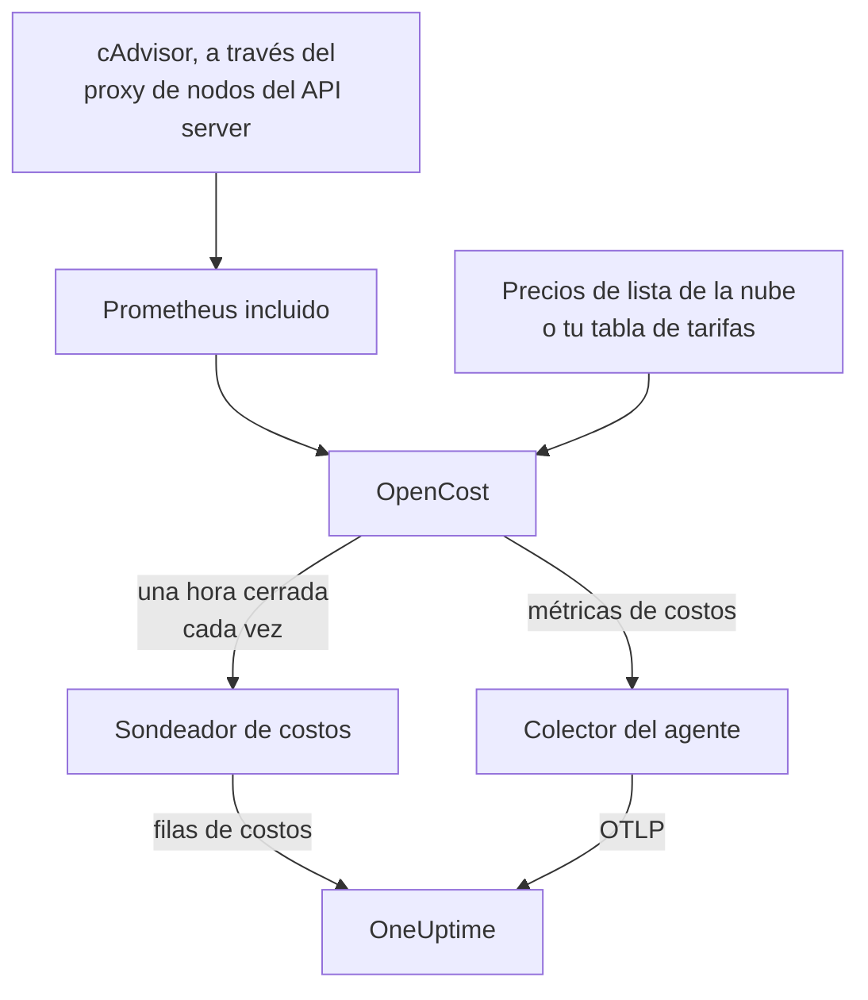

# Observabilidad de costos de Kubernetes

Mira cuánto cuesta cada carga de trabajo de Kubernetes — el gasto por namespace, carga de trabajo y pod, la capacidad ociosa y qué parte de cada solicitud se usa — junto a las métricas, los logs y las trazas que ya recopila el [agente de Kubernetes](/docs/telemetry/kubernetes-agent). Un solo valor de Helm lo activa, sin credenciales de la nube, y la página **Costos** del clúster te dice entonces qué solicitudes reducir.

:::cards
- [Actívalo](#activa-la-observabilidad-de-costos): Un `helm upgrade`.
- [Usa tu propio motor](#ya-ejecutas-kubecost-u-opencost): Apunta el agente a Kubecost u OpenCost.
- [Ajuste de tamaño](#ajuste-de-tamaño): Recomendaciones de solicitudes y cómo se calculan.
- [Solución de problemas](#solución-de-problemas): Páginas vacías, recomendaciones que faltan.
:::

## Cómo funciona

Con `cost.enabled=true`, el chart ejecuta cuatro cosas junto al agente:



1. **OpenCost**, el motor de costos de código abierto (Apache-2.0, CNCF; el [cost-model](https://github.com/kubecost/cost-model) en el que también se basa Kubecost). Vigila el clúster, pone precio a tus nodos, volúmenes y balanceadores de carga, y calcula cuánto cuesta cada carga de trabajo.
2. **Un Prometheus pequeño**, que OpenCost necesita para el historial de uso y de precios. Ejecuta una réplica, conserva 7 días de historial y recopila exactamente dos destinos: cAdvisor a través del proxy de nodos del API server, y el propio OpenCost (que emite sus propias métricas de solicitudes de recursos, así que kube-state-metrics no interviene). Nunca se expone fuera del clúster, y sus datos nunca salen de él.
3. **El sondeador de costos** (`cost.agent`). Una vez por cada hora cerrada lee la Allocation API de OpenCost y envía a OneUptime una fila de costos por carga de trabajo: CPU, memoria, GPU, volúmenes, red, balanceadores de carga y capacidad ociosa, con la eficiencia. Cada hora se envía una vez; el servidor omite una hora que ya tiene, así que un reinicio no puede contar el gasto dos veces.
4. **Una recopilación de métricas de costos** (`cost.metrics`). El colector del agente recopila las métricas de costos de OpenCost y las envía con el resto de las métricas del clúster.

OpenCost pone precio a los nodos a partir de los precios de lista públicos de tu proveedor de nube (AWS, Google Cloud, Azure), sin credenciales. Los clústeres sin precio de lista en la nube establecen en su lugar una [tabla de tarifas](#precios-on-prem-y-bare-metal).

## Activa la observabilidad de costos

:::steps
### Actualiza el agente con cost.enabled

```bash
helm upgrade kubernetes-agent oneuptime/kubernetes-agent \
  --namespace oneuptime-agent \
  --reset-then-reuse-values \
  --set cost.enabled=true
```

Esa es una instalación completa: dos pods pequeños más, OpenCost y su Prometheus. Si instalaste el agente con otro nombre de release u otro namespace, usa los tuyos (`helm list -A | grep kubernetes-agent` los muestra).

### Espera a la primera hora cerrada

Los primeros costos aparecen cuando se cierra la primera hora completa, y OpenCost necesita unos minutos después de arrancar para poner precio a su primera hora.

### Abre las páginas de costos

- **Productos → Infraestructura → Kubernetes → Costos** muestra el gasto de todos los clústeres del proyecto.
- En un clúster, **Costos** muestra la tendencia de su gasto, **Gasto por espacio de nombres** con el desglose de CPU, memoria y almacenamiento, **Gasto por carga de trabajo**, el gasto ocioso, la eficiencia y la tarjeta **Ajuste de tamaño**.
:::

Las métricas de costos (`node_total_hourly_cost`, `pv_hourly_cost` y las demás) son métricas normales: están en el explorador de métricas, en los dashboards personalizados y en los monitores de métricas. Para un dashboard ya hecho, ve a **Productos → Paneles**, selecciona **Crear Panel** y elige **Kubernetes Cost Dashboard**: tendencias del costo por hora de los nodos, costos unitarios de CPU y memoria, y gasto en volúmenes y balanceadores de carga.

## ¿Ya ejecutas Kubecost u OpenCost?

Apunta el agente a tu motor en su lugar, y no se incluye nada:

```bash
helm upgrade kubernetes-agent oneuptime/kubernetes-agent \
  --namespace oneuptime-agent \
  --reset-then-reuse-values \
  --set cost.enabled=true \
  --set cost.engine.url=http://kubecost-cost-analyzer.kubecost.svc.cluster.local:9090
```

| Motor | URL de servicio habitual |
| --- | --- |
| OpenCost | `http://opencost.opencost.svc.cluster.local:9003` |
| Kubecost | `http://kubecost-cost-analyzer.kubecost.svc.cluster.local:9090` |

La ruta de la Allocation API se encuentra sola (`/model/allocation` para Kubecost, `/allocation/compute` o `/allocation` para OpenCost). Establece `cost.engine.allocationPath` solo en una instalación poco habitual. Para las recomendaciones de memoria, establece también `cost.engine.prometheusUrl` (consulta [Los datos detrás](#los-datos-detrás)).

## Precios on-prem y bare metal

Los clústeres cuyos nodos no tienen precio de lista público en la nube pueden establecer una tabla de tarifas. OpenCost pone entonces precio a cada recurso a partir de estas cifras, todas en USD por hora de recurso:

```yaml title="values.yaml"
cost:
  enabled: true
  opencost:
    customPricing:
      enabled: true
      cpuPerCoreHour: "0.031611"       # ~$23 per core-month
      ramPerGiBHour: "0.004237"        # ~$3 per GiB-month
      storagePerGBHour: "0.00005479452" # ~$0.04 per GB-month
      gpuPerHour: "0.95"
```

## Ajustes que conviene conocer

Todos son opcionales; el `values.yaml` del chart tiene la lista completa:

```yaml title="values.yaml"
cost:
  agent:
    windowSeconds: 3600   # allocation window length (hourly = native)
    includeIdle: true     # ship the engine's __idle__ allocation
    currency: USD         # currency code shown in the UI (informational)
  prometheus:
    retention: 7d         # bundled TSDB history; right-sizing reads peaks back over days
    persistence:
      enabled: false      # set true for a small PVC; emptyDir otherwise
  metrics:
    enabled: true         # cost metrics for dashboards / Metric Explorer
    scrapeInterval: 60s
```

## Ajuste de tamaño

La tarjeta **Ajuste de tamaño** de la página **Costos** de un clúster recomienda una solicitud de CPU y otra de memoria para cada contenedor del que tiene suficiente historial, ordenadas por cuánto ahorra cada cambio al mes.

Una recomendación es la demanda observada más un 25% de margen, redondeada a un valor que puedes pegar en un manifiesto (10m de CPU, 16Mi de memoria):

- La CPU se dimensiona a partir del percentil 95 del uso medio por hora: lo bastante alto para cubrir la carga real, lo bastante bajo para que un solo pico no infle la solicitud durante un mes.
- La memoria se dimensiona a partir del working set máximo, nunca de una media (consulta [Los datos detrás](#los-datos-detrás)).

Se recomiendan las solicitudes; los límites no. Una solicitud es lo que reserva el scheduler y aquello a partir de lo que se calcula la factura, así que es la cifra que mueve el costo. Un límite es una decisión sobre si un contenedor que se comporta mal debe limitarse o terminarse, y los datos de uso no pueden tomarla por ti.

Cada contenedor se compara con su solicitud actual:

| Veredicto | Qué significa |
| --- | --- |
| Sobredimensionado | Reserva claramente más de lo que usa. De aquí salen los ahorros. |
| Infradimensionado | Reserva menos de lo que usa, así que se limita o corre el riesgo de un OOM kill. Corregirlo cuesta dinero, y la tarjeta lo muestra como un aumento. |
| Sin solicitud | No hay nada que reducir, pero el scheduler no puede colocar el contenedor de forma segura, y es el primero en ser desalojado bajo presión. |

Un contenedor que está a menos de un 15% de su recomendación cuenta como bien dimensionado y se omite: nadie debería editar un manifiesto para quitarle un 3% a una solicitud.

Dos salvaguardas mantienen honestos los consejos. Una carga de trabajo necesita al menos 24 horas de ventanas de costos antes de dimensionarse, porque una ventana de cuatro horas puede pillar en reposo un trabajo por lotes nocturno y aconsejar reducirlo a nada. Y los ahorros se proyectan a partir de la duración de la ventana que estás mirando, no del número de filas, así que el ahorro de un Deployment no se multiplica por su número de réplicas. La estimación supone que el gasto escala con lo que asignó el motor, que es `max(request, usage)`; para un contenedor sobredimensionado eso es la solicitud, así que la cifra de ahorro es exacta.

### Los datos detrás

Además del gasto, el sondeador recopila lo que necesita una recomendación: las solicitudes, los límites y el uso de CPU y memoria de cada contenedor.

La memoria necesita una fuente más. La Allocation API solo informa de una media por ventana, y una media por hora oculta el pico que provoca el OOM kill de un contenedor, así que dimensionar la memoria a partir de ella sería peligroso. En su lugar, el sondeador lee el pico de memoria de cada contenedor en Prometheus, unido por `(namespace, pod, container)`:

- Con el motor incluido (el predeterminado), usa el propio Prometheus del chart. No hay nada que establecer.
- Con tu propio motor (`cost.engine.url`), apunta `cost.engine.prometheusUrl` a un Prometheus que recopile cAdvisor, y establece `cost.engine.prometheusCadvisorJob` si su job de recopilación no se llama `kubernetes-nodes-cadvisor`.
- Sin Prometheus, las recomendaciones de CPU siguen funcionando, a partir de las medias por hora guardadas, y las recomendaciones de memoria se omiten en lugar de adivinarse.

Una caída de Prometheus nunca detiene la recopilación del gasto: los picos son un extra, y una hora se envía sin ellos. La CPU no usa Prometheus a propósito: una solicitud de CPU demasiado grande solo limita, donde una solicitud de memoria demasiado pequeña termina el contenedor, así que las medias por hora son seguras para la CPU, y consultar la tasa de CPU de cada contenedor en todo un clúster es lo bastante pesado como para tumbar un Prometheus pequeño.

## Alertas sobre costos

Las métricas de costos son métricas normales, así que un [monitor de métricas](/docs/monitor/metrics-monitor) puede alertar sobre ellas como sobre cualquier otra: por ejemplo, cuando la media de `node_total_hourly_cost` supera un presupuesto, o cuando aparece `pv_hourly_cost` para una clase de volumen que no debería existir en un clúster.

## Modelo de datos y retención

Las filas de costos se guardan en ClickHouse, una por clúster, ventana, namespace, controlador, pod y contenedor. Siguen la retención de telemetría del clúster: el `retainTelemetryDataForDays` del clúster, o la retención de datos del proyecto cuando no está establecido. La capacidad ociosa y la no asignada se guardan como filas normales en los namespaces `__idle__` y `__unallocated__`, así que se agrupan y se filtran como el gasto de las cargas de trabajo.

## Solución de problemas

:::details Las páginas de costos están vacías
Lee los logs del sondeador de costos: `kubectl logs -n oneuptime-agent deploy/kubernetes-agent-cost`. (El deployment es `<release>-kubernetes-agent-cost` cuando el nombre de la release no contiene `kubernetes-agent`; `kubectl get deploy -n oneuptime-agent` los muestra.) `HTTP 401` significa que OneUptime rechazó la clave de ingesta. `did not answer any known allocation path` significa que el motor aún no está listo (el OpenCost incluido necesita unos minutos para poner precio a sus primeras horas) o que `cost.engine.url` es incorrecta.
:::

:::details El OpenCost incluido no está listo
Lee sus logs: `kubectl logs -n oneuptime-agent deploy/kubernetes-agent-opencost`. Indican qué proveedor de nube detectó y si se cargaron sus datos de precios.
:::

:::details El log de OpenCost dice mkdir /var/configs: permission denied
Un chart más antiguo ejecutaba OpenCost sin un directorio de configuración con permisos de escritura, así que `Error downloading default pricing data` dejaba su Allocation API sin poder responder y el sondeador se detenía, mientras el pod seguía en `Running`, `/healthz` seguía en verde y las métricas de costos de los nodos se seguían publicando. Los charts actuales lo corrigen: ejecuta `helm repo update` y luego actualiza con `--reset-then-reuse-values`. Las filas de costos aparecen en el siguiente sondeo.
:::

:::details El Kubernetes Cost Dashboard no muestra datos
La plantilla lee las métricas de costos recopiladas: comprueba que `cost.metrics.enabled` es `true`.
:::

:::details La tarjeta Ajuste de tamaño está vacía
O el intervalo de tiempo es más corto que las 24 horas que necesita una recomendación (amplíalo), o todos los contenedores ya están a menos de un 15% de su solicitud recomendada, lo que indica la tarjeta.
:::

:::details Las recomendaciones de memoria muestran -, pero las de CPU funcionan
No llegó ningún pico de memoria a OneUptime, así que la memoria se dejó sin dimensionar en lugar de adivinarla a partir de una media. Con tu propio motor, establece `cost.engine.prometheusUrl`. La tarjeta indica a cuántos contenedores afecta.
:::

:::details Las cifras difieren de la interfaz propia del motor
OneUptime incluye los ajustes de conciliación del motor en cada componente del costo y envía horas completas y cerradas: el gasto de la hora actual aparece cuando se cierra.
:::

:::details El Prometheus incluido se reinició
Con el almacenamiento `emptyDir` predeterminado, un reinicio pierde unas horas de historial de uso, así que los costos de esas horas pueden salir más bajos. Establece `cost.prometheus.persistence.enabled=true` si eso te importa.
:::

## Próximos pasos

:::cards
- [Agente de Kubernetes](/docs/telemetry/kubernetes-agent): Instala el agente y todo lo demás que recopila.
- [Monitor de métricas](/docs/monitor/metrics-monitor): Alerta cuando el gasto supera un presupuesto.
- [Monitor de Kubernetes](/docs/monitor/kubernetes-monitor): Alerta también sobre la salud del clúster.
:::
