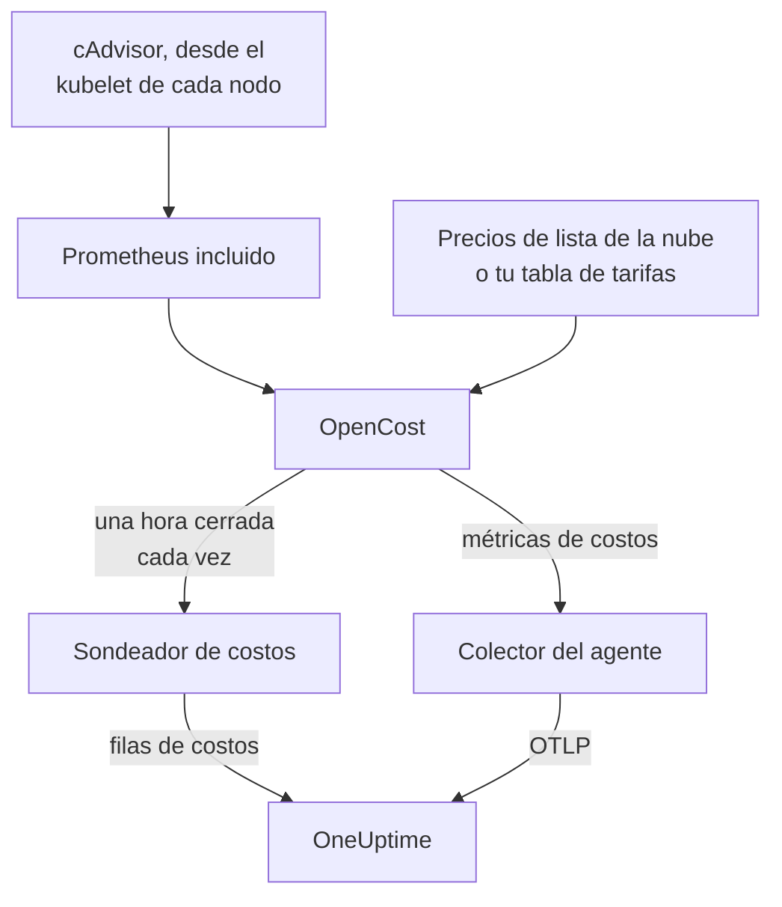

# Observabilidad de costos de Kubernetes

Mira cuánto cuesta cada carga de trabajo de Kubernetes — el gasto por namespace, carga de trabajo y pod, la capacidad ociosa y qué parte de cada solicitud se usa — junto a las métricas, los logs y las trazas que ya recopila el [agente de Kubernetes](/docs/telemetry/kubernetes-agent). La observabilidad de costos viene activada por defecto, sin credenciales de la nube: la vista general del clúster dice cuánto cuesta, su página **Costos** te dice qué solicitudes reducir, y las métricas de costos se pueden graficar y usar para alertas como cualquier otra.

:::cards
- [Actívalo](#activa-la-observabilidad-de-costos): Activo por defecto; un `helm upgrade` donde no lo está.
- [Alertas sobre costos](#alertas-sobre-costos): El costo por clúster, namespace y carga de trabajo, como métricas.
- [Tu propio motor](#ya-ejecutas-kubecost-u-opencost): El Kubecost u OpenCost que ya ejecutas se detecta y se lee.
- [Ajuste de tamaño](#ajuste-de-tamaño): Recomendaciones de solicitudes y cómo se calculan.
- [Solución de problemas](#solución-de-problemas): Páginas vacías, recomendaciones que faltan.
:::

## Cómo funciona

Con el monitoreo de costos activado, como lo está por defecto (`cost.enabled: auto`), el chart ejecuta cuatro cosas junto al agente:



1. **OpenCost**, el motor de costos de código abierto (Apache-2.0, CNCF; el [cost-model](https://github.com/kubecost/cost-model) en el que también se basa Kubecost). Vigila el clúster, pone precio a tus nodos, volúmenes y balanceadores de carga, y calcula cuánto cuesta cada carga de trabajo.
2. **Un Prometheus pequeño**, que OpenCost necesita para el historial de uso y de precios. Ejecuta una réplica, conserva 7 días de historial y recopila exactamente dos destinos: cAdvisor en el kubelet de cada nodo (a través del proxy de nodos del API server con el preset `eks-fargate`, donde ningún pod llega a un kubelet), conservando solo las series que lee OpenCost, y el propio OpenCost (que emite sus propias métricas de solicitudes de recursos, así que kube-state-metrics no interviene). Nunca se expone fuera del clúster, y sus datos nunca salen de él.
3. **El sondeador de costos** (`cost.agent`). Una vez por cada hora cerrada lee la Allocation API de OpenCost y envía a OneUptime una fila de costos por carga de trabajo: CPU, memoria, GPU, volúmenes, red, balanceadores de carga y capacidad ociosa, con la eficiencia. Cada hora se envía una vez; el servidor omite una hora que ya tiene, así que un reinicio no puede contar el gasto dos veces. OneUptime también escribe las [métricas de costos](#alertas-sobre-costos) a partir de estas filas.
4. **Una recopilación de métricas de costos** (`cost.metrics`). El colector del agente recopila las métricas de precios de OpenCost, lo que cuesta por hora cada nodo, volumen y balanceador de carga, y las envía con el resto de las métricas del clúster.

OpenCost pone precio a los nodos a partir de los precios de lista públicos de tu proveedor de nube (AWS, Google Cloud, Azure), sin credenciales. En otros entornos usa sus tarifas predeterminadas, que una [tabla de tarifas](#precios-on-prem-y-bare-metal) propia sustituye.

Los tres pods solicitan entre todos unos 150m de CPU y 450Mi de memoria. El monitoreo de costos está desactivado por defecto con los presets `gke-autopilot` y `eks-fargate`: esas plataformas facturan cada pod por lo que solicita, así que los pods de costos aumentarían la factura que miden, y OpenCost pone precio a los nodos, que no es como cobra ninguna de las dos plataformas.

## Activa la observabilidad de costos

Una instalación nueva no necesita nada: el monitoreo de costos está activado por defecto. Actualiza un agente instalado antes de que lo estuviera, o actívalo con el preset `gke-autopilot` o `eks-fargate`:

:::steps
### Actualiza el agente

```bash
helm upgrade kubernetes-agent oneuptime/kubernetes-agent \
  --namespace oneuptime-agent \
  --reset-then-reuse-values \
  --set cost.enabled=true
```

Esa es una instalación completa: tres pods pequeños más, OpenCost, su Prometheus y el agente de costos. Si instalaste el agente con otro nombre de release u otro namespace, usa los tuyos (`helm list -A | grep kubernetes-agent` los muestra). Para desactivar el monitoreo de costos, establece `--set cost.enabled=false` de la misma forma.

### Espera a la primera hora cerrada

Los primeros costos aparecen cuando se cierra la primera hora completa, y OpenCost necesita unos minutos después de arrancar para poner precio a su primera hora.

### Abre las páginas de costos

- **Productos → Infraestructura → Kubernetes → Costos** muestra el gasto de todos los clústeres del proyecto.
- En un clúster, la vista general muestra su gasto de las últimas 24 horas, una proyección mensual, el gasto ocioso, la eficiencia y sus namespaces y cargas de trabajo más costosos.
- En un clúster, **Costos** muestra la tendencia de su gasto, **Gasto por espacio de nombres** con el desglose de CPU, memoria y almacenamiento, **Gasto por carga de trabajo**, el gasto ocioso, la eficiencia y la tarjeta **Ajuste de tamaño**.
:::

Las métricas de costos (`node_total_hourly_cost`, `pv_hourly_cost` y las demás) son métricas normales: están en el explorador de métricas, en los dashboards personalizados y en los monitores de métricas. Para un dashboard ya hecho, ve a **Productos → Paneles**, selecciona **Crear panel** y elige **Kubernetes Cost Dashboard**: tendencias del costo por hora de los nodos, costos unitarios de CPU y memoria, y gasto en volúmenes y balanceadores de carga.

Bajo las cifras, la vista general y la página **Costos** dicen de dónde salen sus precios: los precios de lista de una nube, tu tabla de tarifas o las tarifas predeterminadas de OpenCost, sea cual sea el motor que pone precio al clúster, Kubecost 3 incluido. Un Kubecost que lee tu factura de la nube concilia sus precios con esa factura aproximadamente un día y medio después de cada hora, así que la línea dice entonces que las cifras son sus precios de lista de antes de esa conciliación. La eficiencia es una sola cifra en todas partes, incluida la métrica de eficiencia: cuánto de la CPU y la memoria solicitadas se usó, con la hora de cada contenedor ponderada por lo que cuestan su CPU y su memoria, así que un trabajo barato que no usa nada no puede arrastrar hacia abajo a un clúster bien aprovechado, y la capacidad ociosa no se cuenta.

## ¿Ya ejecutas Kubecost u OpenCost?

El agente de costos detecta tu motor y lo lee en lugar del OpenCost incluido, así que los precios del clúster son los que configuraste: tu tabla de tarifas, o tu factura de la nube detrás de Kubecost. Al arrancar, y luego cada hora, busca a través de la API de Kubernetes, en cualquier namespace, los Services creados por los propios charts de los motores (`cost-analyzer` o `frontend` de Kubecost, el del chart de OpenCost y el Service `opencost` que crea su manifiesto), Kubecost primero. Descarta un motor que no responde, que pide un inicio de sesión o que responde por varios clústeres, y entonces lee el incluido. El colector recopila entonces también las métricas de precios de tu motor para el Kubernetes Cost Dashboard, así que el dashboard y las páginas de costos muestran los mismos precios, y el ajuste de tamaño lee sus picos de memoria del Prometheus que lee tu motor.

La vista general del clúster nombra entonces tu motor y dice que el OpenCost incluido no hace falta. Deja de ejecutarlo:

```bash
helm upgrade kubernetes-agent oneuptime/kubernetes-agent \
  --namespace oneuptime-agent \
  --reset-then-reuse-values \
  --set cost.engine.url=auto
```

Con `cost.engine.url=auto` no se incluye nada, y el agente lee tu motor dondequiera que se ejecute; sin ningún motor instalado, no se pone precio a nada. El chart no puede buscar un motor por sí mismo: el `lookup` de Helm no ve nada con `helm template`, con Argo CD ni en una ejecución de prueba. Para conservar el OpenCost incluido junto a tu propio motor, establece `cost.engine.preferExisting=false`; para indicar qué motor leer, establece `cost.engine.url` en su Service:

| Motor | URL de servicio habitual |
| --- | --- |
| OpenCost | `http://opencost.opencost.svc.cluster.local:9003` |
| Kubecost 2 | `http://kubecost-cost-analyzer.kubecost.svc.cluster.local:9090` |
| Kubecost 3 | `http://kubecost-frontend.kubecost.svc.cluster.local:9090` |

La ruta de la Allocation API se encuentra sola (`/model/allocation` para Kubecost, `/allocation/compute` o `/allocation` para OpenCost). Establece `cost.engine.allocationPath` solo en una instalación poco habitual. El Prometheus que lee tu motor también se encuentra solo, para las recomendaciones de memoria, salvo con Kubecost 3, que no lee ninguno: entonces establece `cost.engine.prometheusUrl` (consulta [Los datos detrás](#los-datos-detrás)). Las métricas de precios se encuentran del mismo modo, sea cual sea el Service del motor que indiques: el agente prueba su `/metrics`, luego el `/model/metrics` que un frontend de Kubecost 2 o la interfaz de OpenCost pasa al motor, luego el agente FinOps de Kubecost 3, y el colector recopila la primera dirección que tiene series de precios. Para indicarlas tú mismo, establece `cost.metrics.endpoint`.

## Precios on-prem y bare metal

Los clústeres cuyos nodos no tienen precio de lista público en la nube pueden establecer una tabla de tarifas. Sin ella, OpenCost pone precio a esos nodos con sus tarifas predeterminadas (on-prem, bare metal, kind, k3s), que pueden estar muy lejos de lo que cuesta tu hardware, y la vista general y la página **Costos** del clúster lo indican; en una nube que reconoce, un nodo conserva su precio de lista, y una tabla de tarifas solo pone precio a lo que le falta a la lista. Con una tabla de tarifas, OpenCost pone entonces precio a cada recurso a partir de estas cifras, todas en USD por hora de recurso:

```yaml title="values.yaml"
cost:
  enabled: true
  opencost:
    customPricing:
      enabled: true
      cpuPerCoreHour: "0.031611"       # ~$23 per core-month
      ramPerGiBHour: "0.004237"        # ~$3 per GiB-month
      storagePerGBHour: "0.00005479452" # ~$0.04 per GB-month
      gpuPerHour: "0.95"
```

Estas son las tarifas predeterminadas del propio OpenCost: pon tus propias cifras, o la página **Costos** seguirá diciendo que el clúster tiene las tarifas predeterminadas de OpenCost.

## Ajustes que conviene conocer

Todos son opcionales; el `values.yaml` del chart tiene la lista completa:

```yaml title="values.yaml"
cost:
  enabled: auto           # on, except with the gke-autopilot and eks-fargate presets
  agent:
    windowSeconds: 3600   # allocation window length (hourly = native)
    includeIdle: true     # ship the engine's __idle__ allocation
    currency: USD         # currency code shown in the UI (informational)
  prometheus:
    retention: 7d         # bundled TSDB history; right-sizing reads peaks back over days
    persistence:
      enabled: false      # set true for a small PVC; emptyDir otherwise
  metrics:
    enabled: true         # cost metrics for dashboards / Metric Explorer
    scrapeInterval: 60s
```

## Ajuste de tamaño

La tarjeta **Ajuste de tamaño** de la página **Costos** de un clúster recomienda una solicitud de CPU y otra de memoria para cada contenedor del que tiene suficiente historial, ordenadas por cuánto ahorra cada cambio al mes.

Una recomendación es la demanda observada más un 25% de margen, redondeada a un valor que puedes pegar en un manifiesto (10m de CPU, 16Mi de memoria):

- La CPU se dimensiona a partir del percentil 95 del uso medio por hora: lo bastante alto para cubrir la carga real, lo bastante bajo para que un solo pico no infle la solicitud durante un mes.
- La memoria se dimensiona a partir del working set máximo, nunca de una media (consulta [Los datos detrás](#los-datos-detrás)).

Se recomiendan las solicitudes; los límites no. Una solicitud es lo que reserva el scheduler y aquello a partir de lo que se calcula la factura, así que es la cifra que mueve el costo. Un límite es una decisión sobre si un contenedor que se comporta mal debe limitarse o terminarse, y los datos de uso no pueden tomarla por ti.

Cada contenedor se compara con su solicitud actual:

| Veredicto | Qué significa |
| --- | --- |
| Sobredimensionado | Reserva claramente más de lo que usa. De aquí salen los ahorros. |
| Infradimensionado | Reserva menos de lo que usa, así que se limita o corre el riesgo de un OOM kill. Corregirlo cuesta dinero, y la tarjeta lo muestra como un aumento. |
| Sin solicitud | No hay nada que reducir, pero el scheduler no puede colocar el contenedor de forma segura, y es el primero en ser desalojado bajo presión. |

Un contenedor que está a menos de un 15% de su recomendación cuenta como bien dimensionado y se omite: nadie debería editar un manifiesto para quitarle un 3% a una solicitud.

Dos salvaguardas mantienen honestos los consejos. Una carga de trabajo necesita al menos 24 horas de ventanas de costos antes de dimensionarse, porque una ventana de cuatro horas puede pillar en reposo un trabajo por lotes nocturno y aconsejar reducirlo a nada. Y los ahorros se proyectan a partir de la duración de la ventana que estás mirando, no del número de filas, así que el ahorro de un Deployment no se multiplica por su número de réplicas. La estimación supone que el gasto escala con lo que asignó el motor, que es `max(request, usage)`; para un contenedor sobredimensionado eso es la solicitud, así que la cifra de ahorro es exacta.

### Los datos detrás

Además del gasto, el sondeador recopila lo que necesita una recomendación: las solicitudes, los límites y el uso de CPU y memoria de cada contenedor.

La memoria necesita una fuente más. La Allocation API solo informa de una media por ventana, y una media por hora oculta el pico que provoca el OOM kill de un contenedor, así que dimensionar la memoria a partir de ella sería peligroso. En su lugar, el sondeador lee el pico de memoria de cada contenedor en Prometheus, unido por `(namespace, pod, container)`:

- Con el motor incluido (el predeterminado), usa el propio Prometheus del chart. No hay nada que establecer.
- Con tu propio motor, usa el Prometheus que lee ese motor, que el agente encuentra solo: el `PROMETHEUS_SERVER_ENDPOINT` de OpenCost, o el Prometheus que incluye Kubecost 2, una vez que responde por las series de cAdvisor de este clúster. Kubecost 3 no lee ninguno, así que el Prometheus incluido ocupa su lugar mientras el chart lo ejecute.
- Si no, o para elegir uno tú mismo, apunta `cost.engine.prometheusUrl` a un Prometheus que recopile cAdvisor, y establece `cost.engine.prometheusCadvisorJob` si recopila cAdvisor en varios jobs y el que hay que leer no se llama `kubernetes-nodes-cadvisor`. Sin Prometheus, las recomendaciones de CPU siguen funcionando, a partir de las medias por hora guardadas, y las recomendaciones de memoria se omiten en lugar de adivinarse.

Una caída de Prometheus nunca detiene la recopilación del gasto: los picos son un extra, y una hora se envía sin ellos. La CPU no usa Prometheus a propósito: una solicitud de CPU demasiado grande solo limita, donde una solicitud de memoria demasiado pequeña termina el contenedor, así que las medias por hora son seguras para la CPU, y consultar la tasa de CPU de cada contenedor en todo un clúster es lo bastante pesado como para tumbar un Prometheus pequeño.

## Alertas sobre costos

OneUptime escribe cuatro métricas a partir de las filas de costos de cada hora, con su precio y con nombres que dicen lo que son, así que el costo se puede graficar, poner en un dashboard y usar para alertas en un [monitor de Kubernetes](/docs/monitor/kubernetes-monitor) o en un [monitor de métricas](/docs/monitor/metrics-monitor):

| Métrica | Qué es | Atributos |
| --- | --- | --- |
| `oneuptime.kubernetes.cost.total` | Lo que costó el clúster en cada hora, incluida la capacidad ociosa | `k8s.cluster.name` |
| `oneuptime.kubernetes.cost.idle` | La parte que no usó ninguna carga de trabajo: la capacidad ociosa y la no asignada | `k8s.cluster.name` |
| `oneuptime.kubernetes.cost.workload` | Lo que costó cada carga de trabajo en cada hora; sumado por namespace, lo que costó el namespace | `k8s.cluster.name`, `k8s.namespace.name` y el nombre de la carga de trabajo bajo su tipo, como `k8s.deployment.name` |
| `oneuptime.kubernetes.cost.efficiency` | Cuánto de la CPU y la memoria solicitadas usó cada carga de trabajo, en porcentaje, ponderado por costo | Los de la carga de trabajo, como arriba |

Cada punto es el costo de una hora, en la moneda del agente (USD por defecto), con la marca de tiempo del inicio de la hora y escrito aproximadamente una hora después de que termina: suma los puntos en una ventana de horas, y los de un día dan el costo del día. Proceden de lo que el clúster ya envió, así que no se facturan como métricas ingeridas, y se conservan tanto tiempo como las demás métricas del clúster.

El monitor de Kubernetes tiene tres plantillas para ellas: Cluster Daily Cost Over Budget, Namespace Daily Cost Over Budget y High Idle Spend, cada una con un presupuesto que debes ajustar al tuyo. Las métricas de precios de OpenCost también son métricas normales: un monitor de métricas puede alertar cuando la media de `node_total_hourly_cost` supera un presupuesto, o cuando aparece `pv_hourly_cost` para una clase de volumen que no debería existir en un clúster.

## Modelo de datos y retención

Las filas de costos se guardan en ClickHouse, una por clúster, ventana, namespace, controlador, pod y contenedor. Siguen la retención de telemetría del clúster: el `retainTelemetryDataForDays` del clúster, o la retención de datos del proyecto cuando no está establecido. La capacidad ociosa y la no asignada se guardan como filas normales en los namespaces `__idle__` y `__unallocated__`, así que se agrupan y se filtran como el gasto de las cargas de trabajo.

## Solución de problemas

:::details Las páginas de costos están vacías
Con los presets `gke-autopilot` y `eks-fargate`, el monitoreo de costos está desactivado por defecto: actívalo con `--set cost.enabled=true`. Si no, lee los logs del sondeador de costos: `kubectl logs -n oneuptime-agent deploy/kubernetes-agent-cost`. (El deployment es `<release>-kubernetes-agent-cost` cuando el nombre de la release no contiene `kubernetes-agent`; `kubectl get deploy -n oneuptime-agent` los muestra.) `HTTP 401` significa que OneUptime rechazó la clave de ingesta. `did not answer any known allocation path` significa que el motor aún no está listo (el OpenCost incluido necesita unos minutos para poner precio a sus primeras horas) o que `cost.engine.url` es incorrecta.
:::

:::details El OpenCost incluido no está listo
Lee sus logs: `kubectl logs -n oneuptime-agent deploy/kubernetes-agent-opencost`. Indican qué proveedor de nube detectó y si se cargaron sus datos de precios.
:::

:::details La vista general dice que el OpenCost incluido no hace falta
El clúster ejecuta su propio Kubecost u OpenCost, y el agente de costos lee ese, así que el OpenCost que incluyó el chart no pone precio a nada. Actualiza con `--set cost.engine.url=auto` para dejar de ejecutarlo junto con su Prometheus, o establece `cost.engine.preferExisting=false` para leer en su lugar el motor incluido. Con Kubecost 3, que no lee ningún Prometheus, las recomendaciones de memoria salen del incluido: indica otro con `cost.engine.prometheusUrl` en la misma actualización.
:::

:::details El agente de costos no lee tu motor
Su log dice qué motor lee y por qué descartó los demás: `kubectl logs -n oneuptime-agent deploy/kubernetes-agent-cost`. Descarta un motor que no responde (por ejemplo, por una NetworkPolicy entre los namespaces), que pide un inicio de sesión o que responde por varios clústeres, como hace un Kubecost que federa otros. Indica qué motor leer con `cost.engine.url`.
:::

:::details El log de OpenCost dice mkdir /var/configs: permission denied
Un chart más antiguo ejecutaba OpenCost sin un directorio de configuración con permisos de escritura, así que `Error downloading default pricing data` dejaba su Allocation API sin poder responder y el sondeador se detenía, mientras el pod seguía en `Running`, `/healthz` seguía en verde y las métricas de costos de los nodos se seguían publicando. Los charts actuales lo corrigen: ejecuta `helm repo update` y luego actualiza con `--reset-then-reuse-values`. Las filas de costos aparecen en el siguiente sondeo.
:::

:::details El Kubernetes Cost Dashboard no muestra datos
La plantilla lee las métricas de costos recopiladas: comprueba que `cost.metrics.enabled` es `true`. El agente de costos encuentra dónde las sirve el motor que lee, el incluido o el tuyo, y su log dice dónde o qué direcciones probó: `kubectl logs -n oneuptime-agent deploy/kubernetes-agent-cost`. Para indicarlas tú mismo, establece `cost.metrics.endpoint`.
:::

:::details La tarjeta Ajuste de tamaño está vacía
O el intervalo de tiempo es más corto que las 24 horas que necesita una recomendación (amplíalo), o todos los contenedores ya están a menos de un 15% de su solicitud recomendada, lo que indica la tarjeta.
:::

:::details Las recomendaciones de memoria muestran -, pero las de CPU funcionan
No llegó ningún pico de memoria a OneUptime, así que la memoria se dejó sin dimensionar en lugar de adivinarla a partir de una media. Con tu propio motor, el log del agente de costos dice qué Prometheus lee o por qué no encontró ninguno: indica uno con `cost.engine.prometheusUrl` (Kubecost 3 no lee ninguno). La tarjeta indica a cuántos contenedores afecta.
:::

:::details Las cifras difieren de la interfaz propia del motor
OneUptime envía horas completas y cerradas, tal como el motor les puso precio al cerrarse, con sus ajustes de conciliación incluidos: el gasto de la hora actual aparece cuando se cierra. Un Kubecost que lee tu factura de la nube concilia cada hora con ella aproximadamente un día y medio después, y OneUptime conserva la hora tal como se le puso precio por primera vez.
:::

:::details El Prometheus incluido se reinició
Con el almacenamiento `emptyDir` predeterminado, un reinicio pierde unas horas de historial de uso, así que los costos de esas horas pueden salir más bajos. Establece `cost.prometheus.persistence.enabled=true` si eso te importa.
:::

## Próximos pasos

:::cards
- [Agente de Kubernetes](/docs/telemetry/kubernetes-agent): Instala el agente y todo lo demás que recopila.
- [Monitor de métricas](/docs/monitor/metrics-monitor): Alerta cuando el gasto supera un presupuesto.
- [Monitor de Kubernetes](/docs/monitor/kubernetes-monitor): Alerta también sobre la salud del clúster.
:::
