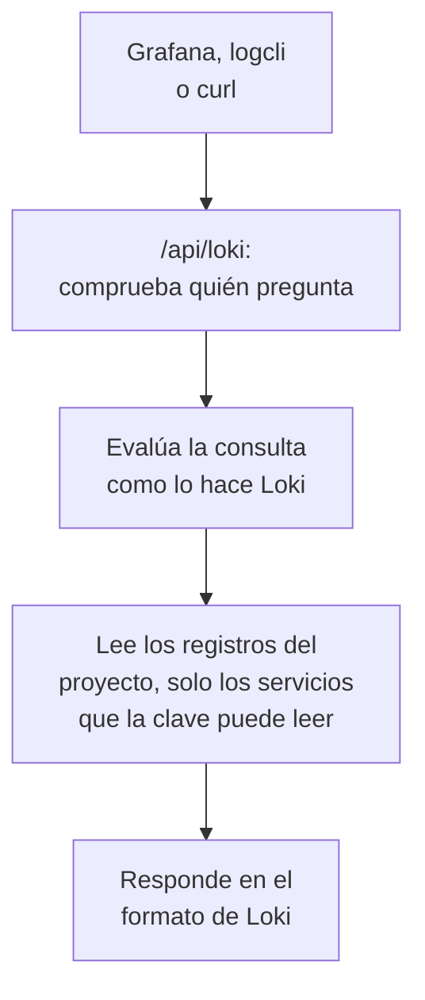

# Consultar registros con LogQL

LogQL es el lenguaje de consulta de Grafana Loki. OneUptime responde a la API de consultas de Loki sobre los registros de tu proyecto, así que la fuente de datos Loki de Grafana, logcli o cualquier cliente de Loki los lee, y los paneles y consultas guardadas que escribiste para Loki siguen funcionando.

:::cards
- [Conectar Grafana](#conectar-grafana): Añadir OneUptime como fuente de datos Loki.
- [Las etiquetas de los registros](#las-etiquetas-de-los-registros): Qué encuentra un selector de flujo.
- [Qué cubre LogQL](#qué-cubre-logql): Consultas de registros, analizadores y consultas de métricas.
- [Límites](#límites): Qué puede leer una consulta, y con qué frecuencia.
:::

## Cómo funciona

Grafana pregunta a OneUptime como pregunta a Loki. OneUptime comprueba que la clave de API pueda leer los registros del proyecto, lee solo los servicios que puede leer y evalúa la consulta como lo hace Loki.



## Antes de empezar

- **Registros que lleguen.** Envíalos con [OpenTelemetry](/docs/telemetry/open-telemetry), o desde Promtail, Grafana Alloy, Fluent Bit o Vector a través de [la API push de Loki](/docs/telemetry/compatible-endpoints).
- **Una clave de API del proyecto que lea registros**, con el rol Propietario del proyecto, Administrador del proyecto, Miembro del proyecto, Visor, Administrador de telemetría, Miembro de telemetría o Visor de telemetría, o el permiso Read Logs. Una clave limitada a algunos servicios solo lee sus registros. Consulta [Crear una clave de API](/docs/api-reference/api-reference#crear-una-clave-de-api). En OneUptime Cloud, las claves de API requieren el plan **Growth**.
- **No una clave de ingesta.** Una clave de ingesta envía telemetría y no lee nada, así que Grafana no puede iniciar sesión con ella.

## Conectar Grafana

:::steps
### Crear una clave de API

En OneUptime, abre **Ajustes del proyecto → Avanzado → Claves de API** y haz clic en **Crear Clave de API**. Dale a la clave un rol que pueda leer telemetría, o el permiso Read Logs.

### Añadir una fuente de datos de Loki

En Grafana, abre **Connections → Data sources → Add data source** y elige **Loki**.

### Introducir la URL

Pon en **URL** tu dirección de OneUptime seguida de `/api/loki`. En OneUptime Cloud, es `https://oneuptime.com/api/loki`.

### Enviar la clave de API

En **HTTP headers**, añade la cabecera `Authorization` con el valor `Bearer` seguido de un espacio y tu clave de API. La autenticación básica también funciona: cualquier nombre de usuario, con la clave de API como contraseña.

### Guardar y probar

Haz clic en **Save & test**. Grafana ejecuta una consulta y dice que la fuente de datos funciona.
:::

Explore, el volumen de registros sobre las líneas, los navegadores de etiquetas y los paneles leen entonces OneUptime como leen Loki. logcli y cualquier otro cliente de Loki funcionan igual. Con curl:

```bash title="Query OneUptime's Loki API"
curl -G -H "Authorization: Bearer $ONEUPTIME_API_KEY" \
  "https://oneuptime.com/api/loki/loki/api/v1/query_range" \
  --data-urlencode 'query={service_name="checkout"} |= "error"'
```

## Las etiquetas de los registros

Un selector de flujo encuentra los atributos de un registro, nombrados como Loki 3 nombra los registros de OpenTelemetry:

| En OneUptime | En LogQL |
| --- | --- |
| Un atributo de recurso `service.name` | La etiqueta `service_name` |
| Un atributo de recurso `k8s.pod.name` | La etiqueta `k8s_pod_name` |
| Un atributo `http.method` | La etiqueta `http_method` |
| Una etiqueta que envió un cliente de Loki, como `job` | La etiqueta `job` |
| La gravedad del registro | La etiqueta `detected_level`: `trace`, `debug`, `info`, `warn`, `error`, `fatal` o `unknown` |

- **Cada atributo es una etiqueta.** Una consulta de registros responde con un flujo por conjunto de etiquetas, así que los registros con atributos distintos son flujos distintos, como Loki 3 responde para registros con metadatos estructurados.
- **El atributo propio de un registro va primero** cuando su recurso tiene uno con el mismo nombre.
- **Un selector nombra un valor**, como pide Loki: al menos un selector que no cumpla un registro sin la etiqueta, como `{service_name="checkout"}` o `{service_name=~"check.+"}`.

Algunas consultas para empezar:

```text title="LogQL"
# The checkout service's lines that say error
{service_name="checkout"} |= "error"

# Requests slower than 250ms, read from JSON lines
{service_name="checkout"} | json | duration > 250ms

# Error logs per second, by service
sum by (service_name) (rate({detected_level="error"} [5m]))
```

## Qué cubre LogQL

- **Consultas de registros**: selectores de flujo con `=`, `!=`, `=~` y `!~`; filtros de línea `|=`, `!=`, `|~` y `!~`, con `or`; los analizadores `json` y `logfmt`; filtros de etiquetas sobre texto, números, duraciones y tamaños, con `and`, `or` y `__error__`; `line_format` con `{{.label}}`; `drop`, `keep` y `decolorize`.
- **Consultas de métricas**: `count_over_time`, `rate`, `bytes_over_time`, `bytes_rate` y `absent_over_time`; sobre una etiqueta tomada con `unwrap` (con `duration()` o `bytes()`), `rate`, `sum_over_time`, `avg_over_time`, `min_over_time`, `max_over_time`, `first_over_time`, `last_over_time`, `stddev_over_time`, `stdvar_over_time` y `quantile_over_time`; y `offset`.
- **Alrededor de ellas**: `sum`, `avg`, `min`, `max`, `count`, `stddev`, `stdvar`, `topk` y `bottomk`, con `by` o `without`; aritmética, comparaciones (con `bool`), `and`, `or` y `unless`, con `on`, `ignoring`, `group_left` y `group_right`; `sort`, `sort_desc`, `label_replace` y `vector()`.

Los analizadores `pattern`, `regexp` y `unpack`, `label_format`, `json` con campos con nombre, los filtros `ip()` y las plantillas de `line_format` más allá de `{{.label}}` aún no están disponibles. Una consulta que use uno se rechaza con un mensaje que lo nombra.

## La API

La API responde a las rutas de la API HTTP de Loki, con `GET` o `POST`, bajo `/api/loki`:

| Ruta | Qué responde |
| --- | --- |
| `/loki/api/v1/query_range` | Las líneas de una consulta de registros de `start` a `end`, o una consulta de métricas en cada `step`. |
| `/loki/api/v1/query` | Una consulta de métricas en un instante (`time`, por defecto ahora). |
| `/loki/api/v1/labels` | Los nombres de etiquetas, de los registros que selecciona `query` o de todos los registros. |
| `/loki/api/v1/label/<name>/values` | Los valores de una etiqueta. |
| `/loki/api/v1/series` | Los conjuntos de etiquetas de los registros que selecciona `match[]`. |

Los instantes son nanosegundos desde 1970, segundos Unix o RFC 3339, y un rango es la hora anterior a `end` salvo que diga otra cosa. Una consulta de registros responde con `limit` líneas, 100 por defecto, las más recientes primero salvo con `direction=forward`. Las respuestas están en el formato de Loki, y los errores son texto plano, como los escribe Loki. `/loki/api/v1/status/buildinfo` responde como un servidor Loki 3.

## Límites

Cada consulta está acotada, para que un panel con muchos gráficos no pueda sobrecargar OneUptime:

| Límite | Valor |
| --- | --- |
| Líneas con las que responde una consulta de registros | 5000 |
| Registros que lee una consulta de registros, cuando los filtros tras sus analizadores descartan algunos | 20 000 |
| Registros que lee por sí misma una consulta de métricas, cuando ClickHouse no puede contarlos | 100 000 |
| Series con las que responde una consulta de métricas | 500 |
| Puntos en una serie de una consulta de rango | 11 000 |
| Registros que devuelve una lectura | 64 MB |
| Tiempo que puede tardar una lectura | 30 segundos |
| Consultas que un proyecto puede enviar cada minuto | 1200 |

Una consulta de métricas cuyo pipeline son solo filtros de línea, como `sum(count_over_time({service_name="checkout"} |= "error" [5m]))`, se cuenta donde están los registros, así que no lee ninguna línea.

## Solución de problemas

:::details Grafana dice que la fuente de datos no funciona
Comprueba que la URL termine en `/api/loki`, y que la cabecera `Authorization` contenga `Bearer`, un espacio y la clave de API. Una clave de ingesta, o una clave de API sin un rol que lea registros, se rechaza: dale a la clave ese rol en **Ajustes del proyecto → Avanzado → Claves de API**.
:::

:::details "queries require at least one regexp or equality matcher that does not have an empty-compatible value"
El selector encuentra registros sin nombrar un valor, como `{service_name=~".*"}`. Añade un selector que nombre uno, como `{service_name="checkout"}`.
:::

:::details "This project sent more queries this minute than OneUptime answers."
Los paneles y clientes del proyecto enviaron más de 1200 consultas a la API en este minuto. Los gráficos vuelven a cargar en el minuto siguiente; actualiza los paneles con menos frecuencia para quedarte por debajo.
:::

## Próximos pasos

:::cards
- [Explorador de registros](/docs/telemetry/logs-explorer): Buscar y filtrar registros sin escribir una consulta.
- [PromQL](/docs/telemetry/promql): Consultar métricas con PromQL, también desde la fuente de datos Prometheus de Grafana.
- [Monitor de registros](/docs/monitor/logs-monitor): Recibir alertas sobre el volumen y el contenido de los registros.
:::
