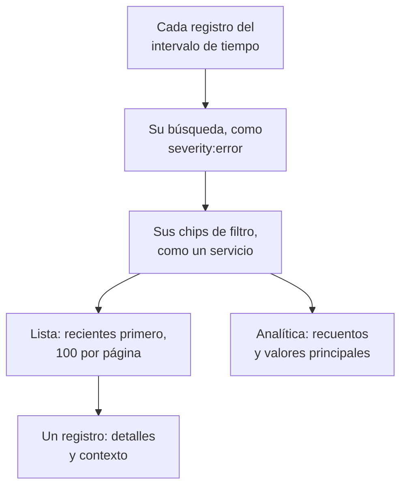

# Explorador de registros

El explorador de registros es donde busca y lee los registros que sus servicios, hosts y agentes envían a OneUptime. Reduzca millones de líneas a las pocas que importan, siga las nuevas a medida que llegan, represéntelas en gráficos y guarde las vistas a las que su equipo vuelve.

:::cards
- [Encontrar una línea de registro](#encontrar-una-línea-de-registro): Un intervalo de tiempo, una búsqueda y unos filtros.
- [Leer un registro](#leer-un-registro): Sus atributos, su traza y las líneas que lo rodean.
- [Seguir los registros en vivo](#seguir-los-registros-en-vivo): Líneas nuevas cada 10 segundos.
- [Guardar una vista](#guardar-una-vista): Conservar una búsqueda, sus filtros y sus columnas para todos.
- [Análisis de registros](#análisis-de-registros): Errores principales, gravedades y quién registra qué.
:::

## Cómo reduce el explorador sus registros

Todo en la pestaña **Visor** trabaja sobre un conjunto de registros: los del intervalo de tiempo que coinciden con su búsqueda y con cada chip de filtro. Cambie cualquiera de ellos y la lista, el gráfico de volumen y los recuentos de la barra lateral cambian a la vez.

El explorador tiene cuatro pestañas:

| Pestaña | Para qué sirve |
| --- | --- |
| **Visor** | Buscar, filtrar y leer registros. Se abre con la última hora, los más recientes primero, 100 registros por página. |
| **Análisis** | Lo que sus servicios registraron en un intervalo de tiempo y lo que salió mal. |
| **Guía de configuración** | Cómo enviar registros con OpenTelemetry, Fluent Bit o Fluentd, usando una de sus [claves de ingesta](/docs/telemetry/ingestion-keys). |
| **Ajustes** | Lo que les pasa a los registros al llegar: **Canalizaciones**, **Filtros de descarte**, **Reglas de depuración** y **Reglas de grabación**. |

## Antes de empezar

- **Registros que llegan.** Envíelos con [OpenTelemetry](/docs/telemetry/open-telemetry), [Fluent Bit](/docs/telemetry/fluentbit), [Fluentd](/docs/telemetry/fluentd) o [Syslog](/docs/telemetry/syslog). La pestaña **Guía de configuración** muestra la configuración para su lenguaje o su recolector.
- **Un rol que pueda leer telemetría.** Project Owner, Project Admin, Project Member, Viewer, Telemetry Admin, Telemetry Member o Telemetry Viewer, o un rol personalizado con el permiso Read Telemetry Service Log. Su ámbito decide de quién son los registros que ve: consulte [Telemetría](/docs/permissions/index#telemetría).

## Encontrar una línea de registro

:::steps
### Abrir el Visor

Vaya a **Productos → Observabilidad → Registros**. El **Visor** enumera los registros de la última hora, los más recientes primero, con su **Hora**, **Servicio**, **Gravedad** y **Mensaje**.

### Elegir el intervalo de tiempo

Elija un intervalo en el selector de tiempo, o arrastre sobre el gráfico de volumen que hay encima de la lista para acercarse a un pico. Haga doble clic en el gráfico para alejarse. Consulte [Hacer zoom en un intervalo de tiempo](/docs/telemetry/charts-and-time-ranges).

### Buscar

Escriba una consulta en el cuadro de búsqueda y pulse Intro, por ejemplo `severity:error service:checkout timeout`. Las palabras sueltas buscan en el mensaje, y `@key:value` busca en un atributo. Consulte [Sintaxis de búsqueda](/docs/telemetry/search-syntax#registros).

### Acotar con filtros

Haga clic en un valor de la barra lateral **Filtros** para añadirlo como chip: una gravedad, un servicio, o un host, un clúster u otro recurso que haya enviado registros. Cada valor indica cuántos registros lo llevan. En un teléfono, toque **Filtros** para abrir la barra lateral.

### Abrir un registro

Haga clic en una fila. Sus detalles se abren junto a la lista.
:::

Su búsqueda, sus chips y el intervalo de tiempo se guardan en la dirección de la página, así que al recargar, con un marcador o con un enlace compartido se abren los mismos registros.

## Leer un registro

El panel de detalles tiene dos pestañas:

| Pestaña | Qué muestra |
| --- | --- |
| **Detalles** | El **Cuerpo del registro**, su **ID de traza**, **ID del span** y **Sesión** cuando los tiene, y sus **Atributos**, como lista o como JSON. |
| **Contexto** | El registro entre sus vecinos. **Cercanos (servicio + tiempo)** muestra las cinco líneas anteriores y posteriores del mismo servicio, y **Esta traza** muestra hasta 100 registros de su traza. |

- Haga clic en el ID de traza para abrir la solicitud completa en el [Explorador de trazas](/docs/telemetry/traces-explorer).
- Apunte a un atributo y haga clic en su icono de filtro para buscar ese valor, o cópielo. Puede copiar todos los atributos a la vez como JSON.
- **Esta traza** solo aparece en un registro escrito dentro de una traza.

## Seguir los registros en vivo

Haga clic en **En vivo** encima de la lista. El explorador salta a la primera página, ordenada de más reciente a más antiguo, y busca registros nuevos cada 10 segundos, de modo que las líneas aparecen a medida que sus servicios las escriben.

El modo en vivo se apaga solo cuando cambia la búsqueda, un filtro o el intervalo de tiempo, o pasa a otra página de resultados: solo muestra los registros más recientes. Haga clic de nuevo en **En vivo** para reanudarlo.

## Elegir columnas y exportar

- **Columnas** elige lo que muestra la lista. **Hora**, **Servicio**, **Gravedad** y **Mensaje** van primero; añada **ID de traza**, **ID del span** o cualquier atributo, mueva las columnas arriba y abajo, o vuelva a los valores predeterminados con **Restablecer**.
- **Exportar** descarga los registros de la página que está viendo. **Exportar como CSV** escribe las columnas que muestra; **Exportar como JSON** escribe cada campo de cada registro, con todos sus atributos.

## Guardar una vista

Una vista guardada conserva una búsqueda, sus chips de filtro, el intervalo de tiempo, las columnas, el orden y el tamaño de página, con un nombre.

:::steps
### Preparar la vista

Busque, filtre y elija las columnas que quiere conservar.

### Guardarla

Abra **Vistas guardadas** y haga clic en **+ Guardar vista actual**. Introduzca un **Nombre**, marque **Establecer como predeterminado** si esta vista debe abrirse cada vez que alguien abra los registros, y haga clic en **Guardar vista**.

### Usarla

Elija la vista en **Vistas guardadas** para aplicarla, y **Quitar vista** para volver a la última hora sin filtros. Apunte a una vista de la lista para **Editar** o **Eliminar**, o, mientras está aplicada, para **Actualizar** con sus cambios.
:::

Las vistas guardadas pertenecen al proyecto, así que todos en él ven la misma lista. Un intervalo móvil, como la última hora, sigue siendo móvil: la vista muestra la hora anterior a abrirla, no la hora en que la guardó. Mientras el proyecto no tenga vista predeterminada, la siguiente vista guardada pasa a serlo, y un proyecto tiene una sola predeterminada a la vez.

## Representar sus registros en gráficos

Cambie la lista a **Analítica** para contar registros en lugar de leerlos. Elija una serie temporal, una lista de los primeros o una tabla; cuente cada registro, o los valores únicos de un campo; y agrupe por gravedad, servicio, traza, span o cualquier atributo, y luego por un segundo campo. Una lista de los primeros o una tabla muestra los 5, 10, 25 o 50 primeros grupos.

Haga clic en **Lista** para volver a las propias líneas.

## Abrir trazas y métricas relacionadas

Los botones **Trazas** y **Métricas** junto a **Vistas guardadas** abren el [Explorador de trazas](/docs/telemetry/traces-explorer) o el [Explorador de métricas](/docs/telemetry/metrics-explorer) para la misma ventana de tiempo, con tanto de su filtrado como ese explorador pueda usar. Apunte a un botón para ver lo que no puede trasladar.

## Análisis de registros

La pestaña **Análisis** muestra lo que sus servicios registraron en un intervalo de tiempo y lo que salió mal. Limítela a algunos servicios, hosts o clústeres con la lista desplegable junto al selector de tiempo.

| Panel | Qué muestra |
| --- | --- |
| Tarjetas de resumen | **Total de registros**, **Errores**, **Errores distintos** y **Orígenes que informan**. |
| **Distribución por gravedad** | Cómo se reparten los registros por gravedad. |
| **Errores principales** | Los mensajes distintos registrados con gravedad Error o Fatal, los más frecuentes primero. |
| **Orígenes que informan registros** | El volumen y la señal de errores de cada servicio, host u otro origen. |

Seleccione un error principal para ver qué ocurría a su alrededor: cuándo pasó, qué comparten sus ocurrencias, dónde ocurre, las trazas que lo llevan y sus líneas más recientes. **Abrir registros coincidentes** los abre en el **Visor**, y **Explain with AI** abre [Ask AI](/docs/ai/ask-ai) con el error y sus pruebas como un prompt que puede editar.

## Qué les pasa a los registros al llegar

La pestaña **Ajustes** contiene las reglas que OneUptime aplica a cada registro antes de almacenarlo. Actúan sobre los registros que llegan después, no sobre los ya almacenados. Cuánto tiempo se conserva cada registro también se decide cuando llega: consulte [Retención de datos](/docs/telemetry/data-retention).

| Regla | Qué hace |
| --- | --- |
| **Filtros de descarte** | Descartar los registros que no quiere conservar, o conservar solo una muestra. Consulte [Descartar o muestrear entradas](/docs/telemetry/drop-filters-and-scrub-rules#descartar-o-muestrear-entradas). |
| **Reglas de depuración** | Ocultar datos sensibles, como direcciones de correo y números de tarjeta. Consulte [Depurar datos sensibles](/docs/telemetry/drop-filters-and-scrub-rules#depurar-datos-sensibles). |
| **Canalizaciones** | Extraer campos del mensaje, corregir la gravedad, renombrar atributos. Consulte [Canalizaciones de registros](/docs/telemetry/log-pipelines). |
| **Reglas de grabación** | Convertir los registros coincidentes en métricas. Consulte [Reglas de grabación de registros](/docs/telemetry/log-recording-rules). |

## Atajos de teclado

Pulse `?` en el Visor para verlos.

| Tecla | Qué hace |
| --- | --- |
| `j` / `k` | Pasar al registro siguiente o anterior. |
| Enter | Abrir o cerrar el registro seleccionado. |
| Esc | Cerrar el panel de detalles. |
| `/` | Ir al cuadro de búsqueda. |
| ⌘ + Enter o Ctrl + Enter | Aplicar la búsqueda. |
| `?` | Mostrar u ocultar los atajos. |

## Solución de problemas

:::details No aparece ningún registro
Amplíe primero el intervalo de tiempo: el Visor se abre con la última hora. Si la lista sigue vacía, compare su configuración con la **Guía de configuración** y compruebe que el ámbito de su rol cubre el servicio que envía los registros.
:::

:::details La búsqueda dice que se quedó sin tiempo
Una búsqueda que dura más de 45 segundos se detiene. Elija un intervalo de tiempo más corto, o añada un valor exacto como un servicio, para que OneUptime pueda usar su índice. Consulte [Sintaxis de búsqueda](/docs/telemetry/search-syntax#conviene-saber).
:::

:::details El modo en vivo se apaga una y otra vez
El modo en vivo solo sigue los registros más recientes, así que cambiar la búsqueda, un filtro, el intervalo de tiempo o la página lo apaga. Haga clic de nuevo en **En vivo** cuando sus filtros estén listos.
:::

## Próximos pasos

:::cards
- [Sintaxis de búsqueda](/docs/telemetry/search-syntax): Todos los filtros que entiende el cuadro de búsqueda.
- [Monitor de registros](/docs/monitor/logs-monitor): Recibir alertas cuando aparezcan los registros que busca.
- [Canalizaciones de registros](/docs/telemetry/log-pipelines): Convertir partes de una línea de registro en atributos filtrables.
- [Explorador de trazas](/docs/telemetry/traces-explorer): Seguir la solicitud de un registro a través de sus servicios.
:::
