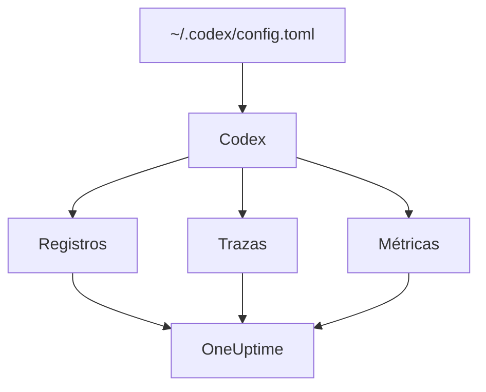

# OpenAI Codex

La CLI de Codex trae integrados tres exportadores de OpenTelemetry, uno para los registros, otro para las trazas y otro para las métricas. Apúntalos a OneUptime en `~/.codex/config.toml` y cada turno de Codex llega con sus tokens y su coste, sin wrapper ni proxy de por medio.

:::cards
- [Configura Codex](#configura-codex): Un bloque `[otel]`, con una URL completa por señal.
- [Atribuye el uso a una persona](#atribuye-el-uso-de-codex-a-una-persona): Codex no nombra a nadie en los spans ni en las métricas, así que lo haces tú.
- [Tokens y coste](#tokens-y-coste): Qué señal lee OneUptime, y qué muestra eso.
- [Solución de problemas](#solución-de-problemas): Qué comprobar cuando no llega nada.
:::

## Cómo funciona

Cada exportador envía una señal a su propia URL. Las trazas y los registros están desactivados hasta que los configuras; las métricas no.



> [!WARNING]
> Codex envía sus métricas a OpenAI salvo que cambies esto. En una versión de producción, `metrics_exporter` vale `statsig` por defecto, lo que las envía a `https://ab.chatgpt.com/otlp/v1/metrics`. Definir `metrics_exporter` como un exportador OTLP, como abajo, o como `none` lo detiene. `[analytics]` con `enabled = false` también detiene el valor predeterminado de Statsig, pero deja funcionando un exportador de métricas OTLP que hayas configurado.

## Antes de empezar

1. Crea una clave de ingesta de telemetría en **Ajustes del proyecto → Telemetría y APM → Claves de ingesta**.
2. Tu endpoint OTLP es `https://oneuptime.com/otlp`, o `https://YOUR-ONEUPTIME-HOST/otlp` si alojas OneUptime tú mismo.
3. Cada exportación envía la clave en la cabecera `x-oneuptime-token`.

## Configura Codex

:::steps
### Añade el bloque otel

Pon esto en `~/.codex/config.toml`. Activa las tres señales, y de paso sustituye el valor predeterminado de Statsig:

```toml title="~/.codex/config.toml"
[otel]
environment = "prod"
log_user_prompt = false

[otel.exporter.otlp-http]
endpoint = "https://oneuptime.com/otlp/v1/logs"
protocol = "binary"
headers = { "x-oneuptime-token" = "YOUR_INGESTION_TOKEN" }

[otel.trace_exporter.otlp-http]
endpoint = "https://oneuptime.com/otlp/v1/traces"
protocol = "binary"
headers = { "x-oneuptime-token" = "YOUR_INGESTION_TOKEN" }

[otel.metrics_exporter.otlp-http]
endpoint = "https://oneuptime.com/otlp/v1/metrics"
protocol = "binary"
headers = { "x-oneuptime-token" = "YOUR_INGESTION_TOKEN" }

[otel.span_attributes]
"user.id" = "dev@example.com"
"user.email" = "dev@example.com"
"team" = "platform"
```

### Da a cada exportador su URL completa

Codex usa cada `endpoint` exactamente como está escrito: no añade `/v1/logs`, `/v1/traces` ni `/v1/metrics` como hacen la mayoría de los SDK. Tres exportadores apuntados al simple `https://oneuptime.com/otlp` no envían nada a ningún sitio, y sin error.

### Ejecuta un turno

Inicia una sesión interactiva de `codex`, pregunta algo pequeño y deja que el turno termine. Después abre **Registros** en OneUptime: los eventos de Codex, como `codex.conversation_starts`, `codex.api_request` y `codex.turn_cost`, aparecen ahí.
:::

> [!IMPORTANT]
> Codex ignora las claves que no conoce bajo `[otel]`, sin avisar. Sus claves van en snake_case (`trace_exporter`, `metrics_exporter`, `span_attributes`), pero sus nombres de exportador y sus campos TLS van en kebab-case (`otlp-http`, `ca-certificate`). Un `trace-exporter` desactiva las trazas sin ningún error.

## Claves de configuración

| Clave | Predeterminado | Qué hace |
| --- | --- | --- |
| `environment` | `"dev"` | Define el atributo de recurso `env` |
| `log_user_prompt` | `false` | Envía el texto del prompt en `codex.user_prompt`; si no, dice `[REDACTED]` |
| `log_agent_responses` | `false` | Envía las respuestas finales del agente al exportador de registros |
| `exporter` | `none` | El exportador de registros |
| `trace_exporter` | `none` | El exportador de trazas |
| `metrics_exporter` | `statsig` | El exportador de métricas: defínelo |
| `span_attributes` | — | Atributos que se añaden a cada span exportado |
| `tracestate` | — | Miembros de `tracestate` del W3C |
| `tool_result` | `{ max_bytes = 2048 }` | Cuánto del resultado de una herramienta conserva un registro, en bytes UTF-8 |

Un exportador es `none`, `statsig`, `otlp-http` u `otlp-grpc`. `otlp-http` acepta `endpoint`, `headers`, `protocol` (`"binary"` o `"json"`, que OneUptime acepta los dos) y `tls` (`ca-certificate`, `client-certificate`, `client-private-key`); `otlp-grpc` acepta lo mismo sin `protocol`.

## Atribuye el uso de Codex a una persona

Codex nombra al desarrollador en un solo sitio:

- **Los registros de log** llevan `user.account_id` y `user.email`.
- **Los spans** no: Codex deja ambos fuera de sus trazas a propósito.
- **Las métricas** tampoco: llevan `auth_mode`, `session_source`, `originator`, `service_name`, `model` y `app.version`, y ninguna persona.

OneUptime lee las personas de los spans y de los puntos de datos de las métricas, nunca de los registros de log. Así que pon tú la identidad en cada span, en `[otel.span_attributes]`:

```toml title="~/.codex/config.toml"
[otel.span_attributes]
"user.id" = "dev@example.com"
"user.email" = "dev@example.com"
"team" = "platform"
"cost_center" = "eng-123"
```

`user.id` es la clave que OneUptime prefiere, y `user.email` rellena la columna del correo. Codex no tiene atributos de recurso, así que define aquí también las claves de equipo (`team.id`, `team`, `cost_center`, `department`). Este bloque vive en el archivo de configuración de cada desarrollador: distribúyelo por desarrollador, con tus dotfiles o un perfil de MDM. Un único archivo compartido con una sola identidad cargaría el gasto de todos a una sola persona.

## Tokens y coste

| Señal | Qué envía Codex | Qué hace OneUptime con ello |
| --- | --- | --- |
| Trazas | `gen_ai.usage.input_tokens`, `gen_ai.usage.output_tokens` y los tokens de caché, pero ningún modelo | Cuenta los tokens por persona; no puede ponerles precio |
| Métricas | `codex.turn.token_usage` por `token_type`, y `codex.turn.cost_microusd`, en millonésimas de USD | Convierte el coste a USD; lee las métricas solo donde los spans no informan de nada |
| Registros | `codex.turn_cost`, con `usage.estimated_usd` y la persona | Lo guarda en el explorador de **Registros**; no se une al gasto |

Con la configuración de arriba, en la pestaña **Uso** el resultado es este:

- Los tokens vienen de los spans, por persona, y `codex.turn.token_usage` no se suma encima: los dos nunca se suman ([por qué](/docs/telemetry/ai-llm-observability#primero-los-spans-las-métricas-los-suplen)).
- Los spans de Codex no nombran ningún modelo, así que OneUptime no puede ponerles precio, y su coste es 0. Los totales de coste toman entonces el coste de Codex de `codex.turn.cost_microusd`, convertido a USD por ti.
- Las tablas **Empleado**, **Equipo** y **Modelo** muestran las filas de los spans: tokens por persona, pero ningún coste por persona.
- Sin trazas, son las métricas las que rellenan esas tablas, solo con el coste, todo bajo **Sin atribuir**, ya que las métricas de Codex no nombran a nadie.

El coste por turno más preciso, con la persona incluida, es el registro de log `codex.turn_cost`. OneUptime todavía no une los registros de log al gasto, pero mantén activado el exportador de registros: el historial estará ahí cuando lo haga.

## Codex en CI y como servidor MCP

`codex`, `codex exec` y `codex mcp-server` construyen su telemetría a partir del mismo bloque `[otel]`, con los tres exportadores. Las ejecuciones de `codex exec` llevan el `originator` `codex_exec`, y `codex mcp-server` exporta como `codex_mcp_server`, así que puedes distinguir las ejecuciones de CI y de MCP de las sesiones interactivas por esos valores.

## Privacidad

`log_user_prompt` y `log_agent_responses` valen `false` por defecto: déjalos así. El evento `codex.user_prompt` sigue llegando, con el prompt sustituido por `[REDACTED]`, así que conservas el turno, sus tokens y su coste sin el texto del prompt. La persona (`user.email`, `user.account_id`) está en los registros de log digan lo que digan estos interruptores.

Si activas el contenido para una investigación, las **Reglas de depuración** y los **Filtros de descarte** de las trazas, en **Trazas → Ajustes**, lo enmascaran o descartan antes de guardarlo.

## Usar la API de OpenAI en lugar de Codex

La API de la plataforma de OpenAI no envía OpenTelemetry por sí misma: cada span sale de instrumentar tu propio cliente. Tres instrumentaciones funcionan con OneUptime:

- **OpenTelemetry**: `opentelemetry-instrumentation-genai-openai` para Python, que sustituye a `opentelemetry-instrumentation-openai-v2`. `OTEL_INSTRUMENTATION_GENAI_CAPTURE_MESSAGE_CONTENT` decide si se registran los mensajes.
- **OpenLLMetry** (Traceloop): `opentelemetry-instrumentation-openai`.
- **OpenInference** (Arize): `openinference-instrumentation-openai`.

Apunta cualquiera de ellas a OneUptime como muestra [Observabilidad de IA / LLM](/docs/telemetry/ai-llm-observability). Ninguna sabe quién es tu empleado: define tú `user.id`.

El **OpenAI Agents SDK** envía sus trazas al endpoint propio de OpenAI, no por OTLP. Conéctalo con `opentelemetry-instrumentation-openai-agents-v2` o `openinference-instrumentation-openai-agents`, que entregan los spans del SDK a un exportador OTLP.

## Solución de problemas

:::details No llega nada
Comprueba primero los tres valores de `endpoint`: cada uno debe terminar en `/v1/logs`, `/v1/traces` o `/v1/metrics`. Después comprueba la cabecera `x-oneuptime-token`: OneUptime rechaza una clave incorrecta.
:::

:::details Las trazas nunca llegan, pero los registros sí
Busca una clave mal escrita bajo `[otel]`: Codex la ignora sin avisar. `trace-exporter` en lugar de `trace_exporter` es la habitual.
:::

:::details El coste de Codex aparece en los totales, pero cada persona muestra 0 $
Es lo esperado: los spans de Codex llevan tokens pero ningún modelo, así que no se les puede poner precio, y la métrica de coste no nombra a nadie. Consulta [Tokens y coste](#tokens-y-coste).
:::

:::details El gasto de todos aparece bajo una sola persona
La misma identidad de `[otel.span_attributes]` está en todos los equipos. Da a cada desarrollador la suya.
:::

## Próximos pasos

:::cards
- [Asistentes de programación con IA](/docs/telemetry/ai-coding-assistants): Cómo se atribuye el gasto en todos los asistentes de programación.
- [Observabilidad de IA / LLM](/docs/telemetry/ai-llm-observability): Conversaciones, alertas, coste y presupuestos para tus propias llamadas de IA.
- [Gateways de IA](/docs/telemetry/ai-gateways): Un gateway que traza y pone precio a cada llamada a un modelo.
:::
