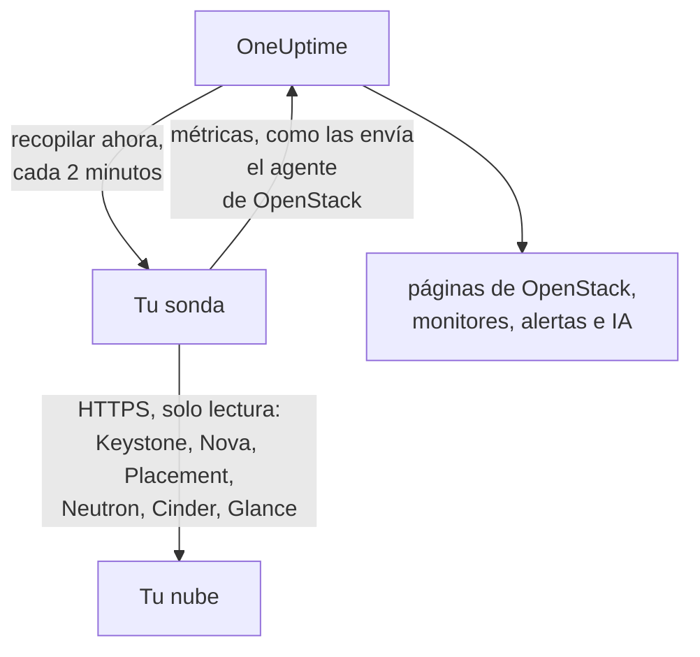

# OpenStack sin agente

Monitoriza una nube OpenStack sin instalar nada: introduce en OneUptime la dirección de Keystone y una credencial de aplicación, elige la sonda que pueda alcanzar la nube, y la sonda recopila los mismos datos que recopilaría el [agente de OpenStack](/docs/telemetry/openstack). No hay ningún agente que instalar, actualizar o mantener en ejecución, ni ninguna máquina propia que aprovisionar.

> [!IMPORTANT]
> Una sonda solo habla HTTPS con una nube. Una credencial o su token nunca se envía por HTTP sin cifrar, y DevStack y Kolla-Ansible sirven sus API por HTTP sin cifrar de forma predeterminada. Para una nube así, activa TLS en sus API o usa el [agente de OpenStack](/docs/telemetry/openstack), que se ejecuta junto a ella. La prueba de conexión lo indica cuando encuentra una dirección HTTP sin cifrar.

:::cards
- [Antes de empezar](#antes-de-empezar): Una sonda que alcance las API y una credencial.
- [Conectar una nube](#conectar-una-nube): La dirección, una credencial, una prueba y un nombre.
- [Solución de problemas](#solución-de-problemas): Qué significa cada mensaje y qué lo soluciona.
:::

## Cómo funciona



Cada dos minutos la sonda lee cada servicio de cada región que elegiste y envía lo que encontró a OneUptime. Llega exactamente igual que lo que envía el agente de OpenStack, así que todas las páginas de OpenStack, los [monitores de OpenStack](/docs/monitor/openstack-monitor) y las plantillas de alertas lo leen de la misma manera.

Cada servicio se lee por separado y al mismo tiempo que los demás. Un Neutron que falla o se cuelga cuesta las series de Neutron, y los datos de Nova llegan como de costumbre, con una salvedad que Nova se impone a sí mismo: consulta a Neutron por cada instancia que lista. Así que, mientras Neutron está caído, una sonda conserva las instancias que leyó por última vez y solo pregunta por lo que cambió. Si una instancia ha cambiado, o la sonda acaba de arrancar, Nova tampoco puede responder esa lista: Nova figura como fallando, sus demás series siguen llegando, y cada instancia permanece en su página tal como estaba hasta que Neutron vuelva.

Heat, Magnum, Manila, Trove, Gnocchi, Designate, Swift y Barbican se leen donde el catálogo de Keystone los nombra. Una nube que no ejecuta ninguno de ellos no paga nada por ellos, no oye nada sobre ellos en la prueba de conexión y [no muestra ningún rastro de ellos](/docs/telemetry/openstack#heat-y-magnum).

En una nube cuyo catálogo incluye Octavia, una sonda lee sus balanceadores de carga, pools, listeners y amphorae con una lista cada uno, y después los miembros de cada pool y los contadores de tráfico de cada balanceador de carga y listener que esté `ACTIVE`, una petición cada uno. Una nube con 3 balanceadores de carga, 1 pool y 1 listener cuesta 9 peticiones por recopilación; un DevStack real que registramos costó exactamente eso. En una recopilación se leen como máximo los miembros de 25 pools y 50 contadores, empezando por los que llevan más tiempo sin leerse, y los demás dicen lo que dijeron en su última lectura. Los contadores de Octavia son acumulativos, así que una sonda guarda la última lectura de cada uno y dibuja la diferencia por segundo entre dos lecturas: una gráfica empieza en la segunda recopilación, y un contador que baja (un listener reconstruido) no dibuja nada en ese intervalo. El proveedor OVN informa 0 en todos los contadores, lo cual es una línea plana y no un fallo.

Las amphorae necesitan la regla de administrador de Octavia para cada lectura. Una credencial por debajo de administrador ve los balanceadores de carga, pools, listeners y miembros de su propio proyecto, y sus propios contadores, pero ninguna amphora: la página Load Balancers lo indica, y nada avisa. El rol de monitorización, en un proyecto sin balanceadores de carga, no ve ninguno. `load-balancer_global_observer` fue rechazado en todo en `stable/2026.1`, la versión en la que se registró esto.

Una API de Octavia detenida es `up 0` para una sonda, algo que el exportador del agente no puede indicar.

## ¿Sonda o agente?

| | Una sonda (esta página) | El agente de OpenStack |
|---|---|---|
| Qué ejecutas | Una sonda que ya ejecutas, o una nueva | El agente, en una máquina propia |
| Dónde se guarda la credencial | Cifrada en OneUptime, enviada solo a la sonda | En el archivo `clouds.yaml` del agente |
| A qué necesita llegar | Keystone y la API de cada servicio, por HTTPS | Keystone y la API de cada servicio |
| API en HTTP sin cifrar | No se recopilan: un token nunca se envía sin cifrar | Se recopilan |
| Nube más grande | Probado con [200 000 instancias](/docs/telemetry/openstack-very-large-clouds) contra una nube simulada, no una real, en hasta diez subidas de 48 MiB | No probado a esa escala: [su scrape se queda sin tiempo](/docs/telemetry/openstack-very-large-clouds#a-través-del-agente) mucho antes de eso |
| Registros de servicios y el agente de IA | No incluido | Incluido |
| Sobre qué se sostiene la nube: RabbitMQ, MariaDB, Memcached, HAProxy, OVN, libvirt | No incluido: una sonda lee las API de la nube | Incluido, con sus destinos nombrados |
| CPU, memoria y disco reales de cada instancia, desde libvirt o Ceilometer | No incluido | Incluido, con sus exportadores nombrados |
| Inicios de sesión en Keystone | Uno durante la vida de un token, normalmente una hora | Uno por scrape |
| Un simple `reader` en un proyecto | Las instancias, volúmenes y redes de ese proyecto | Los volúmenes y redes de ese proyecto, y ninguna instancia |

Ambos envían las mismas series, así que las páginas y los monitores funcionan con cualquiera de los dos. Una sonda además envía lo que solo un cliente nativo puede leer: las direcciones de una instancia, su estado de tarea y su mensaje de fallo, la imagen desde la que arrancó, si un operador forzó la caída de un servicio de Nova, qué redes sirve un agente DHCP, qué pool contiene un volumen, cuándo cambió por última vez una instancia, un volumen o una imagen, y el estado de cada snapshot y backup de volumen. Cinder solo dice qué pool contiene un volumen a una credencial que trata como administrador. En una nube que ejecuta [Heat o Magnum](/docs/telemetry/openstack#heat-y-magnum), también envía por qué falló un stack o un clúster, qué instancias y volúmenes posee un stack, el proyecto, la plantilla y la versión de Kubernetes de cada clúster, y si cada motor de Heat y cada conductor de Magnum está activo.

Elige el agente para los registros de servicios, para el agente de IA, para lo que sostiene la nube y el uso real de cada instancia, para una nube cuyas API solo hablan HTTP sin cifrar, como hacen DevStack y Kolla-Ansible de forma predeterminada, o para una nube tan grande que hay que [leerla desde sus bases de datos](/docs/telemetry/openstack-very-large-clouds#la-vía-de-la-base-de-datos). Elige una sonda para todo lo demás: no hay nada que instalar y lee más de lo que dicen Nova y Cinder. [Nubes OpenStack muy grandes](/docs/telemetry/openstack-very-large-clouds) explica lo que cuesta cada opción a cualquier tamaño.

Puedes cambiar una nube de una a otra en cualquier momento en su página de **Ajustes**.

## Antes de empezar

- **Una sonda que pueda alcanzar Keystone y la API de cada servicio por HTTPS.** Normalmente es una [sonda personalizada](/docs/probe/custom-probe) en la red de la nube. El catálogo de Keystone indica dónde responde cada servicio, y la sonda se conecta a esas direcciones, así que cada una debe ser alcanzable desde la sonda y cada una debe ser HTTPS. En OneUptime Cloud, las sondas compartidas nunca reciben una credencial de OpenStack, así que añade una sonda propia. En una instancia autoalojada, las sondas de la propia instancia también pueden recopilar.
- **Una credencial.** Una credencial de aplicación es lo mejor, porque se puede limitar a lectura y puede caducar. Un nombre de usuario y una contraseña también sirven, y pueden hacer todo lo que su cuenta pueda.

OpenStack no tiene un rol global de solo lectura, así que lo que la sonda ve depende de la credencial:

| Nivel | Qué necesita | Qué lee la sonda |
|---|---|---|
| Vista completa | Una credencial de aplicación en una cuenta con `admin` en un proyecto propio, limitada por reglas de acceso a lectura | Todo, salvo los usuarios y grupos de Keystone, que las reglas excluyen a propósito |
| Solo infraestructura | Los roles `oneuptime_monitoring` y `reader` en un proyecto propio que no contenga nada y tenga cuota cero, y los archivos de política que incluye el agente de OpenStack | Hipervisores, servicios de Nova, agentes de Neutron, pools de direcciones, Placement, la lista de proyectos y las instancias de cada proyecto. Volúmenes, redes y routers solo donde se asigne el rol. No el estado de `cinder-volume` y `cinder-scheduler` ni los pools de almacenamiento: el propio código de Cinder exige un administrador |
| Vista de proyecto | Un simple `reader` en un proyecto | Las instancias, volúmenes y redes de ese proyecto, y nada de infraestructura |

La prueba de conexión indica a cuál de estos equivale una credencial, y avisa cuando su propio proyecto contiene cosas: donde Cinder tiene `enforce_new_defaults` desactivado, que es su valor predeterminado, cualquier rol en un proyecto puede crear los volúmenes de ese proyecto, `reader` incluido.

> [!IMPORTANT]
> Una credencial de aplicación limitada por reglas de acceso es rechazada con un `401` por cualquier servicio cuyo `keystonemiddleware` no tenga `service_type` definido. La prueba de conexión lo indica en cada lectura. Defínelo en la configuración de cada servicio y reinícialo. [Crear la credencial](/docs/telemetry/openstack#crea-la-credencial) tiene las reglas, los archivos de política y los ajustes de cada servicio, y [qué lee cada nivel](/docs/telemetry/openstack#qué-lee-cada-nivel) es lo que respondieron nubes reales.

## Conectar una nube

:::steps
### Abre tus nubes
En OneUptime, abre **OpenStack → Todas las nubes** y haz clic en **Conectar nube**.

### Introduce la dirección y la credencial
Introduce el `auth_url` de tu archivo `clouds.yaml` o `openrc`, como `https://keystone.example.com:5000/v3`, y el ID y el secreto de la credencial de aplicación. Elige la sonda que alcanza la nube.

### Prueba la conexión
Haz clic en **Probar conexión**. La sonda inicia sesión, prueba cada lectura que hace una recopilación en cada región y cierra la sesión. Indica qué regiones nombra el catálogo, qué puede leer la credencial, qué se le rechaza, qué páginas quedan sin datos por ello y la línea que lo habilita. Una lectura fallida no detiene la prueba.

### Confía en el certificado de la nube
Una nube con su propia autoridad de certificación presenta un certificado en el que la sonda no confía. La prueba muestra entonces el certificado y el host que lo presentó. Comprueba su huella con la de la propia API y haz clic en **Confiar en este certificado**. Una nube con un host por servicio puede tener un certificado por servicio, y puedes confiar en hasta 32.

### Elige las regiones y conecta
Elige las regiones que leer, ponle nombre a la nube y haz clic en **Conectar nube**. Se abre la página de la nube.
:::

La **Vista general** de la nube muestra una tarjeta **Recopilación de datos**. Dice **Comprobando** hasta la primera recopilación, que empieza en menos de un minuto, luego **Recopilando**, y las páginas se llenan. Cuando se leyeron algunos servicios y otro no, indica cuál. Si ninguna sonda se ocupa de la nube durante 15 minutos, porque está sin conexión o es demasiado antigua, dice **Sin recopilar** y lo indica, sea cual sea lo que encontró la última recopilación.

La tarjeta **Recopilación de datos** de la página de **Ajustes** de la nube contiene lo que usaste para conectarla:


## Conectar una nube desde la API o Terraform

Los ajustes de conexión de una nube son campos normales del [recurso OpenStack Cloud](/reference/open-stack-cloud) en la API, en `/api/openstack-cloud`, así que se puede conectar una nube sin usar el panel en absoluto. Con Terraform es `oneuptime_openstack_cloud`:

```hcl
resource "oneuptime_openstack_cloud" "prod_eu" {
  name                      = "prod-eu"
  collection_method         = "Probe"
  auth_url                  = "https://keystone.example.com:5000/v3"
  credential_kind           = "applicationCredential"
  application_credential_id = var.openstack_application_credential_id
  credential_secret         = var.openstack_application_credential_secret
  collection_probe_id       = oneuptime_probe.eu_west.id
  collection_regions        = jsonencode(["RegionOne"])

  # A cloud with its own certificate authority: the fingerprints it presents.
  trusted_certificate_fingerprints = jsonencode(["AB:CD:EF:..."])
}
```

Para un nombre de usuario y una contraseña, define `credential_kind` como `password`, con `keystone_username`, `project_name` y, cuando no sean `Default`, `user_domain_name` y `project_domain_name`. `endpoint_interface`, `collection_interval_in_minutes` y `collection_options` son lo que el formulario agrupa bajo **Más campos**. Solo `name` es obligatorio, porque una nube que envía el agente no tiene ninguno de estos.

`credential_secret` es de solo escritura, así que ninguna lectura lo devuelve y Terraform lo mantiene fuera de los planes y las salidas. [Las reglas de una credencial guardada](#la-credencial-guardada) también valen aquí: cambiar la dirección, la sonda o los certificados de confianza requiere el secreto en la misma petición. Lo que informa la sonda, como `collection_status`, `collection_error` y `presented_certificate`, se puede leer pero no establecer.

## Lo que le cuesta a tu nube

La monitorización nunca debe ser lo que tumbe una nube, así que una recopilación es amable por construcción:

- **Un solo inicio de sesión, conservado.** El token se usa hasta cinco minutos antes de que caduque. Un inicio de sesión es lo que un Keystone con problemas menos puede permitirse.
- **Listas en páginas.** Cada lista se lee de mil en mil filas, con `limit` y `marker`.
- **Instancias por lo que cambió.** Entre lecturas completas, cada media hora, la sonda pregunta a Nova solo por lo que cambió desde la última lectura, con `changes-since`.
- **Los inventarios de un hipervisor, una vez.** Placement cambia la generación de un proveedor cada vez que cambian, algo que una sola llamada de lista dice de todos ellos, así que se vuelven a leer solo entonces.
- **Una carga declarada.** Lo que es una llamada por cosa se reparte en turnos a partir de 2000 por recopilación, y a partir de 250 proyectos para los límites. Lo que no se leyó esta vez se envía como se leyó por última vez, así que ninguna serie tiene huecos, y la carga deja de crecer con la nube.
- **Solo los campos que lee.** Las listas de Neutron nombran sus campos, y de los grupos de seguridad se piden solo sus ID.
- **Nunca apiladas.** Una recopilación que tarda más que su intervalo se omite, no se ejecuta junto a la siguiente.
- **Un presupuesto de tiempo.** Una recopilación dispone de nueve décimas de su intervalo, y como máximo diez minutos. Lo que se leyó para entonces se envía, y el servicio que se quedó sin tiempo lo indica.
- **Reduciendo la frecuencia.** Cuando se le pide esperar con un `429` o `Retry-After`, la sonda espera. Un servicio que responde `429`, `503` o nada en absoluto se deja en paz durante un minuto, luego dos, luego cuatro, hasta media hora, y sus series siguen diciendo que está caído mientras espera.
- **Aminorando.** Una respuesta tres veces más lenta de lo que ese servicio suele responder, y de al menos un segundo, o de cinco segundos sea cual sea lo habitual, retrasa la siguiente petición a ese servicio por ese mismo tiempo. La tarjeta **Recopilación de datos** indica cuándo ocurrió.
- **Una credencial rechazada espera más.** Repetir una es lo que bloquea una cuenta, así que espera cinco minutos, luego diez, hasta una hora. Una credencial que corregiste se prueba de inmediato.

- **Menos de una nube grande.** A partir de 5000 instancias, una nube conserva los recuentos y sus partes, y ninguna serie por instancia ni por volumen, a menos que elijas otra cosa en **Uso real por instancia** en su página de **Ajustes**. Lo que cambió, lo que elegiste conservar y lo que vigila una alerta sigue yendo en cada recopilación. El resto va en turnos, y la tarjeta **Recopilación de datos** indica cuánto dura un turno.

En cada recopilación, con los valores predeterminados, una región cuesta 7 llamadas a Nova, 7 a Neutron y 5 a Cinder, una llamada a Placement y dos más por hipervisor, hasta 4 más para preguntar a Placement [cuántos de cada flavor caben](/docs/telemetry/openstack#capacidad) y, aproximadamente cada cinco minutos, 5 a Keystone y 1 a Glance. El inventario de un hipervisor se lee una vez, y de nuevo solo cuando Placement dice que cambió. Una lista de más de mil filas cuesta una llamada por cada mil. Cada instancia que cambió cuesta una llamada más a Nova, para leer por lo que pasó, y se leen como máximo 25 en una recopilación: una nube tranquila no hace ninguna. En ML2/OVS, Neutron cuesta una llamada más por router, para preguntar qué agentes L3 lo contienen, y cada diez minutos una llamada por agente DHCP, como máximo 20, para preguntar qué redes sirve. Una nube con más agentes DHCP los recorre en turnos, una nube que supera el tamaño de resumen omite esto, y a un Neutron lento no se le pregunta en absoluto. Una nube con OVN no tiene ninguno por el que preguntar. [Nubes OpenStack muy grandes](/docs/telemetry/openstack-very-large-clouds#la-carga-sobre-tu-plano-de-control) indica a cuántas peticiones por minuto equivale esto, a cada tamaño.

Una nube que ejecuta Manila paga, aproximadamente cada cinco minutos, 2 llamadas a él, una que ejecuta Trove paga 1, Gnocchi 1 y Barbican 3. Designate cuesta 2, y una más por cada zona que no esté `ACTIVE`, como máximo 50 por recopilación. Swift cuesta 1 por el propio proyecto de la credencial, y con `ResellerAdmin` una más por cada otro proyecto, como máximo 200 por recopilación. Una nube que ejecuta Heat o Magnum paga, aproximadamente cada cinco minutos, 2 llamadas a Heat y 3 a Magnum. Ninguna lista lo dice todo: la de Magnum no dice de quién es un clúster ni por qué falló, y la de Heat no dice qué posee un stack. Así que la sonda también lee un clúster o un stack por sí solo cuando su estado ha cambiado, como máximo 25 de cada uno por recopilación. Una nube con más sigue completándose en las siguientes recopilaciones, y uno que no se mueve nunca se lee dos veces.

Tres cosas están desactivadas a menos que las actives, en **Lo que lee además de lo predeterminado** en la tarjeta **Recopilación de datos** de la página de **Ajustes** de la nube, o en **Más campos** al conectarla, porque cada una le cuesta más a tu nube:

| Opción | Qué obtienes | Qué cuesta |
|---|---|---|
| Puertos | Una serie por puerto, y cuántos no tienen dirección o un balanceador de carga que está caído | Una lista paginada por cada red o proyecto que nombres, o de todos los puertos si no nombras ninguno. Una lista de puertos sin ámbito puede saturar Neutron en una nube grande |
| Límites de proyecto | Cuotas y límites por proyecto | Cuatro llamadas por proyecto, como máximo 250 proyectos por recopilación |
| Servidores de almacenamiento de Swift | Si cada uno responde, su replicación y si todos tienen los mismos anillos, donde nombras el puerto `/recon` de cada servidor como `host:port`. Solo lo ofrece una nube que ejecuta Swift, en su página de **Ajustes** una vez que su primera recopilación ha leído Swift | 5 llamadas por servidor en cada recopilación. No se les envía ninguna credencial |

## Certificados

La sonda nunca omite la verificación de certificados. Cada conexión completa un handshake TLS completo, y después:

- sin ningún certificado de confianza, el certificado de una API debe provenir de una autoridad en la que confíe la máquina de la sonda, para la dirección en la que responde;
- con certificados de confianza, una API debe presentar uno de exactamente esos, identificados por sus huellas SHA-256. No se acepta nada más, ni siquiera uno de confianza pública.

Para comprobar una huella, ejecuta esto desde la máquina de la sonda:

```bash
openssl s_client -connect keystone.example.com:5000 </dev/null | openssl x509 -noout -fingerprint -sha256
```

Cuando se renueva un certificado, la recopilación se detiene con **El certificado de la API cambió** y se muestra el nuevo certificado. No se envía nada hasta que confíes en él, en la página de **Vista general** o de **Ajustes** de la nube.

## La credencial guardada

El secreto está cifrado y es de solo escritura: nadie puede volver a leerlo, y la API nunca lo devuelve. Se envía solo a la sonda que recopila la nube, que lo mantiene en memoria.

Una credencial guardada solo se envía a la dirección, a través de la sonda y a los certificados para los que se introdujo. Cambiar la dirección, la sonda o los certificados de confianza vuelve a pedir el secreto, de modo que nadie que pueda editar la nube pueda enviarlo a otro sitio. Confiar en el certificado que la sonda encontró en la dirección guardada lo conserva, y también confiar en menos.

El catálogo se somete a las mismas reglas que la dirección que escribiste, porque un token va adonde este indique. La sonda no se conecta a una dirección de loopback, de enlace local o de metadatos de la nube, ya sea que el catálogo la nombre o que un nombre de host se resuelva a ella, y se conecta a las direcciones que comprobó, no a lo que DNS diga un momento después. No sigue redirecciones.

## Cambiar entre el agente y una sonda

Abre la página de **Ajustes** de la nube. Su tarjeta **Recopilación de datos** ofrece **Recopilar con una sonda** para una nube que envía el agente, y **Usar el agente de OpenStack** para una que recopila una sonda. Cambiar al agente borra la credencial guardada.

> [!WARNING]
> Detén el agente de OpenStack en cuanto la primera recopilación de la sonda tenga éxito. Mientras ambos se ejecutan, cada métrica llega dos veces.

Pasadas [5000 instancias](/docs/telemetry/openstack-very-large-clouds#modo-resumen), la primera recopilación de una sonda conoce toda la nube y envía una parte de ella, así que las listas de una nube nueva se llenan durante su primer ciclo, y la tarjeta **Recopilación de datos** indica cuándo estarán todas.

## Bare metal

En una nube cuyo catálogo incluye Ironic, una sonda lee sus nodos y pide cada campo por su nombre, así que el `driver_info` de un nodo nunca se lee en una recopilación. Añade lo que el exportador del agente no tiene: el driver de un nodo, su conductor, su fallo y por qué falló. Ironic puede vaciar `last_error` en aproximadamente un minuto, así que una página conserva el último que vio una recopilación, e indica cuándo.

Una sonda lee primero el catálogo, así que puede decir que la API de Ironic está caída, algo que el exportador del agente no puede. A una nube sin Ironic no se le pregunta nada sobre él.

Ironic muestra a un proyecto solo los nodos que posee, y le rechaza la lista de conductores. Según la política predeterminada de Ironic, solo una credencial con ámbito de sistema lee esos datos, y la credencial de una sonda no puede tener ámbito de sistema, porque lee las listas de Nova con la misma. Así que, a menos que la política de la nube conceda a su rol `baremetal:node:list_all` y `baremetal:conductor:get`, una sonda ve los nodos que su proyecto posee y ningún conductor, y las páginas lo indican. [Bare metal](/docs/telemetry/openstack#bare-metal) tiene el resto.

## Referencia

| Ajuste | Predeterminado | Notas |
|---|---|---|
| Recopilar cada | 2 minutos | De 1 a 60 minutos. Recopila una nube grande con menos frecuencia para ser más suave con ella. Keystone y Glance se leen aproximadamente cada cinco minutos, con independencia de la frecuencia con que se lea el resto. |
| Interfaz del endpoint | public | Cuál de las URL del catálogo usar: public, internal o admin. |
| Recopilaciones a la vez | 4 por sonda | Una recopilación más lenta que su intervalo se omite, nunca se apila. |
| Subida más grande | 48 MiB | Una recopilación se envía en tantas como haga falta, hasta diez. Pasadas [5000 instancias](/docs/telemetry/openstack-very-large-clouds#modo-resumen), lo que no ha cambiado va en turnos. |
| Peticiones a cada servicio | Una a la vez | Las llamadas por proveedor de Placement van de cuatro en cuatro. |
| Espera de una respuesta | 60 segundos | Se intenta tres veces en total cuando es un `429` o un error del servidor. |
| Prueba de conexión | 90 segundos para empezar | Una prueba que ninguna sonda recoge a tiempo, o que se ejecuta más de 3 minutos, se responde como fallida. Pueden esperar o ejecutarse cinco a la vez en un proyecto. |

## Solución de problemas

:::details El certificado de la API no es de confianza
La nube presenta un certificado de su propia autoridad. Comprueba la huella mostrada con el certificado de la API y haz clic en **Confiar en este certificado**.
:::

:::details El certificado de la API cambió
El certificado se renovó, o alguien está interceptando la conexión. No se envía nada hasta que confíes en el nuevo. Comprueba su huella y luego confía en él.
:::

:::details La URL de autenticación no es válida
Introduce la dirección de Keystone por HTTPS, como `https://keystone.example.com:5000/v3`. Una dirección en HTTP sin cifrar se rechaza antes de enviar nada. Para una nube cuyas API solo hablan HTTP sin cifrar, activa TLS o usa el [agente de OpenStack](/docs/telemetry/openstack).
:::

:::details El catálogo nombra un endpoint HTTP sin cifrar
El token de una credencial nunca se envía sin cifrar. Activa TLS en esa API, elige otra interfaz de endpoint o usa el [agente de OpenStack](/docs/telemetry/openstack) para esta nube. La prueba de conexión falla hasta que cada API que lee esté en HTTPS. En una recopilación, solo se queda sin datos el servicio con ese endpoint: los demás se leen como de costumbre.
:::

:::details Keystone rechazó la credencial
El ID, el secreto o la contraseña son incorrectos, ha caducado o se ha eliminado, o su cuenta perdió su rol en el proyecto. Crea una nueva e introdúcela con **Editar conexión** en la página de **Ajustes** de la nube.
:::

:::details La cuenta no tiene ningún rol en ese proyecto
Un nombre de usuario y una contraseña iniciaron sesión, pero no en ese proyecto. Comprueba el nombre del proyecto y ambos dominios. Una credencial de aplicación evita esto: tiene ámbito desde que se crea.
:::

:::details La credencial no puede leer lo que la monitorización necesita
La prueba enumera cada lectura que se le rechazó, lo que queda sin datos por ello y la línea que lo habilita. Un `401` en una credencial con reglas de acceso significa que no incluyen esa ruta, o que el `keystonemiddleware` de ese servicio no tiene `service_type` definido y no se ha reiniciado.
:::

:::details La sonda no recibe respuesta de la nube
La red de la sonda no puede alcanzar esa API. Permítelo en el cortafuegos o elige una sonda en la red de la nube. La dirección de cada servicio es propia: el mensaje nombra la que no respondió.
:::

:::details Nada responde en ese puerto
Comprueba la dirección y el puerto. Keystone suele servir en el 5000, o en el 443 detrás de una ruta como `/identity`.
:::

:::details Falló la conexión segura
Probablemente la dirección apunta a un puerto que no habla HTTPS. Compruébala. Si las API de la nube solo hablan HTTP sin cifrar, activa TLS o usa el agente de OpenStack.
:::

:::details OneUptime no se conecta a esta dirección
La dirección, o algo que nombra el catálogo, es o se resuelve a una dirección de loopback, de enlace local o de metadatos de la nube. Usa la dirección en la que responde la API en tu red.
:::

:::details Esta dirección no es Keystone
Introduce el endpoint de Identity de tu archivo `clouds.yaml` o `openrc`: su `auth_url`.
:::

:::details Una región no está en el catálogo
Elige entre las regiones que nombra el catálogo. La prueba de conexión las enumera.
:::

:::details Keystone está fallando
Keystone respondió con un error del servidor. La sonda espera más entre inicios de sesión hasta que se recupere, y no se puede leer nada más sin un inicio de sesión. Comprueba el servicio de Keystone y la base de datos que hay detrás.
:::

:::details Un servicio está detenido o demasiado ocupado para responder
Siguió respondiendo `429` o un error del servidor, así que la sonda espera más entre recopilaciones hasta que se recupere. Comprueba que se está ejecutando y luego su carga. Recopilar con menos frecuencia ayuda a uno ocupado.
:::

:::details La recopilación tardó demasiado
La nube respondió demasiado despacio para este intervalo. Recopila con menos frecuencia o comprueba su carga.
:::

:::details La sonda no recogió esto
La sonda está sin conexión, o ejecuta una versión de OneUptime anterior a la recopilación de OpenStack. Comprueba que está conectada en la página de **Sondas** y actualízala. La tarjeta de una nube también lo indica cuando una recopilación lleva 15 minutos de retraso, sea cual sea el resultado de su última recopilación, y se quita sola cuando la sonda vuelve.
:::

:::details Esta nube es demasiado grande para recopilarla desde una sonda
Sus métricas superan lo que una recopilación puede enviar, y esta nube está configurada para conservar las series de cada instancia. Deja que conserve recuentos en su lugar, en **Uso real por instancia** en su página de **Ajustes**, o usa el [agente de OpenStack](/docs/telemetry/openstack). [Modo resumen](/docs/telemetry/openstack-very-large-clouds#modo-resumen) explica a qué se renuncia con eso.
:::

## Siguientes pasos

:::cards
- [Monitor de OpenStack](/docs/monitor/openstack-monitor): Alerta sobre servicios, hipervisores, instancias, redes y volúmenes.
- [Sonda personalizada](/docs/probe/custom-probe): Ejecuta una sonda en la red de la nube.
- [Agente de OpenStack](/docs/telemetry/openstack): Recopila una nube con el agente en su lugar.
:::
