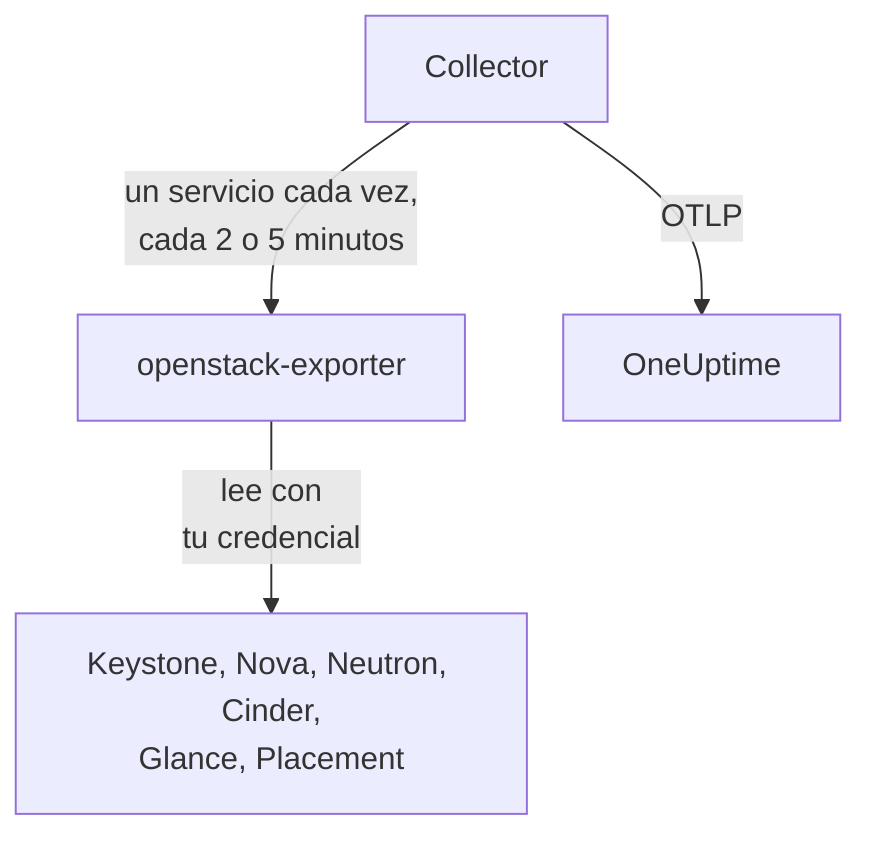

# Agente de OpenStack

El agente de OpenStack de OneUptime monitoriza una nube OpenStack: sus servicios y agentes, hipervisores, instancias, redes, routers, volúmenes, pools de almacenamiento, imágenes y proyectos, en todas las regiones. Lee las API de la nube con una credencial que tú eliges y envía lo que encuentra a OneUptime, donde la nube aparece con sus regiones, hipervisores y proyectos. Los [monitores de OpenStack](/docs/monitor/openstack-monitor) alertan sobre lo que llega, y una [sonda](/docs/telemetry/openstack-agentless) puede recopilar los datos de una nube sin instalar nada.

:::cards
- [¿Sonda o agente?](/docs/telemetry/openstack-agentless#sonda-o-agente): Cuál elegir, para una nube que puede usar cualquiera de los dos.
- [Elige cuánto ve](#elige-cuánto-ve-el-agente): OpenStack no tiene un rol global de solo lectura, así que hay tres niveles.
- [Instala el agente](#instala-el-agente): Una credencial y después el script de instalación, Docker Compose o sin Docker.
- [Lo que cuesta a tu nube](#lo-que-cuesta-a-tu-nube): Qué lee cada ajuste y cómo cambiarlo.
- [Capacidad](#capacidad): Cuántas unidades más de cada flavor caben y cuántos días faltan para que cada cosa se llene.
- [Gasto](#gasto): Quién usa qué, a cuánto asciende con tus precios o según lo calculó CloudKitty, y qué se podría recuperar.
- [Páginas de estado y aviso a los proyectos](#páginas-de-estado-y-aviso-a-los-proyectos): Una página por región en un solo paso, y avisar solo a los proyectos a los que llega un fallo.
- [Registros de servicios](#registros-de-servicios): Analizados, con una solicitud seguida a través de varios servicios.
- [Eventos del ciclo de vida](#eventos-del-ciclo-de-vida): Acciones sobre instancias en el feed y en los gráficos, a partir de notificaciones o de una sonda.
- [Quién hizo qué](#quién-hizo-qué): Pistas de auditoría en Eventos de seguridad.
- [Trazar una solicitud](#trazar-solicitudes-a-través-del-plano-de-control): Una solicitud firmada, seguida a través del plano de control.
- [Comprobar desde fuera](#comprobar-la-nube-desde-fuera): Si alguien puede realmente arrancar una instancia, desde una sonda fuera de la nube.
- [Sin internet](#sin-internet): Las cuatro imágenes del agente y cómo copiarlas a un registro propio.
- [Por herramienta de despliegue](/docs/telemetry/openstack-deployment-tools): Kolla-Ansible, OpenStack-Ansible, OpenStack-Helm, Atmosphere, Sunbeam, Red Hat y Mirantis.
- [Solución de problemas](#solución-de-problemas): Un script de diagnóstico y los problemas habituales.
:::

## Cómo funciona

El agente son dos programas upstream fijados en una versión y su configuración, en una misma máquina: [openstack-exporter](https://github.com/openstack-exporter/openstack-exporter) lee las API de la nube y las convierte en series `openstack_*`, y un OpenTelemetry Collector le pide un servicio de OpenStack cada vez, marca cada serie con la nube y la región de la que viene, y las envía a OneUptime. No se ejecuta nada en tus controladores ni en tus nodos de cómputo, salvo que añadas el [perfil de registros](#registros-de-servicios) opcional, que lee sus registros.



La nube se registra sola con sus primeros datos, con el nombre que el agente asigna a cada métrica como `openstack.cloud.name`. Un agente vigila una nube: un Keystone, con una región o varias.

## Antes de empezar

- Docker Engine 20.10 o posterior con el plugin Docker Compose v2 o, para ejecutarlo sin Docker, una máquina Linux (x86_64 o arm64) con systemd 235 o posterior, glibc 2.34 o posterior (RHEL 9, Ubuntu 22.04, Debian 12) y root.
- Una ruta desde esa máquina hasta Keystone y hasta el endpoint público de cada servicio.
- La línea de comandos `openstack`, como alguien que pueda crear la credencial de más abajo.
- Una clave de ingesta. Crea una en **Ajustes del proyecto → Telemetría y APM → Claves de ingesta** y copia su valor.
- HTTPS saliente desde esa máquina hasta la URL de tu OneUptime.

### Dónde ejecutar el agente

Ejecuta el agente fuera de la nube que vigila: una VM pequeña en hardware aparte, un host de gestión u otra nube. Un agente dentro de una nube que ha fallado se queda en silencio con ella, y ese silencio parece una nube sana que dejó de reportar.

## Elige cuánto ve el agente

OpenStack no tiene un rol global de solo lectura, y eso es lo más difícil de monitorizarlo:

- `reader` está limitado a un proyecto en todas partes excepto en Keystone e Ironic.
- Hipervisores, servicios, agentes, pools y Placement exigen admin por defecto.
- Una política personalizada no puede abrir las listas de todos los proyectos en Neutron ni en Cinder, que las limitan por contexto de admin en su propio código.
- Los servicios y los pools de almacenamiento de Cinder responden con un `403` a cualquiera que no sea admin, desde el código de Cinder, cuando la política ya se ha superado. Ninguna política personalizada los abre.
- Neutron y Cinder responden a un reader simple con un `200` y solo con el proyecto de ese reader. Parece que funcionó, y no es así.
- Donde Cinder tiene `enforce_new_defaults` desactivado, que es su valor por defecto, cualquier rol en un proyecto puede crear los volúmenes de ese proyecto, incluidos `reader` y `oneuptime_monitoring`. En Epoxy, Flamingo y Gazpacho tanto un reader simple como el rol en un proyecto real crearon un volumen (`202`). En Hibiscus ambos fueron rechazados (`403`), porque DevStack solo activa `enforce_new_defaults` allí. Un rol de solo lectura en un proyecto real no es de solo lectura.

Así que hay tres niveles, y cada uno tiene un coste. Empieza por el primero si puedes.

| Nivel | Qué necesita | Qué ve | Qué se queda sin ver |
| --- | --- | --- | --- |
| **1. Vista completa** | Una credencial de aplicación en una cuenta con `admin` en un proyecto propio, limitada por reglas de acceso a la lectura, con `service_type` definido en cada servicio | Todas las lecturas que hace el agente, y el estado de `cinder-volume` y `cinder-scheduler` y los pools de almacenamiento, que solo ve este nivel | Los usuarios y grupos de Keystone, a propósito. No puede escribir: toda escritura respondió `401` |
| **2. Solo infraestructura** | Los roles `oneuptime_monitoring` y `reader` en un proyecto propio que no contiene nada y tiene cuota cero, y las políticas personalizadas que incluye el agente | Todos los proyectos, dominios, servicios y endpoints de Keystone, todo Nova incluidos los servidores de todos los proyectos, todo Placement, y los agentes y las IP availabilities de Neutron | Las redes, subredes, routers, IP flotantes y puertos de Neutron, y los volúmenes y snapshots de Cinder, son solo los de su propio proyecto, así que en un proyecto vacío solo los compartidos y externos. Sin estado de `cinder-volume` ni `cinder-scheduler` ni pools de almacenamiento. No puede escribir: toda escritura respondió `403`, o `409` y `413` por la cuota |
| **3. Vista de proyecto** | Un `reader` simple en un proyecto real, para un equipo que vigila su propia parte de una nube que gestiona otro | Los volúmenes, redes y routers de ese proyecto, desde Cinder y Neutron | Toda la infraestructura: sin hipervisores, servicios, agentes, pools ni capacidad. A través del agente, tampoco instancias, porque se rechaza la lectura de todos los proyectos del exporter. Y en muchas nubes `reader` puede escribir ahí |

Las plantillas **Block Storage Service Down**, **Storage Pool Warning** y **Storage Pool Critical** necesitan el nivel 1. **Compute Service Down**, **Network Agent Down** y las plantillas de Placement y de hipervisores necesitan el nivel 1 o 2, y nada en el nivel 3 lee una instancia.

### Qué lee cada nivel

Esto es lo que respondieron cinco nubes reales, en Epoxy, Flamingo, Gazpacho (OVN y OVS) y Hibiscus. Cada celda está escrita a partir de esas grabaciones.

| Lectura | Nivel 1: Vista completa | Nivel 2: Solo infraestructura | Nivel 3: Vista de proyecto |
| --- | --- | --- | --- |
| Keystone: proyectos | todos | todos | rechazado |
| Keystone: dominios | todos | todos | rechazado |
| Keystone: regiones | todas | lo que ve cualquiera | lo que ve cualquiera |
| Keystone: servicios | todos | todos | rechazado |
| Keystone: endpoints | todos | todos | rechazado |
| Nova: servidores, todos los proyectos | todos | todos | rechazado |
| Nova: servicios | todos | todos | rechazado |
| Nova: hipervisores | todos | todos | rechazado |
| Nova: aggregates | todos | todos | rechazado |
| Nova: zonas de disponibilidad, detalle | todas | todas | rechazado |
| Nova: flavors | todos | lo que ve cualquiera | lo que ve cualquiera |
| Nova: uso por proyecto | todo | todo | rechazado |
| Placement: resource providers | todos | todos | rechazado |
| Neutron: agentes | todos | todos | nada |
| Neutron: redes | todas | solo el proyecto propio | solo el proyecto propio |
| Neutron: subredes | todas | solo el proyecto propio | solo el proyecto propio |
| Neutron: routers | todos | solo el proyecto propio | solo el proyecto propio |
| Neutron: IP flotantes | todas | solo el proyecto propio | solo el proyecto propio |
| Neutron: IP availabilities | todas | todas | nada |
| Neutron: grupos de seguridad | todos | 409, esperado | solo el proyecto propio |
| Neutron: puertos | todos | solo el proyecto propio | solo el proyecto propio |
| Neutron: cuotas | todas | rechazado | rechazado |
| Cinder: volúmenes, todos los proyectos | todos | solo el proyecto propio | solo el proyecto propio |
| Cinder: servicios | todos | rechazado | rechazado |
| Cinder: pools | todos | rechazado | rechazado |
| Cinder: snapshots, todos los proyectos | todos | solo el proyecto propio | solo el proyecto propio |
| Cinder: backups, todos los proyectos | todos | ninguno registrado | ninguno registrado |
| Cinder: tipos de volumen | todos | lo que ve cualquiera | lo que ve cualquiera |
| Glance: imágenes | todas | lo que ve cualquiera | lo que ve cualquiera |

- **todas las**: las mismas filas que vio un admin.
- **solo el proyecto propio**: las filas de ese proyecto y todo lo compartido o externo. En un proyecto que no contiene nada, eso son solo las compartidas y externas.
- **rechazado**: un `401` o un `403`.
- **lo que ve cualquiera**: todas las credenciales vieron todas las filas, en nubes que solo contienen flavors, tipos de volumen e imágenes públicos. Uno privado en otro proyecto requiere el nivel 1.
- **nada**: un `200` sin filas, en un proyecto que también tiene redes. Parece que funcionó, y no es así.
- **ninguno registrado**: un `200` sin filas donde un admin tampoco vio ninguna, así que no había nada con lo que distinguirlo.
- **409, esperado**: Neutron intenta crear el grupo de seguridad por defecto del proyecto cuando los lista, y la cuota cero no se lo permite, así que responde `409 Quota exceeded`. Es inofensivo y no hay nada que corregir.

Octavia, Ironic, Heat, Magnum, Manila, Designate, Barbican, Swift, Trove y Gnocchi no aparecen aquí porque esas nubes no los ejecutan. El [script de diagnóstico](#solución-de-problemas) también los consulta, donde una nube los tiene, y lee cada ruta con tu credencial real y dice qué puede ver esa credencial.

Lo que obtuvo el exporter del agente con cada una, en series por servicio. Los recuentos dependen de lo que contenga una nube cuando se le consulta, así que compáralos entre sí y no con los tuyos:

| Servicio del exporter | Admin | Nivel 1: Vista completa | Nivel 2: Solo infraestructura | Nivel 3: Vista de proyecto |
| --- | --- | --- | --- | --- |
| identity | 14 | 13 | 13 | 4 |
| compute | 33 | 33 | 33 | 15 |
| placement | 25 | 25 | 25 | 1 |
| network | 36 a 40 | 36 a 40 | 24 a 26 | 14 |
| volume | 33 | 33 a 41 | 23 | 29 a 37 |
| image | 4 | 4 | 4 | 4 |

## Instala el agente

Cada OneUptime sirve el script de instalación del agente y sus archivos para su propia versión: los comandos de abajo los descargan de `https://oneuptime.com`, así que en un OneUptime autoalojado sustitúyelo por tu URL. El script de instalación se guarda primero como `install.sh`, para que puedas leerlo antes de ejecutarlo.

:::steps
### Crea la credencial

Elige el nivel que escogiste. Cada uno crea una credencial de aplicación, que imprime un `id` y un `secret`: el secreto se muestra una sola vez. Dale una fecha de caducidad y nunca `--unrestricted`, que le permitiría crear más credenciales.

:::tabs
@tab Level 1: Full view
Como admin, crea un proyecto y una cuenta para el agente:

```bash
openstack project create --domain default oneuptime-monitoring
openstack user create --domain default --password-prompt oneuptime-monitoring
openstack role add --project oneuptime-monitoring --user oneuptime-monitoring admin
```

Después, con la sesión iniciada con esa cuenta en ese proyecto, crea la credencial. Las reglas son las rutas `GET` exactas que usa el agente, ajustadas a tu nube:

```bash
curl -fsSLO https://oneuptime.com/install/openstack-agent/access/application-credential-access-rules.json
curl -fsSLO https://oneuptime.com/install/openstack-agent/access/access-rules-for-cloud.py
openstack catalog list -f json | python3 access-rules-for-cloud.py \
  application-credential-access-rules.json > access-rules-for-this-cloud.json
openstack application credential create oneuptime-agent \
  --role admin \
  --access-rules "$(cat access-rules-for-this-cloud.json)" \
  --expiration 2027-11-01T00:00:00
```

Una regla de acceso se compara con la ruta que ve el servicio. Un servicio detrás de un prefijo de ruta, como `https://cloud.example/compute/v2.1`, ve `/compute/v2.1/servers`, y rechaza con un `401` la regla incluida para `/v2.1/servers`. `access-rules-for-cloud.py` añade de nuevo cada regla bajo el prefijo de su servicio, leído de tu catálogo.

Dos de las lecturas del exporter requieren reglas fáciles de pasar por alto a mano. Lee la raíz de Octavia antes que nada y, detrás de Apache, un servicio la ve como `/load-balancer//`, con dos barras. Si se rechaza, el exporter responde con un `200` vacío, así que la nube parece no ejecutar Octavia. Y lista la cuenta de Swift con una barra final, que `/v1/*` no cubre. Si se rechaza, `openstack_object_store_up` vale `0`. Las reglas ajustadas incluyen ambas. Las reglas de una credencial no se pueden cambiar, así que si la tuya se creó a partir de una copia anterior, crea una nueva.

Las reglas de acceso también requieren que `service_type` esté definido para keystonemiddleware en cada servicio, y reiniciar ese servicio. Sin él, el servicio rechaza la credencial con un `401`:

```ini title="nova.conf"
[keystone_authtoken]
service_type = compute
```

| Archivo de configuración | `service_type` |
| --- | --- |
| `nova.conf` | `compute` |
| `neutron.conf` | `network` |
| `cinder.conf` | `block-storage`. Las reglas también incluyen `volume` y `volumev3`, para un Cinder configurado así |
| `glance-api.conf` | `image` |
| `placement.conf` | `placement` |
| `octavia.conf` | `load-balancer` |
| `ironic.conf` | `baremetal` |
| `heat.conf` | `orchestration` |
| `magnum.conf` | `container-infra` |
| `manila.conf` | `sharev2`. Las reglas también incluyen `shared-file-system`, para un Manila configurado así |
| `designate.conf` | `dns` |
| `barbican.conf` | `key-manager` |
| `trove.conf` | `database` |
| `gnocchi.conf` | `metric` |
| `cloudkitty.conf` | `rating` |
| `proxy-server.conf`, bajo `[filter:authtoken]` | `object-store`, y `include_service_catalog = True` junto a él. keystonemiddleware comprueba las reglas con el catálogo del token, así que con `False`, que es lo que define DevStack, Swift responde `500` a la credencial |

Solo los servicios que ejecuta tu nube necesitan una línea.

En los servicios que una nube puede no ejecutar, lo que obtuvo cada nivel en nubes reales difiere de las tablas anteriores en cuatro puntos:

- **Ironic** responde a la credencial de un proyecto, también a la de un admin, solo con los nodos que ese proyecto posee, y rechaza sus conductores. Solo el alcance de sistema lee todos los nodos y los conductores, y la credencial del agente está en un proyecto. Para leer un nodo con ella, haz de su proyecto el propietario: `openstack baremetal node set --owner`.
- **Swift** lista los contenedores del proyecto de la propia credencial y de ningún otro. La cuenta de otro proyecto responde `403` salvo que la credencial tenga `ResellerAdmin`.
- **Barbican** responde a una credencial solo sobre su propio proyecto y rechaza a un reader simple. OneUptime no lee ningún secreto.
- **Gnocchi** deja que cualquier rol en un proyecto cree una métrica, así que en una nube que lo ejecuta, el nivel 2 y el nivel 3 pueden escribir ahí.

Keystone no necesita nada. Con las reglas ajustadas, `service_type` definido y las API reiniciadas, toda lectura respondió `200` y toda escritura `401`, en todas las versiones que registramos. El exporter obtiene lo que obtiene un admin, salvo los usuarios y grupos de Keystone, a propósito. Eso vale también para los servicios que una nube puede no ejecutar: registrado en DevStack, el nivel 1 obtuvo las mismas series que la credencial de un admin de cada uno que lee el exporter, y toda escritura respondió `401`.

Si no vas a hacer ese cambio, crea la misma credencial sin `--access-rules`: una credencial de aplicación de admin simple. Funciona y puede escribir, por lo que el script de diagnóstico la etiqueta como tal.
@tab Level 2: Infrastructure only
Como admin, crea el rol, un proyecto que no contenga nada y tenga cuota cero, y una cuenta:

```bash
openstack role create oneuptime_monitoring
openstack project create --domain default --description "OneUptime monitoring: holds nothing" oneuptime-monitoring
openstack quota set --instances 0 --cores 0 --ram 0 --key-pairs 0 oneuptime-monitoring
openstack quota set --volumes 0 --gigabytes 0 --snapshots 0 --backups 0 --backup-gigabytes 0 oneuptime-monitoring
openstack quota set --networks 0 --subnets 0 --ports 0 --routers 0 --floating-ips 0 --secgroups 0 --secgroup-rules 0 oneuptime-monitoring
openstack user create --domain default --password-prompt oneuptime-monitoring
openstack role add --project oneuptime-monitoring --user oneuptime-monitoring oneuptime_monitoring
openstack role add --project oneuptime-monitoring --user oneuptime-monitoring reader
```

El proyecto no contiene nada y tiene cuota cero a propósito. Donde Cinder tiene `enforce_new_defaults` desactivado, cualquier rol en un proyecto puede crear los volúmenes de ese proyecto. Sin nada que tocar y sin cuota para crear nada, no hay nada que pueda escribir: en todas las versiones que registramos, toda escritura respondió `403`, o `409` y `413` por la cuota.

Descarga las políticas personalizadas y fusiona cada archivo, en cada controlador, en el archivo indicado por `[oslo_policy] policy_file` en la configuración de ese servicio (`nova.conf`, `neutron.conf` y así sucesivamente). Eso es `/etc/nova/policy.yaml`, y así con los demás, salvo que tu despliegue diga otra cosa: DevStack dice `policy.json`. Cada regla mantiene el valor por defecto del servicio y añade el rol, y oslo.policy detecta por sí solo un archivo modificado, así que no hace falta reiniciar.

```bash
curl -fsSLO https://oneuptime.com/install/openstack-agent/access/policy/nova.yaml
curl -fsSLO https://oneuptime.com/install/openstack-agent/access/policy/neutron.yaml
curl -fsSLO https://oneuptime.com/install/openstack-agent/access/policy/keystone.yaml
curl -fsSLO https://oneuptime.com/install/openstack-agent/access/policy/placement.yaml
```

No hay archivo para Cinder. Sus `os-services` y `scheduler-stats/get_pools` responden al rol con `403 User does not have admin privileges`, en las cinco versiones que registramos. Eso viene del propio código de Cinder, que exige un contexto de admin, cuando la política ya se ha superado, así que ninguna política personalizada puede abrirlos.

**Para quitar las políticas personalizadas, vacía el archivo (`{}`) y nunca lo borres.** En Flamingo (2025.2) y Epoxy (2025.1), oslo.policy lanza un error en cada comprobación cuando desaparece un archivo de políticas que ya había leído, así que ese servicio falla en todas las solicitudes. Cuando el servicio es Keystone, deja de validar tokens y toda la nube responde `503`. Si ya ha ocurrido, reinicia el servicio.

Después, con la sesión iniciada con esa cuenta en ese proyecto, crea la credencial:

```bash
openstack application credential create oneuptime-agent --expiration 2027-11-01T00:00:00
```

Poner el rol en un proyecto real para ver sus volúmenes y routers también permite a la cuenta escribir ahí, en una nube donde Cinder tiene `enforce_new_defaults` desactivado. El script de diagnóstico avisa cuando el proyecto de la credencial contiene cosas.
@tab Level 3: Project view
Da a una cuenta el rol `reader` simple en el proyecto y, después, con la sesión iniciada con esa cuenta en ese proyecto, crea la credencial:

```bash
openstack role add --project my-team --user my-monitoring-account reader
openstack application credential create oneuptime-agent --expiration 2027-11-01T00:00:00
```

El agente ve las filas de ese proyecto desde Cinder y Neutron y nada de infraestructura. Tres cosas que debes saber antes de elegir esto:

- **A través del agente no muestra ninguna instancia.** El exporter pide a Nova los servidores de todos los proyectos, Nova rechaza a un reader simple y esa lectura falla por completo. Solo una sonda de OneUptime, que recopile sin este agente, puede listar las instancias de un proyecto.
- **Puede que pueda escribir.** En una nube donde Cinder tiene `enforce_new_defaults` desactivado, un `reader` simple también puede crear volúmenes en su proyecto. En Epoxy, Flamingo y Gazpacho lo hizo (`202`), y en Hibiscus fue rechazado (`403`), porque DevStack solo activa `enforce_new_defaults` allí. El valor por defecto de Cinder es desactivado.
- **Placement figura como si no respondiera.** Todas las llamadas que hace se rechazan, y el exporter lo informa igual que informa de un Placement detenido: `openstack_placement_up 0`, en las cinco versiones que registramos. Las páginas pueden distinguirlo, por lo que más está cerrado a esta credencial, y lo dicen. La plantilla [Placement API Down](/docs/monitor/openstack-monitor#pre-built-alert-templates) no puede, así que déjala fuera en este nivel.
:::

### Instala e inicia el agente

:::tabs
@tab install.sh
Descarga el script de instalación y ejecútalo en la máquina que alojará el agente:

```bash
curl -fsSL https://oneuptime.com/install/openstack-agent -o install.sh
bash install.sh
```

El script pide tu URL de OneUptime, la clave de ingesta, un nombre estable para la nube, la URL de autenticación de Keystone, los nombres de las regiones, la credencial de aplicación (un usuario y una contraseña si le dices que no a ella) y un archivo de CA privada si la nube tiene su propia autoridad de certificación. Nada secreto se muestra en pantalla ni va en una línea de comandos. Comprueba la credencial con Keystone antes de escribir o iniciar nada, se instala en `/opt/oneuptime-openstack-agent`, o en `oneuptime-openstack-agent` dentro de tu carpeta personal si no tienes permisos sobre `/opt` (solo necesita el grupo `docker`), escribe `.env` y `clouds.yaml` con el modo `0600` e inicia el agente con Docker Compose. Cada respuesta también funciona como variable de entorno, y ejecutar el script otra vez las reutiliza en lugar de volver a preguntar, que es como se [actualiza el agente](#actualizar-el-agente).
@tab Docker Compose
Descarga `docker-compose.yml` y `otel-collector-config.yaml` de tu OneUptime en una carpeta nueva:

```bash
mkdir oneuptime-openstack-agent && cd oneuptime-openstack-agent
curl -fsSLO https://oneuptime.com/install/openstack-agent/docker-compose.yml
curl -fsSLO https://oneuptime.com/install/openstack-agent/otel-collector-config.yaml
```

Crea un `clouds.yaml` junto a ellos, con una entrada por región, **con el nombre de la región**, porque las series del exporter no dicen de qué región son y el collector les asigna el nombre de la entrada como `openstack.region.name`:

```yaml title="clouds.yaml"
clouds:
  RegionOne:
    region_name: RegionOne
    identity_api_version: 3
    auth_type: v3applicationcredential
    auth:
      auth_url: https://keystone.example.com:5000/v3
      application_credential_id: your-credential-id
      application_credential_secret: your-credential-secret
```

Después, un archivo `.env`:

```bash title=".env"
ONEUPTIME_URL=YOUR_ONEUPTIME_URL
ONEUPTIME_TELEMETRY_INGESTION_KEY=YOUR_TELEMETRY_INGESTION_TOKEN
OPENSTACK_CLOUD_NAME=my-cloud
OPENSTACK_EXPORTER_CLOUDS=[RegionOne,RegionTwo]
COMPOSE_PROFILES=openstack-exporter,openstack-ai-agent
```

`OPENSTACK_EXPORTER_CLOUDS` lista todas las regiones, entre corchetes, y `COMPOSE_PROFILES` inicia el exporter incluido y el [agente de IA](#agente-de-ia). Ambos archivos contienen secretos. El exporter se ejecuta como uid 65532 y debe ser la única cuenta que pueda leer `clouds.yaml`. Inicia el agente:

```bash
chmod 600 .env
sudo chown 65532:65532 clouds.yaml
sudo chmod 600 clouds.yaml
docker compose up -d
```
@tab Without Docker
En Linux (x86_64 o arm64) con systemd 235 o posterior y glibc 2.34 o posterior, el script de instalación ejecuta las versiones upstream de los mismos dos programas como servicios de systemd. RHEL 8 y sus derivados tienen una glibc más antigua, en la que la versión del exporter no puede ejecutarse: el script lo dice y no cambia nada, así que usa Docker ahí.

```bash
curl -fsSL https://oneuptime.com/install/openstack-agent -o install.sh
sudo bash install.sh --without-docker
```

Las mismas preguntas, la misma comprobación con Keystone y los mismos archivos. Cada archivo de versión se contrasta con un sha256 fijado en `install.sh`, y una descarga que no coincide detiene la instalación antes de que cambie nada. El collector se ejecuta como un usuario sin privilegios y desechable que nunca ve la credencial de OpenStack, y el exporter como el usuario de sistema `oneuptime-openstack`, la única cuenta que puede leer `clouds.yaml`, escuchando solo en `127.0.0.1:9180`.

Ejecuta un agente por nube: si pasas de una instalación con Docker, ejecuta primero `docker compose down`, o cada métrica llegará dos veces.
:::

¿Ya ejecutas openstack-exporter con `--multi-cloud`? Apunta el agente a él y el incluido nunca se inicia: `OPENSTACK_EXPORTER_ADDRESS=10.0.0.5:9180 bash install.sh`, o deja `COMPOSE_PROFILES` fuera de `.env` y define allí `OPENSTACK_EXPORTER_ADDRESS`. Su `clouds.yaml` necesita una entrada con el nombre de cada región, y debe desactivar lo que desactiva el incluido: consulta [Lo que cuesta a tu nube](#lo-que-cuesta-a-tu-nube). Usa una dirección a la que pueda llegar el contenedor del agente: `localhost` es el propio contenedor.

El exporter de Kolla-Ansible se ejecuta sin `--multi-cloud`, así que no tiene `/probe`, y está fijado a una versión que dice menos. [Usa el exporter que ya ejecutas](/docs/telemetry/openstack-deployment-tools#usar-el-exportador-que-ya-ejecutas) explica cómo leerlo y exactamente de qué se quedan sin las páginas. [OpenStack por herramienta de despliegue](/docs/telemetry/openstack-deployment-tools) tiene el resto de los pasos de cada herramienta.

### Comprueba que el agente se está ejecutando

```bash
cd /opt/oneuptime-openstack-agent    # or the folder the script said it installed to
docker compose ps
docker logs oneuptime-openstack-agent
```

`docker compose ps` lista el collector (`oneuptime-openstack-agent`), el exporter incluido (`oneuptime-openstack-exporter`) y el [agente de IA](#agente-de-ia) (`oneuptime-openstack-ai-agent`). Los registros del collector deberían mostrar esta línea una vez iniciado:

```text
Everything is ready. Begin running and processing data.
```

Sin Docker, consulta `systemctl status oneuptime-openstack-agent oneuptime-openstack-exporter` y `journalctl -u oneuptime-openstack-agent`.

### Encuentra la nube en OneUptime

Abre **Productos → Infraestructura → OpenStack**. La nube aparece con su `OPENSTACK_CLOUD_NAME` tras su primera recopilación, en pocos minutos. Compute, network, volume y Placement se leen cada 2 minutos, identity e images cada 5.
:::

La **Vista general** de la nube indica si sus datos llegan a OneUptime, qué requiere atención primero y cómo va cada servicio:


**Hipervisores** indica lo que Nova y Placement han prometido en cada host de cómputo:


**Instancias** lista todas las instancias con su estado en las propias palabras de Nova, su proyecto, flavor e hipervisor:


## Variables de entorno

El script de instalación las escribe en `/opt/oneuptime-openstack-agent/.env`; una instalación con Docker Compose las lee del `.env` junto a `docker-compose.yml`. Tras cambiar una, ejecuta `docker compose up -d` en esa carpeta. Solo `clouds.yaml` contiene la credencial.

| Variable | Obligatoria | Descripción |
| --- | --- | --- |
| `ONEUPTIME_URL` | Sí | La URL de tu OneUptime, como `https://oneuptime.com` o tu instancia autoalojada. |
| `ONEUPTIME_TELEMETRY_INGESTION_KEY` | Sí | La clave de ingesta de **Ajustes del proyecto → Telemetría y APM → Claves de ingesta**. |
| `OPENSTACK_CLOUD_NAME` | Sí | El nombre de la nube en OneUptime, asignado a cada métrica como el atributo de recurso `openstack.cloud.name`. Mantenlo estable: cambiarlo registra una nube nueva. Por defecto es `openstack`. |
| `OPENSTACK_AUTH_URL` | Exporter incluido | Una respuesta al script de instalación: la URL de autenticación de Keystone. Se añade `/v3` si falta. |
| `OPENSTACK_EXPORTER_CLOUDS` | Sí | Las regiones, entre corchetes, como `[RegionOne,RegionTwo]`, cada una con el nombre de una entrada de `clouds.yaml`. Por defecto es `[RegionOne]`. |
| `OPENSTACK_EXPORTER_ADDRESS` | No | `host:port`, sin esquema, de tu propio exporter. Omítela para usar el incluido. |
| `OPENSTACK_CA_FILE` | No | Un archivo PEM con la autoridad de certificación de una nube que tiene la suya. El script de instalación guarda una copia como `ca.pem` junto a `clouds.yaml`. |
| `OPENSTACK_EXPORTER_USER` | No | El `uid:gid` con el que se ejecuta el contenedor del exporter, que debe ser el propietario de `clouds.yaml`. Por defecto es `65532:65532`. |
| `COMPOSE_PROFILES` | Exporter incluido | `openstack-exporter` inicia el exporter incluido, y `openstack-ai-agent` el [agente de IA](#agente-de-ia). |
| `OPENSTACK_LIBVIRT_EXPORTER_TARGETS` | No | Los nodos de cómputo de los que leer el [uso real](#uso-real) mediante `prometheus-libvirt-exporter`, entre corchetes, como `[compute-01:9177,compute-02:9177]`. Por defecto, ninguno. |
| `OPENSTACK_CEILOMETER_EXPORTER_TARGETS` | No | Lo mismo mediante el propio exporter de Ceilometer, como `[compute-01:9101]`. Por defecto, ninguno. |
| `OPENSTACK_SINGLE_CLOUD_EXPORTER_TARGETS` | No | Un exporter que ya se ejecuta sin `--multi-cloud`, como el de Kolla-Ansible: `[10.0.0.254:9198]`. Consulta [Usa el exporter que ya ejecutas](/docs/telemetry/openstack-deployment-tools#usar-el-exportador-que-ya-ejecutas). |
| `OPENSTACK_RABBITMQ_TARGETS` | No | El plugin de Prometheus de RabbitMQ en cada nodo, para [sobre qué se sostiene la nube](#sobre-qué-se-sostiene-la-nube): `[10.0.0.11:15692,10.0.0.12:15692]`. Por defecto, ninguno. |
| `OPENSTACK_MARIADB_TARGETS` | No | mysqld_exporter junto a cada nodo de MariaDB, normalmente en el `9104`. Por defecto, ninguno. |
| `OPENSTACK_MEMCACHED_TARGETS` | No | memcached_exporter junto a cada Memcached, normalmente en el `9150`. Por defecto, ninguno. |
| `OPENSTACK_HAPROXY_TARGETS` | No | El propio exporter de Prometheus de HAProxy. Por defecto, ninguno. |
| `OPENSTACK_NETWORK_EXPORTER_TARGETS` | No | openstack-network-exporter en cada nodo, para OVN y Open vSwitch, normalmente en el `1981`. Por defecto, ninguno. |
| `OPENSTACK_LIBVIRT_HEALTH_TARGETS` | No | prometheus-libvirt-exporter en cada nodo de cómputo, normalmente en el `9177`, para saber si libvirt responde y nada por instancia. Por defecto, ninguno. |
| `OPENSTACK_CONTROL_PLANE_REGION` | No | La región de un destino de los anteriores que no dice la suya. Un destino puede hacerlo: `RegionTwo@10.1.0.11:15692`. Por defecto es la primera región. |
| `OPENSTACK_AGENT_SERVICES` | No | Qué servicios lee este agente, para [compartir una nube entre agentes](/docs/telemetry/openstack-very-large-clouds#compartir-una-nube-entre-recopiladores), como `compute\|placement`. Por defecto, todos. |
| `OPENSTACK_AGENT_MEMORY_LIMIT_MIB` | No | Lo que el collector puede mantener en memoria. La recopilación de una nube muy grande requiere más que el valor por defecto de `512`. |
| `OPENSTACK_DATABASE_EXPORTER_TARGETS` | No | `openstack_database_exporter`, para [la ruta de la base de datos](/docs/telemetry/openstack-very-large-clouds#la-vía-de-la-base-de-datos): `[openstack-database-exporter:9180]`. Por defecto, ninguno. Los demás ajustes de esa ruta se listan allí. |

El script de instalación también lee la credencial del entorno, para saltarse sus preguntas: `OPENSTACK_APPLICATION_CREDENTIAL_ID` y `OPENSTACK_APPLICATION_CREDENTIAL_SECRET`, o `OPENSTACK_USERNAME`, `OPENSTACK_PASSWORD`, `OPENSTACK_PROJECT_NAME`, `OPENSTACK_USER_DOMAIN_NAME` y `OPENSTACK_PROJECT_DOMAIN_NAME`. Tienen nombres propios en lugar de los `OS_*` que define un archivo openrc, de modo que el openrc de un admin que se ha cargado nunca se convierte en la credencial del agente sin que nadie lo decida. Una credencial de aplicación es mejor que un usuario y una contraseña: se puede limitar a lectura y puede caducar.

## Sobre qué se sostiene la nube

La mayoría de las caídas de OpenStack empiezan por debajo: un RabbitMQ caído, Galera sin quórum, una base de datos OVN sin líder. El agente puede leer, cada minuto, los exporters que esos componentes ya tienen, y está desactivado hasta que los nombres. Nada de esto escribe en ninguno, y de cada uno solo se conservan unas pocas series.

Nombra cada uno en el `.env` del agente, todos los miembros de un clúster, y después ejecuta `docker compose up -d`:

```bash
OPENSTACK_RABBITMQ_TARGETS=[10.0.0.11:15692,10.0.0.12:15692,10.0.0.13:15692]
OPENSTACK_MARIADB_TARGETS=[10.0.0.11:9104,10.0.0.12:9104,10.0.0.13:9104]
OPENSTACK_MEMCACHED_TARGETS=[10.0.0.11:9150,10.0.0.12:9150]
OPENSTACK_HAPROXY_TARGETS=[10.0.0.11:9101,10.0.0.12:9101]
OPENSTACK_NETWORK_EXPORTER_TARGETS=[10.0.0.21:1981,10.0.0.22:1981,RegionTwo@10.1.0.21:1981]
OPENSTACK_LIBVIRT_HEALTH_TARGETS=[10.0.0.21:9177,10.0.0.22:9177]
OPENSTACK_CONTROL_PLANE_REGION=RegionOne
```

Un destino puede indicar en qué región está, como hace el último de esa lista. Uno que no lo indica está en `OPENSTACK_CONTROL_PLANE_REGION`. En Kolla-Ansible, cuyo Prometheus ya los conoce todos, `control-plane-targets.py` imprime estas líneas por ti, y [OpenStack por herramienta de despliegue](/docs/telemetry/openstack-deployment-tools) dice dónde está cada exporter en las demás.

Qué lee cada uno y qué necesita el agente de él:

| Ajuste | Lee | Actívalo con |
| --- | --- | --- |
| `OPENSTACK_RABBITMQ_TARGETS` | El propio plugin de RabbitMQ, `/metrics` y cada cola desde `/metrics/detailed` | `rabbitmq-plugins enable rabbitmq_prometheus` en cada nodo |
| `OPENSTACK_MARIADB_TARGETS` | mysqld_exporter junto a cada nodo. Sus valores por defecto ya informan de Galera | Nada más que el exporter |
| `OPENSTACK_MEMCACHED_TARGETS` | memcached_exporter junto a cada Memcached | Nada más que el exporter |
| `OPENSTACK_HAPROXY_TARGETS` | El propio exporter de HAProxy | `http-request use-service prometheus-exporter` en un `frontend` propio |
| `OPENSTACK_NETWORK_EXPORTER_TARGETS` | openstack-network-exporter en cada máquina con Open vSwitch o con las bases de datos de OVN | Sus collectors por defecto. Una máquina informa de lo que ejecuta |
| `OPENSTACK_LIBVIRT_HEALTH_TARGETS` | prometheus-libvirt-exporter en cada nodo de cómputo, y solo si libvirt responde | Nada más que el exporter |

Después, la tarjeta **Plano de control** de la nube tiene una línea para cada uno, y una página por dependencia con una línea por máquina. **Sin vigilar** en esa tarjeta significa que no lo has nombrado: nunca aparece como sano. Los problemas ahí van a **Requiere atención** de la nube. La página **Recomendaciones** de la nube ofrece [las plantillas de alertas](/docs/monitor/openstack-monitor#sobre-qué-se-asienta-la-nube), y `troubleshoot.sh` comprueba que cada destino responde y que es lo que dijiste que era.

Para ver más de un RabbitMQ o de una base de datos de lo que necesita la salud de una nube, los productos [Colas](/docs/telemetry/queues) y [Bases de datos](/docs/telemetry/databases) los leen mediante sus propios agentes, lo que supone más datos que esto y en sus propios términos. Las páginas del plano de control enlazan con ellos. Instalarlos es aparte, porque esos productos leen las series de esos agentes y no estas.

Dos cosas que debes saber sobre openstack-network-exporter 0.3.0, la versión con la que se registró esto:

- **Se conecta una sola vez a la base de datos de Open vSwitch.** Tras reiniciar Open vSwitch, `ovs_build_info`, sus bridges, sus interfaces y todas las series de ovn-controller desaparecen hasta que el exporter también se reinicia, mientras que las series propias de Open vSwitch vuelven enseguida. **Exporter Lost Open vSwitch's Database** avisa cuando ha ocurrido.
- **Lee el estado del clúster de una sola base de datos OVN en una máquina.** Es Southbound donde una máquina tiene ambos sockets, como las de Kolla-Ansible. Así que el líder de Northbound solo se muestra donde una máquina no tiene Southbound que leer.

## Qué recopila el agente

El collector crea un trabajo de scrape por servicio de OpenStack, mediante el `/probe?cloud=<region>&include_services=<service>` del exporter, de modo que si Nova falla solo faltan las series de Nova:

| Trabajo de scrape | Cada | Tiempo límite | Series |
| --- | --- | --- | --- |
| `oneuptime-openstack-compute` | 2 minutos | 110 s | `openstack_nova_agent_state`, `openstack_nova_running_vms`, `openstack_nova_vcpus_used`, `openstack_nova_memory_used_bytes`, `openstack_nova_local_storage_used_bytes`, `openstack_nova_total_vms`, `openstack_nova_server_status`, `openstack_nova_flavors`, `openstack_nova_availability_zones` |
| `oneuptime-openstack-network` | 2 minutos | 110 s | `openstack_neutron_agent_state`, `openstack_neutron_networks`, `openstack_neutron_subnets`, `openstack_neutron_routers`, `openstack_neutron_router`, `openstack_neutron_l3_agent_of_router`, `openstack_neutron_floating_ips`, `openstack_neutron_security_groups`, `openstack_neutron_network_ip_availabilities_total`, `openstack_neutron_network_ip_availabilities_used` |
| `oneuptime-openstack-volume` | 2 minutos | 110 s | `openstack_cinder_agent_state`, `openstack_cinder_volumes`, `openstack_cinder_volume_gb`, `openstack_cinder_snapshots`, `openstack_cinder_pool_capacity_free_gb`, `openstack_cinder_pool_capacity_total_gb` |
| `oneuptime-openstack-placement` | 2 minutos | 110 s | `openstack_placement_resource_total`, `openstack_placement_resource_usage`, `openstack_placement_resource_allocation_ratio`, `openstack_placement_resource_reserved` |
| `oneuptime-openstack-identity` | 5 minutos | 120 s | `openstack_identity_projects`, `openstack_identity_project_info`, `openstack_identity_domains`, `openstack_identity_regions` |
| `oneuptime-openstack-image` | 5 minutos | 120 s | `openstack_glance_images`, `openstack_glance_image_bytes`, `openstack_glance_image_created_at` |
| `oneuptime-openstack-load-balancer` | 5 minutos | 120 s | `openstack_loadbalancer_total_loadbalancers`, `openstack_loadbalancer_loadbalancer_status`, `openstack_loadbalancer_total_amphorae`, `openstack_loadbalancer_amphora_status`, `openstack_loadbalancer_total_pools`, `openstack_loadbalancer_pool_status` |
| `oneuptime-openstack-baremetal` | 5 minutos | 120 s | `openstack_ironic_node`, `openstack_ironic_node_updated_at`, `openstack_ironic_node_provision_updated_at` |
| `oneuptime-openstack-orchestration` | 5 minutos | 120 s | `openstack_heat_stack_status`, `openstack_heat_stack_status_counter` |
| `oneuptime-openstack-container-infra` | 5 minutos | 120 s | `openstack_container_infra_total_clusters`, `openstack_container_infra_cluster_masters`, `openstack_container_infra_cluster_nodes`, `openstack_container_infra_cluster_status` |
| `oneuptime-openstack-sharev2` | 5 minutos | 120 s | `openstack_sharev2_shares_counter`, `openstack_sharev2_share_gb`, `openstack_sharev2_share_status`, `openstack_sharev2_share_status_counter` |
| `oneuptime-openstack-dns` | 5 minutos | 120 s | `openstack_designate_zones`, `openstack_designate_zone_status`, `openstack_designate_recordsets`, `openstack_designate_recordsets_status` |
| `oneuptime-openstack-object-store` | 5 minutos | 120 s | `openstack_object_store_objects`, `openstack_object_store_bytes` |
| `oneuptime-openstack-database` | 5 minutos | 120 s | `openstack_trove_total_instances`, `openstack_trove_instance_status`, `openstack_trove_instance_volume_size_gb`, `openstack_trove_instance_volume_used_gb` |
| `oneuptime-openstack-gnocchi` | 5 minutos | 120 s | `openstack_gnocchi_status_metricd_processors`, `openstack_gnocchi_status_metric_having_measures_to_process`, `openstack_gnocchi_status_measures_to_process` |

Los últimos nueve son servicios que una nube puede no ejecutar. Cuando se le pregunta por uno que no está en su catálogo, el exporter inicia sesión en Keystone, registra una línea (`No suitable endpoint could be found in the service catalog`) y responde con nada, y esa nube no muestra rastro del servicio. Es un inicio de sesión cada 5 minutos por servicio y región, y por eso todos son de 5 minutos. Para pedir solo los servicios que ejecutas, define `OPENSTACK_AGENT_SERVICES`, como `identity|compute|placement|network|volume|image`.

Cada servicio también informa de `openstack_<service>_up`, como `openstack_nova_up`. El [monitor de OpenStack](/docs/monitor/openstack-monitor#métricas-recopiladas) lista todas las series con su significado. Cada serie lleva:

| Atributo | Qué dice |
| --- | --- |
| `openstack.cloud.name` | El nombre de la nube, un atributo de recurso |
| `oneuptime.agent.version` | La versión del collector que fijan los archivos del agente, un atributo de recurso |
| `openstack.region.name` | La región, a partir del nombre de la entrada de `clouds.yaml`, en cada punto de datos |
| `openstack_service` | El servicio de OpenStack del trabajo (`compute`, `network`, ...), en cada punto de datos |

Los filtros del monitor comparan por igualdad, así que conserva el procesador `transform/openstack-identity` si personalizas la configuración, y los dos borrados de `service.name` y `service.instance.id` en el procesador `resource`: sin los borrados, los datos registran un Service fantasma en lugar de llegar a la nube.

## Lo que cuesta a tu nube

La monitorización nunca debe ser lo que tumbe una nube, así que los valores por defecto son suaves. Cada scrape vuelve a iniciar sesión en Keystone y hace llamadas reales a la API. [Nubes OpenStack muy grandes](/docs/telemetry/openstack-very-large-clouds) explica a cuánto asciende eso, en solicitudes por minuto y gigabytes al día, en cada tamaño.

| Ajuste | Valor por defecto | Activarlo o cambiarlo te da | Lo que cuesta |
| --- | --- | --- | --- |
| Cuotas de proyecto | Desactivado | Cuánto de cada cuota ha usado un proyecto, en su página y en **Requiere atención**, y la alerta Project Quota Nearly Reached | Cuatro llamadas a la API por proyecto y región, una vez por hora (una de Nova, dos de Cinder, una de Neutron), desde un exporter propio |
| Métricas lentas | Desactivado | Las propias listas de cuotas de Nova y el uso por servidor | Una llamada por proyecto en cada scrape, así que crece con el número de proyectos |
| Series por puerto | Desactivado | `openstack_neutron_port`, `openstack_neutron_ports`, `openstack_neutron_ports_no_ips`, `openstack_neutron_ports_lb_not_active` | Una lista sin alcance de todos los puertos. En una nube grande eso [puede saturar Neutron y causar fallos en cascada](https://github.com/openstack-exporter/openstack-exporter/issues/540), así que déjalo desactivado salvo que sepas que tu número de puertos es pequeño |
| Servicios que una nube puede no ejecutar | Activado | Balanceadores de carga, bare metal, stacks, clústeres, shares, DNS, almacenamiento de objetos, bases de datos y Gnocchi, donde la nube los tiene | Una nube sin alguno paga un inicio de sesión cada 5 minutos. Designate cuesta una llamada por zona en cada scrape, así que crece con el número de zonas |
| Intervalos de scrape | 2 y 5 minutos | Datos más recientes, o menos carga | El doble de frecuencia es el doble de llamadas a la API. Mantén cada `scrape_timeout` por debajo de su `scrape_interval`, para que un scrape lento nunca se acumule sobre el anterior |

**Cuotas de proyecto:** ejecuta `install.sh` otra vez con `OPENSTACK_COLLECT_QUOTAS=true`. Inicia un segundo exporter, `openstack-quota-exporter`, que no lee nada más, y el collector le pide una vez por hora `openstack_nova_limits_*`, `openstack_neutron_quota_*`, `openstack_cinder_limits_*` y `openstack_cinder_volume_type_quota_gigabytes`. Cambian despacio, y un exporter lee las mismas cosas sea cual sea el trabajo que las pide, así que leerlas con menos frecuencia requiere un exporter propio. Tu propio exporter no tiene nada parecido: el agente lee lo que dice, en cada scrape.

**Métricas lentas:** borra la línea `--disable-metric` de lo que quieras, del `command` del exporter en `docker-compose.yml`, o de `ExecStart` en `oneuptime-openstack-exporter.service` sin Docker. El coste es una llamada por proyecto en cada scrape.

| Borra | Para recopilar |
| --- | --- |
| `--disable-metric=nova-quota_cores` | `openstack_nova_quota_*` |
| `--disable-metric=nova-server_local_gb` | `openstack_nova_server_local_gb`, el uso por servidor. Es un único informe de uso que recorre todos los servidores en lugar de una llamada por proyecto, y aun así es lento en una nube grande |

Las tres líneas que dejan las cuotas de proyecto fuera de este exporter (`--disable-metric=nova-limits_vcpus_max`, `--disable-metric=neutron-quota_network`, `--disable-metric=cinder-limits_volume_max_gb`) se quedan. Si las borras, también se leen cada dos minutos.

Cada indicador nombra la serie que lee el resto de su fila, y por eso una línea las desactiva todas. No uses en su lugar el propio `--disable-slow-metrics` del exporter: también quita `openstack_glance_image_*`, la lista de imágenes que la página Imágenes lee con una sola llamada. La lista de cuotas de Neutron es solo de un admin en todos los niveles menos el 1, así que `openstack_neutron_quota_*` necesita ese nivel.

**Series por puerto:** borra las cuatro líneas `--disable-metric=neutron-port*`, en el mismo lugar.

**Intervalos:** cambia `scrape_interval` y `scrape_timeout` bajo un trabajo en `otel-collector-config.yaml`.

Después ejecuta `docker compose up -d --force-recreate`, o `sudo systemctl daemon-reload` y reinicia ambos servicios sin Docker. Una actualización sustituye estos archivos y guarda tu copia como `<file>.bak.<timestamp>`, así que vuelve a hacer tu cambio después.

Otras tres líneas se quedan, porque no las vas a echar de menos. `--disable-metric=neutron-subnets_total` deja fuera muchas series que dicen lo que ya dicen los pools de direcciones (`openstack_neutron_subnets_total`, `openstack_neutron_subnets_used`, `openstack_neutron_subnets_free`). `--disable-metric=nova-security_groups` deja fuera la lectura de una ruta que Nova ya no tiene, que solo llenaría el registro del exporter. `--disable-metric=gnocchi-total_metrics` deja fuera la lectura de todas las métricas de Gnocchi, página a página, para un único recuento (`openstack_gnocchi_total_metrics`): un Gnocchi puede contener millones.

Para leer los endpoints internos en lugar de los públicos, añade `--endpoint-type=internal` en el mismo lugar.

Tres problemas abiertos en upstream condicionan todo esto, y el proyecto también [ha pedido mantenedores](https://github.com/openstack-exporter/openstack-exporter/issues/443):

- [Issue 660](https://github.com/openstack-exporter/openstack-exporter/issues/660): un servicio que falla vacía todo un scrape. Por eso hay un trabajo de scrape por servicio. No los combines.
- [Issue 540](https://github.com/openstack-exporter/openstack-exporter/issues/540): una lista de puertos sin alcance puede saturar Neutron. Por eso las series por puerto están desactivadas, y el script de diagnóstico pide una sola página pequeña de puertos.
- [Issue 244](https://github.com/openstack-exporter/openstack-exporter/issues/244): los scrapes agotan el tiempo en nubes más grandes. Por eso los intervalos son de minutos y no de segundos, cada uno con un tiempo límite por debajo. Si `openstack_*_up` desaparece para un servicio en una nube grande, aumenta el intervalo y el tiempo límite de ese trabajo antes que nada.

## Bare metal

Si tu nube ejecuta Ironic, obtiene una sección **Bare Metal** con todos los nodos que Ironic muestra a la credencial: en qué punto de la máquina de estados de Ironic está, su energía, si alguien lo puso en mantenimiento y por qué, su clase de recurso y cuándo vio Ironic por última vez que se movía. Una nube sin Ironic no tiene esa sección, ni alertas al respecto, ni una sola línea en ninguna página.

Un nodo no es un hipervisor, aunque Nova y Placement lo listen como tal con su UUID, así que no se cuenta como un lugar donde ejecutar una máquina virtual. Cuántos nodos de cada clase de recurso podrían alojar una instancia aparece en la página Bare metal, para los nodos que Ironic muestra a esta credencial, y en la página [Capacidad](#capacidad), para todos los nodos que tiene Placement.

Lo que necesita a alguien, en las mismas líneas que las [plantillas de alertas](/docs/monitor/openstack-monitor#pre-built-alert-templates):

| Lee | Significa |
| --- | --- |
| Un estado de fallo, como `clean failed` o `deploy failed`, o `error` | Sigue fallido hasta que alguien actúe: Ironic no reintenta ninguno de estos y no siempre pone el nodo en mantenimiento |
| El mismo estado transitorio, como `wait call-back`, durante 2 horas | Ironic deja de esperar a los 30 minutos por defecto, así que algo más lo retiene. Un borrado largo de disco puede tardar de verdad tanto: la página lee el tiempo del propio Ironic, que los heartbeats de un borrado siguen moviendo, y una alerta solo lee la palabra |
| En mantenimiento durante 7 días | Planificado hasta entonces, como un servicio que alguien deshabilitó, así que nada dice que requiera atención antes |
| `active` con la energía apagada | Lo que se ejecuta en él se ha detenido. Si su propietario detuvo la instancia que hay en él, la página del nodo dice que es algo planificado. Una alerta lee una sola serie y no puede saberlo |

### Lo que no puede ver

Cada uno de estos casos se registró en un DevStack real, y cada página lo dice donde importa:

- **Ironic muestra a un proyecto solo los nodos que posee.** Placement responde a todos, así que donde tiene un nodo que Ironic no listó, la página dice que la lista no es la de toda la nube. Con la política por defecto de Ironic, solo una credencial con alcance de sistema lee todos los nodos, o una cuyo rol tenga `baremetal:node:list_all`.
- **El exporter no transporta por qué falló un nodo.** Tiene un motivo de mantenimiento y no `last_error`, y Ironic puede vaciar `last_error` en aproximadamente un minuto de todos modos, con el nodo aún fallido: lo hizo con una limpieza fallida y dejó el de un despliegue fallido. Así que mira enseguida con `openstack baremetal node show <node> -c last_error`, o en el registro del conductor. Una [sonda](/docs/telemetry/openstack-agentless) lee `last_error` y conserva el último que vio.
- **El exporter no tiene conductores.** Solo una sonda los lee, e Ironic rechaza la lista a la credencial de un proyecto salvo que su política diga otra cosa (`baremetal:conductor:get`).
- **Un Ironic detenido se lee igual que ningún Ironic.** Cuando se le pregunta por uno detenido, el exporter responde con un 200 vacío, igual que con una nube que nunca lo tuvo. Así que una página solo dice que no ha tenido noticias de Ironic y que los nodos están como se leyeron por última vez. Nunca dice que está caído. Dos semanas después de que el resto de la nube informara por última vez sin él, esas filas desaparecen, y vuelven si él vuelve.

## Capacidad

"¿Cabe esto?" es la pregunta que más se hace a un operador de OpenStack, y los recuentos libres de Nova no la responden: los ratios de asignación, las reservas y la fragmentación influyen, así que una nube puede tener miles de vCPU libres y ningún hueco para una instancia grande. La página **Capacidad** de una nube dice cuántas unidades más de cada flavor caben, y qué falta, empezando por lo más próximo. Lee un único resumen, calculado cada dos minutos, así que una nube de 5.000 hosts carga tan rápido como una de uno. **Exportar CSV** en su tabla de flavors descarga todo lo que hay en la página.

Todo lo que contiene es asignación: lo que se ha prometido, no lo que está ocupado. Una instancia inactiva lo retiene todo.

**Qué es la capacidad.** Para cada resource provider y clase de recurso, la capacidad es `(total - reserved) x allocation_ratio`, y lo asignado es lo que Placement ha prometido. Eso se suma por zona, aggregate, región y nube. Un host cuyo `nova-compute` está caído sigue informando de sus últimos números, y uno deshabilitado no admite nada más, así que ninguno cuenta como espacio. Lo que contienen sigue ahí, y un pronóstico lo cuenta.

**Bare metal.** Un nodo aloja una instancia entera, así que una nube con Ironic obtiene una tabla propia, por clase de recurso: cuántos nodos hay, cuántos podrían alojar una instancia, cuántos están en uso y cuántos están retenidos porque el driver de Ironic de Nova no puede usarlos ahora. Son los números propios de Placement, así que son los de toda la nube incluso donde Ironic muestra a un proyecto solo lo que posee, y no están en las vCPU y la memoria de arriba. Una sonda lee qué clase pide un flavor y lo cuenta contra estos. El exporter del agente no lo dice, así que con el agente un flavor bare metal cuenta como sus vCPU, memoria y disco, en hosts.

**Cuántos más caben.** Cada flavor se cuenta host a host, porque una instancia necesita todo lo que pide en un mismo host. Junto al recuento está lo que sería si todo lo libre estuviera en un solo host, que es como se distingue una nube llena de una fragmentada. Un flavor que ningún host podría alojar ni siquiera vacío dice **Demasiado grande para cualquier host**, y nunca se alerta por él. Los recuentos son para una instancia arrancada desde una imagen: una arrancada desde un volumen no pide disco raíz.

La página dice de dónde salió cada recuento:

| | Mediante una sonda | Mediante el agente |
| --- | --- | --- |
| **Contado desde** | `GET /allocation_candidates`, que es lo que pregunta el scheduler de Nova, como hace [os-capacity de StackHPC](https://github.com/stackhpc/os-capacity). Los inventarios se completan hasta que llega el turno de un flavor | Las series de Placement que el exporter ya envía: `openstack_placement_resource_{total,reserved,allocation_ratio,usage}` |
| **Ve traits y providers anidados** | Sí. También se piden los extra specs de un flavor, así que `trait:` y `resources:` cuentan | No: la serie de flavors del exporter no tiene extra specs, así que un flavor que necesita un trait cuenta todos los hosts, y la página lo dice |
| **El `max_unit` de un host** | El propio de Placement | Se toma como el total del host, que es lo que define Nova |

Una sonda pregunta con suavidad, porque esta es la única lectura que hace trabajar a Placement. Pregunta por una forma de flavor cada vez, así que los flavors que piden lo mismo son una sola pregunta, y como mucho 4 por recopilación, por turnos, sea cual sea el número de flavors. Así que una nube de 40 flavors recopilada cada 2 minutos cuesta 2 llamadas por minuto y da la vuelta en 20 minutos. Cada respuesta está limitada a 1.000 hosts, que es el `max_placement_results` de Nova: el trabajo de un solo arranque. Un recuento de una respuesta tan larga es un mínimo, y la página dice **Al menos**. No pregunta nada en su primera recopilación, nada cuando Placement ha ido lento en esa recopilación, y nada durante una hora una vez que se ha rechazado una credencial, porque el recuento a partir de los inventarios está ahí de todos modos. Una credencial de aplicación o el rol `oneuptime_monitoring` necesita que se permita `/allocation_candidates`: está en `access/application-credential-access-rules.json` y en `access/policy/placement.yaml`.

**Junto a lo que los hosts usan de verdad.** Donde el [uso real](#uso-real) llega a OneUptime, la página pone el ratio que definiste junto a lo que los hosts usan realmente en su pico durante un día, y el ratio con el que alcanzarían la línea del 90 % que trazan **Hypervisor CPU Saturated** y **Hypervisor Memory Pressure**. Es una línea recta a partir de un día de una carga de trabajo, así que dice hasta dónde podría moverse un ratio, no que debas moverlo. No dice nada hasta que más de la mitad de los hosts de una zona informan.

**Cuándo se llenan las cosas.** Los recursos de cada zona, las direcciones IPv4 de cada red externa y cada pool de almacenamiento tienen un pronóstico: una línea recta por lo asignado durante la última semana, frente a lo que hay hoy. Una nube nueva dice **Historial insuficiente** hasta que tiene un día de él.

**Si una zona puede perder un host.** Lo asignado en la zona, también en un host perdido, frente a lo que podrían prometer sus otros hosts sin el más grande, como pregunta Host failure de VMware a un clúster. Compara cantidades en lugar de dónde aterrizaría cada instancia, así que una zona que lo supera tiene espacio para una evacuación, no la promesa de que cada instancia encuentre host: la tabla de flavors muestra lo que está fragmentado. Una zona de un solo host no tiene nada que decir, ni tampoco una con un host que alguien deshabilitó, porque eso es trabajo planificado.

**Asignaciones que ninguna instancia explica.** Cuando Placement retiene en un host más de lo que suman los flavors de sus instancias, durante más de media hora, la página nombra el host. Normalmente es una [asignación huérfana](https://docs.openstack.org/nova/latest/admin/troubleshooting/orphaned-allocations.html), dejada por un borrado o un movimiento que falló a medias, y consume capacidad en silencio. Compara vCPU y memoria, porque una instancia arrancada desde un volumen no retiene nada del disco de su flavor. No dice nada de un host con algo moviéndose en él, ni de una instancia de un flavor que la nube ya no lista. Para ver qué son, y para eliminarlas una vez que hayas comprobado que cada una no es de ninguna instancia ni migración:

```bash
nova-manage placement audit --verbose
nova-manage placement audit --verbose --delete
```

**Alertas.** **Flavor Can No Longer Be Placed**, **Capacity Forecast Under 14 Days** y **Reserved Headroom Gone** leen series que OneUptime escribe a partir del mismo resumen. Están en las [plantillas del monitor](/docs/monitor/openstack-monitor#pre-built-alert-templates) y en la página **Recomendaciones** de la nube.

**Lo que cuesta.** Nada en el agente. Una sonda añade las llamadas de arriba. OneUptime escribe unas 2 series por cada clase de recurso de zona, red externa y pool de almacenamiento, y una por cada flavor que se puede pedir, cada dos minutos, facturadas como cualquier otra métrica.

## Gasto

Las nubes privadas siguen costando dinero, y a quien gestiona una se le pregunta quién usa qué y qué se podría recuperar. La página **Gasto** de una nube responde a ambas cosas, en cualquier nube y de cualquier tamaño, y funciona sin ninguna configuración. Muestra uso y estimaciones para planificar. OneUptime no factura a nadie, y nada de esto es un importe que deba un inquilino.

**Este mes frente al anterior** está arriba, después quién está creciendo, luego cada proyecto, del mayor al menor, con **Exportar CSV**. Debajo están los dominios, y qué se usó en qué flavor y tipo de volumen. La página de un proyecto muestra su mes línea por línea y los meses anteriores.

### Cómo se calcula el uso

Cada 15 minutos, un worker lee lo que contiene cada proyecto en el inventario de la nube y suma eso por el tiempo transcurrido desde la última lectura: horas de vCPU y horas de memoria por flavor, horas de GB de volumen por tipo, horas de IP flotante, y almacenamiento de imágenes y snapshots. No se lee ni se escribe ninguna serie por instancia, así que no cuesta nada al almacén de métricas ni a la factura de telemetría, y funciona igual en una nube en [modo resumen](/docs/telemetry/openstack-very-large-clouds#modo-resumen).

Qué significa eso para los números:

- **Un cambio de tamaño mueve horas de un flavor al otro**, y un borrado las detiene. Un cambio se cuenta desde la primera lectura que lo muestra, así que cada uno puede desviarse hasta 15 minutos. Una instancia que vivió menos que eso puede no verse nunca.
- **Una pieza cuenta hasta que el inventario la suelta,** lo que ocurre hasta [la ventana de caducidad](#variables-de-entorno) después de que desapareciera. En una nube grande leída por turnos, un cambio tarda en llegar lo que tarde su turno.
- **Una instancia mantiene su flavor desde que se coloca hasta que se borra.** Una apagada sigue contando, en su propia línea, porque Nova mantiene reservados sus vCPU y su memoria en su host. Una que nunca llegó a un host no cuenta, ni tampoco una archivada (shelved) fuera de su host.
- **Un volumen o snapshot en error, o aún en creación, no cuenta,** porque no tiene espacio detrás en conjunto.
- **Las horas en que OneUptime no estaba leyendo no se adivinan.** Un hueco de más de una hora cuenta su última hora, y la página dice cuántas horas no se contaron.
- **El exporter del agente informa de cuántos snapshots hay, no de cuáles,** así que el almacenamiento de snapshots solo se cuenta en una nube [conectada sin agente](/docs/telemetry/openstack-agentless).

### Precios

Los precios son tuyos y son opcionales. Sin ellos la página muestra el uso. En **Precios**, define una moneda y un precio por hora de una vCPU, un GB de memoria, un GB de volumen, una IP flotante, un GB de imagen y un GB de snapshot. **Avanzado** tiene un precio por hora de instancia por flavor, que pasa a ser entonces todo el precio de ese flavor, un precio por tipo de volumen y un interruptor para dejar fuera las instancias apagadas. Un mes son unas 730 horas.

Un precio de cero significa que no hay precio, no una nube gratuita. Lo que no tiene precio se dice que no lo tiene, y un proyecto que usó algo sin precio se cuenta en la página, de modo que un total de lo que tiene precio nunca se hace pasar por el total. Los precios de hoy se aplican a todos los periodos mostrados, también al del mes pasado, así que cambiar un precio no se lee como un movimiento en el uso de un proyecto. Un precio cambiado ahora se muestra en 15 minutos.

### CloudKitty

Si la nube ejecuta [CloudKitty](https://github.com/openstack/cloudkitty), lo que calculó sustituye al cálculo, proyecto por proyecto, y la página dice cuál usó. Una sonda pregunta una vez por hora, por este mes y el anterior, y lo pregunta a `GET /v2/summary`, o a `GET /v1/report/summary` en un CloudKitty demasiado antiguo para ello. Son como mucho dos solicitudes por cada 1.000 proyectos por hora, más una solicitud de su versión cada vez que se lee.

- **Solo una [sonda](/docs/telemetry/openstack-agentless) puede leerlo.** El exporter del agente no tiene series para CloudKitty, así que una nube conectada mediante un agente calcula, y lo dice.
- **Lo que ve es lo que la credencial puede ver.** La política propia de CloudKitty muestra a la credencial de un admin todos los proyectos, con reglas de acceso o sin ellas, y a cualquier otra solo el suyo. Los proyectos que no valora siguen calculándose a partir de tus precios.
- **Un CloudKitty por región se suma.** Cada uno se lee a su ritmo, y la cifra de un proyecto es lo que valoraron entre todos. Un CloudKitty que el catálogo lista para varias regiones se consulta una vez.
- **Sus cifras son la única parte de esto que es telemetría.** Llegan a OneUptime como `openstack_cloudkitty_rated`, un punto de datos por proyecto y mes, una vez por hora: 20.000 por hora con 10.000 proyectos, lo que es casi nada junto al resto de una nube de ese tamaño.
- **No indica una moneda.** Una tarifa se muestra en la moneda de tu lista de precios si has definido una, y como un número solo si no.
- **Si deja de responder,** lo que se valoró de cada proyecto se queda donde estaba, y la página dice cuándo se leyó por última vez. **Rating API Down** alerta de eso.
- **Un CloudKitty real ha respondido a esto,** en `stable/2026.1`, con InfluxDB detrás, valorando lo que Ceilometer escribió en Gnocchi. Es la única configuración en la que se ha leído. Sin ninguna regla activada valora cada proyecto con `0`, y sin nada valorado aún responde sin filas. En ambos casos, esos proyectos siguen calculándose a partir de tus precios.

### Presupuestos

Un presupuesto dice a cuánto puede ascender un proyecto, o una nube entera, en un mes, en la moneda de tus precios. Igual que con [los presupuestos de una nube conectada](/docs/telemetry/cloud-costs), genera una alerta la primera vez en un mes que la estimación supera cada porción (80 % y 100 % salvo que digas otra cosa), y otra cuando mantener lo que se mantiene ahora lo superaría antes de que acabe el mes. Un mes nuevo empieza desde cero, y las alertas del mes pasado se resuelven. Un presupuesto solo alerta: no detiene nada. Sin precios ni CloudKitty no hay nada que comparar, así que se queda callado y su fila dice que no se ha comprobado.

### Qué se podría recuperar

La página **Recomendaciones** de la nube lista lo que se ha dejado sin usar, lo que liberaría cada cosa y el comando que lo lista, una vez por hora. OneUptime nunca elimina nada, y cada una de estas es una pregunta para quien lo posee.

| Qué | Cuándo se nombra | Qué libera | El comando que los lista |
|---|---|---|---|
| Hipervisores que se podrían vaciar | El 20 % o menos de sus vCPU y memoria están asignados, todo lo que hay en él cabe en los otros hosts de su zona y aggregates, y la zona aún podría perder un host después | El host entero | `openstack hypervisor list --long` |
| Instancias apagadas durante mucho tiempo | Apagadas durante 30 días | Sus vCPU, memoria y disco local | `openstack server list --all-projects --status SHUTOFF --long` |
| Volúmenes conectados a nada | Disponibles durante 30 días, conectados a nada, y que no sean uno de los volúmenes `image-<id>` propios de Cinder, que el comando también lista | Su almacenamiento | `openstack volume list --all-projects --status available --long` |
| Snapshots de volumen antiguos | Creados hace 90 días. Solo sonda | Su almacenamiento | `openstack volume snapshot list --all-projects --long` |
| Imágenes desde las que no se arrancó nada | Privadas o compartidas, de 30 días, no protegidas, y de las que no salió ninguna instancia ni volumen. Solo sonda | Su almacenamiento | `openstack image list --long` |
| IP flotantes que nadie usa | Sin asociar durante 7 días | Una dirección | `openstack floating ip list --status DOWN --long` |

Nunca se nombra nada que esté en uso. Cuánto tiempo lleva algo así procede del propio reloj de la nube donde una sonda informa de uno. Mediante un agente es el tiempo que OneUptime lo ha visto así, de modo que el día en que conectas una nube nada es antiguo todavía. Una regla que no puede estar segura lo dice en lugar de adivinar: el agente no puede decir desde qué imagen se arrancó una instancia, así que una imagen en uso parecería sin usar, y no puede listar snapshots, así que esas dos reglas esperan a una sonda. Un host se nombra por lo que tiene asignado y no por lo ocupado que esté, nunca se nombra en una zona con un host perdido o deshabilitado, y los hosts se toman empezando por el más vacío para que todo lo nombrado se pueda hacer. No puede ver traits ni nada más que una instancia necesite de un host.

### En cada tamaño

Una lectura cuesta lo mismo sin importar la frecuencia con que cambien las instancias, y lo que cuesta crece con lo que se nombra aquí. Esto se prueba en Postgres, con las sentencias contadas con exactitud y el tiempo del mayor tamaño sujeto a un presupuesto.

| Hipervisores | Instancias | Proyectos | Sentencias por lectura | Filas conservadas | Qué lee la página |
|---|---|---|---|---|---|
| 10 | 100 | 10 | 13 | 750 | Una fila de la nube, una página de proyectos |
| 500 | 20.000 | 1.000 | 14 | 75.000 | Una fila de la nube, una página de proyectos |
| 5.000 | 200.000 | 10.000 | 37 | 750.000 | Una fila de la nube, una página de proyectos |

Una vez que una nube tiene un mes anterior, una lectura lo lee también, una sentencia por cada 2.000 proyectos. Las reglas por hora leen cinco listas de como máximo 5.000 filas, y recorren la fila de cada instancia una vez para ver qué está en uso.

En el mayor tamaño, lo que contiene cada proyecto se lee en menos de 5 segundos, una lectura completa tarda menos de 30, y la fila que lee la página se mantiene por debajo de 2 MB. Las filas conservadas son una por proyecto para cada uno de los 13 meses, y una por proyecto para cada uno de los últimos 62 días. No dependen de cuántas instancias haya, y nada de ello cuenta como telemetría.

## Uso real

Nova y Placement dicen lo que está prometido en un hipervisor, no lo que está ocupado: una instancia inactiva retiene todas sus vCPU. Así que nada en OneUptime llama uso a esos números. Para ver lo que está realmente ocupado, apunta el agente a cualquiera de estos que tu nube ya ejecute. El OpenTelemetry Collector no tiene un receptor de libvirt propio.

| Fuente | Dónde se ejecuta | Actívala |
| --- | --- | --- |
| [`prometheus-libvirt-exporter`](https://github.com/inovex/prometheus-libvirt-exporter) | Puerto 9177 en cada nodo de cómputo. Kolla-Ansible lo ejecuta cuando Prometheus y KVM están activados. | Define `OPENSTACK_LIBVIRT_EXPORTER_TARGETS=[compute-01:9177,compute-02:9177]` |
| El propio exporter de Ceilometer, desde 2025.1 | Puerto 9101 en cada nodo de cómputo, junto a su agente de sondeo. | En `ceilometer.conf`, bajo `[polling]`, define `enable_prometheus_exporter = true`, `prometheus_listen_addresses` con una dirección a la que pueda llegar el agente, y `batch_size` mayor que el máximo de instancias en un nodo. Después define `OPENSTACK_CEILOMETER_EXPORTER_TARGETS=[compute-01:9101]` |

Tras cambiar cualquiera de los dos, ejecuta `docker compose up -d`. Cada exporter habla por un nodo de cómputo, así que nombra todos los nodos que quieras leer.

Ceilometer solo dice lo que le pide su `polling.yaml`, y el archivo que incluye omite parte de esto. Añade estos meters para tener la imagen completa:

| Meter | Sin él |
| --- | --- |
| `vcpus` | La CPU de una instancia se mide en relación con lo que dice su flavor. Epoxy no tiene ese meter. |
| `memory.resident` | Nada dice lo que las instancias retienen en su hipervisor, así que no hay **Hypervisor Memory Pressure** |
| `disk.device.read.latency`, `disk.device.write.latency` | Sin latencia de disco, así que no hay **Instance Disk Latency High** |

OneUptime convierte ambos en un único conjunto de series a medida que llegan, junto a las originales: `openstack.instance.*` para cada instancia, por su UUID, y `openstack.hypervisor.instances.*` para lo que suman las instancias de un hipervisor. El [monitor de OpenStack](/docs/monitor/openstack-monitor#métricas-recopiladas) las lista. Así, las páginas y las alertas significan lo mismo sea cual sea la fuente de una nube:

| Qué lee | libvirt | Ceilometer |
| --- | --- | --- |
| CPU en uso | Cuánto tiempo de CPU pasó, sobre el tiempo entre dos lecturas | Lo mismo, a partir de un número acumulado en nanosegundos |
| CPU en espera, lo que el invitado llama steal | `libvirt_domain_vcpu_delay_seconds_total` | `ceilometer_cpu_delay`, cuando una versión lo tenga. Ninguna versión publicada de Ceilometer lo tiene aún, de Epoxy a Hibiscus, así que estos no muestran lectura |
| Memoria en uso | Lo que dice el driver de balloon del invitado: disponible menos utilizable | `ceilometer_memory_usage`, que es la misma resta. Sin un driver de balloon ninguno lo tiene, y se omite en lugar de adivinarlo |
| Memoria en el hipervisor | `libvirt_domain_memory_stats_rss_bytes` | `ceilometer_memory_resident`. Contiene más que el tamaño del flavor, porque el propio QEMU está en él |
| Disco y red | Tasas por disco e interfaz, y latencia como el tiempo que tardaron las solicitudes sobre cuántas hubo | Lo mismo |

Las lecturas de Ceilometer solo cambian una vez por ciclo de sondeo, cinco minutos por defecto, sea cual sea la frecuencia con que se lean. Una tasa se calcula entre los momentos en que una lectura cambió, así que no lee 0, 0 y luego cinco veces la verdad, y una lectura que no cambió no añade datos. El primer valor visto no dice nada de cuándo se sondeó, así que la primera tasa necesita dos sondeos. Una vez que un sondeo ha movido algo de una instancia, lo que dejó como estaba lee 0, y una lectura en una instancia donde nada se mueve lee 0 a los 11 minutos. Un contador que retrocede se ha reiniciado, tras reiniciarse o moverse una instancia, y cuenta desde cero. `libvirt_domain_info_memory_usage_bytes` no se lee como uso: es el tamaño del balloon, que en una instancia inactiva es la memoria de su flavor.

Una instancia apagada no tiene lectura de ninguna de las dos fuentes: libvirt informa de un tiempo de CPU de 0 y Ceilometer no dice nada, y ninguna de las dos cosas es una instancia que no hace nada. Una config drive es un CD-ROM, que el exporter de libvirt omite y Ceilometer no, así que con Ceilometer una instancia que tenga una muestra un disco más, normalmente `hda`, sin lecturas.

La página de una instancia muestra CPU, memoria, disco y red junto al tamaño de su flavor, con sus gráficos en **Uso**. La página de un hipervisor muestra lo que usan sus instancias, medido frente a lo que tiene antes de cualquier ratio de asignación, y nombra las más ocupadas junto a lo que se dio a cada una, con sus gráficos en **Métricas**. Pasada una línea, dice qué instancias son responsables y cuáles están siendo obligadas a esperar. Sin una fuente, cada página lo dice y explica qué añadir. Donde el [agente de host](/docs/telemetry/hosts) de OneUptime se ejecuta en un hipervisor, su página lee de allí la CPU, memoria, disco y red de esa máquina, lo que incluye los procesos del propio host, así que puede pasar la línea mientras sus instancias no.

El script de solución de problemas del agente lee cada exporter que nombraste, dice cuántas instancias conoce y qué meters no está sondeando Ceilometer, y lo que te cuesta cada uno.

Cuatro [plantillas de alertas](/docs/monitor/openstack-monitor#pre-built-alert-templates) leen esto: **Hypervisor CPU Saturated**, **Hypervisor Memory Pressure**, **Instance CPU Saturated** e **Instance Disk Latency High**. Sin una fuente permanecen en silencio.

### Lo que cuesta

Las series por instancia se multiplican rápido, así que conservarlas es una decisión, en los **Ajustes** de la nube, en **Uso real por instancia**:

| Opción | Qué conserva |
| --- | --- |
| Automático, el valor por defecto | Todas las instancias mientras la nube tenga 500 o menos, y ninguna por encima |
| Todas las instancias | Todas las instancias, a cualquier tamaño |
| Solo los proyectos y aggregates que elija | Las instancias de esos proyectos, y las de los hipervisores de esos aggregates |
| Ninguna | Las series de ninguna instancia |

Una instancia que no se conserva pierde también sus series originales, así que la opción detiene todo el coste, y aun así cuenta para los totales de su hipervisor, que son cinco series por hipervisor elijas lo que elijas. Los trabajos de scrape del agente conservan solo lo que OneUptime lee de cada exporter. Por encima de 5.000 instancias, la misma opción decide también quién conserva una [serie de su estado](/docs/telemetry/openstack-very-large-clouds#modo-resumen).

Lo que cuesta una instancia, con dos vCPU, un disco y una interfaz de red:

| Fuente | Series por instancia | Filas por hora | Filas por mes, 100 instancias | Filas por mes, 1.000 instancias |
| --- | --- | --- | --- | --- |
| `prometheus-libvirt-exporter`, leído cada minuto | 30 | 1.800 | 131.400.000 | 1.314.000.000 |
| El exporter de Ceilometer, leído cada minuto y sondeado cada 5 | 24 | 864 | 63.072.000 | 630.720.000 |

Cada disco adicional añade 12 series a cualquiera de los dos, y cada interfaz adicional 4. Cada vCPU adicional añade 1 con libvirt. El collector del agente los mantiene en memoria mientras salen, así que una nube grande puede querer más de sus 512 MiB por defecto. La calculadora de la guía, en **Documentación** de una nube, pone precio a esto para una nube de tu tamaño.

## Proyectos y dominios

Una nube contiene muchos inquilinos, así que OneUptime lleva la cuenta de de quién es cada cosa.

- **Proyectos** lista todos los proyectos con su dominio, lo que ejecutan, lo que requiere atención en ellos y los incidentes y alertas abiertos sobre sus partes. La página de un proyecto dice lo mismo con todo detalle, y nombra cualquier host caído que haya bajo él.
- **Dominios** dice cuántos proyectos contiene cada dominio.
- **Toda lista de lo que posee un proyecto** se puede acotar a un proyecto, y a un dominio en una nube con más de uno. Ambos van por ID, así que renombrar un proyecto o un dominio no rompe nada.

### Envía las alertas de un proyecto a su equipo

En la página de un proyecto, añade una regla en **A quién se avisa de esto** o en **Etiquetas de lo que se abre sobre esto**. **Dominios** tiene las mismas dos para un dominio entero. A partir de entonces, toda alerta e incidente que llegue a ese proyecto o dominio recibe esos propietarios o etiquetas.

Una regla aquí es una **Regla de propietarios de la nube OpenStack** o una **Regla de etiquetas de la nube OpenStack** con el ID del proyecto o dominio, así que también aparece en los ajustes **Reglas del propietario** o **Reglas de etiquetas** de la nube, donde puedes escribir una a mano en **Un proyecto o dominio**. Una regla con cualquiera de los dos ID no añade nada a la propia nube. Las condiciones sobre la nube siguen aplicándose, y una regla creada desde **Dominios** nombra su nube, porque toda nube tiene un dominio llamado `default`. Si renombras esa nube, actualiza la condición de nombre de la regla.

Una alerta o incidente sobre una parte de la nube llega a cada proyecto que tenga algo en esa parte, sean cuantos sean. Solo un monitor puede decir a qué llega, así que una regla como esta no alcanza a un incidente que alguien declara a mano. Las etiquetas se ponen al abrirse la alerta, y los propietarios justo después.

Las reglas escritas antes como un par de reglas de alerta e incidente, que coinciden con ``OpenStack project `<id>` `` or ``OpenStack domain `<id>` `` en la descripción, siguen funcionando y también se listan aquí. Una descripción nombra como máximo 50 de los proyectos a los que llega, así que un par así se queda ahí. Elimínalo y vuelve a añadir la regla para quitar ese límite.

### Cuotas

Con las cuotas activadas, la página de un proyecto muestra cuánto ha usado de cada una: instancias, núcleos, RAM, gigabytes de volúmenes, redes, puertos e IP flotantes. Un proyecto al 90 % de una, o por encima, aparece en **Requiere atención**. Un límite de -1 significa sin límite, así que nunca está en nada. Se leen una vez por hora. Una lectura de más de tres horas se muestra pero ya no se evalúa, porque las cuotas pueden haberse desactivado.

Están desactivadas por defecto por lo que cuestan: consulta [Lo que cuesta a tu nube](#lo-que-cuesta-a-tu-nube). La cuota de OpenStack sobre cuántos volúmenes puede tener un proyecto no se muestra, porque el exporter lee solo sus gigabytes.

### Etiquetas a partir de los metadatos de Nova

Para ver una clave de metadatos de Nova como etiqueta, añade `--nova.metadata-extra-labels=team` al comando del exporter, con más claves después de una coma. La página de un proyecto muestra los valores que llevan sus instancias.

## Topología y radio de impacto

La página **Topología** de una nube la dibuja región por región: zonas de disponibilidad, hipervisores y las instancias que hay en ellos, pools de almacenamiento y volúmenes, redes, routers e IP flotantes, y las API y los servicios. Cada parte se colorea con las mismas reglas que **Requiere atención**, así que un hipervisor cuyo `nova-compute` se ha detenido está en rojo, con sus instancias debajo.

Por encima de 5.000 partes, el mapa lee lo que ha fallado y lo que arrastra consigo en lugar de todo, se abre en los hosts que fallaron y dice lo que ha dejado fuera. **Requiere atención** lo acota a todo lo demás. [Infraestructura](/docs/telemetry/topology) dibuja la nube junto a tus hosts y clústeres.

Con `nova-compute` detenido en un host, el host se pone en rojo con sus instancias debajo, y la página cuenta el incidente y la alerta abiertos:


El radio de impacto de una parte es lo que arrastra consigo, por recuento y por proyecto:

| Cuando esto falla | Llega a |
| --- | --- |
| Un hipervisor, o su `nova-compute` | Sus instancias |
| Un pool de almacenamiento | Sus volúmenes, y las instancias a las que están conectados |
| Un agente L3 | Los routers que ningún otro agente puede asumir, y sus IP flotantes |
| La API de una región | Todo lo que esa API sirve en la región, en todos los proyectos |

La página de una parte lo muestra. Una alerta o incidente sobre la parte lo dice en su descripción, como "3 instancias en 2 proyectos", con sus nombres.

El exporter no dice en qué red está una instancia, ni qué pool contiene un volumen, así que ninguna de las dos cosas se dibuja en una nube que recopila el agente. El mapa lo dice, y el radio de impacto de un pool de almacenamiento dice que no puede saberlo en lugar de responder ninguno. Una [sonda](/docs/telemetry/openstack-agentless) dice ambas. El mapa entonces une un volumen con su pool, cuando Cinder trata su credencial como la de un admin, y el radio de impacto de un pool cuenta sus volúmenes y las instancias a las que están conectados. También une una instancia con cada red en la que tiene una dirección. Nova nombra esas redes solo por su nombre, y Neutron permite dos con un mismo nombre, así que el mapa busca una en el proyecto de la instancia, luego una compartida con él, luego cualquiera con ese nombre, y no dibuja unión cuando dos son igual de probables. Lo que sigue siendo desconocido permanece en el aviso del mapa.

## Páginas de estado y aviso a los proyectos

Muchas nubes se gestionan para otras personas. Cuando falla un host, quieren avisar exactamente a los proyectos a los que afecta, y publicar cómo va cada región. Todo lo de aquí se construye con lo que OneUptime ya tiene, y cada cosa que crea sigue siendo editable donde siempre. Abre la página **Páginas de estado** de una nube para empezar.

### Una página de estado en un solo paso

**Crear página de estado** primero muestra lo que va a crear, monitor por monitor, y no crea nada hasta que lo digas. Cada región es un grupo, y cada servicio que ejecuta la región es una fila: Compute, Networking, Block Storage, Images, Identity y Load Balancing, cada una respaldada por los monitores que dicen si funciona. Un servicio que tu nube no ejecuta no tiene fila.

Un monitor que ya vigila una fila se usa tal cual, así que un fallo sigue abriendo un incidente. En una nube con varias regiones, un monitor que hiciste para toda la nube no puede ser la fila de una región, porque un fallo en otra la pondría en rojo. Esa fila recibe un monitor propio, que solo dice cómo se lee la fila, y el tuyo sigue abriendo el incidente.

La página es privada hasta que digas otra cosa. Es una página de estado normal: sus grupos, filas y quién puede leerla están todos en sus propias páginas.

**Crear objetivos** crea un objetivo por fila, en [Objetivos de nivel de servicio](/docs/slo/introduction): 99,9 % de los últimos 30 días, a partir de la disponibilidad de sus monitores y, donde una [comprobación desde fuera](#comprobar-la-nube-desde-fuera) está activada, también del monitor de esa comprobación. Ejecútalo otra vez y deja en paz los que ya creó.

### A quién nombra un incidente

Un incidente sobre una parte de la nube toma su [radio de impacto](#topología-y-radio-de-impacto) y, mediante las [reglas de propietarios de un proyecto](#envía-las-alertas-de-un-proyecto-a-su-equipo), añade los equipos que poseen los proyectos afectados. Un hipervisor caído dice "42 instancias en 7 proyectos", y las nombra.

Todo eso queda bajo la línea **En esta nube** de la descripción del incidente, y es siempre solo para tu equipo. Una página de estado y sus suscriptores leen la descripción hasta esa línea, así que el nombre de un cliente nunca llega a la página de otro.

### Avisar a un proyecto

Un **aviso de proyecto** es una dirección de correo o un webhook que se entera cuando una parte que afecta a ese proyecto tiene un incidente o un mantenimiento planificado. Añade uno en la página **Páginas de estado** de la nube o en la página del propio proyecto.

Un aviso empieza desactivado. Activarlo se hace siempre desde su vista previa, que muestra a quién avisa, el proyecto del que trata y lo que diría un fallo. Si cambias la dirección vuelve a estar desactivado, porque esa ya no es la que viste.

Lo que se comunica trata solo de ese proyecto: lo que contiene en la parte, con nuestras palabras. Un aviso nunca dice el nombre de un host, que el propio OpenStack oculta a un proyecto, y nunca dice nada de otro proyecto. Toda palabra procedente de tu nube se trata como texto, así que un proyecto con un nombre extraño no hace nada en un cliente de correo ni a lo que lea un webhook, y un correo no carga nada del exterior.

| Caso | A quién se avisa |
| --- | --- |
| Tres proyectos en un host, uno activado | A ese, con lo que contiene allí |
| Un proyecto con los avisos desactivados | A nadie, y el feed del incidente lo dice |
| Una parte que llega a 500 proyectos | A cada uno de los activados, más allá de los 50 que nombra la descripción de un incidente |
| Una instancia sin proyecto | A nadie. Cuenta en el total, y la vista previa lo dice |
| Un proyecto que se borró, con una instancia que quedó atrás | A nadie, sea cual sea la configuración de su aviso |
| Un segundo incidente en una parte de la que ya se avisó | A nadie, hasta que ambos terminan. Entonces se le avisa una vez de que ha terminado |
| Un aviso desactivado en el minuto anterior a su envío | A nadie, y **Qué se envió** dice por qué |
| Un host que alguien deshabilitó, sin evento de mantenimiento | A nadie. Avisa a tu equipo, y lo que un proyecto ejecuta allí sigue adelante |

Cada aviso sale como mucho una vez. Si un worker se detiene a mitad del envío, ese aviso no se vuelve a enviar, y **Qué se envió** dice que puede haber salido o no. Un webhook es un POST de JSON con un `id` que no cambia, y solo una respuesta que diga que no se aceptó (`429` o un `5xx`) se reintenta.

### La página privada de un proyecto

**Crear página privada**, en la página de un proyecto, crea una página de estado privada para las personas que usan ese proyecto: una fila por cada servicio que usa, en cada región en la que está. Una fila se pone en rojo solo cuando un fallo llega a ese proyecto, y un anuncio dice lo que pasó, con las mismas palabras que usa un aviso.

Nadie puede leerla hasta que lo añadas en sus **Usuarios privados**, y una sesión en la página de un proyecto no lee la de ningún otro. La página lista solo monitores propios, en los que nunca hay un incidente, así que no se puede leer nada de otro proyecto a través de ella, ni en la página ni mediante su API.

### Trabajo planificado en un host o una zona

**Programar mantenimiento**, en la página de un hipervisor o de una zona de disponibilidad, crea un evento de mantenimiento solo para eso. Muestra primero a quién avisaría. Cuando se crea, su feed nombra los proyectos a los que llega, y se avisa a quien pidió enterarse de esos proyectos. Mientras está activo, lo que dicen ese host o los hosts de esa zona permanece en silencio, también en la fila de una página de estado, y todas las demás partes siguen avisando.

Un evento vinculado a la nube sin hosts ni zonas nombrados trata de toda la nube.

`openstack compute service set --disable` es lo esperado durante un evento en ese host, y la página del hipervisor lo dice. Fuera de uno, nadie ha dicho por qué, así que la plantilla **Compute Service Disabled** avisa de ello. Añade ese monitor si quieres enterarte de un host deshabilitado a mano. Te avisa a ti y no avisa a ningún proyecto, porque lo que un proyecto ya ejecuta allí sigue adelante. Un `nova-compute` que se deshabilitó por sí mismo porque libvirt cayó es un fallo y un incidente: **libvirt Service Down** lo dice, y esto permanece en silencio mientras ese esté abierto.

## Integrado con el resto de OneUptime

Un incidente rara vez se queda en OpenStack. Un pod va lento porque la instancia de su nodo está en un hipervisor lleno cuyos volúmenes están en un pool de Ceph degradado. Cada uno de ellos informa a OneUptime por su cuenta, y estas son las uniones.

Ningún vínculo se hace por suposición. Un nombre que coincide con dos partes no enlaza con ninguna, lo leas desde el extremo que lo leas: un host llamado `compute-01` junto a dos hipervisores llamados `compute-01.east.example` y `compute-01.west.example` no está en ninguno, y un hipervisor que podrían ser dos hosts no tiene host. El mismo UUID en dos nubes, como una copia restaurada, no enlaza con ninguna, salvo que una de ellas esté archivada.

| Qué | Enlaza con | Cómo |
| --- | --- | --- |
| Un [host](/docs/telemetry/hosts) que ejecuta el agente de OneUptime en un nodo de cómputo | Su hipervisor | Por nombre, donde coincide exactamente un host y un hipervisor. Un nombre corto coincide con uno completo, y dos nombres completos en dominios distintos son dos máquinas |
| Un host dentro de un invitado | Su instancia | Su `host.id` es el UUID de la instancia, que informa el detector de recursos `nova` del collector. Ponlo primero, para que gane a `system`: `detectors: [nova, system, env]`. Deja `host.name` a `system` con `nova: { resource_attributes: { host.name: { enabled: false } } }`, o el nombre del host cambia al de la instancia |
| Un nodo de Kubernetes | Su instancia | Su `spec.providerID`, `openstack:///<uuid>` o `openstack://<region>/<uuid>`, que define `openstack-cloud-controller-manager` |
| Un servicio | La instancia o el hipervisor en que se ejecuta | El host que nombra su telemetría, o el nodo de Kubernetes en que están sus pods |
| Un pool de almacenamiento de Cinder | Su clúster de Ceph | Ver más abajo |

Cada página enlaza con la siguiente: un host, un nodo de Kubernetes y un servicio dicen dónde se ejecutan, una instancia dice qué más es, e [Infraestructura](/docs/telemetry/topology) dibuja los servicios de un host vinculado bajo su instancia. El vínculo de un host se hace una vez y no se toca. Se comprueba cada cinco minutos hasta que se puede hacer, y nunca se sobrescribe. Cuando más de una nube podría serlo, elige una en **Nube OpenStack** en la página de Ajustes del host.

Las páginas de RabbitMQ y MariaDB bajo **Sobre qué se sostiene** llevan a [Colas](/docs/telemetry/queues) y [Bases de datos](/docs/telemetry/databases), que profundizan más una vez que su propio agente las lee.

Cuando falla un hipervisor, su radio de impacto sigue más allá de la nube, y la descripción de una alerta y la IA de OneUptime leen la misma respuesta: sus instancias, la propia máquina, los hosts y nodos de Kubernetes que son sus instancias, los clústeres en que están, y los servicios de esos hosts y nodos. Una investigación que empieza en un servicio lento puede bajar hasta su hipervisor.

### Un pool de almacenamiento y Ceph

Lo que dice cada fuente sobre un pool decide cómo se enlaza:

| Fuente | Qué dice | Qué ocurre |
| --- | --- | --- |
| Una [sonda](/docs/telemetry/openstack-agentless) en el nivel Vista completa | El driver RBD de Cinder nombra el fsid y el pool del clúster de Ceph en `location_info` | Se enlaza solo, cuando un [clúster de Ceph](/docs/telemetry/ceph) de aquí informa de ese fsid. Un clúster de Ceph lo informa solo con `ceph.cluster.fsid` definido en la configuración de su agente |
| El exporter del agente | El nombre del pool, el nombre de su backend y su vendor, que lee `Open Source` tanto para LVM como para RBD | Nada dice que esté en Ceph. Se ofrece un pool de Ceph con el mismo nombre en exactamente un clúster, para que alguien lo confirme una vez en la página del pool, salvo que otro pool de Cinder tenga también ese nombre. Sin esa coincidencia pueden elegir un clúster, o decir que no está en Ceph |

Una vez enlazado, la página del pool dice cómo se lee su clúster, y `HEALTH_WARN` o `HEALTH_ERR` aparece en **Requiere atención** de la nube. Una sugerencia que nadie confirmó no genera nada. Una respuesta que alguien dio se puede cambiar en la página del pool. Solo la credencial de Vista completa puede ver pools: consulta [Elige cuánto ve el agente](#elige-cuánto-ve-el-agente).

## Heat y Magnum

Si tu nube ejecuta Heat o Magnum, aparecen por sí solos: no hay nada que activar. Una nube que no ejecuta ninguno no muestra rastro de ellos, sin entrada de menú, sin tarjeta en **Servicios** y sin alertas que elegir. Lo que lo dice es la propia respuesta de la nube, nunca un ajuste: el agente pregunta por cada uno en cada recopilación, y un servicio que el catálogo de Keystone no nombra responde con nada.

Una nube con Heat obtiene **Stacks** bajo **Orquestación**, y una con Magnum obtiene **Clústeres de Kubernetes**. Cada una lista todos los stacks o clústeres con su estado en la palabra del propio servicio, y cada uno tiene una página. Un stack o clúster en estado fallido llega a **Requiere atención** por su nombre, y también uno que siga en curso tras dos horas, que es el doble de lo que da cada servicio a uno por sí mismo. Magnum construye un clúster con un stack de Heat, así que un clúster fallido y su stack fallido se leen como una sola línea, con el nombre del clúster, y cada página enlaza con la otra.

### Qué ve cada forma de recopilar

El exporter dice menos de estos servicios que una lectura de sus API, y ninguno de los dos servicios muestra toda la nube a nadie más que a un admin. Así que cada página dice lo que el recopilador de tu nube no puede ver.

| Qué | Agente, Vista completa | Sonda, Vista completa | Cualquier cosa menos |
| --- | --- | --- | --- |
| Los stacks de todos los proyectos y su estado | Sí | Sí | Como mucho los de su propio proyecto, sin proyecto en ellos, y ningún error lo dice |
| De quién es un stack | Sí | Sí | No |
| Por qué falló un stack | No. Ejecuta `openstack stack failures list` | Sí | No |
| Los clústeres de Kubernetes de todos los proyectos y su estado | Sí | Sí | Ninguno de otro proyecto, y ningún error lo dice |
| De quién es un clúster | De su stack de Heat | De Magnum | No |
| Por qué falló un clúster, su plantilla y su versión de Kubernetes | No. Ejecuta `openstack coe cluster show` | Sí | No |
| Los engines de Heat y los conductores de Magnum en **Servicios** | No | Sí | No |
| Qué instancias y volúmenes posee un stack | No | Sí | Como mucho los de su propio proyecto |

Dos fallos se leen de forma distinta, y ambos son lo que hace una nube real:

- **Un `heat-engine` detenido** se lee como **Orchestration API Down**, con cualquiera de los dos recopiladores. La API de Heat pide sus listas a un engine, así que sin ninguno no puede responderlas, tras un minuto de espera hasta el tiempo límite de RPC. Un stack que un engine dejó en curso puede seguir en curso cuando el engine vuelve, y se lee **Stack Stuck In Progress** cuando pasan dos horas.
- **Un `magnum-conductor` detenido** no se muestra en ninguna parte en una nube que recopila el agente, porque la API de Magnum sigue respondiendo sin uno y el exporter no lee conductores. Sus clústeres simplemente dejan de moverse. Una sonda con una credencial de Vista completa los lee, que es la única forma de verlo, o ejecuta `openstack coe service list`.

Qué instancias y volúmenes posee un stack está en una lectura más de ese stack, que el exporter del agente no hace. En una nube que recopila una sonda, la página de un stack los lista, y la página de una instancia o de un volumen y sus alertas nombran el stack. A una credencial de Vista completa se le responde sobre los stacks de todos los proyectos. A cualquier otra se le rechazan los de otro proyecto, y la página de un stack dice cuándo nada la ha leído. En una nube que recopila el agente, ejecuta `openstack stack resource list`.

### Un clúster con el agente de Kubernetes

Instala el [agente de Kubernetes](/docs/telemetry/kubernetes-agent) en un clúster construido por Magnum y los dos se enlazan en ambos sentidos, sin nada que definir: la página del clúster de Magnum nombra el clúster de Kubernetes, y la página del clúster de Kubernetes nombra el clúster de Magnum y la nube en que está. La página de cada nodo ya dice qué instancia e hipervisor es.

Lo que lo convierte en un vínculo es que el `spec.providerID` de los nodos nombra instancias, y los nombres de esas instancias son los que el driver de Heat de Magnum da a los servidores del stack de ese clúster: `<stack>-master-0`, `<stack>-node-0`. Así que requiere tres cosas, y sin cualquiera de ellas no hay vínculo ni error:

- El cloud provider de OpenStack en el clúster, que es lo que define `spec.providerID`, y que Magnum activa por defecto.
- Una credencial que pueda leer Heat, porque el nombre del stack sale de ahí.
- Un clúster construido con el driver de Heat. Un driver que no construye ningún stack de Heat no tiene nada con lo que unirse.

Un vínculo nunca es una suposición. Un agente instalado dos veces con dos nombres, o un clúster con servidores de dos clústeres de Magnum, no enlaza con ninguno. Una máquina que uniste al clúster a mano, o un grupo de nodos con un stack propio, no dice nada en ningún sentido.

Un servidor de un clúster de Magnum nombra su clúster en su propia página y en cualquier alerta sobre él, y **Qué arrastra consigo** de un hipervisor nombra cada clúster de Magnum que tenga un servidor en él.

Si un servicio sale del catálogo de Keystone, sus filas desaparecen unos 15 minutos después de que el exporter empiece a responder con nada sobre él, siempre que el resto de la nube siga respondiendo. Una recopilación fallida, o un Keystone al que nadie puede iniciar sesión, no quita nada. Un incidente que un monitor tuviera abierto sobre él sigue abierto hasta que alguien lo resuelve, porque el silencio nunca cierra un incidente.

## Manila

Si tu nube ejecuta Manila, obtiene **Shares** bajo **Almacenamiento** por sí sola, y una que no lo ejecuta no muestra rastro. Cada share tiene su estado en la palabra del propio Manila, el espacio que reserva, su protocolo y de quién es, y una página propia. Un share en estado de error llega a **Requiere atención** por su nombre, y también uno que siga en camino tras una hora: Manila no tiene un tiempo límite propio para un backend lento, así que uno que se colgó se lee igual que uno lento hasta entonces. Un share en migración o en copia de seguridad se deja en paz, porque eso dura lo que tarde en copiarse su contenido.

| Qué | Agente, Vista completa | Sonda, Vista completa | Cualquier cosa menos |
| --- | --- | --- | --- |
| Los shares de todos los proyectos y su estado | Sí | Sí | Como mucho los de su propio proyecto, y el rol de monitorización ninguno, y ningún error lo dice |
| Qué backend contiene un share, y si sus reglas de acceso están en vigor | No. Ejecuta `openstack share show` | Sí | No |
| Por qué falló un share | No. Ejecuta `openstack share message list` | No. Ejecuta lo mismo | No |
| Cuánto de un share está en uso | No: solo lo sabe su backend | No | No |
| `manila-share`, `manila-scheduler` y `manila-data` en **Servicios** | No. Ejecuta `openstack share service list` | Sí | No |

La API de Manila sigue respondiendo sin sus otros servicios, así que en una nube que recopila el agente un `manila-share` detenido no se muestra en ninguna parte: sus shares simplemente dejan de cambiar, y **Share Stuck** es lo que acaba por decirlo. Una sonda con una credencial de Vista completa los lee, y **Manila Service Down** lo dice entonces. Manila dice `stopped` de un servicio que se apagó limpiamente, y `down` solo de uno que murió, cuando su heartbeat ya es viejo.

Una nube sin Manila no cuesta nada por él: el exporter responde con nada, y eso no crea ninguna fila. Si Manila sale del catálogo de Keystone, sus filas desaparecen unos 15 minutos después de que eso empiece, como [las de Heat y Magnum](#heat-y-magnum).

## Octavia

Si tu nube ejecuta Octavia, obtiene **Balanceadores de carga** bajo **Red** por sí sola, y una que no lo ejecuta no muestra rastro. Cada balanceador de carga tiene su estado de aprovisionamiento y su estado operativo en las palabras de Octavia, su provider (`amphora` u `ovn`), su IP virtual y de quién es. Los pools y las amphorae tienen páginas propias, y una amphora enlaza con la instancia en que se ejecuta.

Un balanceador de carga en `ERROR`, uno atascado en `PENDING_UPDATE` o `PENDING_CREATE` durante una hora, un pool con todos sus miembros fallando la comprobación de salud, una amphora en `ERROR`, un par activo-en espera con dos masters, y una amphora cuyo certificado tiene menos de 14 días restantes llegan todos a **Requiere atención** por su nombre. El certificado de una amphora dura exactamente 30 días desde el día en que se construye (registrado), y la limpieza de Octavia renueva uno con 14 días restantes por defecto, así que una línea a los 30 días saltaría en cada amphora durante toda su vida.

| Qué | Agente, Vista completa | Cualquier cosa menos |
| --- | --- | --- |
| Los balanceadores de carga y pools de todos los proyectos, con ambos estados | Sí | Como mucho los de su propio proyecto, y el rol de monitorización ninguno |
| Amphorae, su rol, su instancia y su certificado | Sí | No: Octavia solo deja listarlas a un admin |
| Listeners y miembros | No: el exporter no tiene series para ellos. Una [sonda](/docs/telemetry/openstack-agentless) los lee | Una sonda: los de su propio proyecto |
| Tráfico: conexiones, bytes, errores de solicitud | No: el exporter no tiene series `stats_*`, y la API de Octavia es el único sitio que lo dice. Una sonda lo lee y grafica la tasa entre dos lecturas | Una sonda: los de su propio proyecto |
| Los workers propios de Octavia en **Servicios** | No: nada de lo que lee el agente los lista | No |

Un pool cuyos miembros fallan todos la comprobación de salud está en `ERROR` en estado operativo mientras él y su balanceador de carga siguen `ACTIVE` en aprovisionamiento, registrado, así que una página que leyera solo el aprovisionamiento no mostraría nada malo. Un balanceador de carga en aprovisionamiento `ERROR` lee operativo `OFFLINE`. El provider OVN informa 0 en todos los contadores de tráfico, lo que no es un fallo.

Una API de Octavia detenida da al exporter una respuesta vacía en lugar de `openstack_loadbalancer_up 0`, igual que una nube sin Octavia. Así que en una nube que recopila el agente, la plantilla Load Balancers API Down permanece en silencio y las páginas dicen cuándo se tuvieron noticias de Octavia por última vez. Si Octavia sale del catálogo de Keystone, sus filas desaparecen mucho más tarde que las de Heat, porque una respuesta vacía no puede distinguir un servicio que se fue de uno que se detuvo.

## Designate

Una nube que ejecuta Designate obtiene **Zonas DNS** bajo **Red** por sí sola, y una que no lo ejecuta no muestra rastro. Cada zona tiene su estado en la palabra del propio Designate, cuántos recordsets contiene y de quién es, y una página propia, que lista cualquiera de sus recordsets que no estén `ACTIVE`. Solo esos tienen filas: una zona puede contener cualquier número de recordsets, y la pregunta es cuáles de ellos fallaron. Uno sale de la lista cuando vuelve a leerse `ACTIVE`, en el siguiente barrido del inventario.

Una zona en `ERROR` llega a **Requiere atención** por su nombre, y también una `PENDING` tras media hora. El worker de Designate se rinde por sí solo mucho antes, así que lo que sigue `PENDING` no tiene nada trabajando en ello. Los `SOA` y `NS` propios de una zona se leen `ERROR` con ella, así que eso se dice una vez, por la zona.

| Qué | Agente, Vista completa | Sonda, Vista completa | Cualquier cosa menos |
| --- | --- | --- | --- |
| Las zonas de todos los proyectos y su estado | Sí | Sí | Nada: ver más abajo |
| Recordsets que no están `ACTIVE` | Sí | Sí, de hasta 50 zonas por recopilación | No |
| Cuántos recordsets contiene cada zona | Sí | Solo de una zona que no está `ACTIVE` | No |
| Por qué falló una zona | No: revisa el registro de `designate-worker` | No | No |
| Los servicios de Designate | No. Ejecuta `openstack dns service list` | Sí | No |

Dos cosas se leen de forma distinta a cualquier otro servicio de aquí, ambas registradas:

- **Una API de Designate detenida no dice nada en absoluto.** El exporter lee primero sus versiones, no obtiene respuesta y responde con un `200` vacío, exactamente como con una nube sin Designate. Así que nada del exporter puede distinguir los dos casos, y OneUptime no pretende hacerlo. Una nube que tenía Designate se lee como si hubiera quedado en silencio tras 20 minutos, en **Servicios** y en **Requiere atención**. Sus filas desaparecen tras dos semanas así, y vuelven si él vuelve. Ninguna alerta puede decir esto en una nube que recopila el agente. Una sonda lee ella misma el catálogo de Keystone, así que **DNS API Down** sí puede.
- **`openstack_designate_up` con lectura 0 significa un rechazo.** El exporter pide las zonas de todos los proyectos, lo que solo puede hacer un admin. Así que a una credencial que nunca las ha leído se le dice eso, en lugar de que Designate está caído, y no se le ofrecen las alertas de Designate.

Un `designate-worker` detenido deja la API de Designate respondiendo y su propia lista leyendo `UP` durante un tiempo, porque se guía por un heartbeat. Los cambios se aceptan y no se llevan a cabo, y **DNS Zone Stuck Pending** es lo que acaba por decirlo.

## Trove

Una nube que ejecuta Trove obtiene **Bases de datos** por sí sola, y una que no lo ejecuta no muestra rastro. Cada base de datos tiene su estado en la palabra del propio Trove, lo que ejecuta, su volumen y de quién es, y una página propia. Una en estado de error llega a **Requiere atención** por su nombre, y también una que siga en camino tras una hora, o una que supere el 85 % de su volumen.

| Qué | Agente, Vista completa | Sonda, Vista completa | Cualquier cosa menos |
| --- | --- | --- | --- |
| Las bases de datos de todos los proyectos y su estado | Sí | Sí | Nada en absoluto: ver más abajo |
| Cuánto se ha llenado el volumen de una base de datos en ejecución | Sí | Sí | No |
| Por qué falló una base de datos y qué estaba haciendo | No. Ejecuta `openstack database instance show` | Sí | No |
| `trove-taskmanager` y `trove-conductor` | No: Trove no tiene una lista de ellos | No | No |

El exporter lee la API mgmt de Trove, que solo puede usar un admin. Trove rechaza cualquier otra cosa, y el exporter lee un rechazo igual que lee un Trove detenido: `openstack_trove_up` lee 0 y no se dice nada más. Así que a una credencial que nunca ha leído Trove se le dice eso, en lugar de que Trove está caído, y no se le ofrecen las alertas de Trove. Una sonda lee la misma lista y distingue los dos casos: Trove respondió, así que su API figura como activa, y la prueba de conexión dice que fue rechazada. Una vez que ha leído Trove, un 0 se lee como caído, que es también como se lee una credencial que ha perdido su acceso desde entonces.

Un `trove-taskmanager` detenido no se muestra en ninguna parte, porque las listas de Trove responden sin él y no tiene una lista de workers: aquello en lo que estaba trabajando simplemente deja de moverse, y **Database Instance Stuck** es lo que acaba por decirlo. Trove se rinde con un guest por sí solo mucho antes de esa hora.

No se ha registrado nada de una base de datos que llegue a `ACTIVE`, porque Nova rechazó el guest en cada ejecución de prueba, así que cuánto se llena un volumen solo se ha comprobado con números inventados. Una instancia que no se está ejecutando lee 0 usado, y eso se lee como nada y no como vacío.

## Gnocchi

Una nube que ejecuta Gnocchi obtiene su API en **Servicios** por sí sola, y una que no lo ejecuta no muestra rastro. Gnocchi no tiene partes que nadie abra una por una, así que lo que dice va en la página de esa API: cuántas medidas y métricas están esperando, y cuántos procesadores tiene.

Sin procesadores se llega a **Requiere atención**, y también con una acumulación de más de 10.000 medidas. La API de Gnocchi sigue respondiendo y aceptando medidas con `gnocchi-metricd` detenido, registrado, así que sus procesadores son el único sitio que lo muestra. No se pierde nada mientras dura, pero no se puede leer nada más reciente.

| Qué | Agente, Vista completa | Sonda, Vista completa | Cualquier cosa menos |
| --- | --- | --- | --- |
| Si su API responde | Sí | Sí | Nada: ver más abajo |
| Cuántas medidas y métricas están esperando, y cuántos procesadores tiene | Sí | Sí | No |

El exporter lee el estado de Gnocchi, que solo puede usar un admin. Gnocchi rechaza cualquier otra cosa, y el exporter lee un rechazo igual que lee un Gnocchi detenido: `openstack_gnocchi_up` lee 0. Así que a una credencial que nunca ha leído Gnocchi se le dice eso, en lugar de que Gnocchi está caído, y no se le ofrecen sus alertas. Una sonda distingue los dos casos: Gnocchi respondió, así que su API figura como activa, y la prueba de conexión dice que fue rechazada.

**Gnocchi Backlog Growing** lee una línea a través de las últimas dos horas. La acumulación de una nube ocupada nunca lee 0, así que una grande que está bajando está bien, y una que no baja es lo que dice. Los runners solo llegaron a una acumulación de 10 medidas, así que su línea solo se ha comprobado con números inventados.

## Swift

Una nube que ejecuta Swift obtiene **Almacenamiento de objetos** bajo **Almacenamiento** por sí sola, y una que no lo ejecuta no muestra rastro. Lista los contenedores del proyecto de la propia credencial, cuánto contiene cada uno y cuántos objetos, y cada uno tiene una página propia.

| Qué | Agente, Vista completa | Sonda, Vista completa | Sonda, con `ResellerAdmin` | Cualquier cosa menos |
| --- | --- | --- | --- | --- |
| Los contenedores del proyecto de esta credencial y cuánto contiene cada uno | Sí, sin proyecto | Sí | Sí | Nada: ver más abajo |
| Si su proxy responde | Sí | Sí | Sí | No |
| Los contenedores de otro proyecto | No | No | Sí, hasta 200 proyectos por recopilación | No |
| Un servidor de objetos, contenedores o cuentas detenido | No | No | No | No |

Swift mantiene la cuenta de cada proyecto fuera del alcance de las credenciales de los demás, registrado, así que sin `ResellerAdmin` esta lista nunca es la de toda la nube. El exporter pide solo su propia cuenta en cualquier caso. Una sonda cuya credencial tiene ese rol lee las de cada proyecto por turnos, una lectura por cuenta, y dice de quién es cada contenedor.

Una credencial que Swift rechaza lee `openstack_object_store_up` 0, igual que un proxy detenido. Así que a una credencial que nunca ha leído Swift se le dice eso, en lugar de que Swift está caído, y no se le ofrecen sus alertas. Una sonda distingue los dos casos: Swift respondió, así que su API figura como activa, y la prueba de conexión dice que fue rechazada. Una credencial de aplicación con reglas de acceso necesita además `include_service_catalog = True` en `proxy-server.conf`.

Un servidor de objetos detenido no cambia nada de lo que dice el exporter, registrado: las listas de Swift vienen de sus servidores de cuentas y de contenedores, y su proxy sigue respondiendo. Solo lo dice lo que cada servidor de almacenamiento informa por su propio `/recon`, y eso no está en el catálogo de Keystone.

Así que una sonda lo lee donde los nombres: en **Lo que lee además de lo predeterminado**, en la tarjeta **Recopilación de datos**, lista el puerto `/recon` de cada servidor de almacenamiento como `host:port`. Cuesta 5 llamadas por servidor en cada recopilación, y no se les envía ninguna credencial. Obtienes entonces **Swift Storage Server Not Answering**, **Swift Rings Differ** y **Swift Replication Stale**, y lo que suman en la página propia de Swift. Una grabación solo tenía un servidor que leer, así que los rings que difieren solo se han comprobado con números inventados. Lo mismo ocurre con la replicación obsoleta, que en un runner termina cada pocos minutos.

**Object Container Growth Forecast** lee una línea a través de la última semana de cada contenedor, y mira una semana adelante. Swift no dice nada aquí de cuánto espacio tiene una nube, así que su línea de 1 TiB es una de la que enterarse y no una a la que se rompa algo. Cámbiala para que se ajuste a tu nube. Ningún runner contiene una semana de crecimiento, así que solo se ha comprobado con números inventados.

## Barbican

El exporter no tiene un lector para Barbican: pedirle `key-manager` es un `400`, registrado. Así que una nube que recopila el agente no muestra rastro de él, lo ejecute o no, y solo una [sonda](/docs/telemetry/openstack-agentless) dice algo.

Una sonda lee Barbican donde el catálogo de Keystone lo nombra, y lo pone en **Servicios**: si su API responde, y cuántos secretos, órdenes y contenedores tiene el proyecto de esta credencial. Barbican responde sobre un proyecto cada vez, también a un admin, así que esos nunca son los de la nube. OneUptime no lee ningún secreto: una lista solo dice que existe uno, y pide la única fila que hace falta para obtener el total.

Barbican rechaza a un reader simple, y eso se lee como lo que es: su API respondió, así que figura como activa, y los recuentos no dicen nada.

## Registros de servicios

El agente de arriba lee desde fuera las API de una nube. Por qué falló la creación de una instancia está en otra parte: en `nova-api`, `nova-conductor`, `nova-scheduler`, `nova-compute`, Neutron y Cinder, en varias máquinas. Un perfil de registros opcional envía esas líneas a OneUptime, analizadas, con un stack trace como un solo registro. A diferencia del agente, se ejecuta en los propios controladores y nodos de cómputo de la nube, y solo lee.

:::cards
- [Instala el perfil de registros](#instala-el-perfil-de-registros): Un comando por máquina, o un valor del chart.
- [Sigue una solicitud](#sigue-una-solicitud): De la página de una instancia a su línea del scheduler en dos clics.
- [Alertas de registros](#alertas-de-registros): Los fallos que todo operador conoce por sus palabras.
- [Qué conserva y cuánto cuesta](#qué-conserva-y-cuánto-cuesta): Los filtros con los que empieza y lo que ahorran.
- [Secretos](#secretos-en-los-registros): Lo que nunca se almacena y cómo se consigue.
:::

### Instala el perfil de registros

Dónde registran los servicios de una nube depende de con qué se desplegó:

| Desplegada con | Dónde registran sus servicios | Qué ejecutar |
| --- | --- | --- |
| Kolla-Ansible | Archivos en `/var/log/kolla`, en el volumen Docker `kolla_logs` | `install-logs.sh files` en cada nodo. Un contenedor que puede leer esos archivos y nada más |
| OpenStack-Ansible | El journal, con el de sus contenedores pasado al host | `install-logs.sh journald` en cada host. Un servicio de systemd en el grupo `systemd-journal` |
| DevStack | El journal, bajo las unidades `devstack@*` | `install-logs.sh journald` |
| OpenStack-Helm, Atmosphere, la distribución de Red Hat | Pods | El [agente de Kubernetes](/docs/telemetry/kubernetes-agent), con los valores del chart de abajo |

```bash
curl -fsSLO https://oneuptime.com/install/openstack-agent/install-logs.sh
sudo bash install-logs.sh
```

Sin argumento, el script examina la máquina y pregunta si no puede decidirlo. Pide tu URL de OneUptime, la clave de ingesta, el nombre de la nube, que debe ser el nombre que la nube tiene en OneUptime, y la región a la que sirve esta máquina. Cada respuesta también funciona como variable de entorno, así que una ejecución en toda una flota no pregunta nada: `ONEUPTIME_URL`, `ONEUPTIME_TELEMETRY_INGESTION_KEY`, `OPENSTACK_CLOUD_NAME`, `OPENSTACK_REGION_NAME`, `OPENSTACK_NODE_NAME` y `OPENSTACK_LOGS_PROFILE`. Ejecutarlo de nuevo es la actualización, y conserva todas las respuestas.

| Variable | Para qué sirve |
| --- | --- |
| `OPENSTACK_REGION_NAME` | La región a la que sirve esta máquina, por la que filtra la página Registros de la nube. Por defecto es `RegionOne`. Una máquina configurada antes de esto no indica región, así que sus registros solo aparecen en **Todas las regiones** hasta que vuelvas a ejecutar el script |
| `OPENSTACK_NODE_NAME` | El nombre de esta máquina, por el que las páginas de un hipervisor y de un servicio leen los registros. Por defecto es el de la propia máquina |
| `OPENSTACK_LOGS_DIRECTORY` | Dónde están los registros de Kolla-Ansible, si no están en su volumen Docker habitual |
| `OPENSTACK_LOGS_TIMEZONE` | La zona en la que oslo.log escribe sus horas. Por defecto es `UTC` |
| `OPENSTACK_LOGS_UNITS` | Las unidades del journal que se leen, entre corchetes. Por defecto, las de todos los servicios de OpenStack |

El perfil de archivos lee los servicios de OpenStack por nombre, así que RabbitMQ, MariaDB, HAProxy y libvirt de la misma carpeta se dejan en paz. Un collector reiniciado más tarde continúa desde la línea a la que había llegado.

En un clúster, nombra la nube en los valores del agente de Kubernetes, con los namespaces en que se ejecutan sus servicios. Los pods de esos namespaces tienen entonces sus stack traces unidos, y sus registros van bajo la nube además del clúster. Esto requiere el modo de registros DaemonSet del agente: el tailer de registros que usan los presets restringidos no lo lee.

```yaml title="values.yaml"
logs:
  openStack:
    cloudName: my-cloud
    namespaces:
      - openstack
```

### Sigue una solicitud

Cada línea que lee OneUptime tiene su nivel, servicio, máquina, solicitud, usuario, proyecto e instancia como atributos, sea cual sea la forma en que se configuró el servicio: el formato por defecto de oslo.log, el formato de journal de DevStack, `use_json` y `use_journal` se leen todos como lo mismo. Así que:

- La pestaña **Registros** de una instancia muestra lo que nombra su UUID, empezando por las solicitudes a las que pertenecen esas líneas, las fallidas primero. La de un hipervisor muestra lo que vino de esa máquina, y la de un servicio, lo suyo.
- Cualquier línea que tenga un ID de solicitud dice **Seguir solicitud**, que abre esa solicitud en la página Registros de la nube: todas las líneas que contienen su ID o su ID global, en todos los servicios, en orden temporal.

Los servicios se unen cuando el que los llama envía un ID de solicitud global. Nova envía uno a Neutron, Cinder y Glance, y algo que escribiste tú puede no hacerlo. Así que la página dice qué servicios se unieron, y nombra los que escribieron líneas de otras solicitudes en los mismos momentos, de los que OneUptime no puede saber si participaron o no.

### Alertas de registros

La página **Recomendaciones** de la nube ofrece estas junto a las otras [plantillas de alertas](/docs/monitor/openstack-monitor#qué-dicen-los-servicios):

| Alerta | Salta con |
| --- | --- |
| **No Valid Host** | `No valid host was found` |
| **RabbitMQ Connection Lost** | `AMQP server on <host> is unreachable`, o `MessagingTimeout` |
| **Database Connection Lost** | `DBConnectionError`, o el `Lost connection` y `Can't connect` de MySQL |
| **Too Many Errors from a Service** | Un servicio en una máquina escribiendo muchas líneas `ERROR` |
| **Token Validation Failing** | Un servicio diciendo `Authorization failed for token`, o Keystone `not a recognized Fernet token`: el aspecto de un controlador cuyas claves Fernet difieren de las de los demás |

### Qué conserva y cuánto cuesta

Una nube escribe muchísimo que nadie lee. La primera vez que llegan los registros de OpenStack de un proyecto, recibe estos como [filtros de descarte](/docs/telemetry/drop-filters-and-scrub-rules), donde se pueden contar, cambiar o desactivar. Desactivados, siguen desactivados, y también uno que borres mientras quede cualquiera de los otros. Borra los tres y los siguientes registros traerán los tres de vuelta, así que desactiva lo que no quieras.

| Filtro | Qué descarta | Qué ahorra | Qué te cuesta |
| --- | --- | --- | --- |
| **OpenStack: DEBUG lines** | Toda línea `DEBUG`. Es donde se han filtrado los secretos de una nube | Con `debug = True`, la mayor parte de lo que escribe una nube: del 85 al 87 % de las líneas y del 70 al 76 % de los bytes en nuestras nubes de prueba, en tres versiones. Nada con `debug = False` | El detalle para cuya lectura activas `debug`. Desactiva esto mientras depuras un servicio |
| **OpenStack: health checks** | Un balanceador de carga preguntando a cada API por `/` o `/healthcheck`: una línea cada pocos segundos, por API, por controlador | Con una comprobación cada 2 segundos, 43.200 líneas al día por cada API en cada controlador. Con los 220 a 490 bytes que tenían estas líneas en nuestras nubes de prueba, son de 10 a 21 MB al día. Es aritmética a partir del tamaño de una línea: nuestras nubes de prueba no tienen balanceador de carga | Nada que lea una persona. La misma línea de una persona tiene el mismo aspecto |
| **OpenStack: routine notifications** | `metrics.update`, y todo `*.exists` y `*.usage`. Consulta [Eventos del ciclo de vida](#eventos-del-ciclo-de-vida) | Sin medir: nuestras grabaciones son demasiado cortas para contener muchas. Crece con el número de instancias | Nada que diga que algo cambió. Desactiva esto para conservar todas las notificaciones |

Estos filtros solo coinciden con lo que OneUptime leyó de los registros de una nube, así que no se toca nada más de un proyecto.

### Secretos en los registros

Los registros de depuración de OpenStack han filtrado tokens y contraseñas, y un token Fernet en un registro es un inicio de sesión. Antes de almacenar la línea de una nube, sean cuales sean las reglas que haya definido un proyecto, OneUptime elimina los tokens Fernet, JWS y PKI por su forma, el valor de cualquier cosa nombrada como secreto (`password`, `token`, `X-Auth-Token`, `adminPass` y similares), la contraseña de una URL como una `transport_url`, y las claves privadas. Una línea demasiado larga para conservarla entera se corta primero, y un secreto en el que cayó el corte también se elimina. Nada desactiva esto. Cuatro [reglas de depuración](/docs/telemetry/drop-filters-and-scrub-rules) cubren las mismas formas en los demás registros de un proyecto, como los de un pod sin nube nombrada. Esas son tuyas para cambiarlas.

oslo.log enmascara bastante por sí mismo, pero no todo: el Cinder de nuestras nubes de prueba escribió `connection_info` en claro, con la contraseña CHAP incluida. OneUptime elimina eso también, aunque cualquiera que pueda leer el registro propio del servicio puede seguir leyéndolo allí.

## Eventos del ciclo de vida

"¿Qué cambió justo antes de esto?" es la primera pregunta en cualquier incidente, y OpenStack lo dice mediante sus notificaciones: instancias migradas, un hipervisor deshabilitado, un volumen desconectado. Van a un bus de mensajes que nadie lee, y conectar un consumidor a un RabbitMQ de producción es un riesgo que los operadores rechazan con razón. Así que OneUptime no pide ningún consumidor. El driver `log` de oslo.messaging escribe cada notificación como JSON, con las contraseñas enmascaradas, en el registro propio del servicio, y el [perfil de registros](#instala-el-perfil-de-registros) la transporta.

Cada una se convierte en:

- Una línea en el **Feed** de la parte, y en el de la nube.
- Un marcador en los gráficos de la parte, y un sospechoso cuando la IA de OneUptime investiga un incidente sobre ella.
- La hora real en que cambió el estado de una parte, en lugar de cuando lo notó la siguiente recopilación.
- Para lo que falló, alertas **Instance Action Failed** y **Scheduling Failed**, cada una con el motivo que da.

### Activa las notificaciones

Cada servicio acepta el mismo ajuste, y Nova uno más, porque por defecto es `unversioned`:

```ini title="nova.conf"
[oslo_messaging_notifications]
driver = log

[notifications]
notification_format = versioned
```

Define también `driver = log` en `neutron.conf`, `cinder.conf` y `glance-api.conf`. Cada servicio necesita un reinicio para leerlo, y lo que eso requiere depende de lo que lo desplegó:

| Desplegado con | Dónde va | Qué lo reinicia |
| --- | --- | --- |
| Kolla-Ansible | `/etc/kolla/config/global.conf` para todos los servicios, y `/etc/kolla/config/nova.conf` para el propio de Nova | `kolla-ansible reconfigure -i <inventory> -t nova,neutron,cinder,glance` |
| OpenStack-Ansible | `nova_nova_conf_overrides`, `neutron_neutron_conf_overrides`, `cinder_cinder_conf_overrides` y `glance_glance_api_conf_overrides` en `user_variables.yml` | `openstack-ansible openstack.osa.nova`, y lo mismo para cada servicio. Una versión más antigua nombra sus playbooks `os-nova-install.yml` |
| OpenStack-Helm | `conf.nova.oslo_messaging_notifications.driver` y `conf.nova.notifications.notification_format` en los valores del chart, y lo mismo para el chart de cada servicio | `helm upgrade`, que reinicia los pods cuya configuración cambió |
| La distribución de Red Hat | `customServiceConfig` de cada servicio en el recurso `OpenStackControlPlane`. Esto es de la documentación de Red Hat: no lo hemos ejecutado | Sus operadores, cuando cambia el recurso |
| DevStack | El archivo de cada servicio en `/etc`. Lo hace `iniset` | `sudo systemctl restart "devstack@n-*" "devstack@q-*" "devstack@c-*" "devstack@g-*"` |

Una nube que también envía esto a Ceilometer puede nombrar dos: `driver` se puede definir más de una vez. Si ese Ceilometer lee la forma más antigua de Nova, usa `notification_format = both`. OneUptime lee la versionada de cada par, así que nada aparece dos veces.

Deja `notify_on_state_change` como está. Solo añade líneas `instance.update`, que son [pasos intermedios](#qué-se-conserva), y los demás eventos de Nova ya dicen cuándo cambió el estado de una parte.

### Sin notificaciones

Una nube cuya configuración no te corresponde cambiar puede tener igualmente acciones fallidas. Una [sonda](/docs/telemetry/openstack-agentless) lee `os-instance-actions` de las instancias que cambiaron desde la última vez que miró, y dice cada cosa como la notificación que habría enviado Nova, con el motivo que da Nova. Cuesta una llamada por instancia que cambió, unas pocas por recopilación como mucho, y ninguna en una nube tranquila. Permanece en silencio una vez que llegan las notificaciones propias de una nube, así que nada se dice dos veces.

Nova las conserva solo por instancia, y sin un registro que cambiara no aparece nada. Una conexión de volumen fallida puede dejar su instancia como estaba, así que una sonda no puede verla. Las notificaciones sí.

Nova también puede dar por perdida una creación sin nada en su acción: en nuestras nubes de prueba, una creación que falló en su host de cómputo dejó la acción con buen aspecto y el motivo en el fallo de la instancia. Así que la acción más reciente de una instancia en `ERROR` cuenta como fallida, con ese fallo como motivo.

### Qué se conserva

Tres niveles de evento, tal como los lee el [filtro de descarte](#qué-conserva-y-cuánto-cuesta):

| Nivel | Qué | Adónde va |
| --- | --- | --- |
| Rutina | `metrics.update`, `*.exists` y `*.usage`, que dicen que no pasó nada | Descartados, a un ajuste de distancia de conservarse. Conservados, son registros y no van a ningún otro sitio |
| Rastro | Pasos intermedios: `*.start`, un puerto actualizado mientras arranca una instancia, `instance.update` | Registros, para seguir una solicitud |
| Cambio | Algo ocurrió | Registros, el feed, marcadores de gráficos y la IA de OneUptime |

## Quién hizo qué

Los equipos de seguridad necesitan saber quién cambió qué en una nube: concesiones de roles, inicios de sesión fallidos y acciones de admin. OpenStack puede escribirlo todo, y sigue el mismo camino que todo lo anterior: a los registros, sin bus. OneUptime lo lee como fuente de [Eventos de seguridad](/docs/telemetry/security-events).

Actives lo que actives, OneUptime lo lee una vez que **Encontrar eventos de seguridad en tus registros** está activado, en **Eventos de seguridad → Conexiones**. [La guía de cada herramienta](/docs/telemetry/openstack-deployment-tools) dice dónde van estos ajustes en ella.

### Activa el rastro de auditoría de Keystone

```ini title="keystone.conf"
[DEFAULT]
notification_format = cadf
notification_opt_out = identity.authenticate.pending

[oslo_messaging_notifications]
driver = log
```

Nombra tú mismo `notification_opt_out`. La documentación de Keystone dice que todo inicio de sesión se deja fuera por defecto. En Epoxy, Flamingo y Hibiscus su propio valor por defecto envía los inicios de sesión fallidos y deja fuera los que funcionaron: 24 inicios de sesión erróneos enviaron 24 notificaciones, existiera o no el usuario, y los inicios de sesión correctos no enviaron ninguna. Nombrar solo `pending` envía una línea por cada inicio de sesión, fallido o no. **OpenStack admin credential used from a new address** lee los que funcionaron. Para enviar solo los inicios de sesión fallidos, añade `identity.authenticate.success`, y esa detección lee entonces lo que vio el filtro de auditoría.

### Activa el filtro de auditoría

Las notificaciones de Keystone cubren la identidad. Para saber quién hizo qué mediante Nova, Neutron, Cinder y Glance, el filtro de auditoría de keystonemiddleware registra cada llamada. Va en el archivo paste del servicio, con un archivo de mapa de pyCADF, en `etc/pycadf` bajo el entorno de Python en que se ejecuta el servicio:

```ini title="api-paste.ini"
[filter:audit]
paste.filter_factory = keystonemiddleware.audit:filter_factory
audit_map_file = /path/to/venv/etc/pycadf/nova_api_audit_map.conf
```

```ini title="nova.conf"
[audit_middleware_notifications]
driver = log
```

En cada pipeline, `audit` va justo después de `authtoken` y del filtro de contexto que le sigue. No al final: el filtro `extensions` de Neutron responde a sus routers y grupos de seguridad, y un filtro posterior nunca los ve.

El filtro escribe dos líneas por llamada, y la mayoría de las llamadas son lecturas. Una lectura no dice nada salvo que se rechazara, así que OneUptime conserva lo que cambió algo, y lo que se rechazó, que es el aspecto de alguien que sondea una nube. `ignore_req_list = GET, HEAD` en la sección del filtro deja las lecturas también fuera de los registros, y con ellas las lecturas rechazadas.

### Qué llega a Eventos de seguridad

| Qué | Quién, qué y sobre qué |
| --- | --- |
| Un inicio de sesión, fallido o no | Quién, desde qué dirección, contra Keystone |
| Un rol concedido o retirado | Quién, qué rol, a quién, en qué proyecto o dominio |
| Un cambio en los registros de Keystone | Quién, qué cambio, y qué proyecto, usuario o credencial de aplicación |
| Una llamada a través del filtro de auditoría | Quién, qué acción, sobre qué parte, y si se rechazó |
| Un grupo de seguridad abierto al mundo | Quién, qué grupo, qué proyecto, y el puerto sensible que abrió |
| Una imagen hecha pública | Quién, qué imagen, y de quién era |

Keystone no envía nada por un rol concedido en el sistema, así que nada de aquí ve uno. Cuando un usuario se une a un grupo dice solo que el grupo cambió, y no quién se unió. Un inicio de sesión de un usuario que no existe nombra lo que se escribió, y alguien puede haberse equivocado y haber escrito ahí una contraseña. Para evitarlo, añade una [regla de depuración](/docs/telemetry/drop-filters-and-scrub-rules) para el `user_name` de esas líneas.

Un proyecto y una parte se nombran a partir del inventario de la nube donde OneUptime los conoce, así que un caso lee `project payments` e `instance web-1` y no sus ID. El proyecto de una parte es el que dice su fila, sea cual sea el proyecto del token que la tocó. Los usuarios de Keystone no están en el inventario, porque el acceso que pide el agente los deja fuera a propósito. Un usuario se nombra una vez que un evento de la nube ha dicho su nombre, y por ID hasta entonces. Un rol se nombra por ID, porque ningún evento dice su nombre.

La página de la nube dice lo que Eventos de seguridad encontró sobre ella, un caso nombra la nube, y la página de cada parte tiene **Quién cambió esto**: quién hizo qué alrededor del momento en que su estado cambió por última vez. Lee el rastro de auditoría, y el propio actor de una notificación si no lo hay, y no aparece cuando ninguno dice nada.

Estas seis [detecciones](/docs/telemetry/security-events) vienen de la biblioteca de reglas:

| Detección | Qué dice |
| --- | --- |
| **OpenStack failed logins burst** | Diez o más inicios de sesión fallidos desde una dirección en cinco minutos |
| **OpenStack role granted on a protected project** | Un rol concedido en `admin` o `service`. Añade tus propios proyectos a la lista de la regla. Lee el nombre de un proyecto, así que necesita el inventario de la nube |
| **OpenStack admin credential used from a new address** | La cuenta `admin` usada desde una dirección que no ha usado en treinta días: un inicio de sesión, un cambio o una llamada a través del filtro de auditoría. Detrás de un balanceador de carga que no transmite la dirección del cliente, toda dirección es la del balanceador |
| **OpenStack application credential created** | Se creó una. La notificación de Keystone se lee igual para una sin restricciones, así que esto salta con todas y lo dice. `openstack application credential show` dice cuál fue |
| **OpenStack security group opened to the world** | `0.0.0.0/0`, `::/0` o ninguna dirección en absoluto, de entrada, en un puerto sensible o en todos los puertos |
| **OpenStack public image published** | Una imagen vista pública por primera vez en treinta días. Una edición de una ya conocida permanece en silencio, porque Glance dice lo que es una imagen y no lo que era. Así que una hecha privada y pública otra vez dentro de esos treinta días no se dice dos veces |

### Lo que nunca se almacena

Un evento CADF puede contener lo que no debería conservarse: la credencial de su iniciador contiene parte de un token, el adjunto de una contraseña inválida contiene parte de su hash, y una solicitud de API puede contener cualquier cosa. OneUptime mantiene una lista de campos nombrados, y nada más de un evento, así que lo que añade una versión nueva queda fuera hasta que alguien lo lee y lo añade. Una ruta de solicitud no conserva la cadena de consulta. Los cuerpos de solicitud y de respuesta quedan fuera: el filtro de auditoría no los escribe, y no se conservarían si lo hiciera. Los registros de auditoría conservan la retención propia de [Eventos de seguridad](/docs/telemetry/security-events), y una línea pasa por las reglas de depuración de registros de un proyecto antes de leerse.

## Trazar solicitudes a través del plano de control

"¿Por qué tarda cuatro minutos arrancar una instancia?" cruza Nova, Neutron, Keystone y Glance, y los registros solo muestran los fragmentos. Una traza muestra adónde fue el tiempo. La forma que tiene OpenStack de crear una es [OSProfiler](https://docs.openstack.org/osprofiler/latest/), y OneUptime muestra lo que envía en [Trazas](/docs/telemetry/traces-explorer), unido a las partes de la nube y a sus registros.

Ten claro lo que estás activando:

- **Está desactivado hasta que lo pidas, y es por solicitud.** Un span existe solo para una solicitud [firmada con una clave HMAC](https://docs.openstack.org/osprofiler/latest/user/integration.html) que tengan tus servicios. Sin nada firmado no se envía nada, así que nunca es un feed siempre activo.
- **Su [driver OTLP](https://github.com/openstack/osprofiler/blob/master/osprofiler/drivers/otlp.py) está marcado como experimental** por OpenStack, así que pruébalo primero en una nube que pueda soportarlo.
- **Solo puede enviar HTTP sin cifrar**, y por eso un collector en cada máquina recoge sus spans y los reenvía a OneUptime por TLS.
- **Necesita `opentelemetry-sdk` y `opentelemetry-exporter-otlp` en cada servicio**, que no incluyen las imágenes de ninguna herramienta de despliegue.

> [!WARNING]
> Mantente por debajo de la versión 1.44 del SDK de OpenTelemetry. Esa versión cuelga un servicio cuando inicia un subproceso ([su bug](https://github.com/open-telemetry/opentelemetry-python/issues/5789)). En nuestra nube de prueba 2026.2, cuyos pines nombran 1.44.0, dejó la API de Neutron sin responder nunca, y cinder-volume dejó de funcionar. Los comandos de aquí piden menos de 1.44, y eso se mantuvo en la misma nube: con 1.43.0 todos los servicios volvieron con el driver activado, y Neutron está en la traza. El archivo de constraints de 2026.2 nombra 1.44.0, así que las rechaza: déjalo fuera de esta instalación.

:::cards
- [Qué muestra una traza](#qué-muestra-una-traza): Qué se traza y qué no, en una nube estándar.
- [Activa las trazas](#activa-las-trazas): El collector, las bibliotecas y la configuración.
- [Trazar una solicitud](#trazar-una-solicitud): El comando para tu nube y dónde está su traza.
- [Lo que cuesta trazar](#lo-que-cuesta-trazar): Qué se contó y qué no ha medido nadie.
:::

### Qué muestra una traza

Todo lo de aquí se leyó de lo que el driver envió realmente en un arranque firmado en DevStack, en OpenStack 2025.2 y 2026.2, no de su documentación. Una solicitud es una traza, sea cual sea el número de servicios que cruce, y su Trace ID es el que imprime el cliente. Cada servicio se nombra como lo conoces, y se une a su página. Una traza también está ligada a lo que nombraron sus solicitudes: un arranque a la instancia que creó, su imagen y su red.

| Servicio | En una nube estándar | Qué puedes hacer |
| --- | --- | --- |
| `nova-api`, `nova-compute`, `neutron-server`, `keystone`, `glance-api`, `cinder-api`, `cinder-scheduler` | En la traza | |
| Placement | No envía nada. Mantiene una configuración propia sin `[profiler_otlp]`, así que el driver se detiene al arrancar, con `no such option profiler_otlp` en su registro | [Una línea](#placement-una-línea) de su código. Con `trace_requests` activado, `nova-compute` muestra sus propias llamadas a Placement sin ella |
| `nova-conductor`, `nova-scheduler` | En 2025.2 no envían nada mientras ejecutan más de un worker: crean el driver y después hacen fork en eventlet, y nada de lo que creó un worker bifurcado llegó. En 2026.2 se ejecutan en hilos y están en la traza | En 2025.2, [un worker cada uno](#el-conductor-y-el-scheduler-de-nova-un-worker-cada-uno) |
| `cinder-volume` | No envía nada: siempre ejecuta cada backend en un worker bifurcado, también en 2026.2 | Nada que definir |
| El servidor RPC de Neutron | No envía nada. Nunca dice que inició OSProfiler, y la API de Neutron sí | Nada que definir |

Así que en una nube 2025.2 estándar, un span al que llamó uno de esos llega con un padre que nunca llega. El `build_and_run_instance` de `nova-compute` lo llama `nova-conductor`, así que todo lo que hizo `nova-compute` en un arranque está bajo un span cuyo padre falta. La traza está completa por lo demás, dice **No está en esta traza** sobre el waterfall, y las líneas de esos servicios siguen estando en [los registros de esa solicitud](#de-una-traza-a-sus-registros).

En 2026.2 una traza también puede contener lo que no es de su solicitud, y no contener lo que sí. Los workers de Nova allí mantienen el contexto de una solicitud firmada en sus hilos, así que la parte de `nova-compute` de conectar un volumen llegó bajo el arranque anterior, más de un minuto después de ese arranque, y no bajo la conexión. Los spans del conductor de un arranque fallido hicieron lo mismo. Lee las horas de una traza además de sus servicios.

### Activa las trazas

Abre la página **Trazas** de tu nube. Tiene estos pasos para la herramienta con la que se desplegó tu nube, con sus rutas y variables. Ninguna de las guías de esas herramientas se ha seguido en un despliegue real de esa herramienta: lo que se ha ejecutado es la misma configuración en DevStack, y cada guía lo dice.

:::steps
#### Ejecuta el collector en cada máquina

En cada controlador y nodo de cómputo cuyos servicios quieras trazar. Escucha solo en esta máquina, elimina lo que se pasó a una llamada, indica de qué nube y máquina es un span y reenvía el resto por TLS.

```bash
curl -fsSLO https://oneuptime.com/install/openstack-agent/install-traces.sh
sudo -E bash install-traces.sh
```

#### Da a cada servicio las bibliotecas

En el entorno desde el que se ejecuta cada servicio. Sin ellas, un servicio lo dice en su registro y continúa, sin trazar. En 2026.2, deja fuera su archivo de constraints de esta instalación, porque nombra 1.44.0.

```bash
pip install 'opentelemetry-sdk<1.44' 'opentelemetry-exporter-otlp<1.44'
```

#### Activa OSProfiler

Crea una clave con `openssl rand -hex 32` y da esa misma clave a todos los servicios. Cualquiera que la tenga puede hacer que se trace cualquier solicitud, así que guárdala como guardas una contraseña. Si dejas `hmac_keys` sin definir, OSProfiler usa el valor literal `SECRET_KEY`. Añade esto a `nova.conf`, `neutron.conf`, `cinder.conf`, `glance-api.conf` y `keystone.conf`, y reinícialos.

```ini
[profiler]
enabled = True
hmac_keys = <your key>
connection_string = otlp://127.0.0.1:4318
trace_sqlalchemy = False
```

#### Comprueba que cada servicio lo inició

El registro de cada servicio debería contener esta línea al iniciarse, y ningún `Could not initialize driver`:

```text
osprofiler is enabled with connection string: otlp://127.0.0.1:4318
```
:::

### Placement, una línea

Sin esto, una solicitud firmada sigue llegando a Placement y funciona, y la parte de Placement no está en la traza. Con esto, un arranque cruza Placement, incluidos `allocation_candidates` y las asignaciones de la instancia: se ejecutó en 2025.2 y en 2026.2. Es un cambio en el código de OpenStack en tus máquinas, así que te corresponde mantenerlo entre actualizaciones. Ejecútalo con el Python del entorno de Placement, añade la misma sección `[profiler]` a `placement.conf` y reinícialo:

```bash
sed -i '/profiler\.set_defaults(config)/a\        config.register_opts(profiler._OTLP_OPTS, group="profiler_otlp")' "$(python3 -c 'import placement.wsgi as module; print(module.__file__)')"
```

### El conductor y el scheduler de Nova, un worker cada uno

En 2026.2 estos se ejecutan en hilos y envían spans tal cual, así que esto es para 2025.2. Con un worker cada uno se ejecutan en el proceso que creó el driver. Se ejecutó en 2025.2: con la línea de Placement también, la traza de un arranque no tenía ningún span sin su padre, desde `nova-api` pasando por ambos hasta `nova-compute`, y una planificación fallida aparecía como un span fallido, `No valid host was found`. Un worker es también toda la capacidad que tiene entonces cada uno de esos procesos, así que esto es para una nube de prueba, o una hora tranquila de investigación, y no para que lo ejecute una nube ocupada.

```ini title="nova.conf"
[conductor]
workers = 1

[scheduler]
workers = 1
```

El chart de Nova de OpenStack-Helm ya define ambos en 1 y escala por pods.

### Trazar una solicitud


**Trazar una solicitud**, en la página **Trazas** de tu nube, tiene los comandos para esta nube. Piden tu clave sin mostrarla en pantalla, lo que la mantiene fuera del historial de tu shell y de la lista de procesos de la máquina:

```bash
read -rs OS_PROFILE && export OS_PROFILE
openstack server list
openstack server create --wait --flavor <flavor> --image <image> --network <network> oneuptime-trace-test
openstack server delete --wait oneuptime-trace-test
unset OS_PROFILE
```

`openstack --os-profile <key> server create ...` hace lo mismo, con la clave en tu historial. Cada comando imprime `Trace ID: ...`, se haya trazado algo o no, así que pégalo en la página para abrir esa traza. Dale unos segundos, porque los spans se envían en lotes. En 2025.2 los spans de una API pueden esperar a la siguiente solicitud de ese worker: 15 segundos después de un `server list` firmado, los de `nova-api` no habían llegado en nuestra nube de prueba, y llegaron con la siguiente solicitud.

Un `server list` firmado cruza `nova-api`, `keystone`, `neutron-server` y `glance-api`. Un arranque firmado añade `nova-compute`, ligado a la instancia que creó. Si están ahí, funciona.

| Lo que ves | Qué significa |
| --- | --- |
| Ninguna línea `Trace ID` | El cliente no tiene OSProfiler, e ignora tu clave sin él. Ejecuta `pip install osprofiler` donde ejecutes `openstack` |
| Un `Trace ID` y ninguna traza | Una clave incorrecta no es un error: la solicitud simplemente no se traza. Comprueba la clave, que se reinició el servicio, su registro, y que el collector responde a `curl -i -X POST http://127.0.0.1:4318/v1/traces` |
| Un span sin su padre | Lo llamó un servicio que no envía nada. Consulta [Qué muestra una traza](#qué-muestra-una-traza) |
| Un servicio se cuelga o no responde tras un reinicio | `pip list \| grep opentelemetry-sdk` donde se ejecuta. La versión 1.44 lo cuelga en cuanto ejecuta un comando. Instala una inferior, o quita `[profiler]` de ese servicio. `py-spy dump --pid <worker>` lo muestra atascado en `TracerProvider._handle_fork`. Si ya se había colgado, reinicia otra vez tras instalar una inferior: en nuestra nube de prueba el primer reinicio seguía sin responder, porque la API de Nova esperaba a los workers colgados de Neutron, y el siguiente sí respondió. Lo que se colgó también puede quedar tras un reinicio, así que mata lo que quede |

Tus trazas están en la página **Trazas** de la nube, las de una instancia, un volumen y una red están en su pestaña **Trazas**, y las de un servicio y una API en las suyas. Una instancia que creó una solicitud se encuentra por las solicitudes que la nombraron: el propio `POST` de un arranque no puede nombrarla, y lo que sigue sí.

### El plano de control

La página **Trazas** de la nube dibuja el plano de control a partir de tus trazas más recientes: qué servicio llamó a cuál, con qué frecuencia y cuánto tardó. Es lo que esas solicitudes cruzaron y nada más, así que un servicio al que no llegó ninguna solicitud trazada no está en ella, y una llamada de un servicio que no envía nada no se dibuja.

### De una traza a sus registros

Ningún span contiene un ID de solicitud, y ninguna línea de registro contiene el de una traza, porque OSProfiler y oslo.log no se conocen. Con el [perfil de registros](#registros-de-servicios) activado, la tarjeta sobre una traza encuentra sus solicitudes por lo que tienen en común, y dice con qué seguridad lo hace en cada una:

| Dice | Lo que significa |
| --- | --- |
| Sus líneas nombran una instancia que tocó esta traza | Tan bueno como un ID: en un arranque real, esto da el ID de solicitud que dan las propias acciones de instancia de Nova |
| Una API registró la misma llamada en el mismo momento | Seguro, salvo que otra persona hiciera la misma llamada en ese momento |
| Solo los mismos servicios en el mismo momento | En una nube tranquila esa es la solicitud, y en una ocupada puede no serlo |

Cada una abre [esa solicitud](#sigue-una-solicitud), en todos los servicios, lo que incluye los que no envían spans.

### Lo que cuesta trazar

Nada hasta que se firma una solicitud. Con OSProfiler activado y nada firmado, una solicitud cuesta una comprobación fallida de una cabecera. OpenStack [no da ninguna cifra](https://docs.openstack.org/osprofiler/latest/user/integration.html) de lo que cuesta una firmada, y nosotros tampoco, porque nadie lo ha medido. Una solicitud firmada hace más trabajo en cada servicio que cruza, envía todos los spans por HTTP desde cada uno, y lleva tu clave por el bus de mensajes en su contexto. Firma lo que estés investigando, no el tráfico.

Lo que se ha contado es lo que envía un arranque firmado, en el DevStack de una sola máquina:

| Ajustes | En 2025.2: spans y lo que el collector reenvía | En 2026.2: spans y lo que el collector reenvía |
| --- | --- | --- |
| Los valores por defecto de arriba | Unos 100, 50 KB | Unos 180, 80 KB |
| `trace_requests = True` | Unos 150, 90 KB | Unos 320, 170 KB |
| `trace_sqlalchemy = True` | Unos 900, 1 MB | Unos 1.000, 1 MB |

En 2026.2 `nova-conductor` también envía, y el trabajo posterior cae en la traza, así que de esos 180 habían llegado unos 130 a los 15 segundos del arranque.

Con el collector detenido, un arranque firmado seguía funcionando y sus spans se perdían, así que trazar no se interpuso en el camino de la solicitud.

### Qué contiene un span

El driver de OSProfiler copia en su span lo que se pasó a una llamada trazada, escrito como lo imprimiría Python: la contraseña de admin y los datos de usuario de una instancia, y la información de conexión de un volumen. El collector elimina `args`, `kwargs`, `result` y `db.params` antes de que salgan de la máquina, y OneUptime los elimina al llegar en un span que llegó de otra forma. Nada lo desactiva. Una sentencia de `trace_sqlalchemy` se conserva con sus marcadores de posición, y sus valores no.

Tu clave no está en ninguno de los dos. Sí viaja entre las propias partes de un servicio, en el contexto de cada mensaje de tu bus de mensajes, mientras dure una solicitud firmada.

### Trazas programadas

Una traza solo existe cuando se firma una solicitud, así que nada de aquí traza una nube por sí solo. [La comprobación del ciclo de vida](#la-comprobación-del-ciclo-de-vida) firma sus propias escrituras cuando se le da la clave, cada paso en una traza propia, así que un arranque lento que ve tiene una traza. La clave es el único sitio donde OneUptime guarda una: cifrada, de solo escritura y para esa comprobación únicamente.

## Comprobar la nube desde fuera

Todos los servicios pueden informar de que están sanos mientras nadie puede arrancar una instancia, así que la prueba más fiel es hacer lo que hacen los usuarios, desde donde están. Una sonda lo hace desde fuera de la nube, porque una comprobación dentro de una nube caída no dice nada. Ejecútalas en [una sonda propia](/docs/probe/custom-probe), en algún lugar que llegue a los endpoints públicos de la nube como lo hacen tus usuarios. En OneUptime Cloud, las sondas compartidas nunca reciben credenciales de OpenStack.

Ambas están en la página **Comprobaciones** de la nube. [Las plantillas del monitor de OpenStack](/docs/monitor/openstack-monitor#comprobaciones-desde-fuera) convierten lo que encuentran en incidentes.

### Comprobaciones de API

Cada minuto por defecto, y de solo lectura. Keystone emite un token, cada servicio del catálogo responde a una lectura autenticada de una fila, y se lee el certificado de cada endpoint para saber cuándo caduca. Se pregunta lo que nombre el catálogo, así que no hay lista que mantener.

Una nube que una sonda ya recopila necesita un clic: **Activar comprobaciones de API** usa la misma sonda, dirección y credencial. Una nube que recopila el agente no tiene nada de eso en una sonda, así que las pide. Sirve cualquier credencial que pueda iniciar sesión, porque un servicio que la rechaza ha respondido igualmente.

Cuesta un inicio de sesión y una lectura pequeña por servicio y región, cada minuto, sin reintentos. Una credencial que Keystone rechaza se vuelve a preguntar más tarde en lugar de cada minuto, porque repetir una es lo que bloquea una cuenta.

### La comprobación del ciclo de vida

Cada 30 minutos por defecto, y solo si lo activas. En un proyecto que tiene para sí, con una credencial propia, crea un servidor, espera a `ACTIVE`, opcionalmente conecta una IP flotante y le hace ping, opcionalmente crea y conecta un volumen, y después lo borra todo. La duración de cada paso es una serie, y una ejecución fallida nombra su paso y el fallo que dieron Nova o Cinder.

:::warning
Esta comprobación escribe en tu nube. Todo lo que sigue es lo que lo limita a un proyecto, y se comprueba antes de cada ejecución.
:::

Crea el proyecto, con espacio para tres ejecuciones a la vez, porque lo que dejó una ejecución que murió cuenta contra la cuota hasta que el janitor lo elimina:

```bash
openstack project create --domain default --description "OneUptime lifecycle check" oneuptime-checks
openstack quota set --instances 3 --cores 3 --ram 2048 --volumes 3 --gigabytes 3 \
  --floating-ips 3 --secgroups 6 --secgroup-rules 20 --ports 8 oneuptime-checks
openstack user create --domain default --password-prompt oneuptime-check
openstack role add --project oneuptime-checks --user oneuptime-check member
```

Da al proyecto una red en la que arrancar, como ese usuario en ese proyecto. El router es solo para la parte de la IP flotante:

```bash
openstack network create oneuptime-check-net
openstack subnet create --network oneuptime-check-net --subnet-range 192.168.250.0/24 oneuptime-check-subnet
openstack router create oneuptime-check-router
openstack router set --external-gateway public oneuptime-check-router
openstack router add subnet oneuptime-check-router oneuptime-check-subnet
```

Después crea su credencial, todavía como ese usuario:

```bash
openstack application credential create --role member oneuptime-check
```

En la página **Comprobaciones**, elige **Activar la comprobación del ciclo de vida**, nombra el proyecto y pega el ID y el secreto de la credencial. Deja vacíos el flavor, la imagen y la red y cada ejecución los elige: la imagen de prueba pequeña si hay una, el flavor más pequeño en que quepa, y la única red del proyecto. Si no puede saber a cuál te refieres lo dice en lugar de adivinar.

#### Qué crea

Todo tiene un nombre exactamente con esta forma, en el proyecto de la comprobación, y nunca se crea nada más:

```text
oneuptime-check-<key>-<when>-<random>-<part>
```

`<key>` son doce caracteres hexadecimales de un hash de esta comprobación, de modo que dos comprobaciones que comparten un proyecto nunca tocan las de la otra. `<when>` es cuándo empezó la ejecución, en UTC. `<part>` dice qué es:

| Parte | Qué es | Cuándo |
| --- | --- | --- |
| `server` | Un servidor, del flavor más pequeño que quepa | En cada ejecución |
| `sg` | Un grupo de seguridad, que deja entrar ICMP desde cualquier sitio | Con la parte de la IP flotante |
| `fip` | Una IP flotante. Una IP flotante no tiene nombre, así que esta es su descripción | Con la parte de la IP flotante |
| `volume` | Un volumen, de 1 GiB salvo que digas otra cosa | Con la parte del volumen |

Nova también crea el puerto del servidor, y lo borra con el servidor.

#### Qué puede tocar

Borra lo que una ejecución acaba de crear, y lo que encuentra el janitor. El janitor borra algo solo si se cumple todo esto, y nada que simplemente se parezca lo cumple:

- Su nombre tiene exactamente la forma de arriba, para la clave de esta comprobación y para lo que es: `oneuptime-check-web`, una copia llamada `...-server-old` o un volumen con el nombre de un servidor se dejan en paz.
- No nombra ningún otro proyecto.
- Es más antiguo que dos intervalos, tanto por lo que dice su nombre como por lo que dice el servicio. Una ejecución que sigue en curso es más joven que uno.
- Si es un volumen, no está conectado a nada que esta comprobación no haya creado.

Cada ejecución empieza con el janitor, así que lo que dejó un fallo desaparece en dos intervalos y una ejecución. Hasta entonces una ejecución se omite si hay algo con el nombre de la comprobación más joven de lo que puede tardar una ejecución, porque puede que una siga en curso, y una ejecución nunca empieza mientras hay otra.

#### Qué rechaza

Antes de cada ejecución, y otra vez antes de cada escritura, se niega a continuar con una credencial que podría llegar más lejos que el proyecto que se le dio. Una ejecución rechazada no escribe nada, y la página dice por qué.

- Su token no tiene alcance de proyecto, o lo tiene de otro. Tras la primera ejecución el ID del proyecto queda fijado, así que un proyecto nuevo con el mismo nombre también se rechaza.
- Alguno de sus roles tiene `admin` o `service` en el nombre, o Keystone lo llama su proyecto admin.
- Es una credencial de aplicación creada con `--unrestricted`, que podría crear más credenciales.
- Puede leer lo que solo puede un admin: todos los proyectos, todos los hipervisores o todos los agentes de red. Un rol puede llamarse de cualquier manera, así que esto se pregunta además de los nombres.

Aquí una credencial de aplicación es mejor que una contraseña, porque no se le puede dar alcance sobre ningún otro proyecto.

#### Traza un arranque lento

Guarda tu clave de [OSProfiler](#trazar-solicitudes-a-través-del-plano-de-control) en la página **Comprobaciones** y las escrituras de cada paso se firman, cada paso en una traza propia, de modo que un arranque lento tiene una traza que contiene el arranque y nada más. Las esperas no se firman, porque una solicitud firmada hace más trabajo en cada servicio que cruza. La clave está cifrada y es de solo escritura, como la credencial: va a esta sonda y a cada firma, y no vuelve de ninguna parte.

#### Desactivarla

Desactiva la comprobación y no empieza ninguna ejecución más. Hasta que no quede nada con su nombre, la sonda sigue ejecutando solo el janitor, y por eso se conserva la credencial tanto tiempo. Después OneUptime olvida la credencial y la clave, y puedes borrar el proyecto. Borrar la nube en OneUptime las olvida de inmediato y no limpia nada, así que desactiva primero la comprobación y espera a que la página deje de decir que está limpiando. Si la credencial desaparece antes, busca lo que queda por su nombre:

```bash
openstack server list --name '^oneuptime-check-'
openstack volume list --name 'oneuptime-check-'
```

### El trazado propio de OpenStack

oslo.middleware 8.2.0 y oslo.messaging 18.3.1, en 2026.2, pueden trazar sin que se firme nada, así que algún día podrían ser un feed siempre activo. Los ejecutamos, y OneUptime todavía no los lee, porque tal como se distribuyen no siguen una solicitud entre servicios:

- oslo.messaging por sí solo no envía nada, y registra `has no attribute 'trace_exporter'` en cada llamada.
- Con el filtro de oslo.middleware añadido al pipeline de cada API, una llamada a una API es una traza propia. Un arranque generó 83 trazas, y ninguna cruzó dos servicios, porque nada transmite la traza en una llamada HTTP saliente. Keystone y Placement no tienen un pipeline al que añadirlo.
- Esos spans no contienen ningún ID de solicitud, y los spans de RPC sí.

Si los activas, sus spans siguen llegando a la página **Trazas** de esta nube a través del collector, con sus propios nombres.

## Agente de IA

El `docker-compose.yml` del agente también ejecuta el **Agente de IA de OpenStack**, `oneuptime-openstack-ai-agent` (imagen `oneuptime/resource-ai-agent:release`). Mientras la IA de OneUptime investiga un incidente o una alerta de esta nube, ejecuta con él comandos `openstack` de solo lectura — `openstack compute service list --host compute-01`, `openstack server list --all-projects --limit 50 --host compute-01`, `openstack server event list ID`, `openstack network agent list`, `openstack volume service list` — y cita lo que ejecutó. No hay un binario `openstack` en el agente ni un shell: cada comando se convierte en un `GET` al servicio que lo responde, con la propia credencial del agente. El agente se registra con el mismo `OPENSTACK_CLOUD_NAME` que informa el collector, así que sirve a esta nube.

- **Las investigaciones de IA están activadas por defecto.** Una vez que el agente se conecta, la IA de OneUptime investiga con él los incidentes y alertas de esta nube, y la **Vista general** de la nube muestra el estado del agente. Para detenerlo, define `ONEUPTIME_AI_INVESTIGATION=false` donde se ejecuta el agente. **IA > Agente de IA** tiene el estado del agente, **Probar conexión**, **Restablecer agente** y las instrucciones de instalación, **IA > Perspectivas** lo que ha hecho, e **IA > Registros** los comandos que ejecutó.
- **Lee, hasta que digas otra cosa.** Las correcciones están desactivadas hasta que las actives dos veces, y usan una credencial propia: consulta [Correcciones](#correcciones). Los usuarios, credenciales y asignaciones de roles de Keystone, las consolas, lo que imprimió un invitado y los secretos de Barbican le están vedados, para leerlos o para cambiarlos.
- **La credencial es el límite estricto.** Usa la credencial de `clouds.yaml` que lee el exporter, así que ve lo que le permite ver el nivel que elegiste en [Elige cuánto ve el agente](#elige-cuánto-ve-el-agente). Si creaste esa credencial con reglas de acceso, crea una nueva a partir de las [reglas](https://oneuptime.com/install/openstack-agent/access/application-credential-access-rules.json) actuales: han ganado algunas rutas `GET` para el agente (las acciones de una instancia, una red, subred, router, IP flotante, puerto o imagen), y las antiguas siguen funcionando para todo lo demás. Para usar una credencial propia, define `ONEUPTIME_AI_OPENSTACK_APPLICATION_CREDENTIAL_ID`, `ONEUPTIME_AI_OPENSTACK_APPLICATION_CREDENTIAL_SECRET` y `OPENSTACK_AUTH_URL`, y `OPENSTACK_AI_CLOUDS_FILE=/dev/null` si no hay un `clouds.yaml` junto al agente, como con tu propio exporter.
- **Los secretos quedan fuera.** El `user_data` de una instancia, su contraseña de admin, el `direct_url` de una imagen y el `provider_auth` de un volumen, y los secretos genéricos que enmascara todo agente de IA, se eliminan de la salida antes de que llegue al modelo o a un registro.
- `install.sh` lo inicia con el exporter que incluye (el perfil de Compose `openstack-ai-agent`). Con tu propio exporter no hay un `clouds.yaml` junto a él, así que necesita una credencial propia y se inicia cuando añades ese perfil a `COMPOSE_PROFILES` en `.env`. `install.sh --without-docker` no lo ejecuta: usa la instalación con Docker si quieres que la IA de OneUptime lea esta nube.
- Se ejecuta como el propietario de `clouds.yaml`, sin capacidades y con un sistema de archivos raíz de solo lectura. Borra el servicio `oneuptime-openstack-ai-agent` de `docker-compose.yml` si no usas la IA de OneUptime. Volver a ejecutar `install.sh` lo restituye y guarda tu archivo editado como `docker-compose.yml.bak.<timestamp>`, así que bórralo otra vez tras una [actualización](#actualizar-el-agente).

Qué puede ejecutar y cómo solucionar sus problemas: [Agentes de IA de infraestructura](/docs/ai/infrastructure-ai-agents#nubes-openstack). Las investigaciones de la IA de OneUptime leen también el Requiere atención de esta nube, el radio de impacto, los registros de servicios y los eventos del ciclo de vida, donde los hayas activado.

### Correcciones

La IA de OneUptime puede hacer diez cambios en una nube, y solo diez. Nunca borra nada, y nunca toca Keystone, las cuotas ni los grupos de seguridad.

| Nivel | El cambio |
| --- | --- |
| Seguro | `openstack server start SERVER-ID`, `openstack server reboot --soft SERVER-ID`, `openstack compute service set --enable HOST nova-compute`, `openstack network agent set --enable AGENT-ID` |
| Más arriesgado | `openstack server reboot --hard SERVER-ID`, `openstack server migrate SERVER-ID [--host HOST]`, `openstack server migrate live SERVER-ID [--host HOST]`, `openstack compute service set --disable --disable-reason "REASON" HOST nova-compute`, `openstack network agent set --disable AGENT-ID` |
| Siempre pregunta a una persona | `openstack server evacuate SERVER-ID... [--host HOST]`, en todos los modos, diga lo que diga la lista de permitidos. El número de instancias que una evacuación puede tocar sin preguntar es cero: Nova solo acepta una cuando el host está caído, así que toda evacuación que puede ejecutarse es de un hipervisor muerto |
| Denegado, lo apruebe quien lo apruebe | Todo lo que borre (`server delete`, `volume delete`, `project delete`...), todo lo de Keystone, cuotas, grupos de seguridad, `--state` y `--down`, y todo comando que no esté en esta tabla |

Cada cambio tiene una sola grafía, en ese orden: otro orden de indicadores, una abreviatura o un indicador que el cliente real también acepta se rechaza. Así que lo que aprueba una persona, lo que nombra una entrada de la lista de permitidos y lo que se ejecuta son las mismas palabras. Un `server migrate` en frío deja la instancia en `VERIFY_RESIZE` hasta que una persona lo confirma, cosa que la IA de OneUptime nunca hace.

**Las correcciones están desactivadas hasta que las actives dos veces.** En el agente, `ONEUPTIME_AI_ALLOW_WRITES=true` y una credencial para cambios. En la nube, **Lo que puede hacer la IA** distinto de Off, o `ONEUPTIME_AI_FIXES` en el agente. Una primera conexión las deja desactivadas, a diferencia de los otros tipos de recurso.

**Antes de que una persona apruebe un cambio,** el agente lee lo que toca, y la tarjeta dice cuántas instancias y proyectos, y cuáles. La tarjeta de una evacuación también dice en qué estado está el host, y qué más contiene que el plan no nombra. No se propone una evacuación que el agente no puede leer por completo. Toda corrección es un evento de cambio en el feed de cada parte que tocó, y en el de la nube, con quién lo aprobó.

**Dónde puede aterrizar un cambio.** Ambos ajustes aceptan `project:ID`, `host:NAME` e `instance:ID`, separados por comas, y cada uno puede contener un `*`. Un proyecto y una instancia van por sus ID, porque un nombre se puede reutilizar: una entrada que nombra uno de otra forma mantiene el agente en solo lectura hasta que se corrige.

- `ONEUPTIME_AI_PROTECTED_TARGETS` es lo que nunca se toca. Prevalece sobre cualquier otro ajuste, incluidos un destino de escritura que nombre lo mismo y la aprobación de una persona. Pon aquí la instancia en que se ejecuta este agente, si se ejecuta en esta nube.
- `ONEUPTIME_AI_WRITE_TARGETS` limita dónde pueden aterrizar los cambios. Un movimiento que no nombra `--host` se rechaza cuando hay un host listado en cualquiera de los dos: el scheduler podría colocarlo en cualquier sitio.

El agente lee en qué proyecto y host está una instancia justo antes de cambiarla, con su credencial de lectura. Lo que no puede leer, no lo cambia.

#### La credencial para cambios

Los cambios usan una credencial propia, y nunca aquella con la que lee el agente: el agente se niega a ejecutarse con la misma en ambos sitios.

Nova solo entrega la instancia de otro proyecto a un contexto de admin, en su propio código cuando la política ya se ha superado, así que ningún rol más estrecho puede reiniciar una instancia en el proyecto de otro. Por eso el rol de esta credencial es `admin`, y lo que la limita es todo lo que rodea a ese rol:

1. **Su propia cuenta, en un proyecto vacío y sin cuota.** No hay nada que tocar allí, ni cuota con la que crear nada.

   ```bash
   openstack role create oneuptime_remediation
   openstack project create --domain default --description "OneUptime fixes: holds nothing" oneuptime-remediation
   openstack quota set --instances 0 --cores 0 --ram 0 --key-pairs 0 oneuptime-remediation
   openstack quota set --volumes 0 --gigabytes 0 --snapshots 0 --backups 0 --backup-gigabytes 0 oneuptime-remediation
   openstack quota set --networks 0 --subnets 0 --ports 0 --routers 0 --floating-ips 0 --secgroups 0 --secgroup-rules 0 oneuptime-remediation
   openstack user create --domain default --password-prompt oneuptime-remediation
   openstack role add --project oneuptime-remediation --user oneuptime-remediation admin
   openstack role add --project oneuptime-remediation --user oneuptime-remediation oneuptime_remediation
   ```

2. **Reglas de acceso: cuatro rutas, y nada más.** Con la sesión iniciada con esa cuenta en ese proyecto, ajustadas a tu nube:

   ```bash
   curl -fsSLO https://oneuptime.com/install/openstack-agent/access/write-application-credential-access-rules.json
   curl -fsSLO https://oneuptime.com/install/openstack-agent/access/access-rules-for-cloud.py
   openstack catalog list -f json | python3 access-rules-for-cloud.py \
     write-application-credential-access-rules.json > write-access-rules-for-this-cloud.json
   openstack application credential create oneuptime-agent-fixes \
     --role admin --role oneuptime_remediation \
     --access-rules "$(cat write-access-rules-for-this-cloud.json)" \
     --expiration 2027-11-01T00:00:00
   ```

   Las reglas de acceso requieren que `service_type` esté definido para keystonemiddleware en Nova (`compute`) y Neutron (`network`), y reiniciar cada uno.

3. **Un archivo de políticas, para lo que las reglas de acceso no pueden ver.** `POST /servers/{id}/action` es una sola ruta para un arranque y un borrado forzado. `access/policy/write-nova.yaml` quita al rol `oneuptime_remediation` toda acción de esa ruta que el agente nunca hace, y deja como están los valores por defecto de todos los demás. Una credencial robada solo arranca, reinicia, mueve y evacúa, y nada más.

Después da al agente su ID y su secreto, y reinícialo:

```bash
ONEUPTIME_AI_ALLOW_WRITES=true
ONEUPTIME_AI_OPENSTACK_WRITE_APPLICATION_CREDENTIAL_ID=...
ONEUPTIME_AI_OPENSTACK_WRITE_APPLICATION_CREDENTIAL_SECRET=...
```

Dónde guarda cada forma de desplegar una nube esos dos ajustes. Solo la primera fila se ha ejecutado, en un DevStack real, donde esta credencial volvió a habilitar un `nova-compute` real y Nova aceptó la evacuación de las instancias de un host muerto, y todo lo demás que intentó se rechazó: las lecturas y otros servicios con un 401, y otras acciones sobre un servidor con un 403. Las demás dicen lo que dice la propia documentación de cada herramienta, y no se han seguido en un despliegue real:

| Despliegue | `service_type` | El archivo de políticas |
| --- | --- | --- |
| A mano, paquetes o DevStack | `[keystone_authtoken] service_type` en `/etc/nova/nova.conf` y `/etc/neutron/neutron.conf`, y después reinicia sus API | Fusiónalo en `/etc/nova/policy.yaml` |
| Kolla-Ansible | La misma sección en `/etc/kolla/config/nova.conf` y `/etc/kolla/config/neutron.conf`, y después `kolla-ansible reconfigure -t nova,neutron` | `/etc/kolla/config/nova/policy.yaml`, con el mismo `reconfigure` |
| OpenStack-Ansible | `nova_nova_conf_overrides` y `neutron_neutron_conf_overrides` en `user_variables.yml`, y después ejecuta el playbook de cada servicio | `nova_policy_overrides` en `user_variables.yml` |
| OpenStack-Helm | `conf.nova.keystone_authtoken.service_type` y `conf.neutron.keystone_authtoken.service_type` en los valores de cada chart, y después `helm upgrade` | `conf.policy` en los valores de Nova |
| Atmosphere | Los mismos valores, mediante `openstack_helm_nova_values` y `openstack_helm_neutron_values` | `conf.policy`, mediante `openstack_helm_nova_values` |
| Canonical Sunbeam | Los charms no lo ofrecen, así que las reglas de acceso tampoco: esta es la credencial simple de abajo | Los charms no lo ofrecen |
| Red Hat OpenStack on OpenShift | `customServiceConfig` de las plantillas de API de Nova y Neutron en el `OpenStackControlPlane` | `defaultConfigOverwrite` de la plantilla de API de Nova, como `policy.yaml` |
| Mirantis MOSK | Valores de `services` para Nova y Neutron en el `OpenStackDeployment` | `features.policies` en el `OpenStackDeployment` |

Una nube en la que no hagas ninguno de estos cambios puede usar igualmente una credencial de aplicación en esa cuenta sin `--access-rules`. Funciona, y puede hacer todo lo que puede un admin, con nada más que la política propia del agente entre ella y eso. Tenlo presente cuando decidas quién puede leer el `.env` del agente.

### Runbooks para los fallos habituales

La página **Agente de IA** de la nube ofrece un runbook para cada uno de estos, para añadirlo y hacerlo propio de tu equipo: qué comprobar, con la lectura con la que comprobarlo, y a qué corrección puede llegar y de qué nivel es. Cada uno es una serie de pasos manuales, para que una persona los vaya marcando. Nada de lo que hay en uno se ejecuta por sí solo, porque un cambio en la nube pasa por una corrección y su política.

| Fallo | La corrección a la que puede llegar |
| --- | --- |
| Servicio de cómputo caído | Seguro: habilitarlo. Más arriesgado: deshabilitarlo. Siempre pregunta a una persona: evacuar lo que contenía |
| Instancia atascada | Seguro: iniciarla, o reiniciarla suavemente. Más arriesgado: reiniciarla a la fuerza, o moverla |
| Volumen atascado | A mano: nada de aquí cambia un volumen, y restablecer su estado es para una persona que ha leído los registros |
| Router sin agente | Seguro: habilitar el agente. Más arriesgado: deshabilitarlo |
| Partición de RabbitMQ | A mano, en las máquinas: RabbitMQ está por debajo de OpenStack, y ningún comando que tenga la IA de OneUptime llega a él |
| Galera perdió el quórum | A mano, en las máquinas, desde el nodo con el `wsrep_last_committed` más alto |

### Correcciones desde un workflow

Un workflow puede empezar desde una alerta de OpenStack y proponer una corrección: el paso **Propose an OpenStack fix** toma la alerta o el incidente, y el comando. Pasa por la misma política, el mismo alcance de escritura y la misma lectura de lo que toca un cambio que una corrección que propone la IA de OneUptime, no necesita ningún modelo de IA, y una persona lo aprueba en la alerta. Un workflow no puede hacer el cambio por sí mismo ni aprobar lo que propone, sea cual sea el modo de corrección de la nube. La plantilla **Propose taking a failing OpenStack compute service out of scheduling** es un lugar donde empezar.

## Ejecutar como servicio de systemd

Para iniciar el agente con la máquina y reiniciarlo cuando falle, instala su unidad de systemd. Supone que el agente está en `/opt/oneuptime-openstack-agent`, donde lo pone el script de instalación. Una instalación sin Docker ya es un servicio de systemd.

```bash
sudo curl -fsSL https://oneuptime.com/install/openstack-agent/systemd/oneuptime-openstack-agent.service -o /etc/systemd/system/oneuptime-openstack-agent.service
sudo systemctl daemon-reload
sudo systemctl enable --now oneuptime-openstack-agent
```

## Actualizar el agente

El agente informa de la versión del collector que fijan sus archivos como su **Versión del agente**. Cuando este OneUptime fija una más nueva, aparece una señal de aviso a su lado. Selecciónala para ver estos comandos.

La imagen del collector está fijada en `docker-compose.yml` y su configuración es un archivo junto a él, así que hacer solo un pull no hace avanzar el agente. Ejecuta `install.sh` otra vez, con `sudo` si instalaste sin Docker: reutiliza todos los valores de tu `.env` existente y la credencial de `clouds.yaml` (no se vuelve a preguntar nada), comprueba la credencial con Keystone, actualiza los archivos del agente (un archivo que editaste se conserva como `<file>.bak.<timestamp>`), descarga las imágenes y recrea el agente para que el collector lea su nueva configuración.

```bash
curl -fsSL https://oneuptime.com/install/openstack-agent -o install.sh
bash install.sh
```

¿Lo instalaste con Docker Compose? En la carpeta del agente, descarga de nuevo ambos archivos (y vuelve a hacer cualquier cambio que les hicieras), y después descarga las imágenes y recrea el agente:

```bash
curl -fsSLO https://oneuptime.com/install/openstack-agent/docker-compose.yml
curl -fsSLO https://oneuptime.com/install/openstack-agent/otel-collector-config.yaml
docker compose pull
docker compose up -d --force-recreate
```

Para cambiar lo que hay en `clouds.yaml`, aparta el archivo y vuelve a ejecutar el script, que solo pide la credencial. O exporta lo que cambia, como `OPENSTACK_EXPORTER_CLOUDS=RegionOne,RegionTwo` para añadir una región. El archivo antiguo se conserva como `clouds.yaml.bak.<timestamp>`, tan privado como era. Contiene la credencial antigua, así que bórralo cuando el agente informe con la nueva. Para sustituir una credencial, crea la segunda antes de borrar la primera, para que el agente nunca se quede sin una.

## Desinstalar el agente

```bash
cd /opt/oneuptime-openstack-agent
docker compose down
cd /
sudo rm -r /opt/oneuptime-openstack-agent
```

Si se instaló en tu carpeta personal, usa `~/oneuptime-openstack-agent` en esos comandos, sin `sudo`. Si lo [ejecutas como servicio de systemd](#ejecutar-como-servicio-de-systemd), quita antes la unidad:

```bash
sudo systemctl disable --now oneuptime-openstack-agent
sudo rm -f /etc/systemd/system/oneuptime-openstack-agent.service
sudo systemctl daemon-reload
```

Sin Docker:

```bash
sudo systemctl disable --now oneuptime-openstack-agent oneuptime-openstack-exporter
sudo rm -f /etc/systemd/system/oneuptime-openstack-agent.service /etc/systemd/system/oneuptime-openstack-exporter.service
sudo systemctl daemon-reload
sudo rm -r /opt/oneuptime-openstack-agent
sudo userdel oneuptime-openstack
```

Después borra la credencial: `openstack application credential delete oneuptime-agent`. Si usaste las políticas personalizadas, quítalas del archivo de cada servicio, o vacía el archivo (`{}`). Nunca borres el archivo.

## Sin internet

Un agente tras un air gap necesita tres cosas de fuera: el script de instalación y sus archivos, que sirve tu propio OneUptime; las imágenes que ejecuta su `docker-compose.yml`, que copias a un registro de tu lado; y nada más. El agente solo envía a la URL de tu OneUptime y lee tu nube.

Las imágenes están fijadas en `docker-compose.yml`, así que lo que replicas es exactamente lo que ejecuta el agente:

| Imagen | De dónde viene | Para qué |
| --- | --- | --- |
| `otel/opentelemetry-collector-contrib:0.161.0` | Docker Hub | El collector. Siempre, y los perfiles de [registros](#registros-de-servicios) y [trazas](#trazar-solicitudes-a-través-del-plano-de-control) ejecutan el mismo |
| `ghcr.io/openstack-exporter/openstack-exporter:2.0.0-alpha@sha256:2a864f41db28a1656a5034e8a17831fb37986e8856fd3f5361586a05f928950a` | GitHub Container Registry | El exporter incluido, y el que lee las cuotas de proyecto. No hace falta si [ejecutas tu propio exporter](#instala-e-inicia-el-agente) |
| `oneuptime/resource-ai-agent:release` | Docker Hub | El [agente de IA](#agente-de-ia). No hace falta si quitas su servicio de `docker-compose.yml`. La etiqueta `release` se mueve con cada versión de OneUptime, así que cópiala otra vez cuando actualices |
| `ghcr.io/vexxhost/openstack-database-exporter:v1.2.0@sha256:cae2c794f14f84f697d802a60b866ce69a99ebcffade7dd5e6e0e46f44457508` | GitHub Container Registry | Solo la [ruta de la base de datos](/docs/telemetry/openstack-very-large-clouds#la-vía-de-la-base-de-datos) |

Las dos que nombran un digest se copian por digest, así que un espejo que conserva el digest contiene los mismos bytes. En una máquina que llega a internet y a tu registro, `crane copy` lo conserva (`skopeo copy --all --preserve-digests` también). O guárdalas en un archivo con `docker save`, llévalo al otro lado y cárgalo con `docker load` en la máquina del agente.

```bash
crane copy otel/opentelemetry-collector-contrib:0.161.0 registry.example.com/otel/opentelemetry-collector-contrib:0.161.0
crane copy ghcr.io/openstack-exporter/openstack-exporter:2.0.0-alpha@sha256:2a864f41db28a1656a5034e8a17831fb37986e8856fd3f5361586a05f928950a registry.example.com/openstack-exporter/openstack-exporter:2.0.0-alpha
crane copy oneuptime/resource-ai-agent:release registry.example.com/oneuptime/resource-ai-agent:release
```

Después, en la máquina del agente, ejecuta [el script de instalación](#instala-e-inicia-el-agente) como de costumbre, desde tu propio OneUptime. Intenta descargar las imágenes, lo dice cuando no puede, y arranca con las que tiene la máquina. Con un registro, cambia cada `image:` de `docker-compose.yml` por tu copia y ejecuta `docker compose up -d`. `install.sh` sustituye `docker-compose.yml` cada vez que se ejecuta y conserva el que editaste como `docker-compose.yml.bak.<timestamp>`, así que haz la edición otra vez tras una [actualización](#actualizar-el-agente).

No uses `--without-docker` tras un air gap. Descarga los archivos de versión del collector y del exporter desde GitHub, sin opción de descargarlos de un espejo.

Las imágenes propias de OneUptime cruzan el hueco de otra forma: [Instalación aislada (air-gapped)](/docs/installation/air-gapped) cubre las de la plataforma, y no las del agente. Las imágenes del agente no están en ese paquete.

## Solución de problemas

:::details Ejecuta primero el script de diagnóstico
El agente incluye un script, [`troubleshoot.sh`](https://oneuptime.com/install/openstack-agent/troubleshoot.sh), que comprueba toda la cadena por la ruta de red que usa el agente: los contenedores o servicios, `clouds.yaml`, el exporter, DNS, TLS, Keystone, cada servicio del catálogo, el nombre de la nube, y si OneUptime acepta la clave de ingesta. OneUptime rechaza una clave incorrecta con `401` (`422` para una clave deshabilitada o una clave de navegador), y el collector descarta cada lote rechazado con una sola línea de registro `Exporting failed` que es fácil pasar por alto.

```bash
curl -fsSL https://oneuptime.com/install/openstack-agent/troubleshoot.sh -o troubleshoot.sh
sudo bash troubleshoot.sh    # add -d <dir> if you installed outside /opt/oneuptime-openstack-agent
```

Lee con la credencial real todas las rutas que necesita el agente, una página pequeña cada vez, e informa de cada una como **lee todo**, **puede ser solo el propio proyecto**, **rechazado** o **no desplegado**, con las páginas y alertas que se quedan sin ello y qué hacer. Después dice a qué nivel equivalen las respuestas, avisa cuando el proyecto de la propia credencial contiene cosas, y termina con un veredicto que nombra la causa más probable.
:::

:::details No aparece ninguna nube en OneUptime
1. Lee los registros del collector: `docker logs oneuptime-openstack-agent`, o `journalctl -u oneuptime-openstack-agent` sin Docker. Un `401` al exportar significa una clave de ingesta incorrecta; una conexión rechazada significa un `ONEUPTIME_URL` erróneo.
2. Comprueba que el exporter responde. El exporter incluido no publica su puerto en el host, así que pregunta desde dentro de su red: `docker run --rm --network container:oneuptime-openstack-exporter curlimages/curl -s "http://localhost:9180/probe?cloud=RegionOne&include_services=identity" | head` debería imprimir líneas `openstack_identity_*`.
3. Dale un intervalo de scrape: 2 minutos para compute, 5 para identity.
:::

:::details El exporter se reinicia continuamente, o dice que no puede leer su configuración
El exporter debe ser el propietario de `clouds.yaml`. Su imagen se ejecuta como uid 65532. Ejecutado como root, `install.sh` da el archivo a ese usuario; ejecutado como cualquier otro, ejecuta el exporter como ese usuario en su lugar, y lo dice en `OPENSTACK_EXPORTER_USER`. Vuelve a ejecutar `install.sh` para corregirlo, o `sudo chown 65532:65532 clouds.yaml` cuando la variable no está definida.
:::

:::details Errores x509 o TLS de Keystone
La imagen del exporter confía en las autoridades de certificación públicas, no en las de tu máquina. Dale la de la propia nube: `OPENSTACK_CA_FILE=/path/to/ca.pem bash install.sh`.
:::

:::details Toda lectura responde 401 con una credencial con reglas de acceso
Un servicio detrás de un prefijo de ruta rechaza las reglas incluidas: ajústalas a tu nube con `access-rules-for-cloud.py`. Cada servicio también necesita `service_type` definido para keystonemiddleware, y un reinicio. Ambos están en [Crea la credencial](#instala-el-agente), en el nivel 1.
:::

:::details Los hipervisores o los servicios están vacíos
Una credencial de nivel 3 no puede leerlos, ni tampoco un rol sin las políticas personalizadas. Usa el nivel 1, o el nivel 2 con los archivos de políticas fusionados en el archivo que nombra `[oslo_policy] policy_file`. Un archivo que el servicio no lee no cambia nada: el script de diagnóstico dice qué lecturas se rechazaron.
:::

:::details Los servicios o pools de almacenamiento de Cinder están vacíos
Solo el nivel 1 ve el estado de `cinder-volume` y `cinder-scheduler` y los pools de almacenamiento. El propio código de Cinder responde a cualquier otra cosa con `403 User does not have admin privileges`, cuando la política ya se ha superado, así que ninguna política personalizada los abre.
:::

:::details Los grupos de seguridad responden 409 Quota exceeded
Es lo esperado en el nivel 2, e inofensivo. Neutron intenta crear el grupo de seguridad por defecto de un proyecto cuando los lista, y un proyecto con cuota cero no puede tener uno. No hay nada que corregir.
:::

:::details Los volúmenes y routers muestran solo un proyecto
Neutron y Cinder responden a cualquiera que no sea admin con un `200` y solo con su propio proyecto, lo que parece que funcionó. Ver todos los proyectos requiere el nivel 1. Un rol en un proyecto real muestra ese proyecto, y en muchas nubes permite a la cuenta escribir allí.
:::

:::details Ninguna instancia en el nivel 3
El exporter pide a Nova los servidores de todos los proyectos, Nova rechaza a un reader simple, y esa lectura falla por completo. Usa el nivel 1 o 2, o una [sonda](/docs/telemetry/openstack-agentless), que puede listar las instancias de un proyecto.
:::

:::details Faltan los datos de un servicio
Es el diseño funcionando: los demás siguen informando. El script de diagnóstico dice si el servicio responde. Después lee el registro del exporter: `docker logs oneuptime-openstack-exporter`, o `journalctl -u oneuptime-openstack-exporter` sin Docker. Una credencial con reglas de acceso creada a partir de una copia más antigua de las reglas provoca esto en Swift, y en Octavia detrás de una ruta, aunque las lecturas del propio script pasen: crea una nueva.
:::

:::details Todos los servicios de OpenStack fallan tras quitar un archivo de políticas
En Flamingo y Epoxy, oslo.policy lanza un error en cada comprobación cuando desaparece un archivo de políticas que ya había leído, y cuando el servicio es Keystone toda la nube responde `503`. Reinicia el servicio. Para quitar las políticas personalizadas, vacía el archivo (`{}`) y nunca lo borres.
:::

:::details No llegan los registros de servicios de una nube
Lee el registro del collector: `docker logs oneuptime-openstack-logs` para el perfil de archivos, o `journalctl -u oneuptime-openstack-logs` para el del journal. Un `401` significa una clave de ingesta incorrecta. Si las líneas llegan sin ninguna nube, `OPENSTACK_CLOUD_NAME` no es el nombre que la nube tiene en OneUptime: vuelve a ejecutar `install-logs.sh` con el correcto.
:::

:::details Llegan líneas sin nivel, solicitud ni servicio
OneUptime lee los formatos propios de oslo.log. Una nube que cambió `logging_context_format_string` o `logging_default_format_string` escribe otra cosa, y esas líneas se conservan tal cual, sin leer nada de ellas. Restituye el formato, o activa `use_json`, que se lee igual sea cual sea el formato.
:::

:::details El Feed sigue vacío
Cada servicio necesita `driver = log` y un reinicio, y Nova también `notification_format = versioned`: consulta [Activa las notificaciones](#activa-las-notificaciones). Para comprobar un servicio, busca `oslo.messaging.notification` en su registro con grep. Si no hay nada, mira `default_log_levels`: un nivel superior a `INFO` para `oslo.messaging` silencia la mayoría. Una nube cuya configuración no te corresponde cambiar puede usar una [sonda](#sin-notificaciones).
:::

## Siguientes pasos

:::cards
- [Monitor de OpenStack](/docs/monitor/openstack-monitor): Alerta sobre servicios, hipervisores, instancias, redes y pools de almacenamiento.
- [OpenStack sin agente](/docs/telemetry/openstack-agentless): Recopila los datos de una nube desde una sonda, sin instalar nada.
- [OpenTelemetry Collector del host](/docs/telemetry/host-otel-collector): La vista a nivel de sistema operativo de cada controlador e hipervisor.
:::
