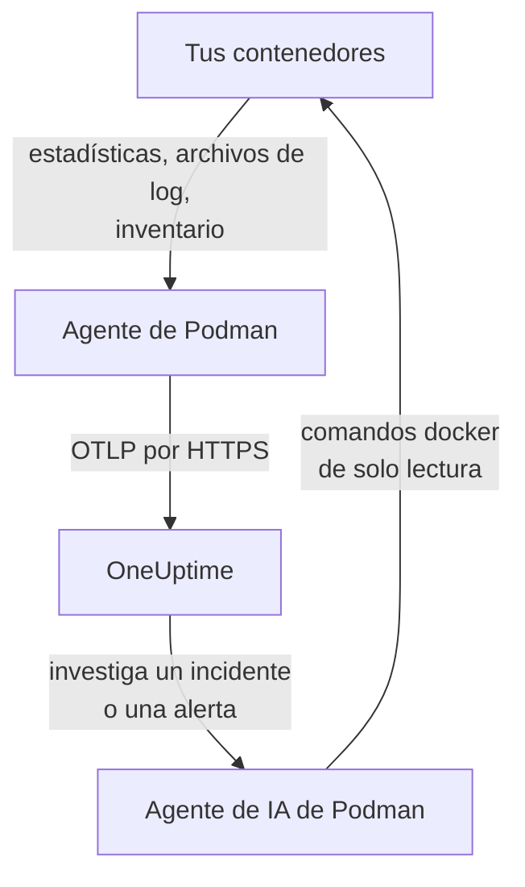

# Agente de Podman

El agente de Podman de OneUptime es un contenedor que ejecutas en un host de Podman. Lee las estadísticas y los archivos de log de cada contenedor del host y los envía a OneUptime, donde el host aparece con sus contenedores, métricas y logs. Un segundo contenedor, el agente de IA de Podman, permite a OneUptime AI investigar el host. Los [monitores de Podman](/docs/monitor/podman-monitor) alertan según lo que envía el agente.

:::cards
- [Instala el agente](#instala-el-agente): Dos contenedores, con `podman run` o Podman Compose.
- [Qué recopila el agente](#qué-recopila-el-agente): Métricas, logs y un inventario de cada contenedor.
- [Los logs de contenedores necesitan k8s-file](#los-logs-de-contenedores-necesitan-el-controlador-k8s-file): Podman envía los logs a journald salvo que lo cambies.
- [Solución de problemas](#solución-de-problemas): Bucles de reinicio, métricas que faltan, logs que faltan.
:::

## Cómo funciona

El agente es un OpenTelemetry Collector con la configuración de OneUptime integrada. A través del socket de API compatible con Docker de Podman lee las estadísticas de cada contenedor cada 30 segundos y enumera cada contenedor, imagen, red y volumen cada 5 minutos. Sigue los archivos de log de los contenedores y lo envía todo a tu URL de OneUptime por OTLP, con la clave de ingesta que le das.



El host se registra con sus primeros datos, con el nombre que le das en `PODMAN_HOST_NAME`. El agente de IA es opcional: si lo omites, el colector funciona igual.

## Antes de empezar

- Podman 4.0 o posterior, y acceso root en el host.
- El socket de la API de Podman en `/run/podman/podman.sock`. Actívalo con `sudo systemctl enable --now podman.socket`.
- Una clave de ingesta. Crea una en **Ajustes del proyecto → Telemetría y APM → Claves de ingesta** y copia su valor.
- HTTPS saliente desde el host hacia tu URL de OneUptime.
- Para los logs de contenedores, contenedores que usen el controlador de logs `k8s-file`. Podman con root envía los logs por defecto a `journald`, que el agente no puede leer. Consulta [Los logs de contenedores necesitan el controlador k8s-file](#los-logs-de-contenedores-necesitan-el-controlador-k8s-file).

## Instala el agente

:::steps
### Inicia el agente

Reemplaza `YOUR_ONEUPTIME_URL` por tu URL de OneUptime, `YOUR_TELEMETRY_INGESTION_TOKEN` por la clave de ingesta y `my-podman-host` por un nombre para este host, como `prod-podman-01`. El nombre es como aparece el host en OneUptime, así que mantenlo estable: un nombre nuevo registra un host nuevo.

:::tabs
@tab Podman CLI
```bash
podman run -d \
  --name oneuptime-podman-agent \
  --user 0:0 \
  --restart unless-stopped \
  -v /run/podman/podman.sock:/run/podman/podman.sock:ro \
  -v /var/lib/containers/storage:/var/lib/containers/storage:ro \
  -e ONEUPTIME_URL="YOUR_ONEUPTIME_URL" \
  -e ONEUPTIME_SERVICE_TOKEN="YOUR_TELEMETRY_INGESTION_TOKEN" \
  -e PODMAN_HOST_NAME="my-podman-host" \
  oneuptime/podman-agent:release
```

Luego inicia el [agente de IA](#agente-de-ia) a su lado, con los mismos valores. **Las investigaciones con IA están activadas por defecto**: mientras OneUptime AI investiga un incidente o una alerta en este host, ejecuta comandos `docker` de solo lectura a través del agente de IA, contra la API compatible con Docker de Podman, y no cambia nada salvo que permitas correcciones. Para instalar sin investigaciones con IA, omite este comando.

```bash
podman run -d \
  --name oneuptime-podman-ai-agent \
  --user 0:0 \
  --restart unless-stopped \
  --read-only --tmpfs /tmp \
  -v /run/podman/podman.sock:/run/podman/podman.sock:ro \
  -e ONEUPTIME_URL="YOUR_ONEUPTIME_URL" \
  -e ONEUPTIME_SERVICE_TOKEN="YOUR_TELEMETRY_INGESTION_TOKEN" \
  -e ONEUPTIME_AI_AGENT_RESOURCE_TYPE=podman \
  -e PODMAN_HOST_NAME="my-podman-host" \
  oneuptime/resource-ai-agent:release
```
@tab Podman Compose
Guarda esto como `docker-compose.yml` en una carpeta del host. El segundo servicio es el [agente de IA](#agente-de-ia): omítelo para ejecutar el colector sin investigaciones con IA.

```yaml title="docker-compose.yml"
services:
  oneuptime-podman-agent:
    image: oneuptime/podman-agent:release
    container_name: oneuptime-podman-agent
    user: "0:0"
    restart: unless-stopped
    volumes:
      - /run/podman/podman.sock:/run/podman/podman.sock:ro
      - /var/lib/containers/storage:/var/lib/containers/storage:ro
    environment:
      - ONEUPTIME_URL=YOUR_ONEUPTIME_URL
      - ONEUPTIME_SERVICE_TOKEN=YOUR_TELEMETRY_INGESTION_TOKEN
      - PODMAN_HOST_NAME=my-podman-host
    logging:
      driver: json-file
      options:
        max-size: "10m"
        max-file: "3"
  oneuptime-podman-ai-agent:
    image: oneuptime/resource-ai-agent:release
    container_name: oneuptime-podman-ai-agent
    user: "0:0"
    restart: unless-stopped
    read_only: true
    tmpfs:
      - /tmp
    volumes:
      - /run/podman/podman.sock:/run/podman/podman.sock:ro
    environment:
      - ONEUPTIME_URL=YOUR_ONEUPTIME_URL
      - ONEUPTIME_SERVICE_TOKEN=YOUR_TELEMETRY_INGESTION_TOKEN
      - ONEUPTIME_AI_AGENT_RESOURCE_TYPE=podman
      - PODMAN_HOST_NAME=my-podman-host
```

Inícialo en esa carpeta:

```bash
podman compose up -d
```
:::

### Comprueba que el agente se está ejecutando

```bash
podman ps --filter name=oneuptime-podman-agent
podman logs -f oneuptime-podman-agent
```

Los logs deberían mostrar esta línea cuando el colector haya arrancado:

```text
Everything is ready. Begin running and processing data.
```

### Busca el host en OneUptime

Abre **Productos → Infraestructura → Podman → Todos los hosts**. El host aparece con su `PODMAN_HOST_NAME` en más o menos un minuto, con sus contenedores, métricas y logs. El agente de IA aparece como conectado en la página **Agente de IA** del host y al final de su **Vista general**.
:::

## Variables de entorno

| Variable | Obligatoria | Descripción |
| --- | --- | --- |
| `ONEUPTIME_URL` | Sí | Tu URL de OneUptime, como `https://oneuptime.com` o tu instancia autoalojada. Usa `http://` y su puerto si la instancia solo admite HTTP. |
| `ONEUPTIME_SERVICE_TOKEN` | Sí | La clave de ingesta de **Ajustes del proyecto → Telemetría y APM → Claves de ingesta**. |
| `PODMAN_HOST_NAME` | No | El nombre del host en OneUptime. Su valor predeterminado es `podman-host`, así que da a cada host el suyo. |
| `DOCKER_API_VERSION` | No | La versión de la API de Docker que el agente habla con el socket de Podman. Su valor predeterminado es `1.44`. Bájala si el socket informa de un máximo más antiguo, o establécela en un valor vacío para negociarla (consulta [Solución de problemas](#solución-de-problemas)). |

Para cambiar un valor, quita el agente y vuelve a ejecutar su comando (Podman CLI), o edita `docker-compose.yml` y ejecuta `podman compose up -d` (Podman Compose).

## Qué recopila el agente

| Datos | Qué es |
| --- | --- |
| Métricas de contenedores | CPU (uso, porcentaje, limitación), memoria (uso, límite, porcentaje), E/S de red y de bloques, tiempo de actividad, reinicios y número de procesos, por contenedor, cada 30 segundos. |
| Logs de contenedores | stdout y stderr de cada contenedor, del archivo `ctr.log` que escribe el controlador de logs `k8s-file`. |
| Inventario | Cada contenedor en cualquier estado, y cada imagen, red y volumen, cada 5 minutos. |

Las métricas y los logs de cada contenedor se archivan en un servicio con el nombre del contenedor. Cada línea de log recibe una severidad a partir del nivel que menciona, como `[ERROR]`, `level=warn` o `{"level":"info"}`; una línea que no menciona ninguno toma la de su flujo: stderr es `ERROR`, stdout es `INFO`. Las líneas que empiezan con un espacio en blanco o un corchete de cierre se unen a la línea anterior, así que un stack trace llega como un solo registro. Los logs del propio agente se omiten.

[Monitor de Podman](/docs/monitor/podman-monitor#métricas-recopiladas) enumera cada métrica y lo que significa.

## Los logs de contenedores necesitan el controlador k8s-file

El agente sigue `/var/lib/containers/storage/overlay-containers/*/userdata/ctr.log`, los archivos que escribe el controlador de logs `k8s-file` de Podman (`json-file` es el mismo controlador en Podman). El controlador predeterminado de Podman con root es `journald`, que no deja ningún archivo que leer, y lo mismo ocurre con un controlador remoto como `syslog`. Las métricas de un contenedor así siguen llegando; sus logs no.

Comprueba el controlador de logs de un contenedor y el predeterminado de Podman:

```bash
podman inspect <container> --format '{{.HostConfig.LogConfig.Type}}'
podman info --format '{{.Host.LogDriver}}'
```

Ejecuta un contenedor con `k8s-file`, o cambia a él un servicio de Compose:

```bash
podman run --log-driver k8s-file --log-opt max-size=100m ... <image>
```

```yaml
services:
  my-app:
    image: my-app:latest
    logging:
      driver: "k8s-file"
      options:
        max-size: "100m"
```

O conviértelo en el predeterminado para cada contenedor creado a partir de entonces, en `containers.conf` (`/etc/containers/containers.conf` con root, `~/.config/containers/containers.conf` sin root):

```toml title="containers.conf"
[containers]
log_driver = "k8s-file"
log_size_max = 104857600
```

Luego vuelve a crear los contenedores. Un contenedor conserva el controlador de logs con el que se creó, así que reiniciarlo no basta.

## Actualizar el agente

Cuando el agente es más antiguo que tu OneUptime, aparece una señal de advertencia junto a **Versión del agente** en la **Vista general** del host. Selecciónala para ver estos comandos.

:::tabs
@tab Podman CLI
```bash
podman pull oneuptime/podman-agent:release
podman pull oneuptime/resource-ai-agent:release
podman rm -f oneuptime-podman-agent oneuptime-podman-ai-agent
```

Luego vuelve a ejecutar los dos comandos `podman run` de [Inicia el agente](#inicia-el-agente).
@tab Podman Compose
```bash
podman compose pull
podman compose up -d
```
:::

La etiqueta `release` siempre apunta a la versión más reciente. Para fijar una versión, usa `oneuptime/podman-agent:<version>`, como `oneuptime/podman-agent:10.0.31`. La misma imagen está en GitHub Container Registry como `ghcr.io/oneuptime/podman-agent:release`.

## Desinstalar el agente

:::tabs
@tab Podman CLI
```bash
podman rm -f oneuptime-podman-agent
podman rm -f oneuptime-podman-ai-agent
```
@tab Podman Compose
```bash
podman compose down
```
:::

El host se queda en OneUptime con los datos que envió. Si ya no lo necesitas, elimínalo con **Eliminar host** en su menú.

## Agente de IA

Los comandos y el archivo de Compose de arriba, el `install.sh` del agente de Podman y el `docker-compose.yml` de su [directorio PodmanAgent](https://github.com/OneUptime/oneuptime/tree/master/agents/PodmanAgent) ejecutan todos el **Agente de IA de Podman**: un segundo contenedor, `oneuptime-podman-ai-agent` (imagen `oneuptime/resource-ai-agent:release`), que ejecuta los comandos de solo lectura que pide OneUptime AI mientras investiga un incidente o una alerta en este host — a través de la API compatible con Docker de Podman, con la CLI `docker`: `docker ps -a`, `docker logs --tail 200 web`, `docker container inspect web` — y, solo si lo permites, aplica correcciones como reiniciar un contenedor concreto. Lee los mismos `ONEUPTIME_URL`, `ONEUPTIME_SERVICE_TOKEN` y `PODMAN_HOST_NAME` que el colector, así que atiende exactamente a este host, y aparece en la página **Agente de IA** del host en OneUptime.

- **Las investigaciones con IA están activadas por defecto.** En cuanto el agente se conecta, OneUptime AI investiga con él los incidentes y alertas de este host, y la **Vista general** del host muestra el estado del agente. Para detenerlo, establece `ONEUPTIME_AI_INVESTIGATION=false` donde se ejecuta el agente (**Cambiar** en **Lo que puede hacer la IA**, en la página del agente de IA, muestra cómo), u omite el agente.
- Es de solo lectura salvo que lo inicies con `ONEUPTIME_AI_ALLOW_WRITES=true`; `ONEUPTIME_AI_WRITE_TARGETS` (por ejemplo `web-*,api-*`) limita qué contenedores puede tocar una corrección. Inícialo también con `ONEUPTIME_AI_FIXES` para indicar cómo se ejecutan las correcciones — `ask-for-approval` (una persona aprueba cada una), `automatic` o `bypass-approval` — y la página del agente de IA lo muestra en solo lectura ([Lo que puede hacer la IA, según el agente](/docs/ai/infrastructure-ai-agents#what-ai-may-do-set-by-the-agent)).
- Necesita el mismo socket que el colector y se ejecuta como root con él montado, porque el socket pertenece a root — y, con Podman con root, quien puede usar el socket es root en este host, con `:ro` o sin él. El límite es la política de comandos del agente: nunca ejecuta `exec`, `run`, `rm` ni `prune`, y nunca se cambia a sí mismo, al colector ni nada de `ONEUPTIME_AI_PROTECTED_TARGETS` (globs de nombres de contenedores).
- `install.sh --no-ai-agent` lo omite; `podman rm -f oneuptime-podman-ai-agent` lo quita. Actualízalo como el colector: `podman pull oneuptime/resource-ai-agent:release`, quítalo y vuelve a iniciarlo.

Qué puede ejecutar, cómo funcionan las correcciones y cómo solucionar sus problemas: [Infrastructure AI Agents](/docs/ai/infrastructure-ai-agents#docker-and-podman-hosts).

## Solución de problemas

:::details El agente se reinicia con "client version is too new"
Los logs del agente muestran:

```text
Error: cannot start pipelines: failed to start "docker_stats" receiver:
Error response from daemon: client version 1.44 is too new.
Maximum supported API version is 1.41
```

Un servidor de la API de Docker que impone una versión máxima de cliente rechaza una más nueva, así que el receiver nunca arranca y el colector termina con él. Comprueba la versión de la API que informa el socket de Podman:

```bash
curl -s -o /dev/null -D - --unix-socket /run/podman/podman.sock http://localhost/_ping | grep -i '^api-version'
```

Luego añade `-e DOCKER_API_VERSION=1.41` (o el valor que obtuviste) a `podman run`, o establece `DOCKER_API_VERSION` en Compose. Los servidores más nuevos siguen atendiendo versiones antiguas de la API, así que el ajuste sigue siendo válido después de una actualización.

¿Prefieres no buscar el número? Establece `DOCKER_API_VERSION` en la cadena vacía. El agente negocia entonces la versión con el socket (un `HEAD /_ping` y luego el máximo que informa el socket) en lugar de fijar una:

```bash
podman run -d ... -e DOCKER_API_VERSION= ...
```
:::

:::details Permiso denegado en el socket de Podman, o no hay socket
El agente debe ejecutarse como root para leer `/run/podman/podman.sock`. Comprueba que `--user 0:0` está en tu comando `podman run`, o `user: "0:0"` en Compose, y que el socket está activado: `sudo systemctl enable --now podman.socket`. Podman sin root tiene su socket en `/run/user/<uid>/podman/podman.sock` (`systemctl --user enable --now podman.socket`): monta esa ruta en lugar de `/run/podman/podman.sock`.
:::

:::details El host aparece como desconectado
1. Comprueba que el agente se está ejecutando: `podman ps --filter name=oneuptime-podman-agent`
2. Busca errores en sus logs: `podman logs oneuptime-podman-agent 2>&1 | grep -i error`
3. Comprueba `ONEUPTIME_URL` y `ONEUPTIME_SERVICE_TOKEN`: la clave debe ser una clave de ingesta válida que no se haya desactivado.
4. Comprueba que el host puede llegar a tu URL de OneUptime por la red.
:::

:::details No aparecen métricas
1. Comprueba que el socket de Podman está montado en el agente. Su imagen no tiene shell, así que míralo desde un contenedor desechable que comparta sus montajes: `podman run --rm --volumes-from oneuptime-podman-agent alpine:3.19 ls -la /run/podman/podman.sock`
2. Busca errores de exportación en sus logs: `podman logs oneuptime-podman-agent 2>&1 | tail -100`
3. Comprueba que la clave de ingesta es válida y no ha caducado.
:::

:::details Llegan métricas, pero no logs de contenedores
Lo más probable es que tus contenedores usen `journald`, el controlador de logs predeterminado de Podman. Comprueba qué archivos vigila el agente y qué controlador usa un contenedor:

```bash
podman logs oneuptime-podman-agent 2>&1 | grep -E "Started watching file|no files match"
podman inspect <container> --format '{{.HostConfig.LogConfig.Type}}'
```

Si el agente informa de `no files match the configured criteria`, cambia los contenedores a `k8s-file` y vuelve a crearlos, como muestra [Los logs de contenedores necesitan el controlador k8s-file](#los-logs-de-contenedores-necesitan-el-controlador-k8s-file).
:::

:::details Los logs están en otro host, o el host se llama podman-host
El nombre del host sale de `PODMAN_HOST_NAME`. Un agente iniciado sin él informa `podman-host`, así que todos los hosts configurados así parecen el mismo; si cambias el nombre más tarde, OneUptime registra un segundo host, que pasa a tener los datos nuevos. Establece `PODMAN_HOST_NAME` con un nombre propio en cada host y vuelve a crear el agente. Para comprobar el nombre que informa el agente:

```bash
podman inspect oneuptime-podman-agent --format '{{range .Config.Env}}{{println .}}{{end}}' | grep PODMAN_HOST_NAME
```
:::

## Próximos pasos

:::cards
- [Monitor de Podman](/docs/monitor/podman-monitor): Alerta sobre la CPU, la memoria y los reinicios de los contenedores.
- [Bases de datos](/docs/telemetry/databases): Los contenedores de bases de datos del host se detectan y reciben sus propias páginas.
- [Agente de Kubernetes](/docs/telemetry/kubernetes-agent): Supervisa un clúster de Kubernetes en su lugar.
- [Colector OpenTelemetry en el host](/docs/telemetry/host-otel-collector): Supervisa la propia máquina: CPU, discos, procesos y logs.
:::
