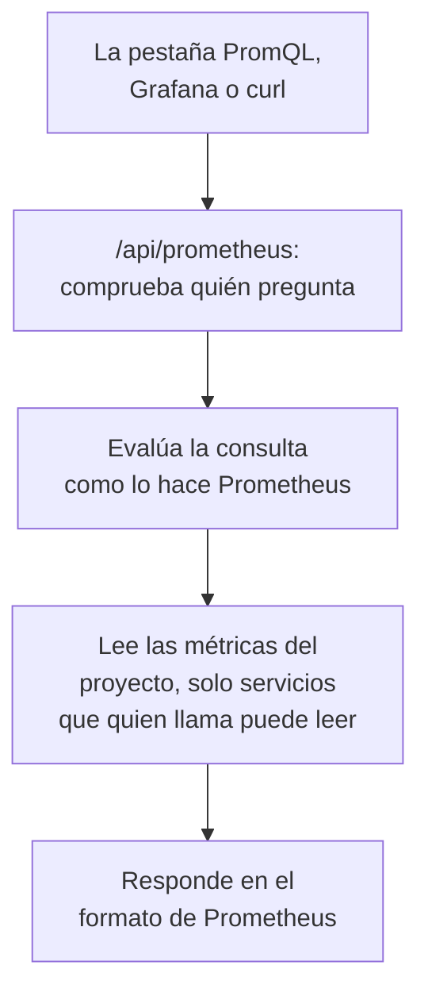

# Consultar métricas con PromQL

PromQL es el lenguaje de consulta de Prometheus, y el que ya conoce la mayoría de quienes grafican métricas. OneUptime lee con él las métricas de tu proyecto: en la pestaña **PromQL** de la página Métricas, y a través de una API compatible con Prometheus a la que puede apuntar Grafana, o cualquier herramienta con una fuente de datos de Prometheus.

:::cards
- [Escribir una consulta](#escribir-una-consulta): Ejecutar PromQL en la página Métricas y ver un gráfico o una tabla.
- [Cómo se nombran las métricas](#cómo-se-nombran-las-métricas): Cómo se leen en PromQL los nombres y los atributos de OpenTelemetry.
- [Conectar Grafana](#conectar-grafana): Añadir OneUptime como fuente de datos de Prometheus.
- [Límites](#límites): Qué puede leer una consulta, y durante cuánto tiempo.
:::

## Cómo funciona

La pestaña PromQL y Grafana consultan la misma API. OneUptime comprueba que quien llama puede leer las métricas del proyecto, lee solo los servicios que puede leer y evalúa la consulta como lo hace Prometheus.



## Antes de empezar

- **Métricas que llegan.** Envíalas con [OpenTelemetry](/docs/telemetry/open-telemetry), o desde un agente como el [Colector OpenTelemetry en el host](/docs/telemetry/host-otel-collector).
- **Un rol que pueda leer métricas.** Project Owner, Project Admin, Project Member, Viewer, Telemetry Admin, Telemetry Member o Telemetry Viewer, o un rol personalizado con el permiso Read Metrics. Un rol limitado a algunos servicios solo lee sus métricas.
- **Para Grafana o un script: una clave de API del proyecto** con uno de esos roles o el permiso Read Metrics. Consulta [Crear una clave de API](/docs/api-reference/api-reference#crear-una-clave-de-api). En OneUptime Cloud, las claves de API requieren el plan **Growth**.

## Escribir una consulta

:::steps
### Abrir PromQL

Abre **Métricas** y haz clic en la pestaña **PromQL**.

### Escribir la consulta

Escríbela en el editor, elige un ejemplo en **Ejemplos** o empieza por **Añadir un nombre de métrica**, que enumera las métricas de tu proyecto tal como las nombra PromQL.

### Ejecutarla

Haz clic en **Ejecutar consulta** o pulsa Ctrl+Enter (⌘+Enter en un Mac). **Gráfico** dibuja la consulta a lo largo del intervalo de tiempo; **Tabla** muestra el valor de cada serie al final del intervalo.
:::

Algunas consultas para empezar:

```text title="PromQL"
# Requests per second, by service
sum by (job) (rate(http_requests_total[5m]))

# The 95th percentile of a latency histogram
histogram_quantile(0.95, sum by (le) (rate(http_server_request_duration_bucket[5m])))

# The five hosts using the most memory
topk(5, system_memory_usage)
```

Con una consulta que no se ejecuta, el editor muestra qué ha fallado y dónde: `rate(http_requests_total)`, por ejemplo, indica que la función necesita un rango como `[5m]`.

## Cómo se nombran las métricas

OneUptime almacena las métricas al estilo de OpenTelemetry. PromQL las lee con los nombres que les da la compatibilidad con OpenTelemetry integrada en Prometheus, así que una consulta escrita para Prometheus funciona aquí:

| En OneUptime | En PromQL |
| --- | --- |
| Un gauge `system.cpu.utilization` | `system_cpu_utilization` |
| Un contador `http.requests` | `http_requests`, o `http_requests_total` |
| Un histograma `http.server.request.duration` | `http_server_request_duration_bucket` (con `le`), `_count` y `_sum` |
| Un summary `rpc.latency` | `rpc_latency` (con `quantile`), `_count` y `_sum` |
| Un atributo `http.route` | La etiqueta `http_route` |
| Un atributo de recurso `service.name` | La etiqueta `resource_service_name`, y `job` |
| Un atributo de recurso `service.instance.id` | La etiqueta `resource_service_instance_id`, e `instance` |

- **Los puntos y los guiones se convierten en guiones bajos** en los nombres de métricas y de etiquetas. Para nombrar una métrica o una etiqueta exactamente como está almacenada, pon su nombre entre comillas, como hace Prometheus 3: `{"http.server.request.duration", "http.route"="/checkout"}`.
- **Los contadores delta se suman** desde el inicio del intervalo de tiempo de la consulta, así que `rate()` e `increase()` los leen como cualquier otro contador.
- **Los histogramas exponenciales** tienen `_count` y `_sum`, pero no buckets.

## Conectar Grafana

:::steps
### Crear una clave de API

En OneUptime, abre **Ajustes del proyecto → Avanzado → Claves de API** y haz clic en **Crear Clave de API**. Dale a la clave un rol que pueda leer telemetría, o el permiso Read Metrics.

### Añadir una fuente de datos de Prometheus

En Grafana, abre **Connections → Data sources → Add data source** y elige **Prometheus**.

### Introducir la URL del servidor

Pon en **Prometheus server URL** tu dirección de OneUptime seguida de `/api/prometheus`. En OneUptime Cloud, es `https://oneuptime.com/api/prometheus`. La pestaña **PromQL** muestra la dirección de tu propio servidor, con un botón para copiarla.

### Enviar la clave de API

En **HTTP headers**, añade la cabecera `Authorization` con el valor `Bearer` seguido de un espacio y tu clave de API. La autenticación básica también funciona: cualquier nombre de usuario, con la clave de API como contraseña.

### Guardar y probar

Haz clic en **Save & test**. Grafana ejecuta una consulta y dice que la fuente de datos funciona.
:::

Cualquier otro cliente de Prometheus funciona igual. Con curl:

```bash title="Query OneUptime's Prometheus API"
curl -H "Authorization: Bearer $ONEUPTIME_API_KEY" \
  "https://oneuptime.com/api/prometheus/api/v1/query?query=up"
```

## La API

La API responde a las rutas de la API HTTP de Prometheus, con `GET` o `POST`, bajo `/api/prometheus`:

| Ruta | Qué responde |
| --- | --- |
| `/api/v1/query` | Una consulta en un instante (`time`, por defecto ahora). |
| `/api/v1/query_range` | Una consulta en cada `step` desde `start` hasta `end`. |
| `/api/v1/series` | Las series que selecciona `match[]`. |
| `/api/v1/labels` | Nombres de etiquetas, de las series que selecciona `match[]` o de todas las métricas. |
| `/api/v1/label/<name>/values` | Los valores de una etiqueta. `__name__` enumera los nombres de las métricas. |
| `/api/v1/metadata` | El tipo, la ayuda y la unidad de cada métrica. |

Los instantes se expresan en segundos Unix o en RFC 3339, las duraciones en segundos o como una duración del tipo `15s`, y las respuestas están en el formato de Prometheus. `/api/v1/status/buildinfo` responde como un servidor Prometheus 3; las reglas y las alertas están vacías, porque OneUptime alerta con [monitores](/docs/monitor/metrics-monitor).

## Qué cubre PromQL

- **Selectores** con todos los comparadores (`=`, `!=`, `=~`, `!~`), rangos, `offset`, `@` (con `start()` y `end()`) y subconsultas.
- **Operadores**: aritméticos, de comparación (con `bool`), `and`, `or`, `unless`, y emparejamiento de vectores con `on`, `ignoring`, `group_left` y `group_right`.
- **Agregaciones**: `sum`, `avg`, `min`, `max`, `count`, `group`, `stddev`, `stdvar`, `topk`, `bottomk`, `quantile` y `count_values`, con `by` o `without`.
- **Funciones**: `rate`, `irate`, `increase`, `delta`, `idelta`, `deriv`, `predict_linear`, `histogram_quantile`, todas las funciones `*_over_time`, `changes`, `resets`, `absent`, `label_replace`, `label_join`, `sort`, `clamp`, `round`, las funciones matemáticas y de fecha, y más.

Las funciones de histogramas nativos de Prometheus, como `histogram_count()`, no están disponibles: OneUptime almacena los histogramas con buckets, que leen `histogram_quantile()` y las series `_count` y `_sum`.

## Límites

Cada consulta está acotada, para que un panel con muchos gráficos no pueda sobrecargar OneUptime:

| Límite | Valor |
| --- | --- |
| Puntos en una serie de una consulta de rango | 11 000 |
| Muestras que una consulta puede leer y mantener en memoria | 5 000 000 |
| Puntos de métrica que puede leer un selector | 1 000 000 |
| Tiempo que puede durar una lectura | 30 segundos |
| Tiempo que puede durar la evaluación | 30 segundos |
| Hasta dónde mira hacia atrás un selector para encontrar la última muestra de una serie | 5 minutos |
| El paso de una subconsulta, cuando la consulta lo omite | 1 minuto |

## Solución de problemas

:::details Grafana dice que la fuente de datos no funciona
Comprueba que la URL termina en `/api/prometheus` y que la cabecera `Authorization` contiene `Bearer`, un espacio y la clave de API. Una clave sin un rol que pueda leer métricas se rechaza: dale uno en **Ajustes del proyecto → Avanzado → Claves de API**.
:::

:::details Una métrica del explorador no devuelve nada
Su nombre en PromQL tiene guiones bajos donde el nombre almacenado tiene puntos, y un histograma se lee a través de `_bucket`, `_count` o `_sum`. **Añadir un nombre de métrica** en la pestaña PromQL enumera cada nombre tal como lo escribe PromQL.
:::

:::details "The query reads more than 1,000,000 metric points"
La consulta pide más de lo que puede abarcar una lectura. Añade comparadores de etiquetas, acorta el intervalo de tiempo o usa un paso mayor.
:::

## Próximos pasos

:::cards
- [Explorador de métricas](/docs/telemetry/metrics-explorer): Graficar métricas sin escribir una consulta.
- [Monitor de métricas](/docs/monitor/metrics-monitor): Recibir alertas cuando una métrica supere un umbral.
- [Fuentes de datos externas](/docs/dashboards/data-sources): Graficar un Prometheus externo en tus paneles.
:::
