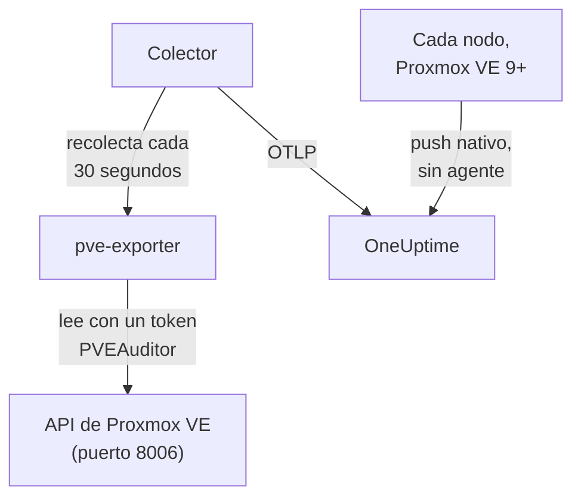

# Agente de Proxmox

El agente de Proxmox de OneUptime supervisa un clúster de Proxmox VE: sus nodos, VM de QEMU, contenedores LXC, almacenamiento, estado de HA, cobertura de copias de seguridad y replicación. Lee el clúster a través de la API de Proxmox VE con un token de solo lectura y envía lo que encuentra a OneUptime, donde el clúster aparece con sus nodos, invitados y almacenamiento. En Proxmox VE 9 y posteriores, los nodos también pueden enviar sus propias métricas, sin nada que instalar. Los [monitores de Proxmox](/docs/monitor/proxmox-monitor) alertan según lo que llega.

:::cards
- [Elige cómo conectar](#elige-cómo-conectar): El agente, o el envío propio de Proxmox VE 9.
- [Instala el agente](#instala-el-agente): Un token de API y luego el script de instalación o Docker Compose.
- [Push nativo](#alternativa-sin-instalación-push-nativo-de-opentelemetry-de-proxmox-ve-9): Proxmox VE 9 envía sus métricas por sí mismo.
- [Solución de problemas](#solución-de-problemas): Un script de diagnóstico y los problemas habituales.
:::

## Cómo funciona

El agente es un conjunto de contenedores que ejecutas con Docker Compose en una máquina: [prometheus-pve-exporter](https://github.com/prometheus-pve/prometheus-pve-exporter) lee la API de Proxmox VE en el puerto 8006, un OpenTelemetry Collector recopila el exportador cada 30 segundos y marca cada métrica con el nombre de tu clúster, y el agente de IA de Proxmox permite a OneUptime AI leer el clúster mientras investiga. El push nativo de Proxmox VE 9 envía en su lugar las métricas de cada nodo directamente a OneUptime.



El clúster se registra con sus primeros datos, con el nombre que el agente marca en cada métrica como `proxmox.cluster.name`.

## Elige cómo conectar

| | El agente | Push nativo |
| --- | --- | --- |
| Proxmox VE | Cualquier versión compatible | 9.0 o posterior |
| Qué instalar | Docker Compose en una máquina | Nada: un servidor de métricas en la interfaz web de Proxmox |
| Nodos, invitados y almacenamiento | Sí | Sí |
| Estado de HA, inicio con el arranque, cobertura de copias de seguridad y replicación | Sí | No |
| Agente de IA de Proxmox | Sí | No |

Las plantillas **HA Resource in Error State**, **Guest Down**, **Guest Not Backed Up** y **Replication Failing** necesitan el agente. Usa uno u otro para un clúster: ejecutar ambos informa de cada recurso dos veces.

## Antes de empezar

- Docker Engine 20.10 o posterior con el plugin Docker Compose v2, en una máquina que pueda llegar a la API de Proxmox VE en el puerto 8006.
- Un shell de root en cualquier nodo de Proxmox VE, o la interfaz web de Proxmox, para crear un token de API.
- Una clave de ingesta. Crea una en **Ajustes del proyecto → Telemetría y APM → Claves de ingesta** y copia su valor.
- HTTPS saliente desde esa máquina hacia tu URL de OneUptime.

### Dónde ejecutar el agente

El agente consulta la API de Proxmox VE por la red, así que no tiene por qué estar en un nodo del clúster, y no debería: ejecútalo en una máquina que sobreviva a la caída de un nodo (una pequeña VM de monitorización en hardware aparte, un host de administración), o apunta `PVE_HOST` a una IP virtual o a un nombre DNS round-robin en lugar de a la dirección de un solo nodo. Si el destino de API del agente es el nodo que acaba de caer, tu monitorización cae con él. La única excepción es el pipeline opcional de logs de journald, que debe ejecutarse en un nodo de Proxmox VE (consulta [Envía los logs de servicio de Proxmox](#opcional-envía-los-logs-de-servicio-de-proxmox)).

## Instala el agente

:::steps
### Crea un token de API de solo lectura

El agente lee el clúster con un token de API que tiene el rol **PVEAuditor**, que puede leer y nada más.

:::tabs
@tab Shell
Como root en cualquier nodo de Proxmox VE:

```bash
pveum user add monitoring@pam
pveum acl modify / --roles PVEAuditor --users monitoring@pam
pveum user token add monitoring@pam oneuptime --privsep 1
pveum acl modify / --roles PVEAuditor --tokens 'monitoring@pam!oneuptime'
```

El primer comando solo falla, sin consecuencias, si `monitoring@pam` ya existe: los tokens de API llevan su propio secreto, así que el usuario no necesita contraseña ni cuenta del sistema. `pveum user token add` imprime el secreto del token una vez; el ID del token es `monitoring@pam!oneuptime`.
@tab Proxmox web UI
1. Ve a *Datacenter → Permissions → API Tokens* y haz clic en **Add**.
2. Elige (o crea) un usuario, da al token un ID como `oneuptime` y deja marcada **Privilege Separation**.
3. Copia el ID del token (`user@realm!tokenname`) y el secreto: el secreto solo se muestra una vez.
4. En *Datacenter → Permissions*, añade el rol **PVEAuditor** en la ruta `/` dos veces: una como **API Token Permission** para el token y otra como **User Permission** para su usuario.
:::

El rol va en el usuario además de en el token porque un token con separación de privilegios solo obtiene los permisos que también tiene su usuario. Debe estar en la ruta raíz `/`, porque el exportador lee todos los objetos de nodo, invitado y almacenamiento: una ruta más estrecha oculta el resto del clúster y falla con `401`/`403 Permission check failed (/, Sys.Audit)`.

### Instala e inicia el agente

:::tabs
@tab install.sh
Descarga el script de instalación y ejecútalo en la máquina que alojará el agente:

```bash
curl -sSL https://raw.githubusercontent.com/OneUptime/oneuptime/master/agents/ProxmoxAgent/install.sh -o install.sh
bash install.sh
```

El script pide tu URL de OneUptime, la clave de ingesta, un nombre para el clúster, el host de la API de Proxmox VE, si ejecutar el exportador incluido, y el ID y el secreto del token — y si el [agente de IA](#agente-de-ia) puede aplicar correcciones y, en ese caso, un token propio y los invitados que nunca debe cambiar. Se instala en `/opt/oneuptime-proxmox-agent`, escribe un archivo `.env` con permisos `0600` e inicia el agente con Docker Compose. Volver a ejecutar el script reutiliza todo lo que hay en ese `.env` en lugar de volver a preguntar, que es como [actualizas el agente](#actualizar-el-agente).
@tab Docker Compose
Descarga `docker-compose.yml` y `otel-collector-config.yaml` del [directorio ProxmoxAgent](https://github.com/OneUptime/oneuptime/tree/master/agents/ProxmoxAgent) en una carpeta nueva:

```bash
mkdir oneuptime-proxmox-agent && cd oneuptime-proxmox-agent
curl -fsSLO https://raw.githubusercontent.com/OneUptime/oneuptime/master/agents/ProxmoxAgent/docker-compose.yml
curl -fsSLO https://raw.githubusercontent.com/OneUptime/oneuptime/master/agents/ProxmoxAgent/otel-collector-config.yaml
```

Crea un archivo `.env` junto a ellos. Contiene el secreto del token, así que mantenlo privado con `chmod 600 .env`:

```bash title=".env"
ONEUPTIME_URL=YOUR_ONEUPTIME_URL
ONEUPTIME_TELEMETRY_INGESTION_KEY=YOUR_TELEMETRY_INGESTION_TOKEN
PROXMOX_CLUSTER_NAME=my-proxmox-cluster
PVE_HOST=192.168.1.10
PVE_API_TOKEN_ID=monitoring@pam!oneuptime
PVE_API_TOKEN_SECRET=your-token-secret
COMPOSE_PROFILES=pve-exporter
```

`COMPOSE_PROFILES=pve-exporter` inicia también el exportador incluido. Inicia el agente:

```bash
docker compose up -d
```
:::

¿Ya ejecutas prometheus-pve-exporter? Responde **n** cuando el script pregunte si ejecutar el incluido, o quita `COMPOSE_PROFILES` de `.env`, y apunta el agente al tuyo (`host:port`, sin esquema, una dirección a la que pueda llegar el contenedor del agente: `localhost` es el propio contenedor). Mantén `PVE_API_TOKEN_ID` y `PVE_API_TOKEN_SECRET` si usas el [agente de IA](#agente-de-ia), que llama a la API con ese token:

```bash
PVE_EXPORTER_URL=your-exporter-host:9221
```

### Comprueba que el agente se está ejecutando

```bash
docker compose ps
docker logs -f oneuptime-proxmox-agent
```

`docker compose ps` enumera el colector (`oneuptime-proxmox-agent`), el exportador incluido (`oneuptime-pve-exporter`, salvo que uses el tuyo) y el agente de IA (`oneuptime-proxmox-ai-agent`). Los logs del colector deberían mostrar esta línea cuando haya arrancado:

```text
Everything is ready. Begin running and processing data.
```

### Busca el clúster en OneUptime

Abre **Productos → Infraestructura → Proxmox → Todos los clústeres**. El clúster aparece con su `PROXMOX_CLUSTER_NAME` aproximadamente un minuto después de la primera recopilación, con sus nodos, invitados y almacenamiento.
:::

## Variables de entorno

El script de instalación las escribe en `/opt/oneuptime-proxmox-agent/.env`; una instalación con Docker Compose las lee del `.env` que está junto a `docker-compose.yml`. Después de cambiar una, ejecuta `docker compose up -d` en esa carpeta.

| Variable | Obligatoria | Descripción |
| --- | --- | --- |
| `ONEUPTIME_URL` | Sí | Tu URL de OneUptime, como `https://oneuptime.com` o tu instancia autoalojada. Usa `http://` y su puerto si la instancia solo admite HTTP. |
| `ONEUPTIME_TELEMETRY_INGESTION_KEY` | Sí | La clave de ingesta de **Ajustes del proyecto → Telemetría y APM → Claves de ingesta**. |
| `PROXMOX_CLUSTER_NAME` | Sí | El nombre del clúster en OneUptime, marcado en cada métrica como el atributo de recurso `proxmox.cluster.name`. Mantenlo estable: cambiarlo más tarde registra un segundo clúster. Su valor predeterminado es `proxmox-cluster`. |
| `PVE_HOST` | Sí | El host de la API de Proxmox VE (cualquier nodo del clúster) que consultan el exportador y el agente de IA, como `192.168.1.10`. |
| `PVE_EXPORTER_URL` | No | La dirección (`host:port`, sin esquema) de prometheus-pve-exporter. Su valor predeterminado es el exportador incluido, `pve-exporter:9221`. |
| `PVE_API_TOKEN_ID` | Exportador incluido o agente de IA | El ID completo del token de API de Proxmox, como `monitoring@pam!oneuptime`. El agente de IA lee la API con él salvo que tenga un token propio (`ONEUPTIME_AI_PVE_API_TOKEN_ID` / `ONEUPTIME_AI_PVE_API_TOKEN_SECRET`). |
| `PVE_API_TOKEN_SECRET` | Exportador incluido o agente de IA | El secreto del token de API de Proxmox. |
| `PVE_VERIFY_SSL` | No | Verifica el certificado TLS de la API de Proxmox (el exportador y el agente de IA). Su valor predeterminado es `false`, porque Proxmox incluye certificados autofirmados. |
| `COMPOSE_PROFILES` | No | Establécelo en `pve-exporter` para iniciar el contenedor del exportador incluido. |

## Qué recopila el agente

El colector recopila el exportador cada 30 segundos con sus collectors de clúster y de nodo activados, lo que también cubre los collectors `backup-info` (a nivel de clúster) y `replication` (a nivel de nodo) del exportador, activados por defecto. Cada serie lleva una etiqueta `id` que nombra el recurso: `node/<name>`, `qemu/<vmid>`, `lxc/<vmid>` o `storage/<node>/<storage>`.

| Categoría | Métricas |
| --- | --- |
| Disponibilidad | `pve_up`, `pve_uptime_seconds` |
| Nodo | `pve_node_info`, `pve_cpu_usage_ratio`, `pve_cpu_usage_limit`, `pve_memory_usage_bytes`, `pve_memory_size_bytes` |
| Invitado (VM o LXC) | `pve_guest_info`, y series de CPU, memoria y red en los ID `qemu/*` y `lxc/*` (`pve_network_receive_bytes`, `pve_network_transmit_bytes`) |
| Almacenamiento | `pve_disk_usage_bytes`, `pve_disk_size_bytes`, `pve_storage_info` |
| HA | `pve_ha_state` |
| Cobertura de copias de seguridad | `pve_not_backed_up_total` (los invitados que no cubre ningún job de copia de seguridad; una serie a nivel de clúster, sin etiqueta `id`) y `pve_not_backed_up_info` (una serie por invitado sin cubrir, con su `id`). Cubierto significa que al menos un job selecciona al invitado: el exportador no expone si las copias de seguridad se ejecutaron recientemente ni si tuvieron éxito. |
| Replicación | `pve_replication_failed_syncs`, `pve_replication_duration_seconds`, `pve_replication_last_sync_timestamp_seconds`, `pve_replication_last_try_timestamp_seconds`, `pve_replication_next_sync_timestamp_seconds`, `pve_replication_info`, por job de replicación de almacenamiento. Su etiqueta `id` es el ID del job (como `100-0`), no un recurso. |

Los criterios de los monitores y los filtros de atributos comparan por igualdad, no por prefijo, así que el procesador `transform/pve-identity` del colector también divide `id` en tres atributos. Las plantillas de alerta de Proxmox integradas filtran por ellos, así que conserva el procesador si personalizas la configuración:

| Atributo | Valores | Para `qemu/100` |
| --- | --- | --- |
| `pve.scope` | `node`, `guest`, `storage`, `cluster` (`qemu` y `lxc` son ambos `guest`) | `guest` |
| `pve.type` | `node`, `qemu`, `lxc`, `storage` | `qemu` |
| `pve.id` | Todo lo que va después de la primera `/` de `id` (`pve1`, `100`, `pve1/local`) | `100` |

La etiqueta `id` original se mantiene tal cual.

## Opcional — Envía los logs de servicio de Proxmox

Por defecto, el agente solo envía métricas, así que la página **Registros** del clúster se queda vacía. Los servicios de Proxmox VE escriben sus logs en el journal de systemd con ocho unidades: `pveproxy`, `pvedaemon`, `pve-firewall`, `pve-ha-crm`, `pve-ha-lrm`, `pvescheduler`, `pvestatd` y `qmeventd`. El `otel-collector-config.yaml` incluido tiene un receiver `journald` comentado para exactamente esas unidades, conectado a un pipeline `logs` comentado que marca `proxmox.cluster.name` para que los logs lleguen a tu clúster.

:::steps
### Ejecuta el agente en un nodo

El journal es de cada host, así que un agente remoto no puede leerlo. Esta es la única configuración que va en contra de [Dónde ejecutar el agente](#dónde-ejecutar-el-agente): para mantener el agente de métricas fuera del clúster, ejecuta en su lugar un segundo colector solo de logs en el nodo (copia la configuración y luego elimina el receiver `prometheus` y el pipeline `metrics`).

### Activa el receiver

Quita el comentario del receiver `journald` y del pipeline `logs` en `otel-collector-config.yaml`, y de los volúmenes del journal en `docker-compose.yml`, para que el contenedor pueda leer el journal del host:

```yaml
- /var/log/journal:/var/log/journal:ro
- /etc/machine-id:/etc/machine-id:ro
```

### Cambia la imagen del colector

La imagen estándar `otel/opentelemetry-collector-contrib` se construye `FROM scratch`: no tiene `journalctl`, que es lo que ejecuta el receiver de journald, y se ejecuta como un usuario que no puede leer el journal. Construye este wrapper y apunta a él el `image:` de `docker-compose.yml`:

```dockerfile title="Dockerfile"
FROM otel/opentelemetry-collector-contrib:0.161.0 AS otelcol
FROM debian:stable-slim
RUN apt-get update \
    && apt-get install -y --no-install-recommends systemd \
    && rm -rf /var/lib/apt/lists/*
COPY --from=otelcol /otelcol-contrib /otelcol-contrib
ENTRYPOINT ["/otelcol-contrib"]
CMD ["--config", "/etc/otelcol-contrib/config.yaml"]
```

El paquete `systemd` solo está ahí por `journalctl`, y esta imagen se ejecuta como root, que es quien puede leer el journal. O prescinde de Docker para los logs y ejecuta el `.deb` de la versión de `otelcol-contrib` en el propio nodo, donde ya está `journalctl`.
:::

Cada nodo envía solo su propio journal: para tener los logs de servicio de todos los nodos, ejecuta el colector solo de logs en cada nodo.

### Alternativa sin imagen personalizada: filelog sobre /var/log/syslog

Para mantener la imagen estándar, sigue syslog en su lugar. Instala rsyslog en el nodo (`apt install rsyslog`; Debian 12 y Proxmox VE 8 y posteriores ya no lo incluyen), monta el directorio `/var/log` en el contenedor (`- /var/log:/var/log:ro`; el directorio, no el archivo, para que la rotación de logs no deje fijado un archivo obsoleto) y usa un receiver `filelog` en lugar del de journald:

```yaml
receivers:
  filelog:
    include:
      - /var/log/syslog
    start_at: end
```

Pierdes el filtro por unidad (syslog lo lleva todo, no solo los ocho servicios), y el usuario de la imagen estándar debe poder leer el archivo. Conéctalo al mismo pipeline `logs` comentado (`receivers: [filelog]`).

## Alternativa sin instalación: push nativo de OpenTelemetry de Proxmox VE 9+

Proxmox VE 9.0 y posteriores incluyen un servidor de métricas OpenTelemetry que envía las métricas de nodos, invitados y almacenamiento a cualquier endpoint OTLP/HTTP, sin agente ni exportador que instalar. En la interfaz web de Proxmox, ve a *Datacenter → Metric Server → Add → OpenTelemetry* y rellena:

| Campo | Valor |
| --- | --- |
| Server | Tu host de OneUptime, como `oneuptime.com`, o tu host autoalojado |
| Port | `443` |
| Protocol | `https` |
| Path | `/otlp/v1/metrics` |
| Headers | `{"x-oneuptime-token": "YOUR_TELEMETRY_INGESTION_TOKEN"}` |

Añádelo una vez: cada nodo del clúster envía sus propias métricas. OneUptime reconoce el push y lo traduce a las mismas series `pve_*` que envía el agente, así que:

- el clúster se registra con el nombre de tu clúster de Proxmox (un nodo independiente, con el nombre del nodo), y un `proxmox.cluster.name` que establezcas en *Resource Attributes* se sigue usando en su lugar;
- las páginas Nodos, Invitados y Almacenamiento, los gráficos de la vista general, el catálogo de métricas y las plantillas de alerta de CPU, memoria y almacenamiento funcionan como con el agente;
- las series originales `proxmox_node_*`, `proxmox_vm_*` y `proxmox_storage_*` se quedan en [Metrics Explorer](/docs/monitor/metrics-monitor) para todo lo demás que informa Proxmox VE (carga media, swap, pressure stall, tráfico por NIC).

### Cuando un nodo deja de informar

Cada nodo envía solo su propio estado, así que un nodo que cae no puede decirlo por sí mismo. Los nodos que siguen activos lo informan por él:

- Unos 2 minutos después de su último informe, el nodo aparece como **Sin conexión** en la página Nodos. **Visto por última vez**, en la propia página del nodo, conserva la hora de su último informe propio.
- Pasados unos 5 minutos, **Node Offline** se dispara para él. **Cluster Quorum at Risk** también lo cuenta como offline; como esa plantilla necesita una ventana completa de 5 minutos de informes, se dispara unos 7–9 minutos después de que el nodo se quedara en silencio.
- Con su siguiente informe vuelve a estar **En línea** y su alerta se recupera.

Offline significa aquí que el nodo dejó de informar, no necesariamente que esté caído. Un nodo que está activo pero cuyo `pvestatd` está colgado o terminado, cuyo sistema de archivos del clúster (`pmxcfs`) está caído o cuya red hacia OneUptime está cortada se informa de la misma forma.

Lo que no puede cubrir:

- Un host independiente, o un clúster entero que se queda en silencio a la vez: no queda nadie para informarlo, así que no se dispara ninguna alerta por nodo. En su lugar, el clúster pasa a **Desconectado**, como cuando se detiene el agente.
- Un nodo en silencio durante más de 7 días deja de informarse: su alerta se resuelve y desaparece de la página Nodos. Un OneUptime autoalojado cambia los 7 días con `PVE_SILENT_NODE_RETENTION_HOURS`.
- Un nodo que sacas del clúster tiene el mismo aspecto que uno muerto. Usa **Quitar nodo** en su página: desaparece y su alerta se resuelve. Si no, sigue Sin conexión hasta 7 días.
- Los invitados y el almacenamiento del nodo: solo el propio nodo se mantiene como Sin conexión. Sus VM, contenedores y almacenamiento desaparecen de sus páginas unos 15 minutos después de su último informe, y los invitados que HA reinicia en otro nodo vuelven a aparecer bajo ese nodo.

Tras una caída de la ingesta de OneUptime, un nodo que se ha quedado en silencio hace poco solo se informa cuando otro de los nodos ha vuelto a enviar durante 2 minutos, así que la propia caída nunca genera avisos por cada nodo. Un nodo que ya estaba Sin conexión sigue así durante una caída corta y conserva su alerta; tras una caída de más de 5 minutos, se vuelve a informar cuando los demás han enviado durante 2 minutos.

En [Metrics Explorer](/docs/monitor/metrics-monitor), estos informes son los puntos `pve_up` = 0 con la etiqueta `oneuptime.proxmox.inferred` = `not-reporting`, así que siempre puedes distinguirlos de lo que un nodo dijo sobre sí mismo.

### Lo que no puede hacer el push nativo

El push nativo solo envía lo que cada nodo sabe de sí mismo, así que parte de lo que recopila el agente no tiene equivalente nativo:

| Necesita el agente | Por qué |
| --- | --- |
| Estado de HA | No se envía: la plantilla **HA Resource in Error State** necesita el agente. |
| Indicador de inicio con el arranque | No se envía: **Guest Down**, que solo avisa de los invitados configurados para iniciarse con el arranque, necesita el agente. |
| Cobertura de copias de seguridad y replicación | No se envían: **Guest Not Backed Up** y **Replication Failing** necesitan el agente. |

Si los necesitas, ejecuta el agente en su lugar y quita el servidor de métricas: ejecutar ambos informa de cada recurso dos veces.

## Ejecutar como servicio de systemd

Para iniciar el agente con la máquina y reiniciarlo cuando falle, instala su unidad de systemd. Supone que el agente está en `/opt/oneuptime-proxmox-agent`, donde lo pone el script de instalación:

```bash
sudo cp systemd/oneuptime-proxmox-agent.service /etc/systemd/system/
sudo systemctl daemon-reload
sudo systemctl enable --now oneuptime-proxmox-agent
```

## Actualizar el agente

El agente informa como su **Versión del agente** de la versión del colector que fijan sus archivos. Cuando es más antigua que la versión que fija esta versión de OneUptime, aparece una señal de advertencia a su lado en la **Vista general** del clúster. Selecciónala para ver estos comandos. Un agente instalado antes de que sus archivos informaran una versión no muestra ninguna hasta que se actualiza de esta forma.

La imagen del colector está fijada en `docker-compose.yml` y su configuración es un archivo junto a él, así que descargar las imágenes no basta para que el agente avance. Vuelve a ejecutar `install.sh`: reutiliza todos los valores de tu `.env` existente (no se vuelve a preguntar nada), renueva `docker-compose.yml` y `otel-collector-config.yaml` (un archivo que editaste se conserva como `<file>.bak.<timestamp>`), descarga las imágenes y vuelve a crear el agente para que el colector lea su nueva configuración.

```bash
curl -sSL https://raw.githubusercontent.com/OneUptime/oneuptime/master/agents/ProxmoxAgent/install.sh -o install.sh
bash install.sh
```

¿Lo instalaste con Docker Compose? En la carpeta del agente, vuelve a descargar los dos archivos (y vuelve a hacer cualquier cambio que les hicieras), luego descarga las imágenes y vuelve a crear el agente:

```bash
curl -fsSLO https://raw.githubusercontent.com/OneUptime/oneuptime/master/agents/ProxmoxAgent/docker-compose.yml
curl -fsSLO https://raw.githubusercontent.com/OneUptime/oneuptime/master/agents/ProxmoxAgent/otel-collector-config.yaml
docker compose pull
docker compose up -d --force-recreate
```

## Desinstalar el agente

```bash
cd /opt/oneuptime-proxmox-agent
docker compose down
```

Luego elimina el token de API en *Datacenter → Permissions → API Tokens* si ya no lo necesitas.

## Agente de IA

El `docker-compose.yml` del agente también ejecuta el **Agente de IA de Proxmox**, `oneuptime-proxmox-ai-agent` (imagen `oneuptime/resource-ai-agent:release`). Mientras OneUptime AI investiga un incidente o una alerta en este clúster, ejecuta a través de él comandos `pvesh` de solo lectura — `pvesh get /cluster/status`, `pvesh get /nodes/pve1/qemu/101/status/current`, `pvesh get /nodes/pve1/tasks --errors 1 --limit 20` — y, solo si lo permites, aplica correcciones como iniciar o reiniciar un invitado. No contiene ningún binario `pvesh`: cada comando se convierte en exactamente una llamada a la API de Proxmox VE en `PVE_HOST`, con un token del mismo `.env`. Se registra como el clúster llamado `PROXMOX_CLUSTER_NAME`, igual que el colector, y aparece en la página **Agente de IA** del clúster en OneUptime.

- **Las investigaciones con IA están activadas por defecto.** En cuanto el agente se conecta, OneUptime AI investiga con él los incidentes y alertas de este clúster, y la **Vista general** del clúster muestra el estado del agente. Para detenerlo, establece `ONEUPTIME_AI_INVESTIGATION=false` donde se ejecuta el agente (**Cambiar** en **Lo que puede hacer la IA**, en la página del agente de IA, muestra cómo), u omite el agente.
- El token de API es el límite firme. Las investigaciones usan el token PVEAuditor del colector (`PVE_API_TOKEN_ID` / `PVE_API_TOKEN_SECRET`), que puede leer y nada más; si ejecutas tu propio exportador y no tienes ningún token en `.env`, añade uno. Las correcciones necesitan un token propio del agente de IA que pueda encender y apagar invitados (`VM.PowerMgmt`, por ejemplo el rol `PVEVMUser` en `/vms` o en un pool), establecido como `ONEUPTIME_AI_PVE_API_TOKEN_ID` / `ONEUPTIME_AI_PVE_API_TOKEN_SECRET`.
- Es de solo lectura salvo que establezcas `ONEUPTIME_AI_ALLOW_WRITES=true`; `ONEUPTIME_AI_WRITE_TARGETS` (VMID como `100,101`, y `<node>/<service>` para los servicios de nodo) limita lo que puede tocar una corrección. Si el agente se ejecuta en un invitado de este clúster, pon el VMID de ese invitado en `ONEUPTIME_AI_PROTECTED_TARGETS`. `ONEUPTIME_AI_FIXES` en el mismo `.env` indica cómo se ejecutan las correcciones — `ask-for-approval` (una persona aprueba cada una), `automatic` o `bypass-approval` — y la página del agente de IA lo muestra en solo lectura ([Lo que puede hacer la IA, según el agente](/docs/ai/infrastructure-ai-agents#what-ai-may-do-set-by-the-agent)).
- Igual que el exportador, no verifica el certificado autofirmado de la API salvo que establezcas `PVE_VERIFY_SSL=true` o apuntes `PVE_CA_FILE` a la CA del clúster (`/etc/pve/pve-root-ca.pem`, montada en el contenedor).
- Se ejecuta como UID 1000 sin capabilities y con un sistema de archivos raíz de solo lectura, y nunca lee `/access`, abre una consola ni cambia la configuración. Elimina el servicio `oneuptime-proxmox-ai-agent` de `docker-compose.yml` si no usas OneUptime AI.

Qué puede ejecutar, cómo funcionan las correcciones y cómo solucionar sus problemas: [Infrastructure AI Agents](/docs/ai/infrastructure-ai-agents#proxmox-clusters). El README del agente tiene los comandos `pveum` exactos para un token de correcciones.

## Solución de problemas

:::details Ejecuta primero el script de diagnóstico
El agente incluye un script, [`troubleshoot.sh`](https://github.com/OneUptime/oneuptime/blob/master/agents/ProxmoxAgent/troubleshoot.sh), que comprueba toda la cadena: el runtime de contenedores, la recopilación del exportador, el nombre del clúster marcado en cada métrica, la forma del token, las propias métricas del colector y si OneUptime acepta la clave de ingesta. Esa última comprobación es la que más importa. OneUptime rechaza una clave incorrecta con `401` (`422` para una clave desactivada o una clave de navegador), y el colector trata ambas como permanentes: descarta el lote y registra un error `Exporting failed`, fácil de pasar por alto mientras el contenedor sigue sano. El script pide `GET <url>/otlp/v1/validate` desde dentro de la red del agente para obtener un `200` (válida) o un `401` (no válida) directos, y en servidores más antiguos recurre a `POST /fluentd/v1/logs`.

```bash
curl -sSL https://raw.githubusercontent.com/OneUptime/oneuptime/master/agents/ProxmoxAgent/troubleshoot.sh -o troubleshoot.sh
bash troubleshoot.sh    # add -d <dir> if you installed outside /opt/oneuptime-proxmox-agent
```

Termina con un veredicto que nombra la causa más probable.
:::

:::details No aparece ningún clúster en OneUptime
1. Lee los logs del colector: `docker logs oneuptime-proxmox-agent`. Un `401` al exportar significa una clave de ingesta incorrecta; una conexión rechazada significa una `ONEUPTIME_URL` incorrecta.
2. Comprueba que el exportador responde. El exportador incluido no publica su puerto en el host, así que pregunta desde dentro de su red: `docker run --rm --network container:oneuptime-pve-exporter curlimages/curl -s "http://localhost:9221/pve?target=YOUR_PVE_HOST" | head` debería imprimir líneas `pve_*`. Para tu propio exportador, pregunta directamente a su `host:9221`.
3. Comprueba que `PROXMOX_CLUSTER_NAME` está establecido: el clúster se encuentra por su atributo de recurso `proxmox.cluster.name`.
:::

:::details El exportador devuelve errores 401 o 595
El token de API es incorrecto o le faltan permisos. Comprueba el formato del ID del token (`user@realm!tokenname`), el secreto y que el rol **PVEAuditor** está en la ruta `/` para el token y para su usuario. Los propios logs del exportador muestran la respuesta de la API: `docker logs oneuptime-pve-exporter`.
:::

:::details Solo métricas de nodo, ninguna de invitados
Las series de invitados (ID `qemu/*` y `lxc/*`) vienen del collector de clúster del exportador, que la configuración incluida activa con el parámetro de recopilación `cluster=1`. Si personalizaste `otel-collector-config.yaml`, vuelve a poner el parámetro `cluster: ["1"]`.
:::

:::details Las métricas llegan al clúster equivocado
OneUptime registra un clúster de Proxmox por su `proxmox.cluster.name`, que el agente toma de `PROXMOX_CLUSTER_NAME`. Cambiarlo después de los primeros datos crea un segundo clúster en lugar de renombrar el primero.
:::

:::details Con el push nativo, un nodo aparece Sin conexión
Dejó de informar: un nodo caído, un `pvestatd` colgado, un `pmxcfs` detenido o una red hacia OneUptime cortada tienen el mismo aspecto. Su siguiente informe lo recupera. Si sacaste el nodo del clúster, usa **Quitar nodo** en su página; si no, sigue Sin conexión hasta 7 días. Consulta [Cuando un nodo deja de informar](#cuando-un-nodo-deja-de-informar).
:::

:::details Con el push nativo, las alertas de Guest Down, HA o copias de seguridad nunca se disparan
El push nativo no envía el estado de HA, el inicio con el arranque, la cobertura de copias de seguridad ni la replicación. [Instala el agente](#instala-el-agente) para tenerlos y quita el servidor de métricas: ejecutar ambos informa de cada recurso dos veces.
:::

## Próximos pasos

:::cards
- [Monitor de Proxmox](/docs/monitor/proxmox-monitor): Alerta sobre nodos, invitados, almacenamiento, HA, copias de seguridad y replicación.
- [Agente de Ceph](/docs/telemetry/ceph): Supervisa el almacenamiento Ceph de tu clúster de Proxmox.
- [Infrastructure AI Agents](/docs/ai/infrastructure-ai-agents): Qué puede ejecutar el agente de IA de Proxmox y cómo funcionan las correcciones.
- [Colector OpenTelemetry en el host](/docs/telemetry/host-otel-collector): La vista a nivel de SO de cada nodo.
:::
