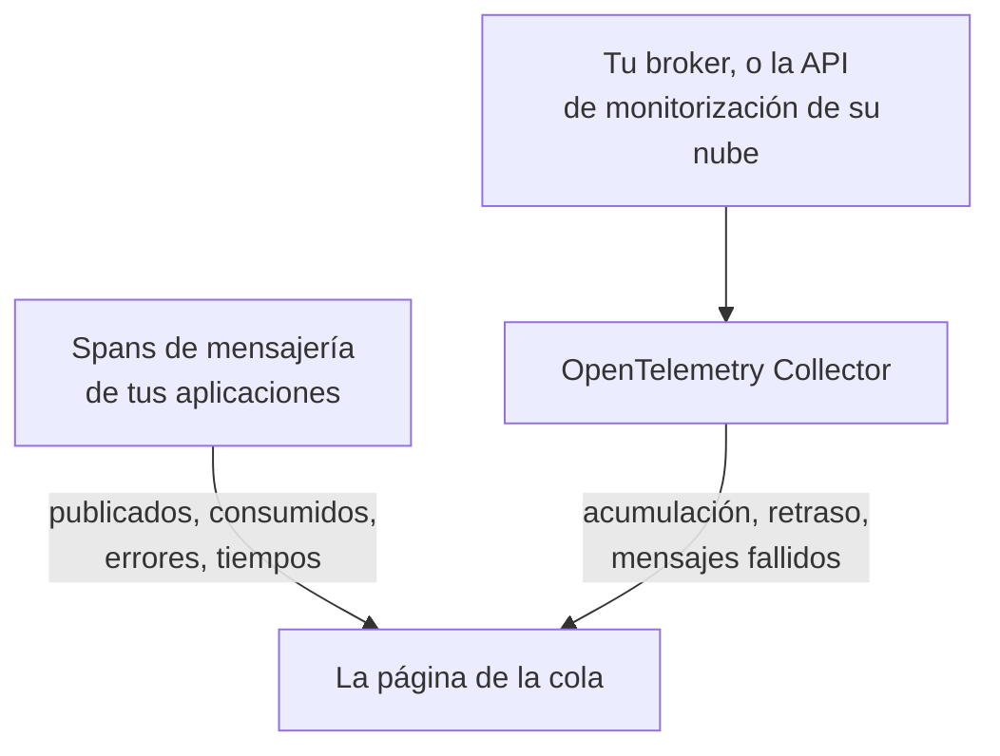

# Colas

**Colas** da a cada cola de mensajes, topic y suscripción que usan tus aplicaciones su propia página: qué servicios publican en ella y cuáles consumen de ella, cuántos mensajes pasan, cuántos fallan y cuánto tarda el procesamiento, sus trazas y métricas y, en cuanto las métricas propias del broker llegan a OneUptime, su acumulación, el retraso de los consumidores, los mensajes fallidos y la limitación. Las colas tienen etiquetas, propietarios, reglas de etiquetas y de propietarios y archivado, como cualquier otro recurso. Ábrelas en **Productos → Recursos → Colas**.

:::cards
- [Instrumentar aplicaciones](#instrumentar-aplicaciones): Los spans de mensajería que tu instrumentación de OpenTelemetry ya envía.
- [Métricas de salud del broker](#métricas-de-salud-del-broker): Acumulación, retraso y mensajes fallidos de tu broker, sistema por sistema.
- [Alertas](#alertas): Plantillas listas para usar, y métricas tardías o contadas.
- [Solución de problemas](#solución-de-problemas): Una cola que no se creó, o una salud del broker que sigue vacía.
:::

## Cómo funciona

Funciona igual para cada broker (Apache Kafka, RabbitMQ, Apache ActiveMQ y otros brokers JMS, Amazon SQS y SNS, Google Cloud Pub/Sub, Azure Service Bus, Event Hubs y Event Grid, Apache Pulsar, Apache RocketMQ, NATS y BullMQ; consulta [Sistemas de mensajería compatibles](#sistemas-de-mensajería-compatibles)) y para cualquier otro broker que tus spans nombren en `messaging.system`. La mayoría de las colas aparecen solas, a partir de dos fuentes:

| Fuente | Qué necesita de ti | Qué añade a la página de la cola |
| --- | --- | --- |
| **Trazas de aplicaciones** | Aplicaciones instrumentadas (OpenTelemetry); consulta [Instrumentar aplicaciones](#instrumentar-aplicaciones) | Mensajes publicados y consumidos, errores y tiempo de procesamiento, los servicios de cada lado y las propias trazas |
| **Métricas del broker** (un OpenTelemetry Collector) | El receptor del colector o el scraping para tu broker; consulta [Métricas de salud del broker](#métricas-de-salud-del-broker) | **Salud del broker**: acumulación, retraso de los consumidores, mensajes fallidos, antigüedad del mensaje más antiguo, limitación y las tasas de mensajes propias del broker |



Las trazas le dicen a OneUptime que una cola existe y cómo la usan las aplicaciones, pero no lo llena que está. Eso viene del propio broker o de la API de monitorización de su proveedor de nube o, en el caso de [BullMQ](#bullmq), que guarda sus trabajos en Redis y no tiene un broker al que preguntar, de un indicador que informa la aplicación.

También puedes añadir una cola a mano: **Colas → Crear Cola**, con su sistema de mensajería y el nombre de su destino y, para Azure Service Bus y Event Hubs, su espacio de nombres. El formulario los pide en su primer paso, **Sistema de mensajería**, y luego un nombre y una descripción opcionales, con las etiquetas en **Más campos** (**Información de la cola**). Deja el espacio de nombres vacío solo para una cola a la que tus aplicaciones llegan a través de un emulador o un nombre de dominio personalizado: sus spans no nombran ningún espacio de nombres, y las métricas de Azure Monitor nunca llegan a esa cola (consulta [Limitaciones](#limitaciones)).

## Primeros pasos

:::steps
### Envía las trazas de tus aplicaciones

Instrumenta las aplicaciones que publican y consumen, y envía sus trazas a OneUptime (consulta [Instrumentar aplicaciones](#instrumentar-aplicaciones)). No hace falta nada específico de OneUptime: los spans de mensajería que tu instrumentación ya genera nombran las colas.

### Envía las métricas de tu broker

Busca tu sistema de mensajería en [Métricas de salud del broker](#métricas-de-salud-del-broker) y ejecuta su configuración del colector con tu clave de ingesta. La pestaña **Documentación** de cada cola tiene la configuración para esa cola, lista para copiar.

### Abre la cola

Abre **Productos → Recursos → Colas**. El descubrimiento se ejecuta cada 10 minutos: una cola aparece en cuanto al menos 3 de sus spans llegaron en 15 minutos, o una métrica del broker la nombró.
:::

## Sistemas de mensajería compatibles

OneUptime conoce por su nombre los sistemas de mensajería de abajo. Normaliza lo que las instrumentaciones ponen en `messaging.system` al valor de la segunda columna (el valor conocido de OpenTelemetry cuando lo hay) sin distinguir mayúsculas de minúsculas, de modo que `AmazonSQS`, `aws.sqs` y `aws_sqs` son un mismo sistema. `nats` y `bullmq` no son valores conocidos de OpenTelemetry: `nats` es lo que informa la instrumentación de NATS del agente de Java, y `bullmq` es el valor que debes establecer para BullMQ (consulta [BullMQ](#bullmq)).

Un sistema que OneUptime no conoce funciona igualmente: un valor bien formado (`ibmmq`, `solace`, `mqtt`: letras minúsculas, dígitos, `.`, `_` y `-`, hasta 64 caracteres) se conserva tal como llegó, de modo que las colas de ese broker se descubren y se muestran con ese nombre; solo las métricas propias del broker necesitan un sistema de esta tabla. `spring_integration` se ignora: los canales de Spring Integration son llamadas a métodos dentro de un proceso, no un broker.

**Métricas del broker** indica de dónde vienen las métricas de salud de un sistema: un receptor de collector-contrib, un endpoint de Prometheus (`:port/path`, recopilado con el receptor `prometheus` del colector), la API de monitorización del proveedor de nube o un programa fuera del colector que las envía por OTLP. Cada sistema enlaza abajo con su configuración, y la pestaña **Documentación** de cada cola lo convierte en una configuración para esa cola.

| Sistema | `messaging.system` | También aceptado | Métricas del broker |
| --- | --- | --- | --- |
| [Amazon SNS](#amazon-sns) | `aws.sns` | `aws_sns`, `amazonsns`, `sns` | receptor `aws_cloudwatch` o `awsfirehose` (monitorización en la nube) |
| [Amazon SQS](#amazon-sqs) | `aws_sqs` | `aws.sqs`, `amazonsqs`, `sqs` | receptor `aws_cloudwatch` o `awsfirehose` (monitorización en la nube) |
| [Apache ActiveMQ](#apache-activemq) | `activemq` | `artemis`, `activemq_artemis` | OpenTelemetry JMX Scraper (envía por OTLP) |
| [Apache Kafka](#apache-kafka) | `kafka` | — | receptor `kafka_metrics` |
| [Apache Pulsar](#apache-pulsar) | `pulsar` | `apache_pulsar` | Prometheus (broker de Pulsar), `:8080/metrics/` |
| [Apache RocketMQ](#apache-rocketmq) | `rocketmq` | — | Prometheus (broker de RocketMQ), `:5557/metrics` |
| [Azure Event Grid](#azure-event-grid) | `eventgrid` | `azure_eventgrid`, `azure.eventgrid`, `microsoft.eventgrid` | receptor `azure_monitor` (monitorización en la nube) |
| [Azure Event Hubs](#azure-event-hubs) | `eventhubs` | `azure_eventhubs`, `azure.eventhubs`, `microsoft.eventhub` | receptor `azure_monitor` (monitorización en la nube) |
| [Azure Service Bus](#azure-service-bus) | `servicebus` | `azure_servicebus`, `azure.servicebus`, `microsoft.servicebus` | receptor `azure_monitor` (monitorización en la nube) |
| [BullMQ](#bullmq) | `bullmq` | — | Nada integrado |
| [Google Cloud Pub/Sub](#google-cloud-pubsub) | `gcp_pubsub` | `gcp.pubsub`, `pubsub`, `google_pubsub` | receptor `googlecloudmonitoring` (monitorización en la nube) |
| [JMS](#jms) | `jms` | — | Nada integrado |
| [NATS](#nats) | `nats` | `jetstream` | Prometheus (prometheus-nats-exporter), `:7777/metrics` |
| [RabbitMQ](#rabbitmq) | `rabbitmq` | — | receptor `rabbitmq` |

Una cola es un destino de un sistema. En **Azure Service Bus** y **Azure Event Hubs** también forma parte su espacio de nombres, ya que dos espacios de nombres pueden contener cada uno una cola llamada `orders`. **JMS** y **Apache ActiveMQ** comparten sus colas: las aplicaciones Java llegan a ActiveMQ a través de la API de JMS, cuyos spans dicen `jms` sea cual sea el broker, mientras que las métricas propias del broker solo pueden decir `activemq`, así que ambos llegan a una misma cola (consulta [Qué hace que dos avistamientos sean una cola](#qué-hace-que-dos-avistamientos-sean-una-cola)).

## Cómo se descubren las colas

Cada cola registra si la crearon las trazas, las métricas del broker o una persona. Todo lo que después nombra la misma cola se añade a ella en lugar de crear otra (consulta [Qué hace que dos avistamientos sean una cola](#qué-hace-que-dos-avistamientos-sean-una-cola)).

### A partir de trazas de aplicaciones

Cada 10 minutos, OneUptime resume los spans que tus aplicaciones enviaron en los últimos 15 minutos y que llevan alguna de las claves `messaging.system`, `messaging.destination.name`, `messaging.destination`, `message_bus.destination`, `az.namespace`, `azure.resource_provider.namespace`, `aws.sqs.queue.url`, `aws.queue_url` o `aws.sns.topic.arn`. Cuenta todo span salvo un span SERVER: spans PRODUCER, CONSUMER, CLIENT e INTERNAL, y spans a los que el **Reasignador de tipo de span** de un pipeline de trazas dio otro tipo (como Unspecified) o ninguno; un span SERVER nunca nombra una cola.

Los spans propios de un broker también son spans SERVER. El trazador eBPF del [agente de Kubernetes](/docs/telemetry/kubernetes-agent#cómo-son-las-trazas-de-ebpf) registra el lado de un broker de Kafka, MQTT o NATS en cada intercambio (un mensaje que recibe, un mensaje que entrega) y envía la mayoría como PRODUCER o CONSUMER; OneUptime los almacena como SERVER, de modo que un broker no aparece entre los productores ni los consumidores de los topics que transporta. Un broker MQTT que reenvía un mensaje a un suscriptor escribe el mismo PUBLISH que un cliente, y el trazador informa de ambos igual, así que para las publicaciones de MQTT y NATS OneUptime se guía por el puerto del otro extremo de la conexión: a partir del puerto 32768 (donde los sistemas operativos eligen el puerto de un cliente que se conecta; el rango predeterminado de Linux empieza ahí; Windows y macOS usan 49152–65535) es el de un suscriptor, y el span es del broker. Por eso, una aplicación que publica en un broker MQTT o NATS que a su vez escucha en un puerto a partir de 32768, como un puerto de Docker publicado al azar, no aparece como productor de sus topics, y un topic que solo usan esas aplicaciones puede no descubrirse en absoluto a partir de los spans del trazador. Un suscriptor que se conecta a un broker desde un puerto inferior a 32768 (un rango de puertos reducido o un puerto que reescribió un NAT) sigue teniendo al broker como productor de los topics que se le entregan.

Todos los atributos de mensajería de OpenTelemetry siguen marcados como en desarrollo, así que las aplicaciones de un mismo proyecto informan de lo mismo con hasta cinco generaciones de nombres. OneUptime los lee todos, los más nuevos primero, y nunca analiza los nombres de los spans, cuyo formato cambió en las convenciones semánticas 1.27 y que los proveedores eligen libremente:

- **El sistema**: `messaging.system`, normalizado como en [Sistemas de mensajería compatibles](#sistemas-de-mensajería-compatibles). Sin él, `az.namespace` o `azure.resource_provider.namespace` de los SDK de Azure (`Microsoft.ServiceBus`, `Microsoft.EventHub`), la clave anterior `component` del SDK de Azure, un span del SDK de AWS (`rpc.system` = `aws-api`) que llama a SQS o SNS (los spans de SNS del agente de Java no llevan `messaging.system`), o una clave con la URL de una cola de SQS o el ARN de un topic de SNS.
- **El destino**: la primera de las claves `messaging.destination.template`, `messaging.destination.name`, `messaging.source.template`, `messaging.source.name`, `messaging.destination` y `message_bus.destination` que lleve el span. Un span sin ninguna de ellas recurre a las claves propias de su sistema: la URL de la cola de SQS (`aws.sqs.queue.url`, `aws.queue_url` o una URL de cola en `messaging.url`, `server.address` o `net.peer.name`), el ARN del topic de SNS (`aws.sns.topic.arn`) y, en RabbitMQ, la clave de enrutamiento (`messaging.rabbitmq.destination.routing_key` o `messaging.rabbitmq.routing_key`), que es el nombre de la cola cuando un mensaje pasa por el exchange predeterminado.
- **La dirección**: primero `messaging.operation.type`, luego el tipo de span (PRODUCER publica, CONSUMER consume), luego el anterior `messaging.operation`, luego `messaging.operation.name` y, en SQS y SNS, la operación del SDK de AWS en `rpc.method` (`SendMessage`, `ReceiveMessage`, …). El tipo tiene prioridad sobre las claves anteriores porque algunas instrumentaciones las rellenaban mal: confluent-kafka para Python escribía `receive` en sus spans de productor.

Una cola se **crea** a partir de las trazas en cuanto sus spans en la ventana de 15 minutos que examina una ejecución suman al menos 3 (`MESSAGE_QUEUE_MIN_SPANS`), para que un script puntual no cree una, y solo mientras el proyecto esté por debajo de su [límite de creación automática](#el-presupuesto-de-creación-automática). Los spans que no crean una cola siguen contando para una que ya existe.

Cada span de mensajería también se etiqueta con su cola al ingerirse, de modo que la pestaña **Trazas** de la cola muestra cada span que la nombra, incluidos los spans enviados antes de que se creara la cola.

### A partir de las métricas del broker

Una métrica del broker de las listas en [Métricas de salud del broker](#métricas-de-salud-del-broker) nombra su cola en el atributo propio del broker (`topic` de Kafka, `rabbitmq.queue.name` de RabbitMQ, la dimensión `EntityName` de Azure Monitor, `QueueName` de CloudWatch), y OneUptime la asocia a esa cola al ingerirla. Las métricas del broker no llevan `messaging.system`: cada una se reconoce por su nombre (`kafka.consumer_group.lag_sum`) y, cuando dos sistemas comparten uno (Azure Monitor nombra igual las métricas de Service Bus y las de Event Hubs), por el tipo de recurso que lleva el punto de datos.

La siguiente ejecución de descubrimiento crea la cola si todavía no existe: basta con una métrica del broker, dentro del [límite de creación automática](#el-presupuesto-de-creación-automática). Así, una cola que ninguna aplicación instrumentada toca aparece igualmente en cuanto su broker informa de ella.

Las API de monitorización en la nube (CloudWatch, Azure Monitor y Cloud Monitoring) publican cada valor minutos después del momento que mide, y se almacena con ese momento. Por eso cada ejecución lee sus métricas de la última hora, en lugar de los últimos 15 minutos de los que lee los spans y las demás métricas: un punto de datos que llega tarde sigue avistando su cola, o la crea.

### A partir de las métricas de los clientes de mensajería

Los clientes instrumentados también pueden informar métricas: las métricas de clientes de mensajería de OpenTelemetry `messaging.client.sent.messages`, `messaging.client.consumed.messages`, `messaging.client.operation.duration` y `messaging.process.duration`, sus nombres anteriores `messaging.publish.duration`, `messaging.receive.duration`, `messaging.publish.messages`, `messaging.receive.messages`, `messaging.process.messages` y `messaging.client.published.messages`, y las del SDK de Azure para Java `messaging.servicebus.messages.sent`, `messaging.servicebus.receiver.lag`, `messaging.servicebus.settlement.request.duration` y `messaging.servicebus.settlement.sequence_number`. Cada punto de datos nombra su sistema y su destino como lo hace un span (las métricas de Service Bus del SDK de Azure no nombran ningún sistema, así que su nombre lo sustituye) y se asocia a esa cola al ingerirse, de modo que aparece en la pestaña **Métricas** de la cola. Lo mismo ocurre con cualquier métrica propia que lleve `messaging.system` y `messaging.destination.name` en cada punto de datos (no en el recurso, donde no se leen), como un indicador de profundidad de la cola (consulta [BullMQ](#bullmq)).

Las métricas de los clientes de mensajería nunca crean una cola: lo hacen las trazas, las métricas del broker o una persona. Una métrica de cliente que nombra una cola existente mantiene al día su **Visto por última vez**, como hacen sus spans. Una métrica propia no hace ninguna de las dos cosas: solo aparece en la pestaña **Métricas** de la cola.

### Qué hace que dos avistamientos sean una cola

La identidad de una cola es su **sistema** y su **destino**, comparados sin distinguir mayúsculas de minúsculas: `Orders` y `orders` son una misma cola, que se muestra con el nombre tal como se vio primero. En Azure Service Bus y Event Hubs, la identidad también incluye el **espacio de nombres**:

- en un span, la primera etiqueta DNS del host al que se conectó el SDK, tomada de `server.address`, `net.peer.name`, `peer.address` o `network.peer.address` en ese orden, cuando ese host es un host de espacio de nombres: `<namespace>.servicebus.windows.net`, o `.servicebus.usgovcloudapi.net`, `.servicebus.chinacloudapi.cn` o `.servicebus.cloudapi.de` de una nube soberana. Event Hubs comparte el dominio de Service Bus;
- en una métrica de Azure Monitor, el `name` del espacio de nombres sobre el que informa.

Nada más forma parte de ella, así que nada de lo siguiente divide nunca una cola: la dirección del broker (los clientes de Kafka rara vez la informan, y un espacio de nombres de Azure responde en muchas), el grupo de consumidores o la suscripción (los consumidores de un topic no son colas separadas), la partición y una subcola de mensajes fallidos. De todo ello, una cola solo conserva la dirección del broker, para mostrarla.

**JMS y ActiveMQ son una misma familia.** Cada span de JMS dice `jms` sea cual sea el broker que hay detrás, y las métricas propias del broker (el [OpenTelemetry JMX Scraper](#apache-activemq)) solo pueden decir `activemq`, así que OneUptime identifica una cola de ActiveMQ por su familia JMS: los spans y las métricas del broker de `orders` llegan a una misma cola. Se muestra como JMS hasta que llegan las métricas del broker, y como Apache ActiveMQ a partir de entonces, nunca al revés. Una cola que creas a mano como Apache ActiveMQ es esa misma cola.

### Cómo se leen los nombres de destino

Las instrumentaciones nombran una misma cola de muchas maneras, y OneUptime reduce lo que informan al nombre propio de la cola:

| Sistema | Informado como | Cola |
| --- | --- | --- |
| Amazon SQS | `https://sqs.us-east-1.amazonaws.com/123456789012/orders`, una URL de cola (`otelaws` de Go la pone en `server.address`) | `orders` |
| Amazon SNS | `arn:aws:sns:us-east-1:123456789012:order-events`, un ARN de topic | `order-events` |
| Google Cloud Pub/Sub | `projects/shop/topics/orders`, un nombre de recurso | `orders` |
| Azure Service Bus | `orders/Subscriptions/billing`, la ruta de entidad de la suscripción `billing` del topic | `orders` |
| Azure Service Bus | `orders/$DeadLetterQueue`, la ruta de entidad de la subcola de mensajes fallidos de la cola | `orders` |
| Azure Event Hubs | `telemetry/ConsumerGroups/$Default/Partitions/3`, la ruta de entidad de un receptor, para el grupo de consumidores `$Default` | `telemetry` |
| Apache Pulsar | `orders-partition-3`, una partición de un topic con nombre corto | `persistent://public/default/orders` |
| Apache Pulsar | `acme/shop/orders`, un topic sin su dominio | `persistent://acme/shop/orders` |
| JMS | `queue://orders`, con su prefijo de tipo de destino | `orders` |
| RabbitMQ | `shop:new-order:orders`, exchange, clave de enrutamiento y cola en un consumidor (convenciones semánticas 1.30 y posteriores) | `orders` |
| RabbitMQ | `amq.default`, el exchange predeterminado, con la clave de enrutamiento `orders` | `orders` |
| RabbitMQ | `,orders`, el `{exchange},{routing key}` de aio-pika a través del exchange predeterminado | `orders` |
| RabbitMQ | `shop,new-order`, el `{exchange},{routing key}` de aio-pika | `shop` |

Una partición de Pulsar se integra en su topic, y un nombre sin dominio se completa como lo completa el propio Pulsar (un nombre corto, en el espacio de nombres `public/default`), de modo que los nombres del agente de Java coinciden con las etiquetas de métricas totalmente cualificadas de los brokers. Un span de RabbitMQ suele nombrar el exchange por el que pasó un mensaje, tanto en el lado que publica como en el que consume; el exchange predeterminado (`amq.default`, `<default>` o un nombre vacío) representa su clave de enrutamiento, que es el nombre de la cola. Las convenciones semánticas 1.30 unen exchange, clave de enrutamiento y cola con `:` (los nombres opcionales del agente de Java), y OneUptime toma la cola del nombre unido de un consumidor y el exchange del de un publicador. aio-pika une exchange y clave de enrutamiento con una coma en el lado que publica, y OneUptime lo separa de la misma manera.

### Qué se ignora

OneUptime prefiere equivocarse a favor de no crear una cola: de lo contrario, un nombre inventado por solicitud o por consumidor crearía, por cada mensaje, una cola que no es de nadie. Esto nunca se convierte en cola:

- **Spans SERVER**, y spans cuyo `messaging.system` es `spring_integration`.
- **Destinos marcados como temporales o anónimos**: `messaging.destination.temporary`, `messaging.destination.anonymous`, `messaging.source.temporary` o `messaging.source.anonymous` establecido en `true`. No se confía en el anterior `messaging.temp_destination`: las instrumentaciones pika y aio-pika de Python lo establecen en cada publicación.
- **Marcadores que las instrumentaciones informan en lugar de un nombre**: `(temporary)`, `(anonymous)`, `<generated>`, `unknown` (un lote de Kafka que abarca varios topics), `aws:sqs` (los eventos de SQS de Lambda del agente de Java), `-NamespaceOnlyMetric-` de Azure Monitor y un valor que la propia depuración de datos de OneUptime reemplazó por completo (`[REDACTED]`).
- **Destinos generados y de respuesta**: las colas con nombre de servidor de RabbitMQ al estilo de `amq.gen-JzTY20BRgKO-HjmUJj0wLg`, las colas `spring.gen-…` de Spring y las colas `<destination>.anonymous.<id>` de Spring Cloud Stream de consumidores sin grupo, y el direct reply-to (`amq.rabbitmq.reply-to…`); los destinos temporales de JMS (`temp-queue://…`, `temp-topic://…`) y `$TMP$…` de TIBCO; los topics de avisos de ActiveMQ (`ActiveMQ.Advisory.…`); los buzones de NATS (`_INBOX.…`) y los subjects de confirmación de JetStream (`$JS.ACK.…`); los topics del sistema de Pulsar (`__change_events`, `__transaction_…` y todo lo que esté bajo un segmento `/__`); y un destino que no es más que un UUID.
- **Mensajes de texto y notificaciones push móviles de SNS**: un número de teléfono (`+15555550123`, o `phone_number:**` de botocore) o un ARN de endpoint de plataforma (`arn:aws:sns:us-east-1:123456789012:endpoint/GCM/shop-app/1234`) es un dispositivo, no un topic.
- **Nombres que no pueden ser una sola cola**: una lista de destinos de un lote (`["orders","payments"]`), un nombre que contiene un carácter de control y un nombre de más de 255 caracteres.

**Los UUID se convierten en plantilla.** Cada UUID dentro de un destino se sustituye por `{uuid}`, de modo que nombres por solicitud como `reply-7f1c2a9e-4b1d-4c3e-9f1a-2b3c4d5e6f70` se convierten en una sola cola, `reply-{uuid}`, en lugar de una cola cada uno.

### El presupuesto de creación automática

Las trazas y las métricas del broker solo crean colas por sí solas mientras el proyecto tiene menos de 500 colas descubiertas activas y no archivadas (`MESSAGE_QUEUE_AUTO_CREATE_BUDGET`; consulta [Ajustes para instalaciones autoalojadas](#ajustes-para-instalaciones-autoalojadas)). Las colas que creas a mano nunca cuentan y nunca se bloquean; las colas archivadas no cuentan, así que el [archivado automático](#ciclo-de-vida-y-archivado) libera límite; y las colas que ya existen se siguen asociando y actualizando.

### Ciclo de vida y archivado

- **Visto por última vez** es el momento en que el descubrimiento vio la cola por última vez, en trazas, métricas de clientes de mensajería o métricas del broker.
- **Archivar para descartar.** Eliminar una cola descubierta solo la quita hasta que se vuelve a ver: su siguiente avistamiento la devuelve como una cola nueva. Para descartar una definitivamente, **archívala**. Una cola archivada conserva su identidad, de modo que todo lo que la nombra sigue asociado a la cola archivada en lugar de crear una nueva.
- **Archivado automático.** Una cola descubierta que no se ha visto en 7 días (`MESSAGE_QUEUE_AUTO_ARCHIVE_DAYS`) se archiva automáticamente, salvo que una persona la haya renombrado, descrito, etiquetado o le haya dado propietarios. Las etiquetas y los propietarios que las reglas de etiquetas o de propietarios añadieron por sí solas no cuentan.
- **Restauración.** Una cola archivada automáticamente se restaura automáticamente cuando se vuelve a ver. Las colas que creaste a mano, y las colas que archivó una persona, nunca las archiva ni las restaura el descubrimiento. Una cola que restaura una persona sigue restaurada durante 30 días (o la ventana de archivado, si es más larga) aunque nada la vea; a partir de su siguiente avistamiento vuelve a aplicarse la regla de los 7 días.

## Instrumentar aplicaciones

Las colas salen de los spans de mensajería que tu instrumentación de OpenTelemetry ya genera; no hace falta nada específico de OneUptime. Envía las trazas a OneUptime como se describe en [OpenTelemetry](/docs/telemetry/open-telemetry) y luego consulta la lista de tu lenguaje.

:::tabs
@tab Java
El agente de Java de OpenTelemetry traza los clientes de Kafka, RabbitMQ, JMS (ActiveMQ, Artemis, IBM MQ y cualquier otro broker JMS), Amazon SQS y SNS, Pulsar, RocketMQ y NATS sin cambios en el código. OneUptime lee tanto los nombres de atributos que emite de forma predeterminada como los más nuevos que emite con `OTEL_SEMCONV_STABILITY_OPT_IN=messaging` (agente 2.31.0 y posteriores). Los spans de JMS dicen `jms` sea cual sea el broker que haya detrás (consulta [JMS](#jms)).

- **Azure Service Bus y Event Hubs**: el SDK de Azure para Java se traza a sí mismo, y el agente de Java conecta ese trazado con OpenTelemetry.
- **Google Cloud Pub/Sub**: el cliente se traza a sí mismo en cuanto sus builders `Publisher` y `Subscriber` reciben una instancia de OpenTelemetry y el interruptor de trazado: `setOpenTelemetry(GlobalOpenTelemetry.get())` y `setEnableOpenTelemetryTracing(true)`. Cualquiera de las dos llamadas por sí sola no traza nada.
@tab .NET
- **Azure Service Bus y Event Hubs** (`Azure.Messaging.ServiceBus`, `Azure.Messaging.EventHubs`): sus spans de OpenTelemetry son experimentales en el SDK de Azure. Actívalos con la variable de entorno `AZURE_EXPERIMENTAL_ENABLE_ACTIVITY_SOURCE=true` (o el interruptor `Azure.Experimental.EnableActivitySource` de abajo) y suscríbete a las fuentes `Azure.*`.
- **RabbitMQ.Client** 7 se traza a sí mismo: suscríbete a `RabbitMQ.Client.*`.
- **MassTransit** se traza a sí mismo: suscríbete a `MassTransit` (consulta [Limitaciones](#limitaciones) para saber qué omiten sus spans).
- **Confluent.Kafka**: el paquete `OpenTelemetry.Instrumentation.ConfluentKafka`.
- **Amazon SQS y SNS**: el paquete `OpenTelemetry.Instrumentation.AWS`, con `.AddAWSInstrumentation(opt => opt.SemanticConventionVersion = SemanticConventionVersion.Latest)`. Su conjunto de atributos predeterminado (`V1_28_0`) nombra una cola de SQS solo por su URL (`aws.queue_url`, que OneUptime lee) y no nombra en absoluto un topic de SNS.

```csharp
// Before any Azure client is created; or set AZURE_EXPERIMENTAL_ENABLE_ACTIVITY_SOURCE=true.
AppContext.SetSwitch("Azure.Experimental.EnableActivitySource", true);

builder.Services.AddOpenTelemetry()
    .WithTracing(tracing => tracing
        .AddSource("Azure.*")
        .AddSource("RabbitMQ.Client.*")
        .AddSource("MassTransit")
        .AddOtlpExporter());
```
@tab Node.js
- `@opentelemetry/auto-instrumentations-node` traza `amqplib` (RabbitMQ), `kafkajs` y el SDK de AWS (SQS y SNS).
- **Azure Service Bus y Event Hubs**: registra `createAzureSdkInstrumentation()` de `@azure/opentelemetry-instrumentation-azure-sdk`.
- **Google Cloud Pub/Sub**: `new PubSub({ enableOpenTelemetryTracing: true })`.
- **BullMQ**: consulta [BullMQ](#bullmq); su propia telemetría necesita que se le añadan dos atributos.
@tab Python
- Kafka: `opentelemetry-instrumentation-kafka-python`, `opentelemetry-instrumentation-confluent-kafka` o `opentelemetry-instrumentation-aiokafka`. RabbitMQ: `opentelemetry-instrumentation-pika` o `opentelemetry-instrumentation-aio-pika`. SQS y SNS: `opentelemetry-instrumentation-botocore`, o `opentelemetry-instrumentation-boto3sqs` para SQS. `opentelemetry-bootstrap -a install` elige las que necesitan tus bibliotecas instaladas.
- **Azure Service Bus y Event Hubs**: instala `azure-core-tracing-opentelemetry` y establece `settings.tracing_implementation = "opentelemetry"` (de `azure.core.settings`).
- **Google Cloud Pub/Sub**: `PublisherOptions(enable_open_telemetry_tracing=True)` y `SubscriberOptions(enable_open_telemetry_tracing=True)`.
- Los spans de Celery no llevan `messaging.system` ni nombran ningún broker, así que no crean colas.
@tab Go
- **Amazon SQS y SNS**: `otelaws` (`go.opentelemetry.io/contrib/instrumentation/github.com/aws/aws-sdk-go-v2/otelaws`), añadido con `otelaws.AppendMiddlewares(&cfg.APIOptions)`. Sus spans de SQS llevan la URL de la cola en `server.address`, que OneUptime lee como la cola.
- **Google Cloud Pub/Sub**: `pubsub.ClientConfig{EnableOpenTelemetryTracing: true}`.
- **Kafka** con `segmentio/kafka-go`: la instrumentación automática de OpenTelemetry para Go (`go.opentelemetry.io/auto`, eBPF, en Linux) traza sus productores y consumidores sin cambios en el código.
- Las bibliotecas contrib de Go de OpenTelemetry no tienen instrumentación para Kafka, RabbitMQ ni NATS. Para otros clientes, usa la compatibilidad con OpenTelemetry propia de la biblioteca cliente, o establece `messaging.system`, `messaging.destination.name` y el tipo de span en los spans que rodean tus envíos y controladores.
:::

## Métricas de salud del broker

Un broker sabe lo que ninguna aplicación puede ver: cuántos mensajes esperan, cuánto retraso lleva cada grupo de consumidores, qué fue a parar a una cola de mensajes fallidos. Cada sección de abajo tiene la configuración del colector para un sistema: una configuración completa de OpenTelemetry Collector que termina en el exportador OTLP que envía a OneUptime. Pon una clave de ingesta de telemetría (**Ajustes del proyecto → Telemetría y APM → Claves de ingesta**) en `x-oneuptime-token`, sustituye `https://oneuptime.com` por tu propio host si usas autoalojamiento y ejecútala con `otel/opentelemetry-collector-contrib` 0.161.0 o posterior (cada configuración de aquí está validada con 0.161.0). Los colectores recientes registran que `otlphttp` está obsoleto en favor de `otlp_http`; ambos nombres son el mismo exportador. Para recopilar varios sistemas, combina sus receptores en un solo colector.

La sección **Salud del broker** de cada cola representa las métricas listadas para su sistema (un indicador como su valor, un recuento por período sumado por intervalo, un contador como tasa por segundo) combinando las series de una cola como lo necesita cada métrica (los mensajes listos y sin confirmar de una cola de RabbitMQ se suman; el grupo de consumidores más retrasado es el retraso). Todo lo que envía el colector también está en el explorador **Métricas**. Mientras no haya llegado ninguna métrica listada para una cola, la sección muestra de dónde vienen las métricas de ese sistema, con un enlace a su sección de aquí.

### Amazon SNS

Lee las métricas de CloudWatch de los topics con el receptor `aws_cloudwatch` del colector, o transmítelas mediante un CloudWatch Metric Stream y Amazon Data Firehose a su receptor `awsfirehose`.

El receptor `aws_cloudwatch` consulta la API `GetMetricData` de CloudWatch, un espacio de nombres por receptor, así que SNS tiene su propia instancia junto a la de [Amazon SQS](#amazon-sqs). Usa las credenciales predeterminadas del SDK de AWS (entorno, perfil compartido o rol de instancia), que necesitan `cloudwatch:ListMetrics` y `cloudwatch:GetMetricData`:

```yaml
receivers:
  aws_cloudwatch/sns:
    region: us-east-1
    metrics:
      collection_interval: 5m
      period: 1m
      delay: 10m
      discovery:
        filters:
          namespace: AWS/SNS
        limit: 500

processors:
  batch: {}

exporters:
  otlphttp:
    endpoint: https://oneuptime.com/otlp
    headers:
      x-oneuptime-token: YOUR_TELEMETRY_INGESTION_TOKEN

service:
  pipelines:
    metrics:
      receivers: [aws_cloudwatch/sns]
      processors: [batch]
      exporters: [otlphttp]
```

Deja `stats` sin establecer, como en [Amazon SQS](#amazon-sqs). Un Metric Stream lleva SNS y SQS juntos: añade `AWS/SNS` a los espacios de nombres del stream en la configuración de [Amazon SQS](#amazon-sqs).

Un topic se nombra igual desde ambos lados: los spans informan de su ARN o de su nombre, y OneUptime conserva el nombre que sigue al último `:` del ARN.

| Métrica | Se muestra como | Tipo |
| --- | --- | --- |
| `amazonaws.com/aws/sns/numberofmessagespublished` (flujo JSON: `numberofmessagespublished`) | Messages published | Recuento por período |
| `amazonaws.com/aws/sns/numberofnotificationsdelivered` (flujo JSON: `numberofnotificationsdelivered`) | Notifications delivered | Recuento por período |
| `amazonaws.com/aws/sns/numberofnotificationsfailed` (flujo JSON: `numberofnotificationsfailed`) | Notifications failed | Recuento por período |
| `amazonaws.com/aws/sns/numberofnotificationsredriventodlq` (flujo JSON: `numberofnotificationsredriventodlq`) | Redriven to dead-letter queue | Recuento por período |

### Amazon SQS

Lee las métricas de CloudWatch de las colas con el receptor `aws_cloudwatch` del colector, o transmítelas mediante un CloudWatch Metric Stream y Amazon Data Firehose a su receptor `awsfirehose`.

**Consultar CloudWatch** no necesita nada en el lado de AWS aparte de credenciales. El receptor usa las credenciales predeterminadas del SDK de AWS (entorno, perfil compartido o rol de instancia), que necesitan `cloudwatch:ListMetrics` y `cloudwatch:GetMetricData`:

```yaml
receivers:
  aws_cloudwatch/sqs:
    region: us-east-1
    metrics:
      collection_interval: 5m
      period: 1m
      delay: 10m
      discovery:
        filters:
          namespace: AWS/SQS
        # Metrics per scrape: about nine per queue. Must be set.
        limit: 500

processors:
  batch: {}

exporters:
  otlphttp:
    endpoint: https://oneuptime.com/otlp
    headers:
      x-oneuptime-token: YOUR_TELEMETRY_INGESTION_TOKEN

service:
  pipelines:
    metrics:
      receivers: [aws_cloudwatch/sqs]
      processors: [batch]
      exporters: [otlphttp]
```

- **Deja `stats` sin establecer.** Sin él, cada métrica llega como un resumen por período, que es lo que lee OneUptime; con él, cada estadística se convierte en una serie propia y los gráficos las mezclan.
- `discovery.limit` debe establecerse, y limita las métricas leídas por recopilación: unas nueve por cola. Cada una cuesta cuatro subconsultas de `GetMetricData` por recopilación, que AWS factura.
- `delay` espera a que CloudWatch publique un período (tarda unos minutos), así que con esta configuración las métricas del broker de una cola llegan con 11 a 17 minutos de retraso: un monitor sobre ellas necesita una ventana más larga (consulta **Métricas tardías** en [Alertas](#alertas)).
- Un receptor lee una región y un espacio de nombres: añade una instancia por región.

**La transmisión** envía las métricas a medida que CloudWatch las publica. Crea un CloudWatch Metric Stream para los espacios de nombres `AWS/SQS` (y `AWS/SNS`) con el formato de salida **OpenTelemetry 1.0**, que entregue a un flujo de Amazon Data Firehose cuyo destino sea un endpoint HTTP: tu colector, con una clave de acceso. Firehose solo entrega a `https://` en el puerto 443, así que el colector necesita un certificado y un puerto 443 público (por ejemplo, detrás de un balanceador de carga):

```yaml
extensions:
  awscloudwatchmetricstreams_encoding:
    format: opentelemetry1.0

receivers:
  awsfirehose:
    # Firehose delivers to HTTPS on port 443 only: expose this port as 443,
    # for example behind a load balancer.
    endpoint: 0.0.0.0:4433
    encoding: awscloudwatchmetricstreams_encoding
    access_key: ${env:FIREHOSE_ACCESS_KEY}
    tls:
      cert_file: /etc/otelcol/tls/server.crt
      key_file: /etc/otelcol/tls/server.key

processors:
  batch: {}

exporters:
  otlphttp:
    endpoint: https://oneuptime.com/otlp
    headers:
      x-oneuptime-token: YOUR_TELEMETRY_INGESTION_TOKEN

service:
  extensions: [awscloudwatchmetricstreams_encoding]
  pipelines:
    metrics:
      receivers: [awsfirehose]
      processors: [batch]
      exporters: [otlphttp]
```

Un stream con el formato de salida **JSON** (`format: json`) también funciona: envía cada métrica con su nombre a secas, y OneUptime distingue las de SQS de las de SNS por el `service.name` que pone el stream (`SQS`, `SNS`).

Una cola de mensajes fallidos es una cola de SQS normal con métricas propias, así que en OneUptime es una cola aparte. Las colas se nombran solo por su nombre, no por su cuenta ni su región (consulta [Limitaciones](#limitaciones)).

| Métrica | Se muestra como | Tipo |
| --- | --- | --- |
| `amazonaws.com/aws/sqs/approximatenumberofmessagesvisible` (flujo JSON: `approximatenumberofmessagesvisible`) | Messages visible | Indicador |
| `amazonaws.com/aws/sqs/approximateageofoldestmessage` (flujo JSON: `approximateageofoldestmessage`) | Oldest message age | Indicador |
| `amazonaws.com/aws/sqs/approximatenumberofmessagesnotvisible` (flujo JSON: `approximatenumberofmessagesnotvisible`) | Messages in flight | Indicador |
| `amazonaws.com/aws/sqs/numberofmessagessent` (flujo JSON: `numberofmessagessent`) | Messages sent | Recuento por período |
| `amazonaws.com/aws/sqs/numberofmessagesreceived` (flujo JSON: `numberofmessagesreceived`) | Messages received | Recuento por período |
| `amazonaws.com/aws/sqs/numberofmessagesdeleted` (flujo JSON: `numberofmessagesdeleted`) | Messages deleted | Recuento por período |

### Apache ActiveMQ

El colector no tiene un receptor JMX, así que ejecuta el OpenTelemetry JMX Scraper con `OTEL_JMX_TARGET_SYSTEM=activemq` junto a un broker ActiveMQ Classic; envía las métricas de destino del broker por OTLP.

1. Permite que el broker acepte conexiones JMX. Con la imagen `apache/activemq-classic` o el script `bin/activemq`, establece `ACTIVEMQ_SUNJMX_START` antes de iniciarlo. Este ejemplo desactiva la autenticación: mantén el puerto en una red privada, o activa `jmxremote.authenticate` con un archivo de contraseñas y dale al scraper `OTEL_JMX_USERNAME` y `OTEL_JMX_PASSWORD`.

```bash
ACTIVEMQ_SUNJMX_START="-Dcom.sun.management.jmxremote.port=1099 -Dcom.sun.management.jmxremote.rmi.port=1099 -Dcom.sun.management.jmxremote.authenticate=false -Dcom.sun.management.jmxremote.ssl=false -Djava.rmi.server.hostname=activemq"
```

2. Ejecuta el scraper donde pueda llegar a ese puerto, con un entorno de ejecución de Java. Envía directamente a OneUptime; para que pase en su lugar por tu propio colector, apunta `OTEL_EXPORTER_OTLP_ENDPOINT` al receptor OTLP del colector.

```bash
curl -fsSLo opentelemetry-jmx-scraper.jar https://github.com/open-telemetry/opentelemetry-java-contrib/releases/latest/download/opentelemetry-jmx-scraper.jar

export OTEL_JMX_SERVICE_URL=service:jmx:rmi:///jndi/rmi://activemq:1099/jmxrmi
export OTEL_JMX_TARGET_SYSTEM=activemq
export OTEL_JMX_TARGET_SOURCE=instrumentation
export OTEL_METRIC_EXPORT_INTERVAL=30000
export OTEL_SERVICE_NAME=activemq-prod
export OTEL_EXPORTER_OTLP_PROTOCOL=http/protobuf
export OTEL_EXPORTER_OTLP_ENDPOINT=https://oneuptime.com/otlp
export OTEL_EXPORTER_OTLP_HEADERS=x-oneuptime-token=YOUR_TELEMETRY_INGESTION_TOKEN
java -jar opentelemetry-jmx-scraper.jar
```

`OTEL_JMX_TARGET_SOURCE=instrumentation` mantiene los nombres de métricas que el scraper usa desde 1.53.0-alpha (`activemq.message.queue.size`, con el destino en `messaging.destination.name`). OneUptime también lee los nombres de los scrapers anteriores y de `OTEL_JMX_TARGET_SOURCE=legacy` (`activemq.message.current`, con el destino en `destination`).

Las métricas del broker se unen a la cola que crearon los spans de sus clientes JMS y, a partir de entonces, la cola se muestra como Apache ActiveMQ (consulta [Qué hace que dos avistamientos sean una cola](#qué-hace-que-dos-avistamientos-sean-una-cola)). El scraper informa de cada destino: OneUptime ignora los topics de avisos, mientras que las colas de mensajes fallidos (`ActiveMQ.DLQ`, o `DLQ.<destination>` con una estrategia individual de mensajes fallidos) son colas aparte. ActiveMQ Artemis tiene otros MBeans, que estas reglas no leen: las colas de Artemis siguen saliendo de sus spans de JMS, sin salud del broker.

| Métrica | Se muestra como | Tipo |
| --- | --- | --- |
| `activemq.message.queue.size` | Queue size | Indicador |
| `activemq.message.current` | Queue size (legacy names) | Indicador |
| `activemq.message.enqueued` | Enqueued | Contador, representado por segundo |
| `activemq.message.dequeued` | Dequeued | Contador, representado por segundo |
| `activemq.message.expired` | Expired | Contador, representado por segundo |
| `activemq.consumer.count` | Consumers | Indicador |
| `activemq.message.enqueue.average_duration` | Average time in queue | Indicador |
| `activemq.message.wait_time.avg` | Average time in queue (legacy names) | Indicador |

### Apache Kafka

El receptor `kafka_metrics` del colector lee de los brokers el retraso de los grupos de consumidores y los offsets de las particiones; activa sus scrapers `topics` y `consumers`.

```yaml
receivers:
  kafka_metrics:
    brokers: ["kafka-1:9092", "kafka-2:9092"]
    # topics: each partition's log-end offset; consumers: each group's
    # committed offsets and lag. brokers: the broker count.
    scrapers: [brokers, topics, consumers]
    collection_interval: 30s
    # auth:
    #   sasl:
    #     mechanism: SCRAM-SHA-512
    #     username: ${env:KAFKA_USERNAME}
    #     password: ${env:KAFKA_PASSWORD}
    # tls:
    #   ca_file: /etc/kafka/ca.pem

processors:
  batch: {}

exporters:
  otlphttp:
    endpoint: https://oneuptime.com/otlp
    headers:
      x-oneuptime-token: YOUR_TELEMETRY_INGESTION_TOKEN

service:
  pipelines:
    metrics:
      receivers: [kafka_metrics]
      processors: [batch]
      exporters: [otlphttp]
```

Para un clúster con SASL o TLS, descomenta `auth` y `tls`. El receptor nombra cada topic en `topic`, que es como las métricas encuentran la cola del topic. Solo informa del retraso y de los offsets confirmados de un grupo de consumidores en los topics en los que el grupo ha confirmado un offset, y omite los topics cuyo nombre empieza por `_`, los internos de Kafka (`topic_match` es `^[^_].*$` de forma predeterminada).

| Métrica | Se muestra como | Tipo |
| --- | --- | --- |
| `kafka.consumer_group.lag_sum` | Consumer lag | Indicador |
| `kafka.consumer_group.lag` | Partition lag | Indicador |
| `kafka.consumer_group.offset_sum` | Consumed | Contador, representado por segundo |
| `kafka.partition.current_offset` | Produced | Contador, representado por segundo |

### Apache Pulsar

Cada broker sirve sus métricas de topics y suscripciones en el puerto de su servicio web; recopila cada broker, porque un broker solo informa de los topics que posee en ese momento.

```yaml
receivers:
  prometheus:
    config:
      scrape_configs:
        - job_name: pulsar-broker
          scrape_interval: 30s
          metrics_path: /metrics/
          # Every broker: each one reports only the topics it owns.
          static_configs:
            - targets: ["pulsar-broker-0:8080", "pulsar-broker-1:8080"]
          # Keeps the families the queue page charts; remove it to keep all.
          metric_relabel_configs:
            - source_labels: [__name__]
              regex: "pulsar_(msg_backlog|subscription_back_log|storage_backlog_age_seconds|in_messages_total|out_messages_total)"
              action: keep

processors:
  batch: {}

exporters:
  otlphttp:
    endpoint: https://oneuptime.com/otlp
    headers:
      x-oneuptime-token: YOUR_TELEMETRY_INGESTION_TOKEN

service:
  pipelines:
    metrics:
      receivers: [prometheus]
      processors: [batch]
      exporters: [otlphttp]
```

- Las series de topics y suscripciones necesitan `exposeTopicLevelMetricsInPrometheus=true` en `broker.conf`, que es el valor predeterminado.
- Pulsar etiqueta cada serie con el nombre completo del topic (`persistent://public/default/orders`), y las de una partición con el de la partición (`persistent://public/default/orders-partition-3`): las particiones se suman en su topic.
- La acumulación se cuenta en entradas, y Pulsar cuenta un lote de mensajes como una sola entrada.
- Pulsar repite `pulsar_out_messages_total` por consumidor cuando `exposeConsumerLevelMetricsInPrometheus=true`; esas series por consumidor quedan fuera de los gráficos, así que ningún mensaje cuenta dos veces.
- `pulsar_storage_backlog_age_seconds` marca `-1` mientras el broker no lo sabe.
- Las métricas nativas de OpenTelemetry de Pulsar 3.3 y posteriores (experimentales, desactivadas de forma predeterminada) usan otros nombres, que no se representan.

| Métrica | Se muestra como | Tipo |
| --- | --- | --- |
| `pulsar_msg_backlog` | Backlog | Indicador |
| `pulsar_subscription_back_log` | Subscription backlog | Indicador |
| `pulsar_storage_backlog_age_seconds` | Backlog age | Indicador |
| `pulsar_in_messages_total` | Messages in | Contador, representado por segundo |
| `pulsar_out_messages_total` | Messages out | Contador, representado por segundo |

### Apache RocketMQ

Establece `metricsExporterType=PROM` en el `broker.conf` del broker para que el broker sirva sus métricas de retraso y rendimiento.

```text
metricsExporterType=PROM
metricsPromExporterPort=5557
metricsPromExporterHost=0.0.0.0
```

Luego recopila cada broker:

```yaml
receivers:
  prometheus:
    config:
      scrape_configs:
        - job_name: rocketmq-broker
          scrape_interval: 30s
          metrics_path: /metrics
          static_configs:
            - targets: ["rocketmq-broker-a:5557", "rocketmq-broker-b:5557"]

processors:
  batch: {}

exporters:
  otlphttp:
    endpoint: https://oneuptime.com/otlp
    headers:
      x-oneuptime-token: YOUR_TELEMETRY_INGESTION_TOKEN

service:
  pipelines:
    metrics:
      receivers: [prometheus]
      processors: [batch]
      exporters: [otlphttp]
```

Este es el exportador integrado de RocketMQ 5. RocketMQ 4 no tiene ninguno; el `rocketmq-exporter` independiente que usa informa de otros nombres de métricas, que no se representan. El topic de mensajes fallidos de un grupo de consumidores (`%DLQ%<group>`) es una cola aparte.

| Métrica | Se muestra como | Tipo |
| --- | --- | --- |
| `rocketmq_consumer_lag_messages` | Consumer lag | Indicador |
| `rocketmq_consumer_ready_messages` | Ready messages | Indicador |
| `rocketmq_send_to_dlq_messages_total` | Sent to dead-letter queue | Contador, representado por segundo |
| `rocketmq_messages_in_total` | Messages in | Contador, representado por segundo |

### Azure Event Grid

Azure Monitor tiene las métricas de entrega y de mensajes fallidos de los topics, que lee el receptor `azure_monitor` del colector; todavía no se representan en una página de cola, así que explóralas en Métricas.

El receptor inicia sesión a través de la extensión `azure_auth`. Da a la entidad de servicio el rol **Monitoring Reader** en la suscripción:

```yaml
extensions:
  azure_auth:
    service_principal:
      tenant_id: ${env:AZURE_TENANT_ID}
      client_id: ${env:AZURE_CLIENT_ID}
      client_secret: ${env:AZURE_CLIENT_SECRET}

receivers:
  azure_monitor/eventgrid:
    subscription_ids: ["${env:AZURE_SUBSCRIPTION_ID}"]
    auth:
      authenticator: azure_auth
    collection_interval: 60s
    services:
      - Microsoft.EventGrid/topics
      - Microsoft.EventGrid/systemTopics
      - Microsoft.EventGrid/domains
    maximum_number_of_records_per_resource: 1000

processors:
  batch: {}

exporters:
  otlphttp:
    endpoint: https://oneuptime.com/otlp
    headers:
      x-oneuptime-token: YOUR_TELEMETRY_INGESTION_TOKEN

service:
  extensions: [azure_auth]
  pipelines:
    metrics:
      receivers: [azure_monitor/eventgrid]
      processors: [batch]
      exporters: [otlphttp]
```

OneUptime no representa las métricas de Event Grid en la página de una cola: Azure Monitor las informa por recurso de Event Grid y suscripción de eventos, no en una forma que nombre una de tus colas. Llegan al explorador **Métricas**: `azure_publishsuccesscount_total`, `azure_deliverysuccesscount_total`, `azure_deadletteredcount_total` y las demás. Para los espacios de nombres de Event Grid, añade `Microsoft.EventGrid/namespaces` a `services`.

### Azure Event Hubs

Lee las métricas del espacio de nombres desde Azure Monitor con el receptor `azure_monitor` del colector, que las divide por event hub según la dimensión EntityName.

El receptor inicia sesión a través de la extensión `azure_auth`. Da a la entidad de servicio el rol **Monitoring Reader** en la suscripción:

```yaml
extensions:
  azure_auth:
    service_principal:
      tenant_id: ${env:AZURE_TENANT_ID}
      client_id: ${env:AZURE_CLIENT_ID}
      client_secret: ${env:AZURE_CLIENT_SECRET}

receivers:
  azure_monitor/eventhubs:
    subscription_ids: ["${env:AZURE_SUBSCRIPTION_ID}"]
    auth:
      authenticator: azure_auth
    collection_interval: 60s
    services: [Microsoft.EventHub/namespaces]
    maximum_number_of_records_per_resource: 1000
    metrics:
      "Microsoft.EventHub/namespaces":
        IncomingMessages: [Total]
        OutgoingMessages: [Total]
        ServerErrors: [Total]
        UserErrors: [Total]
        QuotaExceededErrors: [Total]
        ThrottledRequests: [Total]

processors:
  batch: {}

exporters:
  otlphttp:
    endpoint: https://oneuptime.com/otlp
    headers:
      x-oneuptime-token: YOUR_TELEMETRY_INGESTION_TOKEN

service:
  extensions: [azure_auth]
  pipelines:
    metrics:
      receivers: [azure_monitor/eventhubs]
      processors: [batch]
      exporters: [otlphttp]
```

Las métricas encuentran su event hub por el espacio de nombres (`name`) y el event hub (`EntityName`); el espacio de nombres que los spans informan como `<namespace>.servicebus.windows.net`. `maximum_number_of_records_per_resource` es cuántas series devuelve Azure por métrica y espacio de nombres, 10 salvo que lo aumentes: mantenlo por encima de tu número de event hubs, o los demás no se informarán. Deja `use_batch_api` desactivado, como está de forma predeterminada: la API por lotes falla para los espacios de nombres de Event Hubs desde el colector 0.155.0.

Azure Monitor no tiene métrica de retraso de los consumidores para Event Hubs: su `ConsumerLag` solo existe en los registros de métricas de aplicación de los niveles Premium y Dedicated, que este receptor no lee.

| Métrica | Se muestra como | Tipo |
| --- | --- | --- |
| `azure_incomingmessages_total` | Incoming messages | Recuento por período |
| `azure_outgoingmessages_total` | Outgoing messages | Recuento por período |
| `azure_servererrors_total` | Server errors | Recuento por período |
| `azure_usererrors_total` | User errors | Recuento por período |
| `azure_quotaexceedederrors_total` | Quota exceeded errors | Recuento por período |
| `azure_throttledrequests_total` | Throttled requests | Recuento por período |

### Azure Service Bus

Lee las métricas del espacio de nombres desde Azure Monitor con el receptor `azure_monitor` del colector, que las divide por cola y topic según la dimensión EntityName.

El receptor inicia sesión a través de la extensión `azure_auth`. Da a la entidad de servicio el rol **Monitoring Reader** en la suscripción:

```yaml
extensions:
  azure_auth:
    service_principal:
      tenant_id: ${env:AZURE_TENANT_ID}
      client_id: ${env:AZURE_CLIENT_ID}
      client_secret: ${env:AZURE_CLIENT_SECRET}

receivers:
  azure_monitor/servicebus:
    subscription_ids: ["${env:AZURE_SUBSCRIPTION_ID}"]
    auth:
      authenticator: azure_auth
    collection_interval: 60s
    services: [Microsoft.ServiceBus/namespaces]
    # Series Azure returns per metric and namespace (default 10): keep it
    # above your number of queues and topics.
    maximum_number_of_records_per_resource: 1000
    metrics:
      "Microsoft.ServiceBus/namespaces":
        ActiveMessages: [Average]
        DeadletteredMessages: [Average]
        IncomingMessages: [Total]
        OutgoingMessages: [Total]
        CompleteMessage: [Total]
        AbandonMessage: [Total]
        ServerErrors: [Total]
        UserErrors: [Total]
        ThrottledRequests: [Total]

processors:
  batch: {}

exporters:
  otlphttp:
    endpoint: https://oneuptime.com/otlp
    headers:
      x-oneuptime-token: YOUR_TELEMETRY_INGESTION_TOKEN

service:
  extensions: [azure_auth]
  pipelines:
    metrics:
      receivers: [azure_monitor/servicebus]
      processors: [batch]
      exporters: [otlphttp]
```

- Las métricas encuentran su cola o su topic por el espacio de nombres (`name`) y la entidad (`EntityName`); los spans de los SDK nombran el mismo espacio de nombres como `<namespace>.servicebus.windows.net`. Un span sobre `orders/Subscriptions/billing` u `orders/$DeadLetterQueue` pertenece a `orders`, como las métricas.
- `maximum_number_of_records_per_resource` es cuántas series devuelve Azure por métrica y espacio de nombres, 10 salvo que lo aumentes: mantenlo por encima de tu número de colas y topics (las métricas de errores dividen además cada entidad por resultado), o los demás no se informarán.
- Azure Monitor no divide por suscripción de topic: los recuentos de un topic cubren todas sus suscripciones.
- La lista `metrics` recopila exactamente lo que representa la página de la cola, cada una con la única agregación que representa; añade una métrica (`ScheduledMessages`, `Size`, …) para recopilarla también.
- El receptor lista tus espacios de nombres una vez al día, así que un espacio de nombres nuevo puede tardar hasta 24 horas en aparecer.

| Métrica | Se muestra como | Tipo |
| --- | --- | --- |
| `azure_activemessages_average` | Active messages | Indicador |
| `azure_deadletteredmessages_average` | Dead-lettered messages | Indicador |
| `azure_incomingmessages_total` | Incoming messages | Recuento por período |
| `azure_outgoingmessages_total` | Outgoing messages | Recuento por período |
| `azure_completemessage_total` | Completed messages | Recuento por período |
| `azure_abandonmessage_total` | Abandoned messages | Recuento por período |
| `azure_servererrors_total` | Server errors | Recuento por período |
| `azure_usererrors_total` | User errors | Recuento por período |
| `azure_throttledrequests_total` | Throttled requests | Recuento por período |

### BullMQ

BullMQ guarda sus trabajos en Redis y no tiene un broker que recopilar; informa la profundidad de la cola desde la aplicación como una métrica que lleve `messaging.system` y `messaging.destination.name`, como hacen los propios workers de OneUptime con `queue.size`.

La telemetría propia de BullMQ (su opción `telemetry`, que implementa el paquete `bullmq-otel`) nombra la cola en `bullmq.queue.name` y no establece ningún `messaging.system`, así que por sí sola no crea ninguna cola. Un procesador `transform` en el colector al que envían tus aplicaciones añade las dos claves que lee OneUptime, en los spans que añaden y procesan trabajos y en las métricas propias de BullMQ:

```yaml
receivers:
  otlp:
    protocols:
      grpc:
        endpoint: 0.0.0.0:4317
      http:
        endpoint: 0.0.0.0:4318

processors:
  # BullMQ names the queue in bullmq.queue.name and sets no
  # messaging.system: copy it into the keys OneUptime reads, on the spans
  # that publish (add) and process jobs, and on BullMQ's own metrics.
  transform/bullmq:
    error_mode: ignore
    trace_statements:
      - set(span.attributes["messaging.system"], "bullmq") where span.attributes["bullmq.queue.name"] != nil and span.attributes["messaging.system"] == nil and (span.kind == SPAN_KIND_PRODUCER or span.kind == SPAN_KIND_CONSUMER)
      - set(span.attributes["messaging.destination.name"], span.attributes["bullmq.queue.name"]) where span.attributes["messaging.system"] == "bullmq" and span.attributes["messaging.destination.name"] == nil
    metric_statements:
      - set(datapoint.attributes["messaging.system"], "bullmq") where datapoint.attributes["bullmq.queue.name"] != nil and datapoint.attributes["messaging.system"] == nil
      - set(datapoint.attributes["messaging.destination.name"], datapoint.attributes["bullmq.queue.name"]) where datapoint.attributes["messaging.system"] == "bullmq" and datapoint.attributes["messaging.destination.name"] == nil
  batch: {}

exporters:
  otlphttp:
    endpoint: https://oneuptime.com/otlp
    headers:
      x-oneuptime-token: YOUR_TELEMETRY_INGESTION_TOKEN

service:
  pipelines:
    traces:
      receivers: [otlp]
      processors: [transform/bullmq, batch]
      exporters: [otlphttp]
    metrics:
      receivers: [otlp]
      processors: [transform/bullmq, batch]
      exporters: [otlphttp]
```

Solo se etiquetan los spans PRODUCER que añaden trabajos y los spans CONSUMER que los procesan: los spans internos de BullMQ (obtener el siguiente trabajo, prolongar bloqueos) también nombran la cola, pero no son mensajes. Para la profundidad de la cola, observa los recuentos de trabajos en la aplicación; un indicador que lleve él mismo las dos claves no necesita ninguna transformación:

```ts
import { metrics } from "@opentelemetry/api";
import { Queue } from "bullmq";

const queue = new Queue("orders", { connection: { host: "redis" } });

metrics
  .getMeter("bullmq-queues")
  .createObservableGauge("queue.size", { unit: "{job}" })
  .addCallback(async (result) => {
    const counts = await queue.getJobCounts("waiting", "active", "delayed", "failed");
    for (const [state, count] of Object.entries(counts)) {
      result.observe(count, {
        "messaging.system": "bullmq",
        "messaging.destination.name": queue.name,
        state,
      });
    }
  });
```

Aparece en la pestaña **Métricas** de la cola. OneUptime no tiene métricas propias de BullMQ que representar en **Salud del broker**.

### Google Cloud Pub/Sub

Lee las métricas de los topics y las suscripciones desde Cloud Monitoring con el receptor `googlecloudmonitoring` del colector, listando cada tipo de métrica en `metrics_list`.

El receptor inicia sesión con las Application Default Credentials (`GOOGLE_APPLICATION_CREDENTIALS`, o la cuenta de servicio con la que se ejecuta el colector), que necesitan el rol **Monitoring Viewer** en el proyecto:

```yaml
receivers:
  googlecloudmonitoring:
    project_id: my-gcp-project
    collection_interval: 2m
    # Only the metric types listed here are read.
    metrics_list:
      - metric_name: pubsub.googleapis.com/subscription/num_undelivered_messages
      - metric_name: pubsub.googleapis.com/subscription/oldest_unacked_message_age
      - metric_name: pubsub.googleapis.com/subscription/dead_letter_message_count
      - metric_name: pubsub.googleapis.com/subscription/ack_message_count
      - metric_name: pubsub.googleapis.com/topic/send_request_count

processors:
  batch: {}

exporters:
  otlphttp:
    endpoint: https://oneuptime.com/otlp
    headers:
      x-oneuptime-token: YOUR_TELEMETRY_INGESTION_TOKEN

service:
  pipelines:
    metrics:
      receivers: [googlecloudmonitoring]
      processors: [batch]
      exporters: [otlphttp]
```

- Un tipo de métrica que falta en `metrics_list` nunca se lee, y la lista se lee al iniciar el colector: reinícialo después de un cambio.
- `collection_interval` es de al menos un minuto. Cloud Monitoring publica las métricas de Pub/Sub con dos a cuatro minutos de retraso.
- Las métricas de suscripción se asocian a la cola de la suscripción (`subscription_id`), y las de topic a la del topic (`topic_id`), que es también como las nombran los spans de las bibliotecas cliente (consulta [Limitaciones](#limitaciones)).

| Métrica | Se muestra como | Tipo |
| --- | --- | --- |
| `pubsub.googleapis.com/subscription/num_undelivered_messages` | Undelivered messages | Indicador |
| `pubsub.googleapis.com/subscription/oldest_unacked_message_age` | Oldest unacked message age | Indicador |
| `pubsub.googleapis.com/subscription/dead_letter_message_count` | Dead-lettered messages | Recuento por período |
| `pubsub.googleapis.com/subscription/ack_message_count` | Acknowledged messages | Recuento por período |
| `pubsub.googleapis.com/topic/send_request_count` | Publish requests | Recuento por período |

### JMS

JMS es una API, y sus spans no nombran el broker que hay detrás; cuando el broker es Apache ActiveMQ, ejecuta el OpenTelemetry JMX Scraper contra él y sus métricas se unen a la misma cola, que entonces se muestra como una cola de ActiveMQ, mientras que otros brokers JMS como IBM MQ no tienen una vía de métricas lista para usar.

Las colas de las aplicaciones JMS aparecen a partir de sus spans, sea cual sea el broker: consulta [Apache ActiveMQ](#apache-activemq) para el scraper. Para cualquier otro broker, envía sus métricas con `messaging.system` establecido en `jms` y `messaging.destination.name` establecido en el nombre de la cola en cada punto de datos: entonces se asocian a la misma cola que los spans y aparecen en su pestaña **Métricas**.

### NATS

Ejecuta prometheus-nats-exporter con `-jsz=all` contra el puerto de monitorización del servidor. Sus métricas de JetStream son por stream y consumidor, no por subject, así que no se asocian a colas a nivel de subject.

Activa el puerto de monitorización del servidor con `-m 8222` (o `http_port: 8222` en su configuración) y luego ejecuta el exportador:

```bash
prometheus-nats-exporter -varz -jsz=all http://nats:8222
```

Y recopílalo:

```yaml
receivers:
  prometheus:
    config:
      scrape_configs:
        - job_name: nats
          scrape_interval: 30s
          metrics_path: /metrics
          static_configs:
            - targets: ["nats-exporter:7777"]

processors:
  batch: {}

exporters:
  otlphttp:
    endpoint: https://oneuptime.com/otlp
    headers:
      x-oneuptime-token: YOUR_TELEMETRY_INGESTION_TOKEN

service:
  pipelines:
    metrics:
      receivers: [prometheus]
      processors: [batch]
      exporters: [otlphttp]
```

Las colas de NATS son subjects (`orders.created`), nombrados por los spans del agente de Java, y los streams y consumidores de JetStream no se corresponden con un solo subject, así que OneUptime no representa ninguno de ellos en la página de una cola. Llegan al explorador **Métricas**: `jetstream_consumer_num_pending`, `jetstream_consumer_num_ack_pending`, `jetstream_stream_total_messages` y los demás.

### RabbitMQ

El receptor `rabbitmq` del colector lee la profundidad, los consumidores y las tasas de mensajes de cada cola desde la API HTTP del plugin de administración, como un usuario con la etiqueta `monitoring` y acceso a cada host virtual.

Activa el plugin de administración y crea ese usuario. La etiqueta `monitoring` por sí sola no le muestra ninguna cola: la API de administración solo le lista a un usuario las colas de los hosts virtuales a los que tiene acceso, así que dale acceso a cada host virtual que quieras monitorizar. Los patrones vacíos conceden ese acceso sin ningún derecho a configurar, publicar ni consumir:

```bash
rabbitmq-plugins enable rabbitmq_management
rabbitmqctl add_user otel 'a-strong-password'
rabbitmqctl set_user_tags otel monitoring
# Once per virtual host to monitor; "/" is the default one.
rabbitmqctl set_permissions -p / otel "" "" ""
```

```yaml
receivers:
  rabbitmq:
    endpoint: http://rabbitmq:15672
    username: ${env:RABBITMQ_USERNAME}
    password: ${env:RABBITMQ_PASSWORD}
    collection_interval: 30s

processors:
  batch: {}

exporters:
  otlphttp:
    endpoint: https://oneuptime.com/otlp
    headers:
      x-oneuptime-token: YOUR_TELEMETRY_INGESTION_TOKEN

service:
  pipelines:
    metrics:
      receivers: [rabbitmq]
      processors: [batch]
      exporters: [otlphttp]
```

- El receptor informa de cada cola con su nombre de RabbitMQ. Los spans de la mayoría de las instrumentaciones nombran en cambio el exchange, tanto en los publicadores como en los consumidores, así que llegan a una cola aparte en OneUptime. Los spans nombran la propia cola en los mensajes enviados a través del exchange predeterminado, y en los consumidores que el agente de Java traza con `OTEL_SEMCONV_STABILITY_OPT_IN=messaging` (consulta [Limitaciones](#limitaciones)).
- Sin acceso a un host virtual, el receptor no ve ninguna de sus colas: no envía nada por ellas ni registra ningún error.
- Los contadores de publicados, entregados, confirmados y descartados solo aparecen cuando la cola ha tenido esa actividad: hasta entonces el receptor no envía nada, ni siquiera 0.

| Métrica | Se muestra como | Tipo |
| --- | --- | --- |
| `rabbitmq.message.current` | Queue depth | Indicador |
| `rabbitmq.message.published` | Published | Contador, representado por segundo |
| `rabbitmq.message.delivered` | Delivered | Contador, representado por segundo |
| `rabbitmq.message.acknowledged` | Acknowledged | Contador, representado por segundo |
| `rabbitmq.message.dropped` | Dropped | Contador, representado por segundo |
| `rabbitmq.consumer.count` | Consumers | Indicador |

## Alertas

Las colas se vigilan con monitores de **Métricas** sobre sus métricas del broker (consulta [Monitor de métricas](/docs/monitor/metrics-monitor)).

**Desde la página de la cola.** Cada indicador y cada recuento por período de **Salud del broker** tiene **Crear monitor**: abre un monitor de métricas nuevo sobre esa métrica, filtrado por los valores de atributo exactos que nombran esta cola en ella, con un umbral inicial cuando la métrica mide algo con una dirección mala evidente: acumulación, mensajes fallidos, retraso de los consumidores, antigüedad del mensaje más antiguo, limitación o errores. Cuatro de ellos empiezan sin umbral, porque un umbral fijo en ellos confunde: el retraso de partición de Kafka (`kafka.consumer_group.lag`), que ya cubre el retraso de su grupo de consumidores; el tiempo medio en la cola de ActiveMQ (`activemq.message.enqueue.average_duration`, `activemq.message.wait_time.avg`), una media desde que se inició el broker que sigue alta mucho después de un atasco; y la antigüedad de la acumulación de Pulsar (`pulsar_storage_backlog_age_seconds`), que marca `-1` mientras el broker no lo sabe. Los contadores no tienen monitor: su gráfico muestra una tasa, y un monitor no tiene función de tasa.

**Contadores.** Los contadores de RabbitMQ, Apache ActiveMQ y Apache RocketMQ llegan al colector como sumas acumulativas, que un procesador `cumulative_to_delta` (`cumulativetodelta` en colectores anteriores) convierte en deltas sobre los que un monitor puede alertar. Convierte una copia con un nombre propio, nunca el contador en sí: la página de la cola lee cada uno de estos contadores como un total acumulado y representa lo rápido que crece, así que un contador convertido en deltas representa datos sin sentido en **Salud del broker** y en la pestaña **Métricas**: un tráfico constante aparece como 0 mensajes por segundo. Los offsets de Apache Kafka (`kafka.consumer_group.offset_sum`, `kafka.partition.current_offset`) y `pulsar_in_messages_total` y `pulsar_out_messages_total` de Apache Pulsar llegan como indicadores, que `cumulative_to_delta` deja intactos: en esos sistemas, alerta mejor sobre los indicadores de retraso y acumulación.

La configuración de [RabbitMQ](#rabbitmq) con una copia de `rabbitmq.message.published` sobre la que alertar:

```yaml
receivers:
  rabbitmq:
    endpoint: http://rabbitmq:15672
    username: ${env:RABBITMQ_USERNAME}
    password: ${env:RABBITMQ_PASSWORD}
    collection_interval: 30s

processors:
  # A copy of each counter to alert on, under a name of its own: the queue
  # page keeps charting the original.
  transform/alerting:
    error_mode: ignore
    metric_statements:
      - copy_metric(name="rabbitmq.message.published.delta") where metric.name == "rabbitmq.message.published"
  # Turns only the copies into deltas. `drop` keeps back each copy's first
  # point after a start, which would otherwise be the counter's whole total.
  cumulative_to_delta/alerting:
    initial_value: drop
    include:
      metrics:
        - rabbitmq.message.published.delta
      match_type: strict
  batch: {}

exporters:
  otlphttp:
    endpoint: https://oneuptime.com/otlp
    headers:
      x-oneuptime-token: YOUR_TELEMETRY_INGESTION_TOKEN

service:
  pipelines:
    metrics:
      receivers: [rabbitmq]
      processors: [transform/alerting, cumulative_to_delta/alerting, batch]
      exporters: [otlphttp]
```

Cada punto de `rabbitmq.message.published.delta` es el número de mensajes publicados desde la recopilación anterior, así que un monitor de métricas sobre ella, filtrado por `resource.rabbitmq.queue.name` y sumado sobre su ventana, cuenta lo que se publicó en esa ventana: menos de 1 en 15 minutos significa que nadie publica. Después de cada inicio del colector, el procesador no tiene ningún valor anterior del que restar el primer punto de una cola y, de forma predeterminada, envía ese punto tal cual: todo el total acumulado del contador, como si cada mensaje que la cola ha tenido se hubiera publicado en una sola recopilación. `initial_value: drop` retiene ese punto, de modo que la copia de una cola empieza con la segunda recopilación que informa de su contador. Copia otro contador de la misma manera, con una sentencia `copy_metric` y una entrada `include` para cada uno. El JMX Scraper de ActiveMQ debe entonces enviar a través de ese colector, a un receptor `otlp` en lugar de `rabbitmq`; los contadores de RocketMQ llevan los mismos dos procesadores en el pipeline de su receptor `prometheus`.

**A mano**, filtra por el atributo que nombra la cola en esa métrica; es el mismo para todas las colas de un sistema:

| Alertar cuando | Métrica | Filtro | Agregación |
| --- | --- | --- | --- |
| Un grupo de consumidores de Kafka se retrasa | `kafka.consumer_group.lag_sum` | `topic` = `orders` | Max |
| El mensaje más antiguo de una cola de SQS envejece | `amazonaws.com/aws/sqs/approximateageofoldestmessage` | `Dimensions.QueueName` = `orders` | Max |
| Los mensajes llegan a una cola de mensajes fallidos de Service Bus | `azure_deadletteredmessages_average` | `name` = `shop-prod`, `metadata_entityname` = `orders` | Max |
| Crece la acumulación de una suscripción de Pub/Sub | `pubsub.googleapis.com/subscription/num_undelivered_messages` | `resource.subscription_id` = `orders-billing` | Max |
| Nadie consume una cola de RabbitMQ | `rabbitmq.consumer.count` | `resource.rabbitmq.queue.name` = `orders` | Min |

Para vigilar todas las colas de un sistema con un solo monitor, agrupa por ese atributo en lugar de filtrar por él: así cada cola alerta por su cuenta (consulta [Alertas por serie](/docs/monitor/metrics-monitor#alertas-por-serie-group-by)). La profundidad de una cola de RabbitMQ (`rabbitmq.message.current`) llega como dos series, `state` = `ready` y `state` = `unacknowledged`. El monitor que crea **Crear monitor** las suma como lo hace la página de la cola: una consulta por estado, `a_ready` y `a_unacknowledged`, y la fórmula `a_ready + a_unacknowledged`, a cuyo alias `a` se aplica su umbral inicial. Un monitor creado a mano debería hacer lo mismo, con sus criterios sobre la fórmula.

**Métricas tardías.** Las API de monitorización en la nube publican sus valores minutos después de los hechos: el punto más reciente del receptor `aws_cloudwatch` tiene de 11 a 17 minutos de antigüedad con la configuración de esta página, y hasta 25 con el `period` predeterminado de cinco minutos del receptor; el del receptor `googlecloudmonitoring`, hasta 9. Por eso, un monitor sobre métricas de SQS, SNS o Pub/Sub necesita una ventana más larga que eso, o no verá datos y nunca se activará; **Crear monitor** inicia esos monitores con 30 y 15 minutos.

## Limitaciones

- **Los destinos con el mismo nombre en dos clústeres o cuentas son una misma cola.** Un topic de Kafka, una cola de RabbitMQ o una cola de SQS se identifica solo por su nombre: los spans rara vez nombran su clúster (el agente de Java, kafkajs y el cliente .NET de Confluent no informan de ninguna dirección de broker), así que un clúster en la identidad dividiría en cambio cada topic según la instrumentación. Dos clústeres con un topic llamado `orders`, o dos cuentas o regiones de AWS con una cola llamada `orders`, comparten una misma cola en un proyecto. Azure Service Bus y Event Hubs son la excepción: su espacio de nombres forma parte de la identidad.
- **Los clientes de Kafka en Event Hubs son Kafka.** Un cliente de Kafka conectado al endpoint de Kafka de Event Hubs informa `kafka`, así que su topic es una cola de Kafka, separada de la propia cola de Azure Event Hubs del event hub y de sus métricas de Azure Monitor.
- **Los spans de Service Bus sin host de espacio de nombres se identifican aparte.** El espacio de nombres sale del host al que se conectó el SDK. Los spans enviados al emulador de Service Bus o a través de un nombre de dominio personalizado no nombran ningún espacio de nombres, así que su cola es distinta de la cola a la que se asocian las métricas de Azure Monitor.
- **Los spans de RabbitMQ suelen nombrar exchanges; las métricas del broker nombran colas.** La mayoría de las instrumentaciones (el agente de Java de forma predeterminada, amqplib para Node.js, pika y aio-pika para Python, RabbitMQ.Client para .NET) nombran el exchange por el que pasó un mensaje, tanto en el lado que publica como en el que consume. Sus spans llegan a una cola con el nombre del exchange, y las métricas del receptor `rabbitmq` a la propia cola. Ambos coinciden en los mensajes enviados a través del exchange predeterminado, cuya clave de enrutamiento es el nombre de la cola, y en los consumidores trazados por el agente de Java 2.31.0 o posterior con `OTEL_SEMCONV_STABILITY_OPT_IN=messaging`, cuyos spans nombran exchange, clave de enrutamiento y cola (`shop:new-order:orders`), de donde OneUptime toma la cola. MassTransit nombra un exchange por tipo de mensaje (`Namespace:Type`), que se conserva entero, y sus spans de recepción no establecen ningún `messaging.system`, así que no crean ninguna cola ni aparecen como sus consumidores.
- **Los publicadores de Pub/Sub nombran topics; los suscriptores nombran suscripciones.** Cada biblioteca cliente de Google informa del topic en el lado que publica y de la suscripción en el que consume, así que un topic y cada una de sus suscripciones son colas separadas: los spans de publicación y las métricas de topic en una, los spans de consumo y las métricas de suscripción en las demás.
- **Las series por consumidor de Pulsar quedan fuera de los gráficos**, así que los mensajes entregados a una suscripción no se cuentan dos veces.
- **Azure Storage Queues no tiene métricas por cola.** Azure Monitor solo informa del recuento de mensajes de toda una cuenta de almacenamiento, una vez por hora, así que no tienen salud del broker.
- **Los topics de reintento y del sistema de RocketMQ no se filtran de las métricas del broker.** Las series que RocketMQ marca con `is_retry` o `is_system` cuentan como cualquier otra.

## Ajustes para instalaciones autoalojadas

Las instalaciones autoalojadas pueden ajustar el descubrimiento con estas variables de entorno en la aplicación de OneUptime:

| Variable | Predeterminado | Qué controla |
| --- | --- | --- |
| `MESSAGE_QUEUE_MIN_SPANS` | `3` | Spans que necesita un destino dentro de la ventana de 15 minutos que examina cada ejecución de 10 minutos antes de que las trazas creen una cola para él |
| `MESSAGE_QUEUE_AUTO_CREATE_BUDGET` | `500` | Colas descubiertas activas y no archivadas que puede tener un proyecto antes de que las trazas y las métricas del broker dejen de crear nuevas. Las colas creadas a mano están exentas; `0` desactiva la creación automática |
| `MESSAGE_QUEUE_AUTO_ARCHIVE_DAYS` | `7` | Días sin verse antes de que se archive una cola descubierta sin tocar (mínimo 1) |

## Solución de problemas

### No se creó una cola que usan mis aplicaciones

- Sus spans no nombran ningún sistema de mensajería que OneUptime pueda reconocer: los spans de Celery, la telemetría propia de BullMQ (consulta [BullMQ](#bullmq)) o un cliente hecho a mano. Añade `messaging.system` y `messaging.destination.name`, y da a los spans el tipo PRODUCER o CONSUMER.
- Su nombre es uno de los que OneUptime ignora (consulta [Qué se ignora](#qué-se-ignora)), o solo la nombran spans SERVER.
- Llegaron menos de 3 de sus spans en los últimos 15 minutos, o el proyecto alcanzó su [límite de creación automática](#el-presupuesto-de-creación-automática).

Cuando sus spans sí la nombran, créala a mano con el mismo sistema y destino (**Colas → Crear Cola**): su pestaña **Trazas** se rellena con los spans ya almacenados.

### La salud del broker sigue vacía

- Revisa el registro del colector. OneUptime rechaza una clave de ingesta incorrecta con `401` (`422` para una clave desactivada o una clave de navegador), y el colector registra `Exporting failed` por cada lote que descarta.
- La métrica nombra la cola de forma distinta a los spans. Los spans de RabbitMQ suelen nombrar el exchange, mientras que las métricas del broker describen colas; un topic de Pub/Sub tiene las métricas de topic y sus suscripciones las métricas de suscripción; los spans de Service Bus y Event Hubs sin host de espacio de nombres están en una cola distinta de la de las métricas de Azure Monitor (consulta [Limitaciones](#limitaciones)).
- El receptor no informa de ella. Kafka solo informa del retraso de un grupo de consumidores después de que el grupo confirme un offset; RabbitMQ solo informa de las colas de los hosts virtuales a los que tiene acceso su usuario, y no registra ningún error por el resto (consulta [RabbitMQ](#rabbitmq)); los contadores de RabbitMQ aparecen con la primera actividad; Azure Monitor devuelve 10 colas por métrica y espacio de nombres salvo que se aumente `maximum_number_of_records_per_resource`; Cloud Monitoring solo lee los tipos de `metrics_list`.
- Llega tarde. `aws_cloudwatch` espera `delay` (10 minutos) a que CloudWatch publique, así que sus puntos llegan con 11 a 17 minutos de retraso, y las métricas de Pub/Sub llegan con minutos de retraso.
- El sistema no tiene métricas representadas: Azure Event Grid, NATS, los brokers JMS distintos de ActiveMQ y BullMQ (consulta sus secciones). Sus métricas están en el explorador **Métricas**.

### Dos colas para un mismo destino

- Dos sistemas lo nombran: un cliente de Kafka en el endpoint de Kafka de Event Hubs informa `kafka`, y el SDK de Event Hubs `eventhubs`.
- Un avistamiento de Service Bus o Event Hubs no tiene espacio de nombres: el emulador o un dominio personalizado.
- Los spans de RabbitMQ suelen nombrar el exchange, y las métricas del broker la cola: dos colas en OneUptime salvo que el exchange y la cola compartan nombre (consulta [Limitaciones](#limitaciones)).

Archiva la que no quieras: una cola archivada sigue archivada, y lo que la nombra ya no crea una nueva.

### Una cola nueva por cada solicitud

Un destino nombrado por solicitud o por consumidor que OneUptime no reconoce (un sufijo numérico, un hash) crea una cola por nombre. Los UUID ya se agrupan (consulta [Qué se ignora](#qué-se-ignora)). Marca esos destinos con `messaging.destination.temporary=true` en tu instrumentación, o dales un nombre estable, y luego archiva las colas ya creadas.

## Próximos pasos

:::cards
- [Monitor de métricas](/docs/monitor/metrics-monitor): Alerta sobre la acumulación, el retraso o los mensajes fallidos de una cola.
- [OpenTelemetry](/docs/telemetry/open-telemetry): Envía las trazas de tus aplicaciones para que aparezcan sus colas.
- [Funciones serverless](/docs/telemetry/serverless-functions#azure-functions): Azure Functions activadas por Service Bus o Event Hubs.
:::
