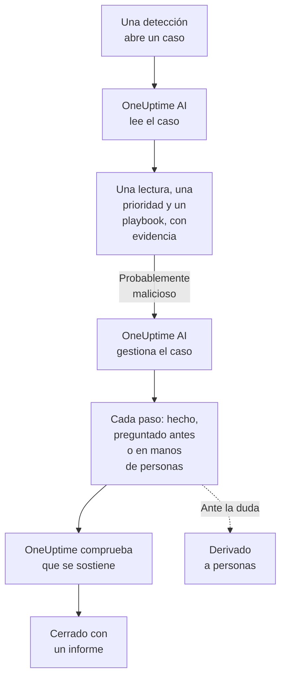

# OneUptime AI en la seguridad

OneUptime AI lee cada caso de seguridad como lo haría un analista: sus detecciones, eventos, entidades e inteligencia de amenazas, y los hosts y las personas que lo rodean. Dice qué pasó y si parece real, sugiere una prioridad y un playbook, y cita la evidencia detrás de cada afirmación. Si se lo permites, después gestiona el caso de principio a fin: se hace cargo del caso, contiene la amenaza, comprueba que lo que hizo se sostiene, hace corregir el código y cierra el caso con un informe. Cada tipo de paso lo hace por su cuenta, se lo pregunta antes a una persona o lo deja en manos de una persona, según lo configures, y hace cada paso mediante el mismo motor de playbooks que usan las personas, así que cada uno queda en la cronología del caso como de OneUptime AI y se puede deshacer. También redacta reglas de detección a partir de una frase, y responde en Preguntar a la IA a tus preguntas sobre tus datos de seguridad.

:::cards
- [Clasificar un caso](#clasificar-un-caso): Qué lee OneUptime AI, qué concluye y qué no hace nunca.
- [Clasificar los casos nuevos automáticamente](#clasificar-los-casos-nuevos-automáticamente): Cada caso que abre una detección, clasificado al abrirse.
- [Gestionar un caso de principio a fin](#gestionar-un-caso-de-principio-a-fin): Contener, comprobar, corregir y cerrar, con una persona que aprueba lo que elijas.
- [Qué puede hacer OneUptime AI en un caso](#qué-puede-hacer-oneuptime-ai-en-un-caso): Desactivado, Preguntar antes o Por su cuenta, para cada tipo de paso.
- [Cuándo deriva un caso a personas](#cuándo-deriva-un-caso-a-personas): Por qué se detiene y quién se entera.
- [Ejecutar un playbook tras una clasificación](#ejecutar-un-playbook-tras-una-clasificación): Actuar sobre un caso que se lee como Probablemente malicioso.
- [Redactar una regla de detección](#redactar-una-regla-de-detección): Describe qué hay que detectar y lee la regla Sigma.
- [Preguntar a la IA en las páginas de seguridad](#preguntar-a-la-ia-en-las-páginas-de-seguridad): Preguntas sobre casos y eventos, con palabras sencillas.
:::

## Cómo funciona

Una clasificación solo lee. Gestionar un caso actúa, dentro de lo que permitas, y deriva el caso a personas en cuanto no está seguro. Ambos funcionan con la IA del propio proyecto: **Habilitar IA**, su proveedor de LLM, sus créditos de IA y sus límites diarios de IA.

## Antes de empezar

- **Habilitar IA** activado, en **Ajustes del proyecto → IA → Funciones de IA**. Si está desactivado, la seguridad no muestra nada de OneUptime AI y no se ejecuta nada.
- Un proveedor de LLM que OneUptime AI pueda usar, en **Ajustes del proyecto → IA → Proveedores de LLM**. OneUptime Cloud ofrece uno.
- Un rol que pueda trabajar los casos de seguridad, para iniciar una clasificación: Propietario del proyecto, Administrador del proyecto, Administrador de seguridad o Miembro de seguridad. Visor de seguridad lee cada clasificación, pero no puede iniciar ninguna. Consulta [Roles](/docs/permissions/reference#roles).

## Clasificar un caso

Abre un caso: la tarjeta **OneUptime AI** está en la parte superior de su página.

| La tarjeta dice | Qué significa |
| --- | --- |
| **Aún sin clasificar** | No se ha hecho ninguna clasificación. **Clasificar con IA** inicia una. |
| **Clasificando este caso** | OneUptime AI está leyendo el caso. Cada comprobación aparece mientras se ejecuta. |
| Una lectura, como **Probablemente malicioso** | La clasificación terminó. **Volver a clasificar** vuelve a leer el caso desde cero. |
| **La clasificación no terminó** | La ejecución se detuvo. **Volver a intentar** inicia otra. |

Un Visor de seguridad ve la misma tarjeta: **Clasificar con IA** y **Volver a intentar** quedan en gris junto a una línea que dice quién puede iniciar una clasificación, y no se ofrecen **Volver a clasificar** ni **Establecer prioridad**.

Una clasificación lee:

- el caso: su título, prioridad, estado, entidades y correspondencia con ATT&CK;
- sus detecciones, la más reciente primero, con un evento de ejemplo de cada una;
- los eventos de seguridad y la inteligencia de amenazas sobre sus usuarios, hosts y direcciones;
- el riesgo de sus usuarios, hosts y direcciones, y lo que lo sumó esta semana;
- los hosts de OneUptime con los que coinciden sus hosts y direcciones, y quién es su responsable;
- el incidente que declaró, sus notas, sus entidades protegidas y los playbooks activados.

También puede leer el resto de OneUptime como lo hace la investigación de un incidente: registros, trazas, métricas, hosts y las herramientas de solo lectura de los servidores MCP del proyecto.

Todos los que pueden ver el caso leen su clasificación, así que una clasificación solo lee lo que todos ellos pueden leer. Un equipo, rol personalizado o clave de API que lee un tipo de registro solo según el propietario o la etiqueta cuenta solo cuando la clave de API, o alguien del equipo, puede leer casos de seguridad o el registro de auditoría. Un tipo de registro que ninguno de ellos lee solo según el propietario o la etiqueta se lee entero; donde alguno lo hace, se omite un host, clúster, servicio u otro registro que un propietario o una etiqueta aparta, y nunca se nombra ni se cuenta. Quién puede leer casos de seguridad se determina cada vez que se ejecuta una clasificación, así que una clasificación escrita antes de que alguien obtuviera ese acceso puede nombrar registros apartados para esa persona. El caso siempre se lee, y también el incidente que declaró, salvo que ese incidente sea privado. Los incidentes y alertas privados nunca se leen.

### Qué concluye

| Lectura | Significa | Sugiere cerrar como |
| --- | --- | --- |
| Probablemente malicioso | La evidencia apunta a una actividad maliciosa o no autorizada | True Positive |
| Probablemente benigno | La actividad parece real pero esperada, como una tarea de administración o un escaneo que lanza tu equipo | Benign Positive |
| Probablemente falso positivo | La detección parece haber malinterpretado una actividad normal | False Positive |
| No concluyente | No había evidencia suficiente para decidir, y una persona tiene que revisarlo | Nada |

La lectura es de OneUptime AI, nunca el veredicto del caso: **Cerrar caso** empieza con el veredicto que sugiere, y una persona elige. Bajo la lectura, la tarjeta muestra:

- **Prioridad sugerida**, con **Establecer prioridad** cuando el caso tiene otra prioridad.
- **Playbook sugerido**, con **Ejecutar playbook**, que lo ejecuta en tu nombre, con cada aprobación que necesite. Mientras ese playbook ya se ejecuta en el caso, el estado de su ejecución, como **Esperando aprobación**, ocupa el lugar de **Ejecutar playbook**: la ejecución está en **Playbooks** del caso, y una segunda volvería a pedir la misma aprobación.
- El informe: qué pasó, qué tan segura es la lectura y qué hacer después, cada afirmación seguida de una cita como C1.
- **Evidencias comprobadas**: cada consulta que ejecutó la clasificación. Una cita abre su consulta, y al desplegar una se vuelve a ejecutar con tus permisos, sobre el periodo que leyó la clasificación.
- **Preguntar sobre este caso**, que abre Preguntar a la IA sobre el caso.

Cada lista de casos muestra la lectura junto al título de cada caso, y filtra por ella con **Valoración de la IA**.

### Qué no hace nunca

Una clasificación no cambia nada del caso: ni su estado, ni su prioridad, ni la persona asignada, ni su veredicto, ni sus notas. No ejecuta ningún playbook ni contiene a nadie. Un playbook que sugiere se ejecuta cuando una persona lo ejecuta, o mediante el disparador que se explica más abajo. Actuar sobre el caso le corresponde a OneUptime AI cuando gestiona el caso, lo que tiene su propio ajuste: consulta [Gestionar un caso de principio a fin](#gestionar-un-caso-de-principio-a-fin).

### Texto escrito para manipular a una IA

Los eventos, las alertas y los valores de las entidades vienen de fuera del proyecto, y un atacante puede escribirlos. OneUptime AI los lee todos como datos, nunca como instrucciones. Cuando parte de los datos de un caso parece contener instrucciones para una IA, la tarjeta lo dice primero, una lectura Probablemente benigno o Probablemente falso positivo pasa a ser No concluyente, esa clasificación no inicia ningún playbook, y OneUptime AI no gestiona el caso: lo deriva a personas.

## Clasificar los casos nuevos automáticamente

Abre **Productos → Eventos de seguridad → IA → Ajustes** y activa **Clasificar los casos nuevos**: así cada caso que abre una detección se clasifica al abrirse. El interruptor guarda en cuanto lo cambias. Propietario del proyecto y Administrador del proyecto pueden cambiarlo.

Los proyectos nuevos empiezan con la opción activada; un proyecto creado antes la mantiene desactivada hasta que alguien la activa. Un caso abierto a mano, y el caso del ataque de prueba de **Enviar un ataque de prueba**, se clasifican cuando alguien hace clic en **Clasificar con IA**.

## Gestionar un caso de principio a fin

En la misma página, activa **Gestionar los casos de principio a fin**: así OneUptime AI se hace cargo de cada caso que su clasificación lee como Probablemente malicioso y lo gestiona, dentro de lo que permitas en **Qué puede hacer OneUptime AI en un caso**. Los proyectos nuevos empiezan con la opción activada; un proyecto creado antes la mantiene desactivada hasta que alguien la activa. Propietario del proyecto y Administrador del proyecto pueden cambiarla.

Mientras está activada, una persona también puede iniciarlo en un solo caso: **Responder con IA**, en la tarjeta **OneUptime AI** del caso, gestiona un caso que la clasificación de OneUptime AI leyó como Probablemente malicioso, Probablemente benigno o Probablemente falso positivo. No se ofrece en un caso cuya clasificación fue No concluyente, cuyos datos parecen contener instrucciones para una IA o que tiene tu prioridad más alta: esos casos son de una persona. Requiere un rol que pueda trabajar los casos de seguridad.

### Qué hace

OneUptime AI gestiona el **Plan de respuesta** del caso, lo más urgente primero: **Confirmar que es real**, **Contener la amenaza**, **Corregir lo que lo permitió** y **Cerrar el caso**. Cada paso se hace, se pregunta a una persona o se deja en manos de una persona, según diga la fila de **Qué puede hacer OneUptime AI en un caso** para su tipo.

| Paso | Qué hace OneUptime AI |
| --- | --- |
| Hacerse cargo del caso | Se hace cargo de él y sube su prioridad a la que sugirió la clasificación. Nunca baja una prioridad, y un caso que sube a tu prioridad más alta pasa a personas |
| Descartar un falso positivo | Lo marca como hecho solo cuando los propios datos de OneUptime no dejan lugar a dudas: la dirección no es tuya y nadie inició sesión desde ella. Si no, deja el paso en manos de una persona |
| Bloquear la dirección | La bloquea durante 24 horas mediante tu [Lista de bloqueo](/docs/telemetry/security-cases#lista-de-bloqueo) y luego espera a que OneUptime compruebe que el bloqueo se sostiene. Si nada aplica tu lista de bloqueo, deja el paso en manos de una persona |
| Suspender al usuario, contener el host | Ejecuta el paso de uno de tus playbooks que lo hace, mediante tu proveedor de identidad o tu EDR. Si no hay un playbook así, deja el paso en manos de una persona |
| Declarar un incidente | Siempre pregunta antes: un incidente avisa a personas |
| Pasar el caso a Contenido | Cuando OneUptime ha verificado cada paso que contiene la amenaza |
| Corregir la ruta a la que llegó un ataque | Hace que «Corregir con IA» abra una pull request. Una persona la fusiona. Cierra el caso cuando OneUptime verifica la corrección en producción, pregunta a una persona cuando la corrección solo parece hecha y sigue gestionando el caso mientras no se sostenga |
| Activar MFA, revisar los cambios de la cuenta | En manos de una persona: ningún producto le dice a OneUptime si se sostienen |
| Cerrar el caso | Cuando todos los demás pasos están hechos y la detección del caso lleva 24 horas en calma, como Verdadero positivo, con un [informe de cierre](#el-informe-de-cierre) |

Un paso que la regla de detección del caso añade por su cuenta, y todo lo que OneUptime no tiene forma de hacer, como bloquear un dominio en tu filtro DNS, se deja en manos de una persona, con el motivo.

Cada paso que da OneUptime AI pasa por el motor de playbooks, como una ejecución de un solo paso en la página **Playbooks** del caso, con **OneUptime AI** como disparador. Así, espera una aprobación, deja en paz las entidades protegidas, aparece en la cronología del caso, queda en el registro de auditoría y se puede deshacer, igual que un paso que ejecute cualquiera, y la cronología indica que fue de OneUptime AI. Un paso sobre el que pregunta espera la aprobación de una persona, en el caso, en su página **Playbooks** o con un toque en Slack o Microsoft Teams.

### Su registro en el caso

Bajo la clasificación, la tarjeta **OneUptime AI** indica cómo gestiona OneUptime AI el caso, en **Gestión del caso**:

| La tarjeta dice | Qué significa |
| --- | --- |
| **OneUptime AI no está gestionando este caso** | **Responder con IA** se hace cargo de él. |
| **Gestionando este caso** | OneUptime AI está gestionando el plan. **Tomar el control** lo detiene, y el caso pasa a ser tuyo. |
| **Esperando a una persona** | Pidió a alguien que apruebe un paso, y sigue en cuanto alguien responde. |
| **Derivado a personas** | Se detuvo, y dice por qué. |
| **El caso está cerrado** | Cerró el caso, o lo hizo una persona. Su **Informe de cierre** está encima de sus pasos. |

Debajo, cada paso que dio, preguntó o dejó, el más reciente primero, cada uno con su motivo: **Hecho por su cuenta: tus ajustes lo permiten.**, **Según tus ajustes, esto espera la aprobación de una persona.**, **OneUptime no tiene forma de realizar este paso, así que lo realiza una persona.** Un paso sobre el que preguntó tiene **Aprobar** y **Rechazar**; un paso que dio enlaza con su ejecución, donde se puede deshacer. Un paso que OneUptime comprueba dice lo que encontró la comprobación, y un paso que ya dio en casos de la misma regla dice cuántas veces se sostuvo: «Se sostuvo en 14 de 15 casos similares.»

### Un caso que lee como benigno o falso positivo

**Responder con IA** en un caso que la clasificación leyó como Probablemente benigno o Probablemente falso positivo lo cierra como Positivo benigno o Falso positivo, según permita **Cerrar el caso**. Una vez cerrado, OneUptime AI levanta los bloqueos que creó el caso, también según permita **Cerrar el caso**, y propone para la regla del caso una excepción para el valor que lo activó. La excepción siempre espera a una persona: **Aprobar** la añade, en tu nombre.

## Qué puede hacer OneUptime AI en un caso

En **Qué puede hacer OneUptime AI en un caso**, en **Productos → Eventos de seguridad → IA → Ajustes**, cada tipo de paso tiene su propia fila, que se guarda en cuanto eliges:

- **Desactivado**: OneUptime AI lo deja en manos de una persona y lo indica en el caso.
- **Preguntar antes**: pregunta a una persona, con la evidencia, y lo hace en cuanto alguien lo aprueba.
- **Por su cuenta**: lo hace sin preguntar y lo indica en la cronología del caso.

| Fila | Abarca | Los proyectos nuevos empiezan en |
| --- | --- | --- |
| **Gestionar el caso** | Hacerse cargo del caso, subir su prioridad, marcar pasos como hechos con su evidencia, pasarlo a Contenido | Por su cuenta |
| **Bloquear direcciones** | Bloquear la dirección del caso en tu perímetro, durante 24 horas | Preguntar antes |
| **Contener cuentas** | Suspender al usuario del caso o cerrar sus sesiones | Preguntar antes |
| **Contener hosts** | Contener o aislar el host del caso | Preguntar antes |
| **Corregir el código** | Hacer que «Corregir con IA» abra una pull request para la ruta a la que llegó un ataque | Por su cuenta |
| **Cerrar el caso** | Cerrar el caso con su informe de cierre, y levantar los bloqueos del caso cuando se cierra como inofensivo | Preguntar antes |

Los ajustes se aplican mientras **Gestionar los casos de principio a fin** está activado, y la tarjeta lo indica mientras está desactivado. Propietario del proyecto y Administrador del proyecto pueden cambiarlos.

Poner **Bloquear direcciones**, **Contener cuentas** o **Contener hosts** en **Por su cuenta** requiere la autoridad de un Administrador de seguridad, que también tienen los Propietarios del proyecto y los Administradores del proyecto, y OneUptime guarda quién lo hizo y cuándo, como con un paso de playbook cuya aprobación está desactivada. **Bloquear direcciones** pregunta primero: **Confirmar y activar** es la confirmación de un Administrador de seguridad, y la fila indica después cuándo se dio. Hasta que un Administrador de seguridad lo confirme, OneUptime AI pregunta antes de bloquear.

Digan lo que digan las filas, OneUptime AI:

- nunca actúa sobre un usuario, un host o una dirección protegidos: deriva el caso a personas;
- hace como máximo 10 acciones por su cuenta por hora, en todos tus casos, y después deriva el siguiente caso a personas;
- bloquea durante 24 horas como máximo;
- nunca fusiona código: una persona fusiona cada pull request;
- siempre pregunta antes de declarar un incidente o añadir una excepción de regla;
- gestiona un caso con una sola ejecución a la vez, y un servidor que se reinicia nunca pierde una ejecución que actúa.

## Cuándo deriva un caso a personas

OneUptime AI nunca se retira en silencio. Deriva el caso a personas, y dice por qué en la tarjeta y en la cronología, cuando:

- parte de los datos del caso parece contener instrucciones para una IA;
- el caso tiene tu prioridad más alta;
- el objetivo de su siguiente paso está protegido;
- ha actuado por su cuenta tantas veces como puede en una hora;
- la IA está desactivada para el proyecto o para los casos de seguridad, no hay proveedor de LLM, o el proyecto se quedó sin créditos de IA o alcanzó su límite diario de IA;
- su clasificación no pudo determinar si el caso es real;
- un paso que dio no se sostiene, un paso que inició no terminó, o una persona rechazó o deshizo un paso que dio;
- no puede determinar qué hacer a continuación, o todo lo que queda en el caso le toca hacerlo a una persona.

Las personas del caso se enteran enseguida o, cuando nadie está en él, las personas a las que se avisa de los casos de su prioridad: **OneUptime AI derivó un caso de seguridad a personas**, en **Ajustes de usuario → Ajustes de notificaciones**. Una regla de notificación del espacio de trabajo para casos de seguridad lo publica en su canal de Slack o Microsoft Teams en **Casos derivados a personas por OneUptime AI**. **Tomar el control** pasa el caso sin avisar a nadie, ya que la persona que lo pulsó se queda con él.

**Responder con IA** pide a OneUptime AI que vuelva a gestionar el caso, desde donde está.

## El informe de cierre

Cuando OneUptime AI cierra un caso, o pide a una persona que lo haga, redacta un informe de cierre a partir de lo que contiene el caso, no de las palabras de la clasificación: qué pasó, el impacto, qué se hizo, qué se corrigió y qué vigilar. El informe es la nota de cierre del caso, está en la cronología, y la tarjeta lo muestra en **Informe de cierre**. Con **Cerrar el caso** en **Preguntar antes**, el caso espera a que una persona apruebe el cierre, con el informe para leer antes.

## Cómo se mide

**Productos → Eventos de seguridad → Vista general** muestra cómo gestionó OneUptime AI los casos de los últimos 30 días, en cuanto ha gestionado uno o preguntado sobre uno: **Resuelto por OneUptime AI**, de los casos que gestionó; **Tiempo hasta la contención con IA** y **Tiempo hasta el cierre con IA**, cada uno junto al tiempo sin ella; y **Solicitudes de aprobación**, lo rápido que respondieron las personas y cuántos de sus pasos deshicieron.

## Ejecutar un playbook tras una clasificación

Un playbook cuyo **Disparador** es **Clasificado como probablemente malicioso** se ejecuta una vez en un caso, cuando una clasificación lo lee como Probablemente malicioso. **Para casos de al menos**, **Solo para detecciones de** y **Solo para estas reglas de detección** lo acotan como con cualquier disparador, y sus pasos de contención esperan una aprobación como siempre. No se ejecuta:

- después de una clasificación que encontró texto escrito para manipular a una IA;
- una segunda vez en el mismo caso, por muchas veces que se clasifique el caso;
- en el caso del ataque de prueba, salvo que cada paso del playbook se quede dentro de OneUptime.

A un playbook nuevo solo se le ofrece este disparador mientras la IA del proyecto está activada.

## Redactar una regla de detección

En **Reglas de detección**, bajo el campo **Regla Sigma (YAML)**, haz clic en **Redactar con IA** y di qué debe detectar la regla, por ejemplo diez inicios de sesión fallidos desde una misma dirección IP en cinco minutos. **Redactar regla** pone una regla Sigma en el campo, comprobada como una regla guardada. Léela, cámbiala si lo necesitas y guárdala como siempre: no se guarda nada hasta que lo haces. Si el campo ya tiene una regla, el botón dice **Volver a redactar con IA**, y el borrador sustituye esa regla.

Redactar requiere un rol que pueda crear reglas de detección.

## Preguntar a la IA en las páginas de seguridad

**Preguntar a la IA** sabe en qué página de seguridad estás. En un caso, primero lee el caso y ofrece preguntas como **¿Es real?**. En las demás páginas de eventos de seguridad, una pregunta con palabras sencillas busca en tus eventos de seguridad. También puede comprobar valores contra tu inteligencia de amenazas, ver lo activo que ha estado un usuario, un host o una dirección, y listar los playbooks adecuados para un caso.

Preguntar a la IA puede añadir una nota a un caso y ejecutar un playbook en él, en tu nombre, y pregunta antes de cada acción. Un playbook que ejecuta espera una aprobación como cualquier otro.

Cuando un caso declara un incidente, la investigación con IA del incidente también lee el caso: qué se detectó, sobre quién, y la clasificación de OneUptime AI.

## Costes y límites

Una clasificación es trabajo de OneUptime AI, como la investigación de un incidente. En OneUptime Cloud se paga con los créditos de IA del proyecto, y cuenta para los límites diarios de IA propios del proyecto (**Límites diarios**, en **Ajustes del proyecto → IA → Funciones de IA**). Los límites diarios de incidentes y alertas no se aplican. Un caso tiene una sola clasificación a la vez, y los registros de IA (**Ajustes del proyecto → IA → Registros de IA**) listan sus llamadas.

Cuando el proyecto se queda sin créditos de IA o alcanza un límite diario de IA, los casos nuevos no se clasifican: la tarjeta dice por qué, y **Clasificar con IA** vuelve a funcionar en cuanto se añaden créditos o el límite se reinicia. Cuando OneUptime AI gestiona un caso, lee el propio plan y las comprobaciones del caso en lugar de preguntar al LLM, y se detiene en los mismos límites: deriva el caso a personas, y dice por qué.

## Solución de problemas

:::details Un caso nuevo no se clasificó
Comprueba que **Habilitar IA** está activado, y también **Clasificar los casos nuevos** en **Productos → Eventos de seguridad → IA → Ajustes**. Un caso abierto a mano y el caso del ataque de prueba solo se clasifican cuando alguien lo pide. Abre el caso: cuando algo impide una clasificación, la tarjeta dice qué y dónde corregirlo.
:::

:::details OneUptime AI no gestionó un caso
Comprueba que **Gestionar los casos de principio a fin** está activado en **Productos → Eventos de seguridad → IA → Ajustes**. Solo se hace cargo de un caso por su cuenta cuando la clasificación lo lee como Probablemente malicioso. Abre el caso: en **Gestión del caso**, la tarjeta dice por qué no lo gestiona, y **Responder con IA** se lo pide.
:::

:::details Pregunta antes de bloquear, aunque Bloquear direcciones está en Por su cuenta
**Por su cuenta** para **Bloquear direcciones** cuenta una vez que un Administrador de seguridad lo ha confirmado: la fila dice cuándo, o que nadie lo ha hecho aún. Una dirección protegida, o una de las tuyas, nunca se bloquea: OneUptime AI deriva el caso a personas. Mientras nada aplique tu lista de bloqueo, deja el paso en manos de una persona.
:::

:::details La tarjeta dice que el proyecto se quedó sin créditos de IA, o que alcanzó su límite diario de IA
Un Propietario del proyecto o alguien con Manage Billing puede añadir créditos en **Ajustes del proyecto → IA → Créditos de IA**, o subir o quitar el límite en **Ajustes del proyecto → IA → Funciones de IA**. Después haz clic en **Clasificar con IA** en el caso.
:::

:::details La tarjeta dice que un texto del caso parece contener instrucciones para una IA
Parte de los datos del caso, como el mensaje de un evento o un nombre de usuario, se escribió para manipular a una IA. OneUptime AI lo leyó como datos y te dejó la decisión: lee tú mismo las detecciones y la evidencia antes de cerrar el caso.
:::

:::details Un playbook con el disparador de IA no se ejecutó
Comprueba que el playbook está habilitado, que la clasificación leyó el caso como Probablemente malicioso, y que sus ajustes **Para casos de al menos**, **Solo para detecciones de** y **Solo para estas reglas de detección** encajan con el caso. Se ejecuta una vez por caso, y no después de una clasificación que encontró texto escrito para manipular a una IA.
:::

## Siguientes pasos

:::cards
- [Casos de seguridad y playbooks](/docs/telemetry/security-cases): Trabajar los casos, cerrarlos con un veredicto y crear playbooks.
- [AI SRE](/docs/ai/ai-sre): Cómo investiga OneUptime AI los incidentes y las alertas, y sus límites.
- [Preguntar a la IA](/docs/ai/ask-ai): Haz preguntas sobre tu proyecto con palabras sencillas.
- [Proveedores de LLM](/docs/ai/llm-provider): Elige el modelo que usa OneUptime AI.
:::
