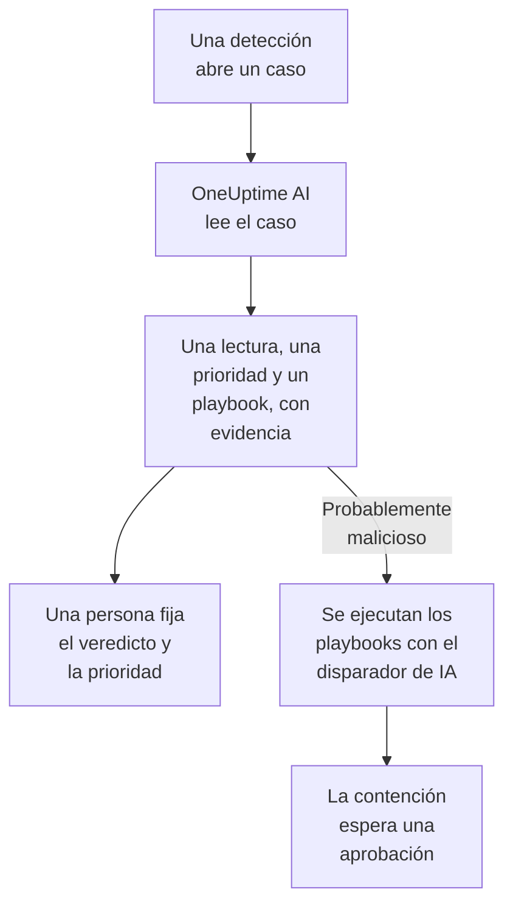

# OneUptime AI en la seguridad

OneUptime AI lee cada caso de seguridad como lo haría un analista: sus detecciones, eventos, entidades e inteligencia de amenazas, y los hosts y las personas que lo rodean. Dice qué pasó y si parece real, sugiere una prioridad y un playbook, y cita la evidencia detrás de cada afirmación. No cambia nada por su cuenta: una persona fija el veredicto y la prioridad, y ejecuta el playbook. También redacta reglas de detección a partir de una frase, y responde en Preguntar a la IA a tus preguntas sobre tus datos de seguridad.

:::cards
- [Clasificar un caso](#clasificar-un-caso): Qué lee OneUptime AI, qué concluye y qué no hace nunca.
- [Clasificar los casos nuevos automáticamente](#clasificar-los-casos-nuevos-automáticamente): Cada caso que abre una detección, clasificado al abrirse.
- [Ejecutar un playbook tras una clasificación](#ejecutar-un-playbook-tras-una-clasificación): Actuar sobre un caso que se lee como Probablemente malicioso.
- [Redactar una regla de detección](#redactar-una-regla-de-detección): Describe qué hay que detectar y lee la regla Sigma.
- [Preguntar a la IA en las páginas de seguridad](#preguntar-a-la-ia-en-las-páginas-de-seguridad): Preguntas sobre casos y eventos, con palabras sencillas.
:::

## Cómo funciona

Una clasificación solo lee. Funciona con la IA del propio proyecto: **Habilitar IA**, su proveedor de LLM, sus créditos de IA y sus límites diarios de IA.

## Antes de empezar

- **Habilitar IA** activado, en **Ajustes del proyecto → IA → Funciones de IA**. Si está desactivado, la seguridad no muestra nada de OneUptime AI y no se ejecuta nada.
- Un proveedor de LLM que OneUptime AI pueda usar, en **Ajustes del proyecto → IA → Proveedores de LLM**. OneUptime Cloud ofrece uno.
- Un rol que pueda trabajar los casos de seguridad, para iniciar una clasificación: Project Owner, Project Admin, Security Admin o Security Member. Security Viewer lee cada clasificación, pero no puede iniciar ninguna. Consulta [Roles](/docs/permissions/reference#roles).

## Clasificar un caso

Abre un caso: la tarjeta **OneUptime AI** está en la parte superior de su página.

| La tarjeta dice | Qué significa |
| --- | --- |
| **Aún sin clasificar** | No se ha hecho ninguna clasificación. **Clasificar con IA** inicia una. |
| **Clasificando este caso** | OneUptime AI está leyendo el caso. Cada comprobación aparece mientras se ejecuta. |
| Una lectura, como **Probablemente malicioso** | La clasificación terminó. **Volver a clasificar** vuelve a leer el caso desde cero. |
| **La clasificación no terminó** | La ejecución se detuvo. **Volver a intentar** inicia otra. |

Un Security Viewer ve la misma tarjeta: **Clasificar con IA** y **Volver a intentar** quedan en gris junto a una línea que dice quién puede iniciar una clasificación, y no se ofrecen **Volver a clasificar** ni **Establecer prioridad**.

Una clasificación lee:

- el caso: su título, prioridad, estado, entidades y correspondencia con ATT&CK;
- sus detecciones, la más reciente primero, con un evento de ejemplo de cada una;
- los eventos de seguridad y la inteligencia de amenazas sobre sus usuarios, hosts y direcciones;
- el riesgo de sus usuarios, hosts y direcciones, y lo que lo sumó esta semana;
- los hosts de OneUptime con los que coinciden sus hosts y direcciones, y quién es su responsable;
- el incidente que declaró, sus notas, sus entidades protegidas y los playbooks activados.

También puede leer el resto de OneUptime como lo hace la investigación de un incidente: registros, trazas, métricas, hosts y las herramientas de solo lectura de los servidores MCP del proyecto.

### Qué concluye

| Lectura | Significa | Sugiere cerrar como |
| --- | --- | --- |
| Probablemente malicioso | La evidencia apunta a una actividad maliciosa o no autorizada | True Positive |
| Probablemente benigno | La actividad parece real pero esperada, como una tarea de administración o un escaneo que lanza tu equipo | Benign Positive |
| Probablemente falso positivo | La detección parece haber malinterpretado una actividad normal | False Positive |
| No concluyente | No había evidencia suficiente para decidir, y una persona tiene que revisarlo | Nada |

La lectura es de OneUptime AI, nunca el veredicto del caso: **Cerrar caso** empieza con el veredicto que sugiere, y una persona elige. Bajo la lectura, la tarjeta muestra:

- **Prioridad sugerida**, con **Establecer prioridad** cuando el caso tiene otra prioridad.
- **Playbook sugerido**, con **Ejecutar playbook**, que lo ejecuta en tu nombre, con cada aprobación que necesite. Mientras ese playbook ya se ejecuta en el caso, el estado de su ejecución, como **Esperando aprobación**, ocupa el lugar de **Ejecutar playbook**: la ejecución está en **Playbooks** del caso, y una segunda volvería a pedir la misma aprobación.
- El informe: qué pasó, qué tan segura es la lectura y qué hacer después, cada afirmación seguida de una cita como C1.
- **Evidencias comprobadas**: cada consulta que ejecutó la clasificación. Una cita abre su consulta, y al desplegar una se vuelve a ejecutar con tus permisos, sobre el periodo que leyó la clasificación.
- **Preguntar sobre este caso**, que abre Preguntar a la IA sobre el caso.

Cada lista de casos muestra la lectura junto al título de cada caso, y filtra por ella con **Valoración de la IA**.

### Qué no hace nunca

Una clasificación no cambia nada del caso: ni su estado, ni su prioridad, ni la persona asignada, ni su veredicto, ni sus notas. No ejecuta ningún playbook ni contiene a nadie. Un playbook que sugiere se ejecuta cuando una persona lo ejecuta, o mediante el disparador que se explica más abajo.

### Texto escrito para manipular a una IA

Los eventos, las alertas y los valores de las entidades vienen de fuera del proyecto, y un atacante puede escribirlos. OneUptime AI los lee todos como datos, nunca como instrucciones. Cuando parte de los datos de un caso parece contener instrucciones para una IA, la tarjeta lo dice primero, una lectura Probablemente benigno o Probablemente falso positivo pasa a ser No concluyente, y esa clasificación no inicia ningún playbook.

## Clasificar los casos nuevos automáticamente

Abre **Productos → Eventos de seguridad → IA → Ajustes** y activa **Clasificar los casos nuevos**: así cada caso que abre una detección se clasifica al abrirse. El interruptor guarda en cuanto lo cambias. Project Owner y Project Admin pueden cambiarlo.

Los proyectos nuevos empiezan con la opción activada; un proyecto creado antes la mantiene desactivada hasta que alguien la activa. Un caso abierto a mano, y el caso del ataque de prueba de **Enviar un ataque de prueba**, se clasifican cuando alguien hace clic en **Clasificar con IA**.

## Ejecutar un playbook tras una clasificación

Un playbook cuyo **Disparador** es **Clasificado como probablemente malicioso** se ejecuta una vez en un caso, cuando una clasificación lo lee como Probablemente malicioso. **Para casos de al menos**, **Solo para detecciones de** y **Solo para estas reglas de detección** lo acotan como con cualquier disparador, y sus pasos de contención esperan una aprobación como siempre. No se ejecuta:

- después de una clasificación que encontró texto escrito para manipular a una IA;
- una segunda vez en el mismo caso, por muchas veces que se clasifique el caso;
- en el caso del ataque de prueba, salvo que cada paso del playbook se quede dentro de OneUptime.

A un playbook nuevo solo se le ofrece este disparador mientras la IA del proyecto está activada.

## Redactar una regla de detección

En **Reglas de detección**, bajo el campo **Regla Sigma (YAML)**, haz clic en **Redactar con IA** y di qué debe detectar la regla, por ejemplo diez inicios de sesión fallidos desde una misma dirección IP en cinco minutos. **Redactar regla** pone una regla Sigma en el campo, comprobada como una regla guardada. Léela, cámbiala si lo necesitas y guárdala como siempre: no se guarda nada hasta que lo haces. Si el campo ya tiene una regla, el botón dice **Volver a redactar con IA**, y el borrador sustituye esa regla.

Redactar requiere un rol que pueda crear reglas de detección.

## Preguntar a la IA en las páginas de seguridad

**Preguntar a la IA** sabe en qué página de seguridad estás. En un caso, primero lee el caso y ofrece preguntas como **¿Es real?**. En las demás páginas de eventos de seguridad, una pregunta con palabras sencillas busca en tus eventos de seguridad. También puede comprobar valores contra tu inteligencia de amenazas, ver lo activo que ha estado un usuario, un host o una dirección, y listar los playbooks adecuados para un caso.

Preguntar a la IA puede añadir una nota a un caso y ejecutar un playbook en él, en tu nombre, y pregunta antes de cada acción. Un playbook que ejecuta espera una aprobación como cualquier otro.

Cuando un caso declara un incidente, la investigación con IA del incidente también lee el caso: qué se detectó, sobre quién, y la clasificación de OneUptime AI.

## Costes y límites

Una clasificación es trabajo de OneUptime AI, como la investigación de un incidente. En OneUptime Cloud se paga con los créditos de IA del proyecto, y cuenta para los límites diarios de IA propios del proyecto (**Límites diarios**, en **Ajustes del proyecto → IA → Funciones de IA**). Los límites diarios de incidentes y alertas no se aplican. Un caso tiene una sola clasificación a la vez, y los registros de IA (**Ajustes del proyecto → IA → Registros de IA**) listan sus llamadas.

Cuando el proyecto se queda sin créditos de IA o alcanza un límite diario de IA, los casos nuevos no se clasifican: la tarjeta dice por qué, y **Clasificar con IA** vuelve a funcionar en cuanto se añaden créditos o el límite se reinicia.

## Solución de problemas

:::details Un caso nuevo no se clasificó
Comprueba que **Habilitar IA** está activado, y también **Clasificar los casos nuevos** en **Productos → Eventos de seguridad → IA → Ajustes**. Un caso abierto a mano y el caso del ataque de prueba solo se clasifican cuando alguien lo pide. Abre el caso: cuando algo impide una clasificación, la tarjeta dice qué y dónde corregirlo.
:::

:::details La tarjeta dice que el proyecto se quedó sin créditos de IA, o que alcanzó su límite diario de IA
Un propietario del proyecto o alguien con Manage Billing puede añadir créditos en **Ajustes del proyecto → IA → Créditos de IA**, o subir o quitar el límite en **Ajustes del proyecto → IA → Funciones de IA**. Después haz clic en **Clasificar con IA** en el caso.
:::

:::details La tarjeta dice que un texto del caso parece contener instrucciones para una IA
Parte de los datos del caso, como el mensaje de un evento o un nombre de usuario, se escribió para manipular a una IA. OneUptime AI lo leyó como datos y te dejó la decisión: lee tú mismo las detecciones y la evidencia antes de cerrar el caso.
:::

:::details Un playbook con el disparador de IA no se ejecutó
Comprueba que el playbook está habilitado, que la clasificación leyó el caso como Probablemente malicioso, y que sus ajustes **Para casos de al menos**, **Solo para detecciones de** y **Solo para estas reglas de detección** encajan con el caso. Se ejecuta una vez por caso, y no después de una clasificación que encontró texto escrito para manipular a una IA.
:::

## Siguientes pasos

:::cards
- [Casos de seguridad y playbooks](/docs/telemetry/security-cases): Trabajar los casos, cerrarlos con un veredicto y crear playbooks.
- [AI SRE](/docs/ai/ai-sre): Cómo investiga OneUptime AI los incidentes y las alertas, y sus límites.
- [Preguntar a la IA](/docs/ai/ask-ai): Haz preguntas sobre tu proyecto con palabras sencillas.
- [Proveedores de LLM](/docs/ai/llm-provider): Elige el modelo que usa OneUptime AI.
:::
