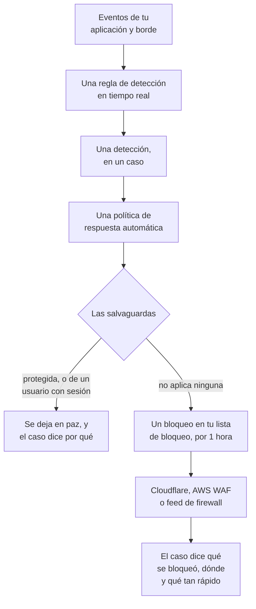

# Respuesta automática

Las políticas de respuesta automática someten a desafío o bloquean una dirección que ataca en cuanto se hace la detección, antes de que nadie clasifique el caso: los escáneres que sondean tu aplicación y los bots que prueban contraseña tras contraseña quedan rechazados a los pocos minutos de su primera solicitud. Cada proyecto trae tres políticas listas para usar, cada una desactivada hasta que la actives, y cada una empieza con una semana de periodo de prueba que solo registra lo que habría hecho. Las salvaguardas hacen que una política sea segura de dejar activada: nunca toca tus propias direcciones ni una que usen tus usuarios con sesión iniciada, y se detiene y avisa a una persona cuando un ataque es mayor de lo que debería atender sola.

:::cards
- [Activar una política](#activar-una-política): Primero una semana de periodo de prueba, luego un clic.
- [Las salvaguardas](#las-salvaguardas): Lo que una política nunca hace, y cuándo se detiene.
- [Tiempo hasta el bloqueo](#tiempo-hasta-el-bloqueo): Qué tan rápido bloquea cada política, en su tarjeta y en el caso.
- [Tu propia política](#tu-propia-política): Actúa sobre las técnicas, reglas o inteligencia de amenazas que elijas.
:::

## Cómo funciona

Una política actúa sobre una detección en cuanto se registra en su caso, unos segundos después de que la regla se dispare. Su bloqueo va a tu [lista de bloqueo](/docs/telemetry/security-cases#lista-de-bloqueo) igual que el paso de playbook **Bloquear la dirección**, con el nombre de la política como autor: los destinos que aplican tu lista de bloqueo lo mantienen, aparece en la cronología del caso y en el registro de auditoría, y caduca solo. No necesita la aprobación de nadie: quien activó la política aprobó sus bloqueos.

## Antes de empezar

- Un destino que aplique tu lista de bloqueo: Cloudflare, AWS WAF, o un firewall o un proxy que lea un [feed de lista de bloqueo](/docs/telemetry/blocklist-feeds). Mientras nada la aplique, la página lo dice, y los bloqueos de una política no se mantienen en ningún sitio.
- Los eventos que leen las reglas de una política: los registros de acceso o las trazas de tu aplicación, o los eventos de tu borde, como los eventos de firewall de Cloudflare, y tus inicios de sesión. Consulta [Eventos de seguridad](/docs/telemetry/security-events).
- Un rol que pueda activar una política: Administrador de seguridad, Administrador del proyecto o Propietario del proyecto. Miembro de seguridad y Visor de seguridad ven las políticas y lo que hicieron. Consulta [Roles](/docs/permissions/reference#roles).

## Las políticas listas para usar

| Política | Actúa sobre | Hace | Primer bloqueo |
| --- | --- | --- | --- |
| **Escáneres** | Escaneos web e intentos de explotación (ATT&CK T1595, T1190): intentos de inyección SQL, de recorrido de rutas y de Log4Shell, y muchas coincidencias de reglas administradas de Cloudflare desde una dirección, mientras todas las solicitudes de la dirección hayan sido rechazadas | Desafío | 1 hora |
| **Adivinación de contraseñas** | Fuerza bruta y rociado de contraseñas (ATT&CK T1110): inicios de sesión fallidos desde una dirección, e inicios de sesión fallidos seguidos de uno correcto desde la misma dirección | Bloquear | 1 hora |
| **Direcciones maliciosas conocidas** | Cualquier detección sobre una dirección que tu [inteligencia de amenazas](/docs/telemetry/threat-intelligence) incluye | Bloquear | 24 horas |

Las personas superan un desafío, los scripts y los bots, no. Escáneres solo somete a desafío una dirección mientras ninguna de sus solicitudes haya llegado a tu aplicación: una dirección cuyas solicitudes pasaron es un caso para una persona.

Activar Escáneres o Adivinación de contraseñas, en su periodo de prueba o del todo, ejecuta en tiempo real las reglas de la **Biblioteca de reglas** sobre las que actúa, y añade las que tu proyecto no tiene: una regla en tiempo real se dispara segundos después de que lleguen los eventos, mientras que una programada lee con minutos de retraso. Una regla que alguien desactivó sigue desactivada. Un proyecto ejecuta como máximo 50 reglas en tiempo real: a partir de ahí, una regla se queda en su programación, y la tarjeta de la política muestra **Según una programación** a su lado.

## Activar una política

:::steps
### Abre Respuesta automática

Abre **Productos → Eventos de seguridad → Playbooks → Respuesta automática**. Cada política tiene su tarjeta: lo que hace, una etiqueta que dice **Desactivado**, **Periodo de prueba**, **Prueba terminada** o **Activado**, y su interruptor.

### Inicia su periodo de prueba

Cambia el interruptor de la política. Durante 7 días registra lo que habría hecho y no toca ningún tráfico: el caso dice "Trial run: the Scanners policy would have challenged 35.205.11.131 for 1 hour." La tarjeta cuenta las direcciones hasta ahora, y lo que sus salvaguardas dejaron en paz.

### Actívala

Cuando termina la semana, la tarjeta dice lo que la política habría hecho, por ejemplo "En 7 días habría sometido a desafío 1283 direcciones. Ninguna tenía usuarios con sesión iniciada, y ninguna era tuya. ¿Activarla?", y tus responsables de seguridad reciben lo mismo por correo electrónico. Haz clic en **Activar**: a partir de entonces, la política actúa.
:::

Para activar una política sin su semana de periodo de prueba, abre **Más ajustes** en su tarjeta y haz clic en **Activar sin periodo de prueba**. Sus salvaguardas siguen aplicándose. Cambia el interruptor de nuevo para desactivar una política; si la vuelves a activar después de una semana completa de periodo de prueba, actúa de inmediato.

## Las salvaguardas

- **Nunca tus propias direcciones ni las protegidas.** Las entradas de **Entidades protegidas**, y todo lo que OneUptime protege por sí mismo: tus hosts, recursos en la nube y sondas, los rangos que no están en internet, y el borde delante de tu aplicación. Consulta [Lista de bloqueo](/docs/telemetry/security-cases#lista-de-bloqueo).
- **Nunca una dirección que un usuario con sesión iniciada haya usado en los últimos 30 días.** La red de una oficina, el proxy de un cliente o la casa de una persona: OneUptime busca la dirección en los inicios de sesión de tu proveedor de identidad y en las solicitudes que tu aplicación atendió a un usuario con sesión iniciada, las que llevan un ID de usuario en sus trazas o registros. Una dirección que no puede comprobar, porque esos eventos no se pudieron leer o porque tus reglas de depuración ocultan las direcciones de un modo que no puede cotejar, se deja a una persona.
- **Bloqueos más largos para una dirección que vuelve.** El primer bloqueo dura 1 hora, luego 24 horas, luego 7 días para una dirección bloqueada de nuevo en un plazo de 30 días. Direcciones maliciosas conocidas empieza en 24 horas.
- **Como máximo 50 bloqueos automáticos por hora.** A partir de ahí, tus políticas dejan de bloquear y avisan a tus responsables de seguridad: un ataque tan grande necesita a una persona. La página lo dice mientras dura.
- **Deshacer ante la duda.** Cuando se ve a un usuario con sesión iniciada desde una dirección que una política bloqueó, la política levanta el bloqueo y avisa a tus responsables de seguridad.

Tus responsables de seguridad son los Administradores de seguridad de tu proyecto o, si no tiene ninguno, los Propietarios del proyecto. Cada dirección que una salvaguarda dejó en paz aparece en su caso, con el motivo.

## Donde un destino no puede desafiar

Cloudflare y AWS WAF desafían. Un firewall que lee un feed de lista de bloqueo no puede, así que allí el desafío de una política es un bloqueo, durante el mismo tiempo, y la tarjeta de la política y el caso lo dicen, por ejemplo "FortiGate feed cannot challenge, so it blocks the address there for the same time." Un desafío que pones tú nunca se convierte en un bloqueo.

## Tiempo hasta el bloqueo

El tiempo hasta el bloqueo va desde la primera solicitud de la dirección, el evento más antiguo de su detección, hasta que el bloqueo surte efecto en tu borde. La tarjeta de cada política muestra sus percentiles 50 y 95 día a día en los últimos 30 días. Un caso que bloqueó una respuesta automática lo indica bajo **Tiempo hasta la contención** en su **Vista general**, por ejemplo "Bloqueada automáticamente 41s después de su primera solicitud", y su cronología dice qué se bloqueó, dónde y qué tan rápido: "OneUptime challenged 35.205.11.131 at Cloudflare for 1 hour (Scanners policy), 41 seconds after its first request." El paso de la dirección en el **Plan de respuesta** del caso está hecho, con **Levantar** al lado.

## Tu propia política

Haz clic en **Crear política** debajo de las políticas listas para usar. Una política propia necesita un **Nombre** y aquello sobre lo que actúa:

| Campo | Qué hace |
| --- | --- |
| **Técnicas de ATT&CK** | Las técnicas que debe llevar una detección, separadas por comas, como `T1110, T1190`. Una técnica abarca sus subtécnicas. |
| **Acción** | **Bloquear** o **Desafío**. |
| **El primer bloqueo dura** | En **Más campos**: 1 hora, 24 horas o 7 días. Una dirección que vuelve se bloquea durante más tiempo. |
| **Reglas de detección** | En **Más campos**: o una detección de una de estas reglas. |
| **Solo direcciones que tu inteligencia de amenazas incluye** | En **Más campos**: actúa solo sobre direcciones que tu inteligencia de amenazas incluye. Por sí sola, actúa sobre cualquier detección sobre una de ellas. |
| **Solo mientras todas las solicitudes hayan sido rechazadas** | En **Más campos**: actúa solo mientras ninguna solicitud de la dirección haya llegado a tu aplicación. |

Una política propia empieza desactivada, pasa una semana en periodo de prueba como una lista para usar y tiene las mismas salvaguardas. **Editar política** y **Eliminar política** están en su tarjeta; al eliminarla, sus bloqueos siguen en tu lista de bloqueo hasta que caducan.

## Solución de problemas

:::details Una política está activada, pero no bloqueó una dirección
Mira la cronología del caso: una política que dejó en paz una dirección dice por qué, por ejemplo porque un usuario con sesión iniciada la había usado. Comprueba que un destino aplica tu lista de bloqueo, y que las reglas de la política dicen **Tiempo real** en su tarjeta.
:::

:::details La página dice que se agotaron los bloqueos automáticos de la hora
Tus políticas hicieron 50 bloqueos automáticos en la última hora y avisaron a tus responsables de seguridad. Vuelven a empezar a medida que los bloqueos de esa hora envejecen. Mira los casos del ataque, y bloquea un rango desde **Lista de bloqueo** si viene de una sola red.
:::

## Próximos pasos

:::cards
- [Casos de seguridad y playbooks](/docs/telemetry/security-cases): Trabaja los casos sobre los que actúan tus políticas, y bloquea a mano.
- [Feeds de lista de bloqueo](/docs/telemetry/blocklist-feeds): Aplica tu lista de bloqueo en un firewall o un proxy.
- [Inteligencia de amenazas](/docs/telemetry/threat-intelligence): Los feeds sobre los que actúa Direcciones maliciosas conocidas.
:::
