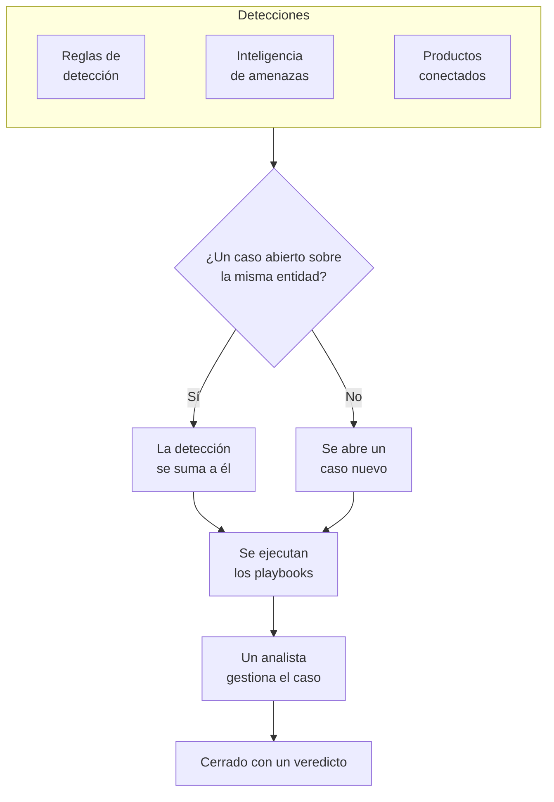

# Casos de seguridad y playbooks (SOAR)

Eventos de seguridad convierte en casos lo que encuentran tus reglas de detección, tu inteligencia de amenazas y tus productos de seguridad conectados: un caso por cada asunto que merece una investigación, con todas las detecciones sobre el mismo usuario, host o dirección agrupadas en él. Los analistas gestionan los casos en una cola, y los playbooks responden a ellos, por sí solos o con un clic.

:::cards
- [De dónde vienen los casos](#de-dónde-vienen-los-casos): Reglas de detección, inteligencia de amenazas, productos conectados, riesgo de entidades y personas.
- [Gestionar un caso](#gestionar-un-caso): Asígnalo, investiga sus entidades y ciérralo con un veredicto.
- [Prioridades y estados de los casos](#prioridades-y-estados-de-los-casos): Cámbiales el nombre, el color y el orden, y añade los tuyos.
- [Objetivos de respuesta](#objetivos-de-respuesta): Lo rápido que hay que hacerse cargo de un caso de cada prioridad y contenerlo.
- [Notificaciones](#notificaciones): A quién se avisa de un caso nuevo, de una asignación, de un objetivo de respuesta, de una tarea y de un paso que espera aprobación.
- [Playbooks](#playbooks): Pasos que se ejecutan sobre un caso, con aprobación donde importa.
- [La vista general](#la-vista-general): Lo que necesita atención ahora y la rapidez con que se gestionan los casos.
:::

## Cómo funciona

Abre **Productos → Eventos de seguridad → Casos de seguridad → Casos abiertos** para la cola. **Asignados a mí**, **Sin asignar**, **Casos cerrados** y **Todos los casos** son páginas propias a su lado, y cada una lista los casos que dice su nombre.

## Antes de empezar

Los permisos sobre casos y playbooks dependen de los tres roles de seguridad. Project Owner y Project Admin pueden hacerlo todo.

| Rol | Qué puede hacer |
| --- | --- |
| Security Admin | Todo, incluido eliminar casos, quitar evidencias y configurar playbooks |
| Security Member | Abrir, asignar, cambiar y cerrar casos, escribir notas, trabajar tareas, añadir evidencias, ejecutar playbooks y aprobar o rechazar sus pasos |
| Security Viewer | Leer casos, detecciones, notas, tareas, evidencias, playbooks y sus ejecuciones |

Cada uno de estos permisos también se puede conceder por separado, desde crear un caso hasta aprobar los pasos de un playbook; consulta [Referencia de permisos](/docs/permissions/reference).

## De dónde vienen los casos

| Origen | Abre un caso cuando | Cómo desactivarlo |
| --- | --- | --- |
| Reglas de detección | Una regla coincide | **Abrir un caso al coincidir**, en el paso **Al coincidir** de la regla |
| Inteligencia de amenazas | Un evento nombra un indicador conocido | **Abrir un caso al coincidir**, en el paso **Al coincidir** del feed |
| Productos conectados | Se importa una alerta propia del producto con un nivel igual o superior al umbral de la conexión | **Open Cases From** con el valor **Nunca**, en el paso **Sondeo** de la conexión |
| Riesgo de entidades | El riesgo de un usuario, host o dirección alcanza el umbral del proyecto | **Casos de riesgo**, en **Ajustes → Puntuación de riesgo** |
| Personas | Alguien abre uno desde **Casos de seguridad**, o con **Abrir caso** en el panel de un evento | No se puede desactivar |

Todos los orígenes abren casos por defecto, salvo el riesgo de entidades en los proyectos creados antes de que existiera: en ellos, activa primero **Casos de riesgo** ([Riesgo de entidades](/docs/telemetry/security-entity-risk)). Una conexión abre casos para **Alta y superior** salvo que elijas otro nivel; las alertas por debajo de ese nivel se siguen importando como eventos.

### Cómo se agrupan las detecciones

Una detección trata sobre una entidad: el valor por el que agrupa su regla, como la dirección IP de una regla de fuerza bruta, o el indicador que nombra una coincidencia de inteligencia de amenazas. Una detección sin entidad queda aislada.

- Cuando ya hay un caso abierto sobre esa entidad, la detección se suma a él. Las entidades y el mapeo de ATT&CK del caso crecen, y su prioridad sube hasta la de la detección, nunca baja.
- Cuando no lo hay, se abre un caso nuevo, con el nombre de la detección y con la prioridad de esta.
- Una detección que se vuelve a disparar incrementa el recuento de su fila en lugar de añadir otra.

La prioridad de un caso se deriva de la gravedad de la detección, en la prioridad predefinida del proyecto para ese nivel, sea cual sea el nombre que le hayas dado:

| Gravedad | Prioridad |
| --- | --- |
| Critical o Fatal | Critical |
| High | High |
| Medium, Unknown u Other | Medium |
| Low | Low |
| Informational | Informational |

## Gestionar un caso

Los casos de un proyecto nuevo pasan por cuatro estados, a los que puedes cambiar el nombre y añadir otros (consulta [Prioridades y estados de los casos](#prioridades-y-estados-de-los-casos)). Un caso puede saltarse alguno, como un falso positivo que se cierra directamente desde Nuevo, y se puede reabrir.

| Estado | Significado |
| --- | --- |
| Nuevo | Nadie lo ha revisado todavía |
| Investigando | Alguien está averiguando qué pasó |
| Contenido | La amenaza ya no puede causar daño; queda pendiente la limpieza |
| Cerrado | Terminado, con un veredicto sobre lo que era |

Un caso tiene su propio menú lateral, como un incidente, y cada parte del caso es una página propia:

| Sección del menú lateral | Páginas |
| --- | --- |
| **Vista general** | **Vista general**, **Cronología** |
| **Investigación** | **Desarrollo**, **Detecciones**, **Entidades**, **Señales conectadas**, **Evidencias**, **Tareas**, **Playbooks** |
| **Notas** | **Notas privadas** |
| **Avanzado** | **Registros de auditoría**, **Eliminar caso**, plegados hasta que haces clic en **Avanzado** |

Cada página mantiene arriba la cabecera del caso: su número, prioridad, estado y título, **Asignarme**, **Ejecutar playbook**, **Declarar incidente** y **Cerrar caso**, y, en el menú ⋯ junto a ellos, **Establecer prioridad**, **Asignar a otra persona**, **Cambiar estado**, **Editar caso** y **Eliminar caso**. Así el caso se puede gestionar desde cualquiera de sus páginas, y un enlace al caso sigue abriendo su **Vista general**. Cuando la prioridad del caso tiene objetivos de respuesta, la cabecera también dice cuándo vence el siguiente ([Objetivos de respuesta](#objetivos-de-respuesta)).

- **Vista general**: la descripción, las etiquetas y los pasos de estado del caso, quién lo tiene y qué lo abrió, y sus cifras: cuántas detecciones tiene, cuánto tiempo lleva abierto y cuánto se tardó en reconocerlo y en contenerlo. Bajo **Tiempo hasta el reconocimiento** y **Tiempo hasta la contención** se ve cómo va el caso frente a sus objetivos de respuesta.
- **OneUptime AI**, en la **Vista general**: lo que OneUptime AI ha sacado del caso, la prioridad y el playbook que sugiere, y la evidencia que hay detrás. Consulta [OneUptime AI en la seguridad](/docs/telemetry/security-ai).
- **Impacto**, en la **Vista general**: lo que el caso pone en riesgo: si OneUptime ha visto que sus registros se alcanzaron desde internet, quién es su propietario y qué cambió por última vez en ellos. Despliéguelo para ver a qué llama cada registro y quién lo llama, los monitores y páginas de estado que lo vigilan y las máquinas con las que hablaron las direcciones del caso.
- **MITRE ATT&CK**, en la **Vista general**: las tácticas y técnicas a las que corresponden sus detecciones, cada una enlazada a su página en attack.mitre.org.
- **Cronología**: todo lo que le pasó al caso, con quién lo hizo.
- **Desarrollo**: lo que pasó, en orden, en todo OneUptime: cada detección y los eventos de seguridad que hay detrás, hasta dónde llegaron sus solicitudes, las excepciones que lanzaron, los cambios en los registros que nombra el caso, los incidentes y alertas que se abrieron en ellos y lo que hizo el equipo. Los muchos sondeos de un escáner son una sola línea, y cada línea abre lo que nombra, como la traza de la solicitud o la excepción.
- **Detecciones**: lo que se disparó para abrir el caso o sumarse a él, cuántas veces y el último evento coincidente.
- **Entidades**: los usuarios, hosts y direcciones de los que trata el caso, con su actividad en todos tus eventos de seguridad de los últimos 7 días. Cada una se abre en **Correlacionar**.
- **Señales conectadas**: los hosts, clústeres, servicios y miembros que nombra el caso, tal como OneUptime los conoce, y lo que ocurría en cada uno en torno a sus detecciones: sus registros, trazas y métricas, lo que está abierto en ellos y lo que cambió. Consulta [Señales conectadas](/docs/telemetry/security-connected-signals).
- **Evidencias**: los archivos, enlaces y eventos de seguridad guardados en el caso, cada uno con quién lo añadió y cuándo. El botón **Añadir archivo** sube un archivo de hasta 10 MB y guarda el SHA-256 de lo que se subió, para que quien lo descargue después pueda comprobar que es lo que se guardó; el botón **Añadir enlace** apunta a evidencias guardadas en otro lugar. Solo un Security Admin puede quitar una evidencia, y la **Cronología** del caso dice qué se añadió y qué se quitó. Un evento de seguridad se guarda aquí tal como era, con **Añadir al caso** en **Eventos** o en la página de una [cacería](/docs/telemetry/security-events#cacerías), y **Ver evento** lo abre. El paso **Preserve the evidence** de un playbook también guarda aquí los eventos detrás de las detecciones del caso.
- **Tareas**: lo que hay que hacer en el caso, quién lo hace y si está hecho. Añade una tarea en una línea, entrégasela a alguien y márcala cuando esté hecha. Se avisa a la persona a la que se entrega, salvo que la tomara ella misma, y el menú muestra cuántas tareas quedan abiertas junto a **Tareas**. El paso **Añadir tareas** de un playbook también añade tareas y omite las que el caso ya tiene.
- **Playbooks**: lo que hizo cada playbook en el caso, paso a paso, y los pasos que esperan aprobación. Mientras haya ejecuciones esperando, el menú muestra cuántas junto a **Playbooks**.
- **Notas privadas**: lo que el equipo escribió sobre el caso.
- **Registros de auditoría**: cada cambio hecho en el caso y quién lo hizo. Consulta [Registros de auditoría](/docs/configuration/audit-logs).
- **Eliminar caso**: elimina para siempre el caso, con sus detecciones, notas, cronología y ejecuciones de playbooks. Para conservar el registro, ciérralo con un veredicto.

### Gestionar casos desde la cola

No tienes que abrir un caso para gestionarlo. En las listas de la cola, el menú ⋯ de la fila de un caso tiene **Asignarme**, **Asignar a otra persona**, **Cambiar estado** y **Cambiar prioridad**. Para gestionar varios casos a la vez, selecciónalos y usa las mismas acciones en **Acciones masivas**: te dice qué casos cambió, cuáles dejó como estaban y por qué.

- Para darle un caso a otra persona, usa **Asignar a otra persona** y elige una persona o un equipo. El caso de un equipo espera en **Sin asignar** hasta que alguien del equipo lo toma.
- Un estado que cierra un caso pide un veredicto y una nota de cierre, como hace **Cerrar caso**.
- Un caso cerrado no se asigna a nadie. Para volver a gestionarlo, reábrelo con **Cambiar estado**.

### Cerrar un caso

**Cerrar caso** pide un veredicto y una nota de cierre opcional:

| Veredicto | Significado |
| --- | --- |
| Verdadero positivo | Hubo realmente actividad maliciosa o no autorizada |
| Positivo benigno | La actividad era real pero esperada, como una prueba de penetración o una tarea de administración |
| Falso positivo | La detección se equivocó: la regla o los datos interpretaron mal una actividad normal |
| Indeterminado | No había información suficiente para saberlo |

Los veredictos se cuentan en la vista general. Una regla cuyos casos se cierran una y otra vez como falso positivo es una regla que hay que ajustar.

Mientras queden tareas abiertas en el caso, el diálogo **Cerrar caso** dice cuántas.

Un caso abierto a partir de alertas de Google SecOps también las cierra en Google SecOps, con el veredicto y la nota de cierre, cuando su conexión tiene activado **Cerrar las alertas cuando se cierra su caso**: consulta [Google SecOps](/docs/integrations/google-secops#cerrar-las-alertas-cuando-se-cierra-su-caso).

### Declarar un incidente

**Declarar incidente** abre un incidente de OneUptime para el caso, con la gravedad que elijas, y enlaza los dos en ambos sentidos: la descripción del incidente nombra el caso, y la cabecera del caso enlaza al incidente. A partir de ahí toman el relevo la guardia, las páginas de estado y el postmortem. Requiere un rol que pueda tanto gestionar casos como crear incidentes.

## Prioridades y estados de los casos

Cada proyecto tiene sus propias prioridades y estados de caso, en **Productos → Eventos de seguridad → Ajustes → Prioridades de casos** y **Estados de casos**. Cámbiales el nombre o el color, arrástralos a otro orden y añade los tuyos, como un estado «Triaje» o una prioridad «Emergencia» por encima de **Crítico**. Un nombre nuevo se ve en todas partes a la vez: en la cola, en las páginas de los casos y en la vista general, en las notificaciones, en Slack y Microsoft Teams, y en los mensajes de los playbooks.

Algunos son predefinidos, porque OneUptime lee lo que significan. Se les puede cambiar el nombre y el color, pero no eliminarlos ni archivarlos, y conservan su orden:

| Predefinido | Qué hace OneUptime con él |
| --- | --- |
| El estado nuevo | Los casos nuevos empiezan en él |
| El estado reconocido | Al llegar a él se registra cuándo se reconoció el caso, y **Reabrir** devuelve a él un caso cerrado |
| El estado contenido | Al llegar a él se registra cuándo se contuvo el caso |
| El estado cerrado | **Cerrar caso** lleva un caso a él, con un veredicto |
| Las prioridades Crítico, Alta, Medium, Low e Informativos | Una detección abre su caso en la prioridad de su gravedad, y un caso que abre una persona empieza en Medium |

- El lugar de un estado decide qué cuenta un caso que está en él, como muestra la columna **Cuenta como**: desde el estado reconocido hacia abajo, reconocido; desde el estado contenido hacia abajo, contenido; desde el estado cerrado hacia abajo, cerrado. Un estado que añades se coloca justo encima del estado cerrado, y pasar un caso a un estado que lo cierra pide antes un veredicto.
- El puesto de una prioridad es su urgencia, la más urgente primero: **Para casos de al menos**, las opciones de notificación y las reglas de Slack y Microsoft Teams leen este orden. Una prioridad que añades va al final, y la columna **Gravedad de la detección** muestra qué detecciones abren sus casos en cada prioridad predefinida.

Para dejar de usar un estado o una prioridad propios, usa **Archivar** en su fila. Nadie puede volver a elegirlo, y la API, Terraform y MCP lo rechazan, pero los casos que lo tienen lo conservan, y puedes seguir filtrando por él. Los valores archivados aparecen en la sección plegada **Estados de caso archivados** o **Prioridades de caso archivadas** bajo la tabla, donde **Desarchivar** devuelve uno. **Eliminar** se rechaza mientras haya casos con el valor o un playbook que parta de la prioridad.

## Objetivos de respuesta

Un objetivo de respuesta es lo rápido que hay que trabajar un caso: **Reconocer en un plazo de**, cuánto puede esperar un caso nuevo a que alguien se haga cargo, y **Contener en un plazo de**, cuánto puede tardar en contenerse o cerrarse. Cada prioridad de caso tiene los suyos, en **Productos → Eventos de seguridad → Ajustes → Objetivos de respuesta**: el botón **Editar** en la fila de una prioridad fija sus dos objetivos, en minutos, horas o días, hasta un año, y uno vacío significa sin objetivo. Las prioridades de un proyecto nuevo empiezan con estos:

| Prioridad | Reconocer en un plazo de | Contener en un plazo de |
| --- | --- | --- |
| Critical | 15 minutos | 4 horas |
| High | 1 hora | 1 día |
| Medium | 12 horas | 3 días |
| Low | 1 día | 7 días |
| Informational | Sin objetivo | Sin objetivo |

Un proyecto creado antes de los objetivos de respuesta no tiene ninguno hasta que alguien los fija.

- Los vencimientos de un caso se fijan al abrirse, a partir de los objetivos de su prioridad. Un objetivo que se cambia después se aplica a los casos que se abren a partir de entonces.
- Un caso está reconocido en cuanto alguien se hace cargo: se asigna a una persona o pasa a un estado que cuenta como reconocido. Está contenido en cuanto llega a un estado que cuenta como contenido, o se cierra.
- Cuando cambia la prioridad de un caso, un objetivo que ya cumplió o incumplió se queda como estaba. Una prioridad más alta acerca un vencimiento: el nuevo objetivo cuenta desde el cambio, salvo que el vencimiento anterior llegue antes. Una prioridad más baja lo retrasa, nunca lo adelanta: el nuevo objetivo cuenta desde que se abrió el caso. Una prioridad sin objetivo mantiene el vencimiento de un caso que sube y quita el de uno que baja.
- Un caso cerrado que se reabre sin haber estado contenido en ningún momento recibe un nuevo vencimiento de contención, contado desde la reapertura.
- En el último quinto de un objetivo, el caso está a punto de incumplirlo: se avisa a quienes se ocupan de él, y se les vuelve a avisar cuando lo incumple. Consulta [Notificaciones](#notificaciones).

Dónde se ven los objetivos:

- La cabecera del caso nombra el siguiente objetivo y cuánto queda, o cuánto lleva vencido: en gris mientras hay tiempo, en ámbar en su último quinto y en rojo una vez incumplido.
- En la **Vista general** del caso, bajo **Tiempo hasta el reconocimiento** y **Tiempo hasta la contención**: cómo va el caso frente a cada objetivo, o cuánto lo superó.
- En las listas de la cola: la línea bajo la prioridad de cada caso, y una columna **Vencimiento** que puedes activar y por la que puedes ordenar. Las listas las muestran solo cuando alguna prioridad del proyecto tiene un objetivo.

## Notificaciones

OneUptime avisa a las personas de cinco cosas de un caso. Nadie tiene que configurar nada: un proyecto que solo hizo clic en **Activar lo recomendado** se entera de sus casos de prioridad Alta y Crítica por correo y por push.

| Notificación | A quién se avisa | Por defecto |
| --- | --- | --- |
| Nuevo caso de seguridad | Todas las personas que pueden ver los casos del proyecto, cuando un caso se abre o sube de prioridad, a partir de la prioridad que eligieron | Por correo y por push, para los casos de prioridad Alta y Crítica |
| Caso de seguridad asignado a mí | La persona a la que está asignado el caso y los miembros del equipo al que está asignado | Por correo y por push |
| Paso de playbook esperando mi aprobación | Las personas del caso que pueden aprobar el paso: la persona a la que está asignado y los miembros de su equipo. Si ninguna de ellas puede aprobarlo, todas las personas del proyecto que pueden hacerlo | Por correo y por push |
| Objetivo de respuesta de un caso de seguridad | Las personas que se ocupan del caso: la persona a la que está asignado y los miembros de su equipo. Si nadie se ocupa de él, las personas a las que se avisa de los casos nuevos con su prioridad | Por correo y por push |
| Tarea de un caso de seguridad asignada a mí | La persona a la que se entrega una tarea del caso, salvo que la tomara ella misma | Por correo y por push |

- Solo se avisa a las personas que pueden ver el caso: Project Owner, Project Admin y los roles Security Admin, Security Member y Security Viewer. A un rol limitado a algunas etiquetas solo se le avisa de los casos con esas etiquetas.
- A nadie se le avisa de lo que hizo: quien abre un caso a mano, lo asigna o inicia una ejecución no recibe una notificación de ello.
- Cada persona se entera de un caso una sola vez. Un caso que se abre con prioridad Medium y después sube a Crítico llega, al subir, a las personas que eligieron Alta y Crítica o Solo Crítica, y no otra vez a las que eligieron Media y superior, que ya se enteraron cuando se abrió.
- El ataque de prueba de **Enviar un ataque de prueba** abre un caso que no avisa a nadie.
- Un caso Crítico y un paso que espera aprobación se envían al instante, nunca se retienen en un [resumen de correos](/docs/emails/notification-rollup). Lo mismo ocurre con un objetivo de respuesta a punto de incumplirse o incumplido.
- La **Cronología** del caso indica a quién se avisó y cuándo.

### Elegir de qué se te avisa

Cada persona elige por sí misma, en **Ajustes de usuario → Ajustes de notificaciones → Seguridad**: los canales de cada notificación (correo, SMS, llamada, push, Telegram, Slack, Microsoft Teams o webhook) y, en **Nuevo caso de seguridad**, la prioridad a partir de la cual se le avisa:

| Opción | Avisa de los casos de prioridad |
| --- | --- |
| Solo Crítica | Crítico |
| Alta y superior | Crítico y Alta (la opción predeterminada) |
| Media y superior | Crítico, Alta y Medium |
| Baja y superior | Todas menos Informativos |
| Todos los casos | Todas |

Las opciones siguen las prioridades de caso del proyecto, con sus propios nombres: estas son las de un proyecto nuevo.

No se envían mensajes de WhatsApp para los casos de seguridad. Una notificación push abre el caso en la app OneUptime On-Call (1.7.0 o posterior), donde puedes aprobar o rechazar un paso de playbook en espera, hacerte cargo del caso y cerrarlo. Su enlace abre el caso en el navegador.

### Publicar en canales de Slack y Microsoft Teams

Para publicar en un canal, añade una regla en **Productos → Eventos de seguridad → Espacio de trabajo → Slack** (o **Microsoft Teams**). Si no hay ninguno de los dos conectado, la única entrada de la sección es **Conectar Slack o Teams**. Una regla nombra los canales en los que publicar (y, en Microsoft Teams, los chats) y, si quieres, los casos a los que se aplica:

| Condición | Coincide con |
| --- | --- |
| Prioridad del caso de seguridad | Una de las prioridades de caso del proyecto, como Crítico o Alta |
| Título del caso de seguridad, Descripción del caso de seguridad | Un texto que el título o la descripción del caso contiene, por el que empieza o con el que termina |
| Estado del caso de seguridad | Uno de los estados de caso del proyecto, como Nuevo o Cerrado |
| Origen del caso de seguridad | Regla de detección, Inteligencia de amenazas, Connected Product, Riesgo de entidades, Seguridad de datos o Manual |
| Etiquetas del caso de seguridad | Las etiquetas del caso |

Cada notificación, salvo la de una tarea, se publica en los canales de todas las reglas con las que coincide el caso en ese momento. Una regla en la que **Prioridad del caso de seguridad** contiene cualquiera de **Crítico** y **Alta** publica los casos de prioridad Alta y Crítico en cuanto se abren, y un caso Medium cuando sube a Alta. Un caso de seguridad nunca tiene un canal propio.

## Playbooks

Un playbook es una lista de pasos que se ejecutan sobre un caso. Crea uno en **Productos → Eventos de seguridad → Playbooks**, a partir de una plantilla o desde cero, y añade sus pasos en su página. Un proyecto sin playbooks ve las plantillas en lugar de una lista vacía; en cuanto hay playbooks, **Crear desde plantilla** en la lista las abre, con **Añadido** en las que el proyecto ya tiene.

### Cuándo se ejecuta un playbook

| Ejecuciones | Cuándo |
| --- | --- |
| Caso abierto | Una vez, al abrirse un caso |
| Detección añadida | Cada vez que una detección nueva se suma a un caso abierto |
| Clasificado como probablemente malicioso | Una vez, cuando la clasificación de OneUptime AI lee el caso como Probablemente malicioso |
| Manual | Solo cuando alguien lo ejecuta desde un caso |

Cualquier playbook habilitado también se puede ejecutar a mano, con **Ejecutar playbook** en un caso. Un playbook que se ejecuta por sí solo se puede acotar:

- **Para casos de al menos**: solo los casos de esta prioridad o superior.
- **Solo para detecciones de**: solo cuando la detección que originó el caso procede de este origen.
- **Solo para estas reglas de detección**: solo cuando procede de una de estas reglas.

Un playbook deshabilitado no se ejecuta ni por sí solo ni a mano.

### Pasos

| Categoría | Paso | Qué hace |
| --- | --- | --- |
| Caso | Assign the case | Asigna el caso a una persona, a un equipo o a ambos |
| Caso | Set the priority | Sube o baja la prioridad del caso |
| Caso | Set the status | Pasa el caso a otro estado del proyecto, con el veredicto que elijas cuando ese estado lo cierra |
| Caso | Add a note | Escribe una nota en el caso, como una lista de comprobación para el analista |
| Caso | Add labels | Pone etiquetas al caso |
| Caso | Add tasks | Añade tareas a la lista de comprobación del caso, para una persona o para quien trabaje el caso |
| Investigación | Check entities against threat intel | Busca cada entidad en tu inteligencia de amenazas y puede subir la prioridad si hay una coincidencia |
| Investigación | Look up entity activity | Cuenta los eventos de seguridad de cada entidad en una ventana reciente y anota el resultado en el caso |
| Investigación | Preserve the evidence | Conserva los eventos detrás de las detecciones del caso y las grabaciones de sesión de sus solicitudes, y anota sus trazas y excepciones en el caso |
| Notificación | Email people | Envía por email a usuarios y equipos un resumen del caso, con un enlace a él |
| Notificación | Notify data store owners | Envía por email a los propietarios de cada almacén de datos del caso un enlace a él |
| Notificación | Post to Slack | Publica un resumen del caso en un canal de Slack |
| Notificación | Post to Microsoft Teams | Publica un resumen del caso en un canal de Microsoft Teams |
| Notificación | Post a status page announcement | Publica un anuncio que escribiste en las páginas de estado que elijas |
| Escalado | Page on-call | Ejecuta una política de guardia |
| Escalado | Declarar un incidente | Abre un incidente de OneUptime vinculado al caso |
| Contención | Suspend the user in Okta | Suspende en Okta al usuario del que trata el caso |
| Contención | End the user's Okta sessions | Cierra la sesión en Okta del usuario del que trata el caso y revoca sus tokens |
| Contención | Contain the host in CrowdStrike | Aplica la contención de red al host del que trata el caso con CrowdStrike Falcon |
| Contención | Isolate the device in Microsoft Defender | Aísla el host del que trata el caso con Microsoft Defender for Endpoint |
| Contención | Disable the user in Microsoft Entra ID | Deshabilita en Microsoft Entra ID la cuenta del usuario del que trata el caso |
| Contención | Sign the user out of Microsoft Entra ID | Cierra en todas partes la sesión de Microsoft Entra ID del usuario del que trata el caso y revoca sus tokens de actualización |
| Contención | Suspend the user in Google Workspace | Suspende en Google Workspace al usuario del que trata el caso |
| Contención | Sign the user out of Google Workspace | Cierra la sesión de Google Workspace del usuario del que trata el caso en todos los navegadores y dispositivos |
| Contención | Unsuspend the user in Okta | Levanta en Okta la suspensión del usuario del que trata el caso |
| Contención | Lift containment in CrowdStrike | Levanta la contención de red que CrowdStrike Falcon aplica al host del que trata el caso |
| Contención | Release the device in Microsoft Defender | Libera del aislamiento en Microsoft Defender for Endpoint al host del que trata el caso |
| Contención | Enable the user in Microsoft Entra ID | Vuelve a habilitar en Microsoft Entra ID la cuenta del usuario del que trata el caso |
| Contención | Unsuspend the user in Google Workspace | Reactiva en Google Workspace al usuario del que trata el caso |
| Contención | Bloquear el acceso público a los almacenes de datos | Bloquea el acceso público a cada bucket o cuenta de almacenamiento del que trata el caso, a través de su conexión a la nube |
| Contención | Revocar el uso compartido de almacenes de datos | Deja de compartir fuera de tus cuentas las instantáneas de cada base de datos de la que trata el caso, a través de su conexión a la nube |
| Automatización | Send a webhook | Envía el caso como JSON a una URL |
| Automatización | Run a workflow | Inicia un flujo de trabajo de OneUptime con el caso como entrada |
| Automatización | Run a runbook | Inicia uno de tus runbooks de OneUptime con el caso como entradas |
| Automatización | Fix the code with AI | Pide a OneUptime AI un pull request que corrija las excepciones que lanzaron las solicitudes del caso |

Un playbook tiene como máximo 25 pasos. Se ejecutan en orden, cada uno cuando ha terminado el anterior. Además, cada paso puede:

- **Requiere aprobación**: detener la ejecución antes del paso hasta que alguien lo apruebe en el caso. Los ocho pasos que dejan a alguien sin acceso siempre se detienen, salvo que un Security Admin lo desactive. **Run a runbook**, **Post a status page announcement** y los dos pasos de almacenes de datos empiezan con la aprobación activada, porque ejecutan comandos en tus sistemas, hablan con tus clientes o cambian los ajustes de una nube; quien añade el paso puede desactivarla.
- **Ejecutar este paso**: **Siempre**, o solo después de un resultado de un paso anterior, como que **Comprobar las entidades con la inteligencia de amenazas** encuentre una entidad maliciosa conocida; consulta [Ramificar según el resultado de un paso](#ramificar-según-el-resultado-de-un-paso).
- **Continuar si falla**: ejecutar el paso siguiente aunque este falle. Si está desactivado, un paso fallido detiene la ejecución. Está en **Más campos**, junto con **Ejecutar este paso**.

### Ramificar según el resultado de un paso

**Ejecutar este paso** hace que un paso espere a cómo terminó un paso anterior. Cada paso anterior ofrece sus resultados:

| Un paso anterior | Sus resultados |
| --- | --- |
| Comprobar las entidades con la inteligencia de amenazas | Encontró una entidad maliciosa conocida, o no encontró nada malicioso conocido |
| Consultar la actividad de las entidades | Encontró actividad, o no encontró actividad |
| Cualquier otro paso | Tuvo éxito, y falló cuando tiene activado **Continuar si falla** |

Dos pasos que esperan resultados opuestos de un mismo paso son un si y un si no: suspender a un usuario solo cuando la inteligencia de amenazas lo conoce y, si no, añadir una tarea para confirmar con él el inicio de sesión. Cuando el paso esperado termina de otra forma, el paso que espera se omite, y la ejecución dice por qué debajo de él; lo mismo pasa con un paso que espera a uno que se omitió. La tarjeta de un paso dice a qué espera, y un paso al que otro espera no se puede mover debajo de él ni eliminar hasta que ese otro se ejecute de otra forma. La plantilla **Escalar indicadores maliciosos conocidos** sube la prioridad y el estado de un caso solo cuando hubo coincidencia de inteligencia de amenazas, y un paso guardado con el antiguo interruptor de inteligencia de amenazas lo conserva como **Solo si una comprobación anterior de inteligencia de amenazas encontró una entidad maliciosa conocida**.

### Responder con OneUptime

Cuatro pasos actúan a través del resto de OneUptime en lugar de un producto conectado:

- **Run a runbook** inicia uno de tus [runbooks](/docs/runbooks/index) con el caso como entradas, que un paso Bash lee como variables de entorno (consulta [Llamar al webhook](/docs/runbooks/triggers#llamar-al-webhook)). `ONEUPTIME_INPUT_IP`, `ONEUPTIME_INPUT_USER` y `ONEUPTIME_INPUT_HOST` son la dirección, el usuario y el host de los que trata el caso, elegidos con la misma regla que un paso de contención, y quedan vacíos si no trata de ninguno. `ONEUPTIME_INPUT_IPS`, `ONEUPTIME_INPUT_USERS` y `ONEUPTIME_INPUT_HOSTS` enumeran en JSON todos los que nombra el caso, y `ONEUPTIME_INPUT_CASE_NUMBER`, `ONEUPTIME_INPUT_CASE_TITLE` y `ONEUPTIME_INPUT_CASE_URL` indican de qué caso se trata. Un usuario o host protegido nunca está entre ellos. La ejecución del runbook indica que la inició **Security playbook**, para el caso.
- **Preserve the evidence** guarda en la página **Evidencias** del caso el último evento de cada una de sus detecciones, hasta 100, tal como está ahora, conserva las grabaciones de sesión de las solicitudes detrás del caso más allá de su retención, y escribe en el caso una nota que enlaza la traza de cada solicitud, cada grabación y cada excepción. Los logs y las trazas no se pueden conservar más tiempo del que el proyecto guarda la telemetría, así que exporta antes lo que necesites.
- **Post a status page announcement** publica lo que escribiste, tal como lo escribiste, en las páginas de estado que elijas. No se le añade nada del caso. Sus suscriptores solo reciben aviso si **Notificar a los suscriptores** está activado.
- **Fix the code with AI** pide a OneUptime AI, para cada excepción que lanzaron las solicitudes del caso, hasta tres, un pull request que la corrija. Necesita OneUptime AI activado, un repositorio con el código conectado mediante la GitHub App y un runner. Sin ellos, el paso se omite e indica qué falta.

### Contención

Los pasos de contención actúan a través de una conexión que necesita algo más que acceso de lectura: una [conexión de eventos de seguridad](/docs/telemetry/security-events#conectar-un-producto-de-seguridad) con el producto, o la [conexión a la nube](/docs/telemetry/cloud-accounts) del almacén de datos:

| Paso | Conexión | Necesita |
| --- | --- | --- |
| Suspend the user in Okta, End the user's Okta sessions, Unsuspend the user in Okta | Okta System Log | Un token de API con permiso para gestionar usuarios |
| Contain the host in CrowdStrike, Lift containment in CrowdStrike | CrowdStrike Falcon | Un cliente de API con permiso de escritura en el ámbito Hosts |
| Isolate the device in Microsoft Defender, Release the device in Microsoft Defender | Microsoft Defender XDR | Una aplicación con el permiso Machine.Isolate |
| Disable the user in Microsoft Entra ID, Sign the user out of Microsoft Entra ID, Enable the user in Microsoft Entra ID | Microsoft Entra ID | Una aplicación con los permisos de aplicación User.Read.All, User.EnableDisableAccount.All y User.RevokeSessions.All |
| Suspend the user in Google Workspace, Sign the user out of Google Workspace, Unsuspend the user in Google Workspace | Google Workspace | Delegación de todo el dominio con los ámbitos admin.directory.user y admin.directory.user.security, para un administrador que gestione al usuario |
| Bloquear el acceso público a los almacenes de datos, Revocar el uso compartido de almacenes de datos | La conexión a la nube del almacén | **Respuesta de seguridad de datos** activada, y su comando de configuración ejecutado de nuevo |

Un paso de usuario o de host solo actúa sobre los usuarios o hosts de los que trata el caso, nunca sobre todos los que el caso nombra:

- El valor por el que se agrupa una detección del caso, como la cuenta por la que agrupa una regla de viaje imposible, o el host que nombra la alerta de un producto conectado.
- Un usuario o host del caso que tu inteligencia de amenazas conoce como indicador.

Un caso agrupado por una dirección, como un ataque de fuerza bruta contra tu VPN, no trata de ninguno de los dos: sus pasos de contención se omiten, y la cuenta contra la que lo intentó y la puerta de enlace que alcanzó quedan intactas. Un paso actúa como máximo sobre 10 usuarios o hosts. Busca cada uno en el producto por su nombre e indica en la ejecución qué hizo con cada uno: hecho, ya hecho, no encontrado, rechazado o protegido. Microsoft Entra ID encuentra a un usuario por su nombre de inicio de sesión o su dirección de correo, y solo cambia la cuenta de un administrador para una aplicación que además tenga el rol Privileged Authentication Administrator; Google Workspace lo encuentra por su dirección principal o un alias.

Los dos pasos de almacenes de datos actúan sobre los almacenes de datos de los que trata el caso, como máximo 10: los de los problemas de Seguridad de datos que ha recibido, y cualquiera por el que lo agrupó una detección. No tocan un almacén marcado como **Público por diseño**, cambian cómo se comparte un almacén pero nunca sus datos, e indican en la ejecución qué hicieron con cada almacén (consulta [Cerrar una exposición](/docs/data-security/integrations#cerrar-una-exposición)).

#### Entidades protegidas

**Entidades protegidas**, en **Playbooks** en el menú, lista los usuarios y hosts a los que ningún playbook aplica contención, como las cuentas de acceso de emergencia, los controladores de dominio y las puertas de enlace VPN. Un valor coincide sin distinguir mayúsculas de minúsculas, y `*` representa cualquier secuencia de caracteres: `svc-*` protege todas las cuentas de servicio. Un paso informa de un usuario o host protegido como protegido y no lo toca. La lista la mantienen los Security Admins.

#### Aprobación

Los ocho pasos que dejan a alguien sin acceso esperan aprobación. Solo un Security Admin puede desactivar **Requiere aprobación** en uno de ellos, y OneUptime registra quién lo hizo. La aprobación lista en **Actuar sobre** los usuarios o hosts sobre los que actuaría el paso, todos marcados: desmarca los que deba dejar intactos. Los protegidos no se ofrecen. Quien inició una ejecución no puede aprobar sus pasos: lo hace otra persona, aunque sí puede rechazarlos.

#### Deshacer

Los pasos para deshacer actúan sobre los usuarios o hosts de los que trata el caso, igual que los pasos que deshacen. Cuando la ejecución se ha detenido, un usuario o host contenido tiene además un botón propio en su paso: **Reactivar**, **Levantar la contención**, **Liberar** o **Activar**. Un cierre de sesión no se puede deshacer. Cada reversión se guarda en la cronología del caso y en el registro de auditoría del proyecto.

### Mensajes

Una nota, un email, una publicación de Slack y una de Teams pueden usar los valores del caso:

| Marcador de posición | Se convierte en |
| --- | --- |
| `{{case.number}}` | El número del caso, como CASE-42 |
| `{{case.title}}` | El título del caso |
| `{{case.priority}}` | La prioridad del caso, tal como la llama tu proyecto, como High |
| `{{case.status}}` | El estado del caso, tal como lo llama tu proyecto, como Investigating |
| `{{case.assignee}}` | A quién está asignado el caso |
| `{{case.url}}` | Un enlace al caso en OneUptime |
| `{{case.entities}}` | Los usuarios, hosts y direcciones de los que trata el caso |
| `{{case.detections}}` | Cuántas detecciones contiene el caso |

Un email o una publicación sin mensaje propio envía un resumen del caso.

### Ejecuciones y aprobaciones

Cada ejecución aparece, paso a paso, en su caso y en **Productos → Eventos de seguridad → Playbooks → Ejecuciones**:

| Estado de la ejecución | Significado |
| --- | --- |
| En cola | Esperando a un worker |
| En ejecución | Ejecutando sus pasos |
| Esperando aprobación | Retenida antes de un paso que necesita aprobación |
| Completado con éxito | Todos los pasos se ejecutaron o se omitieron |
| Fallido | Un paso falló y la ejecución se detuvo |
| Cancelado | Alguien la canceló o rechazó un paso |

Un paso que espera aprobación muestra **Aprobar** y **Rechazar** en la ejecución, con un comentario opcional. Aprobar hace que la ejecución continúe desde ese paso; rechazar la termina. La decisión, quién la tomó y su comentario se guardan en el paso, en la cronología del caso y en el registro de auditoría del proyecto. La página **Aprobaciones**, en **Playbooks** en el menú, lista las ejecuciones que esperan una decisión y las cuenta; **Ejecuciones** lista todas las ejecuciones. En **Ejecuciones**, en la página de un playbook y en **Playbooks** de un caso, cada ejecución es una línea que dice hasta dónde llegó, o el paso en el que se detuvo; **Mostrar pasos** abre sus pasos. Una ejecución que espera aprobación se abre sola, y también la ejecución más reciente de un caso.

Una ejecución que deja de recibir noticias de su worker, por ejemplo tras un reinicio, se retoma: una ejecución en cola vuelve a ponerse en cola a los 2 minutos, y una ejecución que lleva 30 minutos sin dar señales se marca como fallida.

## La vista general

El producto se abre en **Productos → Eventos de seguridad → Vista general**:

- Los casos abiertos asignados a ti, los casos abiertos que nadie ha tomado todavía y los pasos de playbook que esperan aprobación; cada uno abre la página que los lista.
- **Tiempo medio de reconocimiento**, **Tiempo medio de contención** y **Tiempo medio de cierre**, sobre los casos abiertos en los últimos 30 días: desde que se abre un caso hasta que alguien se hace cargo de él (se asigna a una persona o pasa a un estado que cuenta como reconocido), hasta que pasa a un estado que cuenta como contenido y hasta que pasa a uno que cuenta como cerrado. Un caso que sigue esperando no cuenta en la media.
- Los casos abiertos cada día durante 30 días, por prioridad, y las detecciones generadas cada día durante 14 días, por origen.
- Los casos abiertos por prioridad y por estado, las entidades de mayor riesgo según su puntuación de riesgo, las detecciones que más se dispararon, las tácticas de ATT&CK detrás de los casos y los veredictos de los últimos 30 días.

Encima, una franja muestra cómo está configurada la seguridad: sus orígenes, detecciones, casos y playbooks, cada uno con sus cifras. Un proyecto que aún no la ha configurado ve allí **Activar lo recomendado** y **Enviar un ataque de prueba**; consulte [Primeros pasos con la seguridad](/docs/telemetry/security-getting-started). Cuando nada necesita a nadie, la página dice **Todo tranquilo**, y los gráficos aparecen en cuanto hay algo que representar.

## Encontrar amenazas

- **Riesgo de entidades** clasifica los usuarios, hosts y direcciones por su puntuación de riesgo, primero los de mayor riesgo, y **Entidades de mayor riesgo** en la vista general muestra el principio de esa misma lista. Selecciona una entidad para ver por qué es de riesgo. Bajo la lista, **Buscar una entidad** busca cualquier valor en 30 días de eventos, también un dominio o un hash de archivo, y lo abre en **Correlacionar**.
- **Biblioteca de reglas** tiene reglas de detección listas para usar, para amenazas de identidad, endpoints, nube, red, web y Kubernetes. Cada una es una regla Sigma escrita para los campos a los que se normaliza cada origen conectado. Su fila dice qué encuentra, las tácticas y técnicas de MITRE ATT&CK con las que está etiquetada, los eventos que lee y si llegó alguno en los últimos 7 días (**Recibidos** o **No recibidos**), y su gravedad. Filtra la lista por categoría, por los datos que leen las reglas y por si ya las has añadido, o búscala por nombre, técnica de ATT&CK o gravedad; la dirección de la página conserva los filtros. Selecciona una regla para ver sus detalles: cómo empezar a enviar los eventos que lee, cómo se ejecuta y su regla Sigma. **Añadir** la crea como una regla de detección tuya, activada y que abre casos en lugar de alertas; cámbiala en **Reglas de detección** como cualquier otra. Las reglas marcadas como **Recomendadas** encuentran amenazas en datos que OneUptime ya tiene, y un botón añade las que aún no tiene.
- **Cobertura de ATT&CK** lista las tácticas de MITRE ATT&CK, cada una con cuántas de sus técnicas cubren tus reglas habilitadas y para cuántas más tiene reglas la **Biblioteca de reglas**. Abre una táctica para ver sus técnicas, o cambia a **Matriz** para ver la matriz entera. Selecciona una técnica para ver las reglas de la biblioteca que la cubren y abrir la **Biblioteca de reglas** con ellas.

## Automatizar

- **Flujos de trabajo**: un caso o una nota puede iniciar un flujo de trabajo cuando se crea, se actualiza o se elimina. Un paso **Ejecutar un flujo de trabajo** inicia un flujo de trabajo cuyo desencadenante es un webhook.
- **API**: los casos, las notas, las tareas, las evidencias, las detecciones, los playbooks, las ejecuciones, las entidades protegidas y las prioridades y estados de caso tienen la misma API REST que el resto de OneUptime, en `/security-case`, `/security-case-note`, `/security-case-task`, `/security-case-evidence`, `/security-detection`, `/security-playbook`, `/security-playbook-run`, `/security-protected-entity`, `/security-case-priority` y `/security-case-status`. Consulta [Referencia de la API](/docs/api-reference/api-reference).
- Agentes de IA: el servidor MCP tiene herramientas para casos, notas, tareas, evidencias, detecciones, playbooks y prioridades y estados de caso. Consulta [Servidor MCP](/docs/ai/mcp-server).
- Terraform: los recursos `oneuptime_security_case_priority` y `oneuptime_security_case_status` mantienen como código las prioridades y estados de un proyecto.

## Solución de problemas

:::details Una regla coincide, pero no se abre ningún caso
Comprueba **Abrir un caso al coincidir** en el paso **Al coincidir** de la regla. Una detección sobre una entidad que ya tiene un caso abierto se suma a ese caso en lugar de abrir otro: búscala en **Detecciones** dentro del caso abierto.
:::

:::details No se avisó a nadie de un caso
Mira la **Cronología** del caso, que indica a quién se notificó. Una notificación **Nuevo caso de seguridad** va a las personas cuya prioridad elegida alcanza el caso, así que un caso Medium no avisa a nadie que haya mantenido la opción predeterminada, **Alta y superior**. Comprueba que las personas que deberían enterarse pueden ver los casos de seguridad (con un rol de seguridad, o como Project Owner o Project Admin) y que tienen la notificación activada en **Ajustes de usuario → Ajustes de notificaciones → Seguridad**.
:::

:::details Un caso no muestra ningún vencimiento
Su prioridad no tiene objetivo de respuesta, o lo recibió después de abrirse el caso: los vencimientos de un caso se fijan al abrirse. El caso del ataque de prueba no tiene ninguno. Consulta [Objetivos de respuesta](#objetivos-de-respuesta).
:::

:::details Un playbook no se ejecutó
Comprueba que está habilitado, que su ajuste **Disparador** encaja (con Caso abierto se ejecuta una sola vez, al abrirse un caso) y que el caso cumple sus ajustes **Para casos de al menos**, **Solo para detecciones de** y **Solo para estas reglas de detección**. Un caso abierto a mano no tiene detección, así que un playbook limitado a un origen o a unas reglas no se ejecuta sobre él.
:::

:::details Falló un paso de contención
Abre la ejecución en el caso: el paso indica, para cada usuario o host, si el producto lo rechazó, no lo encontró o no se pudo contactar con él. Comprueba que la credencial de la conexión tiene permiso para hacer el cambio, y usa **Probar conexión** en su fila.
:::

:::details Se omitió un paso de contención
El caso no trata de ningún usuario ni host, solo de una dirección, por ejemplo, o todos los usuarios o hosts de los que trata están protegidos. Abre la ejecución en el caso: el paso indica el motivo.
:::

:::details Se omitió un paso que se ejecuta solo después de otro
El paso al que espera terminó de otra forma, o se omitió él mismo: no encontró nada malicioso conocido, por ejemplo, cuando el paso espera una entidad maliciosa conocida. Abre la ejecución en el caso: el paso omitido dice a qué paso esperaba y qué resultado. Para cambiarlo, edita el paso y abre **Más campos**.
:::

:::details No se puede eliminar ni archivar un estado o una prioridad
Uno predefinido se puede renombrar y cambiar de color, pero nunca eliminar ni archivar: su **Archivar** está bloqueado, con el motivo. Uno propio no se puede eliminar mientras haya casos que lo tengan o un playbook que parta de él: pasa antes los casos a otro, o archívalo.
:::

## Próximos pasos

:::cards
- [Eventos de seguridad](/docs/telemetry/security-events): Envía eventos, escribe reglas de detección y conecta productos de seguridad.
- [Inteligencia de amenazas](/docs/telemetry/threat-intelligence): Coteja tus eventos con feeds STIX/TAXII.
- [OneUptime AI en la seguridad](/docs/telemetry/security-ai): Clasificar casos, redactar reglas de detección y preguntar sobre la seguridad, con IA.
- [Referencia de permisos](/docs/permissions/reference): Los roles de seguridad y lo que puede hacer cada uno.
:::
