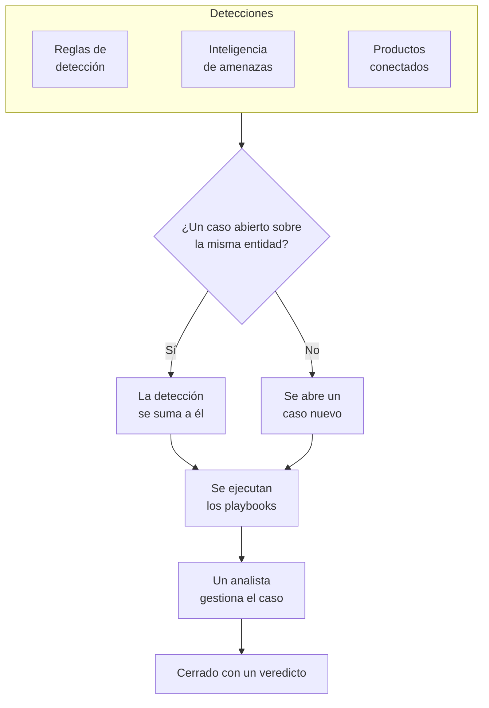

# Casos de seguridad y playbooks (SOAR)

Eventos de seguridad convierte en casos lo que encuentran tus reglas de detección, tu inteligencia de amenazas y tus productos de seguridad conectados: un caso por cada asunto que merece una investigación, con todas las detecciones sobre el mismo usuario, host o dirección agrupadas en él. Los analistas gestionan los casos en una cola, y los playbooks responden a ellos, por sí solos o con un clic.

:::cards
- [De dónde vienen los casos](#de-dónde-vienen-los-casos): Reglas de detección, inteligencia de amenazas, productos conectados y personas.
- [Gestionar un caso](#gestionar-un-caso): Asígnalo, investiga sus entidades y ciérralo con un veredicto.
- [Playbooks](#playbooks): Pasos que se ejecutan sobre un caso, con aprobación donde importa.
- [La vista general](#la-vista-general): Lo que necesita atención ahora y la rapidez con que se gestionan los casos.
:::

## Cómo funciona

Abre **Productos → Eventos de seguridad → Security Cases**. La cola se abre mostrando los casos abiertos; **Assigned to Me**, **Unassigned**, **Cerrado** y **Todos** son las otras vistas.

## Antes de empezar

Los permisos sobre casos y playbooks dependen de los tres roles de seguridad. Project Owner y Project Admin pueden hacerlo todo.

| Rol | Qué puede hacer |
| --- | --- |
| Security Admin | Todo, incluido eliminar casos y configurar playbooks |
| Security Member | Abrir, asignar, cambiar y cerrar casos, escribir notas, ejecutar playbooks y aprobar o rechazar sus pasos |
| Security Viewer | Leer casos, detecciones, notas, playbooks y sus ejecuciones |

Cada uno de estos permisos también se puede conceder por separado, desde crear un caso hasta aprobar los pasos de un playbook; consulta [Referencia de permisos](/docs/permissions/reference).

## De dónde vienen los casos

| Origen | Abre un caso cuando | Cómo desactivarlo |
| --- | --- | --- |
| Reglas de detección | Una regla coincide | **Open a Case on Match**, en el paso **Al coincidir** de la regla |
| Inteligencia de amenazas | Un evento nombra un indicador conocido | **Open a Case on Match**, en el paso **Al coincidir** del feed |
| Productos conectados | Se importa una alerta propia del producto con un nivel igual o superior al umbral de la conexión | **Open Cases From** con el valor **Nunca**, en el paso **Sondeo** de la conexión |
| Personas | Alguien abre uno desde **Security Cases**, o con **Open Case** en el panel de un evento | No se puede desactivar |

Todos los orígenes están activados por defecto. Una conexión abre casos para **High and above** salvo que elijas otro nivel; las alertas por debajo de ese nivel se siguen importando como eventos.

### Cómo se agrupan las detecciones

Una detección trata sobre una entidad: el valor por el que agrupa su regla, como la dirección IP de una regla de fuerza bruta, o el indicador que nombra una coincidencia de inteligencia de amenazas. Una detección sin entidad queda aislada.

- Cuando ya hay un caso abierto sobre esa entidad, la detección se suma a él. Las entidades y el mapeo de ATT&CK del caso crecen, y su prioridad sube hasta la de la detección, nunca baja.
- Cuando no lo hay, se abre un caso nuevo, con el nombre de la detección y con la prioridad de esta.
- Una detección que se vuelve a disparar incrementa el recuento de su fila en lugar de añadir otra.

La prioridad de un caso se deriva de la gravedad de la detección:

| Gravedad | Prioridad |
| --- | --- |
| Critical o Fatal | Critical |
| High | High |
| Medium, Unknown u Other | Medium |
| Low | Low |
| Informational | Informational |

## Gestionar un caso

Un caso pasa por cuatro estados. Puede saltarse alguno, como un falso positivo que se cierra directamente desde Nuevo, y se puede reabrir.

| Estado | Significado |
| --- | --- |
| Nuevo | Nadie lo ha revisado todavía |
| Investigando | Alguien está averiguando qué pasó |
| Contenido | La amenaza ya no puede causar daño; queda pendiente la limpieza |
| Cerrado | Terminado, con un veredicto sobre lo que era |

La página del caso tiene todo lo necesario para gestionarlo:

- Arriba: **Assign to Me**, **Run Playbook**, **Declarar incidente** y **Close Case**, los pasos de estado y la prioridad, en el menú junto a ellos.
- **Detecciones**: lo que se disparó para abrir el caso o sumarse a él, cuántas veces y el último evento coincidente.
- **Entidades**: los usuarios, hosts y direcciones de los que trata el caso, con su actividad en todos tus eventos de seguridad de los últimos 7 días. Cada una se abre en **Correlacionar**.
- **MITRE ATT&CK**: las tácticas y técnicas a las que corresponden sus detecciones, cada una enlazada a su página en attack.mitre.org.
- **Playbook Runs**: lo que hizo cada playbook en el caso, paso a paso, y los pasos que esperan aprobación.
- **Notas** y **Cronología**: lo que escribió el equipo y todo lo que pasó, con quién lo hizo.

Para gestionar varios casos a la vez, selecciónalos en la cola y usa **Assign to Me**, **Change Status** o **Change Priority**.

### Cerrar un caso

**Close Case** pide un veredicto y una nota de cierre opcional:

| Veredicto | Significado |
| --- | --- |
| Verdadero positivo | Hubo realmente actividad maliciosa o no autorizada |
| Positivo benigno | La actividad era real pero esperada, como una prueba de penetración o una tarea de administración |
| Falso positivo | La detección se equivocó: la regla o los datos interpretaron mal una actividad normal |
| Indeterminado | No había información suficiente para saberlo |

Los veredictos se cuentan en la vista general. Una regla cuyos casos se cierran una y otra vez como falso positivo es una regla que hay que ajustar.

### Declarar un incidente

**Declarar incidente** abre un incidente de OneUptime para el caso, con la gravedad que elijas, y enlaza los dos en ambos sentidos: la descripción del incidente nombra el caso, y la cabecera del caso enlaza al incidente. A partir de ahí toman el relevo la guardia, las páginas de estado y el postmortem. Requiere un rol que pueda tanto gestionar casos como crear incidentes.

## Playbooks

Un playbook es una lista de pasos que se ejecutan sobre un caso. Crea uno en **Productos → Eventos de seguridad → Playbooks**, a partir de una plantilla o desde cero, y añade sus pasos en su página.

### Cuándo se ejecuta un playbook

| Ejecuciones | Cuándo |
| --- | --- |
| Caso abierto | Una vez, al abrirse un caso |
| Detección añadida | Cada vez que una detección nueva se suma a un caso abierto |
| Manual | Solo cuando alguien lo ejecuta desde un caso |

Cualquier playbook habilitado también se puede ejecutar a mano, con **Run Playbook** en un caso. Un playbook que se ejecuta por sí solo se puede acotar:

- **For Cases At Least**: solo los casos de esta prioridad o superior.
- **Only For Detections From**: solo cuando la detección que originó el caso procede de este origen.
- **Only For These Detection Rules**: solo cuando procede de una de estas reglas.

Un playbook deshabilitado no se ejecuta ni por sí solo ni a mano.

### Pasos

| Categoría | Paso | Qué hace |
| --- | --- | --- |
| Caso | Assign the case | Asigna el caso a una persona, a un equipo o a ambos |
| Caso | Set the priority | Sube o baja la prioridad del caso |
| Caso | Set the status | Pasa el caso a Investigando, Contenido o Cerrado, con el veredicto que elijas |
| Caso | Add a note | Escribe una nota en el caso, como una lista de comprobación para el analista |
| Caso | Add labels | Pone etiquetas al caso |
| Investigación | Check entities against threat intel | Busca cada entidad en tu inteligencia de amenazas y puede subir la prioridad si hay una coincidencia |
| Investigación | Look up entity activity | Cuenta los eventos de seguridad de cada entidad en una ventana reciente y anota el resultado en el caso |
| Notificación | Email people | Envía por email a usuarios y equipos un resumen del caso, con un enlace a él |
| Notificación | Post to Slack | Publica un resumen del caso en un canal de Slack |
| Notificación | Post to Microsoft Teams | Publica un resumen del caso en un canal de Microsoft Teams |
| Escalado | Page on-call | Ejecuta una política de guardia |
| Escalado | Declarar un incidente | Abre un incidente de OneUptime vinculado al caso |
| Contención | Suspend the user in Okta | Suspende en Okta a cada usuario del caso |
| Contención | End the user's Okta sessions | Cierra la sesión en Okta de cada usuario del caso y revoca sus tokens |
| Contención | Contain the host in CrowdStrike | Aplica la contención de red a cada host del caso con CrowdStrike Falcon |
| Contención | Isolate the device in Microsoft Defender | Aísla cada host del caso con Microsoft Defender for Endpoint |
| Automatización | Send a webhook | Envía el caso como JSON a una URL |
| Automatización | Run a workflow | Inicia un flujo de trabajo de OneUptime con el caso como entrada |

Un playbook tiene como máximo 25 pasos. Se ejecutan en orden, cada uno cuando ha terminado el anterior. Además, cada paso puede:

- **Needs Approval**: detener la ejecución antes del paso hasta que alguien lo apruebe en el caso. Viene activado por defecto en los cuatro pasos de contención, que actúan fuera de OneUptime.
- **Only If Threat Intel Matched**: omitir el paso salvo que un paso **Check entities against threat intel** anterior de la misma ejecución haya encontrado un indicador conocido.
- **Carry On If It Fails**: ejecutar el paso siguiente aunque este falle. Si está desactivado, un paso fallido detiene la ejecución.

### Contención

Los pasos de contención actúan a través de una [conexión de eventos de seguridad](/docs/telemetry/security-events#conectar-un-producto-de-seguridad) con el producto, y esa conexión necesita algo más que acceso de lectura:

| Paso | Conexión | Necesita |
| --- | --- | --- |
| Suspend the user in Okta, End the user's Okta sessions | Okta System Log | Un token de API con permiso para gestionar usuarios |
| Contain the host in CrowdStrike | CrowdStrike Falcon | Un cliente de API con permiso de escritura en el ámbito Hosts |
| Isolate the device in Microsoft Defender | Microsoft Defender XDR | Una aplicación con el permiso Machine.Isolate |

Un paso de contención actúa como máximo sobre 10 de los usuarios o hosts del caso. Busca cada uno en el producto por su nombre e indica en el caso qué hizo con cada uno: contenido, ya contenido, no encontrado o rechazado.

### Mensajes

Una nota, un email, una publicación de Slack y una de Teams pueden usar los valores del caso:

| Marcador de posición | Se convierte en |
| --- | --- |
| `{{case.number}}` | El número del caso, como CASE-42 |
| `{{case.title}}` | El título del caso |
| `{{case.priority}}` | Critical, High, Medium, Low o Informational |
| `{{case.status}}` | New, Investigating, Contained o Closed |
| `{{case.assignee}}` | A quién está asignado el caso |
| `{{case.url}}` | Un enlace al caso en OneUptime |
| `{{case.entities}}` | Los usuarios, hosts y direcciones de los que trata el caso |
| `{{case.detections}}` | Cuántas detecciones contiene el caso |

Un email o una publicación sin mensaje propio envía un resumen del caso.

### Ejecuciones y aprobaciones

Cada ejecución aparece, paso a paso, en su caso y en **Productos → Eventos de seguridad → Playbook Runs**:

| Estado de la ejecución | Significado |
| --- | --- |
| En cola | Esperando a un worker |
| En ejecución | Ejecutando sus pasos |
| Esperando aprobación | Retenida antes de un paso que necesita aprobación |
| Completado con éxito | Todos los pasos se ejecutaron o se omitieron |
| Fallido | Un paso falló y la ejecución se detuvo |
| Cancelado | Alguien la canceló o rechazó un paso |

Un paso que espera aprobación muestra **Approve** y **Rechazar** en la ejecución, con un comentario opcional. Aprobar hace que la ejecución continúe desde ese paso; rechazar la termina. La decisión, quién la tomó y su comentario se guardan en el paso y en la cronología del caso. **Playbook Runs** se abre en las ejecuciones que esperan aprobación, y su entrada del menú las cuenta.

Una ejecución que deja de recibir noticias de su worker, por ejemplo tras un reinicio, se retoma: una ejecución en cola vuelve a ponerse en cola a los 2 minutos, y una ejecución que lleva 30 minutos sin dar señales se marca como fallida.

## La vista general

El producto se abre en **Productos → Eventos de seguridad → Vista general**:

- Los casos abiertos asignados a ti, los casos abiertos que nadie ha tomado todavía y los pasos de playbook que esperan aprobación.
- **Mean Time to Acknowledge**, **Mean Time to Contain** y **Mean Time to Close**, sobre los casos abiertos en los últimos 30 días: desde que se abre un caso hasta que alguien se hace cargo de él (se asigna a una persona o sale de Nuevo), hasta que pasa a Contenido y hasta que pasa a Cerrado. Un caso que sigue esperando no cuenta en la media.
- Los casos abiertos cada día durante 30 días, por prioridad, y las detecciones generadas cada día durante 14 días, por origen.
- Los casos abiertos por prioridad y por estado, los veredictos de los últimos 30 días, las tácticas de ATT&CK detrás de los casos, las detecciones que más se dispararon y las entidades que nombran más hallazgos.

Un proyecto que aún no tiene casos ni detecciones muestra, encima de todo esto, los tres pasos para configurarlo.

## Encontrar amenazas

- **Entidades** clasifica los usuarios, hosts, direcciones y hashes que más nombran tus hallazgos, en el último día, semana o mes, y busca cualquier valor en 30 días de eventos.
- **Rule Library** tiene reglas de detección listas para usar, para amenazas de identidad, endpoints, nube, red, web y Kubernetes. Cada una es una regla Sigma escrita para los campos a los que se normaliza cada origen conectado. **Añadir regla** la crea como una regla de detección tuya, activada y que abre casos en lugar de alertas; cámbiala en **Reglas de detección** como cualquier otra.
- **ATT&CK Coverage** dibuja la matriz MITRE ATT&CK resaltando las técnicas que cubren tus reglas habilitadas, y marca con un contorno las que cubriría una regla de la biblioteca.

## Automatizar

- **Flujos de trabajo**: un caso o una nota puede iniciar un flujo de trabajo cuando se crea, se actualiza o se elimina. Un paso **Run a workflow** inicia un flujo de trabajo cuyo desencadenante es un webhook.
- **API**: los casos, las notas, las detecciones, los playbooks y las ejecuciones tienen la misma API REST que el resto de OneUptime, en `/security-case`, `/security-case-note`, `/security-detection`, `/security-playbook` y `/security-playbook-run`. Consulta [Referencia de la API](/docs/api-reference/api-reference).
- Agentes de IA: el servidor MCP tiene herramientas para casos, notas, detecciones y playbooks. Consulta [Servidor MCP](/docs/ai/mcp-server).

## Solución de problemas

:::details Una regla coincide, pero no se abre ningún caso
Comprueba **Open a Case on Match** en el paso **Al coincidir** de la regla. Una detección sobre una entidad que ya tiene un caso abierto se suma a ese caso en lugar de abrir otro: búscala en **Detecciones** dentro del caso abierto.
:::

:::details Un playbook no se ejecutó
Comprueba que está habilitado, que su ajuste **Disparador** encaja (con Caso abierto se ejecuta una sola vez, al abrirse un caso) y que el caso cumple sus ajustes **For Cases At Least**, **Only For Detections From** y **Only For These Detection Rules**. Un caso abierto a mano no tiene detección, así que un playbook limitado a un origen o a unas reglas no se ejecuta sobre él.
:::

:::details Falló un paso de contención
Abre la ejecución en el caso: el paso indica, para cada usuario o host, si el producto lo rechazó, no lo encontró o no se pudo contactar con él. Comprueba que la credencial de la conexión tiene permiso para hacer el cambio, y usa **Probar conexión** en su fila.
:::

## Próximos pasos

:::cards
- [Eventos de seguridad](/docs/telemetry/security-events): Envía eventos, escribe reglas de detección y conecta productos de seguridad.
- [Inteligencia de amenazas](/docs/telemetry/threat-intelligence): Coteja tus eventos con feeds STIX/TAXII.
- [Referencia de permisos](/docs/permissions/reference): Los roles de seguridad y lo que puede hacer cada uno.
:::
