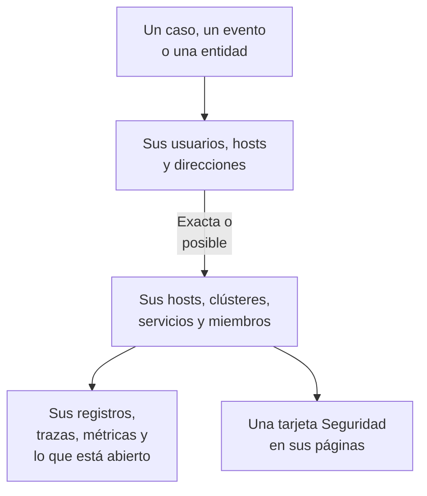

# Señales conectadas

Un caso de seguridad dice a qué usuarios, hosts y direcciones se refiere. Señales conectadas dice cuáles de ellos ya conoce OneUptime - sus hosts, hosts de contenedores, clústeres de Kubernetes, dispositivos de red, servicios y miembros - y qué ocurría en cada uno en torno al caso: sus registros, trazas y métricas, los incidentes y alertas abiertos en él, los monitores que lo vigilan y qué cambió en él. A la inversa, la página de un host, un clúster, un servicio o un miembro dice qué encontró Eventos de seguridad sobre él.

:::cards
- [Dónde se ve](#dónde-se-ve): La página de un caso, la pestaña de un evento, la página de una entidad y las páginas de lo que nombran.
- [Cómo se empareja un valor](#cómo-se-empareja-un-valor): Qué cuenta como el mismo elemento y qué solo posiblemente.
- [Qué muestra cada elemento](#qué-muestra-cada-elemento): Sus señales en torno al caso y lo que está abierto en él.
- [Quién ve qué](#quién-ve-qué): Cada elemento se lee con el rol de quien lo lee.
:::

## Cómo funciona

OneUptime busca cada valor entre los elementos del proyecto, dice qué tan segura es cada coincidencia y muestra qué ocurría en cada elemento en torno al caso.

## Antes de empezar

- Eventos de seguridad que llegan, y hosts, clústeres de Kubernetes, servicios o miembros del proyecto que puedan nombrar. Consulte [Primeros pasos con la seguridad](/docs/telemetry/security-getting-started).
- Un rol que pueda leer eventos de seguridad, y los tipos de elementos que quiere ver.

## Dónde se ve

- **Señales conectadas**, una página de cada caso de seguridad: abra un caso en **Productos → Eventos de seguridad → Casos de seguridad → Casos abiertos** y luego **Señales conectadas** después de **Entidades** en su menú.
- **Conectado**, una pestaña de cada evento de seguridad: abra un evento en **Productos → Eventos de seguridad → Eventos**. Lista lo que nombra el evento, en la hora en torno a él.
- La página de una entidad, en **Productos → Eventos de seguridad → Riesgo de entidades**: dónde conoce OneUptime al usuario, el host o la dirección, en torno a su último evento de seguridad.
- Una tarjeta **Seguridad** en la página de cada host, host de Docker, host de Podman, clúster de Kubernetes, dispositivo de red, servicio, miembro y elemento de inventario: los casos de seguridad abiertos que lo nombran, cuántos eventos de seguridad y hallazgos lo nombraron en los últimos 7 días, el más grave de ellos y su riesgo. **Abrir en Eventos de seguridad** lo abre allí.
- Una tarjeta **Seguridad** en la página de un incidente, cuando un caso de seguridad declaró el incidente (**Declarado desde**) o casos abiertos nombran un host o un clúster al que afecta (**Casos abiertos que nombran lo que afecta**).

## Cómo se empareja un valor

Cada usuario, host y dirección que nombra un caso o un evento se busca entre los elementos del proyecto:

| Lo que nombra el caso o el evento | Emparejado con | Certeza |
| --- | --- | --- |
| Un nombre de host o de dominio igual al nombre que informa un host, un host de contenedores, un clúster o un dispositivo de red | Ese elemento | Exacta |
| El mismo nombre, dado sin decir que es un host | Ese elemento | Posible |
| Una forma corta o completa del nombre de un elemento, como `web-1` y `web-1.acme.internal` | Ese elemento | Posible |
| Una dirección IP pública que solo tiene un elemento | Ese elemento | Exacta |
| Una dirección IP privada, o una que tienen varios elementos | Cada elemento que la tiene | Posible |
| El correo electrónico de un miembro | Ese miembro | Exacta |
| El elemento con el que se envió una línea de registro, para los eventos leídos de sus registros | Ese host, clúster o servicio | Exacta |
| Un simple nombre de usuario, una URL, un hash de archivo o un proceso | Nada: ningún elemento se identifica por ellos | - |

- Una posible coincidencia muestra **Posible coincidencia** junto a su nombre y dice por qué. Nunca se cuenta en la página del elemento, y un incidente que declara el caso nunca se vincula a ella.
- Lo que se buscó y no es un elemento del proyecto aparece en **No está en OneUptime**. Un valor nunca aparece allí cuando no se pudo leer un tipo de elemento que podría ser.
- Se listan como mucho 10 elementos para un caso, primero los exactos.

## Qué muestra cada elemento

- Sus señales, cada una abierta en el elemento y el periodo del caso: **Registros**, **Trazas** y **Métricas**, las **Excepciones** de un servicio, los **Eventos de Kubernetes** de un clúster, la **Topología** del elemento y su elemento de **Inventario** cuando el inventario tiene uno.
- Los incidentes y alertas abiertos en él ahora y los monitores que lo vigilan, cada uno abriendo su página.
- Qué cambió en él durante el periodo: los despliegues de un servicio, los despliegues graduales de un clúster y las correcciones de un host.

| Dónde | Periodo |
| --- | --- |
| Un caso | Desde 30 minutos antes de su primera detección hasta 30 minutos después de la última, como mucho sus últimas 24 horas |
| Un evento | 30 minutos antes y después |
| La página de una entidad | 30 minutos antes y después de su último evento de seguridad |
| La tarjeta **Seguridad** de un elemento | Los últimos 7 días |

## Quién ve qué

- Señales conectadas y la tarjeta **Seguridad** de un elemento requieren un rol que pueda leer eventos de seguridad: Security Admin, Security Member, Security Viewer, Project Owner o Project Admin. Nadie más ve datos de seguridad en ninguna página. Consulte [Roles](/docs/permissions/reference#roles).
- La tarjeta **Seguridad** de un incidente requiere un rol que pueda leer casos de seguridad.
- Cada elemento se lee con su propio rol. Un tipo de elemento que su rol no puede leer se omite, y la página lo dice; uno que no se pudo leer en este momento también lo dice, con **Volver a intentar**.
- La página de un elemento muestra su tarjeta **Seguridad** solo en un proyecto que usa Eventos de seguridad: uno que recibió un evento de seguridad en los últimos 7 días.

## Incidentes que declara un caso

**Declarar incidente** en un caso, o el paso de un playbook que declara uno, vincula el incidente con los hosts, hosts de Docker y Podman, clústeres de Kubernetes y servicios con los que el caso está conectado de forma exacta. El incidente aparece en sus páginas y se le aplican las reglas de sus propietarios, y su feed nombra el caso y aquello con lo que se vinculó. Una posible coincidencia nunca se vincula.

## OneUptime AI

La clasificación de un caso por OneUptime AI lee sus señales conectadas: lo que está abierto y lo que cambió en los hosts, servicios y miembros que nombra el caso. La investigación de un incidente lee el caso de seguridad que lo declaró y los casos abiertos que nombran lo que afecta. Consulte [OneUptime AI en la seguridad](/docs/telemetry/security-ai).

## Solución de problemas

:::details Un host que nombra el caso no aparece
Compruebe que el caso nombra el host como el host se nombra a sí mismo, o nombra una dirección pública que solo tiene ese host. Un nombre corto, como `web-1` para `web-1.acme.internal`, aparece como posible coincidencia, y un simple nombre de usuario, una URL, un hash de archivo o un proceso no se busca en absoluto.
:::

:::details El host correcto aparece como posible coincidencia
Una posible coincidencia nunca se cuenta ni se vincula, para que un nombre que comparten dos máquinas nunca le diga nada sobre la equivocada. Haga que sus registros y detecciones nombren el host por el nombre que informa.
:::

:::details La página de un host no tiene la tarjeta Seguridad
La tarjeta se muestra a un rol que puede leer eventos de seguridad, en un proyecto que recibió un evento de seguridad en los últimos 7 días. Un host que nada nombró en ese tiempo muestra una línea que lo dice.
:::

:::details La página dice que su rol no puede ver un tipo de elemento
Cada elemento se lee con su propio rol. Pida a un Project Owner o a un Project Admin un rol que pueda leer ese tipo de elemento.
:::

## Próximos pasos

:::cards
- [Casos de seguridad y playbooks](/docs/telemetry/security-cases): Trabajar un caso y declarar un incidente a partir de él.
- [Eventos de seguridad (SIEM)](/docs/telemetry/security-events): Los eventos detrás de un caso y los registros de los que se leen.
- [Riesgo de entidades (alertas basadas en el riesgo)](/docs/telemetry/security-entity-risk): La página de una entidad, su riesgo y dónde la conoce OneUptime.
- [OneUptime AI en la seguridad](/docs/telemetry/security-ai): Cómo una clasificación lee lo que nombra un caso.
:::
