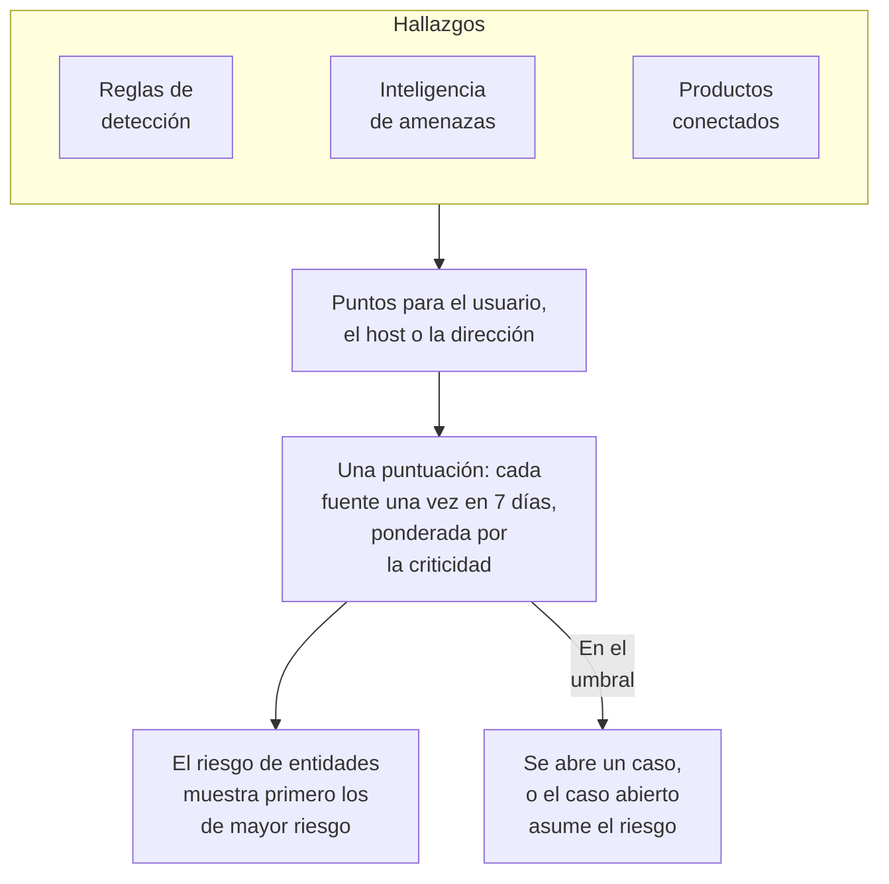

# Riesgo de entidades (alertas basadas en el riesgo)

Un hallazgo aislado rara vez dice mucho. Una ráfaga de inicios de sesión fallidos, un primer sudo en un host y un inicio de sesión desde un país nuevo merecen cada uno un vistazo; la misma cuenta en los tres en una semana merece un caso. El riesgo de entidades suma lo que sus reglas de detección, su inteligencia de amenazas, sus productos conectados y Data Security encuentran sobre cada usuario, host, dirección IP y almacén de datos, muestra primero los de mayor riesgo y abre un caso sobre aquel cuyo riesgo alcanza el umbral del proyecto.

:::cards
- [Cómo se cuenta una puntuación](#cómo-se-cuenta-una-puntuación): Puntos según la gravedad, y cada fuente una vez por semana.
- [Niveles de riesgo y casos](#niveles-de-riesgo-y-casos): Cómo se lee una puntuación, y cuándo se abre un caso.
- [Criticidad de entidades](#criticidad-de-entidades): Contar más lo que importa más, y menos lo que importa menos.
- [La página de una entidad](#la-página-de-una-entidad): Por qué es de riesgo, su mes y los casos sobre ella.
- [Puntos de riesgo en una regla de detección](#puntos-de-riesgo-en-una-regla-de-detección): El peso propio de una regla en la puntuación.
:::

## Cómo funciona

Abra **Productos → Eventos de seguridad → Riesgo de entidades**: cada usuario, host, dirección IP y almacén de datos con riesgo ahora, primero los de mayor riesgo, con su nivel, cuánto importa, qué lo encontró y cuándo. Cada uno se abre en una página propia. **Entidades de mayor riesgo**, en la vista general, muestra el principio de esta lista, y **Buscar una entidad**, debajo de ella, busca cualquier valor en 30 días de eventos, también un dominio o un hash de archivo.

## Antes de empezar

- Eventos de seguridad que llegan, y reglas de detección, inteligencia de amenazas o productos conectados que encuentran algo en ellos. Consulte [Primeros pasos con la seguridad](/docs/telemetry/security-getting-started).
- Reglas de detección que agrupan por un campo que nombra a alguien: **Campo de agrupación**, como `principalUser`, `principalHost` o `principalIp`, o los campos por los que agrupa una correlación. Una regla que no agrupa por nada no suma riesgo.
- Para cambiar **Puntuación de riesgo**: Project Owner o Project Admin para su interruptor y su umbral, y un rol que pueda crear reglas de detección para su lista de entidades. Security Viewer lo lee todo. Consulte [Roles](/docs/permissions/reference#roles).

## Cómo se cuenta una puntuación

Cada hallazgo suma puntos de riesgo al usuario, host, dirección IP o almacén de datos al que se refiere:

| Un hallazgo de gravedad | Suma |
| --- | --- |
| Baja | 10 puntos |
| Media | 25 puntos |
| Alta | 50 puntos |
| Crítica | 75 puntos |

- Un hallazgo informativo no suma nada, y un hallazgo de gravedad desconocida cuenta como Media.
- Los puntos de una regla de detección van al valor por el que agrupa. Una coincidencia de inteligencia de amenazas suma a la dirección IP que nombra el indicador. La alerta de un producto conectado suma al usuario y al host que nombra, o si no, a su dirección IP. Un problema de Data Security suma al almacén de datos en el que se encontró.
- Cada fuente cuenta una vez. Una regla de detección, un feed de inteligencia de amenazas, la regla de un producto conectado o una comprobación de Data Security cuenta una vez en 7 días, con lo máximo que sumó, por mucho que se dispare: una regla ruidosa no puede hacer que una entidad parezca peor que tres reglas distintas.
- Una fuente que no ha encontrado nada en 7 días deja de contar, y la puntuación baja. Las puntuaciones se revisan cada 15 minutos, así que una puntuación baja a tiempo sin un nuevo hallazgo.

La puntuación de una entidad es la suma de sus fuentes, ponderada por su criticidad. El ataque de prueba de **Enviar un ataque de prueba**, y un caso que alguien abre a mano, no suman riesgo.

## Niveles de riesgo y casos

Cada puntuación se lee como un nivel frente al umbral del proyecto, 100 salvo que lo cambie:

| Puntuación de riesgo | Se lee como | Qué ocurre |
| --- | --- | --- |
| 1 a 49 | Bajo | Aparece en Riesgo de entidades |
| 50 a 99 | Medio | Aparece en Riesgo de entidades |
| 100 a 199 | Alto | Se abre un caso, en Alto |
| 200 o más | Crítico | Se abre un caso, en Crítico |

Cuando el riesgo de una entidad alcanza el umbral, se genera sobre ella una detección de la fuente Riesgo de entidades. Se une al caso abierto sobre la entidad, o abre uno con su nombre, como `High risk — k.morgan@acme-commerce.example`, y muestra las fuentes que más sumaron al riesgo, hasta 10, con sus puntos, cuántas veces se disparó cada una y cuándo fue la última.

Una vez que se abre un caso sobre el riesgo de una entidad, lo que había detrás no se vuelve a contar: solo se abre otro caso cuando fuentes nuevas desde entonces vuelven a sumar el umbral. Un caso cerrado como resuelto no se reabre por los mismos hallazgos.

Cambie el umbral en **Productos → Eventos de seguridad → Ajustes → Puntuación de riesgo → Umbral de riesgo**: un número entero de 10 a 10000. Medio empieza en la mitad y Crítico en el doble, en todas las páginas.

### Activar o desactivar los casos de riesgo

**Casos de riesgo**, en **Ajustes → Puntuación de riesgo**, decide si el riesgo abre casos, y se guarda al cambiarlo. Los proyectos nuevos empiezan con él activado. Un proyecto creado antes del riesgo de entidades lo mantiene desactivado hasta que alguien lo active, y **Riesgo de entidades** lo indica sobre su lista. El riesgo se puntúa y se muestra igualmente.

## Criticidad de entidades

Algunas entidades importan más que otras: un controlador de dominio, la cuenta de un directivo, un servidor de pagos. Otras importan menos, como un escáner de vulnerabilidades cuyos escaneos son esperados. Añádalas en **Ajustes → Puntuación de riesgo → Criticidad de entidades** con **Añadir Entidad**:

| Criticidad | Cuenta su riesgo |
| --- | --- |
| Baja | ×0.5 |
| Sin indicar | ×1 |
| Alta | ×1.5 |
| Extrema | ×2 |

Una entrada es un valor o un patrón con `*`, sin importar mayúsculas: `dc-*` nombra cada controlador de dominio, y `*@contractors.example` a cada contratista. **Tipo** la limita a usuarios, hosts, direcciones IP o almacenes de datos; vacío coincide con todos. Cuando varias entradas nombran una entidad, cuenta la más específica: un valor escrito completo antes que un patrón, y un patrón más largo antes que uno más corto. Un cambio llega a la puntuación de cada entidad en minutos. Data Security añade por sí mismo los almacenes de datos que considera sensibles, los confidenciales como Alta y los restringidos como Extrema; si cambia una de esas entradas, pasa a ser suya y Data Security no la toca.

## La página de una entidad

Haga clic en **Ver** en una fila de **Riesgo de entidades**, o en el riesgo junto a una entidad en la página **Entidades** de un caso:

| Parte | Qué muestra |
| --- | --- |
| La cabecera | Su tipo y criticidad, su puntuación y nivel, y cómo se calcula la puntuación |
| **Actividad** | Sus eventos de seguridad y hallazgos de los últimos 7 días |
| **Qué suma a su riesgo** | Cada fuente, su gravedad, los puntos que suma, cuántas veces se disparó y cuándo fue la última |
| **Riesgo de los últimos 30 días** | Su puntuación al final de cada día, coloreada según su nivel |
| **Casos sobre ella** | Los casos de seguridad abiertos sobre ella, los más recientes primero |

**Abrir en Correlacionar** dibuja un grafo de sus eventos, y **Buscar sus eventos** abre **Eventos** en su semana. **Restablecer el riesgo** borra su puntuación y sus fuentes, por ejemplo tras una prueba planificada: lo que se encuentre después cuenta desde cero, y sus casos no cambian. Restablecer requiere un rol que pueda eliminar datos de seguridad, y el [registro de auditoría](/docs/configuration/audit-logs) lo registra.

OneUptime AI lee el riesgo de las entidades de un caso cuando lo evalúa. Consulte [OneUptime AI en la seguridad](/docs/telemetry/security-ai).

## Puntos de riesgo en una regla de detección

Una regla de detección suma los puntos de su nivel, según su `level` de Sigma. Para darle un peso propio, abra el formulario de la regla, vaya a **Al coincidir**, abra **Más campos** y fije **Puntos de riesgo**, de 0, que no suma riesgo, a 100. Déjelo vacío para los puntos de su nivel.

## Solución de problemas

:::details Una entidad no aparece en Riesgo de entidades
Compruebe que una regla de detección, un feed de inteligencia de amenazas o un producto conectado encontró algo sobre ella en los últimos 7 días, y que la regla agrupa por un campo que la nombra. Los hallazgos informativos no suman nada, y una fuente que no ha encontrado nada en 7 días deja de contar.
:::

:::details El riesgo de una entidad alcanzó el umbral y no se abrió ningún caso
Compruebe que **Casos de riesgo** está activado en **Ajustes → Puntuación de riesgo**. Si ya se abrió un caso sobre el riesgo de la entidad, solo las fuentes nuevas desde entonces cuentan para el siguiente.
:::

:::details Una regla se dispara una y otra vez, y la puntuación de la entidad no sube
Así es como se cuenta: una fuente cuenta una vez en 7 días, con lo máximo que sumó. Baje los **Puntos de riesgo** de una regla ruidosa, o marque con criticidad baja una entidad cuyos hallazgos son esperados.
:::

:::details Una puntuación no es la suma de sus fuentes
Su criticidad la pondera. La página de la entidad muestra la suma de sus fuentes y el peso, como 100 de sus fuentes × 2 = 200.
:::

## Próximos pasos

:::cards
- [Casos de seguridad y playbooks](/docs/telemetry/security-cases): Trabajar los casos que abre el riesgo, y cerrarlos con un veredicto.
- [Eventos de seguridad (SIEM)](/docs/telemetry/security-events): Reglas de detección, Correlacionar y los eventos detrás de cada hallazgo.
- [Inteligencia de amenazas (STIX/TAXII)](/docs/telemetry/threat-intelligence): Las coincidencias que suman al riesgo de una dirección.
- [OneUptime AI en la seguridad](/docs/telemetry/security-ai): Cómo una evaluación lee el riesgo de las entidades de un caso.
:::
