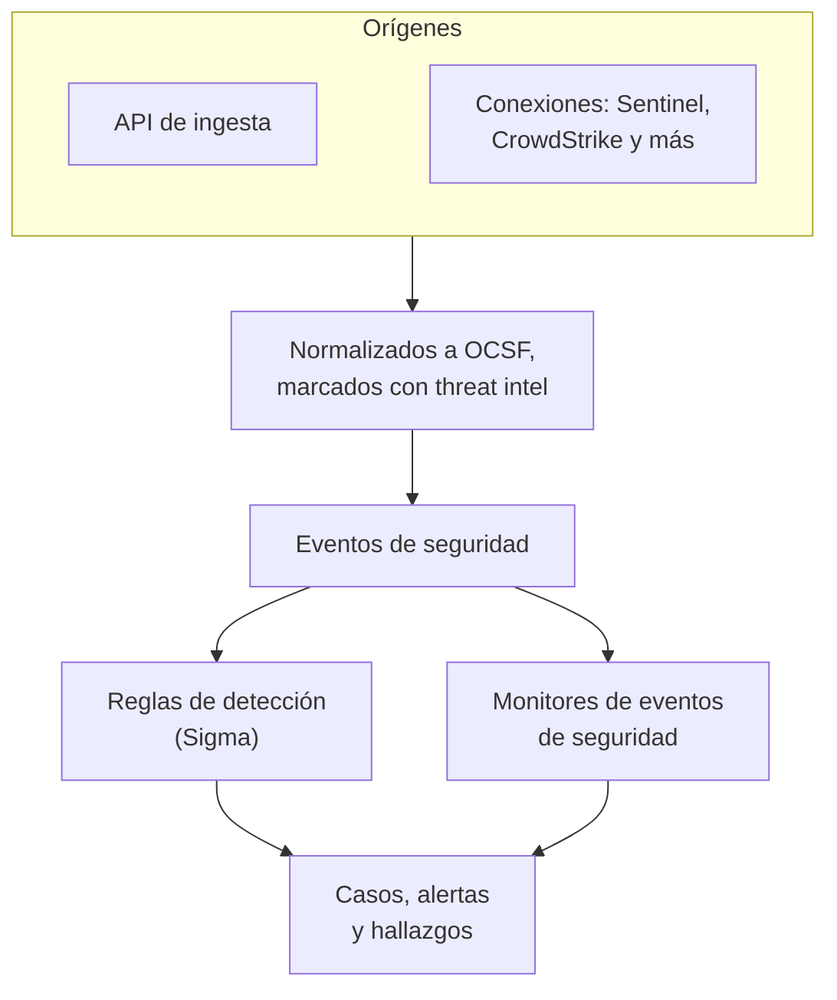
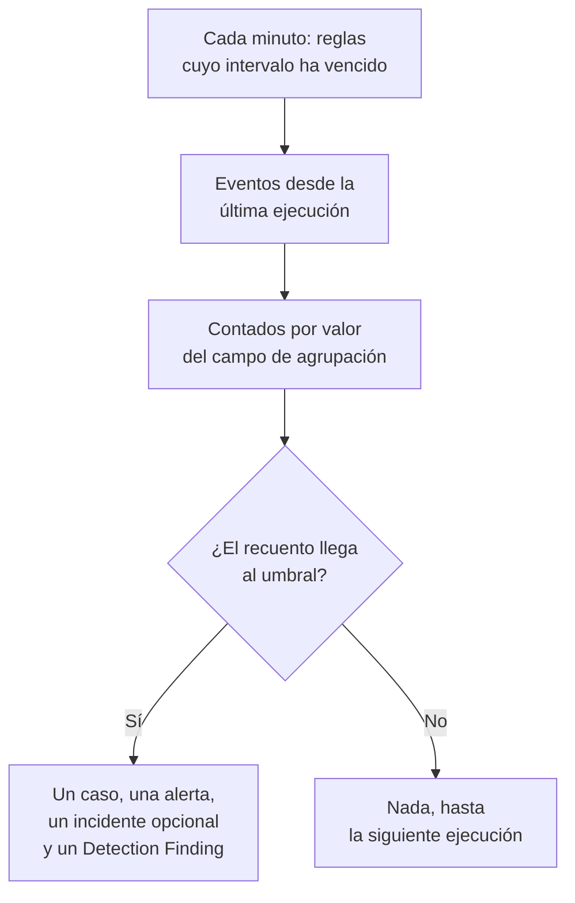

# Eventos de seguridad (SIEM)

OneUptime guarda los eventos de seguridad junto a tus registros, trazas y métricas, y da a cada uno la misma forma, [OCSF](https://schema.ocsf.io/) (el Open Cybersecurity Schema Framework), sea cual sea el formato en que llegó. Envía eventos desde cualquier origen, búscalos y encuentra los importantes con reglas de detección Sigma, inteligencia de amenazas y monitores. Lo que encuentran se convierte en [casos](/docs/telemetry/security-cases) que gestionar, y los playbooks responden a ellos.

:::cards
- [Enviar eventos](#enviar-eventos-de-seguridad): Un POST HTTPS, una salida de Fluent Bit o una conexión con un producto de seguridad.
- [Buscar y correlacionar](#explorar-los-eventos-de-seguridad): El explorador de eventos y el grafo de correlación.
- [Reglas de detección](#reglas-de-detección): Reglas Sigma que abren casos y alertas.
- [Monitores](#monitores-de-eventos-de-seguridad): Recuentos sobre una ventana deslizante, con un estado que se recupera.
:::

## Cómo funciona



Abre **Productos → Eventos de seguridad**, en **Observabilidad**. Su menú tiene una sección para cada parte de la seguridad, y una página propia para cada cosa que contiene:

| Página | Sección | Para qué sirve |
| --- | --- | --- |
| **Vista general** | Vista general | Cómo está configurada la seguridad, qué necesita a alguien ahora y con qué rapidez se gestionan los casos |
| **Casos abiertos** | Casos de seguridad | La cola: cada caso aún no cerrado, agrupado según de qué trata |
| **Asignados a mí** | Casos de seguridad | Los casos abiertos asignados a ti |
| **Sin asignar** | Casos de seguridad | Los casos abiertos que nadie ha tomado |
| **Casos cerrados** | Casos de seguridad | Los casos cerrados con un veredicto, los más recientes primero |
| **Todos los casos** | Casos de seguridad | Cada caso, abierto o cerrado |
| **Eventos** | Eventos | Buscar y filtrar todos los eventos, y abrir uno para ver todos sus campos |
| **Campaigns** | Eventos | Cada dirección que envió solicitudes de ataque, y si alguna de sus solicitudes pasó |
| **Riesgo de entidades** | Eventos | Cada usuario, host y dirección, puntuado por lo encontrado sobre él esta semana, primero los de mayor riesgo |
| **Correlacionar** | Eventos | Un grafo de los eventos que comparten un host, un usuario o una dirección IP |
| **Reglas de detección** | Detecciones | Reglas Sigma que se ejecutan según una programación y abren casos |
| **Excepciones de regla** | Detecciones | Lo que tus reglas omiten a propósito, como un escáner o una prueba planificada, cada cosa con quién la añadió y por qué |
| **Biblioteca de reglas** | Detecciones | Reglas de detección listas para añadir, cada una con los eventos que lee y si llegan, con las recomendadas marcadas |
| **Inteligencia de amenazas** | Detecciones | Feeds STIX/TAXII de indicadores maliciosos conocidos |
| **Cobertura de ATT&CK** | Detecciones | Las técnicas de MITRE ATT&CK que cubren tus reglas |
| **Playbooks** | Playbooks | Pasos que se ejecutan sobre los casos, por sí solos o a mano |
| **Aprobaciones** | Playbooks | Los pasos de playbook que esperan que alguien los apruebe o los rechace |
| **Ejecuciones** | Playbooks | Lo que hizo cada playbook, paso a paso |
| **Entidades protegidas** | Playbooks | Los usuarios y hosts a los que ningún playbook aplica contención |
| **Ajustes** | IA | Si OneUptime AI clasifica cada caso nuevo |
| **Conexiones** | Conexiones | Sus registros, los productos de seguridad que consulta OneUptime y los SIEM a los que envía |
| **Guía de configuración** | Conexiones | Fragmentos para enviar eventos, rellenados con tu clave de ingesta |
| **Prioridades de casos** | Ajustes | Lo urgente que es un caso: las prioridades propias del proyecto, la más urgente primero |
| **Objetivos de respuesta** | Ajustes | Lo rápido que hay que hacerse cargo de un caso de cada prioridad y contenerlo |
| **Estados de casos** | Ajustes | Los pasos por los que pasa un caso, y qué cuenta un caso en cada uno |
| **Puntuación de riesgo** | Ajustes | Si el riesgo de una entidad abre un caso, con qué riesgo, y cuánto importa cada entidad |

**Detecciones**, **IA**, **Conexiones** y **Ajustes**, que se configuran una vez, quedan plegadas hasta que las abres. ¿Empieza con la seguridad? [Primeros pasos con la seguridad](/docs/telemetry/security-getting-started) la configura en dos clics.

## Antes de empezar

Los datos de seguridad solo los leen los roles Project Owner y Project Admin y los tres roles de seguridad; los demás roles no ven nada en Eventos de seguridad. Consulta [Roles](/docs/permissions/reference#roles).

| Rol | Qué puede hacer |
| --- | --- |
| Security Admin | Todo: eventos, casos, playbooks, reglas de detección, feeds de inteligencia de amenazas y conexiones |
| Security Member | Leer eventos e inteligencia de amenazas, gestionar casos, ejecutar playbooks y aprobar sus pasos, y crear, cambiar y eliminar reglas de detección y feeds. No puede configurar playbooks ni conexiones, ni eliminar datos de seguridad. |
| Security Viewer | Leer eventos, casos, playbooks, reglas, feeds, indicadores y conexiones |

## Enviar eventos de seguridad

:::steps
### Crea una clave de ingesta

Abre **Ajustes del proyecto → Telemetría y APM → Claves de ingesta** y haz clic en **Crear clave de ingesta**. Los eventos de seguridad usan las mismas claves que el resto de tu telemetría.

### Envía tus eventos

Envía JSON a `/security-events/v1/ingest` con la clave en `x-oneuptime-token`:

:::tabs
@tab OCSF
```bash
curl -X POST "https://oneuptime.com/security-events/v1/ingest?format=ocsf" \
  -H "Content-Type: application/json" \
  -H "x-oneuptime-token: YOUR_INGESTION_TOKEN" \
  -H "x-oneuptime-service-name: my-security-source" \
  -d '{ "events": [ { "class_uid": 3002, "severity_id": 4, "status": "Failure", "message": "Failed logon for alice", "actor": { "user": { "name": "alice" } }, "src_endpoint": { "ip": "203.0.113.7", "hostname": "laptop-alice" } } ] }'
```
@tab Google UDM
```bash
curl -X POST "https://oneuptime.com/security-events/v1/ingest?format=udm" \
  -H "Content-Type: application/json" \
  -H "x-oneuptime-token: YOUR_INGESTION_TOKEN" \
  -d '{ "events": [ { "metadata": { "event_type": "USER_LOGIN" }, "principal": { "hostname": "laptop-alice", "user": { "userid": "alice" }, "ip": ["203.0.113.7"] }, "security_result": [{ "severity": "HIGH", "action": ["BLOCK"] }] } ] }'
```
@tab Generic JSON
```bash
curl -X POST "https://oneuptime.com/security-events/v1/ingest" \
  -H "Content-Type: application/json" \
  -H "x-oneuptime-token: YOUR_INGESTION_TOKEN" \
  -d '{ "events": [ { "severity": "high", "event_type": "ssh_brute_force", "message": "12 failed SSH logins in 60s", "username": "root", "hostname": "web-01", "src_ip": "203.0.113.7" } ] }'
```
:::

El endpoint responde `200` en cuanto los eventos están en cola. Un evento enviado sin hora, como estos, se sitúa en el momento en que llega.

### Encuéntralos en Eventos

Abre **Productos → Eventos de seguridad → Eventos**. Los eventos aparecen en pocos segundos, con su gravedad, clase, usuario, host y direcciones IP rellenados.
:::

### Formatos

| `format` | Qué lee | También aceptado |
| --- | --- | --- |
| `ocsf` | JSON de eventos OCSF (`class_uid`, `severity_id` y demás) | Ninguno |
| `udm` | Eventos UDM de Google SecOps (Chronicle) (`metadata.event_type` y demás) | `chronicle`, `google-secops` |
| `google-secops-alert` | Detecciones y alertas de Google SecOps: webhooks de SOAR y el flujo de detecciones | `secops-alert`, `detection` |
| `generic` | Cualquier otro JSON, leído por nombres de campo habituales | Ninguno |

Indica el formato con `?format=`, con la cabecera `x-oneuptime-security-event-format` o con un campo `"format"` de primer nivel. Si lo omites, el formato de cada evento se deduce por separado, así que un mismo webhook puede mezclar detecciones con eventos en bruto.

- El cuerpo puede ser un evento, un array de eventos o `{ "events": [...] }`.
- La cabecera `x-oneuptime-service-name` nombra el servicio de telemetría al que pertenecen los eventos. Sin ella, pertenecen al servicio con el nombre del producto o del proveedor del primer evento, o a `Security Events`.
- No se descarta nada por no poder mapearlo: cada campo del origen llega a los atributos del evento.

### Campos de JSON genérico

Un evento genérico se lee por nombres de campo habituales:

| Campo del evento | Se lee del primero de |
| --- | --- |
| `message` | `message`, `msg`, `summary`, `description`, `title` |
| `severityName` | `severity`, `severity_name`, `level`, `priority`, `risk_level` |
| `time` | `timestamp`, `time`, `@timestamp`, `event_time`, `created_at` |
| `principalUser` | `user`, `username`, `user_name`, `account`, `actor` |
| `principalHost` | `host`, `hostname`, `computer`, `device`, `machine` |
| `principalIp` | `source_ip`, `src_ip`, `client_ip`, `ip` |
| `targetIp` | `destination_ip`, `dest_ip`, `dst_ip`, `target_ip` |
| `className` | `event_type`, `category`, `type`, `action` |
| `ruleName` | `rule`, `rule_name`, `signature`, `detection` |
| `productName` | `product`, `product_name`, `source`, `log_source` |
| `processName` | `process_name`, `process.name`, `proc.name`, `comm` |
| `processPath` | `process_path`, `Image`, `NewProcessName`, `exe`, `process.executable` |
| `processCommandLine` | `command_line`, `CommandLine`, `cmdline`, `process.command_line`, `proc.cmdline`, `process` |
| `parentProcessName` | `parent_process_name`, `process.parent.name`, `proc.pname` |
| `parentProcessPath` | `parent_process_path`, `ParentImage`, `ParentProcessName`, `process.parent.executable` |
| `parentProcessCommandLine` | `parent_command_line`, `ParentCommandLine`, `process.parent.command_line`, `proc.pcmdline` |

Una palabra de gravedad se convierte en un nivel OCSF: `info` se lee como Informational, `warning` como Low, `error` como Medium, `alert` como Critical y `emergency` como Fatal.

### Reenviar con Fluent Bit

Para enviar registros de seguridad que ya recopilas, como los de auditd, syslog o Falco, añade a Fluent Bit una salida `http`:

```ini title="fluent-bit.conf"
[OUTPUT]
    Name             http
    Match            security.*
    Host             oneuptime.com
    Port             443
    tls              On
    URI              /security-events/v1/ingest
    Format           json
    Json_date_key    timestamp
    Json_date_format iso8601
    Header           x-oneuptime-token YOUR_INGESTION_TOKEN
    Header           x-oneuptime-service-name my-security-source
    Retry_Limit      5
```

La página **Guía de configuración**, en **Conexiones**, tiene estos fragmentos con tu propio host y tu clave ya rellenados.

### Encontrar eventos de seguridad en sus registros

La tarjeta **Tus registros**, en la parte superior de **Conexiones**, convierte en un origen los registros que ya envía a OneUptime. Con **Encontrar eventos de seguridad en tus registros** activado, los registros nuevos del proyecto se leen cada minuto, y cada inicio de sesión SSH, comando sudo, entrada de auditoría de Kubernetes, cambio de AWS CloudTrail y ataque web que contengan se guarda como evento de seguridad. Consulte [Primeros pasos con la seguridad](/docs/telemetry/security-getting-started#encontrar-eventos-de-seguridad-en-sus-registros) para saber qué cubre cada tipo.

### Conectar un producto de seguridad

**Conexiones** consulta un producto de seguridad por ti e importa sus registros nuevos como eventos de seguridad. Una conexión guarda los ajustes del producto y una credencial cifrada; un worker la consulta con el intervalo que definas y omite los registros que ya importó.

| Producto | Importa | Guía de configuración |
| --- | --- | --- |
| Google SecOps (Chronicle) | Detecciones de reglas, detecciones seleccionadas y alertas, como Detection Findings | [Google SecOps](/docs/integrations/google-secops) |
| Microsoft Sentinel | Incidentes, como Incident Findings | [Microsoft Sentinel](/docs/integrations/microsoft-sentinel) |
| Microsoft Defender XDR | Alertas, como Detection Findings | [Microsoft Defender XDR](/docs/integrations/microsoft-defender-xdr) |
| CrowdStrike Falcon | Alertas, como Detection Findings | [CrowdStrike Falcon](/docs/integrations/crowdstrike-falcon) |
| Splunk Enterprise Security | Notable events, o cualquier búsqueda, como Detection Findings | [Splunk Enterprise Security](/docs/integrations/splunk) |
| Elastic Security | Alertas de detección, como Detection Findings | [Elastic Security](/docs/integrations/elastic-security) |
| AWS Security Hub | Findings, como Detection y Compliance Findings | [AWS Security Hub](/docs/integrations/aws-security-hub) |
| Okta System Log | Eventos de inicio de sesión, MFA, cuentas y políticas | [Okta System Log](/docs/integrations/okta) |

- Las alertas propias del producto con un nivel igual o superior a **Open Cases From** (**Alta y superior** salvo que elijas otro nivel, o **Nunca**) abren [casos](/docs/telemetry/security-cases), agrupadas por el usuario, host o dirección de los que tratan.
- Una conexión lee los registros según el momento en que el producto los creó, no según el momento de la actividad que describen. Una regla de SIEM que se ejecuta cada hora crea detecciones mucho después de los eventos que coincidieron, y aun así se importan.
- La primera consulta mira 24 horas atrás, así que una conexión nueva muestra registros recientes de inmediato.
- **Probar conexión**, en la fila de la conexión, comprueba el acceso al producto y que los workers propios de OneUptime están funcionando, y no importa nada. **Ejecutar ahora** consulta en el acto.

## Qué contiene un evento

Cada evento se guarda con campos tipados y su payload de origen:

| Grupo | Campos |
| --- | --- |
| Clasificación | `categoryName`, `className`, `activityName`, `statusName`, con sus IDs OCSF (`categoryUid`, `classUid`) |
| Gravedad | `severityName`, uno de Unknown, Informational, Low, Medium, High, Critical, Fatal u Other, y `severityId` |
| Quién lo hizo | `principalUser`, `principalHost`, `principalIp`, `principalProcess` |
| Qué tocó | `targetUser`, `targetHost`, `targetIp`, `targetPort`, `targetResource` |
| El proceso | `processName`, `processPath` y `processCommandLine`: en una actividad de proceso, el proceso iniciado, abierto, inyectado o finalizado; en otro caso, el proceso que actuó. `parentProcessName`, `parentProcessPath` y `parentProcessCommandLine`: el proceso que lo inició |
| Origen | `productName`, `vendorName`, `ruleId`, `ruleName`, `eventUid` |
| Contenido | `message`, `mitreTactics`, `mitreTechniques` y `observables`: cada usuario, host, dirección IP, dominio y hash extraído del evento |
| Atributos | El payload de origen completo, aplanado en claves con puntos |

Los eventos guardados antes de OneUptime 14.0.84 dejan vacíos los campos de proceso y nombran su proceso solo como `principalProcess`, el proceso que actuó. No se completan después: conservan lo que tenían al guardarse hasta que termina su retención.

## Explorar los eventos de seguridad

**Eventos** es un explorador de telemetría como los de registros y trazas: un gráfico de los eventos de la ventana por gravedad, una barra lateral de facetas, la lista y un panel con cada campo y atributo del evento que abras. La ventana, los filtros y la búsqueda viven en la URL, así que una vista filtrada se puede compartir y sobrevive a una recarga.

### Búsqueda

La barra de búsqueda habla el mismo lenguaje que los demás exploradores de telemetría (consulta [Sintaxis de búsqueda](/docs/telemetry/search-syntax)):

| Sintaxis | Significa | Ejemplo |
| --- | --- | --- |
| texto libre | El mensaje lo contiene | `failed logon` |
| `"quoted phrase"` | Mantener las palabras juntas | `"brute force"` |
| `<field>:<value>` | Un campo tipado | `severity:Critical` |
| `@<attribute>:<value>` | Un atributo de origen | `@threat.matched:true` |
| `-<filter>` | Esto no | `-severity:Informational` |
| `<field>:(a OR b)` | Cualquiera de estos valores | `severity:(High OR Critical)` |
| `<field>:a*` | `*` es cualquier texto, `?` un carácter | `host:web-*` |
| `@<attribute>:*` | El atributo está presente | `@threat.indicator_id:*` |
| `@<attribute>:~text` | El atributo contiene el texto | `@finding_info.title:~ransom` |

Un campo es un nombre corto (`severity`, `class`, `category`, `activity`, `status`, `vendor`, `product`, `rule`, `user`, `host`, `ip`, `targetuser`, `targethost`, `targetip`, `processname`, `commandline`, `parentprocessname`, `observable`, `tactic`, `technique`, `requestoutcome`, `trace`, `session`) o el nombre propio del campo, como `severityName` o `principalHost`. Cualquier otro nombre se lee como atributo de origen. `observable:<value>` encuentra cada evento que menciona un valor, estuviera en el lado de la actividad que estuviera.

### Facetas

La barra lateral cuenta los eventos de la ventana por **Origen**, **Gravedad**, **Request Outcome**, **Clase de evento**, **Categoría**, **Actividad**, **Estado**, **Proveedor**, **Producto**, **Regla de detección**, **Usuario de origen**, **Host de origen**, **Proceso** y **Proceso padre**. Haz clic en un valor para quedarte solo con sus eventos, o en el signo menos de al lado para excluirlos. Haz clic de nuevo para deshacerlo. El gráfico y cada recuento describen exactamente los eventos de la lista.

### Qué pasó después

Un evento leído de una línea de log escrita dentro de una solicitud trazada se sigue hasta esa solicitud. Su panel dice hasta dónde llegó la solicitud (**Rechazado**, **Reached App**, **Errored** o **Reached Database**), quién la envió, y enlaza a su traza, su excepción, su repetición de sesión y la propia línea de log. Una línea de log, una traza y una excepción que forman parte de un ataque también lo indican en sus propias páginas.

### Campaigns

**Campaigns** muestra cada dirección que envió solicitudes de ataque como una sola fila, con los tipos de ataque, las herramientas y las solicitudes que envió, y cuántas pasaron. Las direcciones cuyas solicitudes llegaron a tu app aparecen primero.

### Correlacionar

**Correlacionar** dibuja los eventos alrededor de un host, un usuario o una dirección IP: sus clases de evento alrededor de lo que buscaste, marcadas con su peor gravedad, y los demás valores vistos en los mismos eventos en el anillo exterior. Haz clic en una clase para listar sus eventos, o en un valor para correlacionar a continuación sobre él. Cada observable del panel de un evento en **Eventos** abre **Correlacionar** sobre él.

## Reglas de detección

Una regla de detección es una regla [Sigma](https://sigmahq.io/), un formato YAML abierto para describir actividad sospechosa, que OneUptime ejecuta según una programación sobre tus eventos. Cuando coincide, abre un [caso](/docs/telemetry/security-cases) o se suma a uno, abre una alerta, opcionalmente un incidente, y escribe un Detection Finding de vuelta en los eventos. La **Biblioteca de reglas** tiene reglas listas para usar como punto de partida.



### Crear una regla

:::steps
1. Abre **Productos → Eventos de seguridad → Detecciones → Reglas de detección** y haz clic en **Crear Regla de detección**.
2. En **Regla Sigma**, pega el YAML de la regla en **Regla Sigma (YAML)**. Se analiza al guardar, así que un error aparece en el formulario.
3. El **Nombre** se rellena con el `title` de la regla: escríbelo encima para llamarla de otra forma. Una regla nueva se ejecuta; **Habilitado** está en su formulario de edición.
4. En **Al coincidir**, deja **Abrir un caso al coincidir** activado para agrupar sus coincidencias en casos, por el valor por el que agrupa la regla.
5. En **Alertas e incidentes**, elige qué más genera una coincidencia: **Crear una alerta** (el valor por defecto), **Declarar un incidente**, **Ambos** o **Ninguno**, con una **Gravedad de la alerta** o una **Gravedad del incidente** opcionales.
6. **Más campos** contiene la **Descripción**, **Escribir un hallazgo de detección al coincidir** (activado) y cómo se cuentan las coincidencias; consulta [Ajustes de evaluación](#ajustes-de-evaluación).
:::

Una primera regla, que coincide con los inicios de sesión fallidos desde fuera de `10.x.x.x`:

```yaml title="failed-logon-burst.yml"
title: Failed logon burst
description: Repeated authentication failures from one source.
level: high
tags:
  - attack.t1110
  - attack.ta0006
detection:
  selection:
    className: Authentication
    statusName: Failure
  filter_internal:
    principalIp|startswith: '10.'
  condition: selection and not filter_internal
```

### Lo que puede expresar una regla

OneUptime ejecuta el núcleo booleano de Sigma:

- Las selecciones son mapas de campos (cada campo debe coincidir; una lista de valores coincide con cualquiera de ellos) o listas de palabras clave, que coinciden en cualquier parte del mensaje.
- Las condiciones combinan selecciones con `and`, `or`, `not` y paréntesis, o con `1 of selection_*`, `all of selection_*`, `any of them` y `all of them`.
- Modificadores de campo: `contains`, `startswith`, `endswith`, `all`, `re`, `cased`, `gt`, `gte`, `lt`, `lte`, `cidr`, `exists` y `windash`. El texto se compara sin distinguir mayúsculas, salvo que añadas `cased`.
- Un campo es un campo tipado (`principalUser`), una grafía Sigma habitual de uno (`CommandLine`, `src_ip`, `Hostname`) o cualquier clave de atributo, escrita como en el evento (`threat.matched`).
- `Image` y `CommandLine` leen el proceso del que trata el evento, el que se inició en el inicio de un proceso (`processPath`, `processCommandLine`), y `ParentImage` y `ParentCommandLine` el proceso que lo inició (`parentProcessPath`, `parentProcessCommandLine`). `principalProcess` es el proceso que actuó, que en un inicio es el proceso padre.
- `level` fija la gravedad: `informational`, `low`, `medium`, `high` o `critical`, y `medium` si falta. Los IDs de ATT&CK en `tags` (`attack.t1110`, `attack.ta0006`) rellenan los campos MITRE del hallazgo.

Las agregaciones como `| count() by principalIp > 5` se rechazan al guardar: usa en su lugar una [regla de correlación](#reglas-de-correlación), o **Campo de agrupación** y **Umbral de número de coincidencias**. `logsource` es solo informativo y no acota nada: pon ese filtro en una selección, como `className: Authentication`. Un `timeframe` se ignora, porque el intervalo de la regla fija su ventana.

### Reglas de correlación

Una [correlación de Sigma](https://sigmahq.io/docs/meta/correlations.html) se dispara con varios eventos juntos en lugar de con uno. Pégala en **Regla Sigma (YAML)** con las reglas que lee, como documentos YAML separados por `---`, o nombra reglas que el proyecto ya tiene por su `name` o su `id` de Sigma. La **Biblioteca de reglas** tiene algunas listas para usar, como inicios de sesión fallidos seguidos de uno correcto.

| Tipo | Se dispara cuando | Se muestra como |
| --- | --- | --- |
| `event_count` | Un grupo alcanza un número de eventos dentro del `timespan` | Recuento de eventos |
| `value_count` | Un grupo muestra un número de valores distintos de un campo dentro del `timespan` | Valores distintos |
| `temporal` | Todas las reglas coinciden para el mismo grupo dentro del `timespan`, en cualquier orden | Eventos juntos |
| `temporal_ordered` | Las reglas coinciden en su orden para el mismo grupo dentro del `timespan` | Secuencia |
| `new_value` | Un grupo muestra un valor de un campo que no ha mostrado dentro del `timespan` | Visto por primera vez |

```yaml title="failed-then-success.yml"
title: Failed sign-ins, then a success from the same address
level: high
correlation:
  type: temporal_ordered
  rules:
    - failed_sign_ins
    - successful_sign_in
  group-by:
    - principalIp
  timespan: 10m
---
title: Five failed sign-ins
name: failed_sign_ins
correlation:
  type: event_count
  rules:
    - failed_sign_in
  group-by:
    - principalIp
  timespan: 10m
  condition:
    gte: 5
---
title: Failed sign-in
name: failed_sign_in
detection:
  selection:
    className: Authentication
    statusName: Failure
  condition: selection
---
title: Successful sign-in
name: successful_sign_in
detection:
  selection:
    className: Authentication
    statusName: Success
  condition: selection
```

- Un grupo es el valor de los campos de `group-by`, como una dirección. Los recuentos son móviles: una ráfaga que dos ejecuciones se reparten se cuenta igualmente entera dentro de su `timespan`, que es como máximo de 24 horas.
- `new_value` es un tipo propio de OneUptime, porque Sigma no tiene una correlación de «visto por primera vez»: compara con hasta 30 días de historial. `value_sum`, `value_avg`, `value_percentile` y `value_median` se rechazan al guardar.
- La columna **Tipo** de **Reglas de detección** nombra la clase de cada regla, y el formulario dice en una frase qué busca la regla.

### Ajustes de evaluación

| Campo | Qué hace |
| --- | --- |
| **Intervalo de evaluación (minutos)** | Cada cuánto se ejecuta la regla: minutos enteros, de 1 a 1440. El formulario de una regla nueva empieza en 5. |
| **Campo de agrupación** | Opcional. Las coincidencias que comparten el valor de este campo, como `principalHost`, se cuentan, alertan y deduplican juntas: una alerta por host en lugar de cientos. |
| **Campo de recuento distinto** | Opcional. Cuenta los valores distintos de este campo en lugar de los eventos coincidentes. Los valores vacíos no cuentan. |
| **Umbral de número de coincidencias** | Un grupo se dispara solo cuando su recuento llega a este número dentro de una ejecución: de 1 a 1000000, y 1 se dispara con cualquier coincidencia. |

La agrupación y el recuento distinto aceptan los mismos nombres de campo que la regla. Con ellos, el umbral dice «tantos, de lo mismo, en una ejecución», sin un monitor encima:

| Objetivo | Campo de agrupación | Campo de recuento distinto | Umbral |
| --- | --- | --- | --- |
| Alertar con cualquier coincidencia | Vacío | Vacío | 1 |
| Una alerta por host | `principalHost` | Vacío | 1 |
| Fuerza bruta: 5 inicios de sesión fallidos desde una IP | `principalIp` | Vacío | 5 |
| Password spraying: una IP que falla contra 5 cuentas distintas | `principalIp` | `principalUser` | 5 |
| Escaneo de puertos: una IP que alcanza 20 puertos distintos | `principalIp` | `targetPort` | 20 |

### Cuándo se ejecuta una regla

OneUptime comprueba cada minuto qué reglas habilitadas han cumplido su intervalo desde su última ejecución. Cada ejecución lee los eventos cuya hora de evento cae entre la ejecución anterior y hace dos minutos, y después avanza. Esos dos minutos dan margen a los eventos que aún están en camino, como una línea de registro leída un minuto después de escribirse:

- Las ventanas van una tras otra, no se deslizan. Con un intervalo de 10 minutos, unos fallos a las 09:58 y a las 10:01 pueden caer en ejecuciones distintas y se cuentan por separado, así que deja margen al elegir un umbral.
- Tras un hueco, como una caída del worker o una regla que se vuelve a activar, la siguiente ejecución cubre el hueco entero, hasta las últimas 24 horas.
- Un evento que llega con más de dos minutos de retraso, cuando una ejecución ya ha cubierto su hora, se guarda y se puede buscar, pero esa regla nunca lo lee.
- Cada grupo que alcanza el umbral se convierte en un Detection Finding, hasta 10.000 por ejecución. Se abren alertas, incidentes y casos para los 100 con los recuentos más altos; el resto comparte un caso sobre la regla, y el **Último error** de la regla dice cuántos grupos coincidieron.

### Gravedad

El `level` de una regla es la gravedad de sus hallazgos: `informational`, `low`, `medium`, `high` y `critical` pasan a ser Informational, Low, Medium, High y Critical. Sus alertas e incidentes toman una de las gravedades de tu proyecto, en este orden:

1. La **Gravedad de la alerta** (o **Gravedad del incidente**) de la regla, si está definida.
2. Tu gravedad con el nombre del nivel, como High, sin importar mayúsculas.
3. Por rango: las reglas `critical` y `high` toman tu gravedad más alta, las demás la más baja.

> [!TIP]
> Nombra tus gravedades de alerta como los niveles de Sigma (Critical, High, Medium, Low, Informational), y cada regla caerá en la correcta sin un ajuste por regla.

### Alertas y hallazgos

Cada grupo que se dispara abre una alerta titulada `[Detection] <rule name> — <group value>`, o `[Detection] <rule name>` para una regla sin campo de agrupación. Mientras está abierta, más coincidencias de ese grupo no abren otra. Una regla solo ve coincidencias y no puede saber que un ataque ha terminado, así que sus alertas siguen abiertas hasta que alguien las resuelve.

Un Detection Finding es un evento de seguridad de clase `Detection Finding` (clase OCSF 2004) del producto `OneUptime Detections`, con las etiquetas MITRE de la regla, el valor del grupo en primer lugar en `observables` y estos atributos:

| Atributo | Valor |
| --- | --- |
| `oneuptime.detection.rule_id` | El ID de la regla que se disparó |
| `oneuptime.detection.rule_name` | El nombre de la regla |
| `oneuptime.detection.match_count` | Cuántos eventos hay detrás del hallazgo |
| `oneuptime.detection.distinct_count` | Cuántos valores distintos hay detrás, para una regla con recuento distinto |
| `oneuptime.detection.group_value` | El valor del grupo, para una regla con campo de agrupación |
| `oneuptime.detection.sigma_id` | El `id` propio de la regla Sigma |

Los hallazgos son eventos corrientes: búscalos en **Eventos** y pivota sobre ellos en **Correlacionar**. Para probar una regla nueva sin ruido, desactiva todas las acciones salvo el hallazgo hasta que confíes en ella.

### Excepciones

Una excepción es algo que una regla omite porque lo esperas, como un escáner de vulnerabilidades, una tarea de copia de seguridad nocturna o una prueba de penetración planificada. Silencia la regla para esa sola cosa sin desactivarla, y las demás coincidencias de la regla siguen disparándose. Cada excepción aparece en **Productos → Eventos de seguridad → Detecciones → Excepciones de regla**: añade una allí con **Añadir Excepción de regla**, con **Añadir excepción** en la fila de una regla, o con **Añadir excepción** en la fila de una detección de un caso, que empieza con la regla de la detección y aquello por lo que se disparó.

| Lo que la regla omite | Con qué coincide |
| --- | --- |
| **Una entidad** | Un usuario, un host o una dirección IP, dondequiera que un evento lo nombre: como quien actuó (`principalUser`, `principalHost`, `principalIp`), como quien recibió la acción (`targetUser`, `targetHost`, `targetIp`), o entre sus `observables` |
| **Un valor** | El valor de un campo, con el campo nombrado como lo nombra una regla: `processName`, `principalUser` o una clave de atributo como `http.user_agent` |
| **Una ventana de tiempo** | Cada evento desde **Comienza en** hasta **Termina en**, con 30 días de diferencia como máximo |

- Los valores coinciden sin importar mayúsculas y minúsculas, y `*` representa cualquier serie de caracteres: `svc-*` omite cada cuenta de servicio, y `*.lab.example.com` cada host de un dominio. Una dirección IP puede ser un rango, como `10.20.0.0/16`. Un valor formado solo por `*` se rechaza: para detener una regla, desactívala.
- Cada excepción dice por qué en su **Motivo**, que ve todo el que lee la lista, y guarda quién la añadió y cuándo. Una entidad o un valor puede tener una fecha en **Caduca el**, tras la cual la regla vuelve a verlo; una ventana de tiempo termina sola.
- **Estado** dice en qué punto está cada una: **Activo**, **Próximos** para una ventana que aún no ha empezado, **Caducado** o **Finalizado**. Bajo el nombre de una regla en **Reglas de detección**, una línea cuenta sus excepciones activas, y **Ver excepciones** en la fila de la regla abre la lista filtrada por ella.
- Los eventos omitidos se descartan antes de que la regla cuente nada, así que nunca cuentan para su **Umbral de número de coincidencias** y no abren ningún caso, alerta, incidente ni hallazgo. Las excepciones se aplican a cada ejecución de la regla, correlaciones incluidas, y a **Ejecutar sobre eventos pasados**, pero nunca a un ataque de prueba, que comprueba que los eventos llegan.
- Una regla tiene como máximo 100 excepciones. Quien puede editar reglas de detección las añade, las cambia y las elimina, cualquier rol de Security puede leerlas, y cada cambio queda en el registro de auditoría del proyecto.

### Ejecutar sobre eventos pasados

**Ejecutar sobre eventos pasados** muestra lo que una regla habría encontrado si hubiera estado en marcha, sin abrir, enviar ni escribir nada. Está en la fila de una regla, para la regla tal como está guardada, y bajo **Regla Sigma (YAML)** en el formulario de la regla, para la regla tal como está ahí, antes de que la guardes. Elige **Últimas 24 horas**, **Últimos 7 días** o **Últimos 30 días**.

- Una regla se cuenta como la cuentan sus ejecuciones: en ventanas tan largas como su **Intervalo de evaluación (minutos)**, y un grupo se dispara en una ventana cuando su recuento allí alcanza el **Umbral de número de coincidencias**. Una correlación se lee sobre todo el periodo, y enumera los grupos con los que habría coincidido, cada uno con lo que ocurrió.
- La respuesta dice cuántas veces se habría disparado la regla, cuántas veces al día, para cuántos usuarios, hosts o direcciones, y cuántos eventos coincidieron. Se enumeran los 50 grupos que más se dispararon, cada uno con sus eventos y la última vez que se disparó.
- Se aplican las excepciones de una regla guardada, y la respuesta dice cuántos eventos omitieron y cuántos disparos evitaron. Una regla que no se habría disparado dice lo cerca que estuvo: cuántos eventos coincidieron, y el umbral que ningún grupo alcanzó en una ventana.
- Una regla que se dispararía más de 20 veces al día se dispara más de lo que una persona puede revisar, y la respuesta lo dice, con formas de hacerla más silenciosa.
- Solo lee las fuentes que puedes leer. Una ejecución que tarda más de 45 segundos se detiene y lo dice: elige un periodo más corto.

## Monitores de eventos de seguridad

Un monitor de eventos de seguridad cuenta los eventos que coinciden con sus filtros sobre una ventana deslizante y aplica al recuento los criterios habituales de los monitores: cambia el estado del monitor, abre alertas o incidentes y avisa a la guardia. Crea uno en **Monitores → Crear monitor**, con **Eventos de seguridad** como tipo; aparece allí junto a sus demás monitores.

Su formulario muestra **Monitorear eventos que incluyan este texto**, **Monitorear eventos de seguridad durante (tiempo)**, **Gravedad del evento** y **Clase de evento**. **Filtrar por servicio de telemetría** y **Filtrar por atributos** esperan en **Más campos**, cuya cabecera muestra los que usa un monitor. Sus criterios comprueban **Security Event Count**.

| | Regla de detección | Monitor de eventos de seguridad |
| --- | --- | --- |
| Coincide con | Una regla Sigma | Filtros de gravedad, clase, mensaje, servicio y atributos |
| Ventana | Una tras otra, una por ejecución | Deslizante: de los últimos 5 segundos a 24 horas |
| Cuenta por grupo | Sí, con **Campo de agrupación** | No: un solo recuento para todo lo que coincide |
| Abre | Alertas, incidentes y hallazgos | Un estado, alertas e incidentes |
| Se recupera | No: las alertas siguen abiertas hasta que se resuelven | Sí: el estado vuelve cuando lo hace el recuento |

Escribe la detección en sí como una regla, con su umbral. Usa un monitor cuando quieras una ventana deslizante, un estado que se recupere solo, una página de estado o políticas de guardia distintas por criterio.

### Vigila tus detecciones

Los hallazgos son eventos, así que un monitor puede vigilar las propias reglas:

- Tormentas: un monitor sobre la clase `Detection Finding` que cuenta cada hallazgo. Veinte reglas distintas disparándose en una hora es una señal que ninguna regla por sí sola puede ver.
- Cambios de ritmo: filtra por el `oneuptime.detection.rule_id` de una regla. Una regla que se dispara cada semana y de pronto lo hace cincuenta veces por hora necesita otra respuesta.
- Silencio: los hallazgos que caen a cero, cuando normalmente ves unos pocos, suelen significar que un origen dejó de enviar. Usa un criterio que compruebe un recuento por debajo de un número.

La acción **Crear monitor** de la fila de una regla abre un monitor nuevo ya configurado así: la clase `Detection Finding`, el ID de la regla (nunca su nombre, que un cambio de nombre alteraría) y la última hora. Un monitor así cuenta hallazgos, uno por grupo y ejecución, no los eventos que hay detrás. Para exigir un número de eventos antes de que se dispare nada, usa el **Umbral de número de coincidencias** de la regla.

## Inteligencia de amenazas

**Inteligencia de amenazas** se suscribe a feeds STIX/TAXII de direcciones IP, dominios, URLs, direcciones de email y hashes de archivos maliciosos conocidos. Los eventos que mencionan uno se marcan con atributos `threat.*` al llegar, por los que pueden filtrar las reglas y los monitores, y cada minuto los eventos recientes se cotejan con los feeds y abren alertas y hallazgos como una regla. Consulta [Inteligencia de amenazas](/docs/telemetry/threat-intelligence).

## Retención y facturación

Los eventos de seguridad se facturan por GB ingerido, como el resto de tu telemetría, y se conservan durante tu retención de telemetría: la **Retención predeterminada (días)** del proyecto, en **Ajustes del proyecto → Telemetría y APM → Retención de datos**, o una retención definida en el servicio de telemetría al que pertenecen. Cuando termina la retención de un evento, se elimina.

## Solución de problemas

:::details Los eventos no aparecen
Comprueba la clave en `x-oneuptime-token` y la ruta, `/security-events/v1/ingest`. Después comprueba la ventana en **Eventos**, el último día salvo que la cambies: un evento se coloca en su propia hora, así que uno con una marca de tiempo anterior queda fuera.
:::

:::details Una regla nunca coincide
Comprueba su **Estado**: con **Deshabilitado** la regla no se ejecuta, y con **La ejecución falló**, **Ver error** en su fila muestra por qué. Abre un evento que esperabas que coincidiera y compáralo con la regla, campo a campo: un valor simple debe ser igual al campo entero, así que usa `contains` o `*` para una parte. Un atributo se nombra como está en el evento (`threat.matched`, no `attributes.threat.matched`). Con un umbral mayor que 1, las coincidencias tienen que caer en una sola ejecución.
:::

:::details Una regla coincidió, pero no se abrió ninguna alerta
**Alertas e incidentes** está en **Declarar un incidente** o **Ninguno**, o sigue abierta una alerta de la misma regla y el mismo valor de grupo, y las coincidencias posteriores se suman a ella. Un proyecto necesita al menos una gravedad de alerta para que las reglas abran alertas.
:::

:::details Una regla abre demasiadas alertas
Cada valor del **Campo de agrupación** recibe su propia alerta: agrupa por algo más general, sube el umbral o añade un recuento distinto. Si te importa el ritmo más que cada coincidencia, elige **Ninguno** en **Alertas e incidentes** y pon un monitor sobre los hallazgos de la regla.
:::

:::details Una regla se dispara con algo que esperas
Añade una excepción para ello en lugar de desactivar la regla: **Añadir excepción** en la fila de la detección de su caso empieza con la regla y aquello por lo que se disparó. Para cambiar la propia regla, **Ejecutar sobre eventos pasados** bajo su YAML muestra lo que el cambio habría encontrado antes de que guardes.
:::

:::details Una excepción no omite lo que debería
Comprueba su **Estado** en **Excepciones de regla**: una excepción en estado **Caducado** no omite nada, y una ventana de tiempo solo omite los eventos entre sus dos horas. Una entidad se busca como quien actuó, como quien recibió la acción y entre los `observables` del evento; para omitir un valor de otro campo, añade una excepción **Un valor** que nombre ese campo. Sin `*`, un valor debe ser igual al campo entero: `svc-*` omite `svc-backup`, y `svc-` no.
:::

:::details Ejecutar una regla sobre eventos pasados no encuentra nada
Solo lee el periodo que eliges y las fuentes que puedes leer. Cuando hubo eventos que coincidieron pero ningún grupo alcanzó el **Umbral de número de coincidencias** en una ventana, la respuesta dice cuántos coincidieron: baja el umbral, o cuenta sobre un **Intervalo de evaluación (minutos)** más largo.
:::

## Próximos pasos

:::cards
- [Inteligencia de amenazas](/docs/telemetry/threat-intelligence): Coteja tus eventos con feeds STIX/TAXII.
- [Casos de seguridad y playbooks](/docs/telemetry/security-cases): Gestiona lo que encuentran tus reglas y responde con playbooks.
- [Google SecOps](/docs/integrations/google-secops): Trae las detecciones y los eventos de Chronicle.
- [Sintaxis de búsqueda](/docs/telemetry/search-syntax): Todo lo que entiende la barra de búsqueda.
- [Referencia de permisos](/docs/permissions/reference): Los roles de seguridad y lo que puede hacer cada uno.
:::
