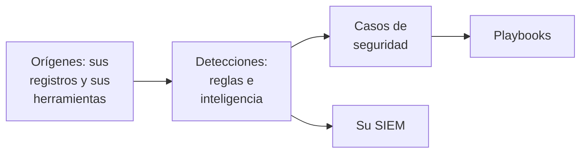

# Primeros pasos con la seguridad

OneUptime encuentra amenazas en datos que ya tiene - sus registros, las herramientas de seguridad que usa y todo lo que le envía -, agrupa lo que encuentra en casos y responde con playbooks. Dos clics lo dejan configurado, y no hay nada que instalar.

:::cards
- [Configurarlo](#configurarlo): Active lo que la mayoría de los equipos necesita y vea cómo un ataque de prueba abre un caso.
- [Cómo funciona](#cómo-funciona): Orígenes, detecciones, casos y playbooks, y lo que hace cada uno.
- [Sus registros](#encontrar-eventos-de-seguridad-en-sus-registros): Los eventos de seguridad que ya están en los registros que envía a OneUptime.
- [Su SIEM](#enviar-a-su-siem-lo-que-encuentra-oneuptime): Envíe lo que encuentra OneUptime a Google SecOps.
:::

## Antes de empezar

Configurar la seguridad requiere el rol Project Owner, Project Admin o Security Admin. Los roles Security Member y Security Viewer consultan lo que se encuentra; consulte [Roles](/docs/permissions/reference#roles).

## Configurarlo

:::steps
### Activar lo que la mayoría de los equipos necesita

Abra **Productos → Eventos de seguridad**. En **Vista general**, haga clic en **Activar lo recomendado**. Se activan tres cosas a la vez: **Encontrar eventos de seguridad en tus registros**, las reglas de detección recomendadas y **Enrich New Cases**, un playbook que contrasta cada caso nuevo con la inteligencia de amenazas y deja en él una lista de comprobación para la clasificación.

### Enviar un ataque de prueba

Haga clic en **Enviar un ataque de prueba**. Una docena de inicios de sesión fallidos desde una dirección de documentación recorren el procesamiento real: se almacenan, la regla de fuerza bruta los detecta y se abre un caso. No se avisa a nadie y ningún SIEM los recibe.

### Abrir el caso

Haga clic en **Abrir el caso**. Así es un hallazgo real: los eventos que lo respaldan, la dirección a la que se refiere y lo que encontró **Enrich New Cases**. Ciérrelo como prueba cuando termine.
:::

A partir de entonces, **Vista general** se abre con lo que necesita a alguien, bajo **Requiere atención**: sus casos abiertos, los que nadie ha asumido y los pasos de playbook que esperan una aprobación. Cuando no hay ninguno, indica **Todo tranquilo**.

## Cómo funciona

| Parte | Dónde | Qué hace |
| --- | --- | --- |
| **Orígenes** | **Conexiones** | Sus registros, los productos de seguridad que consulta OneUptime y todo lo que envía |
| **Detecciones** | **Detecciones** | Reglas Sigma y fuentes de inteligencia de amenazas que buscan amenazas en cada evento |
| **Casos de seguridad** | **Casos de seguridad** | Lo que se encontró, agrupado por el usuario, el host o la dirección a la que se refiere |
| **Playbooks** | **Playbooks** | Pasos que se ejecutan en los casos nuevos: enriquecerlos, avisar, abrir un incidente o contener |

En la parte superior de **Vista general**, bajo lo que necesita a alguien, cada parte muestra sus cifras: los orígenes y sus eventos de las últimas 24 horas, las reglas activas, los casos abiertos y los playbooks que responden. Una parte sin configurar lo indica y abre la página donde configurarla.

## Encontrar eventos de seguridad en sus registros

La tarjeta **Tus registros**, en la parte superior de **Conexiones**, no necesita ninguna instalación. Con **Encontrar eventos de seguridad en tus registros** activado, OneUptime lee cada minuto los registros nuevos del proyecto y convierte en eventos de seguridad las líneas que reconoce:

| Registros | Qué se convierte en evento de seguridad |
| --- | --- |
| Inicios de sesión SSH | Inicios de sesión SSH fallidos y correctos del registro de autenticación, el journal o el syslog de un servidor |
| sudo | Comandos ejecutados como otro usuario, contraseñas de sudo incorrectas y personas que no tienen permiso para usar sudo |
| Registros de auditoría de Kubernetes | Cambios en el clúster, shells abiertos en pods, secretos leídos y solicitudes rechazadas |
| AWS CloudTrail | Inicios de sesión en la consola, cambios en sus cuentas de AWS y llamadas que AWS rechazó |
| Ataques web | Solicitudes del registro de acceso de un servidor web que intentan inyección SQL, recorrido de rutas o Log4Shell |

Sus registros quedan como están. Solo las líneas que importan para la seguridad se convierten en eventos: nunca cada página que sirvió un servidor web ni cada lectura de una API.

## Enviar a su SIEM lo que encuentra OneUptime

Si su equipo ya trabaja en un SIEM, OneUptime también envía allí lo que encuentra. En **Conexiones → Enviar a tu SIEM**, haga clic en **Añadir destino**, rellene la región, la instancia y la clave de la cuenta de servicio de su Google SecOps y haga clic en **Enviar un evento de prueba** antes de guardar. Consulte [Enviar eventos de seguridad a Google SecOps](/docs/integrations/google-secops#enviar-eventos-de-seguridad-a-google-secops).

## Solución de problemas

:::details Turn on recommended aparece desactivado
Su rol no puede añadir reglas de detección, playbooks ni el origen de registros. Pida ayuda a un Project Owner, un Project Admin o un Security Admin, o pídale que le asigne el rol Security Admin.
:::

:::details Turn on recommended no pudo activarlo todo
La tarjeta indica cada cosa que no pudo activar y por qué: su rol, su plan o un error del lado de OneUptime. Todo lo demás está activo. Corrija lo que indica y haga clic en **Volver a intentar**: solo se activa lo que aún falta y nada se añade dos veces.
:::

:::details El ataque de prueba no abrió ningún caso
Normalmente el caso se abre antes de que el botón responda; si la regla aún se está poniendo al día, lo indica y el caso se abre en menos de un minuto. Vuelva a mirar **Casos de seguridad** y compruebe en **Detecciones** que la regla de fuerza bruta está activada.
:::

:::details Mis registros no generan ningún evento de seguridad
Compruebe que **Encontrar eventos de seguridad en tus registros** está activado y que la tarjeta **Tus registros** indica cuándo fue la última comprobación. Solo los tipos de líneas de la tabla anterior se convierten en eventos: un servidor que no envía registros de SSH, sudo, auditoría, CloudTrail ni de acceso no tiene nada que encontrar.
:::

:::details Vista general dice que el último evento de seguridad llegó hace días
Desde entonces no ha llegado nada a Security. Abra **Conexiones** y compruebe que **Tus registros** y cada conexión siguen activados, y cuándo comprobó cada uno por última vez.
:::

:::details La tarjeta que activa Security ha desaparecido
Alguien la quitó con **Descartar**. Mientras todavía no se vigile nada en busca de amenazas, **Vista general** ofrece **Configurar Security**, que la trae de vuelta.
:::

## Próximos pasos

:::cards
- [Eventos de seguridad (SIEM)](/docs/telemetry/security-events): Enviar eventos, buscarlos y escribir reglas de detección.
- [Casos de seguridad y playbooks (SOAR)](/docs/telemetry/security-cases): Trabajar los casos y responder con playbooks.
- [Inteligencia de amenazas (STIX/TAXII)](/docs/telemetry/threat-intelligence): Contrastar sus eventos con indicadores maliciosos conocidos.
- [Google SecOps](/docs/integrations/google-secops): Traer las detecciones de Google SecOps y enviarle lo que encuentra OneUptime.
:::
